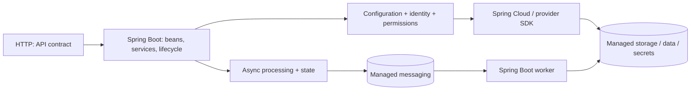
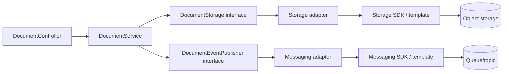
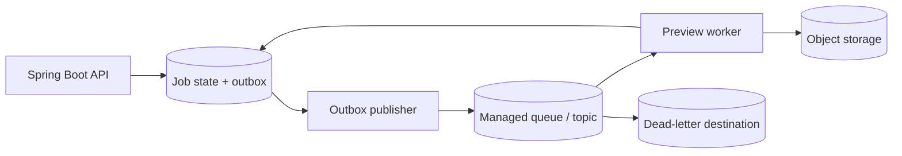
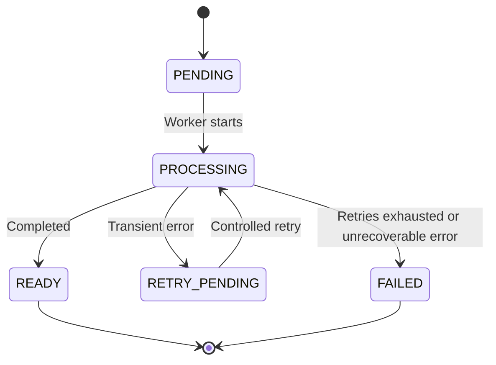

# Essential Knowledge of Spring Boot, Configuration, HTTP, and Asynchronous Processing

> **Chapter:** Orientation  
> **Module:** `SPRING_CLOUD_PROVIDER_INTEGRATION`  
> **Goal:** Prepare the foundational knowledge needed to practice integrating Spring Boot with managed services on **AWS, Azure, and Google Cloud** using the corresponding Spring Cloud libraries; understand how to configure identity and permissions, call storage/messaging/data services, protect secrets, write integration tests, and recognize differences across providers.

## 1. What Does This Lesson Set the Foundation For?

Suppose a Spring Boot API accepts requests to upload PDF contracts, saves files to object storage, records metadata in a database, and emits an event so a worker can generate a preview. You might choose Amazon S3 and SQS, Azure Blob Storage and Service Bus, or Google Cloud Storage and Pub/Sub. However, without solid mastery of Spring Boot, configuration, HTTP, and asynchronous processing, developers easily run into errors even after choosing the right cloud services.

Some common scenarios:

- The SDK library is in `pom.xml`, yet Spring Boot fails to create a client bean for injection.
- The local app can access the bucket, while production throws `AccessDenied` because the workload runs under a different identity.
- Bucket names are hardcoded, causing staging to accidentally write to production resources.
- The HTTP API returns `200 OK` before background work actually finishes, causing the UI to falsely report completion.
- Using `@Async` to process files and assuming jobs will survive container restarts.
- A consumer receives the same message again and creates two invoice records due to missing idempotency.
- Adding unbounded retries on configuration/permission errors, overloading the system without resolving the root cause.

These issues show that four areas of knowledge must connect together:



**Principle:** Spring Boot structures the application and dependencies; configuration determines where the application connects; HTTP expresses requests and state; asynchronous mechanisms govern how work survives, is redelivered, and is tracked. Managed services supply infrastructure, but do not automatically enforce all business rules.

## 2. Essential Spring Boot Knowledge: Beans, DI, and Lifecycle

### 2.1. Separating Controllers, Services, and the Integration Layer

In a Spring Boot application, three basic responsibilities are typically:

| Component | Responsibility | Example in the document system |
| --- | --- | --- |
| **Controller** | Define endpoints, receive/validate HTTP inputs, and return responses | `DocumentController` receives preview creation requests |
| **Business service** | Define when an operation is valid, states, and processing rules | `DocumentService` verifies the document belongs to the right user |
| **Adapter/integration service** | Call external systems according to the application's contract | `S3DocumentStorage` writes objects; `SqsDocumentEvents` publishes messages |

There is no mandatory rule requiring every app to have all three separate layers, yet when integrating multiple clouds, separating **business logic** from **SDK data types** makes testing and swapping adapters much clearer.



### 2.2. Beans and Dependency Injection

A **bean** is an object managed by the Spring container. Dependency Injection (DI) lets a component receive its dependencies from the container rather than instantiating SDK clients or repositories in multiple places.

Example business contract:

```java
public interface DocumentStorage {
    void put(String objectKey, byte[] contents, String contentType);
}
```

Service using constructor injection:

```java
import org.springframework.stereotype.Service;

@Service
public class DocumentService {
    private final DocumentStorage storage;

    public DocumentService(DocumentStorage storage) {
        this.storage = storage;
    }

    public void savePdf(String key, byte[] validatedPdf) {
        storage.put(key, validatedPdf, "application/pdf");
    }
}
```

Here `DocumentService` does not need to know whether `DocumentStorage` is implemented by S3, Azure Blob Storage, or Google Cloud Storage. When writing unit tests, you can pass a fake implementation without needing a cloud account.

**Key points to understand:**

- `@Component`, `@Service`, `@Repository`, and `@Configuration` declare components for Spring to manage; `@Bean` can create beans from factory methods.
- Constructor injection makes dependencies explicit and simplifies unit testing.
- When **two beans implement** `DocumentStorage`, Spring may not know which one to choose; use `@Qualifier`, `@Primary`, or conditional configuration appropriately.
- Singleton beans in Spring are **not automatically thread-safe** if they hold shared mutable state. Never store per-request mutable fields like `currentDocumentId` inside a singleton service.
- SDK clients are typically reused and closed along with the application lifecycle; avoid creating a new client per HTTP request.

### 2.3. Starters and Auto-Configuration

A **Spring Boot starter** typically bundles related dependencies. **Auto-configuration** can create default beans when the right classes and configuration conditions are present. Spring Cloud AWS, Spring Cloud Azure, and Spring Cloud GCP typically provide service-specific starters, such as for storage or messaging.

Example Maven dependency for the Amazon S3 integration track:

```xml
<dependency>
    <groupId>io.awspring.cloud</groupId>
    <artifactId>spring-cloud-aws-starter-s3</artifactId>
</dependency>
```

This example assumes the project has selected a **compatible BOM and versions** across Spring Boot, JDK, and Spring Cloud AWS. For Azure or GCP, use the dependency/version set supported by the corresponding project; property names and client classes do not automatically match AWS.

When seeing `NoSuchBeanDefinitionException` or client injection failures, a helpful diagnostic order is: is the dependency on the classpath in the right scope, does auto-configuration match the version, does component scanning find your own code, are required properties present, or are multiple implementations causing ambiguity? **This is a bean/lifecycle issue**, distinct from cloud service errors returned due to IAM.

### 2.4. Running the Application and Checking Health

Learners should know how to launch Spring Boot from an IDE or the project's build tool, supply environment variables, select profiles, and read startup logs. Spring Boot Actuator can provide health, info, and metrics when dependencies/endpoints are properly configured.

Distinguish:

- **Application starts cleanly:** beans and configuration suffice to build the Spring context.
- **Application is ready to serve requests:** readiness must be evaluated against critical dependencies and traffic-serving requirements.
- **Cloud integration works:** endpoints, identity, permissions, data, and real behavior have been verified.

Do not conflate these three states. Creating an SDK bean successfully does not prove IAM permits reading/writing a specific bucket.

## 3. Spring Boot Configuration: Properties, Profiles, and Secret Sources

### 3.1. What Is Externalized Configuration?

The same application build should run across local, test, staging, and production without editing source code to change buckets, queues, projects, regions, or endpoints. Spring Boot supports loading configuration from many sources such as `application.yml`, environment variables, runtime arguments, and integrated configuration sources.

Example **application-defined** configuration:

```yaml
app:
  documents:
    bucket: ${DOCUMENTS_BUCKET}
    max-upload-size: 20MB
    preview-timeout: 45s
  messaging:
    destination: ${PREVIEW_DESTINATION}
```

`DOCUMENTS_BUCKET` and `PREVIEW_DESTINATION` here are **environment variables** that can be supplied by the runtime. If a variable does not exist and has no suitable default, Spring can fail to resolve the placeholder when the property is used. In production, missing a critical setting should fail fast rather than silently writing somewhere else.

**Do not mix concepts:** `app.documents.bucket` is an **application** property, not a shared default property across all three Spring Cloud providers. Each integration project has its own official configuration namespace; consult the documentation of your actual version to configure regions, identities, and clients.

### 3.2. Reading Typed Configuration with `@ConfigurationProperties`

When multiple properties belong together, `@ConfigurationProperties` binds them into a strongly typed object:

```java
import java.time.Duration;
import org.springframework.boot.context.properties.ConfigurationProperties;

@ConfigurationProperties(prefix = "app.documents")
public record DocumentProperties(
        String bucket,
        org.springframework.util.unit.DataSize maxUploadSize,
        Duration previewTimeout) {
}
```

Enable scanning for properties on the application class:

```java
import org.springframework.boot.SpringApplication;
import org.springframework.boot.autoconfigure.SpringBootApplication;
import org.springframework.boot.context.properties.ConfigurationPropertiesScan;

@SpringBootApplication
@ConfigurationPropertiesScan
public class DocumentApplication {
    public static void main(String[] args) {
        SpringApplication.run(DocumentApplication.class, args);
    }
}
```

Then inject `DocumentProperties` into services/adapters via constructor injection. `DataSize` expresses byte sizes cleanly; `Duration` avoids confusing seconds with milliseconds. In real deployments, add Bean Validation (`@Validated` with appropriate constraints) to catch empty buckets, invalid timeouts, or bad file limits at startup.

Project structure note: properties classes must sit within scanned packages or be explicitly registered; do not assume placing a class in any arbitrary package makes Spring discover it.

### 3.3. Profiles and Configuration Precedence

Profiles help select configuration sets per environment:

```yaml
# application-dev.yml
app:
  documents:
    preview-timeout: 10s
```

For production, corresponding settings should come from the runtime environment or a managed configuration source. Spring Boot orders multiple property sources by precedence; values from environment variables or command-line arguments can typically override file-based settings according to the rules of the active version.

Pitfalls to avoid:

- Hardcoding `spring.profiles.active=prod` in source code and accidentally hitting production resources during local development.
- Hardcoding production bucket names or database passwords into a committed `application.yml`.
- Allowing the test profile to share production accounts/projects.
- Logging the entire configuration map while debugging, leaking sensitive values.

**Profiles do not grant permissions.** `spring.profiles.active=prod` does not cause a workload to receive an IAM role/Managed Identity/service account. Permissions come from infrastructure configuration and provider policies.

### 3.4. Identity, Credentials, and Cloud Access Permissions

| Provider | Common workload identity | Local development approach | Remember |
| --- | --- | --- | --- |
| **AWS** | IAM role attached to workload on supported platforms | AWS profile/SSO or valid SDK credential source | Requires permissions for exact action/resource, e.g., writing objects to a bucket |
| **Azure** | Managed Identity via Microsoft Entra ID when environment supports it | Appropriate Azure CLI/developer credential | RBAC at right scope and service **data-plane role** |
| **Google Cloud** | Service account/Workload Identity | Application Default Credentials in dev environment | Distinguish project ID, principal, and permissions on bucket/topic/subscription |

SDK clients can look up credentials along a provider-specific **credential chain**. Therefore, "runs on my laptop" does not prove the right identity will be used in production. When seeing 401/403 or corresponding error codes, check the **actual principal**, permissions, and resource; do not hastily create admin-privileged keys to test.

Secrets such as connection passwords or external system tokens can be stored in AWS Secrets Manager, Azure Key Vault, or Google Secret Manager. Grant minimal read permissions to the runtime, handle rotation/refresh, and never put secret values into Git, exception messages, request logs, or traces.

## 4. HTTP Fundamentals to Master Before Calling the Cloud

Most Spring Boot applications expose REST APIs, while provider SDKs talk over HTTP/gRPC or appropriate protocols underneath. Learners need to understand **HTTP at the user boundary** before designing asynchronous features.

### 4.1. Methods, Status Codes, and Contract Semantics

| HTTP | When to use | Practical notes |
| --- | --- | --- |
| `GET` | Retrieve resource/state without intentionally mutating business data | Design without side effects beyond permitted ones like logging |
| `POST` | Create resources or trigger processing operations | Not idempotent by default; needs duplicate protection on client retries |
| `PUT` | Create/replace at a target URI with idempotent semantics | API contract must ensure repeating the request causes no extra state changes |
| `PATCH` | Partially update a resource | Semantics depend on patch format and handler |
| `DELETE` | Request deletion of a resource | Define soft/hard delete, authorization, and state on repeated calls |

| Status | Illustrative meaning | Usage |
| --- | --- | --- |
| `200 OK` | Return existing content or result | Reading job status or fetching metadata |
| `201 Created` | Resource created successfully | Upload/registration of document completed per contract |
| `202 Accepted` | Request accepted for processing, **not yet guaranteed finished** | Creating an asynchronous preview job |
| `204 No Content` | Succeeded with no response body | Delete or update needing no body |
| `400 Bad Request` | Request invalid against contract | Malformed JSON, missing fields, invalid format |
| `401 Unauthorized` | Not validly authenticated at API boundary | Missing token or valid session |
| `403 Forbidden` | Authenticated but not permitted | User may not read the document |
| `404 Not Found` | Resource missing or concealed per policy | Job/document not found |
| `409 Conflict` | Conflicts with current state | Duplicate idempotency key with different payload |
| `413 Content Too Large` | Payload exceeds limit | PDF exceeds allowed size |
| `429 Too Many Requests` | Client is rate-limited | May include retry guidance |
| `500 Internal Server Error` | Unclassified server error | Application bug/failure |
| `502/503/504` | Upstream/gateway/service unavailable or timed out depending on architecture | Must accurately reflect boundary and actual state |

If a `POST` saved the job successfully but the response was lost due to a client timeout, the client may resend. **Status codes do not prevent duplicates on their own**: you need an idempotency key, business key, or a way to query the prior request's state.

### 4.2. Designing an API for a Background Job

Example request to create a preview for an uploaded document:

```http
POST /preview-jobs HTTP/1.1
Content-Type: application/json
Authorization: Bearer <access-token>
Idempotency-Key: preview-doc-123-v1

{"documentId":"doc-123"}
```

If the system has durably recorded the request, an appropriate response is:

```http
HTTP/1.1 202 Accepted
Location: /preview-jobs/job-456
Content-Type: application/json

{"jobId":"job-456","status":"PENDING"}
```

Later:

```http
GET /preview-jobs/job-456 HTTP/1.1

HTTP/1.1 200 OK
Content-Type: application/json

{"jobId":"job-456","status":"READY","previewDocumentId":"preview-789"}
```

**Meaning of 202:** the API has **accepted** the work and provided a way to track progress. It does not claim the worker has finished generating the preview. Only return 202 once the system has durably recorded its intent to process per contract (e.g., database record/outbox commit), not merely when an ephemeral thread was just spawned.

### 4.3. Spring MVC Controller Example

```java
import java.net.URI;
import org.springframework.http.ResponseEntity;
import org.springframework.web.bind.annotation.*;

record PreviewRequest(String documentId) {}
record AcceptedPreview(String jobId, String status) {}

@RestController
@RequestMapping("/preview-jobs")
public class PreviewJobController {
    private final PreviewJobService service;

    public PreviewJobController(PreviewJobService service) {
        this.service = service;
    }

    @PostMapping
    public ResponseEntity<AcceptedPreview> create(
            @RequestBody PreviewRequest request) {
        String jobId = service.accept(request.documentId());
        return ResponseEntity.accepted()
                .location(URI.create("/preview-jobs/" + jobId))
                .body(new AcceptedPreview(jobId, "PENDING"));
    }
}
```

`PreviewJobService` is a hypothetical contract/service; `accept(...)` must check permissions, validate the document, enforce idempotency, and durably persist the job before returning if the API promises the behavior above. In a real project, use `@Valid`, Bean Validation, exception handling via `@RestControllerAdvice`, and appropriate security filters.

A controller itself should not spawn raw `Thread`s, invoke complex SDKs, or wait minutes for a worker. It is the HTTP boundary that maps a request to a business action and returns an explicit contract.

### 4.4. File Uploads and Memory Limits

`MultipartFile` is convenient for an upload endpoint, yet calling `getBytes()` loads the entire content onto the heap. For large files or high traffic, design streaming, multipart uploads, or direct client upload URLs supported by the cloud provider.

Factors to consider:

- Server and reverse-proxy request/multipart size limits.
- Business file limits, content validation, and upload authorization.
- Server-controlled object keys; never trust raw client-supplied filenames as storage paths.
- Malware/content scanning if required by organizational policy.
- Upload confirmation strategy, temp-file cleanup, and handling abandoned uploads.
- Avoid creating permanent public read URLs just for a quick user preview.

**Note:** an HTTP request can succeed at the protocol level yet fail at the business-state level if object storage and metadata fall out of sync. The API must make clear when a document is readable and when its preview is ready.

## 5. Outbound HTTP Calls vs. Cloud API Calls: Similarities and Differences

When Spring Boot calls an external API, you can use `RestClient` in modern Spring MVC, `WebClient` for reactive/nonblocking flows, or specialized clients. When calling S3/Blob Storage/Cloud Storage, the standard choice is the **official SDK or a Spring Cloud provider integration** rather than hand-crafting raw HTTP requests.

### Technical Questions for Outbound Requests

| Area | What to know | Risk if ignored |
| --- | --- | --- |
| **DNS/TLS/network** | Endpoints, proxies, certificates, private networks | Production connections fail even though local works |
| **Timeouts** | Connect timeout, read/response timeout, request deadline | Threads held indefinitely, connection exhaustion |
| **Connection pool** | Reuse clients/connections, pool limits | Too many sockets or resource contention |
| **Retries** | Retry only transient errors, backoff/jitter, bounded attempts | Duplicate side effects, extra load on failing services |
| **Rate limits/quotas** | Throttling and backpressure | 429/provider throttling errors, growing queue backlog |
| **Credentials** | Identity/token suited to runtime | 401/403 or accessing the wrong resource |
| **Observability** | Request/correlation IDs, latency, error categories | Hard to trace failures across services |

Do not assume SDKs share default timeouts, credential lookup order, or retry policies. Spring Cloud starters can configure part of this, so read the documentation of the **exact version you use**.

### 5.1. Classify Errors Before Retrying

For example, when uploading an object:

- **Wrong bucket name, project, or IAM permission:** usually a configuration/permission error; retrying repeatedly does not fix the cause.
- **Timeouts or transient service errors:** can be retried carefully; consider whether a prior attempt may already have been accepted by the service.
- **Throttling:** cap concurrency and back off per service guidance; monitor quotas.
- **Invalid input:** fix the data/request; do not auto-retry.

Putting an object at a deterministic key can be easier to retry safely than creating a resource/event without an idempotency key. **Idempotency must be evaluated at the business boundary**, not inferred from whether an SDK method is named `send` or `put`.

## 6. Asynchronous Knowledge: Do Not Confuse Three Kinds of "Async"

The word "asynchronous" can refer to **very different** mechanisms:

1. **In-process Spring Boot async:** offloading work to a thread pool, e.g., `@Async` or `CompletableFuture`.
2. **Nonblocking I/O (reactive):** event-driven pipelines like Reactor/WebFlux, reducing threads blocked waiting on I/O.
3. **Durable cross-system async:** persisting work requests to a database/queue/topic for a separate worker to process later.

| Criterion | `@Async` / thread pool | Reactor/WebFlux | Managed queue/topic + worker |
| --- | --- | --- | --- |
| Where work lives | Process memory | Runtime pipeline and underlying sources | Broker/subscription and designed app state |
| Survives restart by default? | **No** | **No**, unless backed by durable storage | **Yes (potentially)**, depending on broker, retention, acks, and state handling |
| Needs redelivery handling? | Custom logic | Depends on data source and custom logic | Usually requires explicit idempotency |
| Primary goal | Free up the request thread | Efficient I/O in reactive pipelines | Decouple services, buffer load, recover work |
| Complexity | Relatively low | Requires understanding reactive programming | Requires broker, consumer, retries, DLQ, observability, and schemas |

**None of these mechanisms creates an "exactly-once business effect" automatically.** Choose based on job criticality, tolerance for loss on restart, throughput, latency, and worker isolation needs.

### 6.1. When to Use `@Async`?

Spring supports running methods via an executor when `@EnableAsync` and `@Async` are used. Example of a bounded thread pool:

```java
import java.util.concurrent.Executor;
import org.springframework.context.annotation.Bean;
import org.springframework.context.annotation.Configuration;
import org.springframework.scheduling.annotation.EnableAsync;
import org.springframework.scheduling.concurrent.ThreadPoolTaskExecutor;

@Configuration
@EnableAsync
public class AsyncConfiguration {
    @Bean("previewExecutor")
    public Executor previewExecutor() {
        ThreadPoolTaskExecutor executor = new ThreadPoolTaskExecutor();
        executor.setCorePoolSize(4);
        executor.setMaxPoolSize(8);
        executor.setQueueCapacity(100);
        executor.setThreadNamePrefix("preview-");
        return executor;
    }
}
```

Illustrative async method:

```java
import java.util.concurrent.CompletableFuture;
import org.springframework.scheduling.annotation.Async;
import org.springframework.stereotype.Service;

interface PreviewGenerator {
    void generate(String documentId);
}

@Service
public class PreviewBackgroundTask {
    private final PreviewGenerator generator;

    public PreviewBackgroundTask(PreviewGenerator generator) {
        this.generator = generator;
    }

    @Async("previewExecutor")
    public CompletableFuture<Void> generate(String documentId) {
        generator.generate(documentId);
        return CompletableFuture.completedFuture(null);
    }
}
```

This is an example of **in-process task offloading**. If the container dies after accepting the request, work sitting in the thread pool can be lost. Therefore, only use `@Async` for tasks that are safe to lose/recover by design or already backed by durable external state/jobs. Never use it as a durable queue for issuing invoices, charging payments, or generating critical documents.

**Key things to remember about `@Async`:**

- Under default proxy mechanics, calling an `@Async` method from **the same instance** (self-invocation) bypasses the proxy and runs synchronously.
- Executors must have bounded queues/concurrency and be monitored; an unbounded queue can exhaust memory.
- Exceptions and return values must be handled and observed; never fire-and-forget completely blindly.
- Context such as security, transactions, and correlation/tracing does not automatically carry across thread switches; use proper context propagation.
- `@Transactional` on the caller thread **does not propagate the transaction** to the async thread; define transaction boundaries explicitly.

### 6.2. Does Reactive/Nonblocking Replace a Message Broker?

No. `WebFlux`, `Mono`, and `Flux` express asynchronous nonblocking pipelines, especially when calling multiple I/O APIs. However, an unpersisted reactive pipeline **does not survive restarts on its own**.

Additionally, a synchronous SDK call or blocking JDBC query placed on an event loop can stall a reactive system. If using a reactive stack, verify whether client libraries are genuinely nonblocking, schedule blocking work properly, and bound backpressure. You do not have to rewrite every Spring MVC app to WebFlux to use S3/SQS/Pub/Sub.

### 6.3. When Do You Need a Queue/Topic?

For preview jobs that may take tens of seconds, must recover after restarts, and should decouple API load from workers, **messaging + worker** is usually much better suited than `@Async` alone:



The DLQ arrow represents a **failed-message routing policy**; implementation depends on the broker. For example:

| Provider | Common messaging service | Concepts to understand |
| --- | --- | --- |
| **AWS** | Amazon SQS; SNS/EventBridge depending on pattern | Queue, visibility timeout, receive/delete, retries, DLQ |
| **Azure** | Service Bus queues/topics | Peek-lock/settlement, delivery count, lock renewal, DLQ |
| **Google Cloud** | Pub/Sub | Topic/subscription, acknowledgement, ack deadline, redelivery, retry/DLQ policies |

Services have different semantics. An approach assuming AWS queue behavior cannot have its acknowledgement logic copied verbatim to GCP without re-testing.

## 7. Job State and Idempotency: The Foundation for Reliable Async Processing

### 7.1. A Clear State Machine



Defining state meanings keeps the API and worker aligned. For example, transition to `READY` only after the preview file is saved and metadata commits successfully. When using a queue capable of redelivery, workers must be able to detect that a job already finished earlier.

### 7.2. Why Do Workers Need Idempotency?

A message can be redelivered if a worker crashes after processing but before acknowledging, if connectivity drops, or on timeout. Under some configurations, a duplicate copy can arrive before the prior attempt expires.

An application strategy:

- Give each event a stable `eventId` and explicit `documentId`.
- Use a unique key in the database or an equivalent mechanism to track processed events.
- Transition states using transactions / conditional updates so two workers do not execute side effects concurrently.
- Write output files under deterministic keys or check versions before overwriting.
- Acknowledge messages only once appropriate business conditions are satisfied.
- For notifications/payments, pass idempotency keys downstream or persist side-effect records to avoid repeated sends/charges.

**A boolean variable in worker memory is not enough** when running multiple replicas or restarting workers. Idempotency requires durable shared state whenever correctness depends on it.

### 7.3. Database Transactions and Message Publishing Are Not One Atomic Unit

If within an HTTP request you insert into `documents` in PostgreSQL and then call `messagePublisher.publish(...)`, those two operations can succeed or fail independently.

```text
DB commit succeeds ──> publish fails ──> document exists but worker never gets the event
DB commit succeeds ──> publish succeeds ──> response lost ──> retry may publish duplicates
```

A **transactional outbox** is one approach: write the document record and the outgoing event inside the **same database transaction**, then a separate publisher sends outbox events to the broker and updates their status. It closes the dangerous gap between DB and broker, **yet can still produce duplicate sends**, so workers still need idempotency.

### 7.4. Distinguishing Synchronicity from Data Consistency

An API can return `202 Accepted` once the job is saved to the DB, even though the preview is not finished yet. The system then uses **eventual consistency** for the preview result. This is completely valid when the UI shows `PENDING` and users can observe failures or completion.

Good design makes explicit which data must commit before returning HTTP, which updates happen later, and what happens when workers retry or lose connectivity.

## 8. Threads, Transactions, and Database Connections

Spring Boot typically uses Spring Data JPA/JDBC, HikariCP, or equivalent components to connect to managed databases like Amazon RDS, Azure Database for PostgreSQL, or Google Cloud SQL. Before implementing async flows, understand:

- **Connection pools are bounded.** Adding worker threads will not boost throughput if all tasks wait on a handful of DB connections.
- **Transactions have explicit scopes.** `@Transactional` typically relies on Spring proxies and does not span other threads or calls to object storage and message brokers.
- **Isolation/concurrency** affects two workers updating the same job; use optimistic locking or conditional updates where appropriate.
- **Timeouts** on clients, transactions, DB queries, and brokers are separate limits; a mismatched short timeout can break the entire flow.
- **Retries must happen at the right layer.** Retrying a DB transaction that actually committed (whose response was lost) must check idempotency or state instead of creating a duplicate row.

For example, with two worker replicas, "read a PENDING job and switch it to PROCESSING" must prevent race conditions. One approach is a conditional state-based update checking the affected row count; another is locking appropriate for the database and workload.

**Do not hold a DB transaction open while waiting on slow cloud calls** without strong justification: doing so holds connections/locks and heightens outage cascades when external services degrade. Designing intermediate states and compensation workflows is usually far easier to operate.

## 9. Direct Connections to Managed Service Integration on AWS, Azure, and GCP

The knowledge above shows up at concrete points in an integration project:

| Foundation | When integrating S3 / Blob / Cloud Storage | When integrating SQS / Service Bus / Pub/Sub | When integrating databases / secrets |
| --- | --- | --- | --- |
| **DI and bean lifecycle** | Create/inject storage clients consistently | Configure publishers, listeners, and workers | Configure DataSource and secret SDK clients |
| **Typed configuration** | Bucket/container, region/project, timeouts | Queue/topic/subscription, concurrency, retries | JDBC URL, pool settings, secret identifiers |
| **HTTP** | Upload/download, status codes, signed URLs | Job intake API returning 202 and status endpoints | Upstream error handling and API contracts |
| **Async** | Multipart/streaming uploads; post-upload work | Publish/ack, redelivery, DLQ, idempotency | State sync, outbox, secret refresh schedules |
| **Security** | File ownership, workload read/write object permissions | Worker publish/subscribe permissions | DB/secret access permissions, no secret logging |
| **Testing** | Fake ports + emulators/cloud tests | Test duplicates, retries, DLQs | Test transactions, credentials, and rotation |

Do not assume "using Spring Cloud" implements everything in this table automatically. Spring Cloud providers help construct clients and wire APIs into Spring; **contract design, state management, permissions, and operations** remain the application's responsibility.

### A Simple Adapter Choice

```java
public interface DocumentEventPublisher {
    void publish(DocumentUploadedEvent event);
}

public record DocumentUploadedEvent(
        String eventId,
        String documentId,
        String objectKey) {
}
```

The application can implement `SqsDocumentEventPublisher`, `ServiceBusDocumentEventPublisher`, or `PubSubDocumentEventPublisher`. Each adapter uses the matching starter/SDK, while business logic calls the same interface if the event contract is clear enough. Most differences in credentials, endpoints, acks, ordering, retries, and message converters live inside the adapters, configuration, and corresponding worker setup.

## 10. Testing Before Real Cloud Integration

Your test suite should separate boundaries:

### 10.1. Unit Testing Business Services

Create fake `DocumentStorage` and `DocumentEventPublisher` implementations to verify: right keys, only authorized users can act, stable event IDs, and proper state transitions. No AWS/Azure/GCP account is needed for these tests.

### 10.2. Testing HTTP Controllers

Use `MockMvc` / `@WebMvcTest` where appropriate to verify:

- `POST /preview-jobs` returns 202 and `Location` when a job is accepted.
- Requests missing fields or having invalid formats return 400.
- Unauthorized users are rejected.
- `GET /preview-jobs/{id}` distinguishes `PENDING`, `READY`, and `FAILED` per contract.
- When using an idempotency key, resending the same request yields one logical job rather than two new jobs.

### 10.3. Testing Configuration Binding

Verify `@ConfigurationProperties` binds cleanly from YAML/environment variables, catches missing required properties, and parses timeouts and file sizes in the right units. Do not merely check that a YAML file "exists."

### 10.4. Integration Testing with Emulators and Real Clouds

| Goal | How to verify |
| --- | --- |
| API calls storage with right request/metadata | Mock SDK client or adapter tests |
| Client configures endpoints/payloads properly | Emulators where supported, e.g., LocalStack (selected AWS APIs), Azurite (Blob Storage), Pub/Sub emulator |
| Real workload has proper IAM/RBAC | Test account/project/subscription with scoped permissions |
| Disconnects/timeouts are handled | Fault injection in a controlled environment |
| Worker handles duplicate messages | Replay the same event ID and verify outcomes |
| No lost events between DB and broker | Fault the publisher/outbox and verify recovery |
| Load and backlog limits | Load test against target SLOs |

Emulators **do not fully prove** IAM mechanics, quotas, and all real-service semantics. Test against sandbox cloud resources, clean up resources afterward, and avoid real sensitive data.

### 10.5. Testing Async Behavior Without Relying on `sleep`

In unit tests, test processing logic via synchronous calls to pure components and fake dependencies, then assert outputs. In integration tests, wait for real state transitions with a **bounded timeout**, rather than `Thread.sleep(5000)` and assuming the worker finished.

Examples of wait conditions: job reaches `READY`, outbox is published, queue backlog drains to expected levels, or an event ID is marked processed. Timeouts must fail the test clearly if the system does not reach the target state.

## 11. Observing Errors and Operating Async Workflows

A request spanning API, database, broker, worker, and object storage cannot be debugged with a single `"preview failed"` log line.

Signals you need:

| Location | Suggested metrics / logs | Purpose |
| --- | --- | --- |
| HTTP API | Request ID, status, p50/p95 latency, failed request count | Identify user-facing issues |
| Storage adapter | Put/Get latency, exception category, retry count | Distinguish networking, throttling, or permissions |
| Publisher/outbox | Unpublished event count, age of oldest event | Detect stuck events |
| Broker | Backlog, age, dead-letter count, publish failures | Observe load and delivery failures |
| Worker | Completed/failed jobs, retries, duplicate suppressions | Measure throughput and idempotency |
| Database | Pool usage, query duration, lock contention | Detect bottlenecks and race conditions |
| Security | Access denied, permission changes, audit events | Spot errors or anomalous access |

You can combine **Spring Boot Actuator, Micrometer, and OpenTelemetry** with CloudWatch/Azure Monitor/Cloud Monitoring depending on the provider. When propagating trace context over messages, configure propagation explicitly; do not assume MDC or thread-local context crosses threads or brokers automatically.

**Never log secrets, access tokens, or full PDFs** just for easier debugging. Use document IDs, event IDs, correlation IDs, and sanitized error codes.

## 12. Self-Study Path Before the Spring Cloud Provider Labs

A helpful learning sequence to avoid confusion:

1. **Spring Boot basics:** running apps, beans, constructor DI, controllers/services, and starters.
2. **Configuration:** `application.yml`, environment variables, profiles, `@ConfigurationProperties`, and startup config errors.
3. **HTTP APIs:** REST methods/status codes, JSON, validation, exception mapping, authentication/authorization, uploads, and idempotency.
4. **Outbound integrations:** HTTP clients or SDK clients, timeouts, TLS/networking, retries/backoff, and correlation IDs.
5. **Concurrency/async:** thread pools, `@Async`, reactive I/O, bounds, and context propagation.
6. **Durable messaging:** queues/topics/subscriptions, workers, acknowledgement, redelivery, dead-lettering, idempotency.
7. **Consistency:** database transactions, outbox, eventual consistency, and compensation.
8. **Testing/operations:** unit, web slice, emulators, cloud tests, failure tests, metrics, and audits.

You do not need to master every topic before starting the labs; however, you must recognize **responsibility boundaries** so you know whether an error belongs to HTTP, Spring beans, configuration, IAM, the SDK, or the broker.

### Quick Self-Check Questions

| Question | Expected answer |
| --- | --- |
| Why shouldn't a controller create a new S3 client per request? | Clients carry configuration and lifecycles; DI enables reuse, testing, and resource management |
| Does `202 Accepted` mean the preview is finished? | No; it means the system accepted the work per contract |
| Does `@Async` preserve jobs when a container is killed? | Not by default; durable state/job storage is required for recovery |
| Do Spring profiles grant cloud permissions? | No; identity and IAM/RBAC are managed by the runtime and provider |
| Can a consumer receive a message a second time? | Yes in many models; understand delivery semantics and design idempotency |
| Does `@Transactional` on a method cover S3 + SQS? | Not by default; calls outside the database need separate consistency/recovery mechanisms |
| Is a unit test mocking the SDK enough to verify production IAM? | No; controlled tests on the real cloud are required |

## 13. Orientation Practice: From Endpoint to Worker

**Scenario:** Spring Boot exposes an API to generate previews for documents stored in object storage. Previews run in a separate worker, metadata lives in managed PostgreSQL, and the cloud environment may be AWS, Azure, or Google Cloud.

### Part A — Spring Boot Structure

Create `DocumentStorage` and `DocumentEventPublisher` interfaces. Create `PreviewJobService` depending only on those interfaces or appropriate repositories. Explain which beans are managed by Spring Boot, which beans may be provided by a Spring Cloud provider starter, and why business logic must not depend directly on SDK types.

### Part B — Configuration

Define `@ConfigurationProperties(prefix = "app.documents")` for bucket, file limits, and timeout. Run two local/staging configurations with different resource values. Describe the runtime identity source and minimal permissions so the API can write objects and the worker can read objects.

### Part C — HTTP Contract

Design:

- `POST /preview-jobs` accepts a document ID, persists a durable request, and returns `202 Accepted` with `Location`.
- `GET /preview-jobs/{id}` returns `PENDING`, `PROCESSING`, `READY`, or `FAILED`.
- Two requests with the same `Idempotency-Key` and payload do not create two logical jobs.
- User B cannot request a preview for User A's document.

### Part D — Asynchronous Processing

Compare `@Async` with queue/topic + worker. Choose an option for critical previews needing recovery across restarts and justify your choice. Diagram outbox, broker, consumer, acknowledgement, retries, and dead-lettering for the chosen provider.

### Part E — Testing

Write a minimal plan covering: service unit tests with fake ports; HTTP status/authorization tests; config binding tests; emulator integration tests where supported; real cloud IAM tests; duplicate message tests; and worker crash tests after preview creation before ack.

### Part F — Observability

Propose metrics for HTTP p95, preview completion duration, outbox age, message backlog, retry count, DLQ count, and IAM errors; describe how correlation IDs flow across API → event → worker.

**Completion criteria:** learners explain Spring Boot/DI/config roles, distinguish HTTP accepted from completion, do not confuse `@Async` with durable queues, design sound permissions and state machines, and have a way to verify real behavior on AWS/Azure/GCP.

---

## Key Takeaways

To practice integrating Spring Boot with managed services, you need a solid grasp of **four interconnected foundations**:

- **Spring Boot:** beans, DI, auto-configuration, controllers/services, lifecycle, and testability.
- **Configuration and identity:** typed properties, profiles, environment variables, secret management, IAM/RBAC, and separating end-user permissions from workload permissions.
- **HTTP:** endpoint contracts, validation, status codes, uploads, timeouts, retries, and idempotency.
- **Asynchronous processing:** `@Async`, nonblocking I/O, queues/topics, job states, acknowledgements, retries, outboxes, and deduplication.

Spring Cloud AWS, Spring Cloud Azure, and Spring Cloud GCP starters connect applications to their respective service APIs. **System reliability still depends on state architecture, permissions, error handling, testing, and observability**, not merely making a first SDK call succeed.
