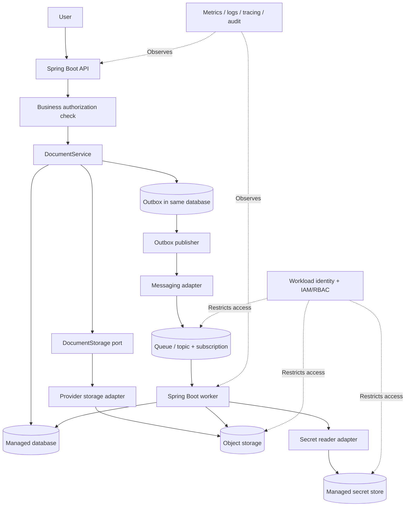
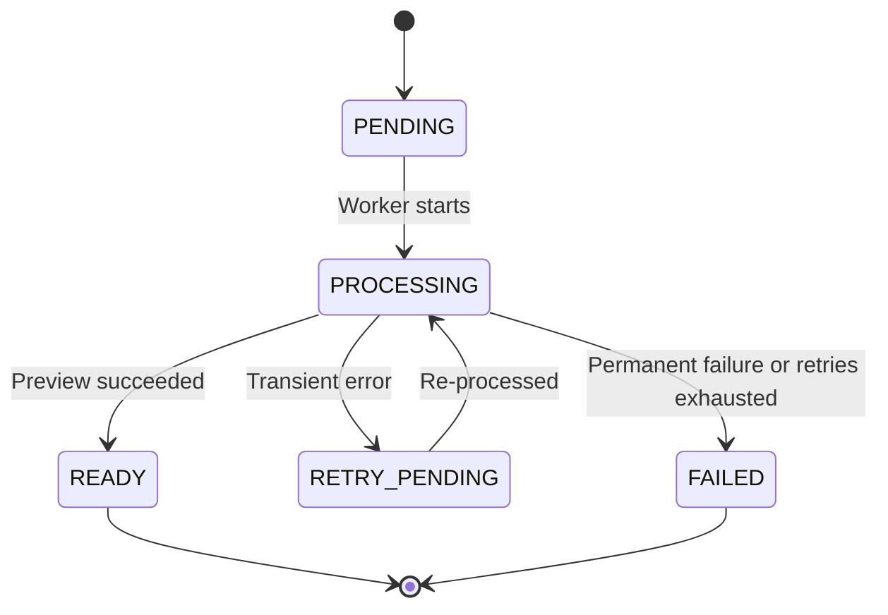
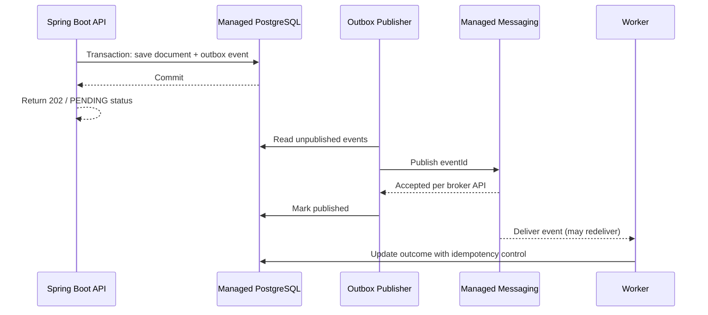

# Learning Path from First Connection to Operable Integration

> **Chapter:** Orientation  
> **Module:** `SPRING_CLOUD_PROVIDER_INTEGRATION`  
> **Scope:** Practicing integrating Spring Boot with managed services from **AWS, Microsoft Azure, and Google Cloud** using Spring Cloud AWS, Spring Cloud Azure, and Spring Cloud GCP where appropriate. The roadmap connects skills in identity, permissions, storage, messaging, data, secrets, integration testing, fault tolerance, and evaluating differences across cloud providers.

## 1. How Far Is "Connected Successfully" from "Operable"?

Imagine a Spring Boot application can now write a file to Amazon S3 after adding a starter and filling in a bucket name. That is a **valuable first milestone**, yet you cannot conclude the system is ready for real users.

A system may work in a demo yet fail when:

- A container restarts and the worker loses in-memory tasks.
- The local app uses developer permissions while the production service lacks object read or write permissions.
- A user uploads a file large enough to exhaust API memory.
- The database commits metadata, yet the messaging event is lost due to a network blip.
- The broker redelivers a message and the worker executes side effects twice.
- A secret is rotated, yet connection pools keep using old credentials.
- One region slows down, clients retry all at once, and traffic amplifies the outage.
- Costs for requests, data transfer, logs, and test resources exceed expectations.
- Everything "works," yet there are no metrics, logs, or incident response instructions.

Therefore, the roadmap distinguishes three levels:

| Level | What does it prove? | What does it not automatically prove? |
| --- | --- | --- |
| **First connection** | Spring Boot creates the client, has a valid identity, and manipulates a test resource successfully | Safety, recovery, load control, cost |
| **Business-correct integration** | The application has data contracts, authorization, state tracking, error handling, and tests for critical flows | Stability under real load or prolonged outages |
| **Operable integration** | Environment-isolated config, IAM/secret controls, observability, recovery procedures, failure tests, resource limits, and runbooks | Never having failures; requires continuous measurement and improvement |

**Learning goal:** walk the full path from a simple cloud call to a Spring Boot service that can be deployed, monitored, diagnosed, and intentionally recovered.

## 2. End-to-End Scenario: Document Management and Preview Generation

We use a compact problem that still covers all major integration patterns:

1. A user logs in and uploads a PDF file to a Spring Boot API.
2. The API checks permissions, file size, and file type; stores the PDF in **managed object storage**.
3. The application persists metadata in a **managed relational database**.
4. An event requesting preview generation is recorded and sent to **managed messaging**.
5. A Spring Boot worker receives the event, reads the PDF, generates the preview, and updates status.
6. The application reads a secret when calling an external service.
7. The user calls an HTTP API to view `PENDING`, `READY`, or `FAILED` status.

This problem does not require using these exact products in every project. It serves as a **shared practice track** to compare approaches across the three providers.

### Target Architecture



We will **not build everything at once**. Each milestone adds capabilities only after the prior milestone has proof of working.

## 3. Roadmap and Milestone Gate Criteria

The roadmap has eight milestones. Time per milestone depends on learner background, cloud access, practice pace, and lab scope; **no fixed hour count is prescribed**.

| Milestone | Objective | Artifacts to retain | Milestone gate criterion |
| --- | --- | --- | --- |
| **0. Environment setup** | Understand Spring Boot, build, profiles, SDKs, safety limits | Runnable project; dev/test config separation; resource list | Run app locally and identify the exact identity to be used |
| **1. First connection** | Successfully call one managed service with proper identity | Storage smoke test: write/read object | Write and read exact bytes; verify insufficient-permission error |
| **2. Isolate integration** | Put cloud clients behind ports/adapters and manage configuration | `DocumentStorage` + adapter + unit tests | Business logic is testable without cloud connectivity |
| **3. Messaging and state** | Offload background work via queue/topic and design delivery | Producer, worker, event ID, job state | Properly handle both duplicate messages and transient errors |
| **4. Data and secrets** | Connect managed database, protect secrets, handle consistency | Metadata, outbox, secret access | Zero lost events on publish failure; least-privilege secret access |
| **5. Integration testing** | Verify across SDK, emulator, and real cloud boundaries | Test suite + per-environment test results | Both success and failure tests are repeatable |
| **6. Resilience and observability** | Timeouts, retries, DLQs, metrics, traces, and runbooks | Dashboards, alerts, replay/recovery procedures | Diagnose faults and recover cleanly in an exercise |
| **7. Deployment and evaluation** | Safe operations, cost control, and provider comparison | Release checklist, ADR, AWS/Azure/GCP trade-off table | Operational evidence matching product requirements |

Do not treat "read all the examples" as a completion criterion. Each milestone needs **observable evidence**: test results, API responses, metrics, sanitized logs, diagrams, or decision records.

## 4. Milestone 0 — Prepare Spring Boot and a Controlled Environment

### 4.1. Prerequisite Knowledge Self-Check

Before the first connection, learners should be able to:

- Run a Spring Boot application from an IDE or build tool.
- Understand `@SpringBootApplication`, beans, constructor injection, `@Configuration`, `@Bean`, and auto-configuration.
- Build Spring MVC endpoints, distinguishing `GET`/`POST` and statuses such as `200`, `201`, `202`, `400`, `401`, `403`.
- Use `application.yml`, environment variables, profiles, and `@ConfigurationProperties`.
- Understand timeouts, exceptions, database transactions, retries, and connection limits.
- Know that `@Async` runs on an in-process thread pool; it is **not** a durable queue.
- Know that a unit test can use a fake or mock adapter, whereas cloud tests require real resources and permissions.

If any skill feels weak, do a short local exercise before proceeding — for instance, inject a fake `DocumentStorage` into `DocumentService` and verify an endpoint returns the right HTTP status.

### 4.2. Isolate Environments and Provisioning Plan

Create or obtain access in an **organization-approved sandbox environment**. Test resources should live in a dedicated test account/subscription/project whenever possible; apply naming conventions, owner tags/labels, and a cleanup process.

Initial planned resource list:

| Category | What to prepare | Why? |
| --- | --- | --- |
| Cloud identity | Dev identity or test role/service account with minimal permissions | SDK must know who is calling the service |
| Object storage | Test bucket/container in a specific region/location | Test reads/writes without touching real data |
| Networking | Appropriate endpoints, DNS, TLS, and outbound access | Avoid confusing network blocks with SDK bugs |
| Configuration | Region, resource names, profiles, and environment variables | One build runs across multiple environments |
| Cost | Quotas, budget alerts, and resource cleanup procedures | Prevent stray test resources from lingering |

**Safety rule:** never commit access keys, service-account private keys, client secrets, or passwords to Git. Prefer workload identity, federation, or short-lived credentials supported by the SDK. Local development can use the provider's official CLI login tools with restricted permissions.

### 4.3. Choose Library Versions Before Adding Starters

The three Spring Cloud provider families have separate release lifecycles. Before adding dependencies:

1. Identify your **JDK** and **Spring Boot** versions.
2. Choose the actual provider and service, e.g., AWS S3 or Google Cloud Pub/Sub.
3. Read the **compatibility matrix** of the corresponding Spring Cloud AWS/Azure/GCP project.
4. Use the BOM or dependency management guided by **that specific library family**.
5. Pin verified versions in the build and upgrade carefully with tests.

Do not assume a Spring Cloud AWS version matches all Spring Cloud Azure/GCP versions or vice versa. "Dependencies resolved at build time" is only a build check, **not a runtime check**.

### Milestone 0 Gate

The application starts locally with test config, you can explain active beans and profiles, you know your intended cloud identity, and no secrets are hardcoded in committed code or config.

## 5. Milestone 1 — A Repeatable First Connection

Pick **one** managed service with simple operations and easily verifiable output. Object storage is a great fit: write a small object to a test resource and read back the exact bytes.

### 5.1. Map of the Three Storage Options

| Provider | Managed service | Typical Java client | Spring integration when suitable | Runtime identity |
| --- | --- | --- | --- | --- |
| AWS | Amazon S3 | AWS SDK for Java v2 `S3Client` | Spring Cloud AWS S3 starter | IAM role / credential provider chain |
| Azure | Azure Blob Storage | Azure Storage Blob Java SDK | Spring Cloud Azure Storage Blob starter | Managed Identity / Azure Identity |
| Google Cloud | Cloud Storage | Google Cloud Java client `Storage` | Spring Cloud GCP Storage starter | Service account / Application Default Credentials |

Client/starter names change across libraries and versions. On all three providers, creating a client successfully **does not grant permissions**. Object reads/writes must be authorized by cloud IAM/RBAC and resource policies.

### 5.2. AWS Example: From Starter to First Read/Write

Assuming a verified compatible combination of Spring Boot and Spring Cloud AWS, you can add:

```xml
<dependency>
    <groupId>io.awspring.cloud</groupId>
    <artifactId>spring-cloud-aws-starter-s3</artifactId>
</dependency>
```

An illustrative configuration:

```yaml
app:
  smoke:
    bucket: ${SMOKE_TEST_BUCKET}
spring:
  cloud:
    aws:
      region:
        static: ${AWS_REGION}
```

`app.smoke.bucket` is an **application-defined** property, while `spring.cloud.aws.*` must match the chosen Spring Cloud AWS version. `SMOKE_TEST_BUCKET` and `AWS_REGION` are supplied by the test environment; keep access keys/secret keys out of the file.

Example of a **smoke test that only runs when the `smoke` profile is active**, using the Spring-created `S3Client`:

```java
import java.nio.charset.StandardCharsets;
import java.util.Arrays;
import java.util.UUID;

import org.springframework.beans.factory.annotation.Value;
import org.springframework.boot.ApplicationRunner;
import org.springframework.context.annotation.Bean;
import org.springframework.context.annotation.Configuration;
import org.springframework.context.annotation.Profile;

import software.amazon.awssdk.core.sync.RequestBody;
import software.amazon.awssdk.services.s3.S3Client;
import software.amazon.awssdk.services.s3.model.GetObjectRequest;
import software.amazon.awssdk.services.s3.model.PutObjectRequest;

@Configuration
public class CloudSmokeConfiguration {

    @Bean
    @Profile("smoke")
    ApplicationRunner verifyS3ReadWrite(
            S3Client s3,
            @Value("${app.smoke.bucket}") String bucket) {

        return args -> {
            String key = "smoke/" + UUID.randomUUID() + ".txt";
            byte[] original = "spring-cloud-check"
                    .getBytes(StandardCharsets.UTF_8);

            s3.putObject(
                    PutObjectRequest.builder()
                            .bucket(bucket)
                            .key(key)
                            .contentType("text/plain")
                            .build(),
                    RequestBody.fromBytes(original));

            byte[] downloaded = s3.getObjectAsBytes(
                    GetObjectRequest.builder()
                            .bucket(bucket)
                            .key(key)
                            .build())
                    .asByteArray();

            if (!Arrays.equals(original, downloaded)) {
                throw new IllegalStateException("Object bytes mismatch");
            }

            System.out.println("S3 read/write PASS. Object key: " + key);
        };
    }
}
```

**Assumptions for running this example:**

- The test bucket already exists in the matching region.
- The workload has `s3:PutObject` and `s3:GetObject` permissions on the `smoke/` prefix of the test bucket, plus any additional permissions required by encryption or resource policies.
- Credentials are resolved by the SDK via the appropriate mechanism, such as a local profile or runtime IAM role.
- The `smoke` profile is enabled **explicitly** only in test environments; without this profile, the runner does not execute.
- Each run creates a new object. Establish a cleanup process for `smoke/` objects or a lifecycle rule on the test bucket; the example avoids auto-deleting so the workload testing read/write does not also require delete permissions.

This is an illustrative smoke test, **not a production upload endpoint**. Never log file contents, credentials, or sensitive data. Replace `println` with an appropriate logger and attach correlation IDs as the app grows.

### 5.3. Equivalent Approach for Azure and Google Cloud

Keep the same acceptance criterion: **write small object → read back bytes → compare contents → verify permission failure path**.

**Azure Blob Storage:** create a container in a test storage account; use the appropriate Azure SDK / Spring Cloud Azure starter. The identity needs data-plane permissions for blob read and write at a narrow scope. Do not confuse portal resource-management roles with blob data-plane permissions.

**Google Cloud Storage:** create a bucket in a test project; specify location; use the Google Cloud Java client or appropriate Spring Cloud GCP Storage starter. Local identity can use ADC, while production uses a service account/Workload Identity. Grant specific roles/permissions to create and read objects per policy.

When switching providers, **keep the verification test**, not a verbatim copy of SDK classes: client types, resource models, identity config, and exceptions may all differ.

### 5.4. Testing a Controlled Failure Path

A first connection is trustworthy only if failures are explainable. In a test environment, test an identity missing `GetObject` (or equivalent provider permission). The expected result is a **clear rejection**, not a fallback to an admin-privileged credential.

Failure classification:

| Symptom | Where to inspect |
| --- | --- |
| Missing client bean | Starter/dependencies, auto-configuration, component scan, config |
| Cannot locate credentials | SDK credential chain and runtime environment |
| Authentication/authorization error | Actual principal, IAM/RBAC, policies, and resource scope |
| Resource not found | Bucket/container, project/account, region, endpoint |
| Timeout/network error | DNS, proxy, firewall, TLS, cloud networking |
| Quota/throttling | Service limits, concurrency, backoff, and retry count |

### Milestone 1 Gate

Evidence exists for both the **happy path and a permission-denied failure path** in the test environment. You can state exactly which identity the application used and where the object landed, without adding credentials to source code to make the example work.

## 6. Milestone 2 — From SDK Experiment to Maintainable Spring Boot Structure

Once service calls succeed, place those calls behind the application's **integration boundary** rather than letting SDK clients spread across controllers and business services.

### 6.1. Define a Port by Business Capability

```java
public interface DocumentStorage {
    void put(String objectKey, byte[] content, String contentType);
    byte[] get(String objectKey);
}
```

`DocumentStorage` only describes what the application needs. It never mentions `S3Client`, `BlobContainerClient`, or `Storage`. In real projects, design streaming/chunked APIs for large files rather than `byte[]` everywhere.

AWS, Azure, or GCP adapters implement this interface using their respective clients/templates. Concrete options:

- **AWS:** adapter injects `S3Client` or a template supported by your Spring Cloud AWS version.
- **Azure:** adapter uses the Azure Blob SDK/bean configured by Spring Cloud Azure.
- **GCP:** adapter uses `Storage` or the appropriate Spring Cloud GCP Storage API.

### 6.2. Let Business Services Use That Contract

```java
import org.springframework.stereotype.Service;

@Service
public class DocumentService {
    private final DocumentStorage storage;

    public DocumentService(DocumentStorage storage) {
        this.storage = storage;
    }

    public void saveValidatedPdf(String key, byte[] pdfBytes) {
        storage.put(key, pdfBytes, "application/pdf");
    }
}
```

The method is named `saveValidatedPdf` to emphasize a precondition: user permissions, size, and file type were already checked before saving. In practice, enforce that precondition at the proper boundary; a method name never replaces validation.

### 6.3. Testing Without Cloud Access

Simple fake for unit tests:

```java
import java.util.HashMap;
import java.util.Map;

public final class InMemoryDocumentStorage implements DocumentStorage {
    private final Map<String, byte[]> objects = new HashMap<>();

    @Override
    public void put(String key, byte[] bytes, String contentType) {
        objects.put(key, bytes.clone());
    }

    @Override
    public byte[] get(String key) {
        byte[] content = objects.get(key);
        if (content == null) {
            throw new IllegalArgumentException("Object not found: " + key);
        }
        return content.clone();
    }
}
```

This fake is **for tests**, not a replacement for production storage; it does not simulate IAM, latency, versioning, or network errors. When multiple adapters are on the classpath, configure bean injection unambiguously via profiles, qualifiers, or conditionals.

### 6.4. Keep the Contract Unambiguous

The port must specify:

- Does `put` create only or allow overwrites?
- If an object does not exist, what application-level error does `get` throw?
- Are checksums, versions/ETags, or metadata needed?
- What does the adapter retry, and could retries duplicate side effects?
- Who constructs object keys? Who verifies user ownership?
- How are permission, timeout, and throttling errors mapped into business/application errors?

Abstract only the **shared behavior genuinely needed**. A port supporting presigned URLs, retention, and object locking may need extra capability contracts because cloud services differ significantly.

### Milestone 2 Gate

`DocumentService` has unit tests using fake storage; the adapter is tested separately; bucket/container names and endpoints are not hardcoded in business services. Swapping adapters does not force business unit tests to change for SDK reasons.

## 7. Milestone 3 — Messaging, Workers, and Durable Asynchronous Processing

After storing a document, the application needs to generate a preview in the background. `@Async` can fit non-critical in-process tasks, yet does not preserve work if a container dies. For **recoverable** work, durably record processing intent and use appropriate messaging/workers.

### 7.1. Mapping Messaging Services

| Need | AWS | Azure | Google Cloud |
| --- | --- | --- | --- |
| Producer enqueues work | Amazon SQS | Azure Service Bus queue | Pub/Sub topic |
| Consumer receives work | Poll/receive SQS queue | Service Bus receiver/listener | Pub/Sub subscription consumer |
| Failure handling | Visibility timeout, redelivery, configured DLQ | Lock/settlement, retries, DLQ | Ack deadline, redelivery, configured retry/DLQ |
| Spring library to consider | Spring Cloud AWS SQS | Spring Cloud Azure Service Bus | Spring Cloud GCP Pub/Sub |

Do not treat these three mechanisms as the same API. For instance, **SQS queues** and **Pub/Sub topics + subscriptions** manage consumers and acknowledgements differently. Master one provider first; move to another by building its adapter and re-testing semantics.

### 7.2. Define Events with Stable Identity

```java
public record DocumentUploaded(
        String eventId,
        String documentId,
        String objectKey,
        int schemaVersion) {
}

public interface DocumentEventPublisher {
    void publish(DocumentUploaded event);
}
```

`eventId` must remain stable when re-sending the same logical event; `schemaVersion` helps consumers handle contract evolution safely. Messages should carry only necessary metadata, **never PDF bytes or secrets**.

### 7.3. HTTP Contract for Background Jobs

An API can return:

```http
POST /documents/doc-123/preview-jobs HTTP/1.1
Idempotency-Key: doc-123-preview-v1
Authorization: Bearer <access-token>

HTTP/1.1 202 Accepted
Location: /preview-jobs/job-456
Content-Type: application/json

{"jobId":"job-456","status":"PENDING"}
```

`202 Accepted` means the request was accepted, **not that the preview is finished**. Before returning 202, persist the job durably per contract. `GET /preview-jobs/job-456` returns current status and must not expose jobs belonging to other users.

### 7.4. States and Deduplication Principles



Consumers must tolerate **at-least-once delivery or redelivery** when enabled by the provider/configuration. A common design:

1. Receive message containing `eventId` and `documentId`.
2. Check whether the job is already `READY` or the event was processed using **durable state**.
3. Transition `PENDING → PROCESSING` via a conditional/transactional update so two workers do not process the same job simultaneously.
4. Generate the preview at a deterministic object key; save the output and update status.
5. Acknowledge/settle per broker semantics only after reaching a defined safe checkpoint.
6. On transient errors, retry with bounds and backoff; on unrecoverable errors, route to dead-letter per service mechanics for controlled inspection/replay.

An in-memory `boolean processed` flag **does not protect** across worker restarts or multiple replicas.

### Milestone 3 Gate

A valid event processes cleanly; re-sending the same `eventId` produces no duplicate preview/business side effects. Kill a worker mid-flight and prove the job either resumes cleanly or transitions to a traceable failure state.

## 8. Milestone 4 — Managed Databases, Secrets, and Consistency

### 8.1. Managed Databases Still Need Data Access and Transactions

The application can use managed PostgreSQL:

| Provider | Service example | Typical Spring Boot access layer |
| --- | --- | --- |
| AWS | Amazon RDS for PostgreSQL | PostgreSQL JDBC driver + Spring JDBC/JPA/R2DBC |
| Azure | Azure Database for PostgreSQL | PostgreSQL JDBC driver + Spring JDBC/JPA/R2DBC |
| Google Cloud | Cloud SQL for PostgreSQL | PostgreSQL JDBC driver + Spring JDBC/JPA/R2DBC |

You do not necessarily need a provider starter to execute SQL queries. Spring Data/JDBC/JPA owns the data-model layer; the cloud handles database infrastructure operations. The application still manages schema migrations, transactions, indexes, timeouts, connection pools, and data authorization.

### 8.2. Outbox Mechanism Across DB and Broker

A critical failure happens when:

```text
Metadata transaction commits successfully
    ↓
Application sends message to broker
    ↓
Network drops or application crashes
    ↓
Database has the document, but the worker never gets notified
```

A **transactional outbox** closes the gap by writing **document metadata and the outgoing event in the same database transaction**. A separate publisher reads the outbox, sends the message, and marks it sent. If the publisher crashes after sending but before updating the outbox, the message may be sent again; therefore **consumers must remain idempotent**.



Note: **object upload and database commit** still do not share an ACID transaction by default. If file upload succeeds and the DB commit fails, you need orphan-object cleanup, temporary upload states, or reconciliation. An outbox specifically addresses the **DB ↔ message publish** gap.

### 8.3. Secret Manager: Reading the Right Secret with the Right Identity

| Provider | Secret store example | Appropriate workload identity |
| --- | --- | --- |
| AWS | AWS Secrets Manager | IAM role/credentials granted access to the specific secret |
| Azure | Azure Key Vault | Managed Identity/Entra identity with appropriate permissions |
| Google Cloud | Secret Manager | Service account/Workload Identity with secret version access |

Never put DB passwords or external API tokens into source code. Depending on the environment, secrets can be injected into runtime config or read via SDK / supported Spring Cloud integration.

**Mandatory tests:** the app reads **only the exact secret** it needs; other workloads cannot read it; when a secret changes, the app has a clear refresh/reconnect flow. A secret manager does not automatically update live connections if application code does not handle rotation.

### Milestone 4 Gate

Database migrations and connection pooling are configured; metadata and outbox commit in the same transaction; publisher failure and recovery are tested experimentally; secrets stay out of repositories and logs, with restricted read permissions.

## 9. Milestone 5 — Integration Testing Along Proper Boundaries

At this point, "all unit tests are green" is necessary but insufficient. Cloud integrations must be tested against different questions at each layer.

| Layer | Objective | Example |
| --- | --- | --- |
| **Business unit tests** | Verify rules without cloud access | Fake `DocumentStorage` and `DocumentEventPublisher` |
| **Adapter tests** | Request mapping, object keys, metadata, exceptions | Mock SDK client or adapter-focused tests |
| **HTTP tests** | Statuses, validation, authentication/authorization | `MockMvc` or suitable tools |
| **Emulator-based integration** | API call paths, serialization, basic config | LocalStack for select AWS APIs; Azurite for Azure Blob; GCP Pub/Sub emulator |
| **Cloud integration tests** | IAM, resources, regions, networking, real service behavior | Sandbox bucket/queue/secret |
| **Failure tests** | Timeouts, throttling, duplicates, DLQs, disconnects | Controlled fault injection and state assertions |
| **Load tests** | Latency, throughput, backlog, resource usage | Measure against product SLOs; avoid treating assumed numbers as cloud SLAs |

Emulators may not fully support IAM, quotas, latency, or real delivery semantics; therefore, never rely on them as sole proof of security or reliability properties.

### 9.1. Behavior-Based Verification Checklist

For the document system, verify at minimum:

- Upload succeeds, API restarts, and exact document bytes and metadata remain readable.
- User B cannot read User A's document; test at **HTTP/API** and verify workload rights in **cloud IAM**.
- Oversized files are rejected without buffering excessive data in memory.
- Object storage timeouts are handled within bounds without hiding uncertain states.
- Replaying an event with the same `eventId` produces no duplicate preview/notification side effects.
- Publisher fails after DB commit: outbox preserves the event and delivers it upon recovery.
- Worker fails repeatedly: bounded retries move the message to a DLQ or policy-defined error state.
- When a secret is revoked or rotated, errors surface clearly and operations has a recovery flow.
- Test resources and data follow cleanup policies and never touch production accounts.

### 9.2. State-Based Asynchronous Testing

Avoid writing "`sleep(5 seconds)` and hope the worker finished." Instead, poll with a **bounded timeout** until the expected state appears, or use a proper test synchronization mechanism.

Example contract:

```text
Given: a valid document and eventId = evt-101
When: DocumentUploaded(evt-101) is delivered twice
Then: job transitions to READY with at most one set of side effects
And: only one output preview exists at the business key
And: no data is lost when the consumer restarts
```

Concrete tests must assert against durable state, never an ephemeral in-worker flag.

### 9.3. Identity Tests Must Be Real Tests

A successfully injected client bean only proves Spring wiring worked. Identity tests must confirm the actual running identity has exact permissions on test resources and is denied outside scope. This is why at least one integration test must run **with a production-like credential mechanism**.

### Milestone 5 Gate

A repeatable test suite exists documenting what evidence each layer provides. Results include at least one controlled failure test and one real cloud integration test, rather than mocked SDK tests alone.

## 10. Milestone 6 — From Working to Fault-Tolerant and Observable

This milestone turns the integration into a component that can be monitored, diagnosed, and operated.

### 10.1. Timeouts, Retries, and Load Limits

| Failure case | Suggested response | Why? |
| --- | --- | --- |
| Missing permissions or misconfiguration | Fail fast, log diagnostic error codes, fix config/IAM | Retries cannot create permissions |
| Network timeout or transient service error | Bounded retries with exponential backoff/jitter where appropriate | Prevents synchronized retry storms from worsening outages |
| Throttling/rate limits | Reduce concurrency, back off per service policy | Protects provider quotas |
| Invalid payload | Route to error/diagnostic path; do not retry indefinitely | Identical bad input will fail repeatedly |
| Duplicate message | Check event ID/business key and state | Prevents duplicate side effects |
| Sustained worker failures | Bounded retries, DLQ, and replay procedure | Keeps the main message stream moving |

Retries **do not** make arbitrary operations safe. Without an idempotency key, a client timeout can happen after the service already completed the side effect. Before retrying, understand the operation's semantics and build a way to detect prior execution.

### 10.2. Observability: What Is the Minimum Needed?

| Component | Required metrics/logs/traces | Operational question answered |
| --- | --- | --- |
| HTTP API | Request rate, p95 latency, error rate, request ID | Can users call the API? |
| Storage adapter | Read/write counts, latency, errors by category, retry count | Is storage slow, throttled, or lacking permissions? |
| Database | Pool saturation, query duration, transaction failures | Is the DB congested or holding locks too long? |
| Outbox publisher | Unpublished event count, oldest event age, publish errors | Are any jobs stuck before reaching the broker? |
| Messaging | Backlog, message age, redeliveries, DLQ depth | Is the worker keeping up with load? |
| Worker | Throughput, success/failure counts, duration, duplicate suppressions | Are previews finishing within targets? |
| Secrets/IAM | Access denied counts, audit events, rotation status | Are identities and secrets still healthy? |

Spring Boot Actuator with Micrometer/OpenTelemetry can emit metrics/traces, paired with CloudWatch (AWS), Azure Monitor, or Cloud Monitoring/Logging (GCP) per environment. Never put secrets, tokens, or PDF contents into logs; log document IDs, event IDs, and correlation IDs.

### 10.3. Measurement Targets: Lab Practice Examples

These are **hypothetical lab targets** to be replaced with real product requirements:

| Lab SLI/SLO | Hypothetical target | How to observe |
| --- | --- | --- |
| Job creation API | p95 under **500 ms** after valid request intake (excluding large file uploads) | HTTP latency |
| Previews | 99% of jobs `READY` within **2 minutes** | `createdAt` to `readyAt` |
| Stuck tasks | No unpublished outbox event older than **5 minutes** under normal conditions | Oldest outbox age |
| Worker failures | Alert when DLQ grows within an observation window | DLQ count + alert |
| Unauthorized access | Denied and audited appropriately | HTTP authorization + cloud audit logs |

If a criterion cannot be measured, it is not clear enough to serve as an acceptance gate. For instance, "fast preview" must be defined with start/end timestamps and a percentile or completion rate.

### 10.4. Runbook: What Should the On-Call Engineer Do?

A minimal runbook should cover:

- **Symptoms:** e.g., growing backlog, degraded p95, or rising `AccessDenied` counts.
- **Confirmation:** dashboards, log queries, correlation IDs, and affected resources.
- **Classification:** IAM/config, networking, throttling, DB, poison messages, or business bugs.
- **Remediation:** config rollback, controlled permission fixes, bounded scaling, replaying DLQ messages once root cause is fixed.
- **Safety guardrails:** never replay blindly before verifying idempotency; never grant broad admin rights to the whole workload just to silence an error.
- **Post-incident review:** root cause, blast radius, data loss/duplicate side effects, missing metrics.

### Milestone 6 Gate

In a hands-on drill, intentionally misconfigure permissions or inject a transient error and **use metrics/logs/runbooks to diagnose the root cause**. For the DLQ, demonstrate controlled inspection and replay without duplicating business side effects.

## 11. Milestone 7 — Safe Deployment, Costs, and Provider Comparison

### 11.1. Release Checklist

Before exposing a cloud integration to real users, verify these areas:

| Area | Pre-release questions |
| --- | --- |
| **Dependencies** | Are Spring Boot/JDK and Spring Cloud provider starters/SDKs verified compatible? |
| **Configuration** | Do resource names, regions, projects/subscriptions/accounts, and endpoints match the environment? |
| **IAM** | Does the runtime identity have only required permissions and no overly broad grants? |
| **Secrets** | Are Git/logs free of secrets, and are rotation/reconnection tested? |
| **Data** | Are retention, lifecycle, backup/restore, migrations, and deletion policies defined? |
| **Messaging** | Are retries, ack/settlement, ordering, idempotency, outbox, and DLQ tested? |
| **Failures** | Are timeouts, quotas, backpressure, and provider errors classified? |
| **Observability** | Are dashboards, alerts, correlation IDs, and runbooks in place? |
| **Deployment** | Are rollback, health/readiness probes, env config, and recovery plans ready? |
| **Cost** | Are budgets, tags/labels, request/egress estimates, alerts, and test cleanup in place? |

**Operationally ready** does not mean zero risks remain. It means the team has identified relevant risks, controlled them to product-acceptable levels, and built detection/recovery mechanisms when things drift.

### 11.2. Evaluate Costs Along the Processing Flow

In the document example, costs include several components:

```text
Estimated total cost
  = object storage + read/write request counts
  + data transfer and egress (especially cross-region/cross-cloud)
  + message publish/receive/retention
  + API and worker compute
  + managed database + backups
  + secret access, logs/metrics/tracing
  + operations, support, and incident response effort
```

Do not declare one provider cheaper before knowing actual regions, traffic, file sizes, retention, and read/write patterns. Excessive retries can also inflate both latency and cost. Estimate across **normal load**, **peak load**, and **retry-heavy failure scenarios**.

### 11.3. Comparison Table After Practicing the Same Use Case

| Comparison criterion | AWS | Azure | Google Cloud | Evidence to collect |
| --- | --- | --- | --- | --- |
| Object storage | S3 | Blob Storage | Cloud Storage | Put/get tests, metadata, signed access if needed |
| Messaging | SQS | Service Bus | Pub/Sub | Retry, redelivery, ordering, DLQ tests |
| Relational data | RDS PostgreSQL | Azure Database for PostgreSQL | Cloud SQL PostgreSQL | Migrations, transactions, pooling/latency |
| Secrets | Secrets Manager | Key Vault | Secret Manager | Read permission tests, rotation/reconnect |
| Workload identity | IAM role and credential chain | Managed Identity / Entra ID | Service account / Workload Identity | Actual principal, least privilege |
| Spring integration | Spring Cloud AWS | Spring Cloud Azure | Spring Cloud GCP | Compatibility, client lifecycle, supported APIs |
| Operations | CloudWatch/CloudTrail | Azure Monitor/Activity Log | Cloud Monitoring/Logging/Audit | Metrics, audit logs, alerts, observed test costs |

Services in the same row **do not necessarily share APIs or semantics**. Switching clouds may keep business interfaces intact, yet requires replacing adapters, identity/policies, endpoints, resource models, and provider-specific integration tests.

### 11.4. ADR: Recording Technical Decisions

An **Architecture Decision Record (ADR)** sufficient for the lab should include:

1. **Context:** business requirements and practical constraints.
2. **Options:** services/designs evaluated.
3. **Decision:** provider, services, SDK/starter/adapter style, and data flow.
4. **Rationale:** why it satisfies the key criteria.
5. **Consequences:** lock-in, cost, permissions, failure-handling risks, operational obligations.
6. **Evidence:** traceable test results and metrics.
7. **Review triggers:** changes in traffic, retention, region, cost, or multi-cloud needs.

Do not force every project to support all three providers immediately. Learning all three integration styles is for **understanding choices and trade-offs**; production architectures should carry multi-cloud complexity only when truly required.

### Milestone 7 Gate

The application deploys to a controlled environment with an appropriate runtime identity, dashboards, and a runbook; includes a rollback/cleanup plan, an ADR, and a test-backed comparison of at least one key difference across providers.

## 12. Role-Based Tracks: Backend, Platform, and Operations

Across the same roadmap, different roles focus on different concerns.

| Role | What to master | Scenarios you must handle |
| --- | --- | --- |
| **Backend Spring Boot** | HTTP contracts, DI, adapters, data, idempotency, outbox, workers | API returns accurate states and recovers when dependencies fail |
| **Cloud/Platform engineer** | IAM/RBAC, runtime identity, networking, secrets, provisioning, cost | Grant least-privilege permissions and resolve connectivity issues |
| **QA / Test engineer** | Unit/contract/integration/failure tests, test data, emulator limits | Prove flows hold under duplicate messages, permission errors, and timeouts |
| **SRE / Operations** | SLIs/SLOs, metrics, traces, alerts, DLQs, rollbacks, runbooks | Detect growing backlogs and recover safely |
| **Tech lead / Architect** | Provider trade-offs, consistency, portability, ADRs, budgets | Choose solutions grounded in needs rather than mere familiarity |

If studying solo, step through these roles in turn at a small scale. The goal is not to become a specialist in every cloud service, but to **know which questions must be answered and who owns them**.

## 13. Capstone: Delivering a Demonstrable, Evaluable Integration

**Assignment:** Build PDF upload, asynchronous preview generation, and status retrieval on **one primary provider**. Then pick one focused slice — such as storage — to compare against the **other two providers** at the adapter and integration-test level.

### Deliverables

1. **Architecture diagram:** API, database, object storage, outbox, publisher, broker, worker, secret store, workload identity.
2. **HTTP contract:** upload endpoint, job creation/status endpoints, validation, authorization, idempotency key where needed.
3. **Bounded source code:** `DocumentStorage`, `DocumentEventPublisher`, and provider adapters; business logic imports zero SDK types.
4. **Environment configuration:** resource names, region/project, profiles, workload identity setup, and least-privilege permissions; zero secrets in source code.
5. **Test evidence:** unit, adapter/contract, emulator where appropriate, cloud integration, duplicate messages, publish failures, and IAM failures.
6. **Operational evidence:** API latency metrics, backlog, DLQ, trace/correlation IDs, runbook, and test-resource cleanup policy.
7. **ADR and comparison table:** rationale for provider selection, AWS/Azure/GCP trade-offs, and remaining risks.

### Self-Assessment Rubric

| Capability area | Not yet passing | Passing | Strong |
| --- | --- | --- | --- |
| **Connectivity** | Runs only with broad personal credentials | Reads/writes test resources with proper identity and permissions | Repeatable locally and in runtime with tightly scoped permissions |
| **Architecture** | SDK mixed into controllers/domain | Adapters/ports and environment-based config exist | Clear contracts, independent unit/adapter tests, easy implementation swap |
| **Messaging** | Fire-and-forget, stateless | Basic job states, retries, and idempotency | Outbox, DLQ, crash/replay tests, and backlog monitoring |
| **Data/secrets** | Hardcoded credentials; unhandled DB-to-publish gap | Managed DB, secret access, and error handling | Consistency tests, rotation/reconnect, and least privilege |
| **Testing** | Manual happy-path testing only | Unit, integration, and missing-permission tests | SLO-linked failure/load tests that are repeatable |
| **Operations** | No visibility when jobs get stuck | Logs/metrics, one alert, and basic troubleshooting guide | Runbook, rollback, cost controls, and evidence-backed ADR |

### Final Verification Drills

Run in a controlled test environment:

**Scenario A — Wrong permissions.** Run the workload without read permission on output objects. Expect clean rejection, sanitized error logs, and errors visible on dashboards; do not grant admin rights.

**Scenario B — Publisher outage.** Stop the publisher after metadata commits. Expect the event to sit safely in the outbox, publish once the publisher recovers, and lose no documents.

**Scenario C — Worker redelivery.** Deliver the same `eventId` twice or crash the worker after writing the preview before ack. Expect no duplicate business results and a consistent final state.

**Scenario D — Load increase.** Increase job volume within test environment limits. Measure queue/subscription backlog, job age, concurrency, and latency; identify when to scale workers or rate-limit intake.

**Scenario E — Configuration change.** Swap test resources via configuration without editing `DocumentService`. Verify the adapter and new permissions work; if switching providers, re-run provider-specific integration tests rather than assuming the shared port suffices.

## 14. Shortcuts That Trap You at the Demo Stage

| Shortcut | Likely consequence | Better habit to build |
| --- | --- | --- |
| Copying access keys into `application.yml` | Secret leaks, hard rotation, loose permissions | Workload identities and secret managers |
| Sharing one bucket across dev and production | Accidental overwrites or deletions | Separate resources and permissions per environment |
| Treating client bean creation as finished integration | Missed IAM, endpoints, quotas, networking | Smoke tests hitting real APIs and permission checks |
| Returning `200` or `201` when a job is merely queued | UI misreads completion status | `202 Accepted` contract and status endpoint |
| Using `@Async` as a durable queue | Work lost on restarts | Persist jobs and use durable messaging when recovery matters |
| Retrying every exception | IAM errors never heal, side effects repeat, load spikes | Classify errors, backoff, bounded retries, idempotency |
| Writing DB then publishing without a failure plan | Lost events after commit | Outbox or suitable consistency mechanism |
| Relying solely on unit tests with mocked SDKs | Missed IAM/resource/semantic bugs | Integration tests in a sandbox cloud |
| Ignoring DLQ and outbox age | Stuck jobs go unnoticed | Metrics, alerts, runbooks, and controlled replay |
| Treating AWS, Azure, and GCP as identical | Broken acks, signed URLs, permissions, or config | Shared contract tests plus provider-specific tests |

## 15. Self-Check Questions Before Diving Deep into Specific Services

Try answering without opening a tutorial:

1. What does a **successful first connection** prove, and what does it not yet prove about IAM, load, and recovery?
2. How do you distinguish `NoSuchBeanDefinitionException` from a cloud resource `AccessDenied` error?
3. Why is `@Async` insufficient to guarantee preview processing after a container restart?
4. When the DB commits but publishing to a queue times out, what mechanism prevents losing the event?
5. Why must consumers remain idempotent even when using an outbox?
6. Does a `DocumentStorage` port let you switch from S3 to Blob Storage without integration tests? Why or why not?
7. Why can an unauthorized user still access User A's document if the API lacks authorization checks, even when the app's IAM is completely valid?
8. Which metrics reveal jobs waiting abnormally long in a queue, and who handles the DLQ?
9. How do you verify secret rotation without logging secrets or committing them to Git?
10. If one cloud provider has lower storage prices but higher egress fees, what data must you gather before choosing?

Learners are ready for deep-dive labs when they can articulate **responsibility boundaries**, **measurement/verification strategies**, and **failure handling**, rather than merely reciting starter or service names.

---

## Key Takeaways

The path from **first connection** to **operable integration** is a progressive capability chain:

**Spring Boot and configuration → identity/permissions → first managed service call → port/adapter → messaging and state → database/secrets/consistency → integration testing → retries/observability/recovery → deployment, costs, and provider decisions.**

For `SPRING_CLOUD_PROVIDER_INTEGRATION`, keep **AWS, Azure, and Google Cloud** as your three practice and comparison tracks, but pick one primary provider for the end-to-end lab before expanding. Every milestone requires **evidence of correct behavior** and a plan for when things do not go as expected. That is the difference between a runnable SDK snippet and a Spring Boot component a team can operate responsibly.
