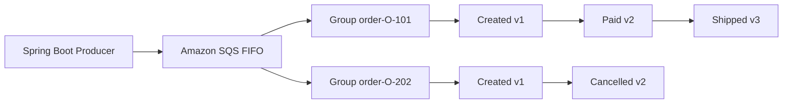

# Standard Queues, FIFO Queues, and Ordering Guarantees Scope

When integrating a **Spring Boot** application with **Amazon Simple Queue Service (Amazon SQS)** via **Spring Cloud AWS**, choosing the queue type determines how the system handles load, receives duplicate messages, and preserves event ordering. The key point is: **a Standard queue does not guarantee ordering; a FIFO queue guarantees ordering within the same `MessageGroupId`, not global ordering across all groups**.

This lesson focuses on the practical meaning of those guarantees, how to choose a queue type, how to assign message groups when sending with `SqsTemplate`, how to process messages with `@SqsListener`, and the boundaries that must be designed at the business layer. IAM permissions, security, and integration testing are mentioned to the extent needed for the examples.

## 1. Learning Objectives

After this lesson, you will be able to:

- Distinguish between **at-least-once delivery**, **best-effort ordering**, **FIFO ordering**, and **deduplication** without confusing them with *exactly-once* business transactions.
- Explain accurately which ordering is guaranteed for messages in the **same group**, in **different groups**, and **sent by multiple producers**.
- Choose `MessageGroupId` and `MessageDeduplicationId` according to business boundaries and understand their impact on parallel processing.
- Integrate FIFO queues in Spring Cloud AWS 3.x, handling errors, retries, visibility timeout, and idempotency.
- Propose an experiment to verify ordering boundaries rather than inferring from a single lucky run.

## 2. Problem Statement: Do Order Events Need Strict Ordering?

Suppose `order-service` publishes the following events and `order-projection-service` updates order status from SQS:

| Business Time | Order | Event | Version |
|---|---|---|---|
| 09:00 | `O-101` | `OrderCreated` | 1 |
| 09:01 | `O-202` | `OrderCreated` | 1 |
| 09:02 | `O-101` | `OrderPaid` | 2 |
| 09:03 | `O-202` | `OrderCancelled` | 2 |
| 09:04 | `O-101` | `OrderShipped` | 3 |

For `O-101`, applying `Shipped` before `Paid` can produce an invalid state. However, `O-101` and `O-202` are two independent workstreams and can be processed completely in parallel. That leads to the requirement: **preserve ordering per order, without forcing a single sequential queue for all orders**.

Conversely, a system that generates image thumbnails, analyzes logs, or dispatches data enrichment requests can tolerate tasks finishing in any order. In that case, enforcing sequential processing usually brings no benefit.

## 3. Comparing Standard Queues and FIFO Queues

| Criterion | Standard Queue | FIFO Queue |
|---|---|---|
| Primary goal | High throughput, flexible work distribution | Guarantee ordering within each message group |
| Delivery order | **Best effort**; messages may be received out of send order | **FIFO per `MessageGroupId`**; no global order across groups |
| Message delivery | **At least once**; duplicates may occur | Supports send-side deduplication within a time window; consumers must still tolerate retries and reprocessing |
| `MessageGroupId` | Can be used for **fair queues** to distribute capacity fairly across tenants; **creates no ordering guarantee** | Required when sending; defines the ordering guarantee scope and sequential processing unit |
| `MessageDeduplicationId` | Not used for FIFO-level deduplication | Deduplication ID within a **5-minute** window, or use content-based deduplication |
| Concurrency | Flexible, unconstrained by group ordering | Different groups can be processed in parallel; the same group must be processed sequentially |
| Queue name | Example: `image-jobs` | Must have a `.fifo` suffix, e.g., `order-events.fifo` |
| Suitable use cases | Image processing, logs, independent jobs, retryable email notifications | Order lifecycle, per-SKU price updates, sequential commands on the same account |

**Standard does not mean random order.** SQS tries to deliver messages close to the send order, so multiple test runs may produce `A → B → C`. However, that is **not a contract** your application is allowed to rely on. Data distribution, multiple consumers, retries, and network glitches can all alter the observed sequence.

In terms of throughput, Standard is typically suited when very high scalability is required. FIFO also supports **high-throughput FIFO**, batching, and multiple message groups; actual limits depend on Region, quotas, queue configuration, batch size, and group distribution. Do not rely on a fixed TPS figure in your design without checking current quotas.

> **Note on Standard fair queues:** AWS allows sending `MessageGroupId` to a Standard queue to help distribute wait time fairly across tenant groups when one group generates heavy load. This feature **does not turn Standard into FIFO** and does not prevent two messages in the same group from being processed in parallel.

## 4. At What Scope Does FIFO Guarantee Ordering?

### 4.1. Ordering Within the Same Message Group

With the FIFO queue `order-events.fifo`, use a group ID based on the entity that needs ordering:

```text
MessageGroupId = order-O-101
    OrderCreated(v1) → OrderPaid(v2) → OrderShipped(v3)

MessageGroupId = order-O-202
    OrderCreated(v1) → OrderCancelled(v2)
```

If messages in group `order-O-101` are accepted by SQS in the sequence v1, v2, v3, the queue preserves that **send/receive** order within the group. While processing one message from a group, the system will not hand subsequent messages of that same group to another consumer in a way that breaks ordering; a single batch receive can contain multiple messages from the same group in exact sequence. Messages belonging to `order-O-202` can be processed concurrently with `order-O-101`.



The diagram illustrates **two independent sequences**: only arrows within the same group represent mandatory ordering relationships. There is no requirement for `Paid(O-101)` to run before or after `Cancelled(O-202)`.

### 4.2. No Ordering Guarantee Across Groups

SQS may deliver `O-202/v2` before `O-101/v2` even though the two events have the opposite business timestamps. This does not violate FIFO because they belong to **two different `MessageGroupId` values**.

If all messages use **a single** `MessageGroupId`, you get one global sequential chain, which easily creates a bottleneck. Conversely, if every message is given **a random group ID**, messages for the same order can run in parallel and lose the required ordering guarantee. The rule for choosing a group is:

> **Same entity requiring ordering → same `MessageGroupId`; independent entities → different `MessageGroupId`.**

Good examples: `order-<orderId>`, `account-<accountId>`, or `product-<productId>`, as long as the same entity always maps to the same value and the ID is valid under SQS rules.

### 4.3. FIFO Does Not Automatically Fix Producer Event Emission Order

Suppose two producer threads concurrently send events for `O-101`:

1. Thread A creates `OrderPaid(v2)` but is delayed before calling send.
2. Thread B sends `OrderShipped(v3)` and SQS accepts it first.
3. Thread A then sends `OrderPaid(v2)`.

FIFO will preserve the order **v3 → v2 in the order SQS received them**, even though it is business-incorrect. `MessageGroupId` is not a sorter by `eventTime`, `version`, or auto-incrementing ID. If multiple producers emit events for the same entity, you must coordinate emission order (such as a transactional outbox with an ordered publishing stream per aggregate) and validate `version` on consumption.

**Distinguish three ordering layers:**

| Layer | Who Is Responsible? | Question to Answer |
|---|---|---|
| Business state change order | Database/transaction and producer logic | Was `Paid(v2)` recorded before `Shipped(v3)`? |
| Order accepted by SQS | Producer and sending to the FIFO queue | Did SQS receive v2 before v3 in the same group? |
| Side-effect execution order | Consumer, transaction, retry, and acknowledgment | Was v2 committed before committing v3? |

Simply picking FIFO is not enough to guarantee all three layers.

## 5. Deduplication and the Boundary of “Exactly Once”

FIFO supports two ways to identify a duplicate send:

- **Explicit deduplication:** the producer passes a stable `MessageDeduplicationId` for the same event, e.g., `event-6e89...`.
- **Content-based deduplication:** when enabled, SQS generates the ID from a SHA-256 hash of the **message body**, excluding message attributes. Two messages with identical bodies within the same window can be treated as duplicates, even if you intended them for two distinct actions.

Once a message is sent successfully, retries with the same deduplication ID **within the 5-minute window** are accepted by SQS without creating extra deliverable copies. After that window expires, SQS no longer guarantees duplicate detection. With high-throughput FIFO, deduplication scope also depends on the queue's `DeduplicationScope` setting; business events should still have a stable `eventId` and never reuse it across two independent events.

Example:

```text
09:00  Send eventId=evt-100, group=order-O-101   → message added
09:01  Retry eventId=evt-100, same group         → deduplicated on send
09:07  Retry eventId=evt-100, same group         → outside 5-minute window;
                                                   cannot rely on SQS dedup
```

AWS describes FIFO using the phrase “exactly-once processing” in feature documentation. When designing applications, understand that **queue-side deduplication is not an exactly-once transaction for your database, email, or external APIs**. Counterexample scenario:

1. The consumer receives `OrderPaid(v2)`.
2. The consumer **commits** the database update successfully.
3. The process crashes **before SQS receives the delete message call**.
4. Once `visibility timeout` expires, the message can be redelivered.

If the listener relies solely on FIFO and re-runs `chargeCard()` or updates a balance, the side effect can be duplicated. Therefore, **consumers must be idempotent**, for example using a unique `eventId` key in an inbox/processed-events table, marking it processed and applying database changes **within the same transaction**. For an external payment API, you must also supply that API's own idempotency key.

## 6. Visibility Timeout, Acknowledgment, and Impact on Ordering

The typical processing lifecycle of an SQS message is:

```text
Available → ReceiveMessage → In flight / Invisible
                                   |
               +-------------------+------------------+
               |                                      |
       Processing succeeds                    Error or disconnect
               |                                      |
       DeleteMessage (ack)                  Visibility timeout expires
               |                                      |
           Completed                       Can be received again for retry
```

`visibility timeout` **temporarily hides** a message while a consumer is processing it; it does not delete the message and is not a database transaction lock. With FIFO, an unfinished message in a group can hold back subsequent messages in that exact group. Other groups can still proceed.

When using Spring Cloud AWS `@SqsListener`, the default acknowledgment configuration typically deletes the message after the listener completes successfully; if the listener throws an exception, the message is not acknowledged and can reappear after the visibility timeout. Exact behavior depends on version and configuration of `acknowledgementMode`, batching, `messageVisibilitySeconds`, and the listener container. Do not catch an exception and merely log it if you want SQS to retry, because the listener may return as though processing succeeded.

Operational principles:

1. Set visibility timeout long enough for actual processing time, or proactively extend it with `ChangeMessageVisibility` for long-running work; if it is too short, a retry may overlap with an unfinished task.
2. Acknowledge success **only after** the required business state changes are durable. If you offload work to another thread and let the listener return immediately, acknowledgment can arrive before the work truly finishes.
3. Configure bounded retries, track receive attempts (`ApproximateReceiveCount`), and set up an appropriate **dead-letter queue (DLQ)**. Moving a failed message to a DLQ can unblock subsequent messages, but **breaks the intact business sequence** if the failed event was a mandatory step.
4. If strict ordering must hold for the entire lifecycle, define a failure-handling policy: pause, fix data, controlled replay, or state reconciliation, rather than silently skipping failed messages by default.

## 7. Spring Boot + Spring Cloud AWS Example: Preserving Per-Order Ordering

The following example uses **Spring Cloud AWS 3.x** APIs. The application assumes an existing `order-events.fifo` queue on AWS, AWS SDK v2 connectivity, and appropriate IAM permissions. The code only illustrates the send/receive flow; business data persistence must be implemented for your actual database engine.

### 7.1. Dependencies and Configuration

For a Gradle project already using a Spring Cloud AWS BOM **compatible with your Spring Boot version**, add the starter:

```gradle
dependencies {
    implementation("io.awspring.cloud:spring-cloud-aws-starter-sqs")
}
```

Do not pin an arbitrary version on the starter if the BOM manages dependencies. Choose the Region matching your queue:

```yaml
# application.yml
spring:
  cloud:
    aws:
      region:
        static: ap-southeast-1

app:
  sqs:
    order-events-queue: order-events.fifo
```

`ap-southeast-1` is just an example; the queue must exist in the configured Region and account. In production environments, use an **IAM role/identity and the AWS SDK default credentials provider chain** instead of hardcoding access keys/secret keys in source code or `application.yml`. Basic producer permissions include `sqs:SendMessage`; consumers typically need `sqs:ReceiveMessage`, `sqs:DeleteMessage`, `sqs:GetQueueUrl`, `sqs:GetQueueAttributes`, and `sqs:ChangeMessageVisibility` when extending visibility timeout. Grant permissions scoped to the specific queue ARN and only the APIs actually used.

### 7.2. Create an Event Record with Clear Identity

```java
public record OrderEvent(
    String eventId,
    String orderId,
    long version,
    String eventType
) {}
```

Here, `eventId` is the unique ID for **one business change** (unchanged across retries); `orderId` is the grouping key; `version` reflects the sequence of changes in the business data source.

### 7.3. Sending FIFO Messages with `SqsTemplate`

```java
import io.awspring.cloud.sqs.operations.SqsTemplate;
import org.springframework.beans.factory.annotation.Value;
import org.springframework.stereotype.Service;

@Service
public class OrderEventPublisher {
    private final SqsTemplate sqsTemplate;
    private final String queueName;

    public OrderEventPublisher(
            SqsTemplate sqsTemplate,
            @Value("${app.sqs.order-events-queue}") String queueName) {
        this.sqsTemplate = sqsTemplate;
        this.queueName = queueName;
    }

    public void publish(OrderEvent event) {
        sqsTemplate.send(to -> to
            .queue(queueName)
            .payload(event)
            .messageGroupId("order-" + event.orderId())
            .messageDeduplicationId(event.eventId()));
    }
}
```

The critical part is not calling `send()`, but the two IDs:

- `messageGroupId("order-" + event.orderId())` preserves ordering **per order**, allowing other orders to proceed independently.
- `messageDeduplicationId(event.eventId())` prevents retries of **the same event** from creating extra messages within the deduplication window. Two distinct business events must have distinct IDs, even if their bodies are identical.

Spring Cloud AWS can auto-generate random values for missing FIFO attributes in some scenarios. **Do not let the framework auto-generate `MessageGroupId` for business ordering requirements**: a random group per message destroys the sequential boundary by `orderId`.

### 7.4. Receiving Messages with `@SqsListener`

```java
import io.awspring.cloud.sqs.annotation.SqsListener;
import org.springframework.stereotype.Component;

@Component
public class OrderEventConsumer {
    private final OrderProjectionService projectionService;

    public OrderEventConsumer(OrderProjectionService projectionService) {
        this.projectionService = projectionService;
    }

    @SqsListener("${app.sqs.order-events-queue}")
    public void onOrderEvent(OrderEvent event) {
        // Return successfully only after the update has committed.
        projectionService.applyIdempotently(event);
    }
}
```

`OrderProjectionService` is the example's business class that you need to implement. Spring Cloud AWS 3.x detects queues with the `.fifo` suffix, organizes processing by `MessageGroupId`, preserves ordering within the same group, and allows different groups to run in parallel. When processing a message fails, the framework protects the order of subsequent messages in the same group according to FIFO retry/visibility semantics. Do not offload each event to `@Async`, an executor, or another message broker and let the listener return immediately unless you have matching mechanisms to preserve ordering and confirm completion.

One way to implement `applyIdempotently(event)` with PostgreSQL:

```sql
-- Pseudocode for a business transaction, not a standalone runnable SQL script.
BEGIN;

-- event_id has a UNIQUE/PRIMARY KEY; if it already exists, skip the whole task.
INSERT INTO processed_event(event_id)
VALUES (:event_id)
ON CONFLICT (event_id) DO NOTHING;

-- If INSERT added no row: COMMIT and return (message already processed).
-- If INSERT succeeded: lock the projection row for order_id.
SELECT version
FROM order_projection
WHERE order_id = :order_id
FOR UPDATE;

-- Proceed only when incoming_version = current_version + 1.
-- If there is a version gap: ROLLBACK, investigate/retry/reconcile.
UPDATE order_projection
SET version = :incoming_version, status = :new_status
WHERE order_id = :order_id;

COMMIT;
```

The initial `OrderCreated` case must also include inserting the projection row within the same transaction. The core rule is that **recording the processed event and updating the projection must succeed or roll back together**. If side effects live outside the database, you need the target system's own idempotency protocol; a database transaction does not automatically cover an external HTTP API.

### 7.5. Spring Cloud AWS Configurations to Watch

| Component | Meaning When Using FIFO |
|---|---|
| `@SqsListener` | Creates the listener container to receive and process messages. A single container should not mix Standard and FIFO queues. |
| `maxConcurrentMessages` | Limits the number of in-flight messages, without violating the sequential constraint of **a single group**. |
| `messageVisibilitySeconds` / `SqsContainerOptions` | Controls the visibility window; affects retries and how long a group must wait on error. |
| `acknowledgementMode` | Governs when SQS is notified of successful processing. Usually configured to acknowledge after successful execution. |
| `fifoBatchGroupingStrategy` | Controls how FIFO messages are grouped in batch listeners; a batch spanning multiple groups must still respect per-group ordering. |

## 8. Choosing a Queue Based on Real Requirements

| Scenario | Recommendation | Reason / Condition |
|---|---|---|
| Resize user-uploaded images | Standard | Independent jobs, throughput prioritized; consumer idempotent by image/job ID. |
| Update progress of an order | FIFO, grouped by `orderId` | Preserves step order for **one** order and allows parallelism across multiple orders. |
| Publish product price-change events | FIFO, grouped by `productId` | Update sequence for the same product matters. |
| Execute sequential commands for an account | FIFO, grouped by `accountId` | A command sequence within an account must stay consistent; other accounts are independent. |
| Multi-tenant job distribution system | Standard + consider fair queues | Helps balance wait times across tenants when ordering is not needed. |
| Require a single global order across all events of all entities | Revisit architecture; a single FIFO group serializes everything | High throughput/latency cost; check whether global order is truly needed or can be partitioned by aggregate. |

If an event affects **multiple entities simultaneously** (such as transferring money between two accounts), grouping by one account does not provide a distributed transaction across both. You need additional business consistency mechanisms such as source-system transactions, sagas, locking/coordination, or version checks.

## 9. Hands-On Ordering Verification

Prepare a Standard queue (`order-events-standard`) and a FIFO queue (`order-events.fifo`) in a learning environment, and configure a Spring Boot application with least-privilege IAM permissions. For FIFO, configure deduplication consistently with sending `MessageDeduplicationId` as shown above. Log `eventId`, `orderId`, `version`, send timestamp, processing start/end timestamps, and `ApproximateReceiveCount` to observe behavior.

**Experiment A — Standard:** Send multiple messages for the same order; run multiple consumers, intentionally introduce varying processing durations and retries. Observe **start** and **completion** order. You may see duplicates or out-of-order execution; even if one run happens to stay ordered, that **does not prove** Standard guarantees ordering.

**Experiment B — FIFO with two groups:** Interleave `O-101/v1`, `O-202/v1`, `O-101/v2`, `O-202/v2`, `O-101/v3` with the proper group IDs and dedup IDs. Observe `O-101` keeping v1→v2→v3 and `O-202` keeping v1→v2; the two groups can overlap in processing time. Repeat using only **one** group ID to see parallelism drop.

**Experiment C — Mid-sequence failure:** Intentionally make the listener throw an exception when receiving `O-101/v2`. Observe `O-101/v3` waiting on v2's processing/retry path while `O-202` keeps advancing. Then inspect the effects of visibility timeout and DLQ policy; only replay after verifying target state validity.

**Experiment D — Send retries:** Send the same `eventId` twice within 5 minutes and compare against two events with different `eventId`s. Verify FIFO deduplication, then simulate a consumer committing successfully without acknowledging to verify **application-layer idempotency**.

Expected results should compare **message receive order**, **side-effect commit order**, and **listener invocation count**. These are three distinct metrics.

## 10. Common Design Mistakes and How to Spot Them

1. **Using FIFO but emitting events out of order:** check event creation flow, outbox, multiple producers, and `version`; FIFO only orders by arrival sequence at SQS.
2. **Choosing a `MessageGroupId` that is too broad:** one ID for the entire application creates a sequential queue and increases latency; partition by independent entity.
3. **Choosing a `MessageGroupId` that is too narrow or random:** the same order gets split across multiple groups, losing the required ordering guarantee.
4. **Reusing `MessageDeduplicationId` across two distinct events:** one event may be dropped as a duplicate send within the deduplication window.
5. **Assuming FIFO eliminates all duplicate side effects:** you still need transactions, unique keys, idempotency keys, and proper acknowledgment management.
6. **Acknowledging before background work finishes:** the next message in the group can be processed while the previous side effect has not yet committed.
7. **Setting visibility timeout too short:** a message can reappear while processing is still underway; monitor duration and retries.
8. **Skipping failed messages to a DLQ without state reconciliation:** subsequent messages may no longer have a valid data baseline; establish a controlled handling/replay procedure.
9. **Using `MessageGroupId` on Standard and expecting FIFO:** on Standard, it is a fairness distribution tool, not an ordering guarantee.

## 11. Self-Check Questions

1. Two messages for `O-101` share a `MessageGroupId`, while one message for `O-202` has a different group. Does SQS require finishing all of `O-101` before `O-202`? **No; ordering applies only within each group.**
2. Why is retrying `SendMessage` within 5 minutes using the same deduplication ID not enough to claim the consumer runs exactly once? **Because the consumer can commit a side effect and fail before deleting the message; send-side dedup does not replace receive-side idempotency.**
3. If the producer sends `v3` to FIFO before `v2`, does SQS automatically detect and sort by `version`? **No; the producer must ensure emission order or the consumer must check versions.**
4. If one FIFO group is blocked by a failing message, must other groups stop as well? **No; each group can be processed independently within consumer resource and configuration limits.**
5. When should you choose Standard? **When tasks can be processed independently or the application handles out-of-order/duplicate delivery itself and prioritizes throughput.**

## 12. References

- [AWS — Amazon SQS queue types](https://docs.aws.amazon.com/AWSSimpleQueueService/latest/SQSDeveloperGuide/sqs-queue-types.html): comparing Standard and FIFO, delivery guarantees, ordering, and throughput.
- [AWS — FIFO queue delivery logic](https://docs.aws.amazon.com/AWSSimpleQueueService/latest/SQSDeveloperGuide/FIFO-queues-understanding-logic.html): ordering within message groups, batching, multiple producers, and retries.
- [AWS — Exactly-once processing](https://docs.aws.amazon.com/AWSSimpleQueueService/latest/SQSDeveloperGuide/FIFO-queues-exactly-once-processing.html): deduplication boundaries and configuration.
- [AWS API — SendMessage](https://docs.aws.amazon.com/AWSSimpleQueueService/latest/APIReference/API_SendMessage.html): `MessageGroupId`, `MessageDeduplicationId`, 5-minute window, and fair queues.
- [Spring Cloud AWS — SQS reference](https://docs.awspring.io/spring-cloud-aws/docs/3.4.1/reference/html/index.html): `SqsTemplate`, `@SqsListener`, listener containers, and FIFO support.

**Key takeaway:** Standard prioritizes flexible processing and accepts possible duplicates or out-of-order delivery. FIFO guarantees ordering **only within properly defined groups**, while event correctness, commits, and reprocessing remain the responsibility of your Spring Boot application design.
