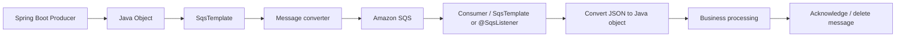

# Sending and Receiving Messages with SqsTemplate

In a Spring Boot application integrated with AWS managed services, Amazon Simple Queue Service (Amazon SQS) handles message transport between components without requiring producers and consumers to be active at the same time. **Spring Cloud AWS provides `SqsTemplate` to send and receive messages using familiar Spring APIs**, while auto-configuring the AWS SDK client, payload conversion, and metadata mapping.

This lesson follows a complete flow: configuring the starter and AWS identity, defining the message contract, sending messages synchronously or asynchronously, sending in batches, polling to receive messages, acknowledging messages after processing, and choosing background listeners. The examples use **Spring Cloud AWS 3.4.1** APIs; if your project uses a different version, check the matching version's documentation before copying configurations.

## 1. Learning Objectives

After this lesson, you will be able to:

- Configure the SQS starter and inject `SqsTemplate` in Spring Boot.
- Distinguish between `SqsOperations` (synchronous) and `SqsAsyncOperations` (asynchronous).
- Send POJOs, message attributes, FIFO messages, and batch messages.
- Receive a single message or a batch with `receive()` and `receiveMany()`.
- Explain when `SqsTemplate` acknowledges messages, configure manual acknowledgment, and avoid losing messages on processing errors.
- Choose between polling with `SqsTemplate` and continuous consumers with `@SqsListener`.
- Design appropriate retry policies, idempotency, IAM policies, and integration tests.

## 2. Where Does SqsTemplate Fit in the Processing Flow?

A message typically passes through the following steps:



SQS only stores and transports message content. The application remains responsible for defining the data schema, validating input data, handling side effects, and deciding when a message is complete.

`SqsTemplate` is built on `SqsAsyncClient` from AWS SDK for Java 2.x. In Spring Boot with auto-configuration, the framework automatically creates `SqsTemplate` if no other template exists in the context; this bean uses the configured `SqsAsyncClient` and can be shared across threads because the template is immutable and thread-safe.

Two main operation interfaces:

| Interface | Characteristics | Typical Methods |
|---|---|---|
| `SqsOperations` | Synchronous API; calls wait for completion | `send()`, `sendMany()`, `receive()`, `receiveMany()` |
| `SqsAsyncOperations` | Asynchronous API; returns `CompletableFuture` | `sendAsync()`, `sendManyAsync()`, `receiveAsync()`, `receiveManyAsync()` |

The `SqsTemplate` class implements both interfaces. When a component only needs one style of API, you can inject the corresponding interface to narrow the usage surface.

## 3. Preparing the Spring Boot Project

### 3.1. Adding the Dependency

Use the Spring Cloud AWS BOM so modules in the same release use compatible dependency versions. Gradle example:

```groovy
ext {
    springCloudAwsVersion = "3.4.1"
}

dependencies {
    implementation platform(
        "io.awspring.cloud:spring-cloud-aws-dependencies:${springCloudAwsVersion}"
    )
    implementation "io.awspring.cloud:spring-cloud-aws-starter-sqs"
}
```

If the project already imports the Spring Cloud AWS BOM at the root level, only add the SQS starter and do not import the BOM a second time. Pick a release compatible with your Spring Boot version.

### 3.2. Declaring the Region and Queue Names

```yaml
# application.yml
spring:
  cloud:
    aws:
      region:
        static: ap-southeast-1

app:
  sqs:
    inventory-queue: inventory-events
    order-queue: order-events.fifo
```

`ap-southeast-1` is only an example. The queue must exist in the exact AWS account and Region the application accesses. You can use either a queue name or a queue URL in template operations.

When running locally with LocalStack, you can configure the corresponding endpoint:

```yaml
spring:
  cloud:
    aws:
      endpoint: http://localhost:4566
      region:
        static: ap-southeast-1
```

Only enable the local endpoint in development or test profiles; real AWS environments should use the default Regional endpoint.

### 3.3. Identity and IAM Permissions

The starter uses the AWS SDK credentials provider chain to locate credentials. In deployed environments, prefer an IAM role attached to the workload, such as an instance profile, ECS task role, or IAM role for service accounts on EKS. Never commit access keys/secret keys to Git or place long-lived secrets in application configuration files.

Basic permissions to consider:

| Operation | Typical Required IAM Action |
|---|---|
| Send a message | `sqs:SendMessage` |
| Resolve queue URL when using queue name | `sqs:GetQueueUrl` |
| Poll/receive messages | `sqs:ReceiveMessage` |
| Acknowledge/delete messages | `sqs:DeleteMessage` |
| Read queue attributes on listener startup | `sqs:GetQueueAttributes` |
| Change visibility timeout | `sqs:ChangeMessageVisibility` |

Scope `Resource` to the ARNs of the queues the service actually uses. If the application is allowed to auto-create queues when not found, required permissions and startup behavior become broader; in production, manage queues via infrastructure and explicitly verify the strategy when a queue does not exist.

## 4. Defining the Message Contract

Suppose an inventory management service publishes an event whenever the quantity of an item changes:

```java
import java.time.Instant;

public record InventoryAdjusted(
    String eventId,
    String sku,
    int quantityDelta,
    Instant occurredAt
) {}
```

Each field has a distinct role:

- `eventId`: unique ID of a business event, kept unchanged when the producer retries sending.
- `sku`: item identifier; can serve as `MessageGroupId` if events need to be serialized per item.
- `quantityDelta`: the change in inventory, not necessarily the final stock count.
- `occurredAt`: timestamp when the event was created at the source system; should not be treated as the sole proof of processing order.

A good message contract has a stable schema, explicit identifier fields, and compatibility rules when producers/consumers are deployed across different versions. Avoid directly sending JPA entities with lazy relationships, sensitive data, or the entire object graph of an HTTP request.

## 5. Sending a Message with SqsTemplate

### 5.1. Auto-Injecting the Template

Once `spring-cloud-aws-starter-sqs` is present, Spring Boot auto-configures `SqsTemplate` if the application has not declared another bean.

```java
import io.awspring.cloud.sqs.operations.SendResult;
import io.awspring.cloud.sqs.operations.SqsTemplate;
import org.springframework.beans.factory.annotation.Value;
import org.springframework.stereotype.Service;

@Service
public class InventoryEventPublisher {
    private final SqsTemplate sqsTemplate;
    private final String queueName;

    public InventoryEventPublisher(
            SqsTemplate sqsTemplate,
            @Value("${app.sqs.inventory-queue}") String queueName) {
        this.sqsTemplate = sqsTemplate;
        this.queueName = queueName;
    }

    public SendResult<InventoryAdjusted> publish(InventoryAdjusted event) {
        return sqsTemplate.send(to -> to
            .queue(queueName)
            .payload(event));
    }
}
```

`send()` accepts an `SqsSendOptions` configuration callback: `queue()` specifies the queue, and `payload()` sets the body. For a Java object, the default converter serializes the payload to JSON before sending to SQS.

If you want to use a queue URL, pass the URL into `queue()` instead of the queue name. You do not need to call `GetQueueUrl` manually before each send when using the template; the framework handles endpoint resolution according to its configuration.

### 5.2. Reading the Send Result

`send()` returns `SendResult<T>` upon success. The result provides:

- `messageId()`: the ID returned by SQS.
- `endpoint()`: the endpoint/queue that accepted the message.
- `message()`: the Spring `Message` sent, including payload and headers after conversion.
- `additionalInformation()`: extra metadata; for FIFO queues this may include `sequenceNumber`.

Example logging the SQS-assigned ID:

```java
SendResult<InventoryAdjusted> result = publisher.publish(event);
log.info("SQS accepted eventId={}, messageId={}",
    event.eventId(), result.messageId());
```

SQS's `messageId` does not replace the business `eventId`. When tracking retries, reconciling, or preventing duplicate processing, store the stable business ID alongside the SQS message ID.

If sending a single message fails, the template throws `MessagingOperationFailedException`. Let the error propagate to the caller or handle it with a bounded retry policy; do not merely log it and continue as if the message had been sent successfully.

### 5.3. Adding Message Attributes and Metadata

You can attach metadata using `header()` or `headers()`. The converter maps these headers to SQS message attributes:

```java
SendResult<InventoryAdjusted> result = sqsTemplate.send(to -> to
    .queue(queueName)
    .payload(event)
    .header("correlationId", event.eventId())
    .header("producer", "inventory-service")
    .headers(Map.of(
        "tenantId", "tenant-42",
        "schemaVersion", "1"
    ))
);
```

Message attributes are suited for routing info, tracing, tenant IDs, or schema versions. Business content needed by the consumer should live in the payload. Do not place passwords, tokens, secrets, or large data in attributes.

SQS enforces a message size limit; Spring Cloud AWS 3.4.1 documentation cites a maximum of 1 MiB per message. If a payload exceeds the limit or contains large files, store the content in S3 and send an access-controlled object key/URL through SQS.

## 6. Sending Messages to a FIFO Queue

For a FIFO queue, the producer must specify the message group and deduplication ID. Example:

```java
public SendResult<OrderEvent> publish(OrderEvent event) {
    return sqsTemplate.send(to -> to
        .queue("order-events.fifo")
        .payload(event)
        .messageGroupId("order-" + event.orderId())
        .messageDeduplicationId(event.eventId())
    );
}
```

`messageGroupId` selects the event stream that needs ordering, such as a single order. `messageDeduplicationId` uses a stable event ID so SQS recognizes repeated sends within the deduplication window. Rules regarding cross-group ordering, deduplication windows, and queue-level exactly-once semantics are detailed in `Standard Queues, FIFO Queues, and Ordering Guarantees Scope`.

Spring Cloud AWS can auto-generate UUIDs if the group ID or deduplication ID is missing under certain configurations. Those random values may satisfy the request format, but they cannot replace business-meaningful IDs. If ordering by `orderId` is required, the producer must pass the same group ID for every event belonging to that order.

## 7. Sending Multiple Messages in a Batch

When sending multiple independent messages, `sendMany()` can reduce network round trips using SQS's `SendMessageBatch` API.

```java
import org.springframework.messaging.Message;
import org.springframework.messaging.support.MessageBuilder;
import io.awspring.cloud.sqs.operations.SendResult;
import java.util.List;

public SendResult.Batch<InventoryAdjusted> publishBatch(
        List<InventoryAdjusted> events) {

    List<Message<InventoryAdjusted>> messages = events.stream()
        .map(event -> MessageBuilder.withPayload(event)
            .setHeader("correlationId", event.eventId())
            .build())
        .toList();

    return sqsTemplate.sendMany(queueName, messages);
}
```

A single `SendMessageBatch` request accepts at most **10 entries**. Spring Cloud AWS does not automatically split large collections into smaller batches; the caller must chunk them before calling `sendMany()`.

The batch result contains two sets:

- `successful()`: messages sent successfully.
- `failed()`: messages that failed to send, along with error details and the corresponding message.

By default, if at least one entry fails, the template throws `SendBatchOperationFailedException`; the exception holds `SendResult.Batch` so the application can inspect both successes and failures. Do not blindly retry the whole batch, because successful entries were already accepted by SQS. Selectively retry only the failed entries using their stable event IDs.

Batching groups multiple messages into one request, not an atomic transaction. A batch can partially succeed.

## 8. Sending Asynchronously

If you do not want the calling thread to block on the send result, use `SqsAsyncOperations`. `SqsTemplate` also implements this interface, so you can inject it directly:

```java
import io.awspring.cloud.sqs.operations.SendResult;
import io.awspring.cloud.sqs.operations.SqsAsyncOperations;
import java.util.UUID;
import java.util.concurrent.CompletableFuture;

@Service
public class AsyncInventoryPublisher {
    private final SqsAsyncOperations sqs;

    public AsyncInventoryPublisher(SqsAsyncOperations sqs) {
        this.sqs = sqs;
    }

    public CompletableFuture<UUID> publish(
            String queueName, InventoryAdjusted event) {
        return sqs.sendAsync(to -> to
            .queue(queueName)
            .payload(event)
        ).thenApply(SendResult::messageId);
    }
}
```

`sendAsync()` returns `CompletableFuture<SendResult<T>>`. You can chain `thenApply`, `thenCompose`, or `whenComplete` to compose async steps. Send errors surface as an exceptional state on the future; ignoring the future or failing to observe errors can prevent the system from detecting unsent messages.

Do not call `.join()` or `.get()` immediately after every `sendAsync()` if the goal is to keep the thread non-blocking. If business logic requires knowing SQS accepted the message before returning an HTTP response, await the future at that exact boundary and map errors to an appropriate response.

## 9. Receiving Messages with SqsTemplate

### 9.1. Receiving a Single Message

`receive()` performs one poll and returns `Optional<Message<T>>`. If no message is available during the poll window, the result is `Optional.empty()`.

```java
import org.springframework.messaging.Message;
import java.time.Duration;
import java.util.Optional;

Optional<Message<InventoryAdjusted>> received = sqsTemplate.receive(
    from -> from
        .queue(queueName)
        .pollTimeout(Duration.ofSeconds(5))
        .visibilityTimeout(Duration.ofSeconds(45)),
    InventoryAdjusted.class
);

received.ifPresent(message ->
    log.info("Received event {}", message.getPayload().eventId())
);
```

`pollTimeout` sets the maximum wait time for the receive call (long polling). The template default is 10 seconds; SQS supports up to 20 seconds of long polling. `visibilityTimeout` temporarily hides the message from other consumers for the chosen duration.

Passing `InventoryAdjusted.class` tells the converter which payload type to instantiate. If the message was sent via `SqsTemplate` and still carries the default type header, the framework can use that information; for messages from external producers or without a type header, explicitly specify the class.

### 9.2. Receiving a Batch

`receiveMany()` returns a collection, useful when the application wants to coordinate batch processing itself:

```java
Collection<Message<InventoryAdjusted>> messages = sqsTemplate.receiveMany(
    from -> from
        .queue(queueName)
        .maxNumberOfMessages(10)
        .pollTimeout(Duration.ofSeconds(10))
        .visibilityTimeout(Duration.ofSeconds(60)),
    InventoryAdjusted.class
);

for (Message<InventoryAdjusted> message : messages) {
    inventoryService.applyIdempotently(message.getPayload());
}
```

SQS returns at most 10 messages in a single `ReceiveMessage` call. The actual number of returned messages may be fewer than requested, even when more messages remain in the queue. Do not assume a single `receiveMany()` call always returns the full configured count.

### 9.3. Important Warning: Default Template Acknowledgment

In `SqsTemplate`, the default mode is **acknowledge on receive** (`ACKNOWLEDGE_ON_RECEIVE`). As soon as `receive()` or `receiveMany()` returns a message, the template has already acknowledged it to SQS. Therefore, if the application receives a message, begins business processing, and crashes partway through, the message may already be deleted from the queue even though the task never finished.

With manual polling, configure manual acknowledgment if you need to acknowledge after business logic commits:

```java
import io.awspring.cloud.sqs.operations.SqsTemplate;
import io.awspring.cloud.sqs.operations.TemplateAcknowledgementMode;
import software.amazon.awssdk.services.sqs.SqsAsyncClient;
import org.springframework.context.annotation.Bean;
import org.springframework.context.annotation.Configuration;

@Configuration
public class SqsTemplateConfiguration {
    @Bean
    SqsTemplate manualAckSqsTemplate(SqsAsyncClient sqsAsyncClient) {
        return SqsTemplate.builder()
            .sqsAsyncClient(sqsAsyncClient)
            .configure(options -> options
                .acknowledgementMode(TemplateAcknowledgementMode.MANUAL)
            )
            .build();
    }
}
```

When manual acknowledgment is enabled, call `Acknowledgement.acknowledge(message)` only after finishing message processing:

```java
import io.awspring.cloud.sqs.listener.acknowledgement.Acknowledgement;
import org.springframework.messaging.Message;

public void pollAndProcessOnce() {
    Optional<Message<InventoryAdjusted>> received = manualAckSqsTemplate.receive(
        from -> from
            .queue(queueName)
            .pollTimeout(Duration.ofSeconds(5))
            .visibilityTimeout(Duration.ofSeconds(60)),
        InventoryAdjusted.class
    );

    received.ifPresent(message -> {
        inventoryService.applyIdempotently(message.getPayload());
        // Delete message only after business processing succeeds.
        Acknowledgement.acknowledge(message);
    });
}
```

If `applyIdempotently()` throws an exception, the acknowledge line does not execute. The message remains in-flight until visibility timeout expires and can be received again. If acknowledgment fails after the database has committed, the message may be redelivered; the consumer must still be idempotent.

With batch manual acknowledgment, acknowledge only the messages that succeeded. You can call `Acknowledgement.acknowledge(message)` per message or `Acknowledgement.acknowledge(messages)` after the whole batch finishes. Do not acknowledge the entire batch if any entry failed.

## 10. When to Use SqsTemplate vs. @SqsListener?

`SqsTemplate.receive()` is an active polling API: your code performs a receive call when invoked. The application must manage poll scheduling, loops, backoff, shutdown stopping, and processing limits itself. This is useful for tasks that actively pull a small number of messages or integrate into an existing workflow.

For a continuously running service consuming a queue, `@SqsListener` is usually a better fit. Spring Cloud AWS creates a `MessageListenerContainer` to poll, invoke handlers, and manage acknowledgments.

```java
import io.awspring.cloud.sqs.annotation.SqsListener;
import org.springframework.stereotype.Component;

@Component
public class InventoryEventListener {
    private final InventoryService inventoryService;

    public InventoryEventListener(InventoryService inventoryService) {
        this.inventoryService = inventoryService;
    }

    @SqsListener("${app.sqs.inventory-queue}")
    public void handle(InventoryAdjusted event) {
        inventoryService.applyIdempotently(event);
    }
}
```

In the listener container, the default mode is `ON_SUCCESS`: the message is acknowledged after the listener completes successfully. If the listener throws an error, the message is not acknowledged and can be received again after the visibility timeout. This differs from `SqsTemplate.receive()`, which acknowledges immediately on receive by default.

A listener can accept `Message<InventoryAdjusted>` instead of just the payload to access headers:

```java
@SqsListener("${app.sqs.inventory-queue}")
public void handle(Message<InventoryAdjusted> message) {
    String correlationId = message.getHeaders().get(
        "correlationId", String.class
    );
    inventoryService.applyIdempotently(message.getPayload());
}
```

If using a batch listener, a parameter of `List<InventoryAdjusted>` or `List<Message<InventoryAdjusted>>` enables batch mode. Design transactions and acknowledgments per item; do not assume a batch is processed atomically.

## 11. Payload Conversion and Schema Management

By default, `SqsMessagingMessageConverter` uses `StringMessageConverter` and `MappingJackson2MessageConverter` to convert payloads between Java objects and JSON. A header mapper maps Spring message headers to and from SQS message attributes.

When sending via `SqsTemplate`, the framework adds a `JavaType` header containing the fully qualified class name of the payload by default. On receive, the template/listener uses this header to determine the deserialization target type. Without type information, you can specify the type in `receive(queue, PayloadClass.class)` or via `defaultPayloadClass` in template options.

In polyglot systems or with independent producers/consumers, agree on a message schema rather than coupling to specific Java class names. You can configure the converter to rename or omit the type header, then specify the payload class on the consumer. Avoid letting untrusted input dictate arbitrary Java types for deserialization.

Example custom converter configuration when sharing the application's `ObjectMapper`:

```java
SqsOperations template = SqsTemplate.builder()
    .sqsAsyncClient(sqsAsyncClient)
    .configureDefaultConverter(converter -> {
        converter.setObjectMapper(objectMapper);
        converter.setPayloadTypeHeader("eventType");
    })
    .buildSyncTemplate();
```

Only change the type header when both producer and consumer are configured compatibly. Changing the header name on only one side may prevent the other side from resolving the payload type.

## 12. Error Handling, Retries, and Idempotency

SQS and networks can produce ambiguous states at call time. For example, a producer sends a request, SQS accepts the message, but the connection drops before the producer receives the response. The producer may retry and trigger another send. Likewise, a consumer may commit its database transaction and then fail before acknowledging, causing the message to be redelivered.

Principles to follow:

1. Generate a stable `eventId` at the business source and reuse it across send retries.
2. Have the consumer store processed `eventId`s with a unique constraint or inbox table; record the event and update business data in the same transaction.
3. Acknowledge only after required changes have committed. Do not offload work to a background thread and return success before the work completes.
4. Set visibility timeout high enough for normal processing time. For long-running tasks, extend visibility and monitor in-flight duration.
5. Configure bounded retries and a dead-letter queue (DLQ) to isolate persistently failing messages. Establish a process to investigate, fix data, and replay.
6. Monitor `ApproximateReceiveCount`, message age, pending message count, and DLQ message count.

Database-level idempotency can use a `processed_event` table with `event_id` as a unique key:

```sql
BEGIN;

INSERT INTO processed_event(event_id)
VALUES (:event_id)
ON CONFLICT (event_id) DO NOTHING;

-- If INSERT created no new row, the event was already processed: exit safely.
-- If INSERT created a new row, update business state in the same transaction.
UPDATE inventory
SET quantity = quantity + :quantity_delta
WHERE sku = :sku;

COMMIT;
```

This is pseudocode illustrating the transaction; adapt it to verify SKU existence, non-negative inventory rules, and business update conditions. If a side effect calls an external API, you need that API's idempotency key or an outbox/saga workflow; a database transaction does not span external HTTP requests.

## 13. Template and Listener Options to Watch

| Option | Meaning | When to Consider |
|---|---|---|
| `defaultEndpointName` | Default queue when an operation omits the queue | The application uses only one endpoint per template |
| `defaultPollTimeout` | Default wait duration when receiving | Balancing long polling and response latency |
| `defaultMaxNumberOfMessages` | Default message count for batch receives | Tuning messages per poll; max 10 per SQS receive API |
| `defaultPayloadClass` | Default payload type for deserialization | Consumer receives a known schema without a type header |
| `acknowledgementMode` | How messages are acknowledged when using `SqsTemplate.receive()` | Use `MANUAL` when processing must finish before deleting the message |
| `queueNotFoundStrategy` | Create queue or fail when not found | Prefer `FAIL` if queue infrastructure is managed separately |
| `messageAttributeNames` | Which message attributes are fetched | Filtering only the metadata needed by the consumer |

For listener containers, options such as `maxConcurrentMessages`, `maxMessagesPerPoll`, `pollTimeoutSeconds`, `messageVisibilitySeconds`, and `acknowledgementMode` govern throughput and processing lifecycle. Tune them based on processing duration, message size, number of FIFO groups, and downstream service capacity.

## 14. Integration Testing

Do not mock only `SqsTemplate` and conclude SQS integration works. Mocks help verify that a service targets the right queue and payload, but they do not verify IAM, queue URLs, JSON conversion, message attributes, or real acknowledgment behavior.

A sound testing strategy includes:

| Test Layer | What It Verifies | Tools / Suggestions |
|---|---|---|
| Producer unit tests | Payload, queue, event ID, and headers are built properly | Mock `SqsOperations` or `SqsTemplate` |
| Consumer unit tests | Idempotency, duplicate handling, and error handling | Test service with a fake repository or test database |
| Integration tests | Sending and receiving messages, JSON conversion, and attributes | LocalStack or a dedicated AWS test account |
| Failure tests | Failed processing does not acknowledge early in manual mode | Intentionally throw in listener/poller and verify redelivery |
| Batch tests | One bad entry does not cause the app to skip successful entries | Send a batch with both valid and invalid payloads |
| IAM tests | Roles only have permissions on required queues | Separate policies for producer and consumer |

When testing manual acknowledgment, verify both branches: on success, the message disappears from the queue; on failure before acknowledgment, the message becomes receivable again after the visibility timeout. Avoid overly short timeouts that make tests flaky under machine scheduling delays.

## 15. Common Issues

| Symptom | Causes to Check | Resolution |
|---|---|---|
| `QueueDoesNotExist` or queue cannot be resolved | Wrong Region, account, queue name, or URL | Verify Region, account credentials, and queue name/URL |
| `AccessDenied` | IAM role missing action or wrong Resource ARN | Check producer/consumer policies and KMS permissions if queue uses CMK encryption |
| Producer throws exception on send | Queue missing, payload too large, policy, or network error | Log `eventId`, root exception, and verify send status before retrying |
| Consumer receives no messages | Empty queue, wrong endpoint, poll timeout, or messages invisible | Check queue URL, Region, visibility, and in-flight message count |
| Messages lost after polling | `SqsTemplate` uses default acknowledge-on-receive mode | Switch to `TemplateAcknowledgementMode.MANUAL` and ack after commit |
| Consumer fails to deserialize | Incompatible JSON, schema, or type header | Specify payload class, standardize schema and converter |
| A batch has failing messages | Batch send can partially succeed | Inspect `successful()` and `failed()`; retry only failed entries |
| Message processed multiple times | Retries, visibility timeout, or failed acknowledgment | Use stable event IDs and idempotent consumers |

## 16. Hands-On Exercises

**Exercise 1 — Send an inventory event:** Create a Standard queue `inventory-events`, declare the `InventoryAdjusted` record, inject `SqsTemplate`, and send an event. Log `eventId` and `messageId` to distinguish the business ID from the SQS ID.

**Exercise 2 — Send metadata:** Attach `correlationId`, `tenantId`, and `schemaVersion` using `header()`/`headers()`. Receive the message as `Message<InventoryAdjusted>` and verify headers on the consumer side.

**Exercise 3 — Batch send:** Generate 25 events and split them into batches of at most 10 entries before calling `sendMany()`. Simulate one failing entry and inspect the successful and failed parts.

**Exercise 4 — Polling and acknowledgment:** Receive a message using `SqsTemplate` in default mode and observe that it is acknowledged upon receipt. Switch to manual acknowledgment, intentionally make the processor throw an exception before ack, and verify the message can be received again.

**Exercise 5 — Continuous listener:** Replace active polling with `@SqsListener`. Make the listener throw a controlled exception, observe retries after the visibility timeout, and verify the consumer produces no duplicate side effects.

**Exercise 6 — FIFO:** Send two events with the same `sku` to `inventory-events.fifo` using the same `MessageGroupId` and distinct `eventId`s as `MessageDeduplicationId`. Observe in-group ordering and parallel processing across different groups.

## 17. Self-Check Questions

1. What component does Spring Boot base `SqsTemplate` auto-configuration on? **The SQS starter and auto-configured `SqsAsyncClient`; the template is created if no other template exists in the context.**
2. How does `SqsOperations` differ from `SqsAsyncOperations`? **One provides blocking calls, while the other returns `CompletableFuture`.**
3. Why is `InventoryAdjusted.class` needed when receiving a message? **So the converter knows which Java type to instantiate when no matching type mapping is present in the message.**
4. Does `sendMany()` automatically split 25 messages into three batches? **No; the caller must split them into batches of at most 10 entries.**
5. Why can default `receive()` lose messages if the process stops? **The template acknowledges immediately upon receive, before business logic completes.**
6. When should you use `@SqsListener`? **When the application needs a continuously running consumer and wants the framework to manage polling, listener invocation, and acknowledgment.**
7. Why does a consumer still need idempotency? **Messages can be redelivered when processing or acknowledgment fails; side effects must be safe to repeat.**

## 18. References

- [Spring Cloud AWS 3.4.1 — SQS Integration Reference](https://docs.awspring.io/spring-cloud-aws/docs/3.4.1/reference/html/index.html): starter, `SqsTemplate`, send/receive, message conversion, listeners, acknowledgment, and IAM.
- [Spring Cloud AWS 3.4.1 — SqsSendOptions API](https://docs.awspring.io/spring-cloud-aws/docs/3.4.1/apidocs/io/awspring/cloud/sqs/operations/SqsSendOptions.html): queue, payload, headers, delay, `messageGroupId`, and `messageDeduplicationId`.
- [Spring Cloud AWS 3.4.1 — SqsAsyncOperations API](https://docs.awspring.io/spring-cloud-aws/docs/3.4.1/apidocs/io/awspring/cloud/sqs/operations/SqsAsyncOperations.html): async operations and `CompletableFuture` return types.
- [Spring Cloud AWS 3.4.1 — Acknowledgement API](https://docs.awspring.io/spring-cloud-aws/docs/3.4.1/apidocs/io/awspring/cloud/sqs/listener/acknowledgement/Acknowledgement.html): acknowledging a single message or collection of messages.
- [Spring Cloud AWS 3.4.1 — SqsListener API](https://docs.awspring.io/spring-cloud-aws/docs/3.4.1/apidocs/io/awspring/cloud/sqs/annotation/SqsListener.html): listener signatures and container configuration.
- [Amazon SQS API — SendMessageBatch](https://docs.aws.amazon.com/AWSSimpleQueueService/latest/APIReference/API_SendMessageBatch.html): batch send limits and responses.

**Key takeaway:** `SqsTemplate` lets you send and receive SQS messages with Spring APIs, but acknowledgment timing is part of business correctness. When polling manually, explicitly select manual acknowledgment if processing must complete before deleting the message; for continuous consumers, `@SqsListener` usually provides clearer message lifecycle management.
