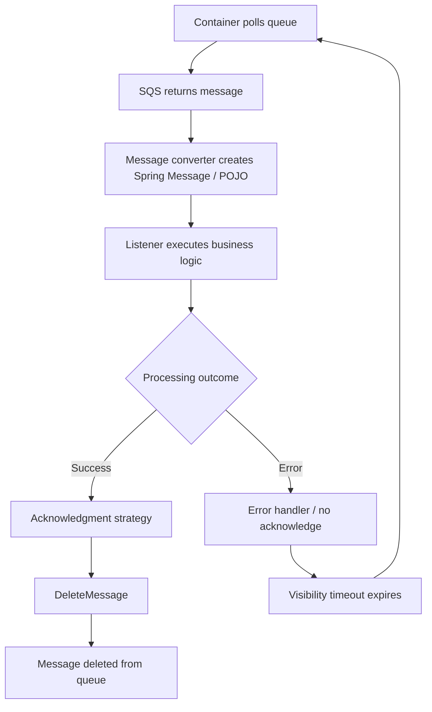
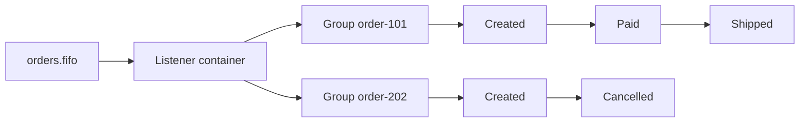

# Processing Messages with SqsListener and Listener Containers

In a Spring Boot application integrating with Amazon Simple Queue Service (Amazon SQS), consumers need a mechanism to continuously receive messages, invoke business logic, handle errors, and acknowledge messages after completion. **Spring Cloud AWS provides `@SqsListener` and `SqsMessageListenerContainer` to manage this entire lifecycle**: queue polling, payload conversion, processing coordination, retries, and acknowledgment.

This lesson focuses on the receiving side. You will create listeners, read metadata, configure container factories, tune concurrency and long polling, process messages in batches, control acknowledgment, operate FIFO queues, design retries/DLQs, and run integration tests. The examples use **Spring Cloud AWS 3.4.1** APIs; consult the documentation for the exact version installed in your project, as packages and APIs can differ across major releases.

## 1. Learning Objectives

After this lesson, you will be able to:

- Explain the roles of `@SqsListener`, `SqsMessageListenerContainer`, and `SqsMessageListenerContainerFactory`.
- Write listeners receiving POJOs, `Message<T>`, headers, and message attributes.
- Configure listeners by queue, factory, concurrency, poll timeout, and visibility timeout.
- Choose `ON_SUCCESS`, `ALWAYS`, or `MANUAL` acknowledgment appropriately for your business requirements.
- Process batches and partially acknowledge batches using `BatchAcknowledgement`.
- Understand retries, error handlers, backoff, dead-letter queues, and FIFO constraints.
- Manage container lifecycles, observe metrics/traces, and test realistic failure scenarios.

## 2. Message Lifecycle in a Listener Container

A listener container does more than invoke a Java method. It manages the full cycle from polling SQS to deleting the message from the queue:



`SqsMessageListenerContainer` handles polling, processing, and acknowledgment. With `@SqsListener`, Spring Cloud AWS creates a container and an adapter to invoke the annotated method. The application focuses on payload processing, while operational policies are configured on the annotation or container factory.

Distinguish three concepts:

- **Receive/poll:** SQS returns the message and places it in the *in flight* state for the duration of the visibility timeout.
- **Processing:** the listener executes business logic. The message still exists in the queue during this phase.
- **Acknowledgment:** Spring Cloud AWS calls the delete operation (`DeleteMessage`) according to the configured strategy. Only after deletion succeeds will the message stop being redelivered.

Visibility timeout is not a database transaction lock. If a consumer takes longer than the visibility window, the message can reappear while the previous execution is still running. Therefore, choose an appropriate timeout and design idempotent consumers.

## 3. Preparing Spring Boot and SQS

### 3.1. Adding the Starter

Use the Spring Cloud AWS BOM to align module versions:

```groovy
ext {
    springCloudAwsVersion = "3.4.1"
}

dependencies {
    implementation platform(
        "io.awspring.cloud:spring-cloud-aws-dependencies:${springCloudAwsVersion}"
    )
    implementation "io.awspring.cloud:spring-cloud-aws-starter-sqs"
}
```

If the project already imports the BOM at the root level, do not declare it again. Choose a Spring Cloud AWS version compatible with your application's Spring Boot version.

### 3.2. Configuring Region and Queues

```yaml
# application.yml
spring:
  cloud:
    aws:
      region:
        static: ap-southeast-1

app:
  sqs:
    inventory-queue: inventory-events
    order-queue: order-events.fifo
```

The Region is only an example. The queue must exist in the AWS account and Region used by the application. For local environments running LocalStack, you can set `spring.cloud.aws.endpoint` in a test profile; do not enable a local endpoint in real AWS environments.

The starter auto-configures `SqsAsyncClient`, the Region provider, and the credentials provider when no custom beans are defined. In deployed environments, prefer an IAM role attached to the workload (EC2 instance profile, ECS task role, or IAM role for service accounts on EKS). Never commit access keys/secret keys to Git.

### 3.3. Event Contracts Used in Examples

The examples below use small DTOs to illustrate payloads. In real projects, place them in a shared event-contract package or version schemas independently of database entities.

```java
import java.time.Instant;

// InventoryAdjusted.java
public record InventoryAdjusted(
    String eventId,
    String sku,
    int quantityDelta,
    Instant occurredAt
) {}

// OrderEvent.java
public record OrderEvent(
    String eventId,
    String orderId,
    long version,
    String eventType
) {}
```

`eventId` is a stable ID for a business event; the producer must keep this ID unchanged on retries. `sku` and `orderId` are entity keys used to update data or determine message groups. `InventoryService` and `OrderService` in the examples represent the application's business logic.

### 3.4. Consumer IAM Permissions

A consumer that only receives and deletes messages typically needs the following permissions on the specific queue ARN:

| IAM Action | Purpose |
|---|---|
| `sqs:ReceiveMessage` | Poll and receive messages |
| `sqs:DeleteMessage` | Acknowledge messages after processing |
| `sqs:GetQueueUrl` | Resolve queue name to URL |
| `sqs:GetQueueAttributes` | Read queue attributes on container startup or when configured to fetch attributes |
| `sqs:ChangeMessageVisibility` | Change visibility when the application needs to extend timeout or delay retries |

Producers may additionally need `sqs:SendMessage`. Do not grant send permissions to a consumer unless required. If the queue uses a KMS customer managed key, verify the corresponding KMS permissions and key policy as well.

**Note:** When a container receives a queue name, it needs to resolve the queue URL at startup. The default `queueNotFoundStrategy` may create the queue if not found; for IaC-managed queues in production, consider setting the `FAIL` strategy to catch typos or missing infrastructure immediately at startup.

## 4. Creating Your First Listener with @SqsListener

With Spring Boot auto-configuration, you do not need to define a container factory manually for basic cases. Simply annotate a method in a Spring bean:

```java
import io.awspring.cloud.sqs.annotation.SqsListener;
import org.springframework.stereotype.Component;

@Component
public class InventoryEventListener {
    private final InventoryService inventoryService;

    public InventoryEventListener(InventoryService inventoryService) {
        this.inventoryService = inventoryService;
    }

    @SqsListener("${app.sqs.inventory-queue}")
    public void handle(InventoryAdjusted event) {
        inventoryService.applyIdempotently(event);
    }
}
```

When the application starts, Spring Cloud AWS creates a `MessageListenerContainer` for this method. The container polls `inventory-events`, converts the payload into `InventoryAdjusted`, and invokes `handle()`. Once the method completes successfully, the default `ON_SUCCESS` acknowledgment deletes the message.

The value in `@SqsListener` can be a queue name or a queue URL. The annotation supports property placeholders and SpEL. Using properties makes it easy to switch queues per environment without changing code.

Each `@SqsListener` method has its own container. If one annotation declares multiple queues, those queues share the container while maintaining per-queue throughput and acknowledgment control. Do not mix Standard and FIFO queues in the same container.

## 5. Listener Parameter Types

Spring Cloud AWS supports multiple method signatures depending on the data the listener needs to inspect:

| Parameter | Meaning |
|---|---|
| `InventoryAdjusted` | Receives the POJO payload deserialized from JSON |
| `Message<InventoryAdjusted>` | Receives the payload along with `MessageHeaders` |
| `@Header("headerName") String value` | Extracts a specific header |
| `@Headers MessageHeaders headers` | Reads the message's header map |
| `Acknowledgement` | Manual acknowledgment for a single-message listener; requires `MANUAL` |
| `List<InventoryAdjusted>` | Enables batch mode and receives a list of payloads |
| `List<Message<InventoryAdjusted>>` | Enables batch mode and receives a list of messages with headers |
| `BatchAcknowledgement<InventoryAdjusted>` | Acknowledges the entire batch or a subset; requires `MANUAL` |
| `Visibility` / `BatchVisibility` | Changes visibility for a single message or a batch |
| `QueueAttributes` | Reads queue attributes requested by the container |

### 5.1. Reading Metadata with Message<T>

Logging examples assume the class has a logger, such as Lombok's `@Slf4j` or a declared `Logger`.

```java
import org.springframework.messaging.Message;

@SqsListener("${app.sqs.inventory-queue}")
public void handle(Message<InventoryAdjusted> message) {
    InventoryAdjusted event = message.getPayload();
    String eventId = event.eventId();
    Object correlationId = message.getHeaders().get("Sqs_MA_correlationId");

    log.info("Receive eventId={}, correlationId={}", eventId, correlationId);
    inventoryService.applyIdempotently(event);
}
```

Spring Cloud AWS maps SQS message attributes to message headers prefixed with `Sqs_MA_`; system attributes are prefixed with `Sqs_MSA_`. Thus, the `correlationId` attribute can be read via the `Sqs_MA_correlationId` header.

Only attributes requested by the container are fetched from SQS. By default, message attributes and system attributes are fetched; queue attributes are not loaded automatically. When queue attributes are needed, configure `queueAttributeNames` in container options.

### 5.2. Extracting a Specific Header

```java
import org.springframework.messaging.handler.annotation.Header;

@SqsListener("${app.sqs.inventory-queue}")
public void handle(
        InventoryAdjusted event,
        @Header("Sqs_MA_correlationId") String correlationId) {

    log.info("Receive eventId={}, correlationId={}", event.eventId(), correlationId);
    inventoryService.applyIdempotently(event);
}
```

If a header may be absent, use a nullable/`Optional` type or set an appropriate default value. Do not let an optional header unintentionally break the entire listener.

## 6. Customizing SqsMessageListenerContainerFactory

When you need shared settings for concurrency, polling, visibility, or acknowledgment, declare a factory:

```java
import io.awspring.cloud.sqs.config.SqsMessageListenerContainerFactory;
import io.awspring.cloud.sqs.listener.acknowledgement.handler.AcknowledgementMode;
import org.springframework.context.annotation.Bean;
import org.springframework.context.annotation.Configuration;
import software.amazon.awssdk.services.sqs.SqsAsyncClient;

import java.time.Duration;

@Configuration
public class SqsListenerConfiguration {
    @Bean
    SqsMessageListenerContainerFactory<Object> defaultSqsListenerContainerFactory(
            SqsAsyncClient sqsAsyncClient) {
        return SqsMessageListenerContainerFactory.builder()
            .sqsAsyncClient(sqsAsyncClient)
            .configure(options -> options
                .maxConcurrentMessages(16)
                .messagesPerPoll(10)
                .pollTimeout(Duration.ofSeconds(10))
                .messageVisibility(Duration.ofSeconds(60))
                .acknowledgementMode(AcknowledgementMode.ON_SUCCESS)
            )
            .build();
    }
}
```

A factory named `defaultSqsListenerContainerFactory` is used by `@SqsListener` whenever the annotation does not specify `factory`. When declaring a custom factory, verify the bean name and configuration because a user-defined factory can replace the auto-configured one.

The options in the example are illustrative values, not universal defaults for every system. Measure processing duration, incoming message rate, database capacity, and downstream services before increasing concurrency.

### 6.1. Configuring an Individual Listener

Attributes on the annotation override the corresponding factory values:

```java
@SqsListener(
    value = "${app.sqs.inventory-queue}",
    id = "inventory-event-consumer",
    maxConcurrentMessages = "8",
    pollTimeoutSeconds = "10",
    messageVisibilitySeconds = "90"
)
public void handle(InventoryAdjusted event) {
    inventoryService.applyIdempotently(event);
}
```

`id` identifies the container in logs and the registry. `maxConcurrentMessages` caps concurrently processed messages per queue. `pollTimeoutSeconds` sets the maximum duration of a poll. `messageVisibilitySeconds` sets the visibility timeout for received messages.

If the same option is declared on both the annotation and the factory, the annotation value takes precedence for that method's container. Avoid scattering configurations; put defaults in the factory and only override when a listener genuinely has different requirements.

## 7. Acknowledgment: ON_SUCCESS, ALWAYS, and MANUAL

In SQS, acknowledging means deleting the message from the queue. Spring Cloud AWS provides three modes:

| Mode | Behavior | Use Case |
|---|---|---|
| `ON_SUCCESS` | Acknowledges after the listener succeeds; does not acknowledge on error | Default choice suited for most consumers |
| `ALWAYS` | Acknowledges after the listener finishes, whether it succeeded or threw an error | Use only when errors are explicitly handled and you want to drop the message after this attempt |
| `MANUAL` | Framework does not auto-acknowledge; listener calls acknowledgment explicitly | When acknowledgment must happen after a specific business step or for part of a batch |

**Do not choose `ALWAYS` merely to stop message retries.** If a listener throws an exception due to a temporarily unavailable database, `ALWAYS` can delete the message and lose the chance to retry.

Default acknowledgment behavior also differs between Standard and FIFO queues: Standard enables batching with a 1-second interval and a threshold of 10 messages; FIFO acknowledges immediately after processing by default. If you enable acknowledgment batching for FIFO, pick an appropriate ordering mode (`ORDERED` or `ORDERED_BY_GROUP`) so you do not break message order within a group.

### 7.1. Manual Acknowledgment for a Single Message

You can configure this directly in the annotation:

```java
import io.awspring.cloud.sqs.annotation.SqsListener;
import io.awspring.cloud.sqs.listener.acknowledgement.Acknowledgement;

@SqsListener(
    value = "${app.sqs.inventory-queue}",
    acknowledgementMode = "MANUAL"
)
public void handle(InventoryAdjusted event, Acknowledgement acknowledgement) {
    inventoryService.applyIdempotently(event);
    acknowledgement.acknowledge();
}
```

If `applyIdempotently()` throws an exception, `acknowledge()` does not run. The container will not auto-acknowledge in `MANUAL` mode; the message can be received again after the visibility timeout expires. Only call `acknowledge()` after required state changes have committed.

`Acknowledgement` also offers `acknowledgeAsync()` if you want a `CompletableFuture<Void>` for asynchronous acknowledgment. If acknowledgment fails, observe the error; never assume a message is deleted simply because the listener invoked this method.

### 7.2. Partial Batch Acknowledgment

With a batch listener, you can acknowledge only the messages that succeeded:

```java
import io.awspring.cloud.sqs.listener.acknowledgement.BatchAcknowledgement;
import org.springframework.messaging.Message;

@SqsListener(
    value = "${app.sqs.inventory-queue}",
    acknowledgementMode = "MANUAL"
)
public void handleBatch(
        List<Message<InventoryAdjusted>> messages,
        BatchAcknowledgement<InventoryAdjusted> acknowledgement) {

    List<Message<InventoryAdjusted>> succeeded = new ArrayList<>();

    for (Message<InventoryAdjusted> message : messages) {
        try {
            inventoryService.applyIdempotently(message.getPayload());
            succeeded.add(message);
        } catch (RuntimeException ex) {
            log.error("Cannot process eventId={}",
                message.getPayload().eventId(), ex);
        }
    }

    if (!succeeded.isEmpty()) {
        acknowledgement.acknowledge(succeeded);
    }
}
```

`BatchAcknowledgement` supports acknowledging the whole batch or a collection of completed messages. Unacknowledged messages can reappear after the visibility timeout. In production, establish error reporting and alerting; merely logging without tracking retries can cause messages to loop indefinitely.

The snippet above illustrates partial acknowledgment for a Standard queue. With FIFO, you must not acknowledge a later message when an earlier message in the same `MessageGroupId` has not yet been processed successfully. Preserve ordering within each group and test your FIFO batch/ack strategy before deployment.

## 8. Batch Listeners

When a method takes a `List<T>` or `List<Message<T>>` parameter, Spring Cloud AWS automatically enables batch mode for that container:

```java
@SqsListener("${app.sqs.inventory-queue}")
public void handleBatch(List<InventoryAdjusted> events) {
    inventoryService.applyBatchIdempotently(events);
}
```

If per-message metadata is needed:

```java
@SqsListener("${app.sqs.inventory-queue}")
public void handleBatch(List<Message<InventoryAdjusted>> messages) {
    for (Message<InventoryAdjusted> message : messages) {
        log.info("eventId={}", message.getPayload().eventId());
    }
}
```

Batch mode reduces listener invocation overhead and allows processing multiple messages in one pass. However:

- A single SQS `ReceiveMessage` call returns at most 10 messages. Setting `maxMessagesPerPoll` above 10 can combine results from multiple polls into a single batch for the listener.
- A batch is not an atomic transaction. One element can succeed while another fails.
- If a listener processes a whole batch and then throws an exception, retry/ack behavior follows the container configuration; do not assume only the failing message will be redelivered.
- When partial acknowledgment is required, use `BatchAcknowledgement` in `MANUAL` mode and acknowledge only elements whose changes are durable.

## 9. Retries and Error Handling

By default, when a listener throws an exception, the message is not acknowledged and can be polled again after the visibility timeout expires. This is SQS's built-in retry mechanism.

### 9.1. Do Not Swallow Exceptions

```java
@SqsListener("${app.sqs.inventory-queue}")
public void handle(InventoryAdjusted event) {
    inventoryService.applyIdempotently(event);
}
```

If the service throws an exception, the error propagates to the container. Avoid the following pattern:

```java
@SqsListener("${app.sqs.inventory-queue}")
public void handle(InventoryAdjusted event) {
    try {
        inventoryService.applyIdempotently(event);
    } catch (Exception ex) {
        log.error("Processing failed", ex);
        // Listener returns normally: ON_SUCCESS may treat this as success.
    }
}
```

If you catch an exception, classify the error and decide explicitly: retry, route to a recovery workflow, or acknowledge after business logic has recorded the failure. Never return normally just because you logged the error.

### 9.2. ErrorHandler and AsyncErrorHandler

Spring Cloud AWS provides `ErrorHandler<T>` and `AsyncErrorHandler<T>` to handle errors after a listener fails. When using the auto-configured factory, you can declare an `ErrorHandler` bean:

```java
import io.awspring.cloud.sqs.listener.errorhandler.ErrorHandler;
import org.springframework.context.annotation.Bean;
import org.springframework.messaging.Message;

@Bean
ErrorHandler<Object> sqsErrorHandler() {
    return new ErrorHandler<>() {
        @Override
        public void handle(Message<Object> message, Throwable error) {
            log.error("SQS listener failed, messageId={}",
                message.getHeaders().getId(), error);
            // If the message must be retried, rethrow/propagate the error.
            throw new IllegalStateException("Message processing failed", error);
        }
    };
}
```

**Note:** Declaring an `ErrorHandler` bean applies directly when using the auto-configured factory. If you created a custom factory as in section 6, attach the handler directly to the factory with `.errorHandler(sqsErrorHandler)` or the equivalent configuration. If `ErrorHandler` completes normally, the framework considers the message recovered and proceeds with acknowledgment according to configuration. If the message should not be acknowledged under `ON_SUCCESS`, let the exception continue propagating. If you only need to observe errors without altering acknowledgment decisions, consider `MessageInterceptor.afterProcessing()`.

### 9.3. Backoff Instead of Tight Retry Loops

Immediate retries can amplify load when a database, target API, or dependency is degraded. Spring Cloud AWS 3.4.1 includes backoff error handlers, including exponential backoff based on `ApproximateReceiveCount` and visibility timeout.

Example of a progressive wait strategy:

```text
Receive attempt 1: visibility 2 seconds
Receive attempt 2: visibility 4 seconds
Receive attempt 3: visibility 8 seconds
Receive attempt 4: visibility 16 seconds
                  ... capped at maxVisibilityTimeoutSeconds
```

The numbers are only illustrative. Set caps aligned with your SLA, dependency recovery time, and business deadlines. Spring Cloud AWS provides immediate, exponential, and linear retry error handlers; base the choice on failure modes and system load.

### 9.4. Dead-Letter Queues

A DLQ is configured via the source queue's redrive policy. When a message is received more times than `maxReceiveCount`, SQS moves it to the DLQ according to the configured policy.

A DLQ isolates poison or persistently failing messages from the main processing flow. Build an operational runbook:

1. Alert when the DLQ message count exceeds 0 or a threshold.
2. Capture `messageId`, `eventId`, `ApproximateReceiveCount`, error details, and timestamps.
3. Classify data errors, code bugs, permission issues, and dependency failures.
4. Fix the root cause before replaying.
5. Verify idempotency so replaying does not cause duplicate side effects.

With FIFO, a failing message can block progress for subsequent messages in the same group. Moving the failed message to a DLQ lets the group resume once the redrive policy triggers, but it can leave a gap in the business sequence. Reconcile or replay the failed message in the right order.

## 10. Tuning Concurrency and Polling

The container manages the number of in-flight messages and poll frequency. Common options:

| Option | Meaning | Default in 3.4.1 |
|---|---|---|
| `maxConcurrentMessages` | Maximum concurrently processed messages per queue | 10 |
| `maxMessagesPerPoll` | Maximum messages per poll; one SQS request returns at most 10 | 10 |
| `pollTimeout` | Maximum wait time for a long poll | 10 seconds |
| `maxDelayBetweenPolls` | Wait time for permits before attempting a smaller poll batch | 10 seconds |
| `messageVisibility` | Visibility timeout applied to received messages | Uses queue configuration if not overridden |
| `backPressureMode` | Strategy to throttle polling based on processing capacity | `AUTO` |

For example, an annotation may set `maxConcurrentMessages = "16"`, which does not guarantee 16 messages/second. It is an in-flight concurrency cap; actual throughput also depends on processing time, database latency, polling rate, FIFO group count, and SQS quotas.

A single poll can return fewer messages than requested, even when the queue still holds messages. Never write logic that assumes every batch contains all 10 items.

`maxMessagesPerPoll` must align with `maxConcurrentMessages`. One `ReceiveMessage` request returns at most 10 messages; if a batch listener expects more, the container can aggregate results from multiple polls into a single batch.

### 10.1. Scaling Concurrency Safely

Suppose each message takes 200 ms on average and a consumer processes 10 messages concurrently. Increasing concurrency can raise throughput, but it also increases concurrent requests to downstream databases/APIs. If a downstream service only sustains 5 concurrent requests, raising listener concurrency to 100 can overload the target and trigger even more retries.

Tune step by step:

1. Measure p50/p95/p99 processing time and backlog depth.
2. Measure actual capacity of the database and downstream services.
3. Increase `maxConcurrentMessages` incrementally while watching error rates and latency.
4. Adjust `maxMessagesPerPoll` to balance SQS request count and batch size.
5. Rely on backpressure when downstream cannot keep up with incoming rate.

For FIFO, effective concurrency is also bounded by the number of `MessageGroupId`s with ready messages. One group advances sequentially; only multiple independent groups enable parallel execution.

### 10.2. Long Polling and Cost

Long polling reduces empty receives when a queue has no messages. In Spring Cloud AWS 3.4.1, the container's `pollTimeout` ranges from 1–10 seconds and defaults to 10 seconds. Longer waits typically suit continuously running workers; latency-sensitive workloads may need to weigh delay against poll frequency.

## 11. FIFO Queues in Listener Containers

Spring Cloud AWS detects FIFO queues by the `.fifo` suffix. When receiving a batch, the container partitions messages by `MessageGroupId`, processes messages sequentially within each group, and can process multiple groups in parallel.



When a message in a group fails, subsequent messages in that same group are dropped from the current processing cycle and will be redelivered after the visibility timeout expires. Messages already processed and acknowledged are not redelivered merely because a later message failed. Other groups continue independently.

### 11.1. FIFO Listener

```java
@SqsListener("${app.sqs.order-queue}")
public void handle(OrderEvent event) {
    orderService.applyInOrder(event);
}
```

The producer must assign `MessageGroupId` according to the aggregate requiring order, such as `order-<orderId>`. The listener container preserves receive order within the group; it does not reorder by `eventTime` or `version` if the producer sent them out of order.

### 11.2. FIFO Batch Grouping Strategy

For batch listeners, `fifoBatchGroupingStrategy` controls how messages are grouped:

- `PROCESS_MESSAGE_GROUPS_IN_PARALLEL_BATCHES` (default): groups are split into separate batches and processed in parallel, preserving order within each group.
- `PROCESS_MULTIPLE_GROUPS_IN_SAME_BATCH`: allows combining messages from multiple groups into one batch.

Choose the strategy matching your batch logic and acknowledgment approach. Do not process messages from the same group in arbitrary parallel batches if doing so can alter side-effect ordering.

A single container must be configured with either Standard queues or FIFO queues, never mixing both types in the same container. If you need both, declare separate listeners/factories.

## 12. Container Lifecycle and Managing Multiple Listeners

Containers created by `@SqsListener` are registered in `MessageListenerContainerRegistry`. The registry manages starting them when the Spring application context starts and stopping them during shutdown. These containers are not standalone Spring beans; the registry manages their lifecycle.

You can assign an ID to a listener and look up its container from the registry for control:

```java
@SqsListener(
    value = "${app.sqs.inventory-queue}",
    id = "inventory-listener"
)
public void handle(InventoryAdjusted event) {
    inventoryService.applyIdempotently(event);
}
```

```java
import io.awspring.cloud.sqs.listener.MessageListenerContainer;
import io.awspring.cloud.sqs.listener.MessageListenerContainerRegistry;

@Service
public class ListenerControlService {
    private final MessageListenerContainerRegistry registry;

    public ListenerControlService(MessageListenerContainerRegistry registry) {
        this.registry = registry;
    }

    public void pauseInventoryListener() {
        MessageListenerContainer<?> container =
            registry.getContainerById("inventory-listener");
        if (container != null) {
            container.stop();
        }
    }

    public void resumeInventoryListener() {
        MessageListenerContainer<?> container =
            registry.getContainerById("inventory-listener");
        if (container != null) {
            container.start();
        }
    }
}
```

This is an example of internal control; if you expose an admin endpoint to stop consumers, restrict access and record audit logs. On shutdown, the container waits for polling, processing, and acknowledgment to finish within a configured timeout, after which remaining tasks may be cancelled. Therefore, listeners should have bounded execution times and never leave orphaned background work.

## 13. Message Conversion and Schema

Listeners can receive POJOs because Spring Cloud AWS automatically converts JSON into Java objects. When both producer and consumer are Java applications, type headers help the framework resolve the payload type. When messages arrive from external systems, do not rely on the producer's Java class names.

Principles:

- Use dedicated DTOs/records for message contracts; avoid serializing persistence entities directly.
- Include `eventId`, `eventType`, and `schemaVersion` if the system needs identification and schema evolution.
- Define compatibility policies for adding fields, renaming fields, or changing data types.
- Use `Message<T>` when metadata is needed; use a POJO when payload alone suffices.
- When deserialization fails, determine whether it is a data issue or a version mismatch before retrying endlessly.

For messages published by SNS to SQS, Spring Cloud AWS 3.4.1 can read the `SnsNotification<T>` wrapper to extract the payload and metadata such as `messageId`, `topicArn`, subject, timestamp, and message attributes. This is useful when a queue subscribes to an SNS topic.

## 14. Observability: Logs, Metrics, and Tracing

Do not just log “received message”. A production consumer should track at least:

| Signal | What to Detect |
|---|---|
| Visible message count | Producer generating load faster than consumer processes it |
| In-flight message count | Consumer actively processing or messages awaiting acknowledgment |
| Age of oldest message | Rising end-to-end latency |
| ApproximateReceiveCount | Messages retrying repeatedly or poison messages |
| DLQ message count | Unrecoverable errors or invalid data |
| Listener duration p95/p99 | Slow database/target API or code bottleneck |
| Acknowledgment failure | Messages may be redelivered despite committed business work |

Spring Cloud AWS supports Micrometer Observation for SQS. Enable it via configuration:

```yaml
spring:
  cloud:
    aws:
      sqs:
        observation-enabled: true
```

The application needs an `ObservationRegistry` in the context to record observations. The framework provides the `spring.aws.sqs.listener` observation for message processing inside listener containers. Use correlation IDs/event IDs to connect logs across producer, queue, and consumer; avoid placing sensitive data in metric tags.

## 15. Testing Listeners

A solid test suite should verify both the happy path and acknowledgment failures.

| Test Type | Coverage |
|---|---|
| Business unit tests | Service handles payload, version, event ID, and idempotency properly |
| Context tests | Spring creates listener containers and resolves queue properties properly |
| Integration tests | Sends real messages via an SQS-compatible service and verifies listener delivery |
| Ack tests | Success deletes the message; error before ack allows redelivery |
| Batch tests | Batch containing valid and invalid messages; verifies partial acknowledgment |
| FIFO tests | Same group preserves order, different groups run concurrently, failures block the right chain |
| Shutdown tests | Container stops gracefully without losing received but uncommitted work |

LocalStack can be used for integration tests in CI or on developer machines. However, behaviors around quotas, IAM, KMS, visibility, and redrive policies should also be verified on a dedicated AWS test account before release.

Example unit test verifying business logic independently of SQS:

```java
@Test
void appliesInventoryEventIdempotently() {
    InventoryAdjusted event = new InventoryAdjusted(
        "evt-100", "SKU-42", 5, Instant.parse("2026-01-01T10:00:00Z")
    );

    inventoryService.applyIdempotently(event);
    inventoryService.applyIdempotently(event);

    assertThat(inventoryRepository.findQuantity("SKU-42")).isEqualTo(15);
}
```

The example assumes initial inventory is 10 and the service enforces a transaction/unique constraint so the same `eventId` is applied only once. Integration tests should send messages to the queue and wait for listener completion using test synchronization rather than fixed `Thread.sleep()` calls whenever bounded polling assertions can be used.

## 16. Common Issues and Troubleshooting

| Symptom | Possible Causes | How to Check |
|---|---|---|
| Listener fails to start | Wrong queue name/URL, Region, credentials, or missing queue | Check startup logs, queue URL, `queueNotFoundStrategy`, and IAM |
| `AccessDenied` on startup | Missing `sqs:GetQueueUrl` or `sqs:GetQueueAttributes` | Check policy attached to the workload role |
| Listener receives messages but doesn't delete them | Exception thrown, MANUAL without acknowledge, or DeleteMessage failing | Check ack mode, exception logs, and `sqs:DeleteMessage` permission |
| Duplicate message processing | Visibility timeout expired, ack failed, or non-idempotent logic | Check receive count, processing duration, and business transaction |
| Queue backlog growing | Slow consumer, low concurrency, or downstream bottleneck | Measure processing time, visible/in-flight counts, and downstream errors |
| One FIFO group stalled | Earlier message in the group is retrying or unacknowledged | Check event ID, receive count, visibility, and DLQ |
| Deserialization errors | Incompatible schema, wrong type header, or unexpected payload JSON | Inspect raw payload, converter, and schema version |
| Batch receives fewer items than expected | SQS returned fewer than requested or queue lacks enough messages | Never assume full batches; inspect polling and backlog |
| Shutdown causes redelivery | Application stopped while messages were unacknowledged | Set a reasonable shutdown timeout, bound processing time, and ensure idempotency |

## 17. Hands-On Exercises

**Exercise 1 — Basic listener:** Create queue `inventory-events`, DTO `InventoryAdjusted`, and an `@SqsListener` method. Send a message with `SqsTemplate` and verify the listener receives the expected payload.

**Exercise 2 — Reading metadata:** Send `correlationId` and `schemaVersion` as message attributes. Receive via `Message<InventoryAdjusted>` and log the correlation ID.

**Exercise 3 — Manual acknowledgment:** Switch the listener to `MANUAL`. Intentionally make the service throw an exception before acknowledging; verify the message is redelivered after visibility timeout. Then succeed and acknowledge the message.

**Exercise 4 — Batch:** Change the method to accept `List<Message<InventoryAdjusted>>`. Include one invalid payload, use `BatchAcknowledgement` to acknowledge succeeded messages, and observe the failed message being redelivered.

**Exercise 5 — Concurrency:** Run the listener with `maxConcurrentMessages` set to 1, 5, and 10. Record processing times and backlog, comparing throughput against database load.

**Exercise 6 — FIFO:** Create `order-events.fifo` and send multiple events across two `MessageGroupId`s. Force one event in the first group to fail and verify subsequent events in that group wait while the other group continues.

**Exercise 7 — DLQ and replay:** Configure a redrive policy, send a repeatedly failing message, and verify it moves to the DLQ after the configured receive count. Fix the root cause and perform a controlled replay.

## 18. Self-Check Questions

1. What does `@SqsListener` do? **Registers a method as a message handler and creates a listener container to poll, convert, process, and acknowledge messages.**
2. How does `ON_SUCCESS` differ from `ALWAYS`? **`ON_SUCCESS` acknowledges only after successful processing; `ALWAYS` acknowledges even when processing fails.**
3. When does a listener method need an `Acknowledgement` parameter? **When the container uses `AcknowledgementMode.MANUAL`.**
4. How do you enable batch mode via the annotation? **Use a `List<Payload>` or `List<Message<Payload>>` parameter.**
5. Does `maxConcurrentMessages` represent throughput per second? **No; it caps the number of messages being processed concurrently per queue.**
6. If a FIFO message in a group fails, what happens to subsequent messages in that group? **Subsequent messages are dropped from the current processing pass and redelivered after the visibility timeout.**
7. Why should you not catch an exception and return normally inside a listener? **Because the container may treat the listener as successful and acknowledge the message under `ON_SUCCESS`.**
8. When do you need a DLQ? **When messages exceed the allowed retry count and must be isolated from the main stream for investigation or replay.**

## 19. References

- [Spring Cloud AWS 3.4.1 — SQS Integration Reference](https://docs.awspring.io/spring-cloud-aws/docs/3.4.1/reference/html/index.html): listeners, container factories, batching, FIFO, acknowledgment, retries, throughput, and observability.
- [Spring Cloud AWS 3.4.1 — SqsListener API](https://docs.awspring.io/spring-cloud-aws/docs/3.4.1/apidocs/io/awspring/cloud/sqs/annotation/SqsListener.html): annotation attributes and listener signatures.
- [Spring Cloud AWS 3.4.1 — Acknowledgement API](https://docs.awspring.io/spring-cloud-aws/docs/3.4.1/apidocs/io/awspring/cloud/sqs/listener/acknowledgement/Acknowledgement.html): manual acknowledgment for single-message listeners.
- [Spring Cloud AWS 3.4.1 — BatchAcknowledgement API](https://docs.awspring.io/spring-cloud-aws/docs/3.4.1/apidocs/io/awspring/cloud/sqs/listener/acknowledgement/BatchAcknowledgement.html): acknowledging an entire batch or a subset.
- [Amazon SQS — Visibility timeout](https://docs.aws.amazon.com/AWSSimpleQueueService/latest/SQSDeveloperGuide/sqs-visibility-timeout.html): in-flight message lifecycle and redelivery behavior.
- [Amazon SQS — Dead-letter queues](https://docs.aws.amazon.com/AWSSimpleQueueService/latest/SQSDeveloperGuide/sqs-dead-letter-queues.html): redrive policy and isolating failed messages.

**Key takeaway:** `@SqsListener` helps Spring Boot operate SQS consumers with a clear lifecycle. Align acknowledgment with business commit state, tune concurrency to downstream capacity, and keep consumers idempotent so the system stays safe against retries, duplicate delivery, and network failures.
