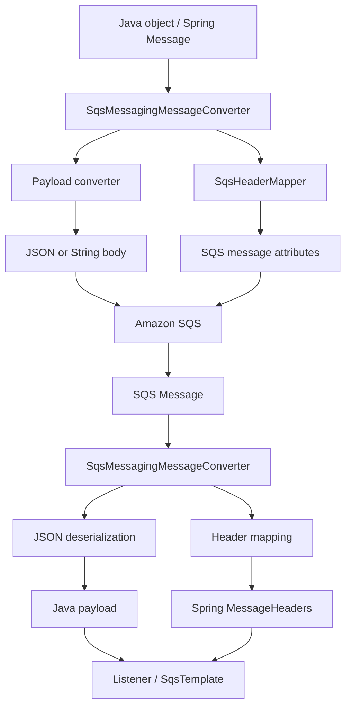

# Payload Mapping, Headers, and JSON Conversion

When integrating Spring Boot with Amazon Simple Queue Service (Amazon SQS), a message is more than a JSON string. A message has a **body** containing business data, **message attributes** holding application-defined metadata, and **system attributes** used by SQS/AWS. A Spring application needs to convert these parts into Java objects and Spring `Message` instances so producers and consumers can communicate reliably.

Spring Cloud AWS provides `SqsMessagingMessageConverter` for this purpose. The default converter combines `SqsHeaderMapper` to map headers to and from message attributes with payload converters such as `StringMessageConverter` and `MappingJackson2MessageConverter` to convert data via JSON. **Understanding the boundary between payload, headers, and type information helps prevent deserialization errors, coupling to Java class names, and metadata loss when integrating with external producers.**

This lesson uses Spring Cloud AWS **3.4.1** APIs and focuses on message structure, JSON mapping, `ObjectMapper`, type headers, custom header mappers, handling multiple event types, schema compatibility, and conversion testing.

## 1. Learning Objectives

After this lesson, you will be able to:

- Distinguish between message body, message attributes, message system attributes, and queue attributes.
- Explain the roles of `SqsMessagingMessageConverter`, `SqsHeaderMapper`, and `MappingJackson2MessageConverter`.
- Send a Java record as JSON using `SqsTemplate` and receive it via `@SqsListener`.
- Read message attributes via `@Header`, `Message<T>`, and Spring Cloud AWS header prefixes.
- Understand the default `JavaType` header, when to specify a payload class, and when to use a type mapper.
- Configure `ObjectMapper`, custom converters, custom header mappers, and an allowlist for multiple event types.
- Design schema versioning, input validation, and tests for invalid payloads.

## 2. Structure of an SQS Message

An SQS message has distinct parts:

| Component | Who Defines It? | Purpose | Example |
|---|---|---|---|
| **Body** | Producer | Business content that the consumer needs to process | `InventoryAdjusted`, `OrderPaid` |
| **Message attributes** | Application | Structured metadata for routing, tracing, classification, or inspection without parsing the body | `eventType`, `correlationId`, `schemaVersion` |
| **Message system attributes** | AWS/SQS and AWS integrations | Metadata for AWS services, such as trace headers | `AWSTraceHeader` |
| **Queue attributes** | Queue configuration | Properties of the queue itself, not per-message metadata | `VisibilityTimeout`, `FifoQueue` |

Example JSON body:

```json
{
  "eventId": "evt-8f31",
  "sku": "SKU-42",
  "quantityDelta": 5,
  "occurredAt": "2026-11-24T09:30:00Z"
}
```

Accompanying message attributes might be:

```text
eventType     = inventory.adjusted.v1
correlationId = req-123
tenantId      = tenant-42
schemaVersion = 1
```

A consumer can inspect `eventType` or `tenantId` to decide how to handle the message before deserializing the entire body. However, all fields required to execute business logic should reside in the body. Do not put the entire event inside message attributes.

### 2.1. Message Attribute Limits

Amazon SQS allows at most **10 message attributes per message**. Logical data types include `String`, `Number`, and `Binary`; custom type labels such as `Number.int` can also be attached. Attribute names are case-sensitive, up to 256 characters long, and cannot start with `AWS.` or `Amazon.`.

Both the body size and attribute components count toward the SQS message size limit (1 MiB). Therefore, attributes are suited for short metadata such as IDs, event types, schema versions, or correlation IDs; they are not suitable for files, large JSON blobs, or secret tokens.

**Do not confuse message attributes with message system attributes.** Message attributes are application-defined metadata; system attributes are managed by SQS/AWS. Examples include `AWSTraceHeader` for tracing and receive-time metadata such as `ApproximateReceiveCount`, `SentTimestamp`, `MessageGroupId`, or `SequenceNumber` when applicable to the queue type. Queue attributes are a separate category describing the queue's configuration.

## 3. Conversion Model in Spring Cloud AWS

In Spring Cloud AWS 3.4.1, the default converter is `SqsMessagingMessageConverter`:



The converter consists of two main parts:

- **Payload converter:** a `CompositeMessageConverter` combining `StringMessageConverter` and `MappingJackson2MessageConverter` to convert Java payloads to message bodies and back.
- **Header mapper:** `SqsHeaderMapper` maps Spring `MessageHeaders` to and from SQS message attributes and SQS-specific headers.

As a result, the JSON body and message attributes can be converted independently. A message with a JSON body and no attributes can still deserialize if the listener knows the payload type. Conversely, a message with valid attributes but a malformed body schema can still fail deserialization.

### 3.1. Default Configuration and API Flows

Spring Cloud AWS uses converters in both `SqsTemplate` and listener containers, though the two configuration paths can be customized separately:

| Flow | Converter Component | Where to Configure |
|---|---|---|
| Send/receive via `SqsTemplate` | Template's `SqsMessagingMessageConverter` | `SqsTemplate.builder()` and `configureDefaultConverter()` |
| Receive via `@SqsListener` | Listener container / message handler converter | `SqsContainerOptions.messageConverter()` or `SqsListenerConfigurer` |
| Custom listener (`MessageListener`) | Container's converter | `SqsMessageListenerContainerFactory` or container options |

Do not assume changing a `SqsTemplate`'s converter automatically updates the converter for every `@SqsListener`. If producer and consumer require the same special rules, configure both paths or use shared auto-configuration as appropriate.

## 4. Defining Java Payloads and JSON

Example inventory adjustment event:

```java
import java.time.Instant;

public record InventoryAdjusted(
    String eventId,
    String sku,
    int quantityDelta,
    Instant occurredAt
) {}
```

This record describes business data; it does not contain `MessageHeaders`, receipt handles, or queue URLs. Transport-layer metadata should be passed via message attributes or Spring headers.

When serializing the record, Jackson produces a JSON body. For `Instant`, the application should use an `ObjectMapper` configured with the Java Time module and an explicit time format convention, typically ISO-8601 UTC. Spring Boot's auto-configured `ObjectMapper` usually registers the necessary module when the Jackson Java Time dependency is present.

Illustrative JSON:

```json
{
  "eventId": "evt-8f31",
  "sku": "SKU-42",
  "quantityDelta": 5,
  "occurredAt": "2026-11-24T09:30:00Z"
}
```

The JSON body is the contract between producer and consumer. If a consumer needs a new `warehouseId` field, design a compatible schema evolution rather than requiring consumers to know the producer's Java package or class name.

## 5. Sending Payloads and Message Headers with SqsTemplate

When sending an object, `SqsTemplate` converts the payload to JSON and maps headers to message attributes:

```java
import io.awspring.cloud.sqs.operations.SqsTemplate;
import org.springframework.beans.factory.annotation.Value;
import org.springframework.stereotype.Service;

@Service
public class InventoryPublisher {
    private final SqsTemplate sqsTemplate;
    private final String queueName;

    public InventoryPublisher(
            SqsTemplate sqsTemplate,
            @Value("${app.sqs.inventory-queue}") String queueName) {
        this.sqsTemplate = sqsTemplate;
        this.queueName = queueName;
    }

    public void publish(InventoryAdjusted event, String correlationId) {
        sqsTemplate.send(to -> to
            .queue(queueName)
            .payload(event)
            .header("eventType", "inventory.adjusted.v1")
            .header("correlationId", correlationId)
            .header("schemaVersion", "1")
        );
    }
}
```

In this example:

- `payload(event)` is the business data serialized into the JSON body.
- `header("eventType", ...)` is application metadata; `SqsHeaderMapper` maps it to an SQS message attribute.
- `correlationId` connects logs/traces between the request and consumer.
- `schemaVersion` helps consumers apply compatibility rules or version-specific handling.

Never put passwords, access keys, tokens, or sensitive personal data into message attributes. Attributes are not a secret store and remain part of the message that is transmitted, stored, and logged if the application logs headers.

### 5.1. Using Spring Message When Managing Multiple Headers

If payload and headers are already prepared in another layer, you can construct a `Message<T>`:

```java
import org.springframework.messaging.Message;
import org.springframework.messaging.support.MessageBuilder;

Message<InventoryAdjusted> message = MessageBuilder
    .withPayload(event)
    .setHeader("eventType", "inventory.adjusted.v1")
    .setHeader("correlationId", correlationId)
    .setHeader("schemaVersion", "1")
    .build();

sqsTemplate.send(to -> to
    .queue(queueName)
    .payload(message)
);
```

`MessageBuilder` separates message construction from sending. When working with headers, verify which headers are supported by `SqsHeaderMapper` and which are strictly internal to Spring. Do not assume every `MessageHeaders` entry becomes an SQS attribute.

## 6. Reading Payloads and Attributes in @SqsListener

### 6.1. Receiving Only the Payload

If only business data is needed, the method can accept the POJO directly:

```java
import io.awspring.cloud.sqs.annotation.SqsListener;
import org.springframework.stereotype.Component;

@Component
public class InventoryListener {
    private final InventoryService inventoryService;

    public InventoryListener(InventoryService inventoryService) {
        this.inventoryService = inventoryService;
    }

    @SqsListener("${app.sqs.inventory-queue}")
    public void handle(InventoryAdjusted event) {
        inventoryService.applyIdempotently(event);
    }
}
```

With `@SqsListener` methods, when no type information is present in headers, the framework can use the method parameter type to determine the target class before invoking the listener. This works well when a queue carries a single known payload type.

### 6.2. Receiving Both Payload and Message Attributes

```java
import org.springframework.messaging.handler.annotation.Header;
import org.springframework.messaging.Message;

@SqsListener("${app.sqs.inventory-queue}")
public void handle(
        InventoryAdjusted event,
        @Header("Sqs_MA_correlationId") String correlationId,
        @Header(name = "Sqs_MA_eventType", required = false) String eventType) {

    log.info("eventId={}, correlationId={}, eventType={}",
        event.eventId(), correlationId, eventType);
    inventoryService.applyIdempotently(event);
}
```

Spring Cloud AWS adds prefixes to headers mapped from SQS:

| Source | Spring Message Header | Example |
|---|---|---|
| Message attribute | `Sqs_MA_` | `Sqs_MA_correlationId` |
| Message system attribute | `Sqs_MSA_` | `Sqs_MSA_ApproximateReceiveCount` |
| Queue attributes | `Sqs_QueueAttributes` | `QueueAttributes` object when requested |
| Queue URL | `Sqs_QueueUrl` | URL of the receiving queue |
| Queue name | `Sqs_QueueName` | Name of the receiving queue |

`Sqs_MA_` stands for message attribute; `Sqs_MSA_` stands for message system attribute. Do not omit the prefix when using `@Header` or `message.getHeaders().get(...)`.

### 6.3. Reading Metadata via Message<T>

When you need multiple headers or want to pass `Message<T>` through processing layers, use:

```java
import org.springframework.messaging.Message;

@SqsListener("${app.sqs.inventory-queue}")
public void handle(Message<InventoryAdjusted> message) {
    InventoryAdjusted event = message.getPayload();
    String correlationId = message.getHeaders()
        .get("Sqs_MA_correlationId", String.class);
    String eventType = message.getHeaders()
        .get("Sqs_MA_eventType", String.class);

    log.info("Received {} ({})", event.eventId(), eventType);
    inventoryService.applyIdempotently(event);
}
```

If metadata may be missing, avoid blind unchecked casts. Use `get(key, String.class)` with a `null` check, or mark the `@Header` parameter as `required = false` depending on the method signature.

### 6.4. How Attributes Are Fetched from SQS

In Spring Cloud AWS 3.4.1, the listener container fetches all message attributes and message system attributes by default, but does not fetch queue attributes. You can customize `messageAttributeNames`, `messageSystemAttributeNames`, and `queueAttributeNames` in `SqsContainerOptions`.

Example fetching only the metadata the application uses:

```java
@Bean
SqsMessageListenerContainerFactory<Object> inventoryListenerFactory(
        SqsAsyncClient sqsAsyncClient) {
    return SqsMessageListenerContainerFactory.builder()
        .sqsAsyncClient(sqsAsyncClient)
        .configure(options -> options
            .messageAttributeNames(List.of("eventType", "correlationId", "schemaVersion"))
        )
        .build();
}
```

When narrowing fetched attributes, listeners cannot read attributes excluded from the receive request. If using a custom factory, reference it in `@SqsListener` or name it as the default factory per project convention. Avoid creating multiple factories with conflicting names.

## 7. JavaType Header and Payload Type Resolution

To turn JSON into a Java object, the converter must know the target class. Spring Cloud AWS has a default type-header mechanism.

### 7.1. The Default JavaType Header

When `SqsTemplate` sends a Java payload, it adds a `JavaType` header by default containing the fully qualified class name (FQCN), for example:

```text
JavaType = com.example.inventory.InventoryAdjusted
```

This header is sent as a message attribute. On receive, `SqsHeaderMapper` maps that attribute into a Spring header:

```text
Sqs_MA_JavaType = com.example.inventory.InventoryAdjusted
```

`SqsTemplate`, `SqsMessageListenerContainer`, and `@SqsListener` can use this type information to choose the deserialization class. With `SqsTemplate.receive()` when no type header exists, specify the payload class explicitly:

```java
Optional<Message<InventoryAdjusted>> message = sqsTemplate.receive(
    from -> from.queue(queueName),
    InventoryAdjusted.class
);
```

If messages arrive from a non-Spring Cloud AWS producer without `JavaType`, `@SqsListener` can rely on the method parameter type. With `SqsTemplate.receive()`, pass `InventoryAdjusted.class` or configure `defaultPayloadClass` when the payload type is known.

### 7.2. Why FQCN Should Not Be Treated as an Inter-Service Contract

An FQCN depends on Java package and code structure. If a producer refactors packages, consumers may fail to resolve the type header. A producer written in .NET, Go, or Python does not even have Java classes to send.

Therefore:

- For internal Java systems with synchronized releases, `JavaType` can be convenient.
- For polyglot integrations or independently deployed teams, use a stable `eventType` such as `inventory.adjusted.v1` and map it to classes via an allowlist.
- If a queue holds only one message type, relying on the listener parameter type or an explicit `payloadClass` keeps the contract simpler.
- Never allow an untrusted header to select arbitrary classes on the classpath for deserialization.

## 8. Handling Multiple Event Types with a Type Mapper

Suppose the `domain-events` queue receives two event types:

```java
interface InventoryEvent {
    String eventId();
}

record InventoryAdjusted(
    String eventId,
    String sku,
    int quantityDelta
) implements InventoryEvent {}

record InventoryRecounted(
    String eventId,
    String sku,
    int countedQuantity
) implements InventoryEvent {}
```

The producer sends a message attribute `eventType` with values from an agreed set:

```text
inventory.adjusted.v1
inventory.recounted.v1
```

The consumer configures `setPayloadTypeMapper()` to map those values to classes:

```java
import io.awspring.cloud.sqs.support.converter.SqsMessagingMessageConverter;

SqsMessagingMessageConverter converter = new SqsMessagingMessageConverter();
converter.setPayloadTypeMapper(message -> {
    String eventType = message.getHeaders()
        .get("Sqs_MA_eventType", String.class);

    if ("inventory.adjusted.v1".equals(eventType)) {
        return InventoryAdjusted.class;
    }
    if ("inventory.recounted.v1".equals(eventType)) {
        return InventoryRecounted.class;
    }

    throw new IllegalArgumentException("Unsupported eventType: " + eventType);
});
```

The listener can accept the interface:

```java
@SqsListener("domain-events")
public void handle(InventoryEvent event) {
    if (event instanceof InventoryAdjusted adjusted) {
        inventoryService.adjust(adjusted);
    } else if (event instanceof InventoryRecounted recounted) {
        inventoryService.recount(recounted);
    } else {
        throw new IllegalArgumentException("Unsupported event class: " + event.getClass());
    }
}
```

The types in this example are package-private to illustrate multiple types in one snippet. In real projects, place each public type in its own file.

`setPayloadTypeMapper()` replaces the default type-header-based mapping. Consequently, if you use a mapper keyed on `eventType`, make sure that message attribute is present and fetched. Unrecognized values should fail explicitly so the message enters error/DLQ handling rather than silently mapping to an unrelated class.

## 9. Customizing SqsMessagingMessageConverter

You can configure the default converter or replace the converter completely.

### 9.1. Configuring SqsTemplate's Converter

```java
import io.awspring.cloud.sqs.operations.SqsOperations;
import io.awspring.cloud.sqs.operations.SqsTemplate;
import software.amazon.awssdk.services.sqs.SqsAsyncClient;
import com.fasterxml.jackson.databind.ObjectMapper;

@Bean
SqsOperations sqsOperations(
        SqsAsyncClient sqsAsyncClient,
        ObjectMapper objectMapper) {

    return SqsTemplate.builder()
        .sqsAsyncClient(sqsAsyncClient)
        .configureDefaultConverter(converter -> {
            converter.setObjectMapper(objectMapper);
            converter.setPayloadTypeHeader("JavaType");
        })
        .buildSyncTemplate();
}
```

`configureDefaultConverter()` lets you keep the default converter while replacing `ObjectMapper`, `HeaderMapper`, or the type header name. If you need completely custom payload conversion, construct your own `SqsMessagingMessageConverter` and pass it via `.messageConverter(converter)`.

### 9.2. Using Spring Boot's ObjectMapper for @SqsListener

With Spring Boot auto-configuration and a single `ObjectMapper` in the context, Spring Cloud AWS uses that mapper to deserialize `@SqsListener` payloads. To assign a mapper explicitly for listeners, use `SqsListenerConfigurer`:

```java
import com.fasterxml.jackson.databind.ObjectMapper;
import io.awspring.cloud.sqs.annotation.SqsListenerConfigurer;

@Bean
SqsListenerConfigurer sqsListenerConfigurer(ObjectMapper objectMapper) {
    return registrar -> registrar.setObjectMapper(objectMapper);
}
```

If an application defines multiple `ObjectMapper` instances for REST APIs, persistence, or event schemas, explicitly choose which mapper SQS uses. Do not alter a global mapper just for one queue if other APIs depend on its existing settings.

### 9.3. Configuring a Converter for a Listener Container

If listeners need a dedicated type mapper or header mapper, configure `SqsMessagingMessageConverter` on `SqsContainerOptions`:

```java
SqsMessagingMessageConverter messageConverter = new SqsMessagingMessageConverter();
messageConverter.setObjectMapper(objectMapper);
messageConverter.setPayloadTypeMapper(message -> {
    String eventType = message.getHeaders()
        .get("Sqs_MA_eventType", String.class);
    if (eventType == null) {
        throw new IllegalArgumentException("Missing eventType attribute");
    }
    return switch (eventType) {
        case "inventory.adjusted.v1" -> InventoryAdjusted.class;
        case "inventory.recounted.v1" -> InventoryRecounted.class;
        default -> throw new IllegalArgumentException("Unsupported eventType: " + eventType);
    };
});

factory.configure(options -> options.messageConverter(messageConverter));
```

The snippet shows the converter setup; `factory` is an `SqsMessageListenerContainerFactory` created in Spring configuration. When using a custom type mapper, test both missing attributes and unsupported event types.

## 10. Custom HeaderMapper and Additional Headers

`SqsHeaderMapper` maps Spring message headers to and from SQS message attributes. If you need to add a header derived from the raw SQS message, use `setAdditionalHeadersFunction()`:

```java
import io.awspring.cloud.sqs.support.converter.SqsHeaderMapper;
import io.awspring.cloud.sqs.support.converter.SqsMessagingMessageConverter;

SqsHeaderMapper headerMapper = new SqsHeaderMapper();
headerMapper.setAdditionalHeadersFunction((sqsMessage, accessor) -> {
    accessor.setHeader("sourceSystem", "amazon-sqs");
    accessor.setHeader("rawMessageId", sqsMessage.messageId());
    return accessor.toMessageHeaders();
});

SqsMessagingMessageConverter converter = new SqsMessagingMessageConverter();
converter.setHeaderMapper(headerMapper);
```

This example adds headers when converting a raw SQS message into a Spring `Message`. The `rawMessageId` header is read from the message metadata returned by the AWS SDK; it is not the business `eventId`. Never use a header mapper to mutate the JSON payload or overwrite system metadata in ways that corrupt the receipt handle, queue URL, or message ID.

After configuring the header mapper, install the converter on the container factory via `factory.configure(options -> options.messageConverter(converter))`. To use it with `SqsTemplate`, pass the converter via `.messageConverter(converter)` when building the template. Configuring the converter in one place does not automatically apply it to the other.

If you need completely custom mapping rules, implement your own `HeaderMapper` and pass it via `setHeaderMapper()`. Keep internal Spring/SQS headers distinct from application-defined message attributes.

## 11. Schema Compatibility and Event Evolution

Messages can sit in a queue longer than a single deployment cycle. A newer producer version may send messages while an older consumer version is still running. Therefore, event schemas must allow multiple versions to coexist.

| Change | Typical Compatibility | How to Handle |
|---|---|---|
| Add an optional field | Usually backward compatible if consumers ignore unknown fields | Provide default/nullable values, test with older consumers |
| Add a required field | Can break older consumers or older messages | Supply a default value or publish a new event version |
| Rename a field | Can cause deserialization errors or missing data | Use `@JsonAlias` during the transition period |
| Change a field type | Risks deserialization errors or semantic bugs | Introduce a new field or new version |
| Remove a field | Can leave older consumers missing data | Retain during a deprecation window |
| Rename a Java package | Can break `JavaType` FQCN resolution | Use a stable event type instead of class names |

Example supporting an old field name:

```java
import com.fasterxml.jackson.annotation.JsonAlias;

public record InventoryAdjusted(
    String eventId,
    @JsonAlias("productCode") String sku,
    int quantityDelta
) {}
```

If an older producer sends `productCode`, Jackson can still map it into `sku`. When rolling out a new schema, maintain a transition window and telemetry to confirm older producers have stopped emitting the legacy field.

An event can carry `schemaVersion` in its body or message attributes. If the version affects deserialization, use `eventType`/`schemaVersion` to pick a specific class or converter. Avoid overloading a single mutable Java class to interpret every version once field semantics diverge.

### 11.1. Ignoring Unrecognized JSON Fields

In some systems, consumers must ignore newly added fields for backward compatibility:

```java
import com.fasterxml.jackson.annotation.JsonIgnoreProperties;

@JsonIgnoreProperties(ignoreUnknown = true)
public record InventoryAdjusted(
    String eventId,
    String sku,
    int quantityDelta
) {}
```

Enable `ignoreUnknown` only when extra fields genuinely do not affect current logic. If an unknown field represents a new event variant or critical business change, silently ignoring it can cause data loss. For critical message contracts, consider explicit schema validation and versioning.

## 12. Producers Outside Spring Cloud AWS

Not every producer sends `JavaType`. For instance, a Python Lambda might send a JSON body:

```json
{
  "eventId": "evt-200",
  "sku": "SKU-99",
  "quantityDelta": -2,
  "occurredAt": "2026-11-24T10:15:00Z"
}
```

With message attributes:

```text
eventType     = inventory.adjusted.v1
schemaVersion = 1
correlationId = req-987
```

A Spring consumer can bind the payload using the method parameter type and read attributes:

```java
@SqsListener("${app.sqs.inventory-queue}")
public void handle(
        InventoryAdjusted event,
        @Header("Sqs_MA_correlationId") String correlationId) {
    inventoryService.applyIdempotently(event);
}
```

Non-Spring producers do not need to know Java packages, `JavaType`, or Spring `MessageHeaders`. Both sides only need to agree on the JSON schema and message attribute names/types. This integration style fits well when AWS Lambda, .NET, Python, and Spring Boot participate in the same event stream.

## 13. Handling Conversion Errors and Invalid Data

Conversion errors occur before or during listener invocation, for example:

- Malformed JSON or an empty body.
- Field type mismatch (a string instead of an integer).
- Invalid `Instant` format.
- Type header pointing to a class absent from the application.
- Missing `eventType` or a value outside the allowlist.
- Schema version unsupported by the consumer.

When the converter fails before the listener method is invoked, code inside the listener cannot catch that exception. Handle it in the listener container's error handler/interceptor layer and configure retries/DLQ. Never infinitely retry a message with malformed JSON; after an appropriate receive count, move the message to a DLQ for investigation.

For transient business errors (database timeout, downstream 503), retries can help. For schema errors or invalid payloads, retrying the exact same payload rarely fixes anything. Classifying errors reduces cost and keeps poison messages from blocking the queue.

Do not log the entire raw body when messages may contain sensitive information. Prefer logging sanitized `eventId`, `messageId`, `correlationId`, `eventType`, schema version, and error codes.

## 14. Testing Payloads, Headers, and JSON Conversion

### 14.1. ObjectMapper Unit Tests

Verify serialization/deserialization independently of SQS:

```java
@Test
void inventoryEventRoundTripsAsJson() throws Exception {
    InventoryAdjusted event = new InventoryAdjusted(
        "evt-8f31",
        "SKU-42",
        5,
        Instant.parse("2026-11-24T09:30:00Z")
    );

    String json = objectMapper.writeValueAsString(event);
    InventoryAdjusted restored = objectMapper.readValue(
        json, InventoryAdjusted.class
    );

    assertThat(restored).isEqualTo(event);
}
```

This test verifies Jackson mapping, though it does not prove `SqsHeaderMapper` maps attributes correctly.

### 14.2. Integration Tests with LocalStack

Create a test queue, send a message via `SqsTemplate` with `eventType` and `correlationId`, and let `@SqsListener` receive it. Verify:

1. The JSON body deserializes into the expected record.
2. Header `Sqs_MA_correlationId` matches the sent value.
3. Header `Sqs_MA_eventType` matches the event type.
4. `JavaType` maps properly when the producer uses Spring Cloud AWS.
5. Messages from non-Spring producers without a type header still deserialize via the listener parameter type.
6. Invalid JSON routes to the error handler and retry/DLQ as configured.

LocalStack is great for CI and local development. Behaviors involving IAM, KMS, quotas, policies, and redrive should still be verified against a dedicated AWS test account.

### 14.3. Conversion Test Matrix

| Payload | Type Header | Attributes | Expected Outcome |
|---|---|---|---|
| Valid JSON for `InventoryAdjusted` | Valid `JavaType` | Correlation ID present | Deserializes and reads header successfully |
| Valid JSON | Absent | Allowlisted `eventType` present | Type mapper selects the right class |
| Valid JSON | Absent | Absent | `@SqsListener` uses method parameter type if the queue has one payload type |
| Valid JSON | Absent | Absent | `SqsTemplate.receive(queue, InventoryAdjusted.class)` deserializes as specified class |
| Valid JSON with wrong type header | Invalid FQCN | Any | Type mapping fails; do not trust arbitrary classes from producers |
| Malformed JSON | Present or absent | Present or absent | Conversion failure handled by error handler and DLQ |
| JSON with new field | Absent | New `schemaVersion` | Handled per schema compatibility policy |

## 15. Common Issues and Troubleshooting

| Symptom | Cause | Resolution |
|---|---|---|
| Listener fails to deserialize JSON | Payload mismatches schema or Jackson lacks a required module | Inspect raw body, `ObjectMapper`, record types, and date/time formats |
| `JavaType` fails to resolve class | Producer sent an FQCN missing on the consumer | Use a stable event type and an allowlisted type mapper |
| `@Header` returns `null` | Attribute not sent, misspelled, or excluded from receive request | Verify attribute name and `messageAttributeNames` |
| Cannot read queue attributes | Container did not request `queueAttributeNames` | Configure the queue attributes to load |
| Attributes lost on send | Header unsupported by mapper or internal Spring header used | Check `SqsHeaderMapper`, use valid header names, and write integration tests |
| Consumer receives JSON with missing fields | Producer/consumer schema drift or renamed field | Use `@JsonAlias`, defaults, and versioning |
| Interface deserialization fails | Missing type mapper or unrecognized event type | Configure `setPayloadTypeMapper()` with an allowlist |
| Malformed JSON loops in queue | Poison message retried unchanged | Classify errors, set a redrive policy, and process the DLQ |
| Message attribute limit exceeded | More than 10 attributes or oversized metadata | Keep attributes concise; move business data into the body |

## 16. Hands-On Exercises

**Exercise 1 — Record to JSON:** Define `InventoryAdjusted`, send it with `SqsTemplate`, inspect the JSON body, and verify the listener receives the expected values.

**Exercise 2 — Sending message attributes:** Add `eventType`, `correlationId`, and `schemaVersion`. Read them via `@Header` with the `Sqs_MA_` prefix.

**Exercise 3 — Non-Spring producer:** Use the AWS CLI or a Python script to send a JSON body and attributes without `JavaType`. Verify `@SqsListener` deserializes using the method parameter type.

**Exercise 4 — Type mapper:** Create two records implementing `InventoryEvent` and configure `setPayloadTypeMapper()` based on `eventType`. Send one valid event and one unsupported event type and observe the outcome.

**Exercise 5 — Custom ObjectMapper:** Configure a mapper with date/time rules and verify both `SqsTemplate` and `@SqsListener` use the intended converter.

**Exercise 6 — Schema evolution:** Add an optional field to event v2 and test with a v1 consumer; then rename a field and use `@JsonAlias` during the transition period.

**Exercise 7 — Poison message:** Send malformed JSON and verify the listener method is not called while the error handler/DLQ handles the message.

## 17. Self-Check Questions

1. How does the body differ from message attributes? **The body holds business data; attributes hold structured application metadata.**
2. What are the main components of `SqsMessagingMessageConverter`? **`SqsHeaderMapper` and a String/Jackson-based payload converter.**
3. Which header is added by default to messages sent via `SqsTemplate`? **`JavaType`, containing the FQCN of the payload class.**
4. Why does a listener read `Sqs_MA_correlationId` instead of `correlationId`? **Spring Cloud AWS adds the `Sqs_MA_` prefix when mapping SQS message attributes to Spring headers.**
5. When the producer is Python, must it send `JavaType`? **No; producer and consumer can agree on a JSON schema and use the listener parameter type or a type mapper.**
6. What is `setPayloadTypeMapper()` used for? **Mapping message metadata to the target Java class for deserialization instead of relying on the default type-header mapping.**
7. Why should you not trust arbitrary FQCNs in type headers? **Because producers may be untrusted and Java class names are not stable inter-service contracts.**
8. How many message attributes does Amazon SQS support at most? **10 attributes per message.**

## 18. References

- [Spring Cloud AWS 3.4.1 — Template Message Conversion](https://docs.awspring.io/spring-cloud-aws/docs/3.4.1/reference/html/index.html#template-message-conversion): default converter, `SqsHeaderMapper`, JSON converter, and `JavaType` header.
- [Spring Cloud AWS 3.4.1 — Message Conversion and Payload Deserialization](https://docs.awspring.io/spring-cloud-aws/docs/3.4.1/reference/html/index.html#message-conversion-and-payload-deserialization): type mapping, custom converters, and listener payload deserialization.
- [Spring Cloud AWS 3.4.1 — SqsMessagingMessageConverter API](https://docs.awspring.io/spring-cloud-aws/docs/3.4.1/apidocs/io/awspring/cloud/sqs/support/converter/SqsMessagingMessageConverter.html): converter for SQS messages.
- [Spring Cloud AWS 3.4.1 — AbstractMessagingMessageConverter API](https://docs.awspring.io/spring-cloud-aws/docs/3.4.1/apidocs/io/awspring/cloud/sqs/support/converter/AbstractMessagingMessageConverter.html): `setObjectMapper`, `setPayloadTypeMapper`, `setPayloadTypeHeader`, `setHeaderMapper`.
- [Spring Cloud AWS 3.4.1 — SqsContainerOptionsBuilder API](https://docs.awspring.io/spring-cloud-aws/docs/3.4.1/apidocs/io/awspring/cloud/sqs/listener/SqsContainerOptionsBuilder.html): configuring message attributes, system attributes, and queue attributes.
- [Amazon SQS — Message metadata](https://docs.aws.amazon.com/AWSSimpleQueueService/latest/SQSDeveloperGuide/sqs-message-metadata.html): message attributes, system attributes, and data types.
- [Amazon SQS — Message quotas](https://docs.aws.amazon.com/AWSSimpleQueueService/latest/SQSDeveloperGuide/quotas-messages.html): message attribute count and message size limits.

**Key takeaway:** The JSON body is the business data contract; message attributes carry metadata; `SqsMessagingMessageConverter` converts payloads while `SqsHeaderMapper` maps metadata. Use the default type header when both sides share a controlled Java ecosystem; use stable event types and allowlisted mappers when integrating multiple producers or languages.
