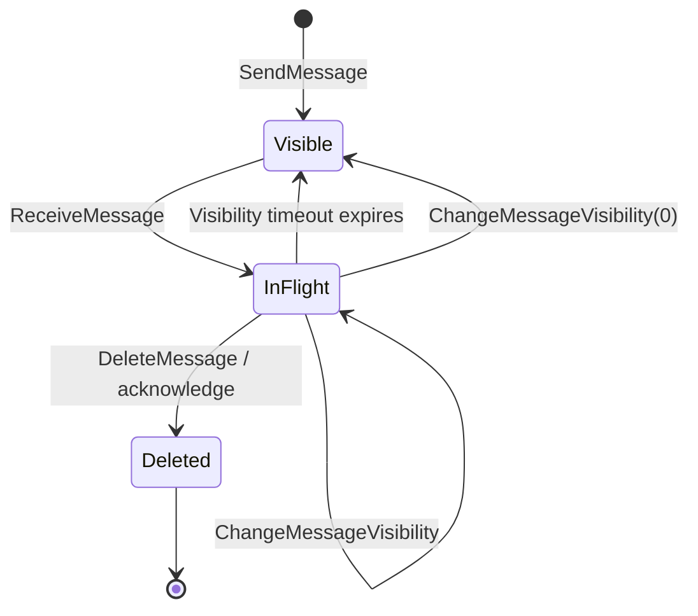
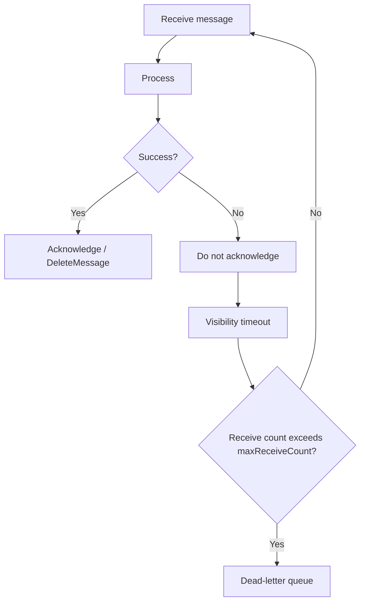

# Visibility Timeout, Long Polling, and Extending Processing Time

When a consumer receives a message from Amazon Simple Queue Service (Amazon SQS), the message remains stored in the queue but is temporarily hidden from other consumers. This hidden interval is called the **visibility timeout**. If the consumer finishes processing and acknowledges the message before the timeout expires, SQS deletes the message. If the message is not acknowledged before the timeout ends, it can reappear for another processing attempt.

On the receiving side, **long polling** lets a consumer wait for messages to arrive rather than repeatedly calling SQS and receiving empty responses. The two mechanisms solve different problems: long polling optimizes how messages are awaited; visibility timeout controls how long a received message stays hidden from other consumers.

With Spring Cloud AWS, a listener container can configure poll timeout and message visibility directly in `@SqsListener` or `SqsContainerOptions`. For workloads with variable processing durations, listeners can also use `Visibility` to change the visibility of the currently processed message. This lesson uses **Spring Cloud AWS 3.4.1** APIs and illustrates how to choose timeouts, extend safely, handle errors, and monitor the queue.

## 1. Learning Objectives

After this lesson, you will be able to:

- Explain the visible, in-flight, and deleted states of an SQS message.
- Distinguish between queue visibility timeout, per-receive visibility timeout, and `ChangeMessageVisibility` for a specific message.
- Choose visibility timeouts based on processing duration, retry delay, and workload variance.
- Distinguish short polling from long polling, configure `WaitTimeSeconds`, and avoid HTTP timeouts while polling.
- Configure `pollTimeout` and `messageVisibility` in Spring Cloud AWS 3.4.1.
- Extend in-flight message visibility with `Visibility` or the AWS SDK, understanding the 12-hour maximum limit.
- Analyze impacts on FIFO message groups, in-flight quotas, retries, DLQs, and idempotency.
- Use CloudWatch metrics and experiments to diagnose messages hidden too long or reappearing too early.

## 2. Message Lifecycle and Visibility Timeout

An SQS message has three conceptual states:

1. **Stored/visible:** the message has been sent to the queue and is ready for consumers to receive.
2. **In-flight/invisible:** a consumer has received the message; it still exists in the queue but is temporarily withheld from other normal receive calls.
3. **Deleted:** the consumer successfully acknowledges via a delete operation; the message is removed from the queue.



The visibility timeout starts when SQS returns the message to a consumer. Within this interval, the consumer is expected to process and delete the message. If the timeout expires before the message is deleted or extended, the message can become visible again and be received by the same or another consumer.

**Visibility timeout does not delete a message and is not a database transaction lock.** It only controls whether the message appears in receive results. The application must still handle duplicate delivery and ensure business side effects are idempotent.

### 2.1. Timeline Example

Suppose a queue has a 60-second visibility timeout:

```text
10:00:00  Consumer A receives message M; 60-second visibility starts
10:00:10  A begins calling the processing service
10:00:60  Timeout expires if A has neither deleted nor extended M
10:01:01  Consumer B can receive M again
10:01:05  A and B risk executing the side effect concurrently
```

If A finishes and deletes the message at 10:00:35, the message no longer appears in the queue. If A crashes at 10:00:20, the message returns after the timeout expires instead of being lost due to a single failed attempt.

With a Standard queue, SQS uses an at-least-once delivery model. Therefore, visibility timeout reduces the chance of two consumers processing the same message concurrently, but does not provide an absolute guarantee that a message cannot be redelivered even within the hidden window. Consumers must be safe when receiving the same `eventId` multiple times.

## 3. Queue Visibility Timeout vs. Per-Receive Timeout

SQS offers several visibility configuration points. Understand each point's scope so you do not inadvertently set a timeout that is too long or too short.

| Configuration Point | Scope | When It Takes Effect |
|---|---|---|
| Queue attribute `VisibilityTimeout` | Queue default value | Applies to received messages unless overridden by the request |
| `VisibilityTimeout` in `ReceiveMessage` | Messages returned in that receive call | Takes effect immediately when SQS returns the message |
| `ChangeMessageVisibility` | A single in-flight message, identified by receipt handle | Changes the timeout at the moment of the API call |
| Spring `messageVisibility` / `messageVisibilitySeconds` | Messages received by the listener container | Framework sends the visibility value on poll and manages it per queue type |
| Spring `Visibility.changeTo()` | The message currently being processed by the listener | Changes the timeout for that message at the moment of the call |

The default visibility timeout for a new queue is **30 seconds**. You can change queue attributes in the AWS Console, IaC, or AWS CLI. Example updating a queue to use 120 seconds and enabling 20-second default long polling:

```bash
aws sqs set-queue-attributes \
  --queue-url "https://sqs.ap-southeast-1.amazonaws.com/123456789012/inventory-events" \
  --attributes '{"VisibilityTimeout":"120","ReceiveMessageWaitTimeSeconds":"20"}'
```

The queue URL and account in the example are illustrative only. In production, manage queue attributes with CloudFormation, CDK, Terraform, or your organization's IaC tool so configurations are reviewable and reproducible.

The consumer role needs `sqs:ReceiveMessage` to receive messages and `sqs:DeleteMessage` to acknowledge them. If the application actively extends or shortens visibility, also grant `sqs:ChangeMessageVisibility` on the exact queue ARN. The `sqs:SetQueueAttributes` permission is only needed by infrastructure management components, not consumers that only read and process messages.

### 3.1. Scope of ChangeMessageVisibility

`ChangeMessageVisibility` requires `QueueUrl`, `ReceiptHandle`, and the new `VisibilityTimeout` value. **The supplied value is the visibility duration starting from the time of the API call**, not seconds added to the remaining timeout.

For example: 20 seconds remain on the current timeout. Calling `ChangeMessageVisibility` with `VisibilityTimeout = 120` resets the hidden interval to 120 seconds from the moment of the call, not 140 seconds.

This value applies only to the current receipt. If the message's visibility expires and it is received again without having been deleted, the new receipt uses the queue's default timeout or the value passed in the new receive request. The changed value from the previous receipt is not persisted as the message's permanent default.

Visibility timeout also differs from the **message retention period**. Retention determines how long SQS keeps a message from the time it was sent; visibility only temporarily hides a message after receipt. Extending visibility does not extend retention and does not prevent a message from expiring under the retention policy.

To make a message visible again immediately, you can set `VisibilityTimeout = 0`. Do this only when the consumer explicitly yields the message to another consumer; if the current consumer is still processing, this can cause parallel execution.

## 4. Choosing an Appropriate Visibility Timeout

The timeout must balance two risks:

- **Too short:** the message reappears while the previous consumer is still running, causing duplicate processing, data contention, and acknowledgment failures.
- **Too long:** if a consumer dies right after receiving a message, the system must wait a long time before retrying; backlog and recovery time increase.

AWS recommends setting visibility timeout based on the time needed to process and delete a message. You can start with the maximum processing time observed under normal conditions, plus a buffer for network jitter, scheduling delays, and acknowledgment.

Illustrative examples:

| Workload Type | Typical Processing Time | Starting Timeout to Test |
|---|---:|---:|
| Write a single projection record | 1–3 seconds | 30 seconds |
| Call multiple services and update an order | 10–20 seconds | 60 seconds |
| Generate a report or process a medium file | 1–2 minutes | 3–5 minutes |
| Long-running task with variable duration | Unpredictable | Shorter initial timeout plus heartbeat extension |

The values in the table are starting points, not universal rules. Measure p95/p99 processing and acknowledgment times before finalizing.

### 4.1. Timeout Must Cover Both Processing and Acknowledgment

Do not measure only business method execution time. The hidden window must cover:

```text
ReceiveMessage
    ↓
Deserialize payload
    ↓
Business processing / database transaction
    ↓
Commit transaction
    ↓
Acknowledgement / DeleteMessage
```

If a listener commits the database at second 25 while acknowledgment completes at second 35, a 30-second timeout can still let the message reappear before deletion. When using acknowledgment batching, messages may remain in-flight until the batch acknowledgment is sent; include that waiting time as well.

### 4.2. Do Not Use Long Timeouts to Hide Consumer Bugs

If a consumer routinely takes several minutes to complete work that should take a few seconds, investigate the database, network, connection pool, locks, or downstream APIs. Raising the timeout excessively may mask duplicates in the short term while prolonging retry times and keeping many messages in-flight.

## 5. The 12-Hour Maximum Visibility Timeout Limit

SQS allows visibility timeouts from **0 to 43,200 seconds (12 hours)**. The 12-hour limit is measured from when SQS receives the initial `ReceiveMessage` request. Each extension does not reset this 12-hour clock.

Example:

```text
12:00  Message received; 12-hour limit begins
12:05  Extend visibility to 10 minutes
12:14  Extend visibility to 10 minutes
...
23:59  Approaching maximum limit from initial receive
24:00  Cannot extend past 12 hours from initial receipt
```

Due to request duration and network latency, requesting an exact 43,200 seconds right after receipt may be rejected because the remaining allowable window is already under 12 hours. Never assume a message can be kept in-flight indefinitely through continuous extensions.

If a workflow must run longer than 12 hours, split it into checkpointed steps that send subsequent messages, or use a workflow orchestration service such as AWS Step Functions. SQS fits units of work with bounded execution times and clear recovery mechanisms.

## 6. Long Polling and Short Polling

`ReceiveMessage` supports two ways to wait for messages:

| Mechanism | How It Works | Effect |
|---|---|---|
| Short polling | `WaitTimeSeconds = 0`; queries a weighted random subset of servers and responds immediately | Can return empty responses even when messages exist on other servers; high empty receives |
| Long polling | `WaitTimeSeconds > 0`; SQS queries all servers and waits until messages arrive or time expires | Reduces empty responses and false empties, usually lowering receive call volume |

Long polling returns early as soon as matching messages are available; if none arrive, SQS waits for the requested duration and then returns an empty list. SQS's maximum long polling duration is **20 seconds**.

Long polling does not hold received messages any longer and does not extend processing time. It only controls how long a receive request waits to find messages.

### 6.1. Configuring Long Polling at the Queue Level

The `ReceiveMessageWaitTimeSeconds` queue attribute sets the default wait time for every receive request that does not override it. Valid values are 0 to 20 seconds; the default is 0 (short polling).

Setting a value greater than 0 enables long polling by default for the queue. If different consumers have different needs, set `WaitTimeSeconds` on individual `ReceiveMessage` requests instead of changing the queue attribute.

### 6.2. Configuring Per Request

With AWS SDK for Java 2.x, a direct request can specify:

```java
ReceiveMessageRequest request = ReceiveMessageRequest.builder()
    .queueUrl(queueUrl)
    .waitTimeSeconds(20)
    .maxNumberOfMessages(10)
    .build();

ReceiveMessageResponse response = sqsClient.receiveMessage(request);
```

SQS returns up to 10 messages per request; it may return fewer if the queue does not have enough messages ready. A 20-second long poll does not mean every request always takes 20 seconds: if messages are ready, SQS can return sooner.

### 6.3. HTTP Response Timeout Must Exceed Long Poll Duration

If the HTTP client closes the connection before `WaitTimeSeconds` elapses, the consumer can time out even while SQS is still waiting for messages. AWS requires the `ReceiveMessage` HTTP response timeout to be **longer than** `WaitTimeSeconds`.

For example, if `WaitTimeSeconds = 20`, the HTTP client's response/read timeout needs to be greater than 20 seconds plus a reasonable buffer. Also check timeouts in proxies, load balancers, service meshes, and gateways if requests traverse those layers.

### 6.4. Polling Multiple Queues

If you write your own poller for multiple queues, avoid using a single thread that sequentially waits 20 seconds on each queue. An empty first queue can make the consumer miss messages ready on the second queue. AWS recommends one thread per queue when implementing manual long polling. Spring listener containers manage polling per container and per queue; do not build a sequential polling loop on top of this mechanism.

## 7. Long Polling in Spring Cloud AWS 3.4.1

Spring Cloud AWS uses `pollTimeout` in `SqsContainerOptions` to control how long a single poll waits. For listener containers in version **3.4.1**, the configurable range is **1–10 seconds**, defaulting to 10 seconds. This is the container configuration limit in this version; the SQS API itself supports long polling up to 20 seconds.

Example factory configuration:

```java
import io.awspring.cloud.sqs.config.SqsMessageListenerContainerFactory;
import org.springframework.context.annotation.Bean;
import org.springframework.context.annotation.Configuration;
import software.amazon.awssdk.services.sqs.SqsAsyncClient;

import java.time.Duration;

@Configuration
public class SqsListenerConfiguration {
    @Bean
    SqsMessageListenerContainerFactory<Object> defaultSqsListenerContainerFactory(
            SqsAsyncClient sqsAsyncClient) {
        return SqsMessageListenerContainerFactory.builder()
            .sqsAsyncClient(sqsAsyncClient)
            .configure(options -> options
                .pollTimeout(Duration.ofSeconds(10))
                .messageVisibility(Duration.ofSeconds(90))
            )
            .build();
    }
}
```

In this example, the container waits up to 10 seconds per poll and requests a 90-second visibility timeout for received messages. The two settings serve distinct purposes: `pollTimeout` is how long to wait for messages to arrive; `messageVisibility` is how long received messages remain hidden.

You can override per listener:

```java
@SqsListener(
    value = "${app.sqs.inventory-queue}",
    pollTimeoutSeconds = "10",
    messageVisibilitySeconds = "90"
)
public void handle(InventoryAdjusted event) {
    inventoryService.applyIdempotently(event);
}
```

Attributes on the annotation override the corresponding factory values. `messageVisibilitySeconds` sets visibility for messages received during the poll. If not configured, the queue's visibility timeout is used.

### 7.1. Default Long Polling via application.yml

The Spring Boot starter lets you configure default poll timeout:

```yaml
spring:
  cloud:
    aws:
      sqs:
        listener:
          poll-timeout: 10s
          max-inflight-messages-per-queue: 10
          max-messages-per-poll: 10
```

The listener container's `poll-timeout` in Spring Cloud AWS 3.4.1 has a maximum range of 10 seconds. If you need 20 seconds directly at the SQS API level, check the limits of the API you are calling and the HTTP client timeout; do not assume this version's container accepts 20 seconds merely because the SQS API supports it.

## 8. Extending Visibility in Listeners with Visibility

For jobs with variable processing duration, a fixed timeout may not suffice. Spring Cloud AWS allows injecting `Visibility` into a listener method. This interface provides `changeTo(seconds)` to change the visibility of the current message.

```java
import io.awspring.cloud.sqs.annotation.SqsListener;
import io.awspring.cloud.sqs.listener.Visibility;
import org.springframework.stereotype.Component;

@Component
public class ReportListener {
    private final ReportService reportService;

    public ReportListener(ReportService reportService) {
        this.reportService = reportService;
    }

    @SqsListener("${app.sqs.report-queue}")
    public void handle(GenerateReport command, Visibility visibility) {
        // Reset visibility to 180 seconds from the moment of this call.
        visibility.changeTo(180);

        reportService.generate(command);
    }
}
```

`changeTo(180)` means the message stays hidden for 180 seconds from the time the visibility-change API call executes. It does not add 180 seconds to the remaining time. Only extend visibility while the listener still genuinely owns and is actively processing the work.

### 8.1. Heartbeat Extensions

If processing duration is unpredictable, you can use a heartbeat: set a moderate initial timeout, then periodically reset visibility before it expires.

Example checkpoint-based logic:

```java
@SqsListener("${app.sqs.report-queue}")
public void handle(GenerateReport command, Visibility visibility) {
    reportService.loadInput(command);

    // Each checkpoint completes before the current timeout expires.
    visibility.changeTo(180);
    reportService.buildReportSections(command);

    visibility.changeTo(180);
    reportService.uploadArtifacts(command);

    visibility.changeTo(180);
    reportService.publishCompletion(command);
}
```

This example illustrates steps with bounded durations. If a single step can block longer than the timeout, calling `changeTo()` after that step finishes is too late. In that case, run an independent heartbeat that extends periodically and stop it upon completion. The heartbeat must be cancelled in a `finally` block so it stops updating visibility once the listener finishes or the message is acknowledged.

### 8.2. Asynchronous Extension

`Visibility` also provides `changeToAsync(int seconds)` returning a `CompletableFuture<Void>`. Use the async API when you do not want to block the listener thread while issuing the visibility-change request:

```java
visibility.changeToAsync(180)
    .thenRun(() -> log.debug("Visibility updated"))
    .exceptionally(error -> {
        log.error("Could not extend message visibility", error);
        return null;
    });
```

If the business flow depends on the extension succeeding, wait for or compose on the future before continuing work that risks exceeding the timeout. Never ignore an extension failure and proceed with a long task as though the message were guaranteed to stay hidden.

### 8.3. Extending Batch Messages

A batch listener can accept `BatchVisibility` to update visibility for the entire batch or a subset of messages. Only extend messages that are still actively being processed. If items in a batch have vastly different processing times, consider smaller batches or single-message processing to avoid keeping finished messages in-flight for too long.

## 9. Extending Directly with AWS SDK for Java 2.x

If a consumer does not use `@SqsListener`, it can call `ChangeMessageVisibility` via `SqsAsyncClient`:

```java
import software.amazon.awssdk.services.sqs.SqsAsyncClient;
import software.amazon.awssdk.services.sqs.model.ChangeMessageVisibilityRequest;

public CompletableFuture<Void> extendVisibility(
        SqsAsyncClient sqsClient,
        String queueUrl,
        String receiptHandle,
        int visibilitySeconds) {

    ChangeMessageVisibilityRequest request = ChangeMessageVisibilityRequest.builder()
        .queueUrl(queueUrl)
        .receiptHandle(receiptHandle)
        .visibilityTimeout(visibilitySeconds)
        .build();

    return sqsClient.changeMessageVisibility(request).thenApply(response -> null);
}
```

`receiptHandle` must be the receipt handle from the **most recent receive**. Do not use `messageId` in place of the receipt handle. Each receipt of the same message can generate a new receipt handle; using a stale handle can cause delete or visibility-change calls to fail to behave as intended.

Inside `@SqsListener`, prefer the `Visibility` abstraction because the framework binds it to the currently handled message. Call the AWS SDK directly only when your consumer manages receipt handles and queue URLs itself, or has integration requirements not covered by the listener abstraction.

## 10. Visibility Timeout and FIFO Message Groups

For a FIFO queue, SQS maintains ordering within each `MessageGroupId`. While a message in a group is in-flight, subsequent messages in that same group are not delivered to other consumers until that message is deleted or its visibility timeout expires.

```text
MessageGroupId = order-101

OrderCreated(v1)  [in-flight, 60s visibility remaining]
OrderPaid(v2)     [waiting on previous message]
OrderShipped(v3)  [waiting on previous message]

MessageGroupId = order-202

OrderCreated(v1)  [can be processed independently]
OrderCancelled(v2)
```

If the consumer for `order-101` hangs, that group stays blocked until the message is deleted or visibility expires. Extending visibility lengthens how long the group waits; setting an overly long timeout increases latency across the entire event sequence in that group.

Spring Cloud AWS 3.4.1 has special visibility handling for FIFO: when `messageVisibility` is set on the container or `messageVisibilitySeconds` on the annotation, visibility is extended for remaining messages in the group before each message is passed to the listener method. Therefore, with a FIFO single-message listener, do not simply assume the timeout is set once for the entire batch and never updated.

## 11. Visibility Timeout, Retries, and DLQs

When a listener throws an exception and does not acknowledge the message, the message stays in-flight until the visibility timeout expires. SQS can then redeliver the message. This is basic visibility-based retry.



Visibility timeout can also act as a retry backoff delay. If an error may recover after a pause (e.g., a downstream service is overloaded), increasing visibility for the next delivery prevents tight retry loops.

Spring Cloud AWS 3.4.1 provides `ExponentialBackoffErrorHandler`, which uses `ApproximateReceiveCount` to compute progressively longer visibility timeouts. Example configuration:

```java
import io.awspring.cloud.sqs.config.SqsMessageListenerContainerFactory;
import io.awspring.cloud.sqs.listener.errorhandler.ExponentialBackoffErrorHandler;
import org.springframework.context.annotation.Bean;

@Bean
ExponentialBackoffErrorHandler<Object> sqsBackoffErrorHandler() {
    return ExponentialBackoffErrorHandler.builder()
        .initialVisibilityTimeoutSeconds(5)
        .multiplier(2.0)
        .maxVisibilityTimeoutSeconds(300)
        .build();
}
```

When using the auto-configured factory, you can declare an error handler bean per Spring Cloud AWS conventions. If you built a custom factory, attach the handler via `.errorHandler(sqsBackoffErrorHandler)`. The values in the example yield delays of roughly 5, 10, 20, and 40 seconds capped at 300 seconds; this is a retry strategy, not a maximum processing duration.

For messages that cannot be processed due to malformed payloads or missing data, raising visibility will not make the message valid. Configure a redrive policy and DLQ to isolate poison messages after the allowed number of receives. After fixing the root cause, replay in a controlled process and ensure consumers are idempotent.

## 12. In-Flight Quota and Impact on Throughput

An in-flight message is one that has been received but not yet deleted. If a consumer receives many messages and holds them in-flight for a long time, the invisible message count rises and can hit the quota.

For Standard queues, the default limit is typically around **120,000 in-flight messages**, depending on traffic and backlog. When hitting the limit:

- Short polling may return an `OverLimit` error.
- Long polling may stop returning additional messages until the in-flight count drops, rather than returning an explicit error.

For FIFO queues, receive capacity also depends on the number of active message groups and applicable quotas. Do not raise `maxConcurrentMessages` blindly without watching in-flight counts.

Safeguards:

1. Delete messages promptly after processing and committing successfully.
2. Do not hold a message inside a listener while waiting on unrelated work.
3. Choose an adequate visibility timeout and extend conditionally.
4. Tune concurrency to match database/downstream capacity.
5. Monitor visible and not-visible message counts; alert on abnormal in-flight growth.

## 13. Monitoring and Diagnostics with CloudWatch

Useful metrics include:

| Metric | Meaning | Warning Signs |
|---|---|---|
| `ApproximateNumberOfMessagesVisible` | Messages ready to be received | Rising steadily: consumer is too slow or unable to poll |
| `ApproximateNumberOfMessagesNotVisible` | In-flight messages | Spiking high: consumer holds messages too long, high concurrency, or slow ack |
| `ApproximateNumberOfMessagesDelayed` | Delayed messages | Can be mistaken for messages hidden due to active processing |
| `ApproximateAgeOfOldestMessage` | Age of the oldest message | Rising: backlog buildup or prolonged retries |
| `NumberOfMessagesReceived` | Messages received | Compare against deleted count to spot retries |
| `NumberOfMessagesDeleted` | Messages deleted | Much lower than receives can indicate processing or ack failures |
| `NumberOfEmptyReceives` | Receive calls returning no messages | High: short polling, empty queue, or suboptimal poll settings |

Most SQS metrics are approximate and aggregated over intervals. Use them to spot trends rather than exact per-message transaction accounting.

In application logs, record `eventId`, `messageId`, `ApproximateReceiveCount`, processing start/end timestamps, and acknowledgment outcome. Never log receipt handles or sensitive data in standard logs.

## 14. Common Failure Scenarios

| Symptom | Possible Causes | How to Check and Fix |
|---|---|---|
| Message processed twice | Visibility too short, hung listener, or Standard duplicate delivery | Compare processing duration against timeout; check idempotency and receive count |
| Message disappears for a long time after consumer failure | Visibility timeout too long | Reduce timeout to realistic processing time; consider bounded backoff |
| Consumer receives nothing despite queue backlog | Messages in-flight, delayed, or FIFO group blocked | Inspect visible/not-visible/delayed metrics and group IDs |
| Long polls frequently return empty | Queue truly empty, low timeout, invisible messages, or request configured for short poll | Check `WaitTimeSeconds`, `pollTimeout`, and CloudWatch metrics |
| HTTP timeout while polling | HTTP response timeout smaller than `WaitTimeSeconds` | Increase response/read timeout above long poll duration |
| Standard queue hits in-flight quota | Consumer pulls many messages without deleting fast enough | Lower concurrency, increase processing capacity, verify acknowledgments |
| FIFO group stalls | Head-of-group message undeleted or continuously extended | Inspect consumer health, timeout, processing errors, and DLQ |
| Visibility extension fails | Stale receipt handle, message no longer in-flight, past 12-hour limit, or missing IAM permission | Use handle from latest receive; check `sqs:ChangeMessageVisibility` and remaining time |
| Message redelivered after app restart | Listener shut down before ack or task exceeded timeout | Configure proper shutdown grace period, timeout, and idempotency |

## 15. Hands-On Verification

Create a Standard queue `long-poll-lab` and a Spring Boot consumer using `@SqsListener`. Log receive time, processing start, completion, and acknowledgment.

**Experiment A — Short polling vs. long polling:** Set `ReceiveMessageWaitTimeSeconds = 0`, call receive continuously on an empty queue, and count empty receives. Then change to 10 or 20 seconds and repeat for the same duration. Compare call counts and latency when sending a message.

**Experiment B — Visibility too short:** Set queue visibility to 5 seconds. Make a listener intentionally take 12 seconds. Run at least two consumers and observe the same message being received again before the first consumer finishes. Verify the consumer requires idempotency.

**Experiment C — Appropriate visibility:** Set a 30-second timeout for the same 12-second task. Verify the message is deleted after successful processing and does not reappear due to a short timeout.

**Experiment D — Extension:** Set an initial 10-second timeout. Call `Visibility.changeTo(30)` inside the listener before a 20-second task. Observe that the message does not reappear on another consumer during the extended window.

**Experiment E — Failure and retry:** Intentionally throw an exception before acknowledgment. Observe the message reappearing after the visibility timeout. Try increasing the timeout to observe a longer retry interval, then configure backoff and a DLQ.

**Experiment F — FIFO:** Send three messages with the same `MessageGroupId`; make the first message take longer than visibility. Observe subsequent messages in the group waiting. Repeat with another group to verify independent groups still make progress.

When running tests, do not rely on fixed `Thread.sleep()` calls as sole proof. Use bounded polling assertions with timeouts, CloudWatch metrics, and timestamps from each receipt so results depend less on machine scheduling.

## 16. Design Exercises

1. An image-processing listener takes 5 to 90 seconds. Choose an initial visibility timeout and explain how to extend it when execution exceeds expectations.
2. A consumer receives a message and must call an external API that can take 4 minutes. Design a heartbeat and how to stop it when the listener finishes.
3. A queue shows growing backlog, high `ApproximateNumberOfMessagesNotVisible`, and rising `NumberOfEmptyReceives`. List hypotheses and the order in which to check them.
4. A FIFO queue has one group blocked by a failing message. Propose how to configure retries, DLQ, and replay without breaking business ordering.
5. A task is expected to run for 15 hours. Explain why a message cannot be kept in-flight via visibility extension and propose how to split the workflow.

## 17. Self-Check Questions

1. When does the visibility timeout begin? **When SQS returns the message to a consumer in a receive call.**
2. What happens if a message is not deleted before the timeout expires? **The message can become visible again and be redelivered.**
3. What is the default visibility timeout of a new queue? **30 seconds.**
4. What is the maximum long polling duration in the SQS API? **20 seconds.**
5. What is the maximum `pollTimeout` in Spring Cloud AWS 3.4.1 listener containers? **10 seconds.**
6. Why must the HTTP response timeout be greater than `WaitTimeSeconds`? **If the HTTP client closes the connection early, the long-poll request can fail before SQS responds.**
7. Does `Visibility.changeTo(180)` add 180 seconds or reset the timeout? **It resets visibility to 180 seconds from the moment of the call.**
8. What is the maximum visibility limit? **12 hours from the initial ReceiveMessage request; extensions do not reset this limit.**
9. Does visibility timeout guarantee a Standard queue will never deliver duplicates? **No; Standard uses at-least-once delivery, so consumers must still be idempotent.**
10. What happens to later messages in the same FIFO group while an earlier message is in-flight? **They wait until the earlier message is deleted or its visibility expires.**

## 18. References

- [AWS — Amazon SQS visibility timeout](https://docs.aws.amazon.com/AWSSimpleQueueService/latest/SQSDeveloperGuide/sqs-visibility-timeout.html): in-flight state, timeouts, retries, FIFO, and the 12-hour limit.
- [AWS — Setting up long polling](https://docs.aws.amazon.com/AWSSimpleQueueService/latest/SQSDeveloperGuide/best-practices-setting-up-long-polling.html): 20-second maximum wait, reducing empty receives, and HTTP response timeouts.
- [AWS API — ReceiveMessage](https://docs.aws.amazon.com/AWSSimpleQueueService/latest/APIReference/API_ReceiveMessage.html): `WaitTimeSeconds`, `VisibilityTimeout`, receipt handles, and batch limits.
- [AWS API — ChangeMessageVisibility](https://docs.aws.amazon.com/AWSSimpleQueueService/latest/APIReference/API_ChangeMessageVisibility.html): changing visibility for an in-flight message.
- [AWS — Processing messages in a timely manner](https://docs.aws.amazon.com/AWSSimpleQueueService/latest/SQSDeveloperGuide/best-practices-processing-messages-timely-manner.html): choosing timeouts from processing times and heartbeats.
- [Spring Cloud AWS 3.4.1 — SQS Integration Reference](https://docs.awspring.io/spring-cloud-aws/docs/3.4.1/reference/html/index.html): `pollTimeout`, `messageVisibility`, `@SqsListener`, `Visibility`, FIFO, and retry handlers.
- [Spring Cloud AWS 3.4.1 — SqsListener API](https://docs.awspring.io/spring-cloud-aws/docs/3.4.1/apidocs/io/awspring/cloud/sqs/annotation/SqsListener.html): `pollTimeoutSeconds` and `messageVisibilitySeconds`.
- [Spring Cloud AWS 3.4.1 — SqsContainerOptionsBuilder API](https://docs.awspring.io/spring-cloud-aws/docs/3.4.1/apidocs/io/awspring/cloud/sqs/listener/SqsContainerOptionsBuilder.html): configuring poll and message visibility on listener containers.

**Key takeaway:** Long polling controls how long a consumer waits to receive messages; visibility timeout controls how long a received message remains hidden. Size timeouts to cover both processing and acknowledgment, extend before expiration for long jobs, stay within the 12-hour cap, and keep consumers idempotent to withstand retries and duplicate deliveries.
