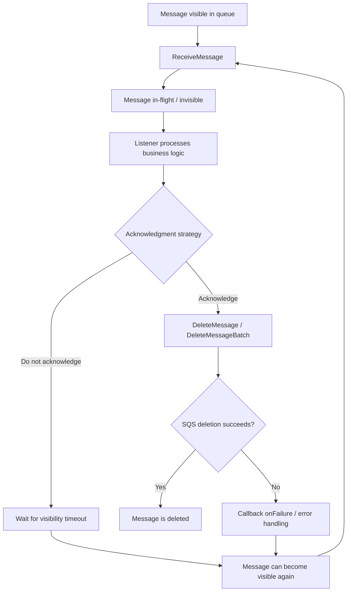

# Acknowledgment Modes and Message Deletion Timing

In Amazon Simple Queue Service (Amazon SQS), **acknowledging a message means deleting that message from the queue via `DeleteMessage`**. When a consumer receives a message, SQS only hides the message for the duration of the `visibility timeout`; the message still exists. Only after deletion succeeds is the message removed from the normal processing stream.

Spring Cloud AWS provides three acknowledgment modes for listener containers: `ON_SUCCESS`, `ALWAYS`, and `MANUAL`. The framework also supports batching multiple acknowledgments together, partial batch acknowledgment, and controlling deletion order. Consequently, when a listener method finishes and when the message is actually deleted can differ.

This lesson uses **Spring Cloud AWS 3.4.1**, focusing on the message lifecycle, receipt handles, the three acknowledgment modes, acknowledgment batching, manual acknowledgment, FIFO ordering, handling deletion failures, and coordinating acknowledgment with business transactions.

## 1. Learning Objectives

After this lesson, you will be able to:

- Explain how SQS acknowledgment maps to `DeleteMessage` and when a message is actually deleted.
- Distinguish `MessageId` from `ReceiptHandle` and understand why the latest receipt handle must be used.
- Choose `ON_SUCCESS`, `ALWAYS`, or `MANUAL` according to business processing requirements.
- Configure `acknowledgementInterval`, `acknowledgementThreshold`, and `acknowledgementOrdering`.
- Explain default differences between Standard queues and FIFO queues.
- Acknowledge a single message or part of a batch with `Acknowledgement` and `BatchAcknowledgement`.
- Monitor message deletion outcomes via `AcknowledgementResultCallback`.
- Avoid losing messages from premature acknowledgment and avoid duplicate side effects when acknowledgment fails.
- Design tests for success, exceptions, partial batches, FIFO, and `DeleteMessage` failures.

## 2. What Does Acknowledgment Actually Do?

A consumer receives a message via `ReceiveMessage`. SQS returns the payload, attributes, `MessageId`, and `ReceiptHandle`, placing the message into the *in-flight* state for the visibility timeout. When the listener completes, Spring Cloud AWS decides whether to acknowledge based on the acknowledgment mode and batching strategy.



**Succeeding in Java and deleting the message from SQS are two separate operations.** A listener may commit the database transaction yet fail when issuing the delete call. Conversely, if a message is deleted before business data commits, the application loses the chance to retry if the transaction fails.

With listener containers, the acknowledgment mode determines under which circumstances the framework sends the delete command. With batching enabled, messages stay in-flight until the batched acknowledgment executes successfully.

## 3. MessageId and ReceiptHandle

These two identifiers serve distinct purposes:

| Value | Meaning | Used For |
|---|---|---|
| `MessageId` | Message identifier generated by SQS when the producer sends the message | Logs, tracing, message correlation |
| `ReceiptHandle` | Token representing one specific delivery/receive of the message | `DeleteMessage`, `ChangeMessageVisibility` |
| `eventId` | Business identifier generated by the producer | Idempotency, preventing duplicate side effects |

Each time the same message is received again, SQS issues a new `ReceiptHandle`. When deleting a message, you must use the receipt handle from the **most recent receive**. Using an older handle may return a success response without deleting the message.

Example:

```text
Receive 1: MessageId=msg-123, ReceiptHandle=RH-A
Visibility timeout expires; message returns to queue
Receive 2: MessageId=msg-123, ReceiptHandle=RH-B

DeleteMessage(RH-A)  -> does not guarantee deleting the message
DeleteMessage(RH-B)  -> uses the latest receipt handle
```

Never pass `MessageId` as the parameter to `DeleteMessage`. Spring Cloud AWS manages the receipt handle internally in the message source and acknowledgment objects; ordinary listeners do not need to store or manipulate this handle directly.

### 3.1. Why Can a Message Still Be Redelivered After DeleteMessage Succeeds?

Standard queues use an at-least-once delivery model. In rare cases, a server holding a replica of the message is unavailable during deletion; that replica may be returned in a subsequent receive. Therefore, even after a successful `DeleteMessage`, the application must remain safe when receiving the same event again.

This is why a business `eventId` and idempotency mechanisms remain essential. `MessageId` and acknowledgment do not create an exactly-once transaction across a database or external API.

## 4. Three Acknowledgment Modes in Spring Cloud AWS

Spring Cloud AWS 3.4.1 defines three modes:

| Mode | When Framework Acknowledges | When Listener Throws Exception | When Appropriate |
|---|---|---|---|
| `ON_SUCCESS` | After the message or batch completes successfully | Does not auto-acknowledge; message can be redelivered after visibility timeout | Recommended default for business consumers |
| `ALWAYS` | After processing finishes, whether successful or failed | Still acknowledges the message | Only when you want to drop failed messages after recording/resolving errors via a separate flow |
| `MANUAL` | Only when the listener invokes acknowledgment | Does not auto-acknowledge unless the listener calls ack | When deletion timing depends on business logic or partial batch acknowledgment is needed |

The mode can be configured in the factory's `SqsContainerOptions` or directly on `@SqsListener`. If omitted from the annotation, the listener uses the factory's mode.

### 4.1. ON_SUCCESS

`ON_SUCCESS` is the default mode. When the listener method completes normally, the framework enqueues the message for acknowledgment. If the method throws an exception, the message is not auto-acknowledged and can be received again after the visibility timeout.

```java
@SqsListener("${app.sqs.order-events-queue}")
public void handle(OrderEvent event) {
    orderService.applyIdempotently(event);
}
```

This fits cases where an exception signals incomplete work, such as a database timeout or temporarily unavailable downstream service. However, if code catches the exception and returns normally, the container considers the listener successful and acknowledges the message. Only catch exceptions when you have an explicit error-handling decision.

### 4.2. ALWAYS

`ALWAYS` acknowledges the message after the listener finishes, regardless of whether it returned normally or threw an error. This mode can be useful when failed messages have already been persisted to a quarantine store or handled by an independent compensation process.

```java
@SqsListener(
    value = "${app.sqs.audit-events-queue}",
    acknowledgementMode = "ALWAYS"
)
public void handle(AuditEvent event) {
    auditService.record(event);
}
```

**Do not use `ALWAYS` to suppress errors.** If the database is temporarily unavailable and the listener throws an exception, the message may still be deleted. It will not be retried by SQS and will not automatically route to a DLQ merely because the listener threw. If you need retries/DLQ, use `ON_SUCCESS` or `MANUAL` and leave the message unacknowledged when processing fails.

### 4.3. MANUAL

`MANUAL` disables automatic acknowledgment. The listener receives `Acknowledgement` (single message) or `BatchAcknowledgement` (batch) and decides which messages to acknowledge.

```java
import io.awspring.cloud.sqs.listener.acknowledgement.Acknowledgement;

@SqsListener(
    value = "${app.sqs.order-events-queue}",
    acknowledgementMode = "MANUAL"
)
public void handle(OrderEvent event, Acknowledgement acknowledgement) {
    orderService.applyIdempotently(event);
    acknowledgement.acknowledge();
}
```

If `applyIdempotently()` throws an exception before `acknowledge()`, the message is not acknowledged and can be redelivered. If the listener returns without calling acknowledgment, the message is not deleted automatically either; it can reappear after the visibility timeout.

Manual does not mean immediate. If the container has acknowledgment batching enabled, calling `acknowledge()` only enqueues the message for acknowledgment; actual deletion still waits for the interval or threshold. Batching is covered in section 8.

## 5. Configuring Acknowledgment in the Container Factory

Example factory configuration using `ON_SUCCESS`, batching acknowledgments by interval or threshold:

```java
import io.awspring.cloud.sqs.config.SqsMessageListenerContainerFactory;
import io.awspring.cloud.sqs.listener.acknowledgement.AcknowledgementOrdering;
import io.awspring.cloud.sqs.listener.acknowledgement.handler.AcknowledgementMode;
import org.springframework.context.annotation.Bean;
import org.springframework.context.annotation.Configuration;
import software.amazon.awssdk.services.sqs.SqsAsyncClient;

import java.time.Duration;

@Configuration
public class SqsAcknowledgementConfiguration {
    @Bean
    SqsMessageListenerContainerFactory<Object> defaultSqsListenerContainerFactory(
            SqsAsyncClient sqsAsyncClient) {
        return SqsMessageListenerContainerFactory.builder()
            .sqsAsyncClient(sqsAsyncClient)
            .configure(options -> options
                .acknowledgementMode(AcknowledgementMode.ON_SUCCESS)
                .acknowledgementInterval(Duration.ofSeconds(2))
                .acknowledgementThreshold(20)
                .acknowledgementOrdering(AcknowledgementOrdering.PARALLEL)
            )
            .build();
    }
}
```

In this example, the framework dispatches acknowledgments when **either condition is met**: 2 seconds have elapsed or 20 messages have accumulated for acknowledgment. These values are examples for a Standard queue with steady traffic, not a one-size-fits-all configuration.

If the same property is configured on both the factory and `@SqsListener`, the annotation value takes precedence for that listener.

## 6. Choosing a Mode Based on Business Outcomes

A practical rule is to acknowledge a message only after the application has determined its final business outcome:

| Scenario | Suitable Mode / Adjustment | Reason |
|---|---|---|
| Database write succeeds and listener returns | `ON_SUCCESS` | Framework acknowledges after listener succeeds |
| Transient database error | `ON_SUCCESS` | Exception triggers message retry |
| Invalid schema message needing quarantine before removal | `MANUAL` or controlled error-handler flow | Acknowledge only after quarantine write succeeds |
| Batch with some valid and some failing messages | `MANUAL` + `BatchAcknowledgement` | Acknowledge processed messages, leave failures unacknowledged |
| Logs/telemetry safe to drop on failure without retry | Consider `ALWAYS` | Accepts deleting messages even when processing fails |
| Need immediate deletion after each listener call | Immediate acknowledgment | Avoids batching delay, increases delete API calls |
| High-throughput Standard queue | Acknowledgment batching | Reduces delete requests when many messages are processed |
| FIFO needing preserved acknowledgment order | Immediate or `ORDERED`/`ORDERED_BY_GROUP` | Prevents later message acks from overtaking earlier ones in the same group |

No acknowledgment mode creates a distributed transaction between SQS and a database. Regardless of the mode chosen, the application still requires idempotency and proper commit ordering.

## 7. Manual Acknowledgment for a Single Message

### 7.1. Calling Acknowledge After Commit

```java
import io.awspring.cloud.sqs.listener.acknowledgement.Acknowledgement;
import org.springframework.stereotype.Component;

@Component
public class PaymentListener {
    private final PaymentService paymentService;

    public PaymentListener(PaymentService paymentService) {
        this.paymentService = paymentService;
    }

    @SqsListener(
        value = "${app.sqs.payment-events-queue}",
        acknowledgementMode = "MANUAL"
    )
    public void handle(PaymentCaptured event, Acknowledgement acknowledgement) {
        paymentService.applyCapturedEventIdempotently(event);
        acknowledgement.acknowledge();
    }
}
```

`applyCapturedEventIdempotently()` must complete its database transaction before returning. Only afterward does the listener call `acknowledge()`. If the database commit succeeds but the SQS delete fails, the message may be redelivered; the service must recognize the already-processed `eventId` so it does not record the payment twice.

### 7.2. Asynchronous Acknowledgment

`Acknowledgement` provides `acknowledgeAsync()`, returning a `CompletableFuture<Void>`:

```java
public CompletableFuture<Void> handle(
        PaymentCaptured event,
        Acknowledgement acknowledgement) {

    paymentService.applyCapturedEventIdempotently(event);
    return acknowledgement.acknowledgeAsync();
}
```

A listener method can return `CompletableFuture<Void>`. When using async style, return the future representing all work the listener depends on—never fire-and-forget and return before processing or acknowledgment finishes. That lets the container track the actual outcome.

## 8. Acknowledgment Batching

Spring Cloud AWS can group multiple messages awaiting acknowledgment and send delete calls in batches. Two options control batching:

- `acknowledgementInterval`: maximum time to wait before sending an acknowledgment batch.
- `acknowledgementThreshold`: minimum number of queued acknowledgments to trigger a batch.

A batch is dispatched when **either the interval or the threshold is reached first**.

| Configuration | Behavior |
|---|---|
| Interval = 1 second, threshold = 10 | Dispatches batch once 1 second passes or 10 messages accumulate |
| Interval = `Duration.ZERO`, threshold = 10 | Disables time trigger; waits for 10 messages |
| Interval = 1 second, threshold = 0 | Disables count trigger; dispatches every 1 second |
| Interval = `Duration.ZERO`, threshold = 0 | Immediate acknowledgment; acknowledges sequentially right after processing |

### 8.1. Default Values by Queue Type

Spring Cloud AWS 3.4.1 uses different defaults:

| Property | Standard Queue | FIFO Queue |
|---|---:|---:|
| `acknowledgementInterval` | 1 second | 0 (immediate) |
| `acknowledgementThreshold` | 10 messages | 0 (immediate) |
| `acknowledgementOrdering` | `PARALLEL` | `PARALLEL` when immediate; `ORDERED` when batching is enabled |

This means a Standard listener can finish processing while the message stays in-flight until the batch delete runs. FIFO defaults to immediate acknowledgment to process messages sequentially.

### 8.2. Intentional Batching Configuration

```java
@Bean
SqsMessageListenerContainerFactory<Object> standardQueueFactory(
        SqsAsyncClient sqsAsyncClient) {
    return SqsMessageListenerContainerFactory.builder()
        .sqsAsyncClient(sqsAsyncClient)
        .configure(options -> options
            .acknowledgementMode(AcknowledgementMode.ON_SUCCESS)
            .acknowledgementInterval(Duration.ofMillis(500))
            .acknowledgementThreshold(10)
            .acknowledgementOrdering(AcknowledgementOrdering.PARALLEL)
        )
        .build();
}
```

At high volume, batching cuts delete API calls. In exchange, messages wait in the acknowledgment queue and remain in-flight longer. When sizing timeouts, account for listener execution time, batch wait time, and delete request duration.

### 8.3. Immediate Acknowledgment

To acknowledge immediately after each invocation, set both values to zero:

```java
.configure(options -> options
    .acknowledgementMode(AcknowledgementMode.ON_SUCCESS)
    .acknowledgementInterval(Duration.ZERO)
    .acknowledgementThreshold(0)
)
```

In this mode, a message is only considered done once acknowledgment succeeds. If deletion fails, message handling is treated as failed and the message can be retried after the visibility timeout. This is useful when you need confirmation of deletion before moving to the next message, at the cost of more SQS requests.

## 9. Partial Batch Acknowledgment with BatchAcknowledgement

A batch listener receives multiple messages in one invocation. If all succeed, you can acknowledge the entire batch. If some messages fail, `BatchAcknowledgement` lets you acknowledge only the subset that succeeded.

```java
import io.awspring.cloud.sqs.listener.acknowledgement.BatchAcknowledgement;
import org.springframework.messaging.Message;

@SqsListener(
    value = "${app.sqs.order-events-queue}",
    acknowledgementMode = "MANUAL"
)
public void handleBatch(
        List<Message<OrderEvent>> messages,
        BatchAcknowledgement<OrderEvent> acknowledgement) {

    List<Message<OrderEvent>> succeeded = new ArrayList<>();

    for (Message<OrderEvent> message : messages) {
        try {
            orderService.applyIdempotently(message.getPayload());
            succeeded.add(message);
        } catch (RecoverableProcessingException ex) {
            log.warn("Will retry eventId={}", message.getPayload().eventId(), ex);
        }
    }

    if (!succeeded.isEmpty()) {
        acknowledgement.acknowledge(succeeded);
    }
}
```

In this example, failing messages are omitted from `succeeded` and therefore not acknowledged. Once the visibility timeout expires, SQS can redeliver them. Production code should classify errors clearly; unrecoverable errors should be recorded and routed to a quarantine/DLQ workflow instead of retrying forever.

`BatchAcknowledgement` supports:

- `acknowledge()` to acknowledge the entire batch.
- `acknowledge(Collection<Message<T>>)` to acknowledge a subset of the batch.
- `acknowledgeAsync()` and `acknowledgeAsync(collection)` for async execution.

**Batch listeners and acknowledgment batching are two separate concepts.** A batch listener groups multiple payloads into one method invocation. Acknowledgment batching groups accepted delete requests to send to SQS based on an interval/threshold. You can use either without necessarily enabling the other.

## 10. Limits and Failures of DeleteMessageBatch

The AWS SQS `DeleteMessageBatch` API accepts at most **10 entries** per request. Each entry's outcome is reported individually in two lists: `Successful` and `Failed`.

A batch request can return HTTP 200 while one or more entries still fail. Therefore, do not check only HTTP status or assume the whole batch succeeded just because the request did not throw an exception. Inspect per-entry results.

| Status | Action |
|---|---|
| Entry in `Successful` | SQS confirmed deletion of that entry |
| Entry in `Failed` | Inspect error code and receipt handle; handle/retry selectively |
| Entire request failed | Check permissions, queue URL, throttling, and connectivity |

Spring Cloud AWS manages batch acknowledgment in listener containers, yet the application still needs to observe acknowledgment outcomes if it wants to measure delete errors or trigger recovery. Never blindly retry the entire batch when some messages were already deleted.

## 11. Acknowledgment Ordering with FIFO

FIFO queues guarantee ordering within each `MessageGroupId`. Processing order must be reflected in acknowledgment order so a later message is never considered finished before an earlier message in the same group.

Spring Cloud AWS 3.4.1 provides three `AcknowledgementOrdering` values:

| Ordering | Behavior | Scope |
|---|---|---|
| `PARALLEL` | Multiple acknowledgment batches can execute concurrently | Standard; default for FIFO immediate |
| `ORDERED` | Each ack batch runs only after the previous batch completes | Preserves global ack order |
| `ORDERED_BY_GROUP` | Sequential acks within the same group, parallel across groups | FIFO only |

With FIFO immediate acknowledgment, `PARALLEL` remains safe under the container's mechanics: the next message in the same group is not polled until the previous message has been acknowledged. When batching is enabled, the default ordering switches to `ORDERED` to preserve order. If you want ordering within each group while letting other groups proceed concurrently, choose `ORDERED_BY_GROUP`.

```java
@Bean
SqsMessageListenerContainerFactory<Object> fifoQueueFactory(
        SqsAsyncClient sqsAsyncClient) {
    return SqsMessageListenerContainerFactory.builder()
        .sqsAsyncClient(sqsAsyncClient)
        .configure(options -> options
            .acknowledgementMode(AcknowledgementMode.ON_SUCCESS)
            .acknowledgementInterval(Duration.ofSeconds(1))
            .acknowledgementThreshold(10)
            .acknowledgementOrdering(AcknowledgementOrdering.ORDERED_BY_GROUP)
        )
        .build();
}
```

This is an example when intentionally enabling acknowledgment batching for FIFO. Test it together with batch listeners, `MessageGroupId`, and error-handling strategies; do not assume `ORDERED_BY_GROUP` replaces proper group ID design.

## 12. Tracking Acknowledgment Results

Spring Cloud AWS provides `AcknowledgementResultCallback<T>` and `AsyncAcknowledgementResultCallback<T>` to notify your application when acknowledgments succeed or fail.

```java
import io.awspring.cloud.sqs.listener.acknowledgement.AcknowledgementResultCallback;
import org.springframework.context.annotation.Bean;
import org.springframework.messaging.Message;

@Bean
AcknowledgementResultCallback<Object> acknowledgementResultCallback() {
    return new AcknowledgementResultCallback<>() {
        @Override
        public void onSuccess(Collection<Message<Object>> messages) {
            log.debug("Acknowledged {} SQS messages", messages.size());
        }

        @Override
        public void onFailure(
                Collection<Message<Object>> messages, Throwable error) {
            log.error("Failed to acknowledge {} SQS messages", messages.size(), error);
        }
    };
}
```

With the auto-configured factory, declaring the callback bean hooks it in via auto-configuration. If creating a custom factory, attach the callback directly:

```java
SqsMessageListenerContainerFactory<Object> factory(
        SqsAsyncClient sqsAsyncClient,
        AcknowledgementResultCallback<Object> acknowledgementResultCallback) {
    return SqsMessageListenerContainerFactory.builder()
        .sqsAsyncClient(sqsAsyncClient)
        .acknowledgementResultCallback(acknowledgementResultCallback)
        .build();
}
```

Callbacks can record metrics, log errors, raise alerts, or trigger acknowledgment failure handling. Do not treat the callback as a place for business logic or transactions. `onFailure` does not mean messages were lost; unacknowledged messages can reappear after the visibility timeout.

With FIFO immediate acknowledgment, the callback runs before processing the next message in the batch; the next message waits for the callback to finish. This allows observing or handling delete failures before the group continues. With Standard queues and parallel batch processing, callbacks may execute asynchronously.

## 13. Acknowledgment and Business Transactions

SQS and databases do not participate in the same distributed transaction. Thus, no acknowledgment mode can make database commit and SQS deletion an atomic operation on its own.

A safe sequence is typically:

```text
Receive message
    ↓
Check if eventId was already processed
    ↓
BEGIN database transaction
    ↓
Insert processed_event + update business data
    ↓
COMMIT
    ↓
Acknowledgement / DeleteMessage
```

If the database commit succeeds but `DeleteMessage` fails, the message may be redelivered. A unique key on `eventId` lets the consumer detect that the event was already applied and re-acknowledge it without duplicating side effects.

Example SQL pseudocode:

```sql
BEGIN;

WITH new_event AS (
    INSERT INTO processed_event(event_id)
    VALUES (:event_id)
    ON CONFLICT (event_id) DO NOTHING
    RETURNING event_id
), updated AS (
    UPDATE inventory
    SET quantity = quantity + :quantity_delta
    WHERE sku = :sku
      AND EXISTS (SELECT 1 FROM new_event)
    RETURNING sku
)
SELECT
    (SELECT count(*) FROM new_event) AS inserted_events,
    (SELECT count(*) FROM updated) AS updated_rows;

COMMIT;
```

This is PostgreSQL-style SQL pseudocode. If `inserted_events = 0`, the event was already processed and you can exit safely. If `inserted_events = 1` yet `updated_rows = 0`, roll back the transaction so an unapplied event is not marked processed. The key point is that the deduplication record and business change must commit in the same transaction.

Never acknowledge before committing just to shrink in-flight counts. If the application deletes the message and the transaction rolls back, SQS has no way to redeliver that message. For side effects on external APIs, use the target API's idempotency key or outbox/saga patterns; a database transaction does not wrap external HTTP requests.

## 14. Distinguishing SqsTemplate vs. Listener Container Acknowledgment

Spring Cloud AWS has two message-receiving flows:

| API | Default Acknowledgment Behavior |
|---|---|
| `SqsTemplate.receive()` / `receiveMany()` | Template defaults to acknowledge on receive (`ACKNOWLEDGE_ON_RECEIVE`) |
| `@SqsListener` / `SqsMessageListenerContainer` | Listener container defaults to `ON_SUCCESS` |

With `SqsTemplate.receive()`, if the application must finish processing before deleting the message, configure the template with `TemplateAcknowledgementMode.MANUAL` and call acknowledgment explicitly. Do not blindly assume listener container defaults apply to `SqsTemplate`.

This lesson focuses on listener container acknowledgment. If your application uses both manual polling and `@SqsListener`, configure and test both flows separately.

## 15. Retries, Visibility Timeout, and DLQs

When `ON_SUCCESS` leaves a message unacknowledged due to a listener error, the message remains in-flight until the visibility timeout expires. SQS can then redeliver it. If failures repeat, `ApproximateReceiveCount` grows and a redrive policy can move the message to a DLQ once `maxReceiveCount` is exceeded.

Key controls:

1. Size visibility timeout to cover both processing time and acknowledgment batching.
2. Do not catch exceptions and return normally if you want SQS to retry.
3. Do not use `ALWAYS` for errors that require retries or DLQ routing.
4. With manual ack, never call ack before the transaction commits or before following your error-recording workflow.
5. Configure a redrive policy and monitor the DLQ; establish procedures to investigate, fix data, and replay.
6. Keep consumers idempotent so retries or acknowledgment failures never cause duplicate side effects.

With FIFO, an unacknowledged message at the head of a group can block subsequent messages in that same group. Moving a failing message to a DLQ lets the queue advance once the redrive policy triggers, but it can leave a gap in the business sequence. Reconcile state and replay in proper order.

## 16. Common Issues and Diagnostics

| Symptom | Possible Causes | Resolution |
|---|---|---|
| Listener returns normally yet message reappears | Ack batching hasn't reached interval/threshold, or delete failed | Check batching settings, visibility, and `onFailure` callback |
| Message deleted despite business error | Using `ALWAYS`, or catching exception and returning normally under `ON_SUCCESS` | Switch to `ON_SUCCESS`/`MANUAL` and propagate errors properly |
| Message processed twice | `DeleteMessage` failed, visibility expired, Standard duplicate, or DB committed before ack | Use `eventId` and idempotent transactions |
| `DeleteMessage` succeeds yet message remains | Used stale receipt handle or Standard at-least-once redelivery | Use receipt handle from latest receive; inspect receive history |
| Part of a batch not deleted | `DeleteMessageBatch` had failed entries despite HTTP 200 | Inspect `Failed` list; do not blindly retry entire batch |
| FIFO group blocked | Earlier message unacknowledged or ack batch incomplete | Inspect group ID, ordering, visibility, and delete errors |
| Manual ack does not delete message | Listener never called `acknowledge()` or ack is only queued in batching | Check mode, code paths, and interval/threshold |
| `ALWAYS` drops failing messages | Mode acknowledges even when listener throws | Use `ON_SUCCESS` or write to quarantine before manual ack |
| DLQ receives no failed messages | Messages acknowledged via `ALWAYS` or exceptions swallowed | Check mode, error handling, and redrive policy |

Metrics and logs to watch include messages received/deleted, visible/not visible counts, approximate receive count, age of oldest message, DLQ count, and acknowledgment failures. When investigating, log `eventId`, `MessageId`, queue, listener ID, and error details; never log receipt handles or sensitive payloads.

## 17. Hands-On Exercises

**Exercise 1 — ON_SUCCESS:** Build a listener that updates an order in the database. Make the listener throw a controlled exception and verify the message is not deleted, then is redelivered after the visibility timeout.

**Exercise 2 — ALWAYS:** Switch the listener to `ALWAYS`, intentionally throw an exception, and observe that the message is still acknowledged. Explain why this mode is unsuitable when retries/DLQs are needed.

**Exercise 3 — MANUAL:** Switch the listener to `MANUAL`. Acknowledge only after the database transaction commits. Try omitting `acknowledge()` and observe the message being redelivered.

**Exercise 4 — Acknowledgment batching:** On a Standard queue, set interval to 2 seconds and threshold to 5. Send 3 messages to observe the time-based trigger; send 5 messages rapidly to observe the threshold-based trigger.

**Exercise 5 — Partial batch:** Use a batch listener with `BatchAcknowledgement`. Force one item to fail, acknowledge the succeeded items, and verify the failed message is retried.

**Exercise 6 — FIFO ordering:** Enable batching for FIFO and compare `ORDERED` with `ORDERED_BY_GROUP`. Use two groups to observe in-group ordering and cross-group concurrency.

**Exercise 7 — Delete failure:** Use a test IAM policy to temporarily deny `sqs:DeleteMessage`, observe `AcknowledgementResultCallback.onFailure`, then restore the permission and verify the message can be processed again.

**Exercise 8 — Idempotency:** Let the database commit succeed while simulating an acknowledgment failure. Verify the next delivery does not reapply the side effect thanks to `eventId` and a unique constraint.

## 18. Self-Check Questions

1. What does acknowledgment mean in SQS? **Deleting the message from the queue via `DeleteMessage`.**
2. Why must `ReceiptHandle` be used instead of `MessageId`? **`DeleteMessage` identifies a specific receive via its receipt handle, and the latest handle must be used.**
3. How does `ON_SUCCESS` handle exceptions? **It does not auto-acknowledge the message when listener processing fails.**
4. How does `ALWAYS` differ from `ON_SUCCESS`? **`ALWAYS` acknowledges even when the listener finishes with an error.**
5. Does `MANUAL` automatically delete a message when the listener returns? **No; the listener must explicitly invoke acknowledgment.**
6. When does acknowledgment batching dispatch? **When either the interval or the threshold is reached first.**
7. What are the default Standard queue batching values in Spring Cloud AWS 3.4.1? **1-second interval, threshold 10, `PARALLEL` ordering.**
8. How does FIFO handle acknowledgment by default? **Immediate acknowledgment with interval and threshold set to zero.**
9. Can `BatchAcknowledgement` acknowledge part of a batch? **Yes, via `acknowledge(Collection<Message<T>>)`.**
10. Why can database commit plus `DeleteMessage` still produce duplicates? **The two operations do not share a single transaction; the database can commit while deletion fails.**

## 19. References

- [Spring Cloud AWS 3.4.1 — Acknowledging Messages](https://docs.awspring.io/spring-cloud-aws/docs/3.4.1/reference/html/index.html#acknowledging-messages): modes, batching, manual acknowledgment, ordering, defaults, and callbacks.
- [Spring Cloud AWS 3.4.1 — Acknowledgement API](https://docs.awspring.io/spring-cloud-aws/docs/3.4.1/apidocs/io/awspring/cloud/sqs/listener/acknowledgement/Acknowledgement.html): single-message acknowledgment and async API.
- [Spring Cloud AWS 3.4.1 — BatchAcknowledgement API](https://docs.awspring.io/spring-cloud-aws/docs/3.4.1/apidocs/io/awspring/cloud/sqs/listener/acknowledgement/BatchAcknowledgement.html): acknowledging an entire batch or a subset.
- [Spring Cloud AWS 3.4.1 — AcknowledgementMode API](https://docs.awspring.io/spring-cloud-aws/docs/3.4.1/apidocs/io/awspring/cloud/sqs/listener/acknowledgement/handler/AcknowledgementMode.html): definitions of `ON_SUCCESS`, `ALWAYS`, and `MANUAL`.
- [Spring Cloud AWS 3.4.1 — AcknowledgementOrdering API](https://docs.awspring.io/spring-cloud-aws/docs/3.4.1/apidocs/io/awspring/cloud/sqs/listener/acknowledgement/AcknowledgementOrdering.html): `PARALLEL`, `ORDERED`, `ORDERED_BY_GROUP`.
- [AWS — DeleteMessage API](https://docs.aws.amazon.com/AWSSimpleQueueService/latest/APIReference/API_DeleteMessage.html): deleting messages by receipt handle and related limits.
- [AWS — DeleteMessageBatch API](https://docs.aws.amazon.com/AWSSimpleQueueService/latest/APIReference/API_DeleteMessageBatch.html): 10-entry limit and per-entry results.

**Key takeaway:** `ON_SUCCESS` acknowledges after successful processing, `ALWAYS` acknowledges even on errors, and `MANUAL` puts the listener in control. Acknowledgment batching can delay deletion; therefore, factor it into visibility timeouts, observe `DeleteMessage` results, and design idempotency so your application neither loses data nor repeats side effects.
