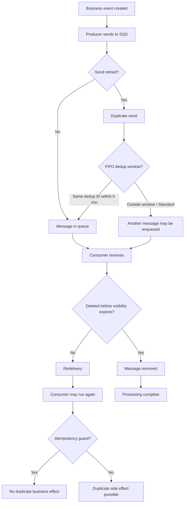
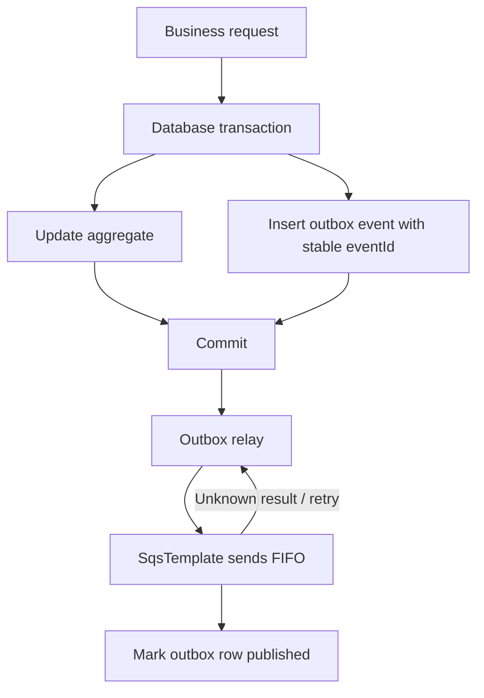

# Duplicate Handling, Message Groups, and Deduplication

In event-driven systems, the same business operation may be sent multiple times or received again by a consumer after an incomplete processing attempt. Amazon Simple Queue Service (Amazon SQS) provides different mechanisms to reduce send-side duplicates, preserve ordering per group, and distribute work in parallel. However, **queue-level deduplication does not replace consumer idempotency**.

With Standard queues, applications must tolerate duplicate delivery and best-effort ordering. With FIFO queues, producers can pass `MessageDeduplicationId` so SQS eliminates duplicate sends within a 5-minute window; `MessageGroupId` defines the sequence of messages that must stay ordered. Messages in different groups can be processed independently.

This lesson uses Spring Boot and Spring Cloud AWS **3.4.1**, focusing on how duplicates arise, how to choose message groups, explicit/content-based deduplication, high-throughput FIFO, transactional outbox and inbox patterns, and how to test to ensure business side effects never repeat.

## 1. Learning Objectives

After this lesson, you will be able to:

- Distinguish duplicate send, redelivery, and duplicate side effects.
- Explain how Standard and FIFO queues differ regarding duplicates and ordering.
- Choose `MessageGroupId` according to the aggregate or entity requiring ordering.
- Use a stable `MessageDeduplicationId` and understand the 5-minute deduplication window.
- Compare explicit deduplication with content-based deduplication.
- Configure `DeduplicationScope` and `FifoThroughputLimit` for high-throughput FIFO.
- Build producers with `SqsTemplate` and idempotent consumers.
- Combine transactional outbox/inbox patterns to handle retries between a database and SQS.
- Test duplicate sends, redelivery, in-group ordering, and cross-group parallelism.

## 2. Three Types of Duplication to Distinguish

In an SQS pipeline, the word “duplicate” can refer to different phenomena:

| Type | When Does It Happen? | Related Mechanism |
|---|---|---|
| **Duplicate send** | Producer sends the same event multiple times, e.g., retrying after a lost response | FIFO `MessageDeduplicationId` or content-based deduplication |
| **Redelivery** | Consumer receives a message and fails to delete it before visibility timeout expires or acknowledgment fails | Visibility timeout, retries, at-least-once delivery |
| **Duplicate side effect** | Consumer executes the same business action multiple times, e.g., adding inventory twice | Idempotency keys, unique constraints, inbox/transactions |



A message sent once can still be redelivered. Conversely, a producer can send the same event multiple times while FIFO eliminates duplicates inside the deduplication window. Thus, producer and consumer designs must address two separate boundaries.

## 3. How Standard and FIFO Queues Handle Duplicates

| Characteristic | Standard Queue | FIFO Queue |
|---|---|---|
| Duplicate on send | Can occur; no FIFO deduplication mechanism | Deduplication ID or content-based deduplication for 5 minutes |
| Redelivery | Can occur; at-least-once delivery | Can occur if message is not deleted and visibility timeout expires |
| Ordering | Best-effort; cannot rely on send order | Preserves ordering within each `MessageGroupId` |
| Message group | Can be used for fair queues; creates no FIFO ordering | Serves as the ordering and parallelism boundary |
| Idempotent consumer | Mandatory if side effects must not repeat | Still required due to redelivery and commit/ack failures |
| Throughput | Scales flexibly | Depends on group count and throughput settings; supports high-throughput FIFO |

AWS describes FIFO as offering queue-level exactly-once processing via deduplication. Understand the exact scope: SQS detects duplicate sends within a 5-minute window, but does not participate in database, payment gateway, or business API transactions. If a consumer commits data and crashes before deleting the message, the side effect can still be invoked again.

**Do not infer that FIFO guarantees a consumer runs only once.** The practical design goal is: the queue reduces duplicate sends, an idempotent consumer protects side effects, and message groups preserve ordering for related event sequences.

## 4. MessageGroupId: Defining the Ordering Boundary

`MessageGroupId` identifies a group of messages in a FIFO queue. SQS preserves message order within the same group according to the order SQS accepted them. Different groups can be processed in parallel.

Order system example:

```text
MessageGroupId = order-O-101
    OrderCreated(v1) → OrderPaid(v2) → OrderShipped(v3)

MessageGroupId = order-O-202
    OrderCreated(v1) → OrderCancelled(v2)
```

Events for `O-101` must follow the exact sequence so order state remains valid. `O-202` is a separate order and can be processed concurrently.

### 4.1. Choosing Group ID by Aggregate

Practical rule:

> Same aggregate requiring order → same `MessageGroupId`; independent aggregates → different group IDs.

| Event Type | Suggested Group ID | Reason |
|---|---|---|
| Order lifecycle | `order-<orderId>` | State transitions for one order are ordered |
| Account balance | `account-<accountId>` | Commands on the same account must be serialized |
| Product updates | `product-<productId>` | Updates to the same product follow versions |
| IoT device state | `device-<deviceId>` | Per-device telemetry has its own sequence |
| Independent jobs | Job or tenant group ID as needed | No single global sequence required |

Do not use a single group ID for the entire queue when independent aggregates can run in parallel. A single group creates a bottleneck because SQS must enforce one sequential stream.

Conversely, do not generate a random group ID per message when ordering by aggregate is required. Splitting one order across multiple groups prevents SQS from knowing they belong to the same business sequence.

### 4.2. Order Accepted by SQS Is Not Business Order

FIFO preserves the order SQS receives messages within a group. It does not sort by `occurredAt`, `version`, or an ascending ID.

Suppose two producer threads emit events for `order-O-101`:

1. Thread A builds `OrderPaid(v2)` but stalls before calling SQS.
2. Thread B sends `OrderShipped(v3)` and SQS accepts it first.
3. Thread A sends `OrderPaid(v2)` afterward.

FIFO keeps the order SQS received them: v3 then v2. `MessageGroupId` does not automatically detect that this violates business order. With multiple producers or relays, serialize publishing per aggregate—typically using a transactional outbox and partitioning/locking by aggregate ID.

### 4.3. Different Groups Have No Global Order

If `order-O-101` and `order-O-202` belong to different groups, SQS may deliver or process one group ahead of the other. Do not use FIFO to infer cross-aggregate temporal relationships. If business rules truly require global ordering, use a dedicated coordination mechanism; funneling all messages into one group only fits when full-queue serialization is acceptable.

## 5. Sending FIFO Messages with Spring Cloud AWS

FIFO queues end with the `.fifo` suffix. When sending, the producer passes `MessageGroupId` and `MessageDeduplicationId`:

```java
import io.awspring.cloud.sqs.operations.SqsTemplate;
import org.springframework.beans.factory.annotation.Value;
import org.springframework.stereotype.Service;

@Service
public class OrderEventPublisher {
    private final SqsTemplate sqsTemplate;
    private final String queueName;

    public OrderEventPublisher(
            SqsTemplate sqsTemplate,
            @Value("${app.sqs.order-queue}") String queueName) {
        this.sqsTemplate = sqsTemplate;
        this.queueName = queueName;
    }

    public void publish(OrderEvent event) {
        sqsTemplate.send(to -> to
            .queue(queueName)
            .payload(event)
            .messageGroupId("order-" + event.orderId())
            .messageDeduplicationId(event.eventId())
        );
    }
}
```

The two values serve different roles:

- `messageGroupId`: selects the ordered stream and serialization scope.
- `messageDeduplicationId`: identifies the same logical send so SQS drops duplicate retries within the deduplication window.

`eventId` must be generated when the business event occurs and preserved across retries. Never generate a fresh UUID inside every `publish()` call, because each retry would get a different deduplication ID and SQS would not recognize them as the same event.

### 5.1. Sending FIFO Batches

SQS supports up to 10 entries in a single `SendMessageBatch` request. Each FIFO entry needs a group ID and deduplication ID (unless content-based deduplication is enabled). A batch is not an atomic transaction; some entries can succeed while others fail.

When sending multiple messages for the same group in one batch, entry order in the batch determines the receive order for messages in that group. When retrying a batch, preserve the event ID and group ID for each entry, and retry only failed entries after inspecting partial results.

### 5.2. Inspecting Send Results

Spring Cloud AWS's `SendResult` provides `messageId` and additional info, which for FIFO may include `sequenceNumber`. `messageId` is assigned by SQS; `sequenceNumber` represents the message's position in the group's FIFO stream and is a large monotonically increasing number, though you should not assume consecutive increments.

Log `eventId`, `orderId`, `messageId`, and `sequenceNumber` when troubleshooting ordering. Never substitute `sequenceNumber` for a business version because it only reflects the order SQS received messages.

## 6. Explicit Deduplication with MessageDeduplicationId

`MessageDeduplicationId` is a producer-supplied identifier for a FIFO message. If SQS receives the same ID again within **5 minutes** of the original send, the duplicate send is accepted without queuing another deliverable message.

Example:

```text
09:00:00  Send eventId=evt-100, group=order-O-101 → SQS accepts message
09:00:03  Retry eventId=evt-100, same group       → SQS deduplicates retry
09:04:59  Retry eventId=evt-100, same group       → still inside dedup window
09:05:10  Retry eventId=evt-100, same group       → outside window; may enqueue new message
```

Key facts:

1. The deduplication window is 5 minutes; do not treat it as permanent event ID storage.
2. The ID must remain identical across all retries of the same event.
3. Two distinct business events must have distinct IDs, even with identical payloads.
4. Once the window closes, SQS no longer guarantees detecting duplicate sends.
5. Send-side deduplication does not prevent redelivery caused by visibility timeouts or failed acknowledgments.

### 6.1. Choosing a Stable ID

Suppose `OrderPaid` has event ID `evt-7f21`:

```java
public record OrderEvent(
    String eventId,
    String orderId,
    long version,
    String eventType
) {}
```

When the publisher retries, reuse `event.eventId()`:

```java
.messageDeduplicationId(event.eventId())
```

Do not use the current timestamp or a newly generated UUID on each send attempt. If you need to distinguish two genuinely separate payments on the same order, each must have its own event ID.

### 6.2. Deduplication ID Is Not MessageId

`MessageDeduplicationId` is supplied by the producer before sending; `MessageId` is returned by SQS after accepting the message. Therefore, `MessageId` cannot be used to identify an attempt before calling `SendMessage`. Use the persisted business ID or outbox ID as the deduplication ID.

## 7. Content-Based Deduplication

When `ContentBasedDeduplication` is enabled on a FIFO queue, SQS generates `MessageDeduplicationId` by computing a SHA-256 hash over the **message body**. Producers do not need to supply a deduplication ID per request.

Example enabling via AWS CLI:

```bash
aws sqs set-queue-attributes \
  --queue-url "https://sqs.ap-southeast-1.amazonaws.com/123456789012/order-events.fifo" \
  --attributes '{"ContentBasedDeduplication":"true"}'
```

With content-based deduplication enabled:

- SQS hashes the body only, excluding message attributes.
- Two messages with identical bodies inside the 5-minute window can be treated as the same send, even if their attributes differ.
- If a request provides an explicit `MessageDeduplicationId`, the explicit value takes precedence.
- Whitespace or JSON serialization differences change the body and produce a different hash, even when business data is equivalent.

### 7.1. Risks of Relying Solely on the Body

Suppose two distinct commands share the same payload:

```json
{
  "orderId": "O-101",
  "command": "refresh"
}
```

Message A has attribute `tenantId=tenant-A`; message B has `tenantId=tenant-B`. Because content-based deduplication hashes only the body, SQS ignores the differing attributes when generating the deduplication ID. If both messages fall within the same deduplication scope and 5-minute window, one send can be dropped as a duplicate.

For business events, a stable explicit ID is usually safer because it reflects event identity rather than JSON serialization details. Content-based dedup fits when identical bodies genuinely denote the exact same message.

## 8. DeduplicationScope and High-Throughput FIFO

FIFO queues have two properties governing deduplication scope and throughput:

- `DeduplicationScope`: `queue` or `messageGroup`.
- `FifoThroughputLimit`: `perQueue` or `perMessageGroupId`.

| Configuration | Deduplication Scope | Throughput Impact |
|---|---|---|
| `DeduplicationScope=queue`, `FifoThroughputLimit=perQueue` | Dedup ID compared across the entire queue | FIFO throughput subject to per-queue quota |
| `DeduplicationScope=messageGroup`, `FifoThroughputLimit=perMessageGroupId` | Dedup ID compared within each group | Enables high-throughput FIFO per message group |

To enable high-throughput FIFO, configure both properties accordingly. Setting only `FifoThroughputLimit=perMessageGroupId` while leaving queue-wide scope may not satisfy high-throughput configuration requirements.

Example:

```bash
aws sqs set-queue-attributes \
  --queue-url "https://sqs.ap-southeast-1.amazonaws.com/123456789012/order-events.fifo" \
  --attributes '{"DeduplicationScope":"messageGroup","FifoThroughputLimit":"perMessageGroupId"}'
```

Actual quotas depend on Region and account limits. High-throughput FIFO scales capacity across groups; it does not parallelize messages within the same group or remove per-group ordering constraints.

### 8.1. Same Deduplication ID Across Different Groups

With `queue` scope, the same deduplication ID can be treated as a duplicate across the whole queue even when group IDs differ. With `messageGroup` scope, deduplication is scoped per group; using the same ID in two different groups will not suppress each other.

Therefore, when high-throughput FIFO is enabled, ensure event IDs are clearly scoped and never accidentally reused for two distinct events in the same group. You can use global IDs such as UUIDs or IDs composed from aggregate ID and sequence/event ID.

## 9. Standard Fair Queues and MessageGroupId

Standard queues also accept `MessageGroupId` in the context of **fair queues**. This feature helps SQS distribute wait times more fairly across tenants when one tenant produces heavy message volume.

However, `MessageGroupId` on a Standard queue **provides neither FIFO ordering guarantees nor deduplication**. Never carry over FIFO assumptions to a Standard queue simply because both APIs accept a `MessageGroupId` field.

## 10. Idempotent Consumers: The Final Line of Defense

An idempotent consumer can receive the same event multiple times while applying the business side effect only once. A common approach uses `eventId` as a unique key in a `processed_event` or inbox table.

Example PostgreSQL schema:

```sql
CREATE TABLE processed_event (
    event_id       varchar(128) PRIMARY KEY,
    processed_at   timestamptz NOT NULL DEFAULT now()
);
```

In the service, record the event and update business state within the same transaction:

```sql
BEGIN;

WITH new_event AS (
    INSERT INTO processed_event(event_id)
    VALUES (:event_id)
    ON CONFLICT (event_id) DO NOTHING
    RETURNING event_id
), updated AS (
    UPDATE inventory
    SET quantity = quantity + :quantity_delta
    WHERE sku = :sku
      AND EXISTS (SELECT 1 FROM new_event)
    RETURNING sku
)
SELECT
    (SELECT count(*) FROM new_event) AS inserted_events,
    (SELECT count(*) FROM updated) AS updated_rows;

COMMIT;
```

This is PostgreSQL-style pseudocode. If `inserted_events = 0`, the event was already processed and the consumer can exit safely. If a new event was inserted but `updated_rows = 0`, roll back the transaction so an unapplied event is not marked processed. Check the counts before committing.

Only after the transaction commits does the listener acknowledge the message. If `DeleteMessage` fails and the message is redelivered, the unique constraint lets the next attempt detect that the event already exists and avoid adding inventory a second time.

### 10.1. An Idempotency Key Must Represent One Business Action

Picking a key that is too broad or too narrow leads to bugs:

- Using `orderId` as the key for all events of an order: `OrderPaid` and `OrderShipped` share the same key, causing one event to be skipped.
- Generating a new `eventId` on every retry: the consumer fails to recognize the same event, repeating side effects.
- Using a unique `eventId` per business event: prevents duplicates when the same event is redelivered or resent.

For payment APIs, forward `eventId` as the payment provider's idempotency key if supported by the target API. A database unique constraint cannot protect an external API that gets invoked twice.

## 11. Transactional Outbox on the Producer

A common issue is when a producer updates its database successfully but fails to send to SQS, or SQS accepts the message while the producer loses the response. If the application generates a new event on every retry, FIFO deduplication cannot recognize it as the same event.

The transactional outbox pattern bridges the boundary between the business database and event emission:



Within a single database transaction, the application updates the aggregate and inserts an outbox row with a stable `eventId`. A relay reads the outbox, sends the event to the FIFO queue with `MessageDeduplicationId = eventId`, and then marks the row published.

If the relay sends successfully yet loses the response before marking the outbox row, the next run resends the same event ID. FIFO can drop duplicate sends within 5 minutes. If the retry occurs past the 5-minute window, SQS may enqueue another message; consumer-side inbox/idempotency still protects business side effects.

### 11.1. Preserving Outbox Ordering per Aggregate

To preserve order inside a FIFO group, the relay must publish events in aggregate sequence order. You can partition workers by aggregate ID, lock the outbox/aggregate rows when polling events, or use a claim mechanism ensuring only one publisher handles a given aggregate at a time.

Never let two relay workers grab `OrderPaid(v2)` and `OrderShipped(v3)` and send them concurrently without coordination. FIFO preserves the order SQS receives messages; it will not repair order scrambled by a relay.

## 12. Consumer Concurrency and Message Groups

FIFO can only parallelize across groups that currently have available messages. If a queue holds 1,000 messages all sharing the same `MessageGroupId`, the consumer remains constrained to one sequential chain.

| Group Design | Consequence |
|---|---|
| One group for the whole queue | Easy global ordering, but throughput is serialized |
| One group per aggregate | Preserves needed order while allowing other aggregates to run concurrently |
| Random group per message | High parallelism, but loses aggregate ordering |
| One group per tenant | Preserves tenant-wide ordering, though a high-volume tenant can become a hot group |

With Spring Cloud AWS `@SqsListener`, the container manages group dispatch. Do not hand off messages to `@Async` and return from the listener before work finishes, because acknowledgment may fire before the side effect and break real execution ordering.

If you need concurrent processing within a group, revisit the ordering requirement. You can split independent events into separate groups or enforce version checks in the database, but never assume FIFO guarantees side-effect ordering once the application runs handlers concurrently itself.

## 13. Testing Deduplication and Ordering

A test suite should separate producer deduplication from consumer idempotency:

| Experiment | Method | Expected Result |
|---|---|---|
| FIFO duplicate send | Send same body and same explicit dedup ID twice within 5 minutes | Only one message queued for delivery |
| Dedup window expiration | Resend same ID after 5 minutes | SQS no longer guarantees dropping the duplicate send |
| Distinct event IDs | Send two events with different IDs in the same group | Both are queued in the order SQS receives them |
| Content-based dedup | Enable content-based dedup; send identical bodies with differing attributes | May be treated as duplicates because attributes are not hashed |
| Group ordering | Send v1, v2, v3 in the same group | Consumer observes exact in-group ordering |
| Group parallelism | Interleave sends across two groups | The two groups can be processed independently |
| Redelivery | Consumer receives without deleting and lets visibility expire | Message can be redelivered |
| Inbox idempotency | Deliver the same event ID twice | Database side effect applies only once |
| Outbox retry | Relay sends successfully without marking published, then retries same ID | Duplicate send dropped inside dedup window; consumer remains safe outside window |

Never infer guaranteed ordering or deduplication from a single passing run. Record `eventId`, `MessageGroupId`, `MessageDeduplicationId`, `MessageId`, `SequenceNumber`, receive count, and processing timestamps.

## 14. Common Design Mistakes

1. **Generating a new dedup ID on every retry:** SQS treats it as a new event; persist the ID before sending.
2. **Using the body as business identity:** content-based dedup ignores attributes and depends on serialization; prefer explicit event IDs.
3. **Using one group for every message:** serializes the queue and creates a hot group.
4. **Using random groups:** events for the same aggregate can run concurrently and lose order.
5. **Assuming FIFO never redelivers:** undeleted messages can reappear after visibility timeout expires.
6. **Treating the 5-minute dedup window as permanent duplicate storage:** retries outside the window can enqueue a new message.
7. **Assuming group IDs sort by version:** SQS preserves acceptance order; producers must ensure publish order.
8. **Committing database changes without idempotency:** `DeleteMessage` failures can re-trigger side effects.
9. **Enabling high-throughput FIFO with mismatched scope:** verify both `DeduplicationScope` and `FifoThroughputLimit`.
10. **Using MessageGroupId on Standard expecting FIFO:** fair queues do not provide ordering guarantees.

## 15. Hands-On Exercises

**Exercise 1 — Explicit deduplication:** Create FIFO queue `order-events.fifo` and send the same event ID twice within 5 minutes using `SqsTemplate`. Observe message count and record `MessageId`.

**Exercise 2 — Message groups:** Send three events for `O-101` and two events for `O-202` in interleaved order. Run multiple consumers and verify in-group order while observing parallel execution across the two groups.

**Exercise 3 — Content-based dedup:** Enable `ContentBasedDeduplication`. Send two identical bodies with differing attributes. Explain why SQS may suppress one send.

**Exercise 4 — Idempotent consumer:** Create a `processed_event` table with a unique key on `eventId`. Redeliver the same message after committing the database by simulating an acknowledgment failure. Verify the side effect does not repeat.

**Exercise 5 — Outbox relay:** In one transaction, update an order and insert an outbox row. Build a relay that sends FIFO messages with group ID by order and dedup ID by event ID. Simulate a relay crash after sending but before marking published.

**Exercise 6 — High-throughput FIFO:** Test `DeduplicationScope=messageGroup` with `FifoThroughputLimit=perMessageGroupId`. Compare throughput against per-queue settings under the same load and group count.

## 16. Self-Check Questions

1. How does duplicate send differ from redelivery? **Duplicate send comes from producer retries; redelivery occurs when an undeleted message is delivered again.**
2. How long does FIFO deduplication retain an ID? **5 minutes.**
3. What does `MessageGroupId` control? **Ordering scope; messages in the same group stay ordered, while different groups can run in parallel.**
4. What part does content-based deduplication hash? **The message body; message attributes are excluded.**
5. When does explicit `MessageDeduplicationId` take precedence? **Whenever a request includes an explicit ID, it is used instead of the content-based generated ID.**
6. Does FIFO guarantee a consumer will never receive a message twice? **No; redelivery can still happen if a message is not deleted before its visibility timeout expires.**
7. Which pair of attributes enables high-throughput FIFO? **`DeduplicationScope=messageGroup` and `FifoThroughputLimit=perMessageGroupId`.**
8. Why must an outbox relay keep event IDs stable? **So retries represent the same event and allow FIFO deduplication to detect duplicate sends.**
9. Why does a consumer still need an inbox/idempotency guard? **Because duplicates outside the 5-minute window and redeliveries can still occur; the queue does not share a transaction with the database.**
10. Does FIFO order by business timestamp or SQS acceptance order? **By SQS acceptance order within each group.**

## 17. References

- [AWS — Exactly-once processing in FIFO queues](https://docs.aws.amazon.com/AWSSimpleQueueService/latest/SQSDeveloperGuide/FIFO-queues-exactly-once-processing.html): explicit/content-based deduplication and the 5-minute window.
- [AWS — FIFO queue message grouping](https://docs.aws.amazon.com/AWSSimpleQueueService/latest/SQSDeveloperGuide/FIFO-queues-understanding-logic.html): ordering within message groups, multiple groups, and concurrent processing.
- [AWS — High throughput for FIFO queues](https://docs.aws.amazon.com/AWSSimpleQueueService/latest/SQSDeveloperGuide/high-throughput-fifo.html): `DeduplicationScope`, `FifoThroughputLimit`, and high-throughput FIFO.
- [AWS API — SendMessage](https://docs.aws.amazon.com/AWSSimpleQueueService/latest/APIReference/API_SendMessage.html): `MessageGroupId`, `MessageDeduplicationId`, and content-based deduplication.
- [AWS API — SetQueueAttributes](https://docs.aws.amazon.com/AWSSimpleQueueService/latest/APIReference/API_SetQueueAttributes.html): FIFO and deduplication scope settings.
- [Spring Cloud AWS 3.4.1 — SQS Integration Reference](https://docs.awspring.io/spring-cloud-aws/docs/3.4.1/reference/html/index.html): `SqsTemplate`, FIFO send options, and listener grouping.
- [AWS Prescriptive Guidance — Transactional outbox pattern](https://docs.aws.amazon.com/prescriptive-guidance/latest/cloud-design-patterns/transactional-outbox.html): saving events in business transactions and reliable event relaying.

**Key takeaway:** `MessageGroupId` protects ordering within a stream, `MessageDeduplicationId` reduces duplicate sends over 5 minutes, and consumer inbox/idempotency guards protect side effects. Combining all three with a transactional outbox lets a Spring Boot system handle retries and event emission reliably.
