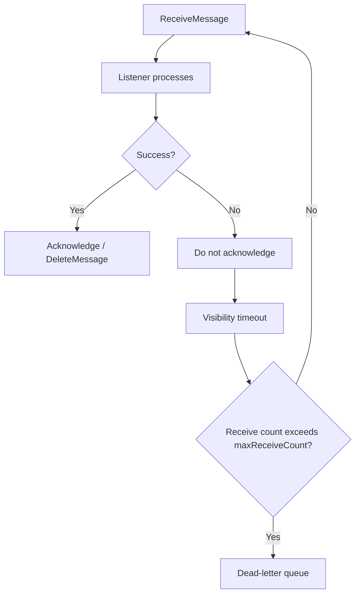

# Retries, Dead-Letter Queues, and Replaying Failed Messages

In a Spring Boot system using Amazon Simple Queue Service (Amazon SQS), a message can fail due to a temporarily unavailable dependency, invalid data, misconfiguration, or a bug in consumer code. Immediately re-receiving the message can create a tight retry loop and amplify load while the dependency is degraded. Dropping the message after the first failure risks losing the ability to recover from a transient error.

SQS combines **visibility timeout**, **redrive policies**, and **dead-letter queues (DLQs)** to manage messages that fail processing. Spring Cloud AWS adds error handlers and backoff strategies to control retry timing inside listener containers. Once the root cause is fixed, messages in a DLQ can be replayed back to the source queue or to another destination queue.

This lesson uses **Spring Cloud AWS 3.4.1**, focusing on error classification, visibility-timeout-based retries, exponential/linear backoff, configuring DLQs and `maxReceiveCount`, monitoring failed messages, redrive via SQS APIs, and controlled manual replay.

## 1. Learning Objectives

After this lesson, you will be able to:

- Distinguish transient, data, and configuration errors to choose the right retry policy.
- Explain SQS's default retry behavior when a listener does not acknowledge a message.
- Configure `ImmediateRetryAsyncErrorHandler`, `ExponentialBackoffErrorHandler`, and `LinearBackoffErrorHandler`.
- Understand the roles of `ApproximateReceiveCount`, `maxReceiveCount`, `RedrivePolicy`, and `RedriveAllowPolicy`.
- Create source queues and DLQs of matching type in the same account and Region.
- Design alerts, investigation workflows, and handling for messages in a DLQ.
- Distinguish SQS managed redrive from manual replay with data transformation.
- Use `StartMessageMoveTask` and monitor or cancel redrive tasks.
- Ensure idempotency, preserve FIFO ordering, and test failure/recovery flows.

## 2. Classifying Errors Before Choosing Retries

Not every error should be retried the same way. Identify the root cause and recoverability first:

| Error Type | Example | Suitable Policy |
|---|---|---|
| Transient | Database timeout, HTTP 503, throttling, brief network drop | Retry with backoff; bound receive attempts with a redrive policy |
| Overloaded dependency | Downstream API rate limiting, exhausted connection pool | Exponential backoff, optionally with jitter to spread retries |
| Invalid data | Schema-invalid JSON, missing required field, unsupported event version | Do not retry indefinitely; route to DLQ/quarantine for investigation |
| Business error needing intervention | Order state forbids transition, locked account | Record business outcome and handle via workflow; do not retry blindly |
| Configuration/infrastructure error | IAM `AccessDenied`, wrong queue URL, wrong Region | Fix configuration/permissions; retries only help after fixing the root cause |
| Reproducible code bug | Null pointer, mapping bug | Bound retries, alert, and move to DLQ to keep the queue from clogging |

A practical rule: **retry only when there is reason to believe a subsequent attempt can succeed**. If the same payload and code will deterministically fail the same way, raising retry counts only delays failure detection.

## 3. Default Retries in SQS and Listener Containers

When a consumer receives a message, SQS places it in the *in-flight* state for the visibility timeout. If the listener finishes successfully and the message is acknowledged, SQS deletes it. If the listener throws an exception and the message is not acknowledged, it can be received again once the visibility timeout expires.



With Spring Cloud AWS 3.4.1, a message that fails in a default listener is not acknowledged and can be polled again after the visibility timeout. Thus, default retries are not necessarily immediate.

**Never catch an exception and return normally if you want SQS to retry.** Under `ON_SUCCESS` acknowledgment mode, a listener returning normally causes the message to be acknowledged. If you catch errors to log or record metrics, rethrow the exception or use an appropriate interceptor to observe errors without altering the acknowledgment decision.

### 3.1. What Does `maxReceiveCount` Count?

`maxReceiveCount` is the threshold for how many times a message is received by consumers from the source queue. Once the receive count exceeds the configured threshold, SQS moves the message to the DLQ per the redrive policy. This counts receives (receive count), not log lines, internal method calls within the listener, or producer send attempts.

A receive can result in a listener error, timeout, process crash, or failed acknowledgment. All of those cause the message to be received again and increment the receive count. When designing retries, inspect `ApproximateReceiveCount` alongside actual processing logs.

## 4. ErrorHandler in Spring Cloud AWS 3.4.1

Spring Cloud AWS provides two interfaces for handling errors after a listener fails:

- `ErrorHandler<T>`: synchronous handling.
- `AsyncErrorHandler<T>`: returns `CompletableFuture<Void>` for asynchronous handling.

Example error handler that logs and rethrows:

```java
import io.awspring.cloud.sqs.listener.errorhandler.ErrorHandler;
import org.springframework.context.annotation.Bean;
import org.springframework.messaging.Message;

@Bean
ErrorHandler<Object> sqsErrorHandler() {
    return new ErrorHandler<>() {
        @Override
        public void handle(Message<Object> message, Throwable error) {
            log.error("SQS listener processing failed", error);

            // Propagate error so the message is not treated as recovered.
            throw new IllegalStateException("Retry SQS message", error);
        }
    };
}
```

The snippet assumes a logger is declared. With the auto-configured factory, declaring an error handler bean lets Spring Cloud AWS wire it into the factory automatically. If you build `SqsMessageListenerContainerFactory` manually, attach the handler via `.errorHandler(sqsErrorHandler)`.

**Very important:** if `ErrorHandler` completes normally, Spring Cloud AWS treats the message as recovered and acknowledges it per the current configuration. To keep the message retrying under `ON_SUCCESS`, the error handler must propagate the error. If you only want to observe errors without changing acknowledgment behavior, use `MessageInterceptor.afterProcessing()` and inspect the throwable.

## 5. Immediate Retries

Since Spring Cloud AWS 3.4, `ImmediateRetryAsyncErrorHandler` sets a failing message's visibility timeout to 0 so it can be received again right away:

```java
import io.awspring.cloud.sqs.listener.errorhandler.AsyncErrorHandler;
import io.awspring.cloud.sqs.listener.errorhandler.ImmediateRetryAsyncErrorHandler;

@Bean
AsyncErrorHandler<Object> asyncErrorHandler() {
    return new ImmediateRetryAsyncErrorHandler<>();
}
```

When using a custom factory:

```java
@Bean
SqsMessageListenerContainerFactory<Object> defaultSqsListenerContainerFactory(
        SqsAsyncClient sqsAsyncClient) {
    return SqsMessageListenerContainerFactory.builder()
        .sqsAsyncClient(sqsAsyncClient)
        .errorHandler(new ImmediateRetryAsyncErrorHandler<>())
        .build();
}
```

Immediate retries can help when failures are ultra-brief glitches and messages need prompt retrial. However, if a database or target API is down, the consumer can receive and fail continuously, burning CPU, SQS requests, and logs. Do not use immediate retry as a blanket default for all errors; backoff is usually safer when dependencies are overloaded.

## 6. Exponential Backoff

Exponential backoff increases the wait interval after each failed processing attempt. Spring Cloud AWS 3.4.1 provides `ExponentialBackoffErrorHandler`, computing the timeout from `ApproximateReceiveCount`:

\[
T_n = \min(T_{initial} \times m^{(n-1)}, T_{max})
\]

Where:

- `T_initial`: initial wait duration.
- `m`: multiplier.
- `n`: receive count used for the retry calculation.
- `T_max`: maximum visibility timeout cap.

Example configuration:

```java
import io.awspring.cloud.sqs.listener.errorhandler.ExponentialBackoffErrorHandler;
import io.awspring.cloud.sqs.listener.errorhandler.Jitter;

@Bean
ExponentialBackoffErrorHandler<Object> asyncErrorHandler() {
    return ExponentialBackoffErrorHandler.builder()
        .initialVisibilityTimeoutSeconds(5)
        .multiplier(2.0)
        .maxVisibilityTimeoutSeconds(300)
        .jitter(Jitter.FULL)
        .build();
}
```

With initial = 5 seconds and multiplier = 2, base intervals grow roughly as 5, 10, 20, 40, 80 seconds, capped at 300 seconds. The example uses `Jitter.FULL`, so the final delay is randomized between the valid minimum and the computed backoff value.

### 6.1. Jitter to Avoid Synchronized Retries

When many messages fail together due to one dependency, they can become eligible for retry at the exact same moment. When the dependency recovers, a surge of simultaneous requests can trigger another overload (*thundering herd*).

Spring Cloud AWS 3.4.1 supports:

| Jitter | How Final Delay Is Chosen | Characteristics |
|---|---|---|
| `Jitter.NONE` | Uses the exact backoff duration | No randomness; default |
| `Jitter.FULL` | Uniformly sampled from the valid minimum up to `timeout` | Strongly spreads out retries |
| `Jitter.HALF` | Sampled in `[ceil(timeout/2), timeout]` | Enforces a minimum wait of half the backoff |

Jitter reduces synchronized retry spikes across many messages. With `FULL`, a retry can occur significantly sooner than the base timeout; if you need a guaranteed minimum pause, consider `HALF` or a custom strategy.

## 7. Linear Backoff

If you want the wait duration to grow by a fixed increment after each failure, use `LinearBackoffErrorHandler`:

```java
import io.awspring.cloud.sqs.listener.errorhandler.LinearBackoffErrorHandler;

@Bean
LinearBackoffErrorHandler<Object> asyncErrorHandler() {
    return LinearBackoffErrorHandler.builder()
        .initialVisibilityTimeoutSeconds(10)
        .increment(15)
        .maxVisibilityTimeoutSeconds(120)
        .build();
}
```

With this configuration, wait intervals step through 10, 25, 40, 55 seconds... and never exceed 120 seconds. Linear backoff is predictable when you want steady increases, whereas exponential backoff scales wait times up faster for prolonged outages.

## 8. Choosing a Retry Strategy

| Strategy | Pros | Risks / Limits | Best For |
|---|---|---|---|
| Default visibility timeout | Simple, minimal configuration | Fixed wait; many messages may retry in lockstep | Simple workloads, brief errors |
| Immediate retry | Fast recovery on fleeting glitches | Can cause hot loops and amplify load | Very brief, controlled failures |
| Exponential backoff | Rapidly backs off during prolonged outages | Can substantially extend message processing age | Unstable APIs/databases, throttling |
| Exponential + jitter | Breaks up synchronized retries | Non-deterministic retry timing | Many consumers/messages hitting one shared outage |
| Linear backoff | Predictable and easy to tune | Backs off more slowly during long outages | Workloads with fairly uniform recovery times |

Backoff only controls when a message becomes receivable again. It does not replace a redrive policy and does not bound total attempts indefinitely. Use `maxReceiveCount` and a DLQ to halt persistently failing messages.

## 9. What Is a Dead-Letter Queue?

A dead-letter queue (DLQ) is a dedicated queue that holds messages exceeding the receive threshold configured in the source queue's redrive policy. A DLQ isolates failing messages for investigation without continuing to clog the main processing stream.

A DLQ is typically used to:

- Inspect payloads and attributes of failed messages.
- Correlate `eventId`, `MessageId`, `ApproximateReceiveCount`, and exception logs.
- Diagnose data issues, code bugs, IAM errors, or dependency failures.
- Retain messages pending fixes and replay them once consumers are repaired.
- Alert whenever new messages enter the DLQ or message age grows.

A DLQ must exist before configuring a source queue to point to it. Source queue and DLQ must belong to the same AWS account and Region; if the source is FIFO, the DLQ must also be FIFO, and vice versa. The DLQ is configured at the Amazon SQS level via the source queue's redrive policy; `@SqsListener` and error handlers control processing/retries, while SQS performs the move to the DLQ once the receive count exceeds the threshold.

## 10. RedrivePolicy and maxReceiveCount

`RedrivePolicy` is set on the source queue and includes:

- `deadLetterTargetArn`: ARN of the DLQ that receives failed messages.
- `maxReceiveCount`: receive count threshold on the source queue; SQS moves the message to the DLQ when the receive count exceeds this threshold.

Example configuring a source queue to move messages to a DLQ after more than 5 receives:

```bash
aws sqs set-queue-attributes \
  --queue-url "https://sqs.ap-southeast-1.amazonaws.com/123456789012/orders" \
  --attributes '{"RedrivePolicy":"{\"deadLetterTargetArn\":\"arn:aws:sqs:ap-southeast-1:123456789012:orders-dlq\",\"maxReceiveCount\":\"5\"}"}'
```

The queue URL, account ID, and ARN are examples only. Substitute resources from your real environment. Redrive policies can be configured via AWS Console, CloudFormation, CDK, or Terraform.

A `maxReceiveCount` that is too low can send messages to the DLQ before transient errors recover. Setting it too high lets poison messages retry repeatedly, increasing cost and extending backlog. Choose the threshold based on desired retry count, backoff, SLA, and dependency recovery time. During testing, inspect `ApproximateReceiveCount` to confirm actual receive counts before messages move.

### 10.1. RedriveAllowPolicy

`RedriveAllowPolicy` is placed on the DLQ to control which source queues are allowed to use it as a DLQ. Common values:

| `redrivePermission` | Meaning |
|---|---|
| `allowAll` | Allows source queues in the same account and Region |
| `byQueue` | Allows only listed source queue ARNs; up to 10 ARNs |
| `denyAll` | Prevents any source queue from using this queue as a DLQ |

Example allowing only one source queue:

```bash
aws sqs set-queue-attributes \
  --queue-url "https://sqs.ap-southeast-1.amazonaws.com/123456789012/orders-dlq" \
  --attributes '{"RedriveAllowPolicy":"{\"redrivePermission\":\"byQueue\",\"sourceQueueArns\":[\"arn:aws:sqs:ap-southeast-1:123456789012:orders\"]}"}'
```

Apply least-privilege policies so shared queues do not unexpectedly become DLQs.

## 11. DLQ Retention Period

The retention period is the maximum time SQS keeps a message before automatically deleting it. Messages moved to a DLQ are still subject to the destination queue's retention, but age calculation differs by queue type:

| Queue Type | When Message Moves to DLQ | Recommendation |
|---|---|---|
| Standard | Original enqueue timestamp is preserved; retention age continues counting from when it entered the source queue | Set DLQ retention longer than source queue retention |
| FIFO | Enqueue timestamp is reset when moved to the DLQ | Monitor message age from the time it entered the DLQ |

Standard example: a message stayed in the source queue for 1 day before moving to a DLQ with a 4-day retention. Only roughly 3 days remain before expiration. Therefore, do not set DLQ retention shorter than the source queue if you need adequate investigation time. For Standard DLQs, `ApproximateAgeOfOldestMessage` reflects how long the message has been in the DLQ since it was moved there, not total age since original send.

## 12. FIFO and DLQ Impact

With FIFO queues, a failing message at the head of a `MessageGroupId` blocks subsequent messages in that group. When that message moves to a DLQ, the stream in the source queue can continue, but **business ordering may be broken** because the earlier message was pulled out of the flow.

AWS advises against using a DLQ for FIFO queues if moving a failed message aside invalidates the order of subsequent operations. Evaluate business requirements:

- If events can stand alone with checkpoints/versions, a DLQ may be acceptable alongside reconciliation.
- If every event must apply in strict absolute order, keep the group blocked, fix the root cause, and replay the failing message before letting later events proceed.
- Never automatically delete or skip failing messages in FIFO merely to shrink backlog.

## 13. Monitoring and Alerting on DLQs

Create CloudWatch alarms when a DLQ has visible messages or when oldest message age exceeds a threshold. Useful metrics:

| Metric | Queue | Meaning |
|---|---|---|
| `ApproximateNumberOfMessagesVisible` | DLQ | Messages awaiting investigation/replay |
| `ApproximateAgeOfOldestMessage` | DLQ | Age of oldest message in DLQ per queue type semantics |
| `NumberOfMessagesSent` | DLQ | Messages moved into the DLQ over a period |
| `ApproximateNumberOfMessagesVisible` | Source | Backlog waiting for consumers |
| `ApproximateNumberOfMessagesNotVisible` | Source | Messages in-flight, processing, or awaiting acknowledgment |

In application logs, record `eventId`, SQS `MessageId`, queue, listener ID, receive count, and exception type. Never log receipt handles or payloads containing sensitive data.

**Note when inspecting via the SQS Console:** viewing/receiving messages in the console can increment the receive count and push a message past `maxReceiveCount`, causing it to move to the DLQ. When investigating, check the redrive policy first and avoid receiving messages more times than allowed.

## 14. Replaying Messages from a DLQ (Redrive)

Once the root cause is fixed, messages can be moved from the DLQ back to the source queue or to another destination queue. SQS provides asynchronous redrive tasks:

| API | Function |
|---|---|
| `StartMessageMoveTask` | Starts moving messages from a DLQ to the source queue or a destination queue |
| `ListMessageMoveTasks` | Lists status of recent redrive tasks |
| `CancelMessageMoveTask` | Cancels an active task |

AWS CLI example:

```bash
aws sqs start-message-move-task \
  --source-arn "arn:aws:sqs:ap-southeast-1:123456789012:orders-dlq" \
  --destination-arn "arn:aws:sqs:ap-southeast-1:123456789012:orders" \
  --max-number-of-messages-per-second 50
```

Monitor the task:

```bash
aws sqs list-message-move-tasks \
  --source-arn "arn:aws:sqs:ap-southeast-1:123456789012:orders-dlq" \
  --max-results 10
```

SQS defaults to redriving back to the source queue. If choosing another destination, both queues must share the same type (Standard → Standard or FIFO → FIFO). You can cap the redrive velocity to avoid overwhelming the source queue and downstream systems. The maximum custom rate is 500 messages/second; start low and ramp up while watching load.

### 14.1. Limitations of Managed Redrive

Managed redrive has specific behaviors to keep in mind:

- SQS moves messages from the DLQ roughly oldest-received first; the destination receives them interleaved with live traffic in actual arrival order.
- SQS does not support filtering or modifying payloads/attributes during redrive.
- Redriven messages appear as new messages at the destination: `messageId` and enqueue time are reassigned, and retention period resets.
- A redrive task can run for up to 36 hours; each account allows at most 100 active tasks.
- For FIFO, the original deduplication ID is replaced with the original message ID when moved to a FIFO DLQ so deduplication does not mistakenly drop independent messages.

Because redrive does not edit messages, fix the consumer or dependent data before replaying. If payloads need transformation, use a controlled custom replay tool instead of managed redrive.

### 14.2. IAM Permissions for Redrive

The role running redrive needs permissions on both the DLQ and destination queue. To start a redrive, basic permissions include:

| Resource | IAM Action |
|---|---|
| DLQ | `sqs:StartMessageMoveTask`, `sqs:ReceiveMessage`, `sqs:DeleteMessage`, `sqs:GetQueueAttributes` |
| Destination queue | `sqs:SendMessage` |
| KMS key when queues are encrypted | `kms:Decrypt`; destination key may also require `kms:GenerateDataKey` and `kms:Decrypt` |

Checking status requires `sqs:ListMessageMoveTasks` and `sqs:GetQueueAttributes`. Cancelling a task requires `sqs:CancelMessageMoveTask` along with related DLQ permissions. Scope Resources to specific ARNs; never grant admin permissions over all of SQS just to replay one DLQ.

## 15. Manual Replay When Messages Need Fixes

Managed redrive only moves messages verbatim. If you need to migrate schemas, add replay metadata, or route to a different quarantine stream, implement a dedicated replay tool.

Safe procedure:

1. Receive the message from the DLQ and save an audit record containing the DLQ `MessageId`, `eventId`, timestamp, cause, and operator/process running the replay.
2. Validate payload, schema version, and dependent data; transform only using versioned rules.
3. Send the fixed message to the destination queue with its stable business `eventId`, adding metadata such as `replayAttempt`, `replayedAt`, or `replaySource` as needed.
4. Delete the original message from the DLQ only after confirming the destination accepted the message.
5. If the send result is uncertain (timeout after SQS may have accepted it), retry using the same event ID and rely on consumer idempotency.
6. Track counts of replayed, succeeded, failed, and remaining messages.

Never edit a message in place conceptually and delete the DLQ original before resending. If the send fails, you lose the only remaining copy.

## 16. Retries, DLQs, and Idempotency

Retries and redrives can cause a consumer to execute the same event multiple times. Use a stable `eventId` and an inbox/processed-event table with a unique constraint:

```sql
CREATE TABLE processed_event (
    event_id      varchar(128) PRIMARY KEY,
    processed_at  timestamptz NOT NULL DEFAULT now()
);
```

Within a single transaction, insert `eventId` and update business data. If the ID already exists, skip repeating the side effect; the listener can complete normally and acknowledge the message. If the business update fails, roll back the ID insertion as well so retries can reprocess it.

For external API side effects, pass that API's idempotency key if supported. A database transaction does not span external HTTP requests.

## 17. Testing Retries, DLQs, and Redrive

A test suite should include:

| Experiment | Method | Expected Result |
|---|---|---|
| Default retry | Listener throws exception, no ack | Message reappears after visibility timeout |
| Immediate retry | Configure `ImmediateRetryAsyncErrorHandler` | Visibility resets to 0 and message is receivable immediately |
| Exponential backoff | Configure initial 2s, multiplier 2, max 30s | Wait time grows with receive count without exceeding cap |
| DLQ threshold | Set small `maxReceiveCount` in test env; force listener to fail repeatedly | Message moves to DLQ after threshold receives |
| Recovery | Fix root cause and redrive DLQ | Message returns to source/destination and processes |
| Partial failure | Send batch with valid and failing messages | Failing message continues retrying; valid messages ack |
| Idempotency | Let DB commit while simulating ack failure, then re-receive | Side effect applies only once |
| FIFO ordering | Force head-of-group message to fail and move to DLQ | Verify impact on business chain and replay policy |

LocalStack works well for testing core flows in CI. Behaviors involving redrive, IAM, KMS, quotas, and move-task velocity should also be verified on a dedicated AWS test account because not every managed-service detail is emulated identically.

## 18. Common Issues and Fixes

| Symptom | Possible Causes | Resolution |
|---|---|---|
| Message retries endlessly without entering DLQ | Missing `RedrivePolicy`, wrong DLQ ARN, or receive count hasn't crossed threshold | Check queue attributes and `ApproximateReceiveCount` |
| Message enters DLQ too soon | `maxReceiveCount` too low, or inspecting messages incremented receive count | Tune threshold, check visibility and inspection practices |
| ErrorHandler logs error yet message is deleted | Handler completed normally, so framework treated it as recovered | Rethrow error to retry; use an interceptor for passive observation |
| Retries cause load spikes | Immediate retry or many messages backing off together | Use exponential backoff with jitter |
| Redrive returns AccessDenied | Missing permissions on DLQ, destination, or KMS key | Grant minimal actions scoped to each ARN |
| Redrive task fails to start | Destination queue type mismatch, wrong ARN, or task already active | Check queue types, task status, and Region/account |
| Message deleted from DLQ yet missing from source | Manual replay deleted before send succeeded, or task cancelled mid-move | Delete only after destination accepts; inspect move task status |
| FIFO replay scrambles order | DLQ pulled message out of group; redrive interleaves with live traffic | Pause/coordinate producers, replay by version/group, reconcile state |
| Messages expire in DLQ | DLQ retention too short, especially Standard keeping original timestamp | Set DLQ retention longer than source and alert on message age |

## 19. Hands-On Exercises

**Exercise 1 — Default retry:** Create source queue `orders` and an `@SqsListener`. Intentionally throw an exception and observe the message being redelivered after the visibility timeout.

**Exercise 2 — Exponential backoff:** Configure `ExponentialBackoffErrorHandler` with initial 2 seconds, multiplier 2, max 60 seconds, and `Jitter.HALF`. Record timestamps between receives.

**Exercise 3 — DLQ:** Create `orders-dlq` and configure a redrive policy with `maxReceiveCount = 4`. Force the listener to fail repeatedly and verify the message moves to the DLQ.

**Exercise 4 — Redrive allow policy:** Restrict `orders-dlq` to only `orders` using `byQueue`. Try pointing another queue at it as a source and observe the policy error.

**Exercise 5 — Replay:** Fix the consumer bug and use `StartMessageMoveTask` to redrive a small batch back to the source queue. Monitor the task and backlog.

**Exercise 6 — Manual replay:** Build a tool that reads the DLQ, adds replay metadata, and sends to a test queue. Delete the original message only after sending succeeds.

**Exercise 7 — FIFO:** Create a FIFO source and FIFO DLQ. Make one message in a group fail, observe the effect on subsequent messages, and design a version-preserving replay procedure.

**Exercise 8 — Idempotency:** Simulate a consumer committing to the database while acknowledgment fails; verify redelivery does not apply the side effect a second time.

## 20. Self-Check Questions

1. When a listener fails without acknowledging, what does SQS do? **The message stays in-flight until the visibility timeout expires, then can be received again.**
2. What does `maxReceiveCount` measure? **The number of times consumers receive a message from the source queue before SQS moves it to the DLQ.**
3. Which queue holds `RedrivePolicy`? **The source queue.**
4. Which queue holds `RedriveAllowPolicy`? **The DLQ, to restrict which source queues may use it.**
5. Why should an `ErrorHandler` not swallow exceptions if you want retries under `ON_SUCCESS`? **A handler returning normally is treated as recovered and the message may be acknowledged.**
6. What inputs does exponential backoff use? **`ApproximateReceiveCount`, initial timeout, multiplier, and max timeout.**
7. Can a DLQ break FIFO ordering? **Yes; the failed message is pulled out of the group sequence and redrive can interleave with live traffic.**
8. Can managed redrive modify payloads? **No; SQS does not support filtering or transforming messages during redrive.**
9. From what timestamp is a Standard message's retention in a DLQ measured? **The message's original enqueue timestamp; it does not reset when moved to the DLQ.**
10. Why do consumers still need idempotency after redrive? **Messages may be reprocessed and SQS does not share transactions with databases or business APIs.**

## 21. References

- [AWS — Using dead-letter queues in Amazon SQS](https://docs.aws.amazon.com/AWSSimpleQueueService/latest/SQSDeveloperGuide/sqs-dead-letter-queues.html): redrive policy, `maxReceiveCount`, redrive allow policy, retention, and FIFO caveats.
- [AWS — Configure a dead-letter queue redrive](https://docs.aws.amazon.com/AWSSimpleQueueService/latest/SQSDeveloperGuide/sqs-configure-dead-letter-queue-redrive.html): `StartMessageMoveTask`, velocity, task limits, and IAM permissions.
- [AWS API — SetQueueAttributes](https://docs.aws.amazon.com/AWSSimpleQueueService/latest/APIReference/API_SetQueueAttributes.html): `RedrivePolicy` and `RedriveAllowPolicy`.
- [AWS API — StartMessageMoveTask](https://docs.aws.amazon.com/AWSSimpleQueueService/latest/APIReference/API_StartMessageMoveTask.html): starting a redrive task.
- [AWS — Troubleshoot DLQ and redrive](https://docs.aws.amazon.com/AWSSimpleQueueService/latest/SQSDeveloperGuide/troubleshooting-dlq-redrive.html): permission errors and common redrive issues.
- [Spring Cloud AWS 3.4.1 — SQS Integration Reference](https://docs.awspring.io/spring-cloud-aws/docs/3.4.1/reference/html/index.html): Error Handling section covering default retries, ErrorHandler, immediate retry, and backoff handlers.
- [Spring Cloud AWS 3.4.1 — Error Handler API package](https://docs.awspring.io/spring-cloud-aws/docs/3.4.1/apidocs/io/awspring/cloud/sqs/listener/errorhandler/package-summary.html): `ErrorHandler`, `AsyncErrorHandler`, immediate retry, exponential backoff, linear backoff, and jitter.
- [Spring Cloud AWS 3.4.1 — ExponentialBackoffErrorHandler API](https://docs.awspring.io/spring-cloud-aws/docs/3.4.1/apidocs/io/awspring/cloud/sqs/listener/errorhandler/ExponentialBackoffErrorHandler.html): configuring exponential backoff and jitter.
- [Spring Cloud AWS 3.4.1 — LinearBackoffErrorHandler API](https://docs.awspring.io/spring-cloud-aws/docs/3.4.1/apidocs/io/awspring/cloud/sqs/listener/errorhandler/LinearBackoffErrorHandler.html): configuring linear backoff.

**Key takeaway:** Retries give messages a chance to recover; backoff paces retry attempts; redrive policies cap receive counts; DLQs isolate failing messages; redrive returns messages to the processing flow. Combine these mechanisms with idempotency, monitoring, and controlled replay procedures to avoid data loss, infinite retries, or broken FIFO ordering.
