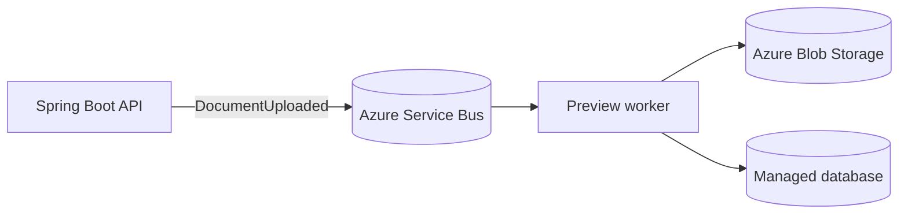
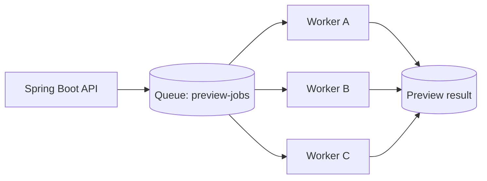
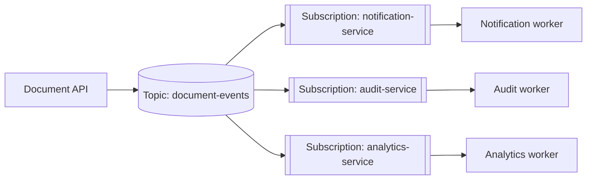
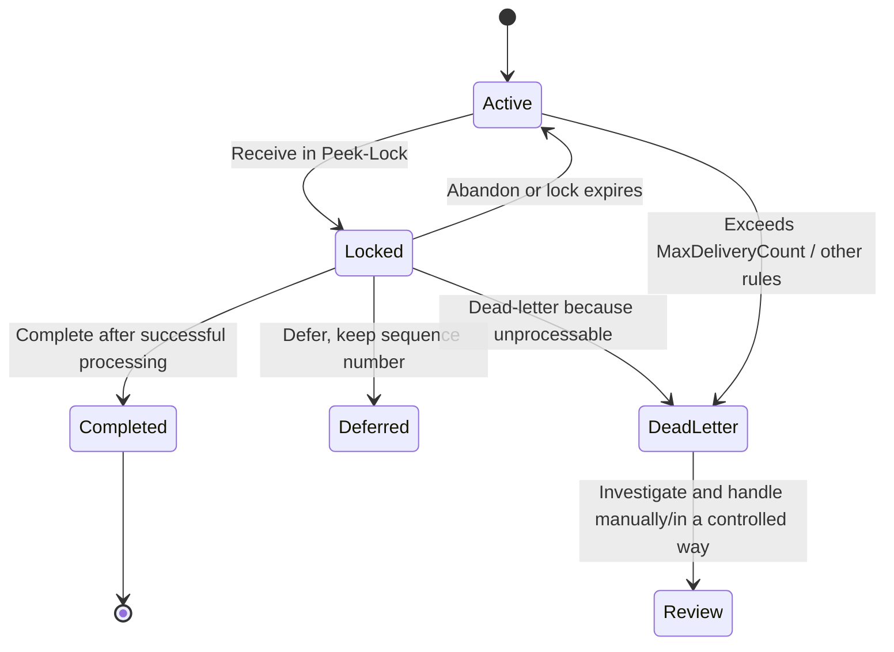
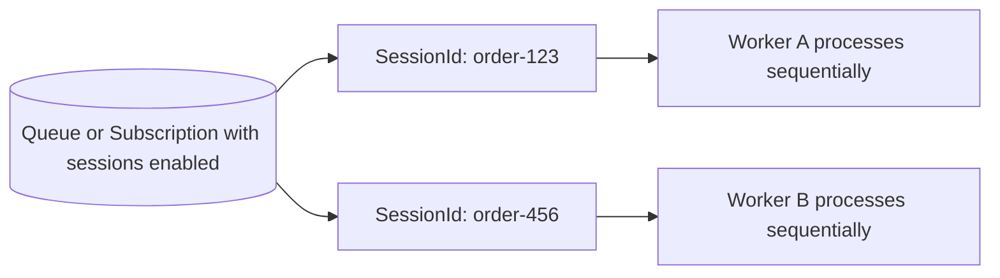
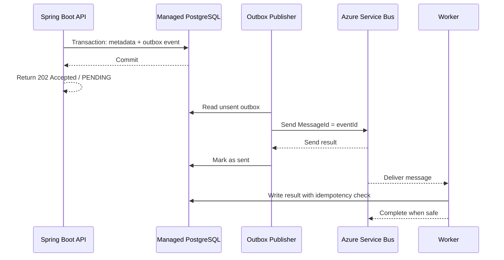

# Queue, topic, subscription, and message processing models

> **Chapter:** Azure Service Bus  
> **Module:** `SPRING_CLOUD_PROVIDER_INTEGRATION`  
> **Context:** Practicing Spring Boot integration with Azure managed services via Spring Cloud Azure and the Azure SDK, while understanding similarities and differences compared to AWS and Google Cloud.

## 1. Why is Azure Service Bus needed?

Suppose a Spring Boot application receives a PDF contract, stores it in Azure Blob Storage, and must perform three additional tasks: generating a preview, sending a notification email, and writing a business audit log. If all of this work happens inside the HTTP request, response time is prolonged, connections to external services can fail, and the API has to handle multiple responsibilities at once.

**Azure Service Bus** is a managed messaging service for reliable message exchange between applications or processing components. The producer sends a message to the broker; the consumer receives it and performs the work later. The producer and consumer can run at different times, scale independently, and do not have to run in the same process.



However, adding a broker does not automatically guarantee that a task "occurs exactly once." The application still has to handle access permissions, message format, job state, retries, duplicate messages, transactions, and monitoring.

**Lesson objective:** accurately distinguish **queue**, **topic**, and **subscription**, and understand how they determine **who receives a message, how many times it is received, and when a message is considered processed**.

## 2. Four key entities: namespace, queue, topic, subscription

Service Bus organizes messaging entities inside a **namespace**. A namespace typically has a fully qualified address in the form `<namespace>.servicebus.windows.net`, located within a chosen Azure subscription, resource group, and region.

| Concept | Role | Producer sends to | Consumer receives from |
| --- | --- | --- | --- |
| **Namespace** | Administrative boundary for connections, security, and messaging entities | Does not send directly "into the namespace" | Does not read directly "from the namespace" |
| **Queue** | Stores a stream of work items that multiple consumers can compete to process | Queue | That queue itself |
| **Topic** | Event publishing endpoint that distributes messages to matching subscriptions | Topic | Does not receive directly from a topic |
| **Subscription** | Independent receiving stream for a group of subscribers on a topic; can have filters | Not used as a direct send target by publishers | A subscription belonging to a topic |

The most common point of confusion: **a subscription is not an Azure subscription used for billing/resource management**. An "Azure subscription" is an account/billing boundary. A "Service Bus topic subscription" is a messaging entity for receiving messages distributed by a topic.

### Naming example

```text
Azure subscription (resource management)
└── Resource group: rg-documents-dev
    └── Service Bus namespace: sb-documents-dev
        ├── Queue: preview-jobs
        └── Topic: document-events
            ├── Subscription: notification-service
            ├── Subscription: audit-service
            └── Subscription: analytics-service
```

This is an illustrative diagram, not a resource creation command. Queues and subscriptions can each have their own **dead-letter subqueue**; a topic does not have a DLQ in the sense of a directly consumed subscription.

## 3. Queue: one job, one competing consumer per delivery

A queue is usually the right choice when the goal is to **distribute work so that one worker in a group processes it**. Multiple workers can receive concurrently from the same queue: each message delivery at a given moment belongs to one receiver, within the scope of the lock and receive mechanism. If a consumer fails to process it, the message can be redelivered.



**The diagram does not mean the same message delivery is broadcast simultaneously to all three workers.** The workers are **competing consumers**, pulling work from the queue together. When there are multiple messages, the broker can distribute them to different workers; when a message is redelivered after an error or lock timeout, another worker may receive that same message next time.

### Business example

A preview generation event has `documentId = doc-123`. The API sends it to the `preview-jobs` queue; a worker receives it, reads the file, generates the preview, and records the completion state. If the worker crashes before acknowledging processing, the message can return to the queue. The system must recognize that the preview result already exists to avoid creating multiple copies or sending duplicate notifications.

A queue provides:

- **Temporal decoupling:** the API does not need to wait for a worker to be online.
- **Load leveling:** the broker buffers work when request volume spikes.
- **Independent scaling:** the number of workers can be adjusted according to the backlog.
- **Relative failure isolation:** a preview generation failure does not necessarily cause the HTTP upload to fail.

A queue **does not guarantee** that each business action takes effect only once, nor does it automatically guarantee **processing completion** order when running multiple workers.

### Avoiding a misconception about "FIFO"

Service Bus tracks enqueue order and receive order, but when multiple consumers process in parallel, **completion order** can differ from send order. If the business logic requires events for the **same order** to be processed sequentially, look into **sessions** instead of assuming a queue provides FIFO results by default in every case.

## 4. Topic and subscription: broadcasting events to multiple processing groups

When a single event needs to be handled by multiple independent business domains, use a **topic + subscriptions**.



A message published to a topic can be **logically copied** into multiple matching subscriptions. Each subscription has its own backlog, consumers, and processing state. The notification worker completing a message on its subscription **does not mean** the audit worker has completed it on another subscription.

### Two levels of fan-out that are easy to confuse

1. **Across subscriptions:** the same message can reach both `notification-service` and `audit-service`. The two systems process independently.
2. **Across instances within a single subscription:** if three instances of the notification worker read from `notification-service`, they **compete** to receive messages. Each instance does not receive its own copy.

For example, `DocumentUploaded` is sent to the topic. The notification subscription receives it to send an email; the audit subscription receives it to record history. The two groups can be deployed, scaled, fail, and recover independently.

### A topic has no direct consumers

To receive a message published to a topic, the application must have a **subscription** created and properly configured. If there is no matching subscription or a filter excludes the event type, no consumer group will receive that message. Do not create a topic and expect a receiver to read directly from the topic.

## 5. Queue or topic/subscription? Choose by business need

| Question | Queue | Topic + subscription |
| --- | --- | --- |
| How many business groups need to react? | Usually one group processing work | One or more independent groups |
| Can multiple workers process the backlog together? | Yes, via competing consumers | Yes, **within each subscription** |
| Does each group have its own processing state? | No separate group branches on a single queue | Yes, each subscription is independent |
| Are messages filtered before delivery to a receiving group? | Requires custom logic or sender-side routing | Has **subscription rules/filters** |
| When adding a new consumer group? | Requires redesigning the flow if the group must receive every event | Create a new subscription as needed |
| Example | Generating thumbnails, generating reports, processing jobs | Orders publishing events for billing, email, audit |

**Quick rule of thumb:** if it is a **command requesting a job to be completed by one of several workers**, consider a queue first. If it is an **event that multiple groups need to know about**, prefer a topic/subscription.

Do not treat this rule as absolute: a system can combine topics and queues, or have each subscription trigger its own workers. The goal is to accurately represent the **number of receiving groups** and **processing responsibilities**.

## 6. Subscription rules and filters: selecting events to receive

Not every subscription has to receive all messages from a topic. Service Bus allows creating **rules** to filter messages before distributing them to a subscription.

Rules can use a **SQL filter** or a **correlation filter** depending on requirements and tier capabilities. Filters generally evaluate **system properties** or **application properties** of a message; they **do not parse the JSON body** for arbitrary querying.

Suppose the `document-events` topic receives two types:

```json
{
  "eventType": "DocumentUploaded",
  "documentId": "doc-123"
}
```

and

```json
{
  "eventType": "DocumentDeleted",
  "documentId": "doc-123"
}
```

The publisher can set `eventType` as an **application property**:

```java
ServiceBusMessage message = new ServiceBusMessage(jsonBody);
message.setMessageId(eventId);
message.getApplicationProperties()
       .put("eventType", "DocumentUploaded");
sender.sendMessage(message);
```

Then a subscription that only receives upload events can use an illustrative SQL rule:

```sql
eventType = 'DocumentUploaded'
```

**Important note about the default rule:** a new subscription typically has a `$Default` rule with a true filter matching all messages. When you want to filter, you must review and remove/replace the default rule if needed. If you keep the match-all rule, adding an `eventType = ...` rule will **not** restrict the subscription to only the desired type.

A subscription can have multiple rules; if multiple rules match, message duplication/transformation behavior needs to be checked. When designing an event schema, put routing information into stable, versioned properties that contain no secrets.

### Example of distribution by requirement

| Subscription | Conceptual rule | Processing group |
| --- | --- | --- |
| `preview-service` | `eventType = 'DocumentUploaded'` | Generate previews |
| `audit-service` | Receive all events matching policy | Record history |
| `cleanup-service` | `eventType = 'DocumentDeleted'` | Clean up resources per retention |

If a subscription does not receive events, check **whether the subscription existed before publishing**, whether the rule matches the application properties, and whether the `$Default` rule is still present.

## 7. What does a message consist of?

A Service Bus message has a **body** and **metadata**. Applications need to design both.

| Property | Common meaning | How to use |
| --- | --- | --- |
| **Body** | Payload, e.g., JSON representing an event | Contains the ID and required business data |
| **MessageId** | Producer-assigned ID | Supports tracing, broker-side duplicate detection when enabled, and consumer idempotency |
| **CorrelationId** | ID to correlate a message with a request/workflow | Tracing HTTP → publisher → consumer |
| **Subject** | Message subject label | Categorization/observability by purpose |
| **Application properties** | Application-defined key-value pairs | `eventType`, `eventVersion`, `tenantId` when appropriate |
| **SessionId** | Groups messages belonging to a session | Ordering/sequential processing by key when the queue/subscription has sessions enabled |
| **TimeToLive (TTL)** | Duration the message remains valid | Avoid processing jobs that have already expired |
| **Scheduled enqueue time** | Scheduled time for the message to become available for later processing | Delayed jobs depending on the use case |

Example of a more reliable event than a message containing only the string `"start"`:

```json
{
  "eventId": "evt-842",
  "eventVersion": 1,
  "eventType": "DocumentUploaded",
  "documentId": "doc-123",
  "objectKey": "documents/doc-123/source.pdf",
  "occurredAt": "2026-01-01T09:00:00Z"
}
```

This is an **illustrative payload**; the timestamp and IDs are dummy data. The producer should set a stable `MessageId = eventId` across retries. Only pass a reference to the file in the body; **do not put an entire PDF or secrets into the broker** just because it is convenient in a demo.

### Consumer contract

The consumer must know:

- Which schema versions are supported.
- Which fields are required and their valid data types.
- How to handle duplicate events if they occur.
- If a referenced object does not exist, whether the error is transient or permanent.
- If the payload contains sensitive data, whether retention, logging, and access permissions are appropriate.

**The broker does not replace validation**. The consumer must still parse and validate the content before causing business side effects.

## 8. Two receive modes: Receive-and-Delete and Peek-Lock

Azure Service Bus supports two basic receive modes.

### 8.1. Receive-and-Delete

In `RECEIVE_AND_DELETE`, the broker considers the message consumed as soon as it is transferred to the receiver. If the application crashes right after receiving but before processing, the message's work can be **lost**.

The advantage is a simpler receive path. The major drawback for critical business tasks is that there is no separate completion confirmation point on the consumer side.

**Limited suitability:** low-value information or tasks where losing a few messages is acceptable. Do not choose it for payments, document issuance, or critical transaction state just to save one settlement step.

### 8.2. Peek-Lock

In `PEEK_LOCK`, the broker delivers the message and temporarily **locks** it for one receiver to process. Once the work reaches a safe state, the consumer must **settle** the message. If the worker loses connection, crashes, or the lock expires before settlement, the message can be redelivered.



This is a conceptual diagram; constraints around TTL, sessions, delivery count, and lock validity depend on Service Bus configuration.

### 8.3. Key settlement operations

| Operation | Outcome | When to use |
| --- | --- | --- |
| **Complete** | Marks the message as processed and removes it from the normal receive stream | When business state has been recorded successfully |
| **Abandon** | Returns the message so it can be received again | Transient error, letting the broker handle redelivery |
| **Dead-letter** | Moves the message to the queue/subscription DLQ | Invalid payload, unrecoverable error, or requires separate investigation |
| **Defer** | Retains the message but temporarily removes it from the normal receive stream | Needs later processing per business order; must store the **sequence number** to retrieve it |

**Defer is not a simple retry replacement.** A deferred message does not automatically return to the normal receive stream like an `abandon`ed message; the application must know the sequence number and retrieve it via the corresponding API.

### 8.4. Why do duplicates still happen?

Suppose a worker finishes writing a preview file to Blob Storage, then crashes before `complete()`. After the lock expires, another worker can receive the message again and run processing a second time.

That is why **Peek-Lock prevents lost work but requires duplicate-tolerant design**. Distinguish between:

- **Broker-redelivered messages**: the same `MessageId` can appear multiple times at the consumer.
- **Producer-re-sent messages**: the application retries sending because it is unsure whether the previous attempt was accepted by the broker.
- **Duplicate business side effects**: sending an email twice, creating two invoices, charging money twice.

The broker's duplicate detection mechanism helps with the second case within configured limits; **consumer idempotency** solves the first case and business side effects in the third case.

## 9. Lock duration, renewal, delivery count, and DLQ

### 9.1. Lock and processing time

If a worker takes longer than the lock duration, the lock can expire before `complete`. At that point, settlement can fail and the message is redelivered. Some SDKs support **automatic lock renewal** within a configured limit.

Before increasing lock duration or max auto-renew, check whether the work can be split into shorter steps. Prefetching too many messages while processing slowly also easily causes locks to expire before messages are handled.

A lock can also be lost due to connection/AMQP link interruptions or service changes. Do not assume that "setting a 5-minute lock guarantees you will hold the lock for a full 5 minutes."

### 9.2. Delivery count and Dead-Letter Queue

Each **queue** and **topic subscription** has a **DLQ** attached to the primary entity—you do not need to create a standalone DLQ queue just to use the default capability. When the delivery count exceeds **MaxDeliveryCount**, Service Bus moves the message to the DLQ. The default value is typically **10**, though you should verify the actual entity configuration.

Other causes may include:

- The application explicitly calls dead-letter for a permanent error.
- The message TTL expires and the entity has **dead-letter on expiration** enabled.
- Certain filter or forwarding error cases depending on service configuration.

Messages in the DLQ must be **inspected and reprocessed intentionally**; they are not automatically reprocessed simply because an external outage resolved. The DLQ also does not apply TTL to auto-delete messages the same way the main queue does, so you must monitor capacity and have a cleanup/replay process.

### 9.3. How to handle a poison message

Suppose a message contains malformed JSON that causes the worker to always fail:

1. The consumer determines this is an unrecoverable error (e.g., the required `documentId` field is missing).
2. The consumer can move the message to the DLQ with a categorized reason; if it chooses abandon, the broker may redeliver several times and then DLQ it once the limit is exceeded.
3. The operations team inspects the message (avoiding exposing sensitive data) and distinguishes data errors from software bugs.
4. Fix the root cause, then create **a new intentional message** or replay it through a process with duplicate checks.
5. Track the number of messages in the DLQ and how long they have been stuck.

Do not retry infinitely just to keep the DLQ count at zero. The DLQ is a useful signal for investigating and improving consumer correctness.

## 10. Sessions: when per-group ordering is required

Suppose a system processes events for an order:

```text
OrderPlaced(order-123)
PaymentConfirmed(order-123)
OrderShipped(order-123)
```

If multiple workers process in parallel, `OrderShipped` could finish before `PaymentConfirmed` even though it was received later. **Sessions** allow grouping related messages by `SessionId`, so that one receiver holds an exclusive lock on the session being processed.



Important requirements:

- The queue or subscription must have **sessions enabled at creation time**; you cannot simply toggle it on or off on an existing entity.
- The producer assigns a consistent `SessionId`, such as `orderId`.
- The consumer uses a **session-aware receiver/processor**; do not use a regular processor for entities requiring sessions.
- One session is held exclusively by a receiver while the lock remains valid; **other sessions can be processed in parallel**.
- Ordering guarantees apply **within the scope of a session**, not global completion order across the entire system.
- Sessions do not eliminate the need for idempotency, handling lock loss, or state checks.

Example SDK code creating a message for a session-enabled entity:

```java
ServiceBusMessage message = new ServiceBusMessage(payload)
    .setMessageId(eventId)
    .setSessionId(orderId);

sender.sendMessage(message);
```

When using the Service Bus Java SDK, the message processor must be built via `sessionProcessor()` if the queue/subscription uses sessions. Choosing concurrency must take into account **maxConcurrentSessions**, per-session processing, and lock hold duration.

## 11. Duplicate detection: a sender-side tool, not a business transaction

Azure Service Bus supports **duplicate detection** on a queue/topic when enabled and supported by the tier. When a message is sent again with a **MessageId** already recorded within the **duplicate detection window**, the broker can accept the send operation while discarding the duplicate per policy.

Typical scenario:

```text
Publisher sends eventId=evt-100 → broker has received it
             ↓
Network drops before publisher receives acknowledgement
             ↓
Publisher retries with the same MessageId=evt-100
             ↓
Duplicate detection can discard the re-sent message within the configured window
```

Limits to understand:

- This feature must be configured on the entity according to tier capabilities; **Basic does not support it**, while Standard/Premium do.
- Enabling/disabling duplicate detection must be decided **when creating** the queue/topic.
- It only applies within the configured **duplicate history time window**.
- If the producer uses a new `MessageId` on every retry, the broker will not treat it as the same message under the duplicate detection key.
- It does not prevent a consumer from causing duplicate side effects when the broker redelivers a message that was accepted only once.

**Engineering takeaway:** use a stable `MessageId`, duplicate detection when appropriate, and **consumer idempotency**. For high-risk business operations, store processed event IDs or perform conditional updates inside a database transaction.

## 12. Ensuring consistency between database and messaging

In a system using Spring Data/JPA or JDBC, a common flow is:

```text
1. Save Document state to PostgreSQL
2. Send DocumentUploaded to Service Bus
```

These two steps **do not inherently belong to a shared ACID transaction**. If the database commits successfully and then the publisher fails, the worker may never know to process the document. If the publisher sends successfully but the response is lost, a retry may publish a duplicate.

A common solution is the **transactional outbox**:



The document record and outbox entry are written in the **same database transaction**. A separate publisher sends the message to Service Bus. If the publisher crashes after `send` but before marking the outbox as sent, the event will be re-sent upon recovery; a stable `MessageId` and an idempotent consumer keep duplicates under control.

**Service Bus provides transaction support within supported messaging scopes**, but you should not assume it automatically provides a distributed transaction spanning PostgreSQL, Blob Storage, and Service Bus. End-to-end consistency design remains the application's responsibility.

## 13. Tiers and service capabilities: check before provisioning resources

Azure Service Bus has tiers with different feature sets. Choosing the wrong tier can prevent creating topics/subscriptions or using sessions, even if the Java code is completely valid.

| Common capability | Basic | Standard | Premium |
| --- | --- | --- | --- |
| Queue | Yes | Yes | Yes |
| Topic and subscription | **No** | Yes | Yes |
| Sessions | **No** | Yes | Yes |
| Duplicate detection | **No** | Yes | Yes |
| Messaging transactions | **No** | Yes | Yes |
| Dedicated compute / isolation | No | No dedicated Premium isolation model | Yes |
| Typical fit | Simple queues, small needs | Queues/topics with common features | Resource isolation and higher operational demands |

This table provides a directional feature overview, **not a pricing or SLA table**. Quotas, message sizes, private networking, and entity limits can vary by tier/configuration. Check current policies and documentation before budgeting or building a production environment.

If the exercise requires a **topic + multiple subscriptions** or **sessions**, do not choose Basic.

## 14. Spring Boot integration: Spring Cloud Azure and Azure SDK

There are multiple levels of integration. Whichever level you choose, business code should only know the **message contract**, rather than scattering namespace/queue/topic details and SDK types across every service.

| Approach | When suitable | What must be controlled |
| --- | --- | --- |
| **Azure SDK for Java directly** | Need specific APIs/settlement/filters/sessions or explicit client control | Bean lifecycle, credentials, timeouts, serialization |
| **Spring Cloud Azure Service Bus starter** | Using Spring Boot and wanting compatible configuration/starter support | Spring Boot/JDK/BOM compatibility matrix and autoconfiguration |
| **Spring Messaging / Spring Integration** | Want listeners/templates or Spring-style integration flows | Converters, acknowledgement, and property mapping |
| **Spring Cloud Stream binder** | Building producers/consumers via functional bindings when a supported binder is available | Binder semantics do not erase broker-level differences |

A typical Maven dependency:

```xml
<dependency>
    <groupId>com.azure.spring</groupId>
    <artifactId>spring-cloud-azure-starter-servicebus</artifactId>
</dependency>
```

You must choose a **Spring Cloud Azure BOM** compatible with your Spring Boot/JDK version. The example below illustrates the **Azure SDK for Service Bus** (`com.azure.messaging.servicebus` API) placed inside a Spring `@Configuration` so learners can clearly see the structure. A project using the starter may receive beans or properties already configured by convention; avoid creating duplicate beans and verify APIs against your actual version.

### 14.1. Environment-based configuration

Example `application.yml`:

```yaml
app:
  servicebus:
    fully-qualified-namespace: ${SERVICEBUS_FQDN}
    queue: ${SERVICEBUS_QUEUE}
    topic: ${SERVICEBUS_TOPIC}
    subscription: ${SERVICEBUS_SUBSCRIPTION}
```

`app.servicebus.*` is **application-defined configuration**, not automatically an official Spring Cloud Azure property key. `SERVICEBUS_FQDN` typically takes the form `my-namespace.servicebus.windows.net`. You can configure official starter properties (such as namespace) per the corresponding version's documentation if you want to leverage auto-configuration.

Do not put connection strings containing shared access keys in source code. With Microsoft Entra ID and appropriate credentials, the application can authenticate locally via supported developer tools; on Azure runtimes, prefer **Managed Identity**.

### 14.2. Creating a sender client as a Spring bean

```java
import com.azure.identity.DefaultAzureCredentialBuilder;
import com.azure.messaging.servicebus.ServiceBusClientBuilder;
import com.azure.messaging.servicebus.ServiceBusSenderClient;
import org.springframework.beans.factory.annotation.Value;
import org.springframework.context.annotation.Bean;
import org.springframework.context.annotation.Configuration;

@Configuration
public class ServiceBusQueueConfiguration {

    @Bean(destroyMethod = "close")
    ServiceBusSenderClient previewQueueSender(
            @Value("${app.servicebus.fully-qualified-namespace}") String fqdn,
            @Value("${app.servicebus.queue}") String queueName) {

        return new ServiceBusClientBuilder()
                .credential(fqdn, new DefaultAzureCredentialBuilder().build())
                .sender()
                .queueName(queueName)
                .buildClient();
    }
}
```

This code uses **Azure Identity** to acquire a workload token. The actual identity must be granted **Azure Service Bus Data Sender** or an appropriate send permission on the right scope/entity; having a valid token is not enough if RBAC permissions are missing.

### 14.3. Service publishing messages with a stable ID

```java
import com.azure.messaging.servicebus.ServiceBusMessage;
import com.azure.messaging.servicebus.ServiceBusSenderClient;
import org.springframework.stereotype.Service;

@Service
public class PreviewEventPublisher {
    private final ServiceBusSenderClient sender;

    public PreviewEventPublisher(ServiceBusSenderClient sender) {
        this.sender = sender;
    }

    public void publish(String eventId, String documentId) {
        // Simplified payload; in practice, serialize a DTO with schemaVersion.
        ServiceBusMessage message = new ServiceBusMessage(documentId)
                .setMessageId(eventId)
                .setSubject("DocumentUploaded")
                .setCorrelationId(documentId);
        message.getApplicationProperties()
                .put("eventType", "DocumentUploaded");

        sender.sendMessage(message);
    }
}
```

This is a **minimal producer for a queue**. When publishing to a **topic**, change the sender builder call from `.queueName(queueName)` to `.topicName(topicName)` and use an appropriate bean. Do not send the same event to both a queue and a topic unless your architecture intentionally handles two independent paths.

**Limitation:** a successful send only means Service Bus accepted it at the API level; the preview has not been generated yet. When a timeout occurs after sending, handle the uncertain outcome and retry with the **same eventId**. To guarantee the event is published after a database commit, use an outbox or equivalent design.

### 14.4. Receiver/processor using Peek-Lock and explicit settlement

For critical tasks, actively control when `complete` is called. Example business handler:

```java
public interface PreviewMessageHandler {
    void process(String eventId, String documentId);
}
```

A Spring-managed processor can be declared as:

```java
import com.azure.identity.DefaultAzureCredentialBuilder;
import com.azure.messaging.servicebus.ServiceBusClientBuilder;
import com.azure.messaging.servicebus.ServiceBusProcessorClient;
import com.azure.messaging.servicebus.models.ServiceBusReceiveMode;
import org.slf4j.Logger;
import org.slf4j.LoggerFactory;
import org.springframework.beans.factory.annotation.Value;
import org.springframework.context.annotation.Bean;
import org.springframework.context.annotation.Configuration;

@Configuration
public class ServiceBusConsumerConfiguration {
    private static final Logger log =
            LoggerFactory.getLogger(ServiceBusConsumerConfiguration.class);

    @Bean(initMethod = "start", destroyMethod = "close")
    ServiceBusProcessorClient previewProcessor(
            @Value("${app.servicebus.fully-qualified-namespace}") String fqdn,
            @Value("${app.servicebus.queue}") String queueName,
            PreviewMessageHandler handler) {

        return new ServiceBusClientBuilder()
                .credential(fqdn, new DefaultAzureCredentialBuilder().build())
                .processor()
                .queueName(queueName)
                .receiveMode(ServiceBusReceiveMode.PEEK_LOCK)
                .disableAutoComplete()
                .processMessage(context -> {
                    var message = context.getMessage();
                    try {
                        handler.process(
                                message.getMessageId(),
                                message.getBody().toString());
                        context.complete();
                    } catch (Exception exception) {
                        log.error("Preview message processing failed. messageId={}",
                                message.getMessageId(), exception);
                        context.abandon();
                    }
                })
                .processError(context ->
                        log.error("Service Bus processor error",
                                context.getException()))
                .buildProcessorClient();
    }
}
```

**For this example to work**, the project needs a bean implementing `PreviewMessageHandler`. Here `process` takes `documentId` as a string; in a real system you should parse, validate the payload, and process according to the schema. The handler must be **idempotent**: if `eventId` is already completed, it safely returns an "already processed" result instead of creating new side effects.

The example above intentionally sends every exception through `abandon` to illustrate **redelivery**. Production systems need **error classification**: unrecoverable malformed payloads should be considered for `deadLetter`; transient network errors can be `abandon`ed/retried per policy. Limit concurrency, configure lock renewal, and record metrics; avoid logging sensitive data.

If the queue/subscription requires **sessions**, you must use `sessionProcessor()` and configure session/concurrency settings accordingly. The standard processor in this example is not suitable for session-enabled entities.

### 14.5. Switching to a topic subscription

The main change in the SDK builder:

```java
// Producer: send to a topic.
ServiceBusSenderClient topicSender = new ServiceBusClientBuilder()
        .credential(fqdn, credential)
        .sender()
        .topicName(topicName)
        .buildClient();

// Consumer: receive from a subscription belonging to the topic.
ServiceBusProcessorClient subscriber = new ServiceBusClientBuilder()
        .credential(fqdn, credential)
        .processor()
        .topicName(topicName)
        .subscriptionName(subscriptionName)
        .disableAutoComplete()
        .processMessage(onMessage)
        .processError(onError)
        .buildProcessorClient();
```

This is a **builder snippet**, assuming `fqdn`, `credential`, `topicName`, `subscriptionName`, and the `onMessage`/`onError` callbacks are already defined; it is not a standalone runnable Java file. Close the clients when the application shuts down. The producer does not choose the receiving subscription; **subscription rules** and topology are determined by Service Bus administration.

## 15. Identity and access permissions when using Service Bus

Applications typically have two distinct types of permissions:

1. **User permissions on the HTTP API**: Spring Security/business logic decides who can upload files, create jobs, or view results.
2. **Workload permissions on Service Bus**: Azure RBAC/Microsoft Entra ID decides whether the application is allowed to publish, receive, or manage resources.

| Workload | Data role typically needed | Should not grant by default |
| --- | --- | --- |
| API or outbox publisher | **Azure Service Bus Data Sender** on the appropriate scope | Namespace-wide Data Owner/admin if it only sends |
| Preview worker | **Azure Service Bus Data Receiver** on the target queue/subscription | Data Sender or unrelated administrative roles |
| Entity management tool | Resource/Service Bus management role appropriate to the task | Broad permissions for all runtime applications |

Local developers can use `az login`/compatible Azure Identity tooling; when running on Azure, Managed Identity generally reduces the need to manage long-lived keys. Verify **which credential `DefaultAzureCredential` actually picks** and that the RBAC role is assigned on the right resource; role assignments can take time to propagate.

When security requires it, consider network restrictions/private endpoints, disabling local authentication/shared keys once fully migrated to Microsoft Entra ID, separating dev/test/prod namespaces, and enabling audit monitoring. Connections can still fail due to DNS, TLS, firewalls, or AMQP transport even when RBAC is correct.

## 16. Testing the queue and subscription models

A practical integration test suite should verify **both the happy path and failure paths**, because a message can be accepted by the broker while the consumer has not yet processed it successfully.

| Layer | What to prove | Approach |
| --- | --- | --- |
| **Business unit test** | Handler updates state properly and does not double-process `eventId` | Fake repository, fake publisher; no Azure required |
| **Adapter test** | Producer sets `MessageId`, body, subject, and application properties correctly | Mock client or appropriate builder/adapter tests |
| **Local integration** | Queue/topic send/receive, settlement, and certain rules | Azure Service Bus emulator within its supported capabilities |
| **Cloud integration** | Real Entra ID/RBAC, namespace, queue/topic/subscription, filters, and DLQ | Dedicated Azure namespace with scoped permissions |
| **Failure test** | Consumer crash/lock expiration, redelivery, and idempotency | Intentionally stop a worker or block processing in a test environment |
| **Load/operations test** | Backlog, message age, throughput, lock loss, DLQ | Metrics/logs in Azure Monitor and the application |

The **Azure Service Bus emulator** runs in a container and is useful for the local development loop. It **does not fully simulate** Microsoft Entra ID, VNet, geo-recovery, portal metrics, or certain other features; emulator data is not persistent across container restarts per current documentation. Therefore, do not use emulator results as a substitute for testing real RBAC and behavior on Azure.

### 16.1. Minimum tests for a queue

1. Send `evt-1` to `preview-jobs`; one of two workers processes it and calls `complete`.
2. Send `evt-2`, crash the worker before settlement. After the appropriate time/condition, the message is redelivered; idempotency prevents duplicate results.
3. Send an invalid payload and observe dead-letter behavior per policy.
4. Run multiple workers concurrently, measure message backlog and processing time; verify completion order is **not** wrongly assumed.

### 16.2. Minimum tests for a topic/subscription

1. Create topic `document-events` and two independent subscriptions, send `DocumentUploaded`; both matching subscriptions receive it.
2. Stop a consumer on subscription A and verify subscription B continues processing independently.
3. Configure a filter for `DocumentDeleted`; send both event types and verify the right group receives each.
4. Test the default `$Default` rule: if not removed, the subscription may continue receiving all events; after replacing the rule, verify the result again.

### 16.3. Reliability and ordering tests

- Re-send the same `MessageId` within the duplicate detection window (when enabled/supported by the tier); verify the broker's effect.
- Send a message that completes business work, simulate connection loss before settlement, and process again; verify the consumer does not repeat side effects.
- Create a session-enabled queue/subscription and send multiple messages with the same `SessionId`; verify **in-session processing order** and parallelism across different sessions.
- Trigger a permission failure using an identity that only has `Data Sender` when trying to receive; confirm an authentication/authorization error is recorded without privilege escalation.

## 17. Operations: metrics, logs, DLQ, and runbooks

Once Service Bus sits between the API and workers, relying solely on application logs is not enough. You must observe both the broker and business progress.

| Signal | Meaning | Action when abnormal |
| --- | --- | --- |
| **Active messages** | Number of messages waiting in the queue/subscription | Check workers, concurrency, timeouts, and upstream load |
| **Dead-lettered messages** | Messages needing investigation or controlled replay | Classify causes, fix schema/code/config |
| **Incoming/outgoing messages** | Rate of messages entering/leaving the entity | Compare producer and consumer throughput |
| **Message age / job latency** | How long the oldest job has been waiting | Check backlog, locks, retries, and SLOs |
| **Abandon/lock-lost/error count** | Signals of processing failures or timeouts | Adjust handler, lock renewal, prefetch/concurrency |
| **End-to-end success rate** | Ratio of events leading to the correct business state | Correlate `eventId` with database state |

Specific metrics, export capabilities, and metric names depend on Azure Monitor/SDK and how the application is instrumented. Teams should include `MessageId`/`CorrelationId` in structured logs, traces, or status tables, while avoiding logging bodies containing sensitive data.

### Example runbook: queue backlog growing

1. **Confirm:** `preview-jobs` queue still has active messages and job age is increasing; are workers running and receiving messages?
2. **Classify:** IAM error, missing connection, slow processing, lock expiration, poison message, or sudden producer spike?
3. **Mitigate:** fix permissions/config, scale up workers within limits, throttle input rate, or move bad messages to the DLQ per policy.
4. **Recover:** replay investigated messages with idempotency in place; monitor job status and duplicate counts.
5. **Prevent:** update alerts, timeouts, concurrency, dead-letter policies, schemas, and regression tests.

A permission error should never be "fixed" with infinite retries or by granting Data Owner to every application.

## 18. Brief comparison with AWS and Google Cloud

This module practices across Spring Cloud libraries for **AWS, Azure, and Google Cloud**, so it helps to distinguish similarities by **need** from differences in **API models**.

| Need | Azure Service Bus | Commonly used on AWS | Commonly used on Google Cloud |
| --- | --- | --- | --- |
| Work processed by one of many workers | Queue + competing consumers | SQS queue | Pub/Sub topic/subscription with one consumer group |
| Multiple groups processing the same event | Topic + multiple subscriptions | SNS + appropriate subscriptions/queues | Pub/Sub topic + multiple subscriptions |
| Per-group ordering | Service Bus sessions | SQS FIFO/message groups when appropriate | Pub/Sub ordering keys when enabled and conditions fit |
| Processing acknowledgement | Complete/Abandon/Dead-letter in Peek-Lock | Delete message, visibility timeout, and DLQ | Ack/nack, ack deadline, and dead-letter policy |
| Workload identity | Entra ID + Managed Identity / RBAC | IAM role/policy | Service account / Workload Identity / IAM |

Do not copy the term **complete** over to SQS or assume Pub/Sub has Service Bus sessions. Even if you use a shared `EventPublisher` port, each adapter must be tested for its own delivery semantics, retries, ordering, and constraints.

## 19. Hands-on lab: designing queues and topics for a document system

**Scenario:** A Spring Boot API stores documents in Azure Blob Storage, records metadata in managed PostgreSQL, and needs three jobs: generating a preview, sending an email upon completion, and writing an audit log.

### Part A — Choose the topology

Design two options:

- **Option 1:** Queue `preview-jobs` for previews; topic `document-events` for notifications/auditing.
- **Option 2:** Topic `document-events` with three subscriptions for the three processing groups.

Explain which option is advantageous when preview generation is a **command/work item**, and which fits when all groups react to a **domain event**. Avoid assuming both options behave identically regarding state and fan-out.

### Part B — Define the message contract

Create JSON containing `eventId`, `eventType`, `eventVersion`, `documentId`, `objectKey`, and a timestamp. Decide which fields go into application properties for filtering. The producer must use a stable `MessageId` on retries.

### Part C — Practice with Service Bus

Create a namespace on an appropriate tier, along with a test queue or topic/subscription. Use the Azure SDK/Spring Cloud Azure to send and receive a message. Observe:

- The message arrives at the expected queue/subscription.
- When the handler succeeds, `complete` removes the message from the normal receive stream.
- On `abandon` or lock loss, the message can be redelivered.
- When explicitly dead-lettered, the message resides in the DLQ and must be investigated.

### Part D — Practice with filters and sessions

Create two subscriptions for `DocumentUploaded` and `DocumentDeleted`; design rules and inspect the default rule. If the problem requires ordering by `documentId`, test sessions on a new entity and compare processing across two different document IDs.

### Part E — Reliability testing

Demonstrate that the same `eventId` does not create two previews, even when the message is processed again. Simulate a successful DB commit followed by a Service Bus publisher failure and explain how an outbox enables recovery.

### Part F — Operations

Set up metrics or a dashboard tracking active messages, DLQ, job latency, and handler errors. Write a short runbook for a poison message scenario and for a scenario where the worker role lacks `Data Receiver`.

**Completion criteria:** distinguish queues from topics/subscriptions; explain competing consumers vs. fan-out; understand settlement operations, DLQ, filters, and sessions; have a Spring Boot example using appropriate identity and tests covering message redelivery.

---

## 20. Takeaways

- A **queue** fits when multiple workers **compete to receive a single stream of work**; a message can be redelivered if processing has not been safely acknowledged.
- A **topic** is a publishing endpoint; each **subscription** corresponds to an independent receiving group that can be filtered by rules; multiple workers within the **same subscription** still compete for processing.
- **Peek-Lock** requires consumer settlement: `complete`, `abandon`, `deadLetter`, or `defer`. Do not confuse "received" with "business work completed."
- **Sessions** enable ordered processing within **each message group**, not global completion order across the system.
- **Duplicate detection** partially protects against producer re-sends within a configured window; the consumer must still be **idempotent**.
- **DLQ, outbox, IAM, testing, and observability** are essential components when taking a messaging flow from a demo into production operations.

With Spring Boot, keep business services dependent on contracts like `DocumentEventPublisher` or `PreviewMessageHandler`, and place `ServiceBusSenderClient`, `ServiceBusProcessorClient`, queue/topic/subscription names, credentials, timeouts, and settlement details in the integration layer. This organization keeps responsibilities clear and makes testing easier when comparing with AWS or Google Cloud.

### Official documentation for reference during practice

- [Azure Service Bus — queues, topics, and subscriptions](https://learn.microsoft.com/en-us/azure/service-bus-messaging/service-bus-queues-topics-subscriptions)
- [Message transfers, locks, and settlement](https://learn.microsoft.com/en-us/azure/service-bus-messaging/message-transfers-locks-settlement)
- [Dead-letter queues](https://learn.microsoft.com/en-us/azure/service-bus-messaging/service-bus-dead-letter-queues)
- [Message sessions](https://learn.microsoft.com/en-us/azure/service-bus-messaging/message-sessions)
- [Duplicate detection](https://learn.microsoft.com/en-us/azure/service-bus-messaging/duplicate-detection)
- [Azure Service Bus Java SDK](https://learn.microsoft.com/en-us/java/api/overview/azure/messaging-servicebus-readme)
- [Spring Boot sample with Service Bus queue](https://learn.microsoft.com/en-us/samples/azure-samples/azure-spring-boot-samples/sending-and-receiving-message-by-azure-service-bus-queue-in-spring-boot-application/)
- [Azure Service Bus emulator and limitations](https://learn.microsoft.com/en-us/azure/service-bus-messaging/overview-emulator)

When installing or upgrading, verify the **actual Spring Boot/JDK version, Spring Cloud Azure version, Azure SDK version, tier, and quotas**. Supported features and configuration property names may change across versions.
