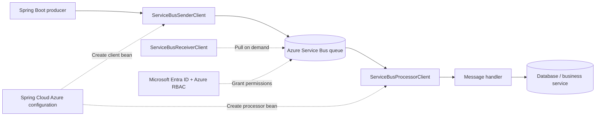

# Creating senders, receivers, and processors with Spring Cloud Azure

> **Chapter:** Azure Service Bus  
> **Module:** `SPRING_CLOUD_PROVIDER_INTEGRATION`  
> **Objective:** Create and use message sending/receiving clients in Spring Boot with Spring Cloud Azure; understand the roles of `ServiceBusSenderClient`, `ServiceBusReceiverClient`, and `ServiceBusProcessorClient`, environment-based configuration, Microsoft Entra ID identity, bean lifecycle, and testing approaches.

## 1. From the Service Bus SDK to Spring Boot

Azure Service Bus provides queues and topics/subscriptions for applications to exchange messages. The Azure SDK for Java provides low-level sending and receiving clients. When an application uses Spring Boot, the development team can create clients manually via builders, or use the **Spring Cloud Azure Service Bus starter** to bring configuration and clients into the Spring Application Context.

The starter helps Spring Boot:

- Load configuration for namespace, entity, credentials, and relevant options.
- Create supported clients or client builders as beans.
- Allow injecting clients into services via constructors.
- Manage the lifecycle of certain beans such as processors when the Application Context starts and stops.
- Integrate with Spring utilities such as externalized configuration, logging, and health indicators when supported by the module.

The starter **does not automatically create queues/topics**, does not automatically grant permissions to workloads, does not decide business payloads, and does not guarantee consumers process messages exactly once.

### Basic flow diagram



In the diagram:

- **Sender** sends messages to a queue or topic.
- **Receiver** lets the application actively fetch a batch of messages in a pull model.
- **Processor** runs continuously, receives messages, and invokes callbacks when a message arrives or an error occurs.
- **Handler** contains business processing; you should not place all product rules in controllers or SDK callbacks.
- **Spring Cloud Azure** provides auto-configuration and connects clients to the Spring context.

For continuously processing applications, `ServiceBusProcessorClient` is usually the better choice for receiving messages. `ServiceBusReceiverClient` is useful when you need scheduled pulls, bounded batch retrieval, or custom control over when to receive.

## 2. Distinguishing sender, receiver, and processor

| Component | Model | What the application does | Best fit |
| --- | --- | --- | --- |
| `ServiceBusSenderClient` | Synchronous send | Calls `sendMessage` or `sendMessages` | Producer sending commands/events to a queue or topic |
| `ServiceBusSenderAsyncClient` | Asynchronous send | Calls APIs returning reactive types and composes pipelines | Non-blocking send flows requiring Reactor coordination |
| `ServiceBusReceiverClient` | Synchronous pull | Calls `receiveMessages`, then complete/abandon/dead-letter per mode | Batch-receiving jobs or needing control over pull timing |
| `ServiceBusReceiverAsyncClient` | Asynchronous pull | Receives via reactive APIs | Reactive applications needing receive flow control |
| `ServiceBusProcessorClient` | Push/continuous receive | Registers a message processing callback and an error callback | Background workers, continuous processing, and processor recovery |

**Receiver and processor are not two names for the same client.** A receiver lets your code explicitly call receive operations. A processor manages a continuous receive loop and handles callbacks, concurrency, and client-level receive error scenarios.

Azure documentation recommends `ServiceBusProcessorClient` for most continuous receiving scenarios. The lower-level receiver is better suited when pull semantics are required or you want to control receiving yourself. For advanced reactive applications, `ServiceBusReceiverAsyncClient` requires more careful code for recovery, backpressure, and threading. See [Azure Service Bus Java client library](https://learn.microsoft.com/en-us/java/api/overview/azure/messaging-servicebus-readme?view=azure-java-stable).

### An illustrative flow

Suppose the API receives a request to generate a preview for a document:

1. The API creates an event with a stable `eventId`.
2. The sender sends the event to the `preview-jobs` queue.
3. The processor receives the event and forwards it to the handler.
4. The handler reads the document, generates the preview, and updates the status in the database.
5. Once processing reaches a safe state, the message is settled according to the receive mode.
6. If the worker fails, the message can be redelivered; the handler must tolerate repeated processing.

## 3. Preparing dependencies and versions

### 3.1. Choosing the right starter

For the integration approach that uses Azure SDK clients directly in Spring Boot, use:

```xml
<dependencyManagement>
    <dependencies>
        <dependency>
            <groupId>com.azure.spring</groupId>
            <artifactId>spring-cloud-azure-dependencies</artifactId>
            <version>${spring-cloud-azure.version}</version>
            <type>pom</type>
            <scope>import</scope>
        </dependency>
    </dependencies>
</dependencyManagement>

<dependencies>
    <dependency>
        <groupId>com.azure.spring</groupId>
        <artifactId>spring-cloud-azure-starter-servicebus</artifactId>
    </dependency>
</dependencies>
```

`spring-cloud-azure.version` is a placeholder in the example; replace it with the BOM compatible with your project's Spring Boot and JDK versions. The BOM aligns the versions of Spring Cloud Azure components and related Azure SDKs.

Do not pick a version solely based on an old blog post. Spring Cloud Azure documentation publishes BOM branches corresponding to different Spring Boot lines; for example, current docs list BOM 7.4.0 for Spring Boot 4.0.x and 6.5.0 for Spring Boot 3.5.x. Check the compatibility matrix before applying it to your project. See [Spring Cloud Azure developer guide](https://learn.microsoft.com/en-us/azure/developer/java/spring-framework/developer-guide-overview).

### 3.2. Do not confuse integration modules

Spring Cloud Azure offers multiple ways to bring Service Bus into an application. They address different levels of abstraction:

| Integration approach | Typical dependency | Application-side API |
| --- | --- | --- |
| Service Bus starter + Azure SDK | `spring-cloud-azure-starter-servicebus` | `ServiceBusSenderClient`, `ServiceBusReceiverClient`, `ServiceBusProcessorClient` |
| Spring Messaging | `spring-cloud-azure-starter` + `spring-messaging-azure-servicebus` | `ServiceBusTemplate`, `@ServiceBusListener` |
| Spring JMS | `spring-cloud-azure-starter-servicebus-jms` | `JmsTemplate`, `@JmsListener` |
| Spring Integration | `spring-cloud-azure-starter-integration-servicebus` | Message channel, inbound/outbound adapters |
| Spring Cloud Stream | `spring-cloud-azure-stream-binder-servicebus` | Functions/bindings/binder |

This lesson focuses on the **Service Bus starter and Azure SDK clients**. The Spring Messaging section is introduced at the end so learners are aware of an alternative Spring abstraction. You do not need to include every dependency in the same application; only select the module that matches your chosen architecture.

## 4. Provisioning resources and preparing identities

Before running the application, you need:

- An appropriate Azure subscription and resource group.
- A Service Bus namespace in the chosen region.
- A queue or topic/subscription already created.
- A local development identity or workload identity in the runtime environment.
- Data-plane roles appropriate for sending/receiving actions.

Example resource names used in this lesson:

| Component | Illustrative value |
| --- | --- |
| Namespace | `sb-documents-dev` |
| Queue | `preview-jobs` |
| Topic | `document-events` |
| Subscription | `preview-worker` |
| Resource group | `rg-documents-dev` |

These names are examples only. The namespace is the Service Bus management resource; queues/topics/subscriptions are messaging entities inside the namespace.

### 4.1. Granting permissions by role

| Workload | Common Azure RBAC role | Purpose |
| --- | --- | --- |
| API/publisher | **Azure Service Bus Data Sender** | Send messages |
| Worker/processor | **Azure Service Bus Data Receiver** | Receive and process messages |
| Admin tooling | Appropriate Service Bus management role | Create/edit entities, policies, and configuration |

If a service both sends and receives, it may need both roles, though workloads should be separated by responsibility when the architecture allows. Avoid granting broad data owner permissions to runtime applications just to work around a permission error.

### 4.2. Authenticating with Microsoft Entra ID

During local development, `DefaultAzureCredential` can look for credentials from developer sources supported by Azure Identity, such as the Azure CLI or IDE environment. When running on Azure, prefer Managed Identity if the hosting service supports it.

With the Spring Cloud Azure starter, configure the namespace and credentials according to the corresponding documentation. Do not commit connection strings containing shared access keys or client secrets into Git. If an environment must use a connection string, retrieve it from a secret store or an organization-approved provisioning mechanism.

## 5. Configuring Service Bus in Spring Boot

### 5.1. Queue configuration

Example `application.yml`:

```yaml
spring:
  cloud:
    azure:
      servicebus:
        namespace: ${AZURE_SERVICEBUS_NAMESPACE}
        entity-name: ${AZURE_SERVICEBUS_QUEUE}
        entity-type: queue
        processor:
          auto-startup: true
```

- `namespace` is the Service Bus namespace name, not the queue name.
- `entity-name` is the queue name used in the example.
- `entity-type` is `queue` for point-to-point messaging.
- `processor.auto-startup` indicates whether the processor starts automatically with the Spring Application Context; by default in starter configuration it is typically enabled.

`AZURE_SERVICEBUS_NAMESPACE` and `AZURE_SERVICEBUS_QUEUE` are environment variables supplied by the runtime environment. Do not hardcode production values in source code.

### 5.2. Topic/subscription configuration

When a processor reads from a topic subscription, configure the entity type as `topic` and specify the subscription:

```yaml
spring:
  cloud:
    azure:
      servicebus:
        namespace: ${AZURE_SERVICEBUS_NAMESPACE}
        entity-name: ${AZURE_SERVICEBUS_TOPIC}
        entity-type: topic
        processor:
          subscription-name: ${AZURE_SERVICEBUS_SUBSCRIPTION}
```

The publisher sends to the topic; the processor receives from a subscription. If the subscription does not exist yet or filters do not match, a successful send does not mean the consumer will receive the message.

### 5.3. Configuring identity with Managed Identity

In some environments, you need to specify a particular Managed Identity, such as a user-assigned identity. Exact properties depend on the Spring Cloud Azure line; conceptual configuration example:

```yaml
spring:
  cloud:
    azure:
      credential:
        managed-identity-enabled: true
        client-id: ${AZURE_CLIENT_ID}
      profile:
        tenant-id: ${AZURE_TENANT_ID}
      servicebus:
        namespace: ${AZURE_SERVICEBUS_NAMESPACE}
        entity-name: ${AZURE_SERVICEBUS_QUEUE}
        entity-type: queue
```

Do not copy identity configuration from another version without checking the property reference for the BOM in use. If using a system-assigned Managed Identity, you do not need to supply a user-assigned identity client ID. The key requirement remains that the principal is granted the appropriate role on the target namespace/entity.

## 6. Creating a sender with the Service Bus starter

Once the starter is configured, Spring Boot can provide `ServiceBusSenderClient` as a bean. Services simply inject it via the constructor.

```java
import com.azure.messaging.servicebus.ServiceBusMessage;
import com.azure.messaging.servicebus.ServiceBusSenderClient;
import org.springframework.stereotype.Service;

@Service
public class PreviewJobPublisher {
    private final ServiceBusSenderClient sender;

    public PreviewJobPublisher(ServiceBusSenderClient sender) {
        this.sender = sender;
    }

    public void publish(String eventId, String documentId) {
        String payload = """
                {
                  "eventId": "%s",
                  "documentId": "%s",
                  "eventType": "PreviewRequested",
                  "schemaVersion": 1
                }
                """.formatted(eventId, documentId);

        ServiceBusMessage message = new ServiceBusMessage(payload)
                .setMessageId(eventId)
                .setSubject("PreviewRequested")
                .setCorrelationId(documentId);

        message.getApplicationProperties()
                .put("eventType", "PreviewRequested");

        sender.sendMessage(message);
    }
}
```

In the example:

- `ServiceBusSenderClient` is the injected Azure SDK client.
- `MessageId` is assigned a stable `eventId` to support tracing and duplicate detection if enabled on the entity.
- `Subject` describes the message type.
- `CorrelationId` links the message to the document or business flow.
- `ApplicationProperties` can be used as metadata/filter attributes per design.

The JSON snippet is for illustration. In a real application, serialize a DTO with Jackson rather than concatenating strings manually; validate data and handle special characters properly. Do not put file bytes or secrets into a message when only an object key and document ID are needed.

### 6.1. Sending messages in batches

When you need to send multiple messages, the SDK supports building a batch to check size limits before sending:

```java
import com.azure.messaging.servicebus.ServiceBusMessage;
import com.azure.messaging.servicebus.ServiceBusMessageBatch;
import com.azure.messaging.servicebus.ServiceBusSenderClient;

public class BatchPublisher {
    private final ServiceBusSenderClient sender;

    public BatchPublisher(ServiceBusSenderClient sender) {
        this.sender = sender;
    }

    public void sendBatch(Iterable<ServiceBusMessage> messages) {
        ServiceBusMessageBatch batch = sender.createMessageBatch();

        for (ServiceBusMessage message : messages) {
            if (!batch.tryAddMessage(message)) {
                if (batch.getCount() == 0) {
                    throw new IllegalArgumentException(
                            "A single message exceeds the Service Bus batch limit");
                }

                sender.sendMessages(batch);
                batch = sender.createMessageBatch();

                if (!batch.tryAddMessage(message)) {
                    throw new IllegalArgumentException(
                            "Message does not fit in a new batch");
                }
            }
        }

        if (batch.getCount() > 0) {
            sender.sendMessages(batch);
        }
    }
}
```

Batch size depends on service limits and message encoding. Do not hardcode a fixed byte threshold without checking; use `tryAddMessage` to determine whether a message fits in the batch.

### 6.2. Sender-side error handling

Errors that may occur:

- Invalid credentials or missing send permissions.
- Wrong or unreachable namespace/entity.
- DNS, TLS, firewall, or network errors.
- Throttling/quotas.
- Timeouts leaving the producer unsure whether the broker accepted the message.

Do not infinitely retry every exception. Classify transient errors vs. configuration errors; when the send outcome is uncertain, retry with the **same MessageId/eventId** if duplicate detection is configured, while also designing an idempotent consumer.

## 7. Creating a processor and message handler

### 7.1. Spring-managed processor

The Spring Cloud Azure starter supports configuring a processor and registering handlers via listener beans. Example using the auto-configuration model:

```java
import com.azure.messaging.servicebus.ServiceBusReceivedMessage;
import com.azure.spring.cloud.service.servicebus.consumer.ServiceBusErrorHandler;
import com.azure.spring.cloud.service.servicebus.consumer.ServiceBusRecordMessageListener;
import org.springframework.context.annotation.Bean;
import org.springframework.context.annotation.Configuration;

@Configuration(proxyBeanMethods = false)
public class PreviewProcessorConfiguration {

    @Bean
    ServiceBusRecordMessageListener processPreviewMessage(
            PreviewMessageHandler handler) {

        return context -> {
            ServiceBusReceivedMessage message = context.getMessage();

            String messageId = message.getMessageId();
            String payload = new String(
                    message.getBody().toBytes(),
                    java.nio.charset.StandardCharsets.UTF_8);

            handler.handle(messageId, payload);
        };
    }

    @Bean
    ServiceBusErrorHandler processPreviewError() {
        return errorContext -> {
            // Only log diagnostic information; do not log tokens or sensitive payloads.
            System.err.printf(
                    "Service Bus receive error. namespace=%s, entity=%s, error=%s%n",
                    errorContext.getFullyQualifiedNamespace(),
                    errorContext.getEntityPath(),
                    errorContext.getException().getMessage());
        };
    }
}
```

`ServiceBusRecordMessageListener` and `ServiceBusErrorHandler` are callback types provided by the Spring Cloud Azure Service Bus integration. They are used by the starter to configure the processor. Exact imports may be suggested by your IDE depending on the BOM/version in use.

Business handler:

```java
public interface PreviewMessageHandler {
    void handle(String messageId, String payload);
}
```

An implementation of `PreviewMessageHandler` should parse the DTO, validate the schema, check job state, and invoke the business service. Do not put all PDF processing, database queries, and retry logic inside the configuration callback.

### 7.2. Processor lifecycle

With the starter's auto-configuration, `ServiceBusProcessorClient` is managed by Spring and usually starts automatically when the Application Context starts and stops when the context closes. Auto-startup can be disabled via property:

```yaml
spring:
  cloud:
    azure:
      servicebus:
        processor:
          auto-startup: false
```

Use this setting when you want manual control over when the processor starts and stops. Do not call `close()` on a Spring-managed client bean during individual message handling; closing the bean affects other requests/consumers. Let Spring manage the lifecycle.

### 7.3. Error handler vs. business errors

`ServiceBusErrorHandler` handles processor/receiver errors during the receive loop. It is useful for logging the root cause, namespace, entity, and classifying transport errors.

It **does not replace** error handling inside `PreviewMessageHandler`. For example:

- Malformed schema payload: business data error, may require dead-lettering.
- Temporarily unreachable database: transient error, may be retried.
- Identity permissions revoked: configuration/authorization error, requires operational intervention rather than continuous retries.

Decide settlement behavior based on error classification and business state.

## 8. Using a receiver when controlled message pulling is needed

### 8.1. When to use a receiver?

`ServiceBusReceiverClient` fits when the application needs to explicitly pull a number of messages, such as a scheduled job, an admin tool, or a workflow that only fetches messages when capacity is available. For continuously receiving workers, `ServiceBusProcessorClient` is usually a better fit due to callbacks, recovery support, and concurrency configuration.

Spring Cloud Azure documentation confirms that the starter provides auto-configuration for Service Bus clients/client builders. How producers, receivers, and processors are configured can vary by version line. When you need a dedicated pull receiver or a different entity from the processor, declare the bean explicitly rather than assuming all clients share a single entity.

### 8.2. Creating a custom receiver bean with the Azure SDK

The example below illustrates a synchronous receiver registered in the Spring Context. It uses `DefaultAzureCredential` and an explicit FQDN:

```java
import com.azure.identity.DefaultAzureCredentialBuilder;
import com.azure.messaging.servicebus.ServiceBusClientBuilder;
import com.azure.messaging.servicebus.ServiceBusReceiverClient;
import com.azure.messaging.servicebus.models.ServiceBusReceiveMode;
import org.springframework.beans.factory.annotation.Value;
import org.springframework.context.annotation.Bean;
import org.springframework.context.annotation.Configuration;

@Configuration(proxyBeanMethods = false)
public class ManualReceiverConfiguration {

    @Bean(destroyMethod = "close")
    ServiceBusReceiverClient previewQueueReceiver(
            @Value("${app.servicebus.fqdn}") String fullyQualifiedNamespace,
            @Value("${app.servicebus.queue}") String queueName) {

        return new ServiceBusClientBuilder()
                .credential(
                        fullyQualifiedNamespace,
                        new DefaultAzureCredentialBuilder().build())
                .receiver()
                .queueName(queueName)
                .receiveMode(ServiceBusReceiveMode.PEEK_LOCK)
                .buildClient();
    }
}
```

Application configuration:

```yaml
app:
  servicebus:
    fqdn: ${AZURE_SERVICEBUS_FQDN}
    queue: ${AZURE_SERVICEBUS_QUEUE}
```

`AZURE_SERVICEBUS_FQDN` typically takes the form `<namespace>.servicebus.windows.net` for Azure public cloud. For sovereign clouds or custom endpoints, use the corresponding FQDN/endpoint rather than hardcoding the default suffix.

This is a **custom bean using the Azure SDK**. The starter still provides dependency management and Spring integration, while the code constructs the receiver client directly to specify the pull entity and lifecycle explicitly. The bean sets `destroyMethod = "close"` to close the connection when the Spring context stops.

### 8.3. Receiving and settling per message

```java
import com.azure.messaging.servicebus.ServiceBusReceivedMessage;
import com.azure.messaging.servicebus.ServiceBusReceiverClient;
import org.springframework.stereotype.Service;

@Service
public class PreviewQueuePoller {
    private final ServiceBusReceiverClient receiver;
    private final PreviewMessageHandler handler;

    public PreviewQueuePoller(
            ServiceBusReceiverClient receiver,
            PreviewMessageHandler handler) {
        this.receiver = receiver;
        this.handler = handler;
    }

    public void pollOnce() {
        for (ServiceBusReceivedMessage message : receiver.receiveMessages(10)) {
            try {
                handler.handle(
                        message.getMessageId(),
                        message.getBody().toString());

                receiver.complete(message);
            } catch (Exception exception) {
                // Illustrative example of a transient error.
                receiver.abandon(message);
            }
        }
    }
}
```

The snippet illustrates pulling up to 10 messages with explicit settlement. Production code should add:

- Classification of transient vs. permanent errors; do not abandon malformed payloads forever.
- Dead-lettering unprocessable messages with an appropriate reason/description.
- Timeouts and lock duration handling; if processing exceeds the lock duration, design lock renewal or use a processor with appropriate renewal support.
- Limits on fetched messages and concurrency so locks are not held without processing capacity.
- Idempotency in case a message is redelivered after a crash or lock loss.

**A receiver does not automatically run a continuous worker**; `pollOnce` must be invoked from a scheduler/job or an appropriate control loop. If continuous receiving is desired, prefer a processor.

## 9. Topic/subscription and destination configuration

With a queue, the producer sends to the queue and the processor receives from the queue. With a topic, the producer sends to the topic and consumers receive through subscriptions.

Processor configuration for a topic/subscription:

```yaml
spring:
  cloud:
    azure:
      servicebus:
        namespace: ${AZURE_SERVICEBUS_NAMESPACE}
        entity-name: ${AZURE_SERVICEBUS_TOPIC}
        entity-type: topic
        processor:
          subscription-name: ${AZURE_SERVICEBUS_SUBSCRIPTION}
```

For the sender, the entity type must match the topic destination. For the processor, the subscription must be specified. A subscription is an independent receiving stream; multiple processor instances reading the same subscription compete to receive messages, while different subscriptions receive their own copies according to topic rules.

If the publisher and processor use **two different namespaces** or you need multiple entities within the same application, the default single-client configuration may not suffice. In that case, create dedicated client beans using the appropriate builder/factory and assign clear bean names/qualifiers.

## 10. Another Spring abstraction option: ServiceBusTemplate and @ServiceBusListener

If you do not need direct control over SDK clients, Spring Cloud Azure also offers the **Spring Messaging Azure Service Bus** module. It provides:

- `ServiceBusTemplate` to send messages via Spring Messaging.
- `@ServiceBusListener` to mark message-receiving methods.
- A listener container configured by the integration.

Dependencies for the Spring Messaging approach:

```xml
<dependency>
    <groupId>com.azure.spring</groupId>
    <artifactId>spring-cloud-azure-starter</artifactId>
</dependency>
<dependency>
    <groupId>com.azure.spring</groupId>
    <artifactId>spring-messaging-azure-servicebus</artifactId>
</dependency>
```

This is an **alternative integration option** to `spring-cloud-azure-starter-servicebus`. There is no need to add both if the application uses only one abstraction.

### 10.1. Sending with ServiceBusTemplate

```java
import com.azure.spring.messaging.servicebus.core.ServiceBusTemplate;
import org.springframework.messaging.support.MessageBuilder;
import org.springframework.stereotype.Service;
import reactor.core.publisher.Mono;

@Service
public class SpringMessagingPublisher {
    private final ServiceBusTemplate template;

    public SpringMessagingPublisher(ServiceBusTemplate template) {
        this.template = template;
    }

    public Mono<Void> send(String queueName, String payload) {
        return template.sendAsync(
                queueName,
                MessageBuilder.withPayload(payload).build());
    }
}
```

The method returns `Mono<Void>` so the caller decides how to compose and handle errors. Avoid calling `subscribe()` and ignoring the result inside a business service if you need to know whether sending succeeded or failed. Attach callbacks or compose pipelines in the appropriate layer and observe errors.

### 10.2. Receiving with @ServiceBusListener

```java
import com.azure.spring.messaging.servicebus.annotation.ServiceBusListener;
import org.springframework.stereotype.Service;

@Service
public class SpringMessagingConsumer {

    @ServiceBusListener(destination = "preview-jobs")
    public void receive(String payload) {
        // Parse, validate, and call the business handler.
    }
}
```

In Spring Cloud Azure documentation, `@EnableAzureMessaging` is used to enable listener method discovery. Starting from certain auto-configuration versions, this annotation is enabled automatically; check the version you are using. You can declare it explicitly if your version requires it.

For a topic/subscription, `destination` is the topic name and `group` is the subscription name:

```java
@Service
public class DocumentEventConsumer {

    @ServiceBusListener(
            destination = "document-events",
            group = "preview-worker")
    public void receive(String payload) {
        // Process events from the preview-worker subscription.
    }
}
```

Spring Messaging is a good fit when you want to work at the Spring abstraction level. If you need specific settlement APIs, sessions, batching, or deeper SDK control, evaluate the Service Bus SDK and processor directly.

## 11. Lifecycle, concurrency, and resources

### 11.1. Clients should be long-lived

Senders, receivers, and processors maintain connections to the namespace; creating a client per request is inappropriate. For starter-managed beans, inject and reuse them. For manually created beans, declare a clear lifecycle via `destroyMethod` or an appropriate shutdown hook.

Do not close a sender right after a single send if the bean is shared across multiple services. Do not create a processor per HTTP request.

### 11.2. Concurrency must match processing capacity

A processor can handle multiple messages concurrently. Increasing concurrency does not always improve throughput:

- If the handler depends on a database with a small connection pool, adding workers can cause DB contention.
- If the handler calls an external rate-limited API, high concurrency can trigger throttling.
- If each message consumes significant CPU/memory, workers can exhaust resources.
- If messages use sessions, per-session ordering and concurrent session count are separate factors.

Measure throughput, message age, latency, lock losses, database pools, and errors before raising concurrency. Exact properties for processor/lock renewal settings can vary across versions; consult the configuration reference and library-supported builder customizers.

### 11.3. Graceful application shutdown

When the Spring Application Context stops:

1. Stop accepting new requests or stop dispatching new jobs.
2. The processor stops receiving according to bean lifecycle.
3. Wait for in-flight processing within an appropriate shutdown timeout.
4. Close custom clients created by the application.
5. Ensure unsettled messages can be safely redelivered.

A shutdown should not lose business effects; consumers must be idempotent and maintain durable job state.

## 12. Serialization, metadata, and message contracts

Do not send arbitrary Java objects assuming every consumer understands them. Define an explicit contract:

```java
public record PreviewRequested(
        String eventId,
        int schemaVersion,
        String documentId,
        String objectKey) {
}
```

When sending JSON, use Jackson or an appropriate message converter. If a message carries metadata like `MessageId`, `CorrelationId`, `Subject`, and application properties, clearly decide which fields live in the body and which live in headers/properties.

Key guidelines:

- Keep `eventId` stable when retrying the same event.
- Include `schemaVersion` so consumers recognize the payload version.
- Do not send large files through the broker when passing an object key suffices.
- Do not put access tokens, secrets, or sensitive data into the body or application properties without genuine need and proper security controls.
- Validate payloads in the consumer; a message broker does not replace business validation.
- Schema changes require a backward-compatibility or versioning strategy.

### Message converter

Spring Messaging can use converters to translate between Spring Message payloads and Service Bus messages. If a DTO contains date/time types or specialized JSON structures, configure the `ObjectMapper`/modules properly and test two-way serialization/deserialization. Spring Messaging Azure Service Bus documentation provides `spring.cloud.azure.message-converter.isolated-object-mapper` and supports declaring custom converters.

## 13. Settlement, retries, and idempotency

In Peek-Lock mode, a message is temporarily locked when received by the consumer. Once processing finishes, the message must be settled. With a processor, auto-complete and callback behavior must be understood according to the exact configuration. With a pull receiver, the application usually calls settlement explicitly.

| Processing outcome | Recommended response |
| --- | --- |
| Business state recorded successfully | Complete the message |
| Transient error such as brief database/network blip | Abandon or let the lock expire per designed strategy |
| Permanently invalid payload | Dead-letter with a diagnostic reason |
| Processing must be delayed for custom ordering | Consider defer and save the sequence number |
| Lock lost before settlement | Message may be redelivered; enforce idempotency |

**Do not infinitely retry every exception.** Permission errors or schema mismatches will not resolve themselves on retry. Enforce retry limits, backoff, dead-lettering, and an investigation process.

### Consumer idempotency

Suppose a worker receives `eventId = evt-100` twice. If it only checks an in-memory variable, side effects can still repeat when the worker restarts or runs two replicas.

One approach:

1. Store processed event IDs in a database with a unique constraint.
2. Use a transaction or conditional update to claim job execution rights.
3. Write results under a deterministic key to avoid producing different preview objects on each retry.
4. Mark completed only after the business state has been persisted.
5. Settle the message according to receiver/processor semantics after the chosen safe checkpoint.

Broker-side duplicate detection, if enabled and supported by the tier, can reduce duplicate sends from the producer within a configured window. It **does not replace** consumer-side idempotency.

## 14. Testing senders, receivers, and processors

### 14.1. Business unit tests

No Azure connection is needed to test the handler:

- Events with valid document IDs are processed.
- Duplicate events do not create two previews.
- Malformed schema payloads are properly classified.
- Job state transitions match handler outcomes.

Mock/fake handlers or repositories; avoid making unit tests depend on a live queue.

### 14.2. Adapter and configuration tests

Verify:

- The sender sets message ID, subject, correlation ID, and payload correctly.
- Entity type and entity name bind from environment variables.
- Queues and topics/subscriptions are selected properly.
- Local/runtime credentials resolve from the expected source.
- The error handler logs sufficient diagnostic context without exposing sensitive bodies.

### 14.3. Integration tests with emulator and real Azure

The Azure Service Bus emulator can support the local development loop for some queue/message operations. However, the emulator does not replace testing Microsoft Entra ID, RBAC, private networking, quotas, tiers, and full semantics on the real service.

Include at least one cloud integration test on a test namespace with scoped identities:

| Test | Expected result |
| --- | --- |
| Sender sends a valid message | Message appears on the target queue/subscription |
| Processor receives and handler succeeds | Job state is updated and message is settled per configuration |
| Receiver pulls messages | Pulls only up to the requested count and handles settlement properly |
| Worker fails before complete | Message can be redelivered |
| Identity lacks Data Sender | Send is rejected and error is recorded |
| Identity lacks Data Receiver | Processor/receiver cannot receive messages |
| Malformed schema message | Classified and moved to DLQ per policy |
| Topic/subscription | Message reaches the right subscription and rule/filter |

### 14.4. Testing shutdown and concurrency

Run multiple processor instances on the same subscription, send a batch of test messages, and observe:

- Throughput and message age.
- Message redeliveries/lock losses.
- Business outcomes are not duplicated.
- Database connection pool is not exhausted.
- When one instance stops, incomplete messages can be picked up by another instance.

Do not just check for a `"Received message"` log line; verify the **final business state**.

## 15. Monitoring and troubleshooting

| Symptom | Where to check |
| --- | --- |
| Cannot inject `ServiceBusSenderClient` | Starter, BOM, auto-configuration, producer/entity settings |
| Processor receives no messages | Entity name/type, subscription, processor auto-startup, Data Receiver role |
| Send is rejected | Namespace, active identity, Data Sender role, network |
| Message reaches queue/topic but not subscription | Topic/subscription, filter rules, when subscription was created |
| Duplicate messages | Peek-Lock, lock expiry, retries, consumer idempotency |
| Message lands in DLQ | Delivery count, handler errors, TTL, reason/description |
| Application hangs on shutdown | Unclosed custom processor/client or in-flight work not finishing |
| Timeouts/throttling | Network, quotas, concurrency, prefetch, retry/backoff |

Key metrics and signals to track:

- Incoming/outgoing message count.
- Active message count and message age.
- Dead-letter message count.
- Processing duration, success/failure counts, and retries.
- Errors by category (authentication, authorization, network, throttling).
- Correlation ID across HTTP → sender → Service Bus → processor.

Combine application logs/metrics with Azure Monitor. Do not log access tokens, connection strings, secrets, or sensitive document payloads.

### Short runbook: processor not receiving messages

1. Confirm whether the processor bean was created and auto-startup is enabled.
2. Verify namespace, entity type/name, and subscription name.
3. Verify the active workload identity and Data Receiver role assignment.
4. Check network/DNS/TLS and errors in the Service Bus error handler.
5. Check active message count, subscription filters, and DLQ.
6. After fixing the root cause, verify messages are processed and business state completes; avoid bulk replay if the consumer is not yet idempotent.

## 16. Comprehensive hands-on lab

**Scenario:** A Spring Boot API sends `PreviewRequested` events to the Azure Service Bus queue `preview-jobs`. A worker uses a processor to receive them, read the document from Blob Storage, generate a preview, and persist the status in a database.

### Part A — Project configuration

- Add `spring-cloud-azure-starter-servicebus` and a compatible BOM.
- Configure namespace, queue, entity type, and identity using environment variables.
- Grant Data Sender to the API and Data Receiver to the worker.

### Part B — Create the sender

- Inject `ServiceBusSenderClient` into `PreviewJobPublisher`.
- Build a payload with `eventId`, `documentId`, and `schemaVersion`.
- Set a stable `MessageId`.
- Send the message and handle send errors.

### Part C — Create the processor

- Declare `ServiceBusRecordMessageListener` and `ServiceBusErrorHandler`.
- Inject a dedicated business handler.
- Verify the processor starts and stops with the Spring Context.
- Run the worker and verify messages reach the right handler.

### Part D — Try a pull receiver

- Create a dedicated `ServiceBusReceiverClient` bean for a test queue.
- Receive up to a bounded number of messages.
- Complete successful messages and abandon on transient errors.
- Test a malformed payload and move it to the DLQ per policy.

### Part E — Compare with Spring Messaging

- Add `spring-messaging-azure-servicebus` in a separate experimental branch.
- Send via `ServiceBusTemplate` and receive with `@ServiceBusListener`.
- Compare business code, settlement control, and client customization against the direct SDK approach.

### Part F — Failure testing

- Run the sender with an identity lacking Data Sender.
- Run the processor with an identity lacking Data Receiver.
- Make the handler fail before finishing and observe redelivery.
- Send the same event ID twice and verify the preview is not created twice.
- Stop the application while receiving messages and inspect lifecycle behavior.

**Completion criteria:** learners can explain the differences between sender, receiver, and processor; inject sender and processor from the Spring Context; create a pull receiver when needed; configure namespace/entity/identity per environment; handle redelivery; and test against Azure test resources.

---

## 17. Selection summary

| Need | Component to consider |
| --- | --- |
| Send messages synchronously | `ServiceBusSenderClient` |
| Send messages asynchronously/reactively | `ServiceBusSenderAsyncClient` |
| Pull a batch on demand | `ServiceBusReceiverClient` |
| Pull reactively with a self-managed pipeline | `ServiceBusReceiverAsyncClient` |
| Receive continuously with callbacks and recovery | `ServiceBusProcessorClient` |
| Use Spring Messaging abstraction | `ServiceBusTemplate` + `@ServiceBusListener` |

In Spring Boot applications, prefer **Spring Cloud Azure starter auto-configuration** to configure clients and lifecycle via the Spring Context. Build clients with dedicated builders when you need multiple namespaces/entities, custom options, or special pull semantics; in those cases, manage credentials, bean names, and close lifecycles explicitly.

### Official documentation

- [Spring Cloud Azure — Use Azure Service Bus in Spring applications](https://learn.microsoft.com/en-us/azure/developer/java/spring-framework/using-service-bus-in-spring-applications)
- [Spring Cloud Azure — Spring Messaging Azure Service Bus](https://learn.microsoft.com/en-us/azure/developer/java/spring-framework/spring-messaging-service-bus-support)
- [Azure Service Bus Java client library](https://learn.microsoft.com/en-us/java/api/overview/azure/messaging-servicebus-readme?view=azure-java-stable)
- [Spring Cloud Azure developer guide and version mapping](https://learn.microsoft.com/en-us/azure/developer/java/spring-framework/developer-guide-overview)
- [Spring Boot sample: Service Bus queue with sender and processor](https://learn.microsoft.com/en-us/samples/azure-samples/azure-spring-boot-samples/sending-and-receiving-message-by-azure-service-bus-queue-in-spring-boot-application/)
- [Spring Boot sample: Spring Messaging Service Bus queue](https://learn.microsoft.com/en-us/samples/azure-samples/azure-spring-boot-samples/sending-and-receiving-message-by-spring-messaging-azure-service-bus-queue-in-spring-boot-application/)

Before implementing, verify the BOM version, Spring Boot/JDK versions, property names, roles, and actual namespace tier. APIs and configuration properties may change between Spring Cloud Azure release lines.
