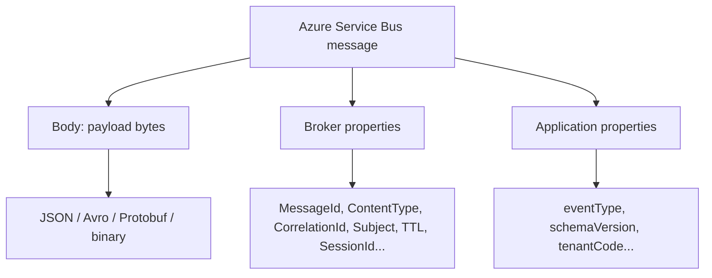

# Payload conversion and message property propagation

> **Chapter:** Azure Service Bus  
> **Module:** `SPRING_CLOUD_PROVIDER_INTEGRATION`  
> **Objective:** Design message payloads and metadata; serialize/deserialize data using the Azure SDK and Spring Messaging; map Spring Message headers to Service Bus properties; maintain compatible contracts across Java and non-Java producers/consumers.

## 1. Why separate payload and message properties?

Suppose a Spring Boot application receives a PDF contract, saves the file to Azure Blob Storage, and publishes a `DocumentUploaded` event so a worker generates a preview. The consumer must know what format the payload is encoded in, which event type the message represents, which schema version it uses, and what metadata is intended for routing or tracing.

If a producer sends a string without a contract, consumers may interpret it differently. If all metadata is stuffed into the body, the broker cannot use those attributes for filtering. If you try to put entire Java objects into application properties, the data may not be compatible with AMQP or consumers written in other languages.

A Service Bus message has two main groups of information:

- **Payload (body):** business data serialized into bytes.
- **Message properties (metadata):** identity, correlation, format, expiration, session, and application-specific attributes.

Service Bus stores the payload as a binary block and does not inspect JSON or Java structures inside it. The producer must serialize; the consumer must deserialize according to the same contract. The `ContentType` property only describes the format—it does not automatically convert an object into JSON. See [Messages, payloads, and serialization](https://learn.microsoft.com/en-us/azure/service-bus-messaging/service-bus-messages-payloads).

## 2. Azure Service Bus message structure



| Component | Who defines it? | What is it for? | Example |
| --- | --- | --- | --- |
| **Body** | Producer and application contract | Holds serialized business data | JSON of `DocumentUploadedEvent` |
| **Broker properties** | Service Bus defines names and semantics; application can set certain values | Identification, correlation, expiration, sessions, and routing | `MessageId`, `ContentType`, `CorrelationId` |
| **Application properties** | Application defines key/value pairs | Custom metadata, classification, and filtering | `eventType=DocumentUploaded`, `schemaVersion=1` |

Certain fields such as `DeliveryCount`, `EnqueuedTime`, `SequenceNumber`, and `LockedUntil` are managed by the broker and are read-only after receiving a message. They are not places for a producer to write business state.

**Do not confuse application properties with the JSON body.** Application properties form a separate key/value map. If you need to pass nested objects, lists, or structured data, serialize them inside the body. Application properties are suited for short, simple metadata compatible with AMQP types.

## 3. Choosing a payload format

Azure Service Bus does not require the body to be JSON. Applications can send bytes, UTF-8 strings, or data in any agreed-upon format.

| Format | Characteristics | When to consider | What to control |
| --- | --- | --- | --- |
| **JSON** | Human-readable, well supported across languages | Business events and cross-platform integration | Schema evolution, dates/times, decimals, optional fields |
| **Avro** | Binary, schema-based | High throughput or formal schema governance | Schema registry and compatibility |
| **Protocol Buffers** | Binary, explicit schema, code generation | Compact payloads and strict contracts | Field numbers, reserved fields, versioning |
| **Custom binary** | Full control over byte layout | Specialized protocols | Documenting encoding, byte order, and debuggability |

For Spring Boot practice exercises, UTF-8 JSON is a practical starting point. When performance or schema governance needs change, teams can evaluate Avro or Protobuf.

### 3.1. ContentType describes the format

`ContentType` is a MIME-formatted broker property. For example:

| Payload | Suggested content type |
| --- | --- |
| UTF-8 JSON | `application/json; charset=utf-8` |
| UTF-8 XML | `application/xml; charset=utf-8` |
| UTF-8 plain text | `text/plain; charset=utf-8` |
| Protobuf | `application/x-protobuf` |
| PDF | `application/pdf` |

Service Bus retains the body as binary data; the consumer relies on `ContentType` and the contract to pick the right decoder. Setting `ContentType` to `application/json` **does not turn a Java object into JSON**. The producer must still serialize before sending.

### 3.2. Do not use the broker as a large file store

If you need to process PDFs or images, it is usually better to store the content in Blob Storage and send the object key and metadata through Service Bus:

```json
{
  "eventId": "evt-901",
  "schemaVersion": 1,
  "documentId": "doc-123",
  "objectKey": "documents/doc-123/source.pdf"
}
```

This reduces message size and allows separate storage access controls. Check message size limits for your actual tier/configuration; do not assume every payload size is accepted.

## 4. Designing an event contract

A good message describes a business event, rather than just being a string telling a worker which function to invoke.

```java
import java.time.Instant;

public record DocumentUploadedEvent(
        String eventId,
        int schemaVersion,
        String documentId,
        String objectKey,
        Instant occurredAt,
        String correlationId) {
}
```

Meaning:

- `eventId` uniquely identifies a logical event; keep it unchanged when retrying the same event.
- `schemaVersion` identifies the payload version.
- `documentId` is the business identifier.
- `objectKey` is the reference to the file in storage.
- `occurredAt` is when the business event occurred, not necessarily when the broker received the message.
- `correlationId` links the event to a larger request/workflow.

Corresponding JSON:

```json
{
  "eventId": "evt-901",
  "schemaVersion": 1,
  "documentId": "doc-123",
  "objectKey": "documents/doc-123/source.pdf",
  "occurredAt": "2026-11-24T09:30:00Z",
  "correlationId": "req-456"
}
```

In this example, `eventId` can be mirrored into the broker property `MessageId`; `correlationId` can be set on `CorrelationId`. If the same information appears in both the body and properties, the contract must define which value is authoritative and how mismatches are handled.

### 4.1. Distinguishing IDs

| ID | Purpose | Rule |
| --- | --- | --- |
| **eventId** | Identifies a business event | Stable across retries; used for idempotency |
| **MessageId** | Identifies a message in Service Bus | Often set to eventId when one event maps to one message |
| **CorrelationId** | Links operations in a workflow | Preserve the same value across API → publisher → consumer |
| **documentId** | Identifies a business resource | Does not replace eventId if a document emits multiple events |
| **traceId** | Technical trace identifier | Follows tracing standards; does not replace business IDs |

If an event is re-sent with a new `MessageId`, broker-side duplicate detection will not recognize it as the same message. If one event produces multiple messages for different processing steps, assign a distinct MessageId per logical message while keeping the original eventId.

### 4.2. Do not put everything in the body

Do not send access tokens, connection strings, passwords, or secrets; do not send entire files if consumers can read from storage; do not send unnecessary personal data. Broker properties and application properties can also appear in operational tooling, logs, or filters, so do not treat them as confidential storage.

## 5. Serializing Java objects to JSON with Jackson

Spring Boot typically provides an `ObjectMapper` via auto-configuration when the appropriate Jackson dependency is present. For Java Time types like `Instant`, standardize serialization rules.

```java
import com.fasterxml.jackson.databind.ObjectMapper;
import com.fasterxml.jackson.databind.SerializationFeature;
import com.fasterxml.jackson.datatype.jsr310.JavaTimeModule;
import org.springframework.context.annotation.Bean;
import org.springframework.context.annotation.Configuration;

@Configuration
public class EventJsonConfiguration {

    @Bean
    ObjectMapper eventObjectMapper() {
        return new ObjectMapper()
                .registerModule(new JavaTimeModule())
                .disable(SerializationFeature.WRITE_DATES_AS_TIMESTAMPS);
    }
}
```

This configuration serializes timestamps as ISO-8601 strings rather than numeric timestamps. If the project already has Spring Boot's standard ObjectMapper, consider reusing it to avoid multiple serializers with inconsistent behavior.

### 5.1. Sending messages with the Azure SDK

Example event-publishing adapter:

```java
import com.azure.messaging.servicebus.ServiceBusMessage;
import com.azure.messaging.servicebus.ServiceBusSenderClient;
import com.fasterxml.jackson.core.JsonProcessingException;
import com.fasterxml.jackson.databind.ObjectMapper;
import org.springframework.stereotype.Component;

@Component
public class ServiceBusDocumentEventPublisher {

    private final ServiceBusSenderClient sender;
    private final ObjectMapper objectMapper;

    public ServiceBusDocumentEventPublisher(
            ServiceBusSenderClient sender,
            ObjectMapper objectMapper) {
        this.sender = sender;
        this.objectMapper = objectMapper;
    }

    public void publish(DocumentUploadedEvent event) {
        try {
            byte[] body = objectMapper.writeValueAsBytes(event);

            ServiceBusMessage message = new ServiceBusMessage(body)
                    .setContentType("application/json; charset=utf-8")
                    .setMessageId(event.eventId())
                    .setSubject("DocumentUploaded")
                    .setCorrelationId(event.correlationId());

            message.getApplicationProperties().put("eventType", "DocumentUploaded");
            message.getApplicationProperties().put("schemaVersion", event.schemaVersion());

            sender.sendMessage(message);
        } catch (JsonProcessingException exception) {
            throw new IllegalArgumentException(
                    "Unable to serialize DocumentUploadedEvent", exception);
        }
    }
}
```

Key points:

1. `writeValueAsBytes` produces payload bytes per Jackson configuration.
2. `ContentType` describes the bytes as UTF-8 JSON.
3. `MessageId` is set to the stable `eventId`.
4. `Subject` describes the message's purpose.
5. `CorrelationId` supports workflow tracing.
6. `ApplicationProperties` holds simple metadata for filters/consumers.

This snippet assumes `ServiceBusSenderClient` has already been created and managed by Spring Cloud Azure or appropriate SDK configuration. Reuse the client; do not create a new sender per request.

If a send times out, it may be unclear whether the broker received the message. Keep the ID stable across retries, use duplicate detection where appropriate, and design an idempotent consumer.

## 6. Deserializing messages into DTOs

The consumer needs to identify the format before parsing. Example decoder reading `ServiceBusReceivedMessage`:

```java
import com.azure.messaging.servicebus.ServiceBusReceivedMessage;
import com.fasterxml.jackson.databind.ObjectMapper;
import java.io.IOException;
import java.util.Locale;
import org.springframework.stereotype.Component;

@Component
public class DocumentEventDecoder {

    private final ObjectMapper objectMapper;

    public DocumentEventDecoder(ObjectMapper objectMapper) {
        this.objectMapper = objectMapper;
    }

    public DocumentUploadedEvent decode(ServiceBusReceivedMessage message) {
        String contentType = message.getContentType();

        if (contentType == null
                || !contentType.toLowerCase(Locale.ROOT)
                        .startsWith("application/json")) {
            throw new IllegalArgumentException(
                    "Unsupported ContentType: " + contentType);
        }

        Object eventType = message.getApplicationProperties().get("eventType");
        if (!"DocumentUploaded".equals(eventType)) {
            throw new IllegalArgumentException("Invalid eventType");
        }

        byte[] body = message.getBody().toBytes();

        try {
            DocumentUploadedEvent event =
                    objectMapper.readValue(body, DocumentUploadedEvent.class);

            if (event.schemaVersion() != 1) {
                throw new IllegalArgumentException(
                        "Unsupported schemaVersion: " + event.schemaVersion());
            }

            if (!message.getMessageId().equals(event.eventId())) {
                throw new IllegalArgumentException(
                        "MessageId does not match eventId in payload");
            }

            return event;
        } catch (IOException exception) {
            throw new IllegalArgumentException(
                    "Invalid JSON payload", exception);
        }
    }
}
```

In real systems, validate required fields, schema version, tenant/resource ownership, and business authorization. Do not log the full body if it contains personal or contract data.

`ServiceBusReceivedMessage.getBody()` returns `BinaryData`. Use `toBytes()` and decode with the chosen serializer; do not call `toString()` on a binary object and assume it is UTF-8 JSON.

### 6.1. Why validate ContentType?

If producer A sends JSON and producer B sends Protobuf to the same entity, the consumer cannot guess the format simply by attempting to parse. `ContentType` or explicit format metadata enables selecting the right decoder.

Without an agreed ContentType, JSON might be read as plain text; newer consumers may fail to read older messages; schema errors may be mistaken for network errors and retried endlessly.

## 7. Broker properties and application properties

### 7.1. Commonly used broker properties

| Property | Who sets the value? | Meaning |
| --- | --- | --- |
| `MessageId` | Producer | Application-defined message ID; can participate in duplicate detection |
| `CorrelationId` | Producer | Links the message to a request/workflow |
| `ContentType` | Producer | Describes the payload format |
| `Subject` | Producer | Purpose/label of the message |
| `SessionId` | Producer | Groups related messages on session-enabled entities |
| `PartitionKey` | Producer | Targets a partition when supported by the entity |
| `TimeToLive` | Producer/entity | Duration the message remains valid |
| `ScheduledEnqueueTime` | Producer | Time when the message becomes available for receiving |
| `ReplyTo` | Producer | Logical address for responses |
| `DeliveryCount` | Broker | Number of times the broker has delivered the message |
| `EnqueuedTime` | Broker | Timestamp when the broker received the message |
| `SequenceNumber` | Broker | Broker-assigned sequence number |
| `LockedUntil` | Broker | Expiration time of the current lock |

Not every property is writable by the application. Some fields are read-only and managed by the broker. When using the SDK, use dedicated setters/getters like `setMessageId`, `setContentType`, `setCorrelationId`, and `setSessionId` rather than creating keys in application properties to mimic them.

### 7.2. Application properties

Application properties are a key/value map for producers to pass custom metadata:

```java
message.getApplicationProperties().put("eventType", "DocumentUploaded");
message.getApplicationProperties().put("schemaVersion", 1);
message.getApplicationProperties().put("tenantCode", "tenant-a");
message.getApplicationProperties().put("priority", "normal");
```

These keys are application-defined; Service Bus does not interpret their business meaning. Use scalar values compatible with AMQP/SDK. Do not put arbitrary Java objects, lists, nested maps, or large byte arrays in application properties; serialize complex structures in the body.

### 7.3. Using application properties for filters

Topic subscriptions can use SQL filters or correlation filters based on system properties and application properties. For example:

```sql
eventType = 'DocumentUploaded'
```

The broker can use this metadata to select subscriptions. It does not need to parse the JSON body to search for an `"eventType"` string inside the payload.

If the body also contains `eventType`, define which source is canonical. When the body and property disagree, the consumer should classify the message as invalid rather than arbitrarily picking whichever is convenient.

## 8. Mapping Spring Message headers to Service Bus properties

Spring Messaging represents messages with a payload and headers. Spring Cloud Azure can map headers to Service Bus properties via `ServiceBusMessageConverter`.

| Service Bus property | Spring header | Typical type | Purpose |
| --- | --- | --- | --- |
| Content type | `MessageHeaders.CONTENT_TYPE` | String | Describes the payload |
| Message ID | `ServiceBusMessageHeaders.MESSAGE_ID` | String | Message identifier |
| Correlation ID | `ServiceBusMessageHeaders.CORRELATION_ID` | String | Workflow tracing |
| Subject | `ServiceBusMessageHeaders.SUBJECT` | String | Message purpose |
| Session ID | `ServiceBusMessageHeaders.SESSION_ID` | String | Group messages by session |
| Partition key | `ServiceBusMessageHeaders.PARTITION_KEY` | String | Partition selection when applicable |
| Time to live | `ServiceBusMessageHeaders.TIME_TO_LIVE` | Duration | Message lifetime |
| Scheduled enqueue time | `ServiceBusMessageHeaders.SCHEDULED_ENQUEUE_TIME` | OffsetDateTime | Schedule message delivery |
| Delivery count | `ServiceBusMessageHeaders.DELIVERY_COUNT` | long | Broker-returned metadata |
| Enqueued time | `ServiceBusMessageHeaders.ENQUEUED_TIME` | OffsetDateTime | Time broker received message |

Read-only broker headers such as `DeliveryCount` or `EnqueuedTime` should not be set as outbound headers. Check the reference docs for your Spring Cloud Azure version for exact types and support levels.

### 8.1. Sending DTOs with ServiceBusTemplate

When using Spring Messaging integration, the application can send DTOs instead of manually serializing bytes:

```java
import com.azure.spring.messaging.servicebus.core.ServiceBusTemplate;
import com.azure.spring.messaging.servicebus.support.ServiceBusMessageHeaders;
import org.springframework.messaging.Message;
import org.springframework.messaging.MessageHeaders;
import org.springframework.messaging.support.MessageBuilder;
import org.springframework.stereotype.Service;
import reactor.core.publisher.Mono;

@Service
public class SpringDocumentEventPublisher {

    private final ServiceBusTemplate template;

    public SpringDocumentEventPublisher(ServiceBusTemplate template) {
        this.template = template;
    }

    public Mono<Void> publish(DocumentUploadedEvent event) {
        Message<DocumentUploadedEvent> message =
                MessageBuilder.withPayload(event)
                        .setHeader(MessageHeaders.CONTENT_TYPE,
                                "application/json; charset=utf-8")
                        .setHeader(ServiceBusMessageHeaders.MESSAGE_ID,
                                event.eventId())
                        .setHeader(ServiceBusMessageHeaders.CORRELATION_ID,
                                event.correlationId())
                        .setHeader(ServiceBusMessageHeaders.SUBJECT,
                                "DocumentUploaded")
                        .setHeader("eventType", "DocumentUploaded")
                        .setHeader("schemaVersion", event.schemaVersion())
                        .build();

        return template.sendAsync("document-events", message);
    }
}
```

`ServiceBusTemplate` and the converter handle converting Spring Messages to Service Bus messages as configured. Standard headers map to broker properties; custom headers are converted to application properties according to converter mechanics.

The method returns `Mono<Void>` so the caller can compose or handle errors. Avoid calling `subscribe()` inside a service and discarding the result if business logic needs to know whether publishing succeeded or failed. Let the orchestration layer decide how to subscribe/block appropriately for the application model.

### 8.2. Receiving DTOs with @ServiceBusListener

When the converter is configured properly, a listener can receive the payload as a DTO type:

```java
import com.azure.spring.messaging.servicebus.annotation.ServiceBusListener;
import com.azure.spring.messaging.servicebus.support.ServiceBusMessageHeaders;
import org.springframework.messaging.Message;
import org.springframework.stereotype.Component;

@Component
public class DocumentEventListener {

    @ServiceBusListener(destination = "document-events")
    public void onDocumentUploaded(Message<DocumentUploadedEvent> message) {
        DocumentUploadedEvent event = message.getPayload();

        String messageId = message.getHeaders().get(
                ServiceBusMessageHeaders.MESSAGE_ID, String.class);

        String eventType = message.getHeaders().get("eventType", String.class);

        if (!"DocumentUploaded".equals(eventType)
                || !event.eventId().equals(messageId)) {
            throw new IllegalArgumentException("Invalid message contract");
        }

        // Forward to business handler with idempotency control.
    }
}
```

This example assumes the listener container and converter are enabled per the corresponding Spring Cloud Azure configuration. Depending on version, `@EnableAzureMessaging` may need to be declared explicitly or may already be enabled by auto-configuration. If you need access to the full Service Bus message or specialized settlement control, use the listener/SDK API appropriate for your version rather than assuming all signatures are identical.

### 8.3. Customizing the converter's ObjectMapper

Spring Cloud Azure supports configuring the converter to use either an isolated ObjectMapper or the Spring Boot–managed ObjectMapper. Example using the application's mapper:

```yaml
spring:
  cloud:
    azure:
      message-converter:
        isolated-object-mapper: false
```

Or register a custom converter:

```java
@Bean
AzureMessageConverter<ServiceBusReceivedMessage, ServiceBusMessage>
serviceBusMessageConverter() {
    JsonMapper jsonMapper = JsonMapper.builder()
            .addModule(new JavaTimeModule())
            .build();

    return new ServiceBusMessageConverter(jsonMapper);
}
```

`isolated-object-mapper` is enabled by default in current documentation. Setting it to `false` lets the converter use the application's ObjectMapper bean; this unifies serialization rules, though global mapper changes will affect message contracts. Only share the mapper when naming strategy, date/time handling, and custom serializers are well controlled.

## 9. Schema evolution and producer/consumer compatibility

Producers and consumers may not be upgraded at the same time. Old messages can sit in a queue for hours while a new producer is already sending a new schema.

| Change | Risk | Recommended handling |
| --- | --- | --- |
| Add optional field | Old consumers can ignore it if the parser permits | Add default/nullable field and test with old consumers |
| Add required field | Old consumers may lack data | Roll out supporting consumers before producers |
| Rename field | Old consumers cannot find the field | Alias/dual-read or new schema version |
| Change field type | Parsing fails or meaning changes | Introduce a new field or new version |
| Remove field | Old consumers may still depend on it | Deprecate, monitor usage, then remove later |
| Change field meaning while keeping name | Parsing succeeds but business logic breaks | Never repurpose a field for a different meaning |

A practical strategy is additive changes first, breaking changes later. New consumers can read both old and new schemas; producers only emit new fields after required consumers are ready. For major changes, use a new event type or version.

Example versioned decoder:

```java
public DocumentEvent decode(byte[] body, int schemaVersion)
        throws IOException {
    return switch (schemaVersion) {
        case 1 -> objectMapper.readValue(body, DocumentUploadedV1.class);
        case 2 -> objectMapper.readValue(body, DocumentUploadedV2.class);
        default -> throw new UnsupportedOperationException(
                "Unsupported schemaVersion: " + schemaVersion);
    };
}
```

If a version is unsupported, do not deserialize by guessing. Classify the message as unsupported/permanent and handle it via the DLQ or a controlled compatibility pipeline.

If multiple teams or languages exchange events, consider a schema registry or a versioned schema repository. Put schema reviews, automated compatibility checks, contract tests, and sample payloads for each version in place.

## 10. Multi-language compatibility and AMQP

Azure Service Bus supports AMQP 1.0 across official clients. Java, .NET, JavaScript, Python, or other AMQP applications can exchange messages if they agree on payload format and properties.

To improve interoperability:

1. Serialize payloads using an open specification format like JSON, Avro, or Protobuf.
2. Set an appropriate `ContentType`.
3. Use stable field names and consistent data types.
4. Avoid relying on Java class names, package names, or Java native serialization.
5. Use application properties with scalar values compatible with AMQP/SDKs.
6. Specify timezones explicitly; for absolute timestamps prefer ISO-8601 UTC.
7. Maintain consumer tests written in another language if interoperability is a product requirement.

Do not use `ObjectOutputStream`/`ObjectInputStream` as an inter-system contract. That ties the payload to Java class layouts and runtime internals; .NET/Node/Python consumers cannot understand it natively, and deserializing untrusted data poses security risks.

## 11. Payload size, performance, and security

### 11.1. Message size

Message size limits depend on tier and entity configuration; check current quotas before designing. Large payloads increase transfer overhead, serialization time, memory pressure, and consumer latency.

- Only send necessary data.
- Use object storage for large files and pass the object key.
- Avoid duplicating large metadata in application properties.
- Use batching when appropriate and check total size with the SDK's batch API.
- Measure actual byte sizes and monitor message size errors.

### 11.2. Sensitive data

Messages can be retained, dead-lettered, replayed, or inspected through operational tools. Therefore:

- Do not send access tokens, connection strings, passwords, or secrets.
- Do not send full personal records if the consumer only needs an ID.
- Restrict read permissions on queues/subscriptions by workload.
- Do not log full message bodies in producers, processors, or DLQ handlers.
- If encrypting payloads at the application level, define key management, versioning, rotation, and decryption permissions clearly.

Application properties are also inspectable metadata; do not put confidential data in properties simply because the body is encrypted.

### 11.3. Classifying payload errors

| Scenario | Handling approach |
| --- | --- |
| Malformed JSON | Classify as payload error; dead-letter per policy |
| Unsupported ContentType | Do not guess with an arbitrary decoder; route to compatibility flow or DLQ |
| Unsupported schema version | Record reason and handle per versioning policy |
| Missing required field | Identify as producer/contract bug; do not retry blindly |
| Transient database error | May retry/abandon with limits and backoff |
| Object key does not exist | Distinguish incomplete upload, misconfiguration, or bad data |
| Workload lacks permissions | Fix IAM/RBAC; retries will not grant permissions |

When dead-lettering, only record necessary diagnostic metadata such as reason, event ID, schema version, and correlation ID; avoid copying sensitive payloads verbatim into error descriptions.

## 12. Testing serialization and message properties

A test that only checks that the sender does not throw an exception is insufficient. You must prove that the producer and consumer agree on the same contract.

### 12.1. Serialization/deserialization unit tests

```java
import static org.junit.jupiter.api.Assertions.assertEquals;

import com.fasterxml.jackson.databind.ObjectMapper;
import com.fasterxml.jackson.datatype.jsr310.JavaTimeModule;
import org.junit.jupiter.api.Test;

class DocumentEventSerializationTest {

    private final ObjectMapper objectMapper = new ObjectMapper()
            .registerModule(new JavaTimeModule());

    @Test
    void shouldRoundTripDocumentUploadedEvent() throws Exception {
        DocumentUploadedEvent original = new DocumentUploadedEvent(
                "evt-901",
                1,
                "doc-123",
                "documents/doc-123/source.pdf",
                java.time.Instant.parse("2026-11-24T09:30:00Z"),
                "req-456");

        byte[] body = objectMapper.writeValueAsBytes(original);

        DocumentUploadedEvent decoded =
                objectMapper.readValue(body, DocumentUploadedEvent.class);

        assertEquals(original, decoded);
    }
}
```

This test validates Jackson and the DTO within the same codebase. It **does not** prove that Service Bus preserved ContentType, broker properties, or application properties.

### 12.2. Testing the ServiceBusMessage adapter

Extracting a factory lets you test mapping independently of the network:

```java
public ServiceBusMessage toServiceBusMessage(
        DocumentUploadedEvent event) throws JsonProcessingException {

    byte[] body = objectMapper.writeValueAsBytes(event);

    ServiceBusMessage message = new ServiceBusMessage(body)
            .setContentType("application/json; charset=utf-8")
            .setMessageId(event.eventId())
            .setCorrelationId(event.correlationId())
            .setSubject("DocumentUploaded");

    message.getApplicationProperties().put("eventType", "DocumentUploaded");
    message.getApplicationProperties().put("schemaVersion", event.schemaVersion());

    return message;
}
```

Adapter tests should verify that the body deserializes cleanly, ContentType is accurate, MessageId/CorrelationId/Subject match, application properties carry `eventType`/`schemaVersion` with the expected types, and no secrets are included.

### 12.3. Integration tests on a Service Bus test namespace

An integration test should:

1. Send a JSON message with a unique event ID.
2. Receive the message via the SDK or a Spring listener.
3. Verify body bytes, content type, message ID, correlation ID, subject, and application properties.
4. Deserialize the payload into the DTO and compare fields.
5. Complete the message only after test assertions pass; on failure, clean up per test policy.

The emulator can help with the local development loop if it supports the features under test, but it does not replace cloud tests for IAM, tiers, quotas, subscription filters, and real-world semantics.

### 12.4. Testing schema compatibility and filters

Create sample payloads for every supported version: producer v1 → consumer v1; producer v1 → consumer v2; producer v2 → consumer v1 if rollouts require it; payloads with missing fields, unknown extra fields, wrong types, or unsupported versions.

If a subscription uses the SQL filter `eventType = 'DocumentUploaded'`, send two messages with the same body format but different application properties. Verify that the broker routes them to the right subscription. Do not merely test Java `if` statements checking `eventType` after receiving, as that tests consumer logic rather than proving broker-side filtering.

## 13. Hands-on lab: standardizing the DocumentUploaded event

**Scenario:** A Spring Boot API saves files to Azure Blob Storage. Upon successful upload, the application sends `DocumentUploadedEvent` to Service Bus for a preview worker to process. An audit service also receives the event via its own subscription.

### Part A — Define the schema

Create a record containing `eventId`, `schemaVersion`, `documentId`, `objectKey`, `occurredAt`, and `correlationId`. Specify required fields, optional fields, timestamp format, and rules for missing data.

### Part B — Serialize and send

- Configure an ObjectMapper supporting Java Time.
- Serialize the DTO to UTF-8 JSON bytes.
- Set `ContentType`, `MessageId`, `CorrelationId`, and `Subject`.
- Put `eventType` and `schemaVersion` into application properties.
- Send via `ServiceBusSenderClient` or `ServiceBusTemplate`.

### Part C — Deserialize and validate

- Validate ContentType.
- Validate the `eventType` application property.
- Parse JSON according to schema version.
- Cross-check `MessageId` against `eventId` per contract.
- Reject payloads with missing fields or unsupported versions.

### Part D — Use Spring Message headers

Build a message with `MessageBuilder`, setting `MessageHeaders.CONTENT_TYPE`, `ServiceBusMessageHeaders.MESSAGE_ID`, `CORRELATION_ID`, `SUBJECT`, and custom application properties. Send using `ServiceBusTemplate` and receive using `@ServiceBusListener`.

Compare this approach against using the SDK directly: what does the converter automate, and what must the application still control?

### Part E — Schema evolution

Release `schemaVersion=2` with a new optional field. Verify v1 and v2 consumers per your defined compatibility strategy. Test a message with an unsupported version and define how it is dead-lettered.

### Part F — Testing and observability

- Round-trip serialization test.
- Adapter mapping test.
- Integration test against a test queue/topic.
- Filter test based on application properties.
- Verify duplicate events do not produce duplicate side effects.
- Log event ID/correlation ID without logging sensitive payloads.

**Completion criteria:** distinguish body/broker properties/application properties; serialize/deserialize in the right format; set content type and stable message IDs; map Spring headers accurately; prove the consumer handles schema versions and invalid messages properly.

---

## 14. Checklist before putting a message contract into production

| Area | Question |
| --- | --- |
| Payload | What format does the body use? Are schema/version and encoding clear? |
| ContentType | Does the MIME type match the actual bytes? |
| Message ID | Is it stable across retries and suitable for idempotency? |
| Correlation | Can we trace API → publisher → consumer? |
| Application properties | Does it contain only short, simple, non-sensitive metadata? |
| Filters | Do subscription filters use the right properties and handle the default rule? |
| Spring converter | Are ObjectMapper, Java Time, and custom serializers consistent? |
| Schema evolution | Can old consumers read new messages during rollout? |
| Security | Could the payload/metadata expose secrets or unnecessary personal data? |
| Size | Are messages within tier limits and appropriate for throughput? |
| Failure | How are bad payloads, wrong content types, and unknown schemas classified? |
| Testing | Are there round-trip, adapter, integration, filter, and compatibility tests? |

## Takeaways

- **Body** is payload bytes; Service Bus does not inherently understand JSON or Java objects.
- **ContentType** describes the format; the producer must serialize and the consumer must deserialize.
- **Broker properties** like `MessageId`, `CorrelationId`, `Subject`, `SessionId`, and `TimeToLive` serve broker and application semantics.
- **Application properties** are application-defined key/value metadata useful for routing/filtering; do not use them instead of the body for complex objects.
- **Spring MessageConverter** converts payloads and headers between Spring Messaging and Service Bus; ObjectMapper configuration must remain consistent.
- **Schema versioning, idempotency, compatibility tests, and sensitive-data controls** determine whether a message contract stays resilient across application versions.

When integrating Spring Boot with Azure Service Bus, define the contract first, pick the serialization format, place metadata in the right locations, and test both sending and receiving paths. This is the foundation for consistent message exchange across Java, .NET, or other language producers and consumers.

### Official documentation

- [Azure Service Bus — Messages, payloads, and serialization](https://learn.microsoft.com/en-us/azure/service-bus-messaging/service-bus-messages-payloads)
- [Azure Service Bus Java SDK — ServiceBusMessage](https://learn.microsoft.com/en-us/java/api/com.azure.messaging.servicebus.servicebusmessage?view=azure-java-stable)
- [Azure Service Bus Java SDK — ServiceBusReceivedMessage](https://learn.microsoft.com/en-us/java/api/com.azure.messaging.servicebus.servicebusreceivedmessage?view=azure-java-stable)
- [Spring Cloud Azure — Spring Messaging Azure Service Bus](https://learn.microsoft.com/en-us/azure/developer/java/spring-framework/spring-messaging-service-bus-support)
- [Spring Cloud Azure — Reference Documentation](https://microsoft.github.io/spring-cloud-azure/current/reference/html/index.html)
- [Azure Service Bus — AMQP 1.0 overview](https://learn.microsoft.com/en-us/azure/service-bus-messaging/service-bus-amqp-overview)

SDK versions, Spring Cloud Azure versions, and converter configurations should be verified against your actual Spring Boot/JDK BOM. Never assume a snippet or header mapping from an older version works unchanged in a newer version.
