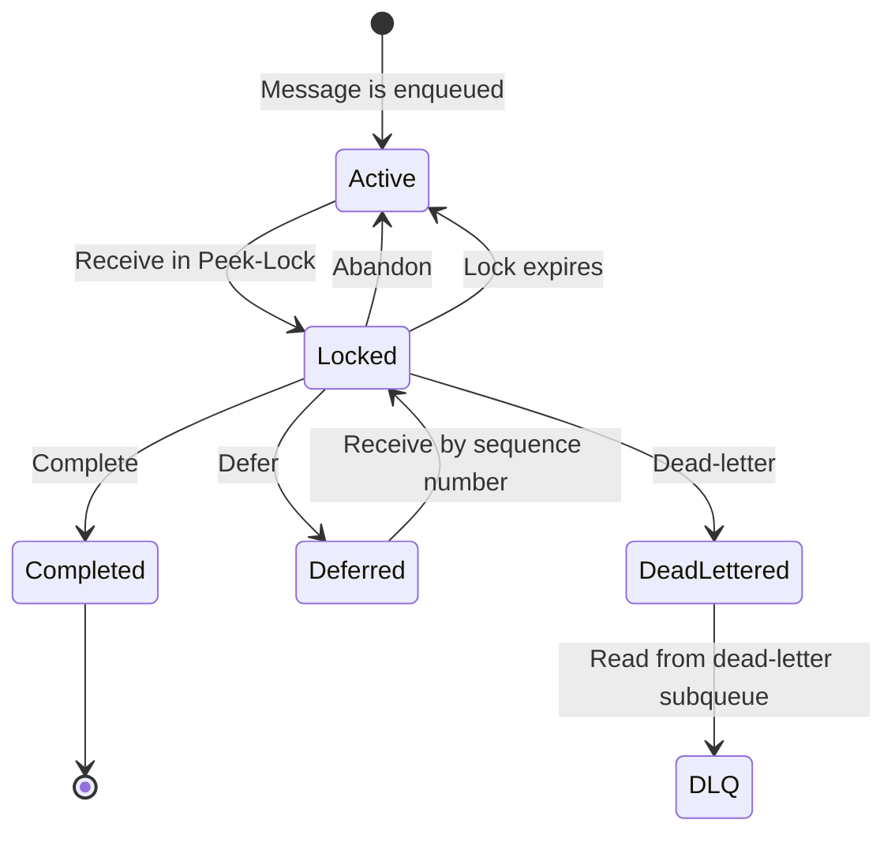
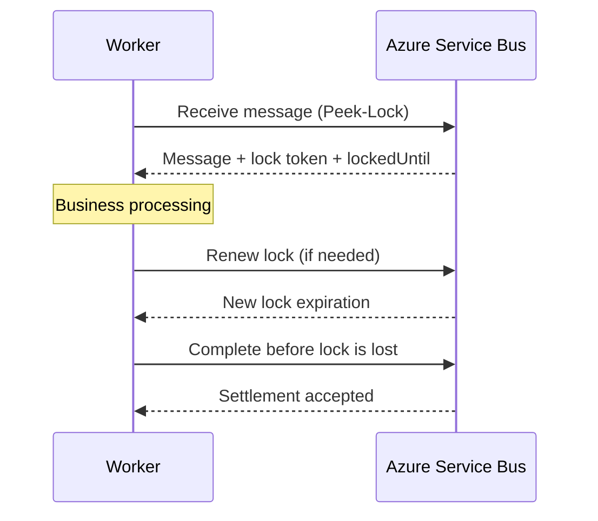
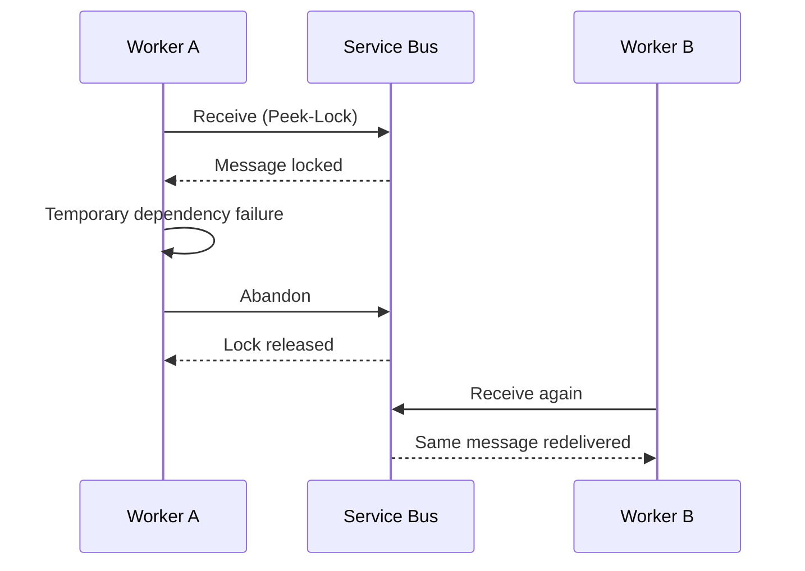
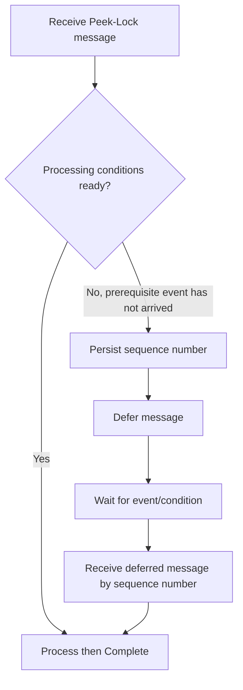
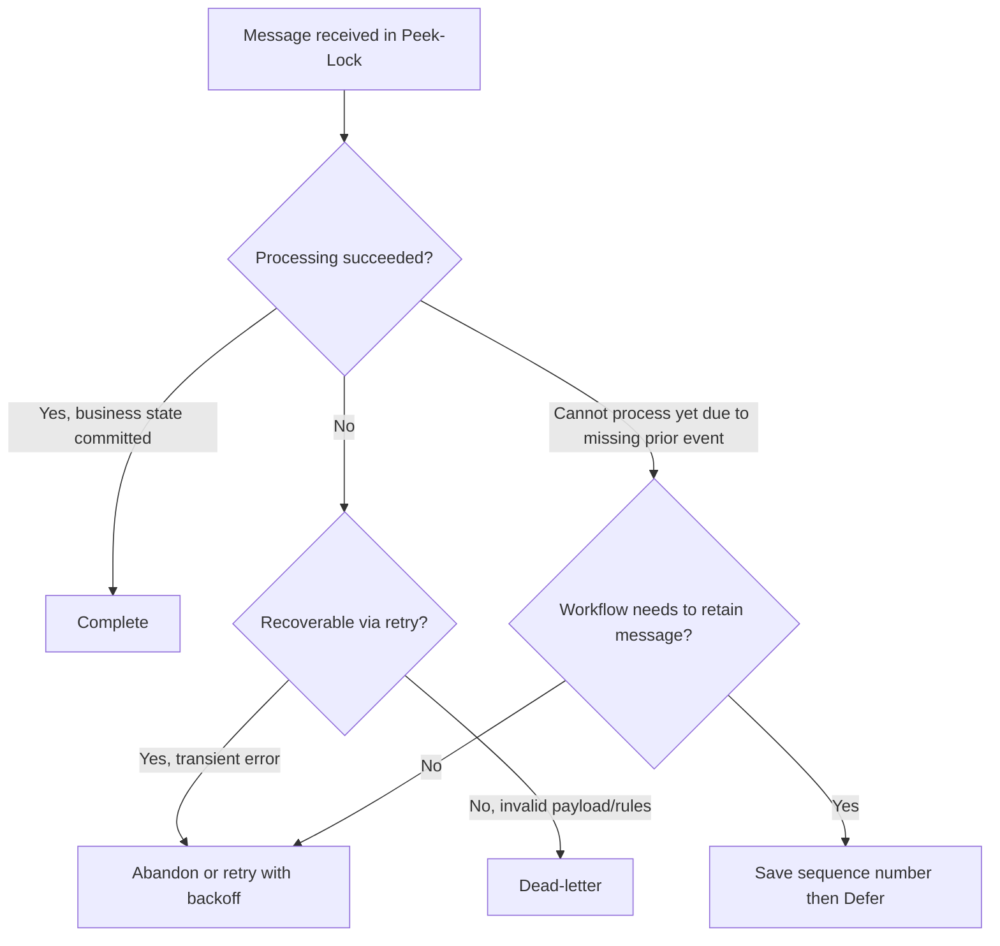

# Peek-lock, complete, abandon, defer, and dead-letter

> **Chapter:** Azure Service Bus  
> **Module:** `SPRING_CLOUD_PROVIDER_INTEGRATION`  
> **Objective:** Understand the message receive lifecycle in Azure Service Bus; choose the right settlement operation in Spring Boot/Azure SDK; design consumers resilient to redelivery, lock loss, and business failures.

## 1. Receiving a message does not mean processing is finished

Suppose a Spring Boot worker receives a `DocumentUploaded` event from the `preview-jobs` queue. The worker needs to read the file from Azure Blob Storage, generate a preview image, write metadata to the database, and update the document status.

If the broker deletes the message as soon as it is delivered to the worker, what happens if the JVM is killed after receiving but before saving the preview? Work can vanish even though business processing never finished. Conversely, if the broker keeps the message indefinitely, already processed messages could be delivered forever.

Azure Service Bus solves this problem with **Peek-Lock** and **settlement** operations. The broker temporarily locks the message when delivering it to a consumer. The consumer performs the work and then confirms the outcome:

- **Complete:** business work finished; the broker can delete the message.
- **Abandon:** could not process yet, and wants the message redelivered.
- **Defer:** keeps the message in a deferred state to be retrieved later by sequence number.
- **Dead-letter:** the message cannot or should not continue in the normal flow; moves it to the dead-letter queue (DLQ).

These are decisions about job state. Choosing the wrong one can cause lost messages, duplicate processing, or hard-to-recover backlogs.



Messages that are abandoned or whose lock expires return to the normal receive stream. Deferred messages do not automatically appear in the next normal receive call. Dead-lettered messages reside in a dedicated DLQ.

## 2. Peek-Lock and Receive-and-Delete

Azure Service Bus supports two receive modes:

| Mode | When the broker delivers a message | What must the consumer do next? | Primary risk |
| --- | --- | --- | --- |
| **Peek-Lock** | Message is temporarily locked for the receiver | Settle via complete, abandon, defer, or dead-letter | Possible redelivery on lock loss; requires idempotency |
| **Receive-and-Delete** | Broker treats the message as consumed upon delivery | No separate settlement | Message can be lost if the app fails before finishing |

**Peek-Lock is the default choice** for workloads that must avoid losing work. Receive-and-Delete is only suitable when data is low-value, losing some messages is acceptable, and simpler throughput matters more than recoverability.

### 2.1. A Peek-Lock lifecycle

1. The consumer receives a message from a queue or subscription.
2. Service Bus grants a lock and returns payload plus metadata.
3. The consumer processes within the lock's validity window.
4. The consumer sends a settlement operation while the lock and receiver/connection are still active.
5. The broker acknowledges settlement; the message is deleted, unlocked, deferred, or moved to the DLQ depending on the operation chosen.

While a message is locked, other consumers reading from the same queue/subscription will not receive that locked delivery; they can receive other unlocked messages. If the lock is released or expires, the message can be redelivered.

### 2.2. Why is Receive-and-Delete unsuitable for critical work?

Suppose a worker receives `DocumentUploaded` in Receive-and-Delete mode and the JVM is killed immediately afterward. The broker has already marked the message consumed and does not wait for the application to report an outcome. Without another durable work source, the system has no message left to retry.

For previews, critical emails, order processing, or financial state updates, start with Peek-Lock and design idempotency.

## 3. What is a lock and how long does it live?

When receiving in Peek-Lock mode, the broker issues a time-limited **message lock**. During this window, the receiver holding the lock has the right to settle the message.

- Lock duration is configured on the queue or topic subscription.
- The default value is typically **1 minute**.
- The maximum configurable lock duration is **5 minutes**.
- If a task runs longer, the client needs to renew the lock or split work into shorter steps with checkpoints.
- Locks are **volatile**: they can be lost on network/AMQP connection drops, receiver shutdown, service updates, or lock expiration.
- A lock is tied to the receiver and connection; you cannot assume a new connection will keep holding the old lock.



### 3.1. Auto-lock renewal in the Java SDK

`ServiceBusProcessorClient` in the Azure SDK for Java supports automatic lock renewal. Per the current API reference:

- Default auto lock renewal runs up to **5 minutes**.
- Configurable via `maxAutoLockRenewDuration(Duration)` on the processor builder.
- `Duration.ZERO` or `null` disables auto-renewal.
- Renewal can still fail due to networking, throttling, CPU starvation, or detached connections.

Example processor configuration for a task expected to take longer than the initial lock:

```java
import java.time.Duration;

import com.azure.identity.DefaultAzureCredentialBuilder;
import com.azure.messaging.servicebus.ServiceBusClientBuilder;
import com.azure.messaging.servicebus.ServiceBusProcessorClient;
import com.azure.messaging.servicebus.models.ServiceBusReceiveMode;

ServiceBusProcessorClient processor =
        new ServiceBusClientBuilder()
                .credential(
                        fullyQualifiedNamespace,
                        new DefaultAzureCredentialBuilder().build())
                .processor()
                .queueName("preview-jobs")
                .receiveMode(ServiceBusReceiveMode.PEEK_LOCK)
                .disableAutoComplete()
                .maxAutoLockRenewDuration(Duration.ofMinutes(8))
                .maxConcurrentCalls(4)
                .processMessage(this::handleMessage)
                .processError(this::handleError)
                .buildProcessorClient();

processor.start();
```

This example uses the Azure SDK directly; `fullyQualifiedNamespace` is the namespace FQDN and the identity must have permission to receive messages. The 8-minute number merely illustrates client configuration, not a recommendation for all workloads. `maxConcurrentCalls` must fit CPU, database pool, and processing duration.

**Lock renewal does not turn a long-running task into a durable transaction.** If a preview takes 30 minutes, consider breaking it into steps, persisting checkpoints, or orchestrating smaller steps in a workflow. Do not hold locks for tens of minutes just to mask a handler that does too much work.

### 3.2. Prefetch and concurrency affect locks

If a client prefetches more messages than workers can process, some messages sit locked in the buffer before a handler even starts. While waiting their turn, part of their lock time is already consumed.

Increasing `maxConcurrentCalls` can also exhaust the database pool or trigger downstream API throttling. Measure time from enqueue to processing start, handler lock hold duration, lock-loss/redelivery rate, CPU, database connection pool, and downstream request counts.

Do not raise prefetch/concurrency by guesswork. Lock renewal also generates network operations; excessive renewals can add load to the namespace.

## 4. Complete: confirming successful processing

**Complete** is positive settlement: the consumer informs the broker that the message has been processed and can be removed from the queue/subscription.

Only complete when **business state has reached a safe checkpoint**. For the preview generation example, that safe checkpoint might be:

1. Source file read successfully.
2. Preview written to object storage.
3. Metadata/`READY` status updated in the database.
4. Event ID or idempotency key recorded so redelivery does not create new side effects.

Do not complete immediately after parsing the message if the actual work has not been executed yet.

### 4.1. Processor example with manual settlement

The processor defaults to auto-completion. To decide settlement manually, call `disableAutoComplete()`:

```java
import com.azure.messaging.servicebus.ServiceBusReceivedMessage;
import com.azure.messaging.servicebus.ServiceBusReceivedMessageContext;

private void handleMessage(ServiceBusReceivedMessageContext context) {
    ServiceBusReceivedMessage message = context.getMessage();

    try {
        previewService.createPreviewIdempotently(
                message.getMessageId(),
                message.getBody());

        // Complete only after business state is recorded successfully.
        context.complete();

    } catch (TransientDependencyException exception) {
        // Recoverable error: return the message for redelivery.
        context.abandon();

    } catch (InvalidMessageException exception) {
        // Payload cannot be processed under the current contract.
        context.deadLetter();
    }
}
```

This example illustrates the decision flow. In a real application, the body must be deserialized and validated against the schema; do not call `toString()` to decode a binary payload if the contract specifies JSON bytes. Do not put sensitive contents into logs or dead-letter descriptions.

When using the processor builder as shown above, `disableAutoComplete()` turns off auto-complete and auto-abandon so the application settles explicitly. If left enabled, the processor may auto-complete when the callback returns normally and auto-abandon when it throws; understand this exact behavior before mixing manual settlement with auto-settlement.

### 4.2. Complete can fail even when business work succeeded

An important scenario:

- The worker writes the preview and commits the database successfully.
- The worker calls `context.complete()`.
- The connection drops or the lock is lost before the broker acknowledges settlement.
- The worker does not know for sure whether the broker completed it; the message may be redelivered.

This is a case of **business effect succeeded, acknowledgement uncertain**. The consumer needs to persist completion state durably by `MessageId` or `eventId`. Upon redelivery, it detects the work is already done and completes the message without regenerating the preview or re-sending notifications.

Never assume that if `complete` throws an exception, the broker definitely did not delete the message. Settlement outcomes can be ambiguous during network failures.

## 5. Abandon: unlocking so the message can be redelivered

**Abandon** asks the broker to release the current lock, making the message available to be received by another receiver. Choose this when a database is temporarily unreachable, a downstream API suffers a transient error, the worker lacks capacity, or the failure can succeed on retry.

Abandoning usually **increments DeliveryCount**. When a message is repeatedly abandoned or its lock expires, DeliveryCount rises to the configured threshold, after which the message can be moved to the DLQ.



### 5.1. Abandon is not a delayed retry

Abandon releases the lock so the broker can redeliver; it **does not apply an arbitrary backoff delay**. If a dependency outage lasts a while and thousands of workers abandon simultaneously, the system can enter a hot retry loop.

For transient failures, consider SDK retry policies, bounded backoff at the business layer, reducing concurrency or pausing receivers while a shared dependency is down, scheduled messages, or a dedicated retry queue if intentional delay is required.

Abandon is not always the right answer. If every message depends on a database that is currently offline, **pausing message receiving** until the dependency recovers can be better than receiving and abandoning the entire backlog.

### 5.2. Abandon and lock expiry differ in timing

| Scenario | What happens |
| --- | --- |
| Consumer calls `abandon()` | Lock is released immediately so the message can be received again |
| Consumer does not settle and lock expires | Broker releases the message after the lock expires |
| Consumer closes receiver before settlement | Settlement never reaches the broker; lock stays valid until expiry, then the message may redeliver |
| Consumer calls `complete()` successfully | Message is removed from the normal receive stream |

Both abandon and lock expiry can increment DeliveryCount. Failing to settle before closing a receiver is a common operational mistake; when shutting down a receiver, allow in-flight handlers to finish within a reasonable shutdown window.

## 6. Defer: intentional postponement requiring sequence number tracking

**Defer** is used when a message is valid but **cannot be processed yet because a specific business precondition has not occurred**. The message is placed into a deferred state within the same queue or subscription.

Examples:

- The system receives `PaymentConfirmed` before `OrderPlaced` for that order arrives.
- A workflow must wait for a result from another system before proceeding to the next step.
- A message needs to be held for processing after another event finishes.

Defer differs from abandon:

- Abandon returns the message to the normal receive stream for broker redelivery.
- Defer takes the message out of the normal receive stream; the application must **persist the sequence number** and call the deferred-message receive API by sequence number when ready.



**A deferred message is not in the DLQ.** It remains in the main queue/subscription, though normal receive operations will skip it. The message will not reappear in the queue simply because time has passed.

### 6.1. Sequence number is the key to retrieving the message

When receiving a message, Service Bus assigns a unique `SequenceNumber`. Before deferring, capture it from `message.getSequenceNumber()` and store it in durable storage alongside the necessary business context.

```java
long sequenceNumber = message.getSequenceNumber();
String messageId = message.getMessageId();

// Application repository persists eventId, sequenceNumber,
// entity, and workflow state to the database.
deferredMessageStore.recordPending(
        messageId,
        sequenceNumber,
        "WAITING_FOR_ORDER");

context.defer();
```

This is a service-level example where `deferredMessageStore` is an application repository. In real systems, manage record states such as `DEFER_INTENT` and `DEFERRED` to reconcile if the app crashes between the database write and the Service Bus call.

**Never store sequence numbers only in memory.** When a worker restarts, the application will lose track of which messages were deferred and will not be able to retrieve them by sequence number.

### 6.2. Receiving a deferred message back

The Java SDK provides `ServiceBusReceiverClient.receiveDeferredMessage(long sequenceNumber)`:

```java
import com.azure.messaging.servicebus.ServiceBusReceivedMessage;
import com.azure.messaging.servicebus.ServiceBusReceiverClient;

public void resumeDeferredMessage(
        ServiceBusReceiverClient receiver,
        long sequenceNumber) {

    ServiceBusReceivedMessage deferred =
            receiver.receiveDeferredMessage(sequenceNumber);

    if (deferred == null) {
        // Reconcile workflow state if the sequence number is no longer available.
        return;
    }

    try {
        previewService.processIdempotently(
                deferred.getMessageId(),
                deferred.getBody());

        receiver.complete(deferred);
    } catch (TransientDependencyException exception) {
        receiver.abandon(deferred);
    }
}
```

This snippet focuses on the API; handle real SDK exceptions, deserialize the body per contract, and keep the receiver open during settlement. If the sequence number no longer resolves to a deferred message, reconcile workflow state in the database before deciding to emit a new message or mark it complete.

### 6.3. The gap between saving sequence number and deferring

The database and Service Bus do not share an automatic transaction. There are two failure windows:

1. Saving the sequence number to the DB succeeds, but `defer()` fails: the DB has a `DEFER_INTENT` record while the message may still be active.
2. `defer()` succeeds, but the app crashes before updating the DB to `DEFERRED`: the message has left normal receive, while the DB only records the intent to defer.

Design a reconciliation process:

- Save the sequence number and intent state before deferring.
- Execute `defer()` while the lock is still valid.
- Update the state to deferred after broker acknowledgement.
- Have a reconciliation job inspect unfinished intents and determine whether the message is active, deferred, completed, or moved to the DLQ.
- Use `MessageId` and business event IDs so recovery does not create duplicate work.

Deferral is not a general retry/backoff substitute for transient errors. If all processing depends on a down database, pausing the consumer is usually simpler and safer than deferring individual messages.

### 6.4. Deferred messages and TTL

Deferred messages are not treated like normal active messages when TTL expires. Per Service Bus documentation, a deferred message is not automatically purged or moved to the DLQ merely upon expiration; expiration is checked when a client attempts to receive the message again by sequence number. If expired, it can be moved to the DLQ when dead-letter-on-expiration is enabled.

Workflows using deferral need cleanup/evaluation mechanisms for stale sequence numbers and expired business states.

## 7. Dead-letter: moving messages out of the normal processing flow

**Dead-letter** is intentional negative settlement. The message is moved to the **Dead-Letter Queue (DLQ)** associated with the queue or topic subscription.

Use dead-letter when the payload violates the schema, the event version is unsupported, business data is invalid, the message exceeded maximum deliveries, or the message expired with dead-letter-on-expiration enabled.

Dead-letter **does not mean permanent deletion**. It moves the message into a holding stream for operations to investigate, fix data/code, and perform controlled replay.

### 7.1. Application-initiated dead-lettering

In a processor callback, the Java SDK provides `context.deadLetter()`:

```java
import com.azure.messaging.servicebus.ServiceBusReceivedMessageContext;

private void rejectInvalidMessage(
        ServiceBusReceivedMessageContext context) {
    // Payload cannot be processed under the current contract.
    context.deadLetter();
}
```

In real applications, use the `deadLetter(DeadLetterOptions)` overload to attach a reason/description appropriate for your SDK version. Example reasons might be `InvalidPayload` or `UnsupportedSchemaVersion`. Do not put full payloads, access tokens, or personal data into error descriptions.

### 7.2. Automatic DLQ movement due to MaxDeliveryCount

Queues and subscriptions have a `MaxDeliveryCount` property. The default is typically **10**, though you must verify the actual entity configuration. When a message is repeatedly abandoned or its lock expires and DeliveryCount exceeds the limit, Service Bus automatically moves the message to the DLQ, typically with reason `MaxDeliveryCountExceeded`.

DeliveryCount increments when the consumer calls abandon or lets the lock expire before settlement. Do not raise MaxDeliveryCount very high just to keep the DLQ empty. If a message always fails due to bad payload or code, retrying many extra times only wastes resources and slows down the backlog.

### 7.3. Dead-lettering due to TTL expiration

If a queue/subscription enables `deadLetteringOnMessageExpiration`, expired messages can be moved to the DLQ with reason `TTLExpiredException`. This is configured separately from the application explicitly calling `deadLetter()`.

Distinguish clearly:

- **TTL** defines how long a message remains useful.
- **Dead-letter-on-expiration** decides whether expired messages move to the DLQ.
- **MaxDeliveryCount** caps redeliveries caused by abandon/lock expiry.

### 7.4. Receiving messages from the DLQ

The DLQ has its own subqueue path, and a receiver can be created using `SubQueue.DEAD_LETTER_QUEUE`:

```java
import com.azure.identity.DefaultAzureCredentialBuilder;
import com.azure.messaging.servicebus.ServiceBusClientBuilder;
import com.azure.messaging.servicebus.ServiceBusReceiverClient;
import com.azure.messaging.servicebus.models.SubQueue;

ServiceBusReceiverClient deadLetterReceiver =
        new ServiceBusClientBuilder()
                .credential(
                        fullyQualifiedNamespace,
                        new DefaultAzureCredentialBuilder().build())
                .receiver()
                .queueName("preview-jobs")
                .subQueue(SubQueue.DEAD_LETTER_QUEUE)
                .buildClient();

try {
    deadLetterReceiver.receiveMessages(10).forEach(message -> {
        System.out.printf(
                "DLQ messageId=%s, reason=%s%n",
                message.getMessageId(),
                message.getDeadLetterReason());

        // After investigating and deciding on handling, settle the message in the DLQ.
    });
} finally {
    deadLetterReceiver.close();
}
```

This example reads from a queue's DLQ. For a topic, the receiver must specify both `topicName` and `subscriptionName` before choosing `SubQueue.DEAD_LETTER_QUEUE`. When receiving from the DLQ in Peek-Lock mode, you must still settle; `complete` removes the message from the DLQ.

Do not automatically replay the entire DLQ without fixing the root cause. If the payload is still invalid, the message will bounce back into the DLQ or trigger unwanted side effects.

## 8. Comparing the four settlement operations

| Operation | Where does the message go? | DeliveryCount | When to choose? | What else must be stored? |
| --- | --- | --- | --- | --- |
| **Complete** | Removed from queue/subscription | Does not increase from this operation | Business work completed | Status/idempotency record if settlement is uncertain |
| **Abandon** | Returns to normal receive stream | Increases | Transient error, retryable | Retry reason and limits/backoff if needed |
| **Defer** | Remains in main entity, excluded from normal receive | Should not be treated as retry count | Waiting for a specific workflow event/condition | Sequence number and durable deferred state |
| **Dead-letter** | Moved to DLQ | No longer in normal retry loop | Unprocessable message or delivery limit exhausted | Reason, correlation ID, and investigation/replay process |

### 8.1. Choosing an operation by business question



Do not use `defer` just because you want to retry later. For transient errors, `abandon` or a delayed retry mechanism is usually clearer. Defer is meant for cases where the application knows **what condition** will allow retrieving the message again.

## 9. Idempotency: why Peek-Lock can still cause duplicate processing

Peek-Lock reduces the risk of losing messages, but it does not guarantee that each message executes its side effects only once.

Consider this scenario:

1. A worker receives message `evt-100`.
2. The worker generates the preview and commits to the database.
3. The worker calls `complete`, but loses connection before receiving confirmation.
4. The message can be redelivered.
5. Another worker receives `evt-100` and runs it again.

The consumer must be **idempotent**: processing the same message multiple times produces the business outcome only once.

### 9.1. An idempotency pattern

Store event IDs or message IDs in a database with a unique constraint:

```sql
CREATE TABLE processed_messages (
    message_id VARCHAR(200) PRIMARY KEY,
    processed_at TIMESTAMP NOT NULL
);
```

Pseudo-flow:

```text
BEGIN TRANSACTION
  1. Insert messageId into processed_messages
  2. If unique conflict: event already processed, do not repeat side effect
  3. If new insert: update document/job state
  4. Commit transaction
END
After transaction succeeds:
  Complete message in Service Bus
```

In real code, inserting the idempotency record and updating the business state must occur within the same DB transaction if they need atomic commits. Completing the message remains a separate broker operation; if `complete` fails, the next delivery reads the idempotency record and skips repeating the side effect.

### 9.2. Outbox and message settlement

If the producer writes metadata to a database and then publishes an event, consider a transactional outbox to avoid losing events between DB commit and broker send. Outbox solves the producer-side gap; idempotency and settlement solve the consumer side.

No settlement operation automatically creates an ACID transaction across the database, Blob Storage, and Service Bus. Clearly define checkpoints, retries, and behavior when any step's outcome is uncertain.

## 10. Settlement lifecycle in the Java SDK

### 10.1. Processor and manual settlement

`ServiceBusProcessorClient` is built for continuous receiving. By default, the processor enables auto-complete and auto-lock renewal. To control operations yourself, use `disableAutoComplete()`:

```java
import java.time.Duration;

import com.azure.identity.DefaultAzureCredentialBuilder;
import com.azure.messaging.servicebus.ServiceBusClientBuilder;
import com.azure.messaging.servicebus.ServiceBusProcessorClient;
import com.azure.messaging.servicebus.ServiceBusReceivedMessageContext;
import com.azure.messaging.servicebus.models.ServiceBusReceiveMode;

ServiceBusProcessorClient processor =
        new ServiceBusClientBuilder()
                .credential(
                        fullyQualifiedNamespace,
                        new DefaultAzureCredentialBuilder().build())
                .processor()
                .queueName("preview-jobs")
                .receiveMode(ServiceBusReceiveMode.PEEK_LOCK)
                .disableAutoComplete()
                .maxAutoLockRenewDuration(Duration.ofMinutes(5))
                .maxConcurrentCalls(2)
                .processMessage(this::process)
                .processError(this::onProcessorError)
                .buildProcessorClient();

processor.start();
```

Illustrative handler:

```java
private void process(ServiceBusReceivedMessageContext context) {
    var message = context.getMessage();

    try {
        previewService.processIdempotently(
                message.getMessageId(),
                message.getBody());

        context.complete();

    } catch (TemporaryDependencyException exception) {
        context.abandon();

    } catch (InvalidEventSchemaException exception) {
        context.deadLetter();
    }
}
```

`previewService` is an application service. In production, classify exceptions more thoroughly and record metrics for each settlement type. If complete/abandon/dead-letter fails due to lock loss or networking, do not assume whether the broker applied it; an idempotent consumer handles any redelivery.

### 10.2. Graceful processor shutdown

When the application shuts down:

1. Stop accepting new work if the system is draining.
2. Allow running handlers to finish within a time limit.
3. Settle messages while the receiver/connection is still open.
4. Stop and close the processor/client.
5. If any message remains unsettled, accept that its lock may expire and the message will be redelivered.

The Java SDK provides `drainTimeout(Duration)` on the processor builder to cap how long it waits for in-flight handlers when closing the processor. The current default is 30 seconds. Tune this according to container shutdown limits and typical processing time; do not extend it indefinitely.

### 10.3. Pull receiver and manual settlement

With `ServiceBusReceiverClient`, code receives messages and calls settlement directly:

```java
import java.time.Duration;
import com.azure.messaging.servicebus.ServiceBusReceiverClient;
import com.azure.messaging.servicebus.ServiceBusReceivedMessage;

public void poll(ServiceBusReceiverClient receiver) {
    for (ServiceBusReceivedMessage message :
            receiver.receiveMessages(10, Duration.ofSeconds(20))) {
        try {
            previewService.processIdempotently(
                    message.getMessageId(),
                    message.getBody());

            receiver.complete(message);
        } catch (TemporaryDependencyException exception) {
            receiver.abandon(message);
        }
    }
}
```

A receiver fits when you want on-demand pulls or controlled batch processing. For continuous workers needing recovery and concurrency, a processor is usually simpler.

## 11. Dead-letter and operational procedures

The DLQ is a holding area for messages requiring investigation, not a trash bin to ignore. Every queue and topic subscription has an associated DLQ.

Common fields to inspect: `MessageId`, `CorrelationId`, `DeadLetterReason`, `DeadLetterErrorDescription`, `DeliveryCount`, `EnqueuedTime`, `ExpiresAt`, and `SequenceNumber`.

### 11.1. Common reasons

| Reason | Common cause | Action |
| --- | --- | --- |
| `MaxDeliveryCountExceeded` | Abandon or lock expiry exceeded delivery limit | Check handler, locks, timeouts, and dependencies |
| `TTLExpiredException` | Message TTL expired and entity enabled dead-letter-on-expiration | Determine whether messages expired due to backlog or too short a TTL |
| `HeaderSizeExceeded` | Headers/message exceeded quota | Reduce metadata or message size |
| `Session ID is null` | Sent a message without SessionId to a session-required entity | Fix producer and check contract |
| `MaxTransferHopCountExceeded` | Auto-forwarded across too many hops | Shorten forwarding chain |
| Custom reason | Application explicitly dead-lettered | Inspect business error code and version/schema |

Exact reason strings and conditions may vary by error type/feature; consult current documentation when building dashboards and runbooks.

### 11.2. Safe DLQ replay workflow

1. **Observe:** DLQ message count, message age, reason, and source entity.
2. **Classify:** data error, schema error, missing permission, dependency outage, or worker bug.
3. **Fix root cause:** fix producer/consumer/config or update data via an audited procedure.
4. **Select messages:** replay a small batch in a controlled manner; do not blindly replay the entire DLQ by default.
5. **Preserve IDs:** if the same logical event is replayed, retain the event/business ID so idempotency catches duplicate side effects.
6. **Monitor:** inspect business outcomes, messages returning to the DLQ, and main backlog.
7. **Clean up:** complete messages in the DLQ after processing or per retention/deletion policy.

Do not place sensitive payloads or full stack traces into `DeadLetterReason`/`DeadLetterErrorDescription` if they can be viewed in portals or logs. Store correlation IDs and error codes sufficient to trace back to secure logs.

## 12. Distinguishing transient errors, permanent errors, and lock loss

| Error type | Example | Appropriate settlement/adjustment |
| --- | --- | --- |
| **Transient** | Brief database timeout, recoverable throttling | Abandon or retry with backoff; avoid hot retry loops |
| **Permanent payload error** | Malformed JSON, missing document ID, unsupported schema | Dead-letter and investigate |
| **Permanent config/permission error** | Missing RBAC, wrong namespace/queue | Fix config/identity; do not abandon endlessly |
| **Lock lost** | Handler took too long, connection detached, processor closed | Do not settle using the stale lock; message may redeliver; handle idempotently |
| **Uncertain settlement outcome** | DB commit succeeded but settlement timed out | Check idempotency record when the message is redelivered |
| **Unmet workflow condition** | Payment arrived before order | Defer if sequence number and resume mechanism are durably managed |

### 12.1. Lock loss does not mean the business operation failed

If a worker writes the result successfully but loses the lock before `complete`, the broker can redeliver the message. Inspect DB/object storage state to determine whether the side effect already completed. Do not repeat side effects simply because settlement threw an exception.

### 12.2. Do not use Defer for every dependency outage

Deferral is for workflows waiting on a specific event or condition. If all messages depend on an offline database, deferring in bulk creates a hard-to-track inventory of sequence numbers. Pausing the consumer, applying a circuit breaker, or throttling receive calls is usually cleaner.

## 13. Testing the four settlement operations

Test suites should verify the **final state of both the message and business data**, not merely assert that a callback executed.

| Test | Action | Expected outcome |
| --- | --- | --- |
| Complete | Handler succeeds and completes | Message is no longer in the main receive stream |
| Abandon | Handler throws transient error and abandons | Message can be received again; DeliveryCount increments |
| Defer | Persist sequence number then defer | Normal receive skips the message; receive by sequence number retrieves it |
| Dead-letter | Handler detects invalid payload and dead-letters | Message appears in the DLQ with the expected reason |
| Lock expiry | Stop worker before settlement | Message is redelivered after lock expires |
| Lock renewal | Task exceeds initial lock duration | Observe lock renewal; test renewal failure cases |
| Complete uncertainty | DB commit finishes but settlement fails | Redelivery creates no duplicate side effects |
| Shutdown | Stop processor while handler is running | Handler drains within timeout or message redelivers safely |

### 13.1. Testing with emulator and real cloud

The emulator is helpful for local development if it supports the entities and operations under test. However, do not assume the emulator fully models lock renewal, identity, RBAC, networking, quotas, or operational behavior of a real namespace.

Run integration tests on a test namespace with an identity resembling production runtime to verify Peek-Lock, settlement, redelivery, deferred-message receiving, DLQ, Data Receiver/Data Sender roles, and processor shutdown.

### 13.2. Do not test async behavior with fixed sleeps

Do not write tests that simply call `Thread.sleep(5000)` and assume a message has been redelivered. Wait on state with a bounded timeout—for instance, job status transitioning to `READY`/`FAILED`, message ID appearing in the processed messages table, DeliveryCount increasing, or DLQ count changing.

## 14. Observability: tracking settlement and backlog

| Metric/log | Meaning | Signal to investigate |
| --- | --- | --- |
| Active message count | Number of messages waiting to be processed | Growing steadily even though workers are running |
| Dead-letter message count | Number of messages in the DLQ | Sudden spike or failing to drop after replay |
| DeliveryCount distribution | Extent of message redelivery | Many messages with counts near the threshold |
| Message age | Age of the oldest waiting message | Exceeding processing SLO |
| Complete/abandon/defer/dead-letter counts | Frequency of each settlement | Abnormal jump in abandons or dead-letters |
| Lock lost count | Settlement failures due to lost lock | Long handlers, CPU/network issues, or connection drops |
| Handler duration | Message processing time | Exceeding lock renewal budget |
| Idempotency hit | Already processed messages received again | Indicates redeliveries or producer retries |

Use `MessageId`, `CorrelationId`, and business IDs to correlate logs across API → publisher → Service Bus → worker. Do not log sensitive bodies or tokens.

### Runbook: DLQ growing rapidly

1. Identify the queue/subscription and when growth started.
2. Group by `DeadLetterReason` and DeliveryCount.
3. Check handler errors, lock losses, schemas, TTL, and permissions.
4. Pause replays until the root cause is fixed.
5. Fix producer/consumer/configuration.
6. Replay a small batch with verified idempotency.
7. Monitor main backlog, DLQ count, and business state after replay.

### Runbook: lock losses increasing

1. Measure handler duration against LockDuration and auto-renew duration.
2. Check `maxConcurrentCalls`, prefetch, CPU, memory, and database pool.
3. Inspect network/AMQP connections and processor shutdowns.
4. Lower concurrency/prefetch if receivers are overloaded.
5. Split long work into steps/checkpoints.
6. Verify consumer idempotency when messages are redelivered.

## 15. Comprehensive hands-on lab: resilient preview processing

**Scenario:** A Spring Boot worker receives `DocumentUploaded` from Azure Service Bus queue `preview-jobs`. The worker reads the file from Azure Blob Storage, generates a thumbnail, and updates PostgreSQL. Some files must wait for a `VirusScanCompleted` event before processing.

### Part A — Complete and Abandon

- Create a processor in Peek-Lock mode with auto-complete disabled.
- When the preview and DB status commit, call complete.
- When Blob Storage times out temporarily, call abandon.
- Re-send the same event ID and verify no duplicate thumbnail or notification is created.

### Part B — Defer

- Send `DocumentUploaded` before `VirusScanCompleted` arrives.
- Persist the sequence number and event ID to the database.
- Defer the message.
- Once scanning completes, look up the corresponding sequence number and receive the deferred message.
- Verify the message cannot be received via normal receive while deferred.

### Part C — Dead-letter

- Send a payload missing `documentId` or with an unsupported schema version.
- Dead-letter the message with an appropriate reason.
- Use a DLQ receiver to read the reason and correlation ID.
- Fix the producer/consumer and perform controlled replay.

### Part D — Lock renewal and crashes

- Simulate a processing task longer than LockDuration.
- Configure appropriate auto-lock renewal and observe `LockedUntil`.
- Stop the worker before settlement to trigger redelivery.
- Verify side effects appear only once in the database/object storage.

### Part E — Shutdown and runbooks

- Stop Spring Boot while the processor has an in-flight message.
- Verify the processor drains within its timeout; unsettled messages can redeliver.
- Build a dashboard for settlement, DLQ, and message age.
- Write runbooks for lock loss and poison messages.

**Completion criteria:** learners choose the right settlement per outcome; explain locks, renewal, and DeliveryCount; store and retrieve deferred messages by sequence number; manage the DLQ in a controlled way; demonstrate that the worker handles redelivery without duplicate side effects.

---

## 16. Checklist before putting a consumer into production

| Area | Question |
| --- | --- |
| Receive mode | Why was Peek-Lock or Receive-and-Delete chosen? |
| Complete | Is a safe business checkpoint defined before completing? |
| Abandon | Which errors are retried, and are retries bounded with backoff? |
| Defer | Is there a specific workflow use case and durable sequence number store? |
| Dead-letter | Are reasons, DLQ monitoring, replay policies, and retention defined? |
| Lock | Do handler duration, LockDuration, and auto-renew duration align? |
| Concurrency | Do prefetch and maxConcurrentCalls fit DB/network/CPU capacity? |
| Idempotency | Could redelivery or complete timeout cause duplicate side effects? |
| Shutdown | Does the processor drain and close receivers in the proper order? |
| Testing | Are lock expiry, defer, DLQ, and real cloud identity tested? |
| Observability | Are metrics tracked for settlement, message age, DeliveryCount, DLQ, and lock losses? |

## Takeaways

- **Peek-Lock** holds messages in the broker until consumer settlement; locks are time-bound and can be lost due to timeouts, connection drops, or shutdowns.
- **Complete** should only be called after business state has been safely persisted.
- **Abandon** releases the lock so the message can be redelivered; it does not provide delay/backoff by itself.
- **Defer** removes the message from the normal receive stream; you must store the **sequence number** durably and retrieve it via the deferred-message API.
- **Dead-letter** moves the message to the DLQ for investigation/replay; it does not fix payloads or reprocess them automatically.
- **Idempotency** is mandatory because Peek-Lock can redeliver and settlement outcomes can be uncertain.
- **Lock renewal, concurrency, prefetch, shutdown, and observability** must be designed together.

When integrating Spring Boot with Azure Service Bus, treat settlement as part of your **business state machine**. Pick the right operation by error class, persist checkpoints durably, guard side effects with idempotency, and test lock loss/redelivery in a test environment. That is how a message-receiving consumer becomes a resilient, responsibly operated worker.

### Official documentation

- [Message transfers, locks, and settlement](https://learn.microsoft.com/en-us/azure/service-bus-messaging/message-transfers-locks-settlement)
- [Message deferral overview](https://learn.microsoft.com/en-us/azure/service-bus-messaging/message-deferral)
- [Dead-letter queues](https://learn.microsoft.com/en-us/azure/service-bus-messaging/service-bus-dead-letter-queues)
- [Prevent message loss and duplicate processing](https://learn.microsoft.com/en-us/azure/service-bus-messaging/service-bus-message-loss-and-duplicates)
- [Azure Service Bus Java client library](https://learn.microsoft.com/en-us/java/api/overview/azure/messaging-servicebus-readme?view=azure-java-stable)
- [ServiceBusReceivedMessageContext Java API](https://learn.microsoft.com/en-us/java/api/com.azure.messaging.servicebus.servicebusreceivedmessagecontext?view=azure-java-stable)
- [ServiceBusProcessorClient builder Java API](https://learn.microsoft.com/en-us/java/api/com.azure.messaging.servicebus.servicebusclientbuilder.servicebusprocessorclientbuilder?view=azure-java-stable)

Verify the Azure SDK version, BOM, Spring Boot/JDK versions, and queue/subscription configuration before applying. Lock duration, MaxDeliveryCount, dead-letter-on-expiration, and auto-lock-renewal values may vary across resource setups and client versions.
