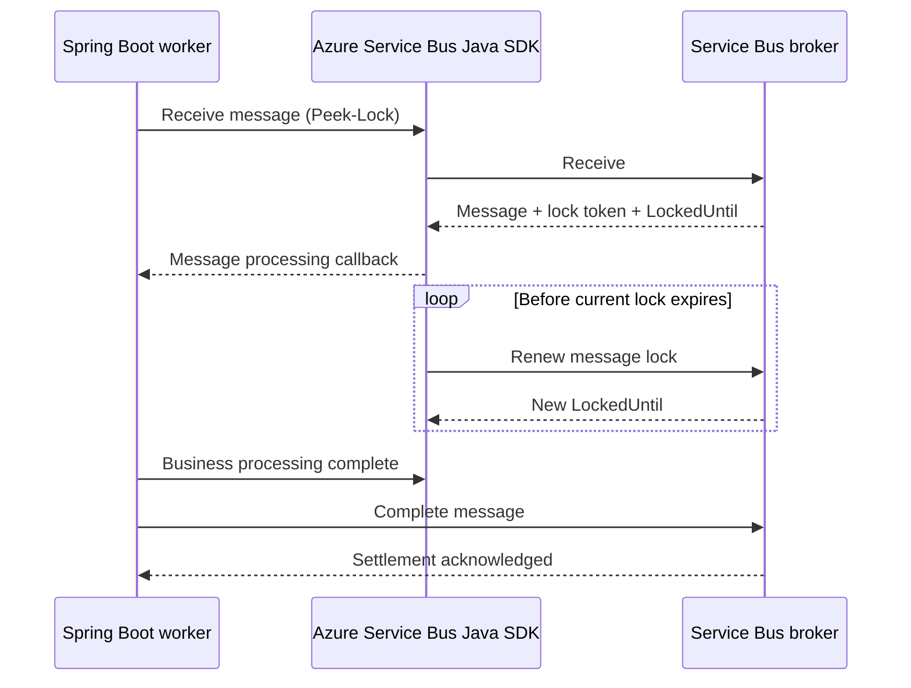
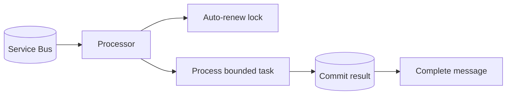
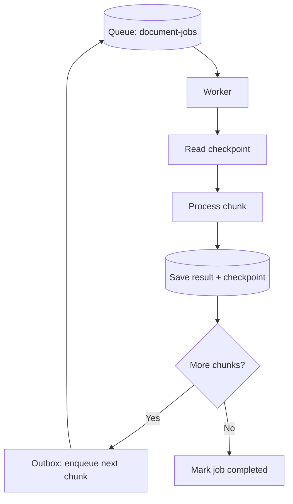
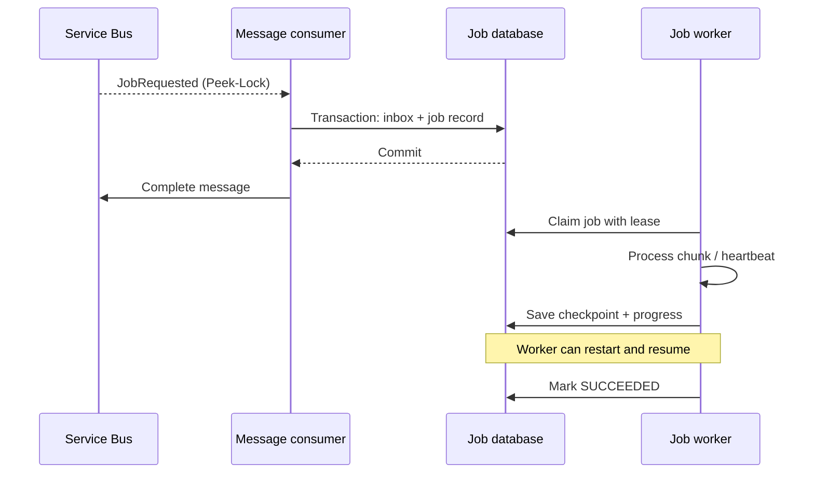
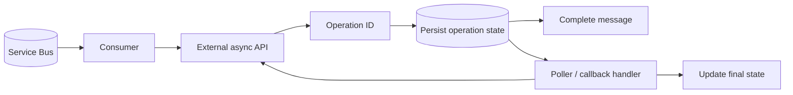

# Lock renewal and handling long-running tasks

> **Chapter:** Azure Service Bus  
> **Module:** `SPRING_CLOUD_PROVIDER_INTEGRATION`  
> **Objective:** Understand message lock duration, distinguish `LockDuration` from the Java SDK's auto-renew window, configure lock renewal with Spring Boot/Azure SDK, handle lock loss, and design long-running work using checkpoints or durable jobs.

## 1. The problem: work taking longer than lock duration

A Spring Boot worker receives a `GeneratePreview` message from Azure Service Bus. The worker must download a PDF from Azure Blob Storage, scan its contents, generate multiple preview images, store the results, and update the database. The work normally takes 20 seconds, but sometimes takes 3 minutes due to large files or slow downstream dependencies.

If the queue only locks the message for 1 minute and the worker does not renew it, the message can return to an active state while the worker is still processing. A second worker receives the same message, and both generate previews or update data concurrently. When the first worker calls `complete`, the broker may reject it because the lock has expired.

Another approach is configuring continuous renewal for many hours. That also carries risks: network connections can drop, the process can starve for CPU, the client can be throttled, or the host can restart. Microsoft advises against designing systems around the assumption that a lock will always be successfully renewed for very long durations. For long-running work, split it into smaller steps or use idempotent checkpoints.

This lesson addresses three questions:

1. **How long does a message stay locked?**
2. **For how long and how does the client renew it?**
3. **If work outlasts renewal capacity or the lock is lost, how does the system still finish accurately?**

## 2. Distinguishing LockDuration and auto-lock-renew duration

These two concepts are frequently confused.

| Property | Where is it configured? | Meaning | Common values |
| --- | --- | --- | --- |
| **LockDuration** | Queue or topic subscription on Azure Service Bus | Duration of each broker-granted lock on a message | Default 1 minute, max 5 minutes |
| **maxAutoLockRenewDuration** | Java SDK client when creating receiver/processor | Maximum duration the client keeps running background renewal | Default 5 minutes |
| **LockedUntil** | Returned by broker on received message | Expected expiration timestamp of the current lock | Updates on each renewal |
| **Processing deadline** | Application-defined | Business time limit allowed for processing a job | Per SLO/use case |

Example:

- The queue has `LockDuration = 1 minute`.
- The processor is configured with `maxAutoLockRenewDuration = 10 minutes`.
- Upon receiving a message, the broker grants an initial 1-minute lock.
- The SDK automatically renews before the lock expires; on each renewal, the broker extends the lock by the entity's LockDuration.
- The SDK keeps performing background renewal up to the configured maximum window.
- Once the auto-renew window ends, the final lock remains valid until its corresponding `LockedUntil` timestamp. If the message is not settled and the lock expires, the message can be redelivered.

**maxAutoLockRenewDuration does not change the queue's LockDuration.** Nor is it a guarantee that the message will definitely remain locked for that entire period. Every renewal is a network operation and can fail.

### 2.1. Why not set LockDuration very long?

The maximum LockDuration is 5 minutes. Even if longer values were possible, excessively long locks have consequences: if a worker crashes, the message must wait for the lock to expire before being redelivered. For tasks that normally take only a few seconds, an unnecessarily long lock slows down recovery when a consumer fails.

Pick a LockDuration slightly above normal processing time, yet short enough that messages are redelivered promptly when a worker becomes unable to process. Use auto-renew for the long tail of variable-duration tasks.

## 3. Lock renewal lifecycle



Locks are renewed for **messages currently owned by the receiver**. Renewal does not turn a message into a durable exclusive lease: a lock can still be lost if the connection drops, the service updates, the receiver closes, the background renewal window ends, or the host lacks resources to send the renewal on time.

If the broker does not receive a renewal before the lock expires, the message can be redelivered. At that point, the previous worker must no longer treat the old lock as valid.

## 4. When is renewal needed?

Measure processing durations before changing configuration. A simple breakdown:

| Actual processing time | Recommended approach |
| --- | --- |
| Shorter than LockDuration in most cases | Pick an appropriate LockDuration and process/complete within the initial lock |
| Occasionally exceeds LockDuration, still bounded | Use processor or receiver auto-lock renewal |
| Need explicit control over per-message renewal timing | Use receiver and call manual renew API |
| Runs for tens of minutes or hours | Consider splitting into steps, checkpoints, or durable jobs |
| Unbounded time, depends on external system | Persist job/operation ID, track status separately; do not hold a message lock waiting indefinitely |

For instance, if p95 processing is 25 seconds and p99 is 50 seconds, a 1-minute LockDuration may suffice for most messages. If some files take 3 minutes, a 5-minute auto-renew window is a reasonable starting point to test. Leave headroom for external service calls and settlement, then verify with metrics.

Do not pick numbers based on a single successful run. Measure p95/p99, dependency latency, renewal counts, lock losses, and message redeliveries under realistic load.

## 5. Auto-lock renewal with ServiceBusProcessorClient

For continuously receiving workers, `ServiceBusProcessorClient` is usually the right fit. The processor manages the receive loop and callbacks; the SDK enables auto-lock renewal by default.

Configure the auto-renew window on the processor builder via `maxAutoLockRenewDuration(Duration)`.

### 5.1. Example processor configuration in Spring Boot

The following example creates a processor as a Spring bean. The application uses Azure Identity for credentials; production workloads must be granted receive permissions on the target queue/subscription.

```java
import java.time.Duration;

import com.azure.identity.DefaultAzureCredentialBuilder;
import com.azure.messaging.servicebus.ServiceBusClientBuilder;
import com.azure.messaging.servicebus.ServiceBusProcessorClient;
import com.azure.messaging.servicebus.models.ServiceBusReceiveMode;

import org.springframework.beans.factory.annotation.Value;
import org.springframework.context.annotation.Bean;
import org.springframework.context.annotation.Configuration;

@Configuration(proxyBeanMethods = false)
public class PreviewProcessorConfiguration {

    @Bean(initMethod = "start", destroyMethod = "close")
    ServiceBusProcessorClient previewProcessor(
            @Value("${app.servicebus.fqdn}") String namespace,
            @Value("${app.servicebus.queue}") String queueName,
            PreviewMessageHandler handler) {

        return new ServiceBusClientBuilder()
                .credential(
                        namespace,
                        new DefaultAzureCredentialBuilder().build())
                .processor()
                .queueName(queueName)
                .receiveMode(ServiceBusReceiveMode.PEEK_LOCK)
                .maxAutoLockRenewDuration(Duration.ofMinutes(10))
                .maxConcurrentCalls(2)
                .prefetchCount(0)
                .disableAutoComplete()
                .drainTimeout(Duration.ofSeconds(45))
                .processMessage(handler::handle)
                .processError(handler::onError)
                .buildProcessorClient();
    }
}
```

Illustrative configuration:

```yaml
app:
  servicebus:
    fqdn: ${AZURE_SERVICEBUS_FQDN}
    queue: ${AZURE_SERVICEBUS_QUEUE}
```

Explanation:

- `maxAutoLockRenewDuration(Duration.ofMinutes(10))` gives the SDK up to a 10-minute background renewal window.
- `maxConcurrentCalls(2)` limits how many handlers run concurrently in this processor.
- `prefetchCount(0)` disables prefetch in this example so messages do not sit locked in a buffer for too long before a handler starts.
- `disableAutoComplete()` turns off auto-complete and auto-abandon so the handler chooses settlement explicitly. This option **does not disable auto-lock renewal**.
- `drainTimeout(Duration.ofSeconds(45))` gives the processor time to wait for running handlers during close; the SDK default is 30 seconds.
- `initMethod` and `destroyMethod` tell Spring to start the processor when the context initializes and close the client when the context stops.

`PreviewMessageHandler` is an application component, not an SDK class. If the project already enables starter auto-configuration creating a processor for the same entity, do not create a second processor accidentally reading from the same queue. Choose one lifecycle management approach and verify Spring Cloud Azure configuration against your BOM.

### 5.2. Handler processing and settlement

```java
import com.azure.messaging.servicebus.ServiceBusReceivedMessageContext;
import org.springframework.stereotype.Component;

@Component
public class PreviewMessageHandler {

    private final PreviewService previewService;

    public PreviewMessageHandler(PreviewService previewService) {
        this.previewService = previewService;
    }

    public void handle(ServiceBusReceivedMessageContext context) {
        var message = context.getMessage();

        try {
            previewService.createPreviewIdempotently(
                    message.getMessageId(),
                    message.getBody());

            // Complete only after business state has been recorded.
            context.complete();

        } catch (TemporaryDependencyException exception) {
            context.abandon();

        } catch (InvalidPreviewRequestException exception) {
            context.deadLetter();
        }
    }

    public void onError(
            com.azure.messaging.servicebus.ServiceBusErrorContext context) {
        // Log receive/transport error with appropriate entity and error code.
    }
}
```

This is an illustrative processing flow. In a real application, deserialize the body per contract, classify transient vs. permanent errors, and avoid logging sensitive data. `createPreviewIdempotently` must tolerate reprocessing the same message ID without creating duplicate side effects.

If the callback runs for several minutes, auto-renew can help keep the lock within the configured window. When the callback finishes, the handler must settle the message per policy. Do not launch a fire-and-forget background thread and let the callback return immediately; with auto-complete enabled, the processor could complete the message when the callback returns even though the background task has not finished.

### 5.3. Choosing an auto-renew window with justification

The `10 minutes` value above is illustrative. Choose the window based on:

1. Expected processing duration at high percentiles.
2. Buffer time for internal retries and settlement.
3. Business deadline limits.
4. Host resource and network capacity to sustain renewals.
5. Number of concurrent messages needing renewal.

If work can exceed this window, consider splitting it or using a durable job. Do not keep extending the window just to mask unbounded work.

## 6. Manual renewal with ServiceBusReceiverClient

`ServiceBusReceiverClient` fits when the application pulls messages on demand and controls receiving directly. The client exposes `renewMessageLock(ServiceBusReceivedMessage)`, returning an `OffsetDateTime` representing the new expiration timestamp.

### 6.1. Creating a receiver and disabling auto-renew

```java
import java.time.Duration;

import com.azure.identity.DefaultAzureCredentialBuilder;
import com.azure.messaging.servicebus.ServiceBusClientBuilder;
import com.azure.messaging.servicebus.ServiceBusReceiverClient;
import com.azure.messaging.servicebus.models.ServiceBusReceiveMode;

ServiceBusReceiverClient receiver =
        new ServiceBusClientBuilder()
                .credential(
                        fullyQualifiedNamespace,
                        new DefaultAzureCredentialBuilder().build())
                .receiver()
                .queueName("preview-jobs")
                .receiveMode(ServiceBusReceiveMode.PEEK_LOCK)
                .maxAutoLockRenewDuration(Duration.ZERO)
                .buildClient();
```

`Duration.ZERO` disables background auto-renew tasks. Choose this only when the application explicitly wants to control renewal itself and has a mechanism to renew before the current lock expires.

### 6.2. Calling renewMessageLock

```java
import java.time.OffsetDateTime;

import com.azure.messaging.servicebus.ServiceBusReceivedMessage;
import com.azure.messaging.servicebus.ServiceBusReceiverClient;

public OffsetDateTime renewIfStillProcessing(
        ServiceBusReceiverClient receiver,
        ServiceBusReceivedMessage message) {

    // Only renew while the message still belongs to this receiver's lock.
    return receiver.renewMessageLock(message);
}
```

On each successful call, the broker renews the lock for the queue/subscription's `LockDuration`. The application can use the returned timestamp to schedule the next check. Do not wait until right before expiration to renew; leave margin for network latency and retries.

If renewal fails because the lock was lost or the connection dropped, stop assuming the receiver still owns the message. Halt work under the stale lock, inspect business state, and let the message be redelivered per broker semantics.

### 6.3. Why avoid building an overly complex custom renewal scheduler?

A custom scheduler managing many messages must track expiration times, monitor receiver lifecycle, handle race conditions between renew and complete, cancel timers on settlement, and classify renewal errors. For typical workers, processor auto-renew is far less complex.

Use manual renewal only when explicit control is required—for example, a pull receiver processing batches or an application with a specialized orchestrator. Never spawn an unbounded scheduled task per message without tracking and cancelling it after settlement.

## 7. Common causes of lock loss

Automatic renewal does not guarantee success. Common causes include:

| Cause | Why can the lock be lost? | Where to check |
| --- | --- | --- |
| Auto-renew window too short | Task keeps running after the SDK stops renewing | Compare handler duration against renew budget |
| Prefetch too high | Messages sit locked in the buffer before handlers start; SDK does not renew locks for messages still in the prefetch buffer | Reduce prefetch or disable it for long-running tasks |
| Insufficient CPU or blocked thread pool | Background renewal tasks fail to run on time | CPU, boundedElastic pool, thread starvation |
| Too many concurrent messages | Many renewal network calls overload client/namespace | maxConcurrentCalls, maxMessages, receiver count |
| Overloaded shared connection | I/O thread processes many operations and delays renewals | I/O thread queue, timeouts, number of clients sharing a builder |
| Network/AMQP interruption | Client fails to deliver renewal to broker on time | Network, DNS, firewall, TLS, reconnects |
| Host clock skew | Renewal schedule may fire late or miscalculate timing | Synchronize host/container clocks |
| Session lock lost | Session expired or lost lock during processing | SessionIdleTimeout, session renewal, receiver lifecycle |

Microsoft notes that the number of background renewal tasks correlates with processor `maxConcurrentCalls` or receiver `maxMessages`. Each renewal is a network call; large volumes can trigger namespace throttling. Thus, raising concurrency to process more messages can actually worsen lock loss if CPU or connections cannot keep up.

### 7.1. Prefetch is an easy detail to overlook

Prefetch lets the client buffer messages locally ahead of time. However, those messages are already locked by the broker while waiting in the buffer; the SDK does not renew locks on messages still sitting in the prefetch buffer. If workers are busy processing earlier messages, later buffered messages can lose their locks before a handler ever receives them.

For long-running tasks, start with `prefetchCount(0)` or a small value, then increase gradually once processing capacity and buffer wait times are measured.

### 7.2. Concurrency and host resources

`ServiceBusProcessorClient` invokes handlers on Reactor's boundedElastic threads. If `maxConcurrentCalls` exceeds thread pool or CPU capacity, handlers slow down and renewal tasks suffer as well.

Monitor simultaneously:

- Container CPU and memory.
- Running handler count and wait time before handler start.
- Database connection pool usage and query times.
- Request latency to Blob Storage or external APIs.
- Renewal success/failure counts and lock-lost exceptions.

There is no single concurrency number right for every application. Benchmark under realistic load and cap concurrency by the tightest bottleneck in the pipeline.

## 8. Handling long-running tasks: three strategies

Lock renewal is a mechanism to protect a single message delivery during processing. It does not replace workflow design.

### Strategy A — Process in a single delivery with bounded auto-renew

Suitable when:

- The task has a fairly clear upper bound on duration.
- Work takes only a few minutes.
- If a lock is lost, re-execution is protected by idempotency.
- The system tolerates occasional redelivery in rare cases.

Flow:



The advantage is simplicity and ease of monitoring. The limitation is that work remains tied to a single delivery, a single lock window, and host health.

### Strategy B — Split work into chunks with checkpoints

Suitable when a task is long but divisible into smaller steps—such as processing a 500-page PDF, converting multiple files, or importing a large dataset.

Each message represents only one bounded step:



Principles:

1. Each chunk has a stable `jobId` and `chunkNumber`.
2. The worker checks the checkpoint before executing.
3. Chunk output and checkpoint are committed atomically in the database when possible.
4. If more chunks remain, enqueue the next message via an outbox so the next step is not lost between DB commit and publish.
5. When the same chunk is redelivered, the worker recognizes it is already done and avoids duplicate side effects.

Each message delivery only needs to hold a lock long enough for one chunk, instead of a multi-hour job.

### Strategy C — Turn the message into a durable job

Suitable when work has an unbounded duration, calls external asynchronous services, or requires progress tracking across multiple worker restarts.

Flow:



The consumer only completes the message after **the job has been durably persisted** to the database. If the worker crashes after commit but before complete, the message can be redelivered; a unique constraint on the message/event ID recognizes the existing job and avoids creating a second one.

A job table might look like:

```sql
CREATE TABLE processing_jobs (
    job_id          VARCHAR(100) PRIMARY KEY,
    message_id      VARCHAR(200) NOT NULL UNIQUE,
    status          VARCHAR(30) NOT NULL,
    checkpoint      VARCHAR(500),
    progress        INTEGER NOT NULL DEFAULT 0,
    attempt         INTEGER NOT NULL DEFAULT 0,
    lease_owner     VARCHAR(100),
    lease_until     TIMESTAMP,
    updated_at      TIMESTAMP NOT NULL
);
```

Meaningful columns:

- `message_id` has a unique constraint so redelivering the same message does not create duplicate jobs.
- `status` represents PENDING, RUNNING, RETRY_WAIT, SUCCEEDED, or FAILED.
- `checkpoint` stores the last completed step.
- `lease_owner` and `lease_until` let a worker claim the job for a bounded duration; an expired lease lets another worker take over.
- `progress` and `updated_at` aid monitoring and detecting stalled jobs.

### 8.1. Consumer creates the job then completes

Service-level pseudo-code:

```java
@Transactional
public ProcessingJob acceptMessage(
        String messageId,
        GeneratePreviewCommand command) {

    return jobRepository.findByMessageId(messageId)
            .orElseGet(() -> jobRepository.save(
                    ProcessingJob.pending(
                            UUID.randomUUID().toString(),
                            messageId,
                            command.documentId())));
}
```

Only after the transaction commits successfully does the handler call `context.complete()`. If the transaction fails, the handler abandons or lets retries happen per policy. If complete fails and the message is redelivered, `findByMessageId` returns the existing job and the consumer can complete without creating a new job.

This pseudo-code illustrates the idea; in real code, the unique constraint is the final safeguard when two consumers concurrently receive/insert due to a race condition. Catch the unique conflict and re-read the existing row inside an appropriate transaction.

### 8.2. Worker claims the job with a lease

A worker starts a job only after acquiring a lease. Conceptual PostgreSQL SQL example:

```sql
UPDATE processing_jobs
SET status = 'RUNNING',
    lease_owner = :worker_id,
    lease_until = NOW() + INTERVAL '2 minutes',
    attempt = attempt + 1,
    updated_at = NOW()
WHERE job_id = :job_id
  AND status IN ('PENDING', 'RETRY_WAIT', 'RUNNING')
  AND (lease_until IS NULL OR lease_until < NOW())
RETURNING *;
```

If no row is returned, the worker does not hold the lease or the job is already handled. The worker must send heartbeats to renew the lease while running, save checkpoints periodically, and update only while `lease_owner` still matches itself.

A database lease is not a Service Bus message lock. The two mechanisms serve different goals:

- **Message lock** protects exclusive processing of one message delivery at the broker.
- **Job lease** coordinates which worker may advance a durable job in the database.

### 8.3. Why is an outbox needed?

If a worker saves a checkpoint to the database and then sends the next message, the two operations can succeed or fail independently. Saving the checkpoint while failing to publish stalls the workflow; publishing successfully while timing out on the response can create duplicate messages.

A transactional outbox stores the checkpoint and next event in the same database transaction. A publisher reads the outbox and sends to Service Bus. Downstream consumers must still be idempotent.

## 9. Comparing the strategies

| Criterion | Single delivery + auto-renew | Chunk + checkpoint | Durable job + lease |
| --- | --- | --- | --- |
| Message lock hold time | Potentially several minutes | Duration of one chunk | Only until the job is durably recorded |
| Recovery after restart | Redelivery and rerun | Resume from checkpoint | Resume from job state/lease |
| Complexity | Low to moderate | Moderate | Higher |
| Best fit | Clearly bounded tasks | Long tasks divisible into steps | Multi-step or unbounded-duration tasks |
| Where progress lives | Usually in business outputs | Per-chunk checkpoint | Job database |
| Primary risk | Lock loss mid-task | Non-idempotent chunks | Flawed lease/job state/outbox design |

Do not build a full job engine for a task that takes only a few seconds. Pick the simplest strategy that still meets duration, recoverability, and business SLO requirements.

## 10. Tasks calling long-running external services

Some services accept a request and process asynchronously—such as generating large reports, transcoding video, or processing documents. Instead of holding a message lock for the entire external execution:

1. Consumer receives the message.
2. Sends the request to the external service.
3. Receives an operation ID or job ID from the service.
4. Stores the operation ID, status, and correlation ID in the database.
5. Completes the message once acceptance has been durably recorded.
6. A worker/poller or callback tracks the operation until completion.
7. Updates business state and emits the next event if needed.

Diagram:



If the external API times out after accepting the request, the consumer must handle uncertainty via an idempotency key or operation lookup per the API contract. Do not blindly submit a brand-new operation request.

## 11. Session locks and long-running tasks

When a queue/topic subscription enables sessions, the broker grants a **session lock** to the receiver. Session locks enable sequential processing of messages sharing a `SessionId`, yet can still be lost due to timeouts, connection drops, or session idleness.

For session-enabled entities:

- Use a session-aware processor/receiver.
- Configure session auto-lock renewal on the corresponding builder.
- Set `SessionIdleTimeout` appropriately for periods of inactivity.
- Monitor `SessionLockLostException` separately from `MessageLockLostException`.
- Do not assume a session lock stays held indefinitely while the worker performs no operations.

If a session includes a long-running step, consider checkpointing in session state or a database. Sessions coordinate ordering; they do not replace durable job state.

## 12. Worker shutdown and redeployment

When containers are redeployed or scaled in, workers must stop gracefully.

A proper sequence:

1. Transition readiness to stop accepting new traffic/work.
2. Stop the processor so it stops receiving new messages.
3. Let running handlers finish within the configured drain timeout.
4. Settle messages while the receiver/connection is still open.
5. Stop and close the processor/client.
6. If a handler cannot finish within the drain window, persist checkpoints and let messages redeliver safely.

`ServiceBusProcessorClientBuilder.drainTimeout(Duration)` sets the maximum wait for running handlers when closing the processor. The current default is 30 seconds. Align this with Kubernetes/container runtime `terminationGracePeriodSeconds` or your deployment platform's shutdown window.

Never close the receiver before settlement. If the receiver/connection closes before `complete`, settlement never reaches the broker, the lock expires, and the message can redeliver.

## 13. Diagnosing MessageLockLostException

When a handler calls complete/abandon after a lock has expired or been lost, the SDK can throw `ServiceBusException` indicating an invalid lock—commonly surfaced as `MessageLockLostException` or the corresponding version-specific reason.

| Symptom | Possible cause | Recommended action |
| --- | --- | --- |
| Error appears after a fixed processing time | Auto-renew budget exhausted or LockDuration too short | Compare handler duration, LockDuration, and maxAutoLockRenewDuration |
| Error hits messages at the end of a batch | Prefetch/buffer held locks before handlers started | Reduce prefetch, lower batch receive count |
| Errors spike under high load | CPU, Reactor thread pool, I/O threads, or namespace overloaded | Lower concurrency, profile CPU/network, inspect I/O thread queues |
| Errors appear during container restarts | Insufficient drain or receiver closed before settlement | Adjust drain timeout, checkpoint before shutdown |
| Random errors correlated with network | AMQP connection drops | Check network/TLS and prepare for idempotent redelivery |
| Occurs only on session entities | Session lock lost or unsuitable SessionIdleTimeout | Check session receiver/processor and session lock renewal |

### 13.1. Handling a lost lock

Once a lock is lost:

- Stop calling `complete` with the stale lock token.
- Do not assume the message was deleted or will definitely redeliver immediately.
- Inspect business state by message ID/job ID.
- If side effects already completed, the redelivery must detect completion and avoid repeating work.
- If incomplete, resume from checkpoint or safely rerun the chunk.
- Log the error code, message ID, correlation ID, and processing duration; do not log sensitive payloads.

**Lock loss does not mean the business operation failed.** The operation may have written data successfully while settlement failed to reach the broker. That is why idempotency matters more than trying to hold a lock at all costs.

## 14. Metrics to monitor for long-running tasks

| Metric | Meaning | Warning sign |
| --- | --- | --- |
| Handler duration p50/p95/p99 | Actual processing duration | p99 approaching auto-renew budget |
| Lock renewal count/failure | Renewal volume and failures | Rising failures or excessive repeated renewals |
| MessageLockLostException count | Frequency of lock losses | Increasing with load or after deployments |
| DeliveryCount distribution | Extent of message redelivery | Many messages reaching high delivery counts |
| Prefetch buffer/active work | Messages received ahead of processing | Messages waiting long in buffer |
| maxConcurrentCalls and CPU | Processing load | High CPU, thread starvation, timeouts |
| Queue active message count/age | Backlog and message age | Backlog rising while workers are active |
| Job lease expired/checkpoint age | Stalled durable jobs | Frequent lease expirations or stale checkpoints |
| Complete/abandon/dead-letter rates | Settlement outcomes | Sudden spike in abandons or DLQ |

The Azure SDK for Java uses Reactor boundedElastic threads to invoke `ServiceBusProcessorClient` handlers. If desired handler count exceeds thread pool capacity, actual concurrency can fall short of configuration. Measure and tune thread pools/CPU under real load; do not increase `maxConcurrentCalls` without checking resources.

## 15. Testing lock renewal and long-running work

Test on a dedicated test namespace using dummy data and a short enough LockDuration to observe behavior within reasonable test times.

| Test | How to execute | Expected outcome |
| --- | --- | --- |
| Short processing | Handler finishes before LockDuration | Completes successfully without needing renewal |
| Auto-renew | Handler runs longer than LockDuration but within renew budget | Lock is renewed and message completes |
| Exceed renew budget | Handler runs past the auto-renew window | Lock loss/redelivery may occur; idempotency protects results |
| Manual renew | Disable auto-renew, call `receiver.renewMessageLock` before expiry | New `LockedUntil` is returned |
| Prefetch | Raise prefetch and intentionally slow down earlier handlers | Observe locks on buffered messages expiring |
| Concurrency | Step up `maxConcurrentCalls` across levels | Measure throughput, CPU, lock losses, and DB pool |
| Network interruption | Drop connection in a controlled test environment | Consumer recovers and handles redelivery safely |
| Shutdown | Stop processor while handler is running | Handler drains within timeout or message redelivers |
| Checkpoint | Stop worker after one chunk | Another worker resumes from checkpoint without repeating side effects |
| Durable handoff | DB job commit succeeds but message complete fails | Redelivery finds existing job and creates no duplicate |

### 15.1. Do not test with fixed sleeps

Do not merely call `Thread.sleep(60000)` and assume the lock renewed. Await explicit conditions with a bounded timeout:

- Handler completes and job status transitions to `SUCCEEDED`.
- `LockedUntil` changes after renewal.
- Message ID is recorded in the processed-message/inbox table.
- DeliveryCount or DLQ count changes as expected.
- Checkpoint updates and a new worker resumes from it.

Tests must fail clearly if the expected state does not appear within the timeout.

### 15.2. Testing auto-renew in a real environment

The emulator may not fully simulate lock renewal, network timing, throttling, and AMQP behavior of a real namespace. Run at least one integration test against an Azure Service Bus test namespace to verify lock configuration, identity, processor, and settlement.

## 16. Hands-on lab: processing PDFs with variable durations

**Scenario:** A worker receives `GeneratePreview`. Small PDFs usually process in 10 seconds, while large ones can require 4 minutes. Some documents must generate hundreds of page images.

### Part A — Measure a baseline

- Send test files of varying sizes.
- Measure p50/p95/p99 processing times.
- Record the queue's LockDuration.
- Determine the percentage of messages exceeding LockDuration.

### Part B — Configure auto-renew

- Create a `ServiceBusProcessorClient`.
- Configure `maxAutoLockRenewDuration` based on baseline measurements.
- Cap `maxConcurrentCalls` and `prefetchCount`.
- Verify messages are completed when handlers finish.

### Part C — Induce controlled lock loss

- Let a handler run past the auto-renew budget in a test namespace.
- Observe lock-lost exceptions and redelivery.
- Verify the same message ID does not produce duplicate previews or notifications.

### Part D — Move to chunks + checkpoints

- Split PDFs into page groups.
- Persist a checkpoint after each group.
- Emit the next event via an outbox.
- Stop the worker mid-way and restart it.
- Verify the worker resumes from the unfinished pages.

### Part E — Durable job

- Create a job table with unique message ID, status, checkpoint, and lease.
- Have the consumer save the job in a transaction, then complete the message.
- Have workers claim jobs by lease, updating heartbeats and checkpoints.
- Kill a worker mid-job; wait for the lease to expire and let another worker resume.

### Part F — Write a runbook

Describe how to investigate rising lock losses, growing queue backlogs, expiring job leases, or a job whose checkpoint has not updated for a long time.

**Completion criteria:** learners distinguish LockDuration from auto-renew duration; configure processors and receivers; explain how prefetch/concurrency affect locks; handle lock loss; and prove long-running work can resume via checkpoints or durable jobs.

---

## 17. Checklist before deploying long-running workers

| Area | Question |
| --- | --- |
| LockDuration | Have processing durations been measured and an appropriate value chosen? |
| Auto-renew | Does the renew window cover normal workloads with an explicit deadline? |
| Manual renewal | If using a pull receiver, does it renew before expiry and handle renewal errors? |
| Prefetch | Are messages buffered longer than the lock duration? |
| Concurrency | Do CPU, thread pools, DB pools, and downstream services support concurrent handlers? |
| Idempotency | If a message redelivers after side effects committed, is it handled safely? |
| Checkpoints | Do long tasks persist progress durably and resume cleanly? |
| Durable jobs | If offloaded to a database, are unique message IDs, leases, and recovery in place? |
| Shutdown | Does the processor drain before closing receivers/clients? |
| Observability | Are lock renewals, lock losses, handler duration, backlog, and checkpoint age tracked? |
| Testing | Are LockDuration exceedance, renew budget exhaustion, prefetch, crashes, and redelivery tested? |

## Takeaways

- **LockDuration** belongs to the queue/subscription: default 1 minute, max 5 minutes.
- **maxAutoLockRenewDuration** belongs to the Java SDK client: default 5 minutes, governing how long background renewal continues.
- Each successful renewal extends the lock by the entity's LockDuration; auto-renew can still fail due to networking, CPU, I/O threads, throttling, or host shutdowns.
- **ServiceBusProcessorClient** is usually best for continuously receiving workers; auto-renew, concurrency, prefetch, and drain timeout can all be configured.
- **ServiceBusReceiverClient** supports auto-renew or manual `renewMessageLock(message)` calls when pull semantics are needed.
- Do not hold locks for hours as a workflow engine. Split into chunks, save checkpoints, or turn messages into durable jobs with leases.
- **Idempotency** is mandatory because a lock can be lost after side effects succeed yet before the broker confirms `complete`.

When integrating Spring Boot with Azure Service Bus, treat lock renewal as a **bounded safeguard**. Design processing time, host resources, settlement, and job state together. For long or unbounded tasks, checkpoints and durable jobs recover far more reliably than trying to hold a single message lock indefinitely.

### Official documentation

- [Message transfers, locks, and settlement — Renew locks](https://learn.microsoft.com/en-us/azure/service-bus-messaging/message-transfers-locks-settlement)
- [Troubleshoot Azure Service Bus issues — Java SDK lock loss and concurrency](https://learn.microsoft.com/en-us/azure/developer/java/sdk/troubleshooting-messaging-service-bus-overview)
- [ServiceBusProcessorClientBuilder Java API](https://learn.microsoft.com/en-us/java/api/com.azure.messaging.servicebus.servicebusclientbuilder.servicebusprocessorclientbuilder?view=azure-java-stable)
- [ServiceBusReceiverClientBuilder Java API](https://learn.microsoft.com/en-us/java/api/com.azure.messaging.servicebus.servicebusclientbuilder.servicebusreceiverclientbuilder?view=azure-java-stable)
- [ServiceBusReceiverClient Java API](https://learn.microsoft.com/en-us/java/api/com.azure.messaging.servicebus.servicebusreceiverclient?view=azure-java-stable)
- [Azure Service Bus Java client library](https://learn.microsoft.com/en-us/java/api/overview/azure/messaging-servicebus-readme)

Before applying, verify the Azure SDK version, Spring Cloud Azure BOM, Spring Boot/JDK versions, and actual queue/subscription configuration. LockDuration, auto-renew budget, concurrency, and timeout values should be measured in your project's deployment environment.
