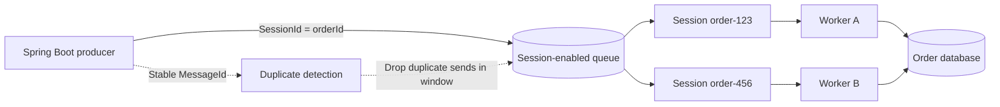
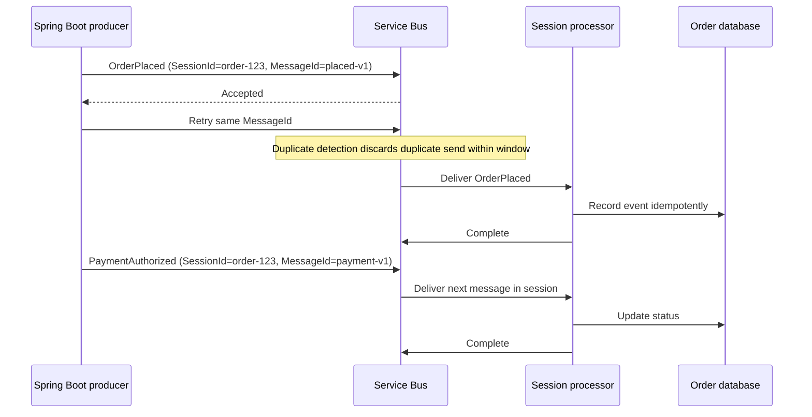

# Sessions, message ordering, and duplicate detection

> **Chapter:** Azure Service Bus  
> **Module:** `SPRING_CLOUD_PROVIDER_INTEGRATION`  
> **Objective:** Design ordered message flows per business group using Azure Service Bus sessions; distinguish enqueue, receive, and processing order; configure session-aware senders/processors in Spring Boot; enable duplicate detection and build idempotent consumers.

## 1. The problem: events for the same order must arrive in order

An e-commerce system uses Spring Boot to emit events:

```text
OrderPlaced(order-123)
PaymentAuthorized(order-123)
OrderPacked(order-123)
OrderShipped(order-123)
```

If these messages are put into a regular queue with multiple competing workers, worker A might receive `OrderPlaced` and take a long time. Worker B receives `PaymentAuthorized` and finishes first. Worker C continues processing `OrderPacked`. As a result, the system updates order state out of the intended order.

Another issue arises on the producer side: the API sends `PaymentAuthorized` successfully to the broker, then loses connection before receiving the acknowledgement. The API retries and sends the same event again. Without a way to recognize duplicate sends, the consumer can execute side effects twice.

Azure Service Bus provides two related capabilities that solve two distinct problems:

- **Message sessions:** group related messages by `SessionId`, exclusively lock a session, and support ordered processing within that group.
- **Duplicate detection:** recognize producer-re-sent messages based on `MessageId` within a configurable time window.

These two features complement each other. Sessions preserve per-group ordering; duplicate detection reduces duplicate messages on the send side. **The consumer must still be idempotent** because the broker can redeliver messages on lock loss or worker restart.



## 2. What is a session?

A **session** is an application-defined group of related messages. The producer assigns the same `SessionId` to messages belonging to the same group. For example:

| Business group | Suggested SessionId | Messages that can share a session |
| --- | --- | --- |
| Order | `order-123` | OrderPlaced, PaymentAuthorized, OrderShipped |
| Bank account | `account-789` | MoneyDeposited, MoneyWithdrawn, BalanceRecalculated |
| Customer profile | `customer-456` | CustomerCreated, AddressChanged, CustomerDeactivated |
| A workflow | `workflow-9f31` | StepStarted, StepCompleted, WorkflowFinished |

Service Bus does not infer which business relationships should be grouped. **The application chooses `SessionId`** and decides which messages share a session and when a sequence starts/ends.

When a receiver accepts a session, the broker grants an **exclusive session lock** to that receiver. Messages with that `SessionId` are delivered to the receiver holding the lock. Other receivers can process different sessions concurrently, but cannot simultaneously own the same session.

### 2.1. What do sessions guarantee?

- Messages with the same `SessionId` are delivered in order within the session.
- One receiver owns the session lock at a time.
- Messages in the same session stay within the same logical processing stream.
- Different sessions can be processed in parallel across multiple workers.
- If a message is not completed and is abandoned, that same message can be redelivered before subsequent messages in the session.
- Session locks can be renewed; if a lock is lost, another receiver can take over the session.

Sessions fit **per-group FIFO**, such as event order for one order or one account. They do not impose a global order across every message in the entire system.

### 2.2. Sessions do not define business sequence by themselves

If the producer emits events in the wrong order:

```text
OrderShipped(order-123)
OrderPlaced(order-123)
```

Service Bus still preserves the enqueue order of those two messages in the session. The broker does not inherently know `OrderPlaced` must precede `OrderShipped`.

If upstream sources can arrive out of order, events should carry metadata like `aggregateVersion` or `eventSequence`. The consumer checks the business sequence number and decides whether to wait, reject, defer, or compensate per contract.

## 3. Prerequisite: enable sessions on the queue or subscription

Sessions must be enabled on the **queue or topic subscription when creating the entity**.

Key facts:

- **Basic tier does not support sessions.**
- **Standard and Premium support sessions.**
- You cannot toggle sessions on or off after a queue/subscription is created.
- When an entity requires sessions, producers must send messages with a `SessionId`.
- Consumers must use a session-aware receiver/processor to accept sessions.
- Non-session-aware regular clients cannot send/receive like a regular entity; peek operations may still work.

Therefore, decide ordering requirements before provisioning resources. If an existing queue lacks sessions and the business starts requiring per-order ordering, you usually must create a new session-enabled entity, migrate producers/consumers, and drain the backlog under a migration plan.

### 3.1. Both queues and topic subscriptions can use sessions

| Entity | Can enable sessions? | How consumers use it |
| --- | --- | --- |
| Queue | Yes | Session processor or session receiver on the queue |
| Topic subscription | Yes | Session processor or session receiver on topic + subscription |
| Topic | Producer publishes to topic; session applies on receiving subscription | Subscription must have sessions configured |
| Basic namespace | Not supported | Choose Standard/Premium if needed |

With topics, each subscription is its own receive stream. If a consumer needs ordered processing on the `order-projection` subscription, enable sessions on that subscription itself.

## 4. Choosing SessionId: grouping properly for order and scale

`SessionId` is an architectural decision. Too coarse a key reduces parallelism; too fine a key fails to preserve needed order.

### 4.1. Use a business aggregate key

Order example:

```java
String sessionId = orderId;

ServiceBusMessage message = new ServiceBusMessage(payload)
        .setSessionId(sessionId)
        .setMessageId(messageId);

sender.sendMessage(message);
```

All events for `order-123` use the same `SessionId`. Order `order-456` uses a different session and can be processed concurrently by another worker.

### 4.2. Avoid a single global session

If every message uses `SessionId = "global"`, the entire system collapses into one session. A single receiver holds the session lock and processes everything sequentially, losing horizontal scalability.

Conversely, if you generate a random `SessionId` per message, nearly every message becomes its own session; the system cannot preserve order across events for the same order.

| Choice | Consequence |
| --- | --- |
| One session for the entire system | Global sequential bottleneck |
| Random session per message | Fails to group related messages |
| One session per aggregate ID | Preserves order per order/account while enabling cross-aggregate parallelism |
| One session per tenant | All work within a tenant serializes; easy to create a hot session for large tenants |

**Practical rule:** choose the smallest key covering the exact scope that must be serialized, such as `orderId` or `accountId`. Evaluate load distribution to avoid a single session with excessive traffic.

### 4.3. SessionId must be stable

Do not generate a new UUID on each retry of the same message. `SessionId` must be deterministically derived from the same business key so retries land in the same session. Changing how `SessionId` is computed while older messages are in flight can split an aggregate's messages across two sessions and break ordering.

## 5. Enqueue order, sequence number, and processing order

Distinguish three concepts:

| Concept | Meaning | Are sessions required? |
| --- | --- | --- |
| **Enqueue order** | Order in which the broker accepted messages | No; broker assigns sequence numbers |
| **Receive/extraction order** | Order in which messages are pulled | Sequence number helps observe order |
| **Processing/completion order** | Order in which business tasks finish | Sessions are required to preserve per-group FIFO |

Example of a queue with three messages and two consumers:

1. Consumer A receives message 1 and processes slowly.
2. Consumer B receives message 2 and finishes.
3. Consumer B receives message 3 and finishes.
4. Consumer A finally finishes message 1.

Completion order is 2, 3, 1 even though messages were enqueued in order 1, 2, 3.

**SequenceNumber does not guarantee processing completion order.** If the business requires messages 1, 2, 3 to finish in order, assign the same `SessionId` and use a session-aware consumer.

### 5.1. Sessions guarantee order only within the same group

Suppose:

```text
Session order-123:
  1. OrderPlaced
  2. PaymentAuthorized
  3. OrderShipped

Session order-456:
  1. OrderPlaced
  2. PaymentAuthorized
  3. OrderShipped
```

Service Bus can process `order-123` and `order-456` concurrently while preserving message order within each session. There is no guarantee that `OrderPlaced(order-123)` completes before `OrderPlaced(order-456)`.

If global ordering across all orders is requested, challenge that requirement because it forces broad serialization and severely limits throughput. Most business cases only need per-aggregate ordering.

### 5.2. How is order determined when producers send concurrently?

Service Bus orders messages according to when the broker enqueues them—it does not sort by a business timestamp inside the body. If multiple producers send to the same session concurrently, the broker's acceptance order is used.

If the business requires monotonically increasing `eventSequence`, producers should ensure ordered emission or consumers should validate version/sequence to detect gaps. Sessions cannot fix source data emitted out of order.

## 6. Sending messages to a session with the Azure SDK for Java

The sender still uses `ServiceBusSenderClient`. The difference is that messages must set `SessionId`.

```java
import com.azure.messaging.servicebus.ServiceBusMessage;
import com.azure.messaging.servicebus.ServiceBusSenderClient;

public class OrderEventPublisher {

    private final ServiceBusSenderClient sender;

    public OrderEventPublisher(ServiceBusSenderClient sender) {
        this.sender = sender;
    }

    public void publish(
            String orderId,
            String eventId,
            String payload) {

        ServiceBusMessage message = new ServiceBusMessage(payload)
                .setSessionId(orderId)
                .setMessageId(eventId)
                .setSubject("OrderEvent")
                .setContentType("application/json; charset=utf-8");

        sender.sendMessage(message);
    }
}
```

In the example:

- `orderId` is used as `SessionId`.
- `eventId` is the stable `MessageId` of one logical event.
- `Subject` describes the message category.
- The body is the payload following the agreed JSON contract.

If re-sending the same event after a timeout, re-send with the same `eventId` and the same `SessionId`. Do not mint a new `MessageId` for the same logical event just because the producer missed the acknowledgement.

### 6.1. If the entity enables partitioning

On partitioned entities, duplicate detection uses `MessageId + PartitionKey` to identify duplicates. When sessions are enabled alongside partitioning, `PartitionKey` and `SessionId` must match.

For example, when `orderId` serves as both:

```java
ServiceBusMessage message = new ServiceBusMessage(payload)
        .setSessionId(orderId)
        .setPartitionKey(orderId)
        .setMessageId(eventId);
```

Only set `PartitionKey` when the entity and partition design require it. Never set a different value from `SessionId` on a session-enabled partitioned entity; the broker may reject the message or dedup/partitioning may behave unexpectedly.

## 7. Receiving session messages with ServiceBusProcessorClient

For continuously receiving workers, `ServiceBusProcessorClient` is usually the right fit. To receive from a session-enabled entity, create the builder with `sessionProcessor()` instead of `processor()`.

### 7.1. Configuring the processor for a queue

```java
import java.time.Duration;

import com.azure.identity.DefaultAzureCredentialBuilder;
import com.azure.messaging.servicebus.ServiceBusClientBuilder;
import com.azure.messaging.servicebus.ServiceBusProcessorClient;
import com.azure.messaging.servicebus.models.ServiceBusReceiveMode;

ServiceBusProcessorClient processor =
        new ServiceBusClientBuilder()
                .credential(
                        fullyQualifiedNamespace,
                        new DefaultAzureCredentialBuilder().build())
                .sessionProcessor()
                .queueName("order-events")
                .receiveMode(ServiceBusReceiveMode.PEEK_LOCK)
                .disableAutoComplete()
                .maxConcurrentSessions(8)
                .maxConcurrentCalls(1)
                .maxAutoLockRenewDuration(Duration.ofMinutes(5))
                .processMessage(context -> {
                    var message = context.getMessage();

                    try {
                        orderHandler.processIdempotently(
                                message.getSessionId(),
                                message.getMessageId(),
                                message.getBody());

                        context.complete();
                    } catch (TemporaryDependencyException exception) {
                        context.abandon();
                    } catch (InvalidOrderEventException exception) {
                        context.deadLetter();
                    }
                })
                .processError(errorContext -> {
                    // Record namespace/entity/reason; do not log sensitive payloads.
                })
                .buildProcessorClient();

processor.start();
```

Configuration breakdown:

- `sessionProcessor()` builds a processor for session-enabled entities.
- `maxConcurrentSessions(8)` allows up to eight sessions to be processed concurrently.
- `maxConcurrentCalls(1)` limits processing to one message callback at a time per session in the session processor, suitable when sequential business processing is required.
- `disableAutoComplete()` lets the handler decide complete/abandon/dead-letter.
- `maxAutoLockRenewDuration` sets the client-side session lock renewal window.
- `processMessage` receives the message and delegates to the business handler.
- `processError` handles receive/transport errors; it does not replace business exception handling.

Values like 8 sessions and 5 minutes are examples only. Size concurrency to your database pool, CPU, downstream dependencies, and per-aggregate load. If you increase `maxConcurrentCalls`, verify that concurrent callbacks within the same session do not break business side-effect ordering.

### 7.2. With a topic subscription

Replace the queue settings with:

```java
.sessionProcessor()
.topicName("order-events")
.subscriptionName("order-projection")
.maxConcurrentSessions(8)
.maxConcurrentCalls(1)
```

The subscription must have sessions enabled at creation time. The producer sends to the topic and sets `SessionId`; the subscription receives messages routed/filtered to it by session.

### 7.3. Managing processor lifecycle in Spring Boot

Register the processor as a bean so Spring starts and closes it alongside the Application Context:

```java
@Configuration(proxyBeanMethods = false)
public class OrderSessionProcessorConfiguration {

    @Bean(initMethod = "start", destroyMethod = "close")
    ServiceBusProcessorClient orderSessionProcessor(
            ServiceBusSessionProcessorFactory factory) {
        return factory.createOrderProcessor();
    }
}
```

`ServiceBusSessionProcessorFactory` is an application-defined factory holding the builder/callbacks from the previous example. If using Spring Cloud Azure auto-configuration or builder customizers, configure only one processor for that entity/consumer; avoid accidentally running two processors competing for sessions unless intentional.

During shutdown, the processor needs time to drain running handlers and settle before connections close. If a message remains unsettled, the session lock can expire and another receiver can take over the session; handlers must be idempotent.

## 8. Receiving a specific session with ServiceBusSessionReceiverClient

When you need pull semantics, use `ServiceBusSessionReceiverClient`. The application accepts a specific session or the next available session.

```java
import com.azure.identity.DefaultAzureCredentialBuilder;
import com.azure.messaging.servicebus.ServiceBusClientBuilder;
import com.azure.messaging.servicebus.ServiceBusReceiverClient;
import com.azure.messaging.servicebus.ServiceBusSessionReceiverClient;

ServiceBusSessionReceiverClient sessionClient =
        new ServiceBusClientBuilder()
                .credential(
                        fullyQualifiedNamespace,
                        new DefaultAzureCredentialBuilder().build())
                .sessionReceiver()
                .queueName("order-events")
                .buildClient();

try (ServiceBusReceiverClient receiver =
             sessionClient.acceptSession("order-123")) {

    for (var message : receiver.receiveMessages(10)) {
        try {
            orderHandler.processIdempotently(
                    message.getSessionId(),
                    message.getMessageId(),
                    message.getBody());

            receiver.complete(message);
        } catch (TemporaryDependencyException exception) {
            receiver.abandon(message);
        }
    }
} finally {
    sessionClient.close();
}
```

`acceptSession("order-123")` requests the lock for a specific session ID. If another receiver holds that session, the call can fail. `acceptNextSession()` lets the broker select the next available session.

The returned receiver is bound to the accepted session. Closing that receiver releases the session lock. Keep the receiver open throughout processing and settlement.

### 8.1. When to use acceptNextSession?

Use `acceptNextSession()` when a worker wants to pull whichever session currently has messages and orchestrate the receiver lifecycle manually. If no session is available, the call may wait up to the client timeout and throw a timeout error; treat that as an idle condition rather than a business error.

For continuously running workers that need automatic recovery from transient errors, a session processor usually requires less orchestration code.

## 9. Session locks and session state

A session lock is an exclusive session-level lock covering message reception for that session. It differs from a regular message lock: a receiver holding a session lock has rights to receive current and newly arriving messages with the same `SessionId`.

### 9.1. Session locks

- Only one receiver holds the lock for a session at a time.
- Session locks can be renewed.
- When the receiver closes or the lock expires, another receiver can accept the session.
- If a session lock is lost, uncompleted messages can be redelivered.
- Session locks do not replace idempotency or checkpoints.

A session processor includes auto-lock renewal; a session receiver can renew locks manually or use appropriate auto-renew configuration. Initial lock duration comes from entity configuration; the auto-renew window is client-configured.

### 9.2. Session state for storing progress

Service Bus allows storing a custom state blob attached to a session. State is opaque binary data to the broker. When another worker accepts the same session after a failure, it can read the state to resume the workflow.

Example session state payload:

```json
{
  "workflowVersion": 2,
  "lastCompletedEventSequence": 17,
  "status": "PROCESSING",
  "checkpoint": "payment-authorized"
}
```

The Java session receiver provides `getSessionState()` and `setSessionState(byte[])`. Conceptual example:

```java
byte[] currentState = receiver.getSessionState();

if (currentState == null) {
    // No checkpoint yet for this session.
}

byte[] nextState = objectMapper.writeValueAsBytes(
        new OrderWorkflowState(2, 17, "PROCESSING"));

receiver.setSessionState(nextState);
```

This assumes `receiver` is a `ServiceBusReceiverClient` that has accepted a session and `OrderWorkflowState` is an application DTO. In real code, serialize/deserialize state with a versioned schema and handle state write errors.

### 9.3. Session state does not vanish when a session runs out of messages

Session state persists even after all messages in the session are completed, until the application clears it by setting `null`. State counts toward the queue/subscription storage quota.

State size limits by tier:

| Tier | Max session state size |
| --- | --- |
| Standard | 256 KB |
| Premium | 100 MB |

Do not use session state as a business database or to store large files. Store a small checkpoint or a pointer to a database/blob store. Once a workflow finishes, clear obsolete state to avoid consuming quota and incurring cost.

## 10. Sessions and retry, abandon, dead-letter

Sessions preserve order in the receive stream, which does not mean a failing message is automatically skipped.

Suppose session `order-123` has three messages:

```text
1. OrderPlaced
2. PaymentAuthorized
3. OrderShipped
```

If `PaymentAuthorized` is abandoned, it can be redelivered on the next receive in the session. The consumer must reprocess it before advancing to subsequent messages in order. This is the desired behavior when steps depend on one another.

If a message exceeds `MaxDeliveryCount`, the broker moves it to the DLQ and the receiver can proceed to later messages in the session. However, if operations puts that DLQ message back into the queue for replay, it gets a new sequence number and enqueue time; **its original relative order among other messages in the session is lost**.

Therefore, DLQ replay for sessions requires a dedicated procedure:

1. Record `SessionId`, `MessageId`, `SequenceNumber`, business sequence, and reason.
2. Fix the root cause of the failure.
3. Decide which events it should be replayed before or after.
4. Check aggregate state and event sequence before reapplying.
5. Use idempotency to prevent duplicate side effects.
6. Audit the replay and its outcome.

Do not dump failed messages back into the queue and assume original ordering is restored.

## 11. What does duplicate detection solve?

Duplicate detection is a broker-side feature that catches a producer re-sending a message with the same identifier within a time window.

A scenario:

1. Producer sends `PaymentAuthorized(order-123)` with a stable `MessageId`.
2. Service Bus accepts the message.
3. The connection drops before the producer receives acknowledgement.
4. Unsure whether the first send succeeded, the producer retries.
5. With duplicate detection enabled, the broker sees the `MessageId` is already in the window and drops the duplicate send.

Service Bus can report the send operation as succeeded/accepted while discarding the duplicate message. The broker only inspects IDs per dedup rules; it does not compare bodies, event types, or application properties to decide whether messages are duplicates.

### 11.1. Duplicate detection is not exactly-once processing

Distinguish clearly:

| Mechanism | What it protects against | What it does NOT protect against |
| --- | --- | --- |
| Duplicate detection | Producer re-sending the same `MessageId` within the configured window | Consumer receiving a message again after lock loss/redelivery |
| Peek-Lock | Uncompleted messages can be redelivered after failure | Duplicate business side effects |
| Consumer idempotency | Processing the same event multiple times causes no extra side effects | Producer sending events with different IDs but the same business intent |
| Transactional outbox | Prevents losing events between DB commit and publish | Automatically eliminating all redeliveries at the consumer |

Thus, duplicate detection **does not deliver end-to-end exactly-once semantics**. Combine a stable `MessageId`, duplicate detection, and consumer-side idempotency.

## 12. Choosing MessageId for effective duplicate detection

`MessageId` is controlled by the producer. When retrying the same logical event, the producer must reproduce the exact same `MessageId`.

A reproducible ID pattern:

```text
order-123.payment-authorized.v1
order-123.order-shipped.v1
account-789.balance-recalculated.v3
```

Or use an event UUID persisted durably alongside an outbox row. The key is that the ID never changes when the producer retries the same event.

### 12.1. Do not reuse one MessageId for different events

Duplicate detection only checks `MessageId` within the window, not the body. If two distinct valid messages share the same `MessageId`, the second message can be dropped despite having a different payload.

Incorrect example:

```text
MessageId = order-123
Body = PaymentAuthorized

MessageId = order-123
Body = OrderShipped
```

Better example:

```text
MessageId = order-123.payment-authorized.v1
MessageId = order-123.order-shipped.v1
```

`SessionId` can be identical for both messages because they belong to the same order; `MessageId` must differ because they are two distinct events.

### 12.2. EventId and MessageId can share the same value

If one event maps to one message, setting `MessageId = eventId` is straightforward. If one event produces multiple independent messages, assign a distinct `MessageId` per logical message while keeping the original `eventId` in the payload/properties for tracing.

## 13. Duplicate detection window and limits

| Property | Rule |
| --- | --- |
| Supported tiers | Standard and Premium; Basic does not support it |
| Default window | 10 minutes |
| Minimum window | 20 seconds |
| Maximum window | 7 days |
| Match key | `MessageId`; if partitioning is enabled, `MessageId + PartitionKey` |
| Performance impact | Longer windows force the broker to store and compare more IDs; throughput can drop |

The window should be long enough to cover how long a producer might retry an uncertain send, without being needlessly long. On high-throughput entities, a shorter window reduces lookup overhead.

### 13.1. Enable the feature when creating the entity

Duplicate detection must be enabled when creating the queue/topic. You cannot freely toggle it on or off after creation. Once enabled, the history window can be adjusted within supported limits.

If a lab requires duplicate detection, verify entity configuration before writing producer code. Setting `MessageId` in Java alone does not enable the feature on the broker.

### 13.2. Partitioning and duplicate detection

Duplicate key rules:

- If partitioning is **disabled**, the broker checks `MessageId`.
- If partitioning is **enabled**, the broker checks `MessageId + PartitionKey`.
- If sessions are enabled on a partitioned entity, `PartitionKey` and `SessionId` must match.

On non-partitioned entities, you do not need to add `PartitionKey` solely for duplicate detection. On partitioned, session-enabled entities, use the same business key for both `SessionId` and `PartitionKey` as required by the broker.

### 13.3. Scheduled messages also participate in duplicate detection

Scheduled messages count toward duplicate history. Consequently, a scheduled message with `MessageId` X can cause a subsequent unscheduled message with the same ID to be dropped, and vice versa. Account for this when combining scheduled delivery and retries.

## 14. Combining Sessions and Duplicate Detection

Both features can be used together:

- `SessionId` groups events by aggregate and preserves ordering.
- `MessageId` identifies each event to catch producer retries.
- `PartitionKey` is set equal to `SessionId` if the entity is partitioned.
- Consumers store processed event/message IDs to guard against redelivery.

Example:

| Event | SessionId | MessageId |
| --- | --- | --- |
| OrderPlaced | `order-123` | `order-123.placed.v1` |
| PaymentAuthorized | `order-123` | `order-123.payment.v1` |
| OrderShipped | `order-123` | `order-123.shipped.v1` |
| OrderPlaced for another order | `order-456` | `order-456.placed.v1` |

Events for the same order share a session while having distinct `MessageId`s. Retrying an event keeps the same `MessageId`; the next event uses a new ID.



Duplicate detection filters duplicate sends before another message is stored; sessions handle receive-time ordering at the consumer; database idempotency protects side effects when a message is redelivered.

## 15. Consumer idempotency remains mandatory

A message can still be redelivered even when duplicate detection is enabled. For instance, a worker commits to the database and then loses its session/message lock before calling `complete`. The broker can redeliver the message to another worker.

An inbox/processed event table:

```sql
CREATE TABLE processed_servicebus_messages (
    message_id VARCHAR(200) PRIMARY KEY,
    session_id VARCHAR(200) NOT NULL,
    processed_at TIMESTAMP NOT NULL
);
```

Pseudo-flow inside one transaction:

```text
BEGIN
  INSERT messageId into processed_servicebus_messages

  If unique conflict:
      Event already processed; do not repeat side effect
  If new insert:
      Check aggregate version/sequence
      Update order status
      Write business result
COMMIT

After commit:
  Complete message
```

If `complete` fails and the message is redelivered, the consumer sees `MessageId` already exists, skips side effects, and completes the redelivery. Inserting the inbox record and updating aggregate state must share the same database transaction if they must be atomic.

### 15.1. Deduplication does not replace business order validation

Idempotency answers: "Has this event already been applied?" It does not answer: "Is this event truly the next step?"

If payloads carry `aggregateVersion`, the consumer can check:

- Version equals current version + 1: safe to apply.
- Version less than or equal to current version: likely a duplicate/already processed event.
- Version greater than current version + 1: gap detected; wait, defer, or reconcile per workflow.

Sessions preserve broker order within a group; aggregate versions verify domain state correctness.

## 16. Session state and long workflows

Session state can hold a workflow checkpoint. For example, session `order-123` has processed up to event sequence 17. A new worker accepting the session can read the state and continue from the next step.

However, broker session state does not replace a transactional database:

- It is opaque binary with no automatic business schema.
- It is subject to per-entity quotas.
- It persists after the final message completes unless explicitly cleared.
- Writing session state and updating a database do not form an automatic ACID transaction across both systems.
- If storing critical state, implement versioning and reconciliation strategies.

For large workflows, keep primary state in the database and use session state as a small checkpoint or pointer. When the workflow finishes, clear obsolete state.

## 17. Edge cases to watch out for

### 17.1. An abandoned message

When a message in a session is abandoned, it can be redelivered on the next receive in that session. This preserves order, but can block later messages if the error keeps repeating. Cap retries and dead-letter unrecoverable messages.

### 17.2. Dead-lettered then replayed messages

The receiver can continue processing subsequent messages once a failing message is moved to the DLQ. If that message is later put back into the queue/subscription, it receives a new sequence number and its original position in the session is gone. Check domain sequence and replay under strict controls.

### 17.3. TTL on session-enabled entities

On session-enabled queues/subscriptions, messages are locked at the session level. If one message's TTL expires in a session, Service Bus can drop or dead-letter **related messages in the session** depending on dead-letter-on-expiration settings. Keep this behavior in mind when assigning differing TTLs to messages in the same workflow.

Do not set a short TTL on one step without evaluating its impact on other messages in the same session.

### 17.4. Session lock expiration

Session locks can expire or drop due to connections/networking. When a session lock expires, the DeliveryCount of messages in the session can increment per session rules. A new consumer can take over the session; therefore handlers must persist checkpoints durably and be idempotent.

### 17.5. Hot sessions

If a single `SessionId` receives more traffic than one receiver can handle, that session's backlog grows even while other sessions sit idle. You cannot let multiple receivers simultaneously process the same session while keeping an exclusive session lock.

Solutions include splitting the aggregate if the business allows, shortening handler execution time, scaling processing within sequential bounds, or offloading independent work to another queue.

## 18. Testing Sessions and Duplicate Detection

Do not just test that messages reach the queue. Prove that ordering, parallelism, redelivery, and deduplication work per contract.

| Test | How to execute | Expected outcome |
| --- | --- | --- |
| Same SessionId | Send 3 messages with the same SessionId and sequence 1, 2, 3 | Same session receives them in order |
| Different SessionIds | Send two groups `order-123` and `order-456` | Both sessions can process in parallel |
| Exclusive session lock | Two workers try accepting the same SessionId | Only one worker holds the lock at a time |
| Entity without sessions | Send/receive with session semantics on a regular entity | Resource rejects session requirement; test catches misconfiguration |
| Repeated MessageId in window | Send the same MessageId twice | Duplicate send is dropped within window |
| Distinct MessageIds | Send two valid events with the same SessionId but different MessageIds | Both are retained |
| Past duplicate window | Re-send ID after the window expires | Do not rely on dedup to block sends past the window |
| Consumer redelivery | Commit DB then lose lock before complete | Message may redeliver, but side effects do not repeat |
| Session state | Write state, close receiver, accept session on another worker | New worker reads the state |
| Abandon | Abandon first message in a session | That message can be redelivered ahead of later messages |
| DLQ replay | Dead-letter then return message to main stream | Verify old order changed and domain sequence is handled |
| Partitioned + sessions | Set differing SessionId and PartitionKey | Producer/broker rejects or config invalid; test enforces rule |

### 18.1. Testing ordering through business state

In tests, record the order of applied events in an audit table or aggregate version. Do not rely solely on log line order because threads can flush logs out of sequence.

Expected outcome example:

```text
order-123: placed -> payment-authorized -> shipped
order-456: placed -> payment-authorized -> shipped
```

Do not assert global ordering across two orders; only assert ordering within each session.

### 18.2. Testing duplicate detection

Send the same `MessageId` twice within the duplicate window and verify only one message is enqueued. Then send another event with the same `SessionId` and a new `MessageId`; that event must be received.

Also test producer timeout after a successful send followed by retry with the same ID. The retry send call may report success while the broker drops the duplicate.

### 18.3. Testing consumer idempotency separately

Disable or do not rely on duplicate detection, then crash a worker after database commit yet before `complete`. Verify message redelivery produces no second side effect. This test is mandatory because duplicate detection does not protect receive-side processing.

## 19. Observability and operations

| Signal | Question to answer |
| --- | --- |
| Active messages per queue/subscription | Is the overall backlog growing? |
| Active messages per session (when tooling supports) | Which session is becoming a hot session? |
| Session lock lost | Are workers/networking/concurrency causing lock losses? |
| Session acquisition latency | Are workers waiting on sessions held by other receivers? |
| Processing duration by SessionId | Is a step in a particular session running too slowly? |
| Producer duplicate detection/retry counts | Is the producer seeing unusual timeouts/retries? |
| Consumer idempotency hits | Are redeliveries or duplicate events occurring? |
| DLQ count/reason | Are session messages being skipped due to repeated errors? |
| Session state size/retention | Is state being cleaned up after workflows finish? |
| Aggregate version gaps | Are events arriving out of order or missing? |

Logs should include `MessageId`, `SessionId`, `SequenceNumber`, `CorrelationId`, aggregate ID, and event version. Do not log full sensitive payloads.

### Runbook: a session has a long-standing backlog

1. Identify the backlogged `SessionId` and when the oldest message started waiting.
2. Inspect the current session lock and owning receiver if observability data is available.
3. Check handler duration, lock renewal, database/downstream latency, and DLQ.
4. Check whether the head-of-line message in the session is repeatedly abandoned or is a poison message.
5. Fix the root cause before replaying or skipping events.
6. Verify aggregate version and order after recovery.

### Runbook: duplicate messages sent

1. Compare `MessageId` and `eventId` across sends.
2. Confirm duplicate detection is enabled on the target queue/topic.
3. Check the duplicate window and partition/session keys.
4. Verify whether the producer retries with the same ID or generates a new ID.
5. Inspect consumer inbox/idempotency because messages can still redeliver.
6. Monitor business side effects, not just broker message counts.

## 20. Hands-on lab: ordered processing of order events

**Scenario:** A Spring Boot Order API emits `OrderPlaced`, `PaymentAuthorized`, and `OrderShipped` events. Events for the same order must be processed in order; multiple orders should still process in parallel. The producer may retry sending when acknowledgements are lost.

### Part A — Design entities

- Create a Service Bus Standard/Premium namespace.
- Create an `order-events` queue with sessions enabled.
- Enable duplicate detection at queue creation and choose an appropriate window.
- If using a topic, create a session-enabled subscription for consumers needing ordering.

### Part B — Design IDs

- `SessionId` = `orderId`.
- `MessageId` = stable ID per event.
- Retries of the same event keep the same `MessageId`.
- If the entity is partitioned, `PartitionKey` = `SessionId`.

### Part C — Build the producer

- Inject `ServiceBusSenderClient`.
- Send `ServiceBusMessage` with `SessionId`, `MessageId`, and `ContentType`.
- Simulate a timeout and re-send with the same `MessageId`.
- Send the next event for the same order with a different `MessageId` while keeping `SessionId` unchanged.

### Part D — Build the session processor

- Use `sessionProcessor()`.
- Set `maxConcurrentSessions` > 1 so multiple orders process in parallel.
- Keep `maxConcurrentCalls(1)` for sequential callbacks within each session.
- Use Peek-Lock and manual settlement.
- Record aggregate version and processed event ID in the database.

### Part E — Failure testing

- Run two workers and verify a single session is owned by only one worker at a time.
- Crash a worker between event processing and `complete`; verify redelivery does not repeat side effects.
- Abandon the first event and verify it redelivers ahead of subsequent events.
- Dead-letter a bad event and test replay; verify domain sequence checks.
- Send duplicate `MessageId`s inside and outside the window.

### Part F — Session state

- Write a checkpoint to session state.
- Stop the worker and accept the session on another worker.
- Read the checkpoint and resume the workflow.
- Finish the order and clear obsolete state.

**Completion criteria:** explain `SessionId`/`MessageId`/`SequenceNumber`; pick the right aggregate session key; configure a session processor; prove per-session FIFO and cross-session parallelism; enable duplicate detection properly; and protect consumers with idempotency.

---

## 21. Checklist before shipping sessions and dedup to production

| Area | Question |
| --- | --- |
| Entity | Were sessions enabled at queue/subscription creation? Does the tier support it? |
| SessionId | Is it stable and representative of the exact aggregate needing serialization? |
| Ordering | Does the business require enqueue, receive, or processing completion order? |
| Producer | Does the producer emit events in order and include event sequence/version? |
| Processor | Is a session-aware processor/receiver used? |
| Concurrency | Are callbacks within the same session constrained to preserve side-effect order? |
| Throughput | Could `SessionId` create a hot session or a single global session? |
| Session lock | Are renewal, shutdown/drain, and redelivery strategies in place? |
| Session state | Are versioning, quotas, cleanup, and database fallback handled? |
| Duplicate detection | Is it enabled on the queue/topic with an appropriate window? |
| MessageId | Is it stable across retries and unique per logical event? |
| Partitioning | If partitioned, does `PartitionKey` match `SessionId`? |
| Consumer | Is there a durable inbox/unique constraint/idempotency check? |
| DLQ/replay | Do you handle the fact that replay alters original sequence order? |
| TTL | Do you understand expiration effects across the whole session? |
| Testing | Are session ordering, duplicate window, redelivery, and crashes tested? |

## Takeaways

- **SessionId** groups related messages; choose by aggregate/business key to keep ordering scoped properly.
- **Sessions** support ordered delivery/handling within a single session and exclusive session locks; other sessions can still run in parallel.
- **SequenceNumber** reflects broker enqueue/extraction order; if processing order is required, use sessions.
- **Session processors** use `sessionProcessor()`; `maxConcurrentSessions` tunes parallel sessions, and `maxConcurrentCalls` tunes concurrent message callbacks.
- **Session state** stores small session-scoped checkpoints, persists until cleared, and counts toward storage quota.
- **Duplicate detection** evaluates `MessageId` within a configured window; it does not replace consumer idempotency.
- When an entity is partitioned and sessions are enabled, **PartitionKey must equal SessionId**.
- DLQ replay can break original session ordering; one message's TTL can affect other messages in the same session.

When integrating Spring Boot with Azure Service Bus, use sessions for per-business-group ordering and duplicate detection for producer retries. Keep `MessageId` stable, scope `SessionId` by aggregate, control concurrency within sessions, and guard side effects with idempotency. That is how to combine ordering, parallelism, and duplicate handling without relying on false end-to-end exactly-once assumptions.

### Official documentation

- [Azure Service Bus message sessions](https://learn.microsoft.com/en-us/azure/service-bus-messaging/message-sessions)
- [Enable message sessions for a queue or subscription](https://learn.microsoft.com/en-us/azure/service-bus-messaging/enable-message-sessions)
- [Duplicate detection in Azure Service Bus](https://learn.microsoft.com/en-us/azure/service-bus-messaging/duplicate-detection)
- [Enable duplicate message detection](https://learn.microsoft.com/en-us/azure/service-bus-messaging/enable-duplicate-detection)
- [Message sequencing and timestamps](https://learn.microsoft.com/en-us/azure/service-bus-messaging/message-sequencing)
- [Azure Service Bus Java SDK — session processing](https://learn.microsoft.com/en-us/java/api/com.azure.messaging.servicebus.servicebusclientbuilder.servicebussessionprocessorclientbuilder?view=azure-java-stable)
- [Azure Service Bus Java client library — send and receive from session-enabled entities](https://learn.microsoft.com/en-us/java/api/overview/azure/messaging-servicebus-readme?view=azure-java-stable)
- [Prevent message loss and duplicate processing](https://learn.microsoft.com/en-us/azure/service-bus-messaging/service-bus-message-loss-and-duplicates)

Verify the tier, queue/subscription settings, partitioning, and actual Azure SDK version before deploying. Sessions and duplicate detection are broker features; the Java client simply declares `SessionId`/`MessageId` and coordinates receiving according to the configured entity.
