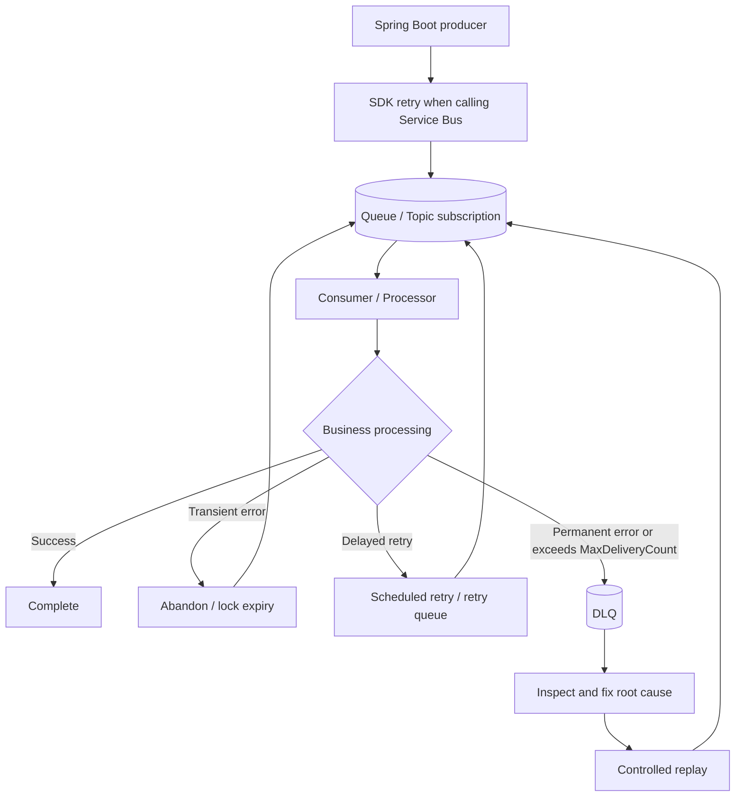
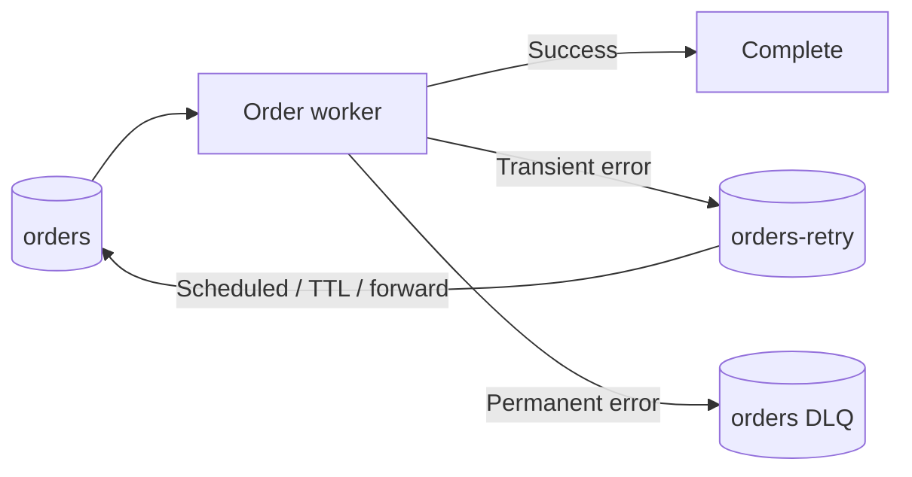

# Retries, delivery counts, and dead-letter replay

> **Chapter:** Azure Service Bus  
> **Module:** `SPRING_CLOUD_PROVIDER_INTEGRATION`  
> **Objective:** Distinguish Azure SDK retries, broker redeliveries, and application retries; understand `DeliveryCount`/`MaxDeliveryCount`; design bounded backoff; safely read and replay messages from the dead-letter queue (DLQ) using Spring Boot and the Azure SDK for Java.

## 1. A single message error can trigger multiple kinds of retries

A Spring Boot worker receives `DocumentUploaded` from Azure Service Bus, reads the file in Blob Storage, and generates a preview. At runtime, several things can go wrong:

- The AMQP connection drops briefly while the producer is sending.
- Service Bus returns a throttling error because the namespace receives too many requests.
- A message is received, but the worker does not finish before the lock expires.
- The database is temporarily unreachable.
- The payload violates the schema and fails on every attempt.
- The worker commits the result but loses connection before calling `complete`.
- A message is delivered multiple times and eventually moved to the DLQ.

The word "retry" is often used for all of these scenarios, but there are actually **three distinct layers**:

1. **SDK retry:** the Java library retries a Service Bus communication operation when the error is classified as transient.
2. **Broker redelivery:** Service Bus redelivers the message to a consumer after the consumer abandons it or its message lock expires.
3. **Application retry:** the application decides to re-run business logic, wait for a period, move to a retry queue, or schedule a new message.

The DLQ holds messages removed from the normal processing stream after permanent errors or exceeding the redelivery limit. **The DLQ is not automatically a retry queue.** Operations must investigate, fix the root cause, and decide whether to replay.



**Goal:** know which layer an error occurs at, choose the appropriate retry mechanism, and prove that messages are neither lost nor producing duplicate side effects.

## 2. Three distinct retry layers

| Mechanism | Who decides to retry? | What is retried? | Does DeliveryCount increment? |
| --- | --- | --- | --- |
| **SDK retry** | Azure SDK | Send/receive/settlement call to the broker on transient transport errors | Not a new message delivery |
| **Broker redelivery** | Service Bus | Redelivering the same message after abandon or lock expiry | Yes |
| **Application retry** | Business code | Re-running business work, abandoning, or sending another retry message | Depends on implementation |

For example, a sender calls `sendMessage` and hits a network blip. The SDK can retry the send operation per `AmqpRetryOptions`. This is not a consumer receiving the message a second time.

Conversely, a worker receives a message under Peek-Lock and calls `abandon`. The broker releases the lock and can redeliver the message; `DeliveryCount` increments. That is broker redelivery.

Finally, the worker detects that the image processing service is overloaded and wants to try again in 2 minutes. Calling `abandon` makes the message immediately available again without creating a 2-minute wait. If a delay is needed, the application must use a scheduled message or a dedicated retry queue/workflow.

## 3. SDK retry: handling transient communication failures

The Azure SDK for Java includes a retry policy at the AMQP layer. When a send/receive or broker interaction fails with an error marked transient, the library can retry per `AmqpRetryOptions`.

Key properties:

| Property | Meaning | Default in Java SDK 7.18.0 |
| --- | --- | --- |
| `Mode` | How delay between attempts is calculated | `EXPONENTIAL` |
| `MaxRetries` | Maximum retry attempts after the initial try | 3 |
| `Delay` | Base delay | 800 ms |
| `MaxDelay` | Upper bound on delay | 1 minute |
| `TryTimeout` | Maximum duration for each individual attempt | 1 minute |

Defaults can change across SDK versions. Check the source or API reference for your exact version before relying on them in SLOs.

### 3.1. Configuring AmqpRetryOptions

Example creating a sender bean in Spring configuration:

```java
import java.time.Duration;

import com.azure.core.amqp.AmqpRetryMode;
import com.azure.core.amqp.AmqpRetryOptions;
import com.azure.identity.DefaultAzureCredentialBuilder;
import com.azure.messaging.servicebus.ServiceBusClientBuilder;
import com.azure.messaging.servicebus.ServiceBusSenderClient;

import org.springframework.beans.factory.annotation.Value;
import org.springframework.context.annotation.Bean;
import org.springframework.context.annotation.Configuration;

@Configuration(proxyBeanMethods = false)
public class ServiceBusSenderConfiguration {

    @Bean(destroyMethod = "close")
    ServiceBusSenderClient documentEventSender(
            @Value("${app.servicebus.fqdn}") String namespace,
            @Value("${app.servicebus.queue}") String queueName) {

        AmqpRetryOptions retryOptions = new AmqpRetryOptions()
                .setMode(AmqpRetryMode.EXPONENTIAL)
                .setMaxRetries(3)
                .setDelay(Duration.ofMillis(800))
                .setMaxDelay(Duration.ofSeconds(30))
                .setTryTimeout(Duration.ofSeconds(20));

        return new ServiceBusClientBuilder()
                .credential(
                        namespace,
                        new DefaultAzureCredentialBuilder().build())
                .retryOptions(retryOptions)
                .sender()
                .queueName(queueName)
                .buildClient();
    }
}
```

In this example:

- `namespace` is the Service Bus namespace FQDN.
- `DefaultAzureCredential` resolves credentials by environment; production workloads need Managed Identity or an appropriate identity granted Data Sender.
- The retry policy only governs client communication calls.
- The sender is a long-lived bean reused across the application lifecycle; do not create a new connection per message.

`TryTimeout` is the limit for **each individual attempt**, not the total maximum duration across the entire retry sequence. Total time also depends on the number of attempts and delays.

### 3.2. Exponential backoff

With exponential backoff, the wait grows across attempts, capped by `MaxDelay`. Conceptual model:

```text
delay(attempt) = min(maxDelay, baseDelay * 2^(attempt - 1))
```

Some retry policies also add jitter so multiple clients do not retry at the exact same instant. Inspect the specific SDK's behavior; do not assume every library uses the identical internal formula.

Illustrative example with an 800 ms base delay and 30-second max delay:

| Retry attempt | Conceptual wait |
| --- | --- |
| 1 | 800 ms |
| 2 | 1.6 seconds |
| 3 | 3.2 seconds |
| Subsequent attempts | Continue growing, capped at 30 seconds |

The goal is to give the service time to recover and avoid adding pressure during throttling.

### 3.3. Do not retry configuration or business errors

Some errors will not go away on retry:

- Identity lacks `Azure Service Bus Data Sender` or `Data Receiver` permission.
- Namespace or queue/subscription does not exist.
- Payload exceeds the message size limit.
- Invalid data or unsupported schema version.
- Invalid API call state, such as settling with a lost lock token.

The SDK can throw an exception after exhausting retries for transient failures. For `ServiceBusException`, inspect `isTransient()` and `getReason()` to classify:

```java
import com.azure.messaging.servicebus.ServiceBusException;

try {
    sender.sendMessage(message);
} catch (ServiceBusException exception) {
    if (exception.isTransient()) {
        // SDK tried per retry policy, but the operation still failed.
        // Check connectivity, load, and retry configuration.
    } else {
        // Check reason: permissions, entity, state, or request.
    }

    throw exception;
}
```

When `isTransient()` is `true`, the SDK has already applied its retry policy to that call and all attempts failed. The application may need a higher-level retry after checking state, though it must not loop infinitely.

### 3.4. A timeout does not prove the operation failed

This case is especially critical for producers:

1. Producer sends the message.
2. Broker receives and stores the message.
3. Acknowledgement is lost on the return path.
4. Producer times out and does not know whether the broker saved the message.

If the producer re-sends using a new `MessageId`, two messages may be created. Use a stable `MessageId`, enable duplicate detection where appropriate, and ensure consumers are idempotent. Similarly, if `complete` times out after business state already committed, the message can be redelivered.

## 4. Broker redelivery and DeliveryCount

When receiving in Peek-Lock mode, Service Bus keeps the message locked while the lock remains valid. If the consumer:

- Calls `abandon`, or
- Fails to settle before the lock expires,

the message can be redelivered. Each abandon or lock expiration increments `DeliveryCount`.

`DeliveryCount` is the number of times the broker has delivered the message to a consumer. It is **not** how many times the SDK retried a send/receive call, nor how many times business code invoked an internal method.

### 4.1. MaxDeliveryCount

A queue or topic subscription has a `MaxDeliveryCount` property. The default is usually **10**. Once DeliveryCount exceeds this threshold, Service Bus moves the message to the DLQ with reason `MaxDeliveryCountExceeded`.

Example:

```text
Message is delivered (DeliveryCount = 1)
    ↓
Worker abandons or lock expires
    ↓
Message is redelivered (DeliveryCount increments)
    ↓
Repeat until processed successfully
    ↓
If MaxDeliveryCount is exceeded
    ↓
Message is moved to DLQ
```

Do not interpret `MaxDeliveryCount = 10` as "the application gets 10 arbitrary retries." It is a broker threshold tracking redeliveries from abandons and lock expirations. A database error retried multiple times in a Java loop inside a handler still happens within the same single delivery; those internal loops do not increment DeliveryCount by themselves.

### 4.2. When does DeliveryCount increment?

| Event | DeliveryCount |
| --- | --- |
| Consumer receives message in Peek-Lock | Reflects current delivery attempt |
| Consumer calls `abandon` | Increments when redelivered |
| Message lock expires | Increments when redelivered |
| Consumer completes successfully | Message is removed from the normal receive stream |
| SDK retries a transient AMQP call | Not a new message delivery |
| Consumer retries a business method in the same callback | Does not increment by itself |
| Consumer closes receiver before settlement | Lock expires, message may redeliver and DeliveryCount increments |

A common mistake is having a callback receive a message, kick off background work, and return immediately without awaiting completion. Depending on configuration, the processor may auto-complete or auto-abandon at the wrong moment or trigger redelivery. Let the callback manage work lifecycle and settlement accurately.

### 4.3. High DeliveryCount is a diagnostic signal

Rapidly climbing DeliveryCount can indicate:

- The handler always throws an exception.
- The consumer lacks permissions to access the database/storage.
- Lock duration is too short or auto-renew is insufficient.
- The consumer closes connections before settlement.
- The message has an invalid payload or an unrecoverable dependency issue.
- Throttling, network issues, or resource exhaustion.

Do not simply raise `MaxDeliveryCount` to shrink the DLQ. First find out why messages are not completing.

## 5. Classifying errors before choosing a retry strategy

| Error class | Example | Recommended action |
| --- | --- | --- |
| **Transient in Service Bus** | ServiceBusy, brief network blip, transient timeout | Let SDK retry per policy; if exhausted, observe and retry with limits |
| **Transient in business dependency** | Brief DB timeout, Blob Storage throttling | Short retry with backoff or abandon; consider scheduled retry if delay needed |
| **Permanent payload error** | Malformed JSON, missing document ID, unsupported schema | Dead-letter with a clear reason |
| **Permanent config error** | Missing RBAC, wrong namespace, missing entity | Stop/pause consumer, fix config/permissions; do not retry infinitely |
| **Business rejection** | Document fails business validation | Record rejection status; dead-letter or complete per contract |
| **Uncertain outcome** | Send/complete timeout after broker or DB may have committed | Use stable IDs, check idempotency and state before repeating side effects |
| **Lock lost** | Long-running handler, detached connection | Do not settle with the stale lock; message may redeliver, consumer must be idempotent |

### 5.1. Do not turn permanent errors into hot retry loops

Suppose a worker lacks read permissions on Blob Storage. If it keeps abandoning messages, on every redelivery the worker still lacks permissions until messages land in the DLQ. The right procedure is:

1. Detect the permission error.
2. Log/audit safely with message ID and target resource.
3. Alert the operations team.
4. Pause receiving if the error affects all workers.
5. Fix the role or policy.
6. Once permissions are fixed, perform controlled replay of DLQ messages.

If an error affects only one message due to a bad object key, classify it as a data error instead of retrying continuously.

## 6. Business retries: immediate retry or delayed retry?

Service Bus provides `abandon`, yet abandon **is not a scheduled retry**. It unlocks the message so the broker can redeliver immediately whenever a receiver is available. If a dependency stays down, consumers can receive and abandon in a tight loop.

Three common patterns:

| Pattern | How it works | When appropriate | Risk |
| --- | --- | --- | --- |
| Short in-handler retry | Re-call dependency a few times with short backoff before settlement | Brief glitches, fast operations fitting within lock budget | Holds lock and thread; needs strict timeouts |
| Abandon/redelivery | Return message to broker for redelivery | Want quick retry, another consumer can pick it up | No arbitrary delay; DeliveryCount increments |
| Scheduled retry/retry queue | Emit retry message with a future enqueue time | Need to wait seconds/minutes or let dependency recover | Must manage retry counts, IDs, and duplicate risk |

Never use long `Thread.sleep` calls inside callbacks to wait on a dependency. That holds locks, ties up threads, and hurts throughput. If a long wait is needed, schedule a new message or convert the work to a durable job.

### 6.1. Bounded short retries inside the handler

Some calls can be retried briefly before complete/abandon—for instance, an API returning brief 429 errors. Requirements:

- Cap the attempt count.
- Use exponential backoff and jitter when running multiple workers.
- Enforce per-attempt timeouts.
- Total retry duration must stay within the lock/auto-renew budget.
- Only retry errors explicitly classified as transient.
- When retries exhaust, choose abandon, scheduled retry, or dead-letter by error class.

If a handler runs too long, the lock can expire and another worker can receive the message while the first worker is still running. Idempotency remains mandatory.

### 6.2. Abandoning for broker redelivery

Example processor using manual settlement:

```java
private void handleMessage(ServiceBusReceivedMessageContext context) {
    var message = context.getMessage();

    try {
        documentService.processIdempotently(
                message.getMessageId(),
                message.getBody());

        context.complete();

    } catch (TemporaryDependencyException exception) {
        // Message can be redelivered immediately.
        context.abandon();

    } catch (InvalidPayloadException exception) {
        context.deadLetter();
    }
}
```

This assumes the processor was built with `disableAutoComplete()`. In real applications, exception classification must be precise; never catch all `Exception` and abandon, because permission errors or bad payloads will create retry loops.

### 6.3. Scheduled retry with the Java SDK

Azure Service Bus supports scheduled messages. `ServiceBusSenderClient.scheduleMessage(message, scheduledEnqueueTime)` sends a message that only becomes visible in the queue/topic at the specified time. The API returns the scheduled message's sequence number, which can be used to cancel it before activation.

A retry message should carry:

- `originalEventId` or stable business ID.
- Incrementing `retryAttempt`.
- A new `MessageId`, deterministic for **that specific retry attempt**.
- Preserved `CorrelationId` for tracing.
- Preserved `SessionId`/`PartitionKey` if required by the entity.
- Clearly recorded retry timestamp and reason.

Example creating a scheduled retry message from an in-flight message:

```java
import java.time.OffsetDateTime;
import java.time.ZoneOffset;

import com.azure.messaging.servicebus.ServiceBusMessage;
import com.azure.messaging.servicebus.ServiceBusReceivedMessage;
import com.azure.messaging.servicebus.ServiceBusSenderClient;

public long scheduleRetry(
        ServiceBusSenderClient sender,
        ServiceBusReceivedMessage original,
        String originalEventId,
        int nextAttempt,
        java.time.Duration delay,
        String replayBatchId) {

    // This constructor copies the body and relevant message properties.
    ServiceBusMessage retry = new ServiceBusMessage(original);

    // New ID for this retry attempt, stable if the same attempt must be re-sent.
    String retryMessageId = originalEventId
            + ":retry:" + nextAttempt
            + ":" + replayBatchId;

    retry.setMessageId(retryMessageId);

    retry.getApplicationProperties().put("originalEventId", originalEventId);
    retry.getApplicationProperties().put("retryAttempt", nextAttempt);
    retry.getApplicationProperties().put("retryReason", "TemporaryDependencyFailure");

    OffsetDateTime scheduledTime =
            OffsetDateTime.now(ZoneOffset.UTC).plus(delay);

    return sender.scheduleMessage(retry, scheduledTime);
}
```

This is an illustrative helper; `originalEventId`, `replayBatchId`, and `nextAttempt` must be managed durably. Only after the handler schedules successfully should it complete the original message. If scheduling fails, abandon the original message or persist failure state for retry per policy.

**Watch out for the schedule/complete gap:** the scheduled message might be accepted by the broker while completing the original message fails. When the original message redelivers, the worker could schedule again. Use deterministic retry IDs, duplicate detection where appropriate, and a retry/inbox table with unique constraints to prevent scheduling multiple retries for the same attempt. Without duplicate detection, track retry operation IDs in the database.

Do not reuse the original message's `MessageId` for a scheduled retry when duplicate detection is enabled on the same entity; the broker may drop the retry as a duplicate within the dedup window. Keep `originalEventId` separate so consumers stay idempotent by business event.

### 6.4. Backoff for business retries

A retry schedule can use exponential backoff with jitter:

```text
delay = min(maxDelay, baseDelay * 2^(attempt - 1))
delayWithJitter = delay * random(0.8, 1.2)
```

Lab example:

| Retry attempt | Target delay |
| --- | --- |
| 1 | About 10 seconds |
| 2 | About 30 seconds |
| 3 | About 2 minutes |
| 4 | About 5 minutes |
| Exceeds allowed attempts | Dead-letter or route to investigation workflow |

These numbers represent an illustrative policy, not Service Bus defaults. Choose them according to SLOs, TTL, dependency recovery times, and operational cost. Jitter prevents multiple workers from firing retries at the exact same instant.

### 6.5. Dedicated retry queue

Another architecture uses a primary queue plus one or more retry queues:



A retry queue can use scheduled delivery, TTL, or auto-forwarding to return messages to the processing stream. Explicitly design:

- Which queue owns retry attempts.
- How to ensure `MessageId` is not accidentally deduplicated.
- How to cap hops through the retry queue.
- How to monitor backlog and message age across each queue.
- How to prevent infinite auto-forward loops.
- How to preserve `SessionId` if ordering is required.

For simple workloads, scheduled messages may suffice. For large workflows or multi-tier delays, retry queues make operations easier to observe.

## 7. MaxDeliveryCount, retry attempts, and TTL

Do not overload a single number for every limit.

| Property | Layer | Role |
| --- | --- | --- |
| `AmqpRetryOptions.maxRetries` | SDK | Number of SDK retries for transient transport calls |
| `DeliveryCount` | Broker | Number of message deliveries; increments on abandon/lock expiry |
| `MaxDeliveryCount` | Queue/subscription | Threshold for moving a message to the DLQ |
| `retryAttempt` | Application | Number of business retry attempts created by the app |
| `TimeToLive` | Message/entity | How long a message stays valid before expiring |

For instance, a message might experience 3 SDK retries during send, then the consumer receives it for the first time. The consumer hits a DB error and schedules retry attempt 1. The scheduled message enters the queue and is received again. The consumer might still encounter lock loss or redelivery. Each counter serves a separate purpose.

### 7.1. TTL and scheduled retries

For scheduled messages, the message only becomes active at its scheduled enqueue time. TTL is measured from when the message is actually enqueued/activated, not when the producer called `scheduleMessage`.

If TTL is set too short, a retry message can expire right after activation. Account for schedule delay, post-activation TTL, and business processing goals. If TTL expires with dead-letter-on-expiration enabled, the message can enter the DLQ with reason `TTLExpiredException`.

### 7.2. Retries must not outlive business deadlines

An order might only be valid to process within 30 minutes; an OTP might expire in 5 minutes. Never retry a message indefinitely once the event has lost business relevance.

Include `expiresAt` or a business deadline in payload/metadata if needed. The consumer checks the deadline before executing side effects. If expired, record expiration state or dead-letter per process rather than scheduling more retries just because the broker still holds the message.

## 8. What is a dead-letter queue?

The DLQ is a secondary subqueue attached to **every queue or topic subscription**. You do not create DLQs manually. Each topic subscription has its own DLQ; a topic does not have one shared DLQ for all messages.

The DLQ stores undeliverable or unprocessable messages. Messages enter the DLQ only via the broker or a consumer's dead-letter action; re-sending requires reading the message out and publishing it back to a target queue/topic.

### 8.1. Common reasons

| DeadLetterReason | Cause | Where to investigate |
| --- | --- | --- |
| `MaxDeliveryCountExceeded` | DeliveryCount exceeded MaxDeliveryCount | Check exception handlers, abandons, lock expiry, shutdowns, and dependencies |
| `TTLExpiredException` | Message TTL expired with dead-letter-on-expiration enabled | Check backlog, TTL, and processing duration |
| `HeaderSizeExceeded` | Message/headers exceeded quota | Reduce payload or application properties |
| `Session ID is null` | Entity requires sessions but producer omitted SessionId | Check producer and entity settings |
| `MaxTransferHopCountExceeded` | Auto-forward exceeded allowed hops | Shorten forwarding chain |
| Custom reason | Application explicitly dead-lettered | Inspect reason/description and contract |

System reasons are assigned by the broker; applications can define custom reasons for business errors.

### 8.2. Specific characteristics of the DLQ

- Every queue and topic subscription has its own DLQ.
- The DLQ does not clean itself up automatically.
- TTL does not expire messages sitting inside the DLQ.
- Messages can still be received in Peek-Lock mode and must be completed to remove them from the DLQ.
- You cannot dead-letter a message from a DLQ into a nested DLQ.
- Messages in the DLQ can be inspected, corrected via an audited process, and resubmitted.
- For failed auto-forward or send-via transfers, the source entity has a separate **transfer dead-letter queue (TDLQ)**.

Because there is no TTL expiration or auto-cleanup, the DLQ needs dashboards, alerts, retention policies, and designated owners.

### 8.3. Topic DLQs belong to subscriptions

Suppose topic `document-events` has two subscriptions:

```text
document-events
  ├── preview-worker
  │     └── $DeadLetterQueue
  └── audit-worker
        └── $DeadLetterQueue
```

If the preview worker fails to process a message, it lands in `preview-worker`'s DLQ. The audit worker may still have processed the message cleanly on its own subscription. Never replay a message from the preview subscription to the topic assuming audit also needs it again.

### 8.4. DLQ vs. transfer DLQ

- **DLQ:** messages that could not be processed or were removed from the main stream by consumer/broker.
- **Transfer DLQ:** messages that could not be forwarded to the destination entity during auto-forward/send-via; held in the source entity's transfer DLQ.

When the target DLQ is empty yet messages are missing from an auto-forward destination, check the source's transfer DLQ.

## 9. Reading the DLQ with the Azure SDK for Java

The Java SDK lets you build a receiver directly targeting the dead-letter subqueue via `SubQueue.DEAD_LETTER_QUEUE`.

### 9.1. Creating a DLQ receiver for a queue

```java
import com.azure.identity.DefaultAzureCredentialBuilder;
import com.azure.messaging.servicebus.ServiceBusClientBuilder;
import com.azure.messaging.servicebus.ServiceBusReceiverClient;
import com.azure.messaging.servicebus.models.ServiceBusReceiveMode;
import com.azure.messaging.servicebus.models.SubQueue;

ServiceBusReceiverClient dlqReceiver =
        new ServiceBusClientBuilder()
                .credential(
                        fullyQualifiedNamespace,
                        new DefaultAzureCredentialBuilder().build())
                .receiver()
                .queueName("preview-jobs")
                .subQueue(SubQueue.DEAD_LETTER_QUEUE)
                .receiveMode(ServiceBusReceiveMode.PEEK_LOCK)
                .buildClient();
```

For a topic subscription, replace `queueName` with:

```java
.topicName("document-events")
.subscriptionName("preview-worker")
.subQueue(SubQueue.DEAD_LETTER_QUEUE)
```

The identity reading the DLQ needs Data Receiver permissions on that entity. To replay to a queue/topic, the sender needs Data Sender permissions on the destination.

### 9.2. Receiving and inspecting a message

```java
import com.azure.messaging.servicebus.ServiceBusReceivedMessage;

ServiceBusReceivedMessage message =
        dlqReceiver.receiveMessage();

if (message != null) {
    System.out.println("MessageId: " + message.getMessageId());
    System.out.println("DeliveryCount: " + message.getDeliveryCount());
    System.out.println("Reason: " + message.getDeadLetterReason());
    System.out.println("Description: "
            + message.getDeadLetterErrorDescription());
    System.out.println("CorrelationId: " + message.getCorrelationId());
    System.out.println("SessionId: " + message.getSessionId());
    System.out.println("EnqueuedTime: " + message.getEnqueuedTime());

    // Complete only after saving investigation results or deciding handling.
}
```

Do not complete the message immediately upon reading if you have not persisted the required investigation info. In Peek-Lock mode, the message will redeliver if the lock expires; process within the lock window and settle before closing the receiver.

### 9.3. Recording reasons and descriptions

DLQ reasons and descriptions help categorize root causes. Never put full sensitive payloads into descriptions. Record:

- Message ID, original event ID, and correlation ID.
- Source entity and subscription.
- Dead-letter reason/description.
- DeliveryCount and enqueue timestamp.
- Schema version or event type.
- Trace ID and error code to look up logs.

If payloads must be stored for investigation, use secure storage with proper access control and retention.

## 10. Replaying messages from the DLQ

Replay means **re-sending dead-lettered messages** to a processing entity. Because this can trigger business side effects, perform it only after the root cause has been resolved.

A solid workflow:

1. Inspect the DLQ and classify reasons.
2. Identify whether the fault is in producer, schema, permissions, dependencies, or worker code.
3. Fix code/config/data before replaying.
4. Select a single message or a small scoped batch.
5. Preserve the business event ID/original message ID in metadata for consumer idempotency.
6. Send the new message to the appropriate destination.
7. Complete the old DLQ entry only after the resubmit is confirmed.
8. Monitor processing outcomes, whether new messages bounce back to the DLQ, and whether duplicate side effects occur.

### 10.1. Replaying with ServiceBusMessage

The Java SDK provides `new ServiceBusMessage(ServiceBusReceivedMessage)` to build a new message from a received one while copying eligible properties. Applications can assign a new `MessageId` and attach audit metadata.

Example replaying from a queue's DLQ back to that same queue:

```java
import com.azure.messaging.servicebus.ServiceBusMessage;
import com.azure.messaging.servicebus.ServiceBusReceivedMessage;
import com.azure.messaging.servicebus.ServiceBusReceiverClient;
import com.azure.messaging.servicebus.ServiceBusSenderClient;

public void replayOne(
        ServiceBusReceiverClient dlqReceiver,
        ServiceBusSenderClient originalQueueSender,
        ServiceBusReceivedMessage deadLettered,
        String replayBatchId) {

    String originalMessageId = deadLettered.getMessageId();

    // Constructor copies the body and relevant message properties.
    ServiceBusMessage replay = new ServiceBusMessage(deadLettered);

    // Use a dedicated ID for this replay, while keeping the original ID for idempotency.
    String replayMessageId = originalMessageId + ":replay:" + replayBatchId;
    replay.setMessageId(replayMessageId);

    replay.getApplicationProperties().put(
            "originalMessageId", originalMessageId);
    replay.getApplicationProperties().put(
            "replayBatchId", replayBatchId);
    replay.getApplicationProperties().put(
            "originalDeadLetterReason",
            deadLettered.getDeadLetterReason());

    // Re-send first; only complete DLQ after the send is accepted.
    originalQueueSender.sendMessage(replay);
    dlqReceiver.complete(deadLettered);
}
```

This is a minimal example for **queues where the payload does not need modification**. In real applications:

- `replayBatchId` must be stored durably and kept identical if the same replay operation is retried.
- Preserve `originalEventId` in the body/application properties so consumers prevent duplicate side effects.
- If the message uses an older schema, transform the payload before re-sending if necessary.
- If the entity requires sessions, ensure `SessionId` is preserved.
- If the entity is partitioned, ensure `PartitionKey` is preserved accurately.
- Review TTL; do not blindly copy the old TTL. Set a fresh TTL per replay policy.
- Do not copy lock tokens, sequence numbers, or `DeliveryCount` as outbound attributes; those belong to the prior delivery.

If sending succeeds while completing the DLQ message fails due to network/lock loss, the old message can remain in the DLQ and get replayed again. Stable replay IDs, duplicate detection, and consumer idempotency keep this safe. Never treat a send/complete timeout as proof that the operation did not happen.

### 10.2. Which MessageId should be used when replaying?

Separate two IDs:

- **Original event ID:** preserved unchanged to identify the same business event and block duplicate side effects.
- **Replay MessageId:** a new, deterministic ID for one specific replay operation.

If you reuse the old `MessageId`, duplicate detection on the target entity may discard the replayed message within the dedup window because the broker saw that ID earlier. If you generate a totally random ID on every run, retrying the replay operation can create multiple copies.

One pattern derives the replay ID deterministically from `originalMessageId + replayBatchId`. When the same replay operation must be retried, keep `replayBatchId` unchanged. Consumers stay idempotent by original event ID/business key.

### 10.3. Replaying a topic subscription DLQ requires extra care

A topic DLQ belongs to **one subscription**. Resubmitting the message to the original topic causes the broker to distribute it to all matching subscriptions again. That can make consumers that already succeeded on the first attempt reprocess the same event.

If your goal is only to reprocess the failed subscription:

- Consider a dedicated retry queue for that consumer.
- Or create a replay path routed solely to the target consumer.
- If you must republish to the topic, ensure every subscription has idempotent consumers and expects potential redeliveries.

There is no direct "send to a subscription" operation like sending to a queue; producers send to the topic, and filters/rules determine which subscriptions receive copies.

### 10.4. Replay can alter ordering

When resubmitted, the message is enqueued with a new sequence number and enqueue time. It does not return to its original slot in the queue. On session-enabled entities, a replayed message can appear behind newer events in the same session.

Therefore:

- Record the original sequence number and business sequence/version.
- Replay in the required business order.
- Check aggregate state before applying.
- Do not assume `SessionId` automatically restores original ordering.
- For strict workflows, use repair/reconciliation instead of bulk replay.

## 11. Replay and retries must be bounded

An operable retry policy needs limits:

| Limit | Purpose |
| --- | --- |
| Max SDK retries | Prevent a single transport call from stalling a request too long |
| Max application retry attempts | Prevent infinite business retry loops |
| Retry max delay | Avoid waiting past deadlines |
| Message TTL | Drop work that is no longer meaningful |
| MaxDeliveryCount | Route repeatedly redelivered messages to the DLQ |
| DLQ replay batch size | Limit blast radius during replay |
| Replay rate limit | Avoid slamming a newly recovered dependency |

Do not set every limit to the same number. SDK retries, application retries, DeliveryCount, and TTL each serve different roles.

### 11.1. Poison messages

A poison message is one that a consumer can never process successfully due to its payload or a permanent condition. Examples:

- Malformed JSON.
- Unsupported event version.
- Document ID does not exist and cannot be created.
- Missing required property.
- Invalid message structure.

When an error is permanent, dead-letter early with a clear reason rather than abandoning until `MaxDeliveryCount` is exceeded. This reduces load and lets operations spot the issue immediately.

### 11.2. Dependency outages

If a database or storage outage impacts all workers:

1. Do not keep receiving and abandoning in an endless loop.
2. Use health signals/circuit breakers to pause or throttle receiving.
3. Let the SDK retry transient Service Bus calls per policy.
4. Once the dependency recovers, resume workers.
5. Watch backlog and processing rates to avoid thundering-herd spikes.

If only a few messages need a long wait, scheduled retries or a retry queue may fit better.

## 12. Operational DLQ handling

You can use Service Bus Explorer in the Azure Portal or appropriate admin tools to:

- Peek messages without locking for investigation.
- Receive messages in Peek-Lock when taking action.
- View reason, description, application properties, and body.
- Edit content/metadata through an approved procedure.
- Resubmit individual messages or batches.
- Complete messages in the DLQ after handling.

Never bulk-edit payloads without an audit trail. Every replay needs an accountable owner/process, timestamp, reason, batch ID, and recorded outcome.

### 12.1. Pre-replay checklist

- Has the dead-letter root cause been identified?
- Have code/config/schemas been fixed?
- Is the replay target the right queue/topic?
- Will a topic replay cause other subscriptions to receive duplicates?
- Does the message have a `SessionId`/`PartitionKey` that must be preserved?
- Is the new TTL appropriate?
- Is the replay `MessageId` deterministic if the same replay operation retries?
- Is the consumer idempotent by original event/business ID?
- Are an audit record and `replayBatchId` in place?
- Are rate limits and batch sizes enforced?
- Can you halt or roll back replay if unexpected side effects appear?

## 13. Observability for retries and DLQs

Watching active message counts alone is not enough. Monitor across SDK, broker, business, and DLQ layers.

| Metric/log | Meaning | When to investigate |
| --- | --- | --- |
| SDK transient exception count | Transient communication error count | Climbing over time or coinciding with ServiceBusy |
| SDK retry exhausted | Operations still failing after retries | Network, timeouts, namespace health, client overload |
| DeliveryCount distribution | Extent of message redeliveries | Many messages near MaxDeliveryCount |
| Active message count/age | Backlog and message age | Consumers falling behind producers |
| Abandon count | Consumer returning messages | Failing handlers or unstable dependencies |
| Dead-letter count by reason | Why messages were removed | Poison payloads, TTL, permissions, lock losses |
| Retry scheduled count | Messages waiting for delayed retry | Retry queue swelling or prolonged dependency outage |
| Replay count by batch | Number of replayed messages | Excessive replays or repeated batches |
| Idempotency hits | Consumer seeing already processed events | Redeliveries/replays/producer retries |
| End-to-end completion time | Time from event emission to final state | Retries pushing latency past SLO |

Logs should carry `MessageId`, `originalEventId`, `CorrelationId`, `retryAttempt`, `DeliveryCount`, `DeadLetterReason`, and entity name. Never log access tokens, connection strings, or sensitive payloads.

### Runbook: MaxDeliveryCountExceeded rising

1. Identify the queue/subscription and start time.
2. Read a sample of DLQ messages; group by reason, schema version, and event type.
3. Inspect worker logs for handler errors, lock losses, permissions, or dependency failures.
4. Check `DeliveryCount`, lock duration, processor auto-renew, and shutdown behavior.
5. Fix the root cause before replaying.
6. Replay a small batch and monitor outcomes.
7. Update alerts/tests to catch similar regressions early.

### Runbook: SDK retries/ServiceBusy rising

1. Check namespace Resource Health and Azure Service Bus metrics.
2. Check receiver count, concurrency, prefetch, and request rate.
3. Check CPU/thread starvation and connection/I/O threads.
4. Shed load or reduce concurrency as needed.
5. Review retry policy, try timeout, and backoff.
6. Once the service recovers, monitor backlog and message age.

### Runbook: DLQ replay creating duplicates

1. Pause further replay batches.
2. Inspect `replayBatchId`, replay `MessageId`, and original event ID.
3. Verify whether duplicate detection is enabled on the target entity.
4. Check consumer inbox/idempotency and what side effects occurred.
5. Identify which messages are already processed; avoid unconditional replays.
6. Continue in small audited batches.

## 14. Testing retries, delivery counts, and DLQs

| Test | How to execute | Expected outcome |
| --- | --- | --- |
| SDK transient retry | Induce controlled network/throttling errors | SDK retries per `AmqpRetryOptions` |
| SDK retry exhausted | Keep transient error active past retry budget | Exception thrown and reason logged |
| Permanent error | Use identity lacking permissions or invalid entity | Does not retry infinitely; error classified |
| Abandon | Handler fails transiently then abandons | Message redelivers and `DeliveryCount` increments |
| Lock expiry | Stop worker before settlement | Message redelivers after lock expiry |
| MaxDeliveryCount | Repeat abandon/lock expiry past threshold | Message lands in DLQ with `MaxDeliveryCountExceeded` |
| Scheduled retry | Schedule message for a future timestamp | Message becomes active only after scheduled time |
| Retry duplicate | Succeed on schedule, fail on completing original message | Stable retry ID/dedup/inbox prevents multiple retries |
| DLQ inspect | Send invalid payload and dead-letter | Reason/description preserved |
| DLQ replay | Fix root cause, resubmit one message | Message reprocessed; consumer stays idempotent |
| Topic subscription replay | Resubmit to topic with multiple subscriptions | Verify fan-out and idempotency of each consumer |
| Session replay | Replay a session message | Check `SessionId` and business ordering |

### 14.1. Do not test only delivery counts

Tests must validate the final business state:

- One event creates only one preview/order/payment.
- `DeliveryCount` increments accurately on abandon or lock expiry.
- Poison messages land in the DLQ with diagnostic reasons.
- Retry messages carry incrementing attempt numbers and accurate enqueue times.
- Replays do not cause unintended reprocessing by other consumers.
- No messages are lost when send/replay succeeds but DLQ completion fails.

Never use fixed sleeps to test scheduled messages. Poll state with a bounded timeout using dedicated test resources.

## 15. Hands-on lab: designing retries and DLQs for a document system

**Scenario:** A Spring Boot API emits `DocumentUploaded` to the `preview-jobs` queue. A worker reads the PDF from Azure Blob Storage, generates a preview, and writes status to PostgreSQL. Network errors, database timeouts, malformed schemas, and permission errors can occur.

### Part A — Configure SDK retries

- Create `AmqpRetryOptions` in exponential mode.
- Configure max retries, delay, max delay, and try timeout.
- Create reusable sender/receiver beans.
- Induce controlled transient errors and observe retries.

### Part B — Observe broker redelivery

- Build a Peek-Lock processor with manual settlement.
- On transient dependency errors, abandon the message.
- Observe `DeliveryCount` incrementing.
- Repeat until `MaxDeliveryCount` is exceeded and the message enters the DLQ.
- Verify SDK retries are not confused with `DeliveryCount`.

### Part C — Add scheduled retries

- Add `originalEventId` and `retryAttempt` to metadata.
- When transient errors persist, schedule a retry with increasing delay.
- Complete the original message only after the scheduled send succeeds.
- Fail between schedule and complete; verify stable retry IDs and idempotency prevent duplicate work.
- Cap business retry attempts.

### Part D — Investigate the DLQ

- Send a payload missing document ID.
- Dead-letter with reason `InvalidDocumentEvent`.
- Use a DLQ receiver to read reason, description, message ID, correlation ID, and `DeliveryCount`.
- Fix the producer or data before replaying.

### Part E — Controlled replay

- Generate a `replayBatchId`.
- Resubmit one message to the original queue via `ServiceBusMessage` copy.
- Set a new replay `MessageId` while preserving the original event ID.
- Complete the old DLQ entry after send succeeds.
- Simulate send succeeding while complete fails.
- Verify the consumer does not generate the preview twice.

### Part F — Topic subscriptions and sessions

- Create a topic with two subscriptions; have one subscription dead-letter a message.
- Replay to the topic and observe whether other subscriptions receive it again.
- Test a session-enabled queue: preserve `SessionId` during replay.
- Verify the replayed message receives a new sequence number and can alter prior order.

**Completion criteria:** learners distinguish SDK retries, broker redelivery, and application retries; explain `DeliveryCount`/`MaxDeliveryCount`; configure `AmqpRetryOptions`; design bounded scheduled retries; read and safely replay from the DLQ; demonstrate consumer idempotency under uncertain send/complete outcomes.

---

## 16. Checklist before taking retries and DLQs to production

| Area | Question |
| --- | --- |
| SDK retry | Are transient vs. permanent errors classified and maxRetries/delay/timeouts configured? |
| Client lifecycle | Are senders/receivers reused and closed properly? |
| Broker redelivery | Does the consumer settle messages at the right checkpoint? |
| DeliveryCount | Is `MaxDeliveryCount` sized appropriately and monitored? |
| Application retry | Are retry attempts, backoff, jitter, and limits defined? |
| Scheduled retry | Is the retry `MessageId` deterministic for a given attempt? |
| TTL | Do retry delays and business deadlines align with TTL? |
| Idempotency | Does the consumer block duplicate side effects after redelivery/replay? |
| DLQ | Are dashboards, alerts, reason taxonomies, and owners defined? |
| Replay | Are auditing, `replayBatchId`, rate limits, and stop/rollback conditions ready? |
| Topics | Could replay fan out to subscriptions that already succeeded? |
| Sessions | Does replay preserve `SessionId` and validate business order? |
| Security | Could payloads/metadata or dead-letter descriptions expose sensitive data? |
| Testing | Are SDK retries, abandons, lock expiry, scheduled retries, DLQ, and replay tested? |

## Takeaways

- **SDK retry** handles transient communication failures and is configured via `AmqpRetryOptions`; it does not retry business logic inside handlers.
- **Broker redelivery** occurs after abandon or lock expiry; each redelivery increments `DeliveryCount`.
- **MaxDeliveryCount** defaults typically to 10; exceeding it moves the message to the DLQ with reason `MaxDeliveryCountExceeded`.
- **Abandon does not provide arbitrary delays**. To wait before retrying, use scheduled messages or a retry queue.
- **The DLQ** stores failed messages for investigation; each queue/subscription has its own DLQ with no automatic cleanup and no TTL expiration.
- **Replay** requires fixing the root cause first, using deterministic replay IDs, preserving the original event ID, and completing the old DLQ entry after re-send succeeds.
- Replaying to a topic can fan out to multiple subscriptions; replaying a session message can alter original order.
- **Idempotency** remains mandatory because timeouts, redeliveries, and replays can deliver the same event multiple times.

When integrating Spring Boot with Azure Service Bus, treat retries as a multi-layered policy. Let the SDK handle transient transport glitches, use broker redelivery for immediately recoverable errors, use scheduled retries when waiting is required, and route permanent failures to the DLQ. Before replaying, understand the root cause, preserve original event identity, and guard side effects with idempotency.

### Official documentation

- [Azure Service Bus — Dead-letter queues](https://learn.microsoft.com/en-us/azure/service-bus-messaging/service-bus-dead-letter-queues)
- [Azure Service Bus — Handle timeouts and configure retries](https://learn.microsoft.com/en-us/azure/service-bus-messaging/service-bus-timeouts-retries)
- [Azure Service Bus — Messaging exceptions](https://learn.microsoft.com/en-us/azure/service-bus-messaging/service-bus-messaging-exceptions)
- [Azure Service Bus — Prevent message loss and duplicate processing](https://learn.microsoft.com/en-us/azure/service-bus-messaging/service-bus-message-loss-and-duplicates)
- [Azure Service Bus — Scheduled messages and message sequencing](https://learn.microsoft.com/en-us/azure/service-bus-messaging/message-sequencing)
- [Azure Service Bus Java client library, version 7.18.0](https://learn.microsoft.com/en-us/java/api/overview/azure/messaging-servicebus-readme?view=azure-java-stable)
- [AmqpRetryOptions Java API](https://learn.microsoft.com/en-us/java/api/com.azure.core.amqp.amqpretryoptions?view=azure-java-stable)
- [ServiceBusException Java API](https://learn.microsoft.com/en-us/java/api/com.azure.messaging.servicebus.servicebusexception?view=azure-java-stable)
- [ServiceBusReceivedMessage Java API](https://learn.microsoft.com/en-us/java/api/com.azure.messaging.servicebus.servicebusreceivedmessage?view=azure-java-stable)
- [ServiceBusMessage Java API](https://learn.microsoft.com/en-us/java/api/com.azure.messaging.servicebus.servicebusmessage?view=azure-java-stable)
- [ServiceBusSenderClient Java API](https://learn.microsoft.com/en-us/java/api/com.azure.messaging.servicebus.servicebussenderclient?view=azure-java-stable)

Verify the Spring Cloud Azure BOM version, Azure SDK version, tier, `MaxDeliveryCount`, TTL, dead-letter-on-expiration, and duplicate detection settings on your actual entities before deploying. Defaults and APIs may change across versions.
