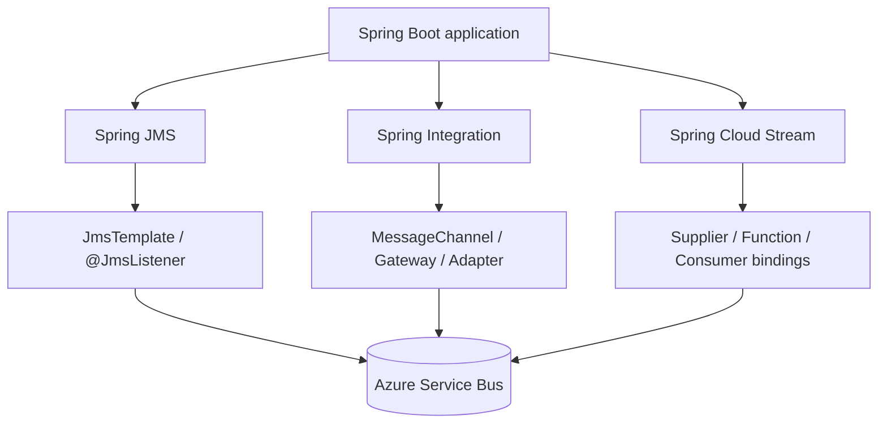
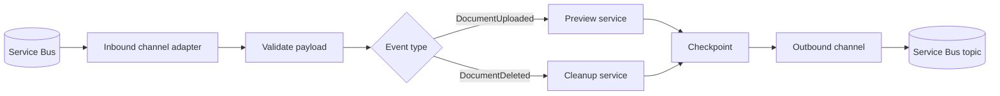

# JMS, Spring Integration, and the Stream binder when appropriate

> **Chapter:** Azure Service Bus  
> **Module:** SPRING_CLOUD_PROVIDER_INTEGRATION  
> **Objective:** Choose the right Spring abstraction for Azure Service Bus integration; implement sending/receiving with Spring JMS, Spring Integration channel adapters, and the Spring Cloud Stream binder; understand differences in subscriptions, settlement, sessions, tiers, configuration, and operations.

## 1. Choosing an abstraction by application architecture

Azure Service Bus provides queues and topics/subscriptions. A Spring Boot application can connect directly via the Azure SDK or use Spring ecosystem abstractions:

- **Spring JMS:** uses the Java Message Service standard with JmsTemplate, @JmsListener, and ConnectionFactory.
- **Spring Integration:** uses message channels, gateways, and inbound/outbound adapters to connect Service Bus into application processing flows.
- **Spring Cloud Stream binder:** uses the function/binding model with Supplier, Function, Consumer, destinations, and consumer groups.

All three approaches can send and receive messages, but they differ in how the application is structured and in feature coverage. Choose an abstraction based on architecture and workload needs, not merely line count.



### 1.1. Quick selection table

| Need | Suitable choice | Why |
| --- | --- | --- |
| Existing JMS app or JMS compatibility required | **Spring JMS** | Preserves familiar JMS APIs, reducing churn when migrating from another broker |
| Integrating Service Bus into internal flows, channels, gateways, or adapters | **Spring Integration** | Decouples transport from flows and connects to Spring Integration endpoints |
| Microservices using event-driven functions and bindings | **Spring Cloud Stream** | Declares destination/group via configuration; business code focuses on functions |
| Deep control over sessions, settlement, deferral, batching, or SDK options | Azure Service Bus native SDK or an abstraction exposing the needed features | Never assume every abstraction exposes the full Service Bus API |

All three abstractions in this lesson connect to the same Azure Service Bus. They do not create three different brokers, nor do they alter fundamental rules for queues, topics, subscriptions, locks, TTL, or DLQs.

## 2. Preparing dependencies and versions

Spring Cloud Azure provides a BOM to keep starter and Azure SDK versions aligned. Do not specify separate versions for individual starters when managed by the BOM.

Maven example:

```xml
<dependencyManagement>
    <dependencies>
        <dependency>
            <groupId>com.azure.spring</groupId>
            <artifactId>spring-cloud-azure-dependencies</artifactId>
            <version>${spring-cloud-azure.version}</version>
            <type>pom</type>
            <scope>import</scope>
        </dependency>
    </dependencies>
</dependencyManagement>
```

Current Spring Cloud Azure documentation specifies BOM versions matching each Spring Boot line. For instance, BOM 7.4.0 targets Spring Boot 4.0.x and BOM 6.5.0 targets Spring Boot 3.5.x. Other Spring Boot lines require checking the Spring Versions Mapping table first. Do not pair a newer starter with an old BOM merely because Maven still resolves the dependencies.

### 2.1. Pick one dependency per abstraction

Add only the dependency for the integration approach you use:

```xml
<!-- Spring JMS -->
<dependency>
    <groupId>com.azure.spring</groupId>
    <artifactId>spring-cloud-azure-starter-servicebus-jms</artifactId>
</dependency>

<!-- Spring Integration -->
<dependency>
    <groupId>com.azure.spring</groupId>
    <artifactId>spring-cloud-azure-starter-integration-servicebus</artifactId>
</dependency>

<!-- Spring Cloud Stream binder -->
<dependency>
    <groupId>com.azure.spring</groupId>
    <artifactId>spring-cloud-azure-stream-binder-servicebus</artifactId>
</dependency>
```

For Spring Cloud Stream, you can use the convenience starter:

```xml
<dependency>
    <groupId>com.azure.spring</groupId>
    <artifactId>spring-cloud-azure-starter-stream-servicebus</artifactId>
</dependency>
```

Do not add all three starters just to try every API inside the same production service. Each abstraction brings its own configuration, listener containers, connection factories, and settlement mechanisms; mixing multiple abstractions can unintentionally create two consumers reading from the same queue.

## 3. Authentication and access permissions

Spring Cloud Azure integrations support Microsoft Entra ID and connection string configuration. For workloads running on Azure, prefer Managed Identity/passwordless when supported by the environment.

- Producers need send permissions, typically **Azure Service Bus Data Sender**.
- Consumers need receive permissions, typically **Azure Service Bus Data Receiver**.
- Grant data management permissions only when the application genuinely performs administrative actions.
- Never commit connection strings containing SAS keys or client secrets to Git.
- Local development can use Azure CLI/IDE credentials through Azure Identity if configured accordingly.
- User-assigned Managed Identity requires a client ID; system-assigned identity does not need a separate client ID.

Authentication properties are not identical between JMS and integrations using the `spring.cloud.azure` prefix. Use the proper prefix for your abstraction.

## 4. Spring JMS: preserving standard JMS APIs

### 4.1. When to use JMS?

Spring JMS fits when:

- A system already uses JMS with ActiveMQ, IBM MQ, or another broker and wants to migrate to Azure Service Bus.
- The codebase standardizes on `JmsTemplate`, `@JmsListener`, listener containers, and the JMS message model.
- Architecture mandates standard JMS APIs or the team has deep JMS experience.
- Workloads primarily send/receive queues and topics without depending on specialized Service Bus features not exposed by JMS.

JMS is Java's standard messaging API. The Azure Service Bus JMS provider communicates with the broker over AMQP 1.0. Spring JMS preserves the application's send/receive programming model while the starter configures the connection factory and Spring Boot integration.

### 4.2. Mind JMS tiers and limitations

| Service Bus tier | JMS level | Meaning |
| --- | --- | --- |
| **Standard** | JMS 1.1 with a limited feature set | Fits JMS 1.1-compatible workloads |
| **Premium** | JMS 2.0 | Use when full JMS 2.0 is required |

JMS is not a wrapper exposing all native SDK capabilities. Microsoft documentation highlights key limitations:

- JMS does not support receiving messages from entities with **Service Bus message sessions** enabled. This concept differs from JMS `Session` objects.
- DLQ support is limited; JMS can receive from a DLQ, but lacks full custom reason/description APIs offered by the native SDK.
- Message deferral is only partially supported.
- Lock renewal must be managed manually by the application under the JMS model.
- Some features like batch receive and AMQP over WebSocket are not available as in the native SDK.
- No XA/JTA distributed transactions; JMS transactions do not create atomic distributed transactions across databases and systems outside Service Bus.

If your business needs FIFO via Service Bus `SessionId`, sequence-number deferral, custom DLQ reasons, or fine-grained lock/prefetch control, evaluate the native SDK before choosing JMS.

### 4.3. Configuring JMS with Microsoft Entra ID

Dependencies were declared above. Example `application.yml`:

```yaml
spring:
  jms:
    servicebus:
      namespace: ${AZURE_SERVICEBUS_NAMESPACE}
      pricing-tier: premium
      passwordless-enabled: true
    listener:
      receive-timeout: 60000
```

`pricing-tier` must match the actual namespace tier. The example above uses `premium` to illustrate JMS 2.0. On Standard, configure `standard` and rely only on supported JMS 1.1 features.

`passwordless-enabled: true` lets the starter use Microsoft Entra ID. During local development, credentials can come from Azure CLI or IDE tooling; on Azure, prefer Managed Identity. Assign Data Sender/Data Receiver roles per workload.

### 4.4. Configuring JMS with a connection string

If an environment does not yet use Entra ID, you can configure a connection string supplied from a secret store:

```yaml
spring:
  jms:
    servicebus:
      connection-string: ${AZURE_SERVICEBUS_CONNECTION_STRING}
      pricing-tier: premium
    listener:
      receive-timeout: 60000
```

Do not put real SAS keys into committed configuration files. Inject them via a secret manager or protected environment variables. When migrating to Entra ID, remove the connection string and switch to passwordless settings.

### 4.5. Sending and receiving on a queue with JmsTemplate and @JmsListener

`JmsTemplate` sends messages; `@JmsListener` registers receiving methods. Queue example:

```java
import org.springframework.boot.SpringApplication;
import org.springframework.boot.autoconfigure.SpringBootApplication;
import org.springframework.jms.annotation.EnableJms;
import org.springframework.jms.annotation.JmsListener;
import org.springframework.jms.core.JmsTemplate;
import org.springframework.stereotype.Component;
import org.springframework.stereotype.Service;

@SpringBootApplication
@EnableJms
public class DocumentJmsApplication {
    public static void main(String[] args) {
        SpringApplication.run(DocumentJmsApplication.class, args);
    }
}

@Service
class DocumentCommandPublisher {

    private final JmsTemplate jmsTemplate;

    DocumentCommandPublisher(JmsTemplate jmsTemplate) {
        this.jmsTemplate = jmsTemplate;
    }

    public void publish(String documentId) {
        jmsTemplate.convertAndSend(
                "preview-jobs",
                "GeneratePreview:" + documentId);
    }
}

@Component
class PreviewCommandListener {

    @JmsListener(
            destination = "preview-jobs",
            containerFactory = "jmsListenerContainerFactory")
    public void receive(String command) {
        // Parse and validate the command, then call the business handler.
        System.out.println("Received: " + command);
    }
}
```

This example uses strings to focus on the JMS API. Real applications should send DTOs or JSON following an explicit contract, set appropriate correlation IDs and message IDs, and validate payloads before processing. Do not log full payloads if they contain sensitive data.

The Spring Boot starter configures the connection factory and listener container. `jmsListenerContainerFactory` is the bean created by the starter/auto-configuration in this example; if your application defines custom factories, reference the matching bean name and transaction/acknowledgement mode.

### 4.6. Sending and receiving on a topic/subscription

With topics, the producer sends to the topic; each matching subscription receives copies per rules. Listeners must configure the topic destination and corresponding subscription:

Example topic listener configuration using Microsoft Entra ID:

```yaml
spring:
  jms:
    servicebus:
      namespace: ${AZURE_SERVICEBUS_NAMESPACE}
      topic-client-id: ${AZURE_SERVICEBUS_TOPIC_CLIENT_ID}
      pricing-tier: premium
      passwordless-enabled: true
```

`topic-client-id` is the JMS client ID used for subscriptions per Service Bus configuration. Its value must match the subscription/client identifier configured for the application.

```java
import org.springframework.jms.annotation.JmsListener;
import org.springframework.stereotype.Component;

@Component
class AuditEventListener {

    @JmsListener(
            destination = "document-events",
            subscription = "audit-worker",
            containerFactory = "topicJmsListenerContainerFactory")
    public void receive(String event) {
        // Process the copy in the audit-worker subscription.
    }
}
```

Configure the topic listener container factory and durable/shared subscription per application requirements. `subscription` is the subscription name already created in Service Bus. Do not confuse `subscription` with a queue name.

### 4.7. Transactions, acknowledgement, and idempotency in JMS

JMS listener containers enforce transaction/acknowledgement mechanics per configuration. When the listener returns, the message can be acknowledged/settled under the active mode. If the listener throws an exception, redelivery behavior depends on transaction/session mode and the provider.

A JMS transaction does not create an ACID transaction spanning Service Bus, PostgreSQL, and Blob Storage. If a listener writes to the database and the acknowledgement fails, the message can be redelivered. Consumers still need idempotency via event IDs/message IDs and database unique constraints.

Do not treat `@JmsListener` as exactly-once processing. Check the transaction manager, acknowledgement mode, redelivery policy, and dead-letter behavior of the JMS provider on your exact tier.

## 5. Spring Integration: connecting Service Bus via message channels

### 5.1. When to use Spring Integration?

Spring Integration fits when an application has multiple endpoints or needs to wire Service Bus into a unified processing flow:

- Messages from Service Bus flow through channels, transformers, filters, routers, or service activators.
- A business pipeline ingests from multiple systems and dispatches to multiple targets.
- You want `MessageChannel`, `@ServiceActivator`, `@MessagingGateway`, and adapters rather than mixing transport logic into business services.
- You need an observable, testable integration flow modifiable step by step.

The Spring Integration Service Bus extension provides inbound channel adapters and outbound channel handlers. The inbound adapter uses `ServiceBusMessageListenerContainer`, which uses `ServiceBusProcessorClient` under the hood to receive messages. The outbound handler sends via `ServiceBusTemplate`.

### 5.2. Dependencies and connection configuration

Add:

```xml
<dependency>
    <groupId>com.azure.spring</groupId>
    <artifactId>spring-cloud-azure-starter-integration-servicebus</artifactId>
</dependency>
```

Example namespace and Managed Identity configuration:

```yaml
spring:
  cloud:
    azure:
      credential:
        managed-identity-enabled: true
      servicebus:
        namespace: ${AZURE_SERVICEBUS_NAMESPACE}
```

If using a user-assigned identity, add `client-id` per Spring Cloud Azure credential settings. In local development, `DefaultAzureCredential` works via supported environment tooling. The identity needs Data Sender or Data Receiver depending on the flow.

### 5.3. Sending messages via an outbound channel

Create an output channel, `ServiceBusTemplate`, and `DefaultMessageHandler`. Queue example:

```java
import com.azure.spring.integration.core.handler.DefaultMessageHandler;
import com.azure.spring.messaging.servicebus.core.ServiceBusTemplate;
import com.azure.spring.cloud.service.servicebus.properties.ServiceBusEntityType;
import org.springframework.context.annotation.Bean;
import org.springframework.context.annotation.Configuration;
import org.springframework.integration.annotation.ServiceActivator;
import org.springframework.integration.channel.DirectChannel;
import org.springframework.messaging.MessageChannel;
import org.springframework.messaging.MessageHandler;

@Configuration
class ServiceBusOutboundConfiguration {

    @Bean
    MessageChannel serviceBusOutput() {
        return new DirectChannel();
    }

    @Bean
    @ServiceActivator(inputChannel = "serviceBusOutput")
    MessageHandler queueMessageSender(ServiceBusTemplate template) {
        template.setDefaultEntityType(ServiceBusEntityType.QUEUE);
        return new DefaultMessageHandler("preview-jobs", template);
    }
}
```

Publish messages to the channel via `MessageChannel.send(...)`, `MessagingTemplate`, or a gateway. `ServiceBusTemplate` needs to know the entity type unless producer configuration supplies another entity type. For a topic, use `ServiceBusEntityType.TOPIC` and the topic name as the destination.

A gateway keeps business services unaware of channel names:

```java
import org.springframework.integration.annotation.MessagingGateway;

@MessagingGateway(defaultRequestChannel = "serviceBusOutput")
interface PreviewCommandGateway {
    void send(String payload);
}
```

Services can then call `previewCommandGateway.send(payload)`. The gateway is only the flow entry point; serialization, metadata, and send errors must still be handled per application contract.

### 5.4. Receiving messages via an inbound channel adapter

Create a listener container, disable auto-complete if you want manual checkpointing, and wire the adapter to the input channel:

```java
import com.azure.spring.integration.servicebus.inbound.ServiceBusInboundChannelAdapter;
import com.azure.spring.messaging.servicebus.core.ServiceBusProcessorFactory;
import com.azure.spring.messaging.servicebus.core.listener.ServiceBusMessageListenerContainer;
import com.azure.spring.messaging.servicebus.core.properties.ServiceBusContainerProperties;
import org.springframework.context.annotation.Bean;
import org.springframework.context.annotation.Configuration;
import org.springframework.integration.channel.DirectChannel;
import org.springframework.messaging.MessageChannel;

@Configuration
class ServiceBusInboundConfiguration {

    @Bean
    MessageChannel serviceBusInput() {
        return new DirectChannel();
    }

    @Bean
    ServiceBusMessageListenerContainer previewListenerContainer(
            ServiceBusProcessorFactory processorFactory) {

        ServiceBusContainerProperties properties =
                new ServiceBusContainerProperties();

        properties.setEntityName("preview-jobs");
        properties.setAutoComplete(false);

        return new ServiceBusMessageListenerContainer(
                processorFactory,
                properties);
    }

    @Bean
    ServiceBusInboundChannelAdapter previewInboundAdapter(
            MessageChannel serviceBusInput,
            ServiceBusMessageListenerContainer listenerContainer) {

        ServiceBusInboundChannelAdapter adapter =
                new ServiceBusInboundChannelAdapter(listenerContainer);

        adapter.setOutputChannel(serviceBusInput);
        return adapter;
    }
}
```

Imports in this example correspond to Spring Cloud Azure 7.4.x packages. When using a different major version, verify package names against your BOM's Javadoc. The core pattern remains: configure container → create inbound adapter → set output channel.

### 5.5. Confirming processing with Checkpointer

When `autoComplete` is off, the handler must acknowledge the message after business processing finishes. The inbound adapter injects `Checkpointer` in the `AzureHeaders.CHECKPOINTER` message header.

```java
import com.azure.spring.messaging.AzureHeaders;
import com.azure.spring.messaging.checkpoint.Checkpointer;
import org.springframework.integration.annotation.ServiceActivator;
import org.springframework.messaging.handler.annotation.Header;
import org.springframework.stereotype.Component;

@Component
class PreviewMessageEndpoint {

    @ServiceActivator(inputChannel = "serviceBusInput")
    public void receive(
            byte[] payload,
            @Header(AzureHeaders.CHECKPOINTER) Checkpointer checkpointer) {

        String json = new String(
                payload,
                java.nio.charset.StandardCharsets.UTF_8);

        previewService.processIdempotently(json);

        // Checkpoint only after business state has committed successfully.
        checkpointer.success().block();
    }
}
```

`Checkpointer.success()` confirms message processing via the adapter's mechanism. Call it only after business state is safely persisted. If processing fails, route the error to the error flow and let the adapter/broker apply the appropriate retry policy; never checkpoint success in a `finally` block.

Do not hold a message lock while offloading work to a background thread and returning from the service activator. When the handler finishes, checkpointing/settlement must reflect actual processing completion. If processing can run long, consider durable jobs or chunked checkpoints.

### 5.6. Message conversion and headers

Spring Integration works with Spring Message payloads and headers. The Service Bus converter can map headers such as content type, message ID, correlation ID, session ID, partition key, and scheduled enqueue time to message properties.

- `byte[]` payloads must be deserialized per content type and contract.
- Standard Service Bus headers should use the corresponding `ServiceBusMessageHeaders` constants.
- Custom metadata should be limited to broker-supported scalar types.
- Do not put secrets or personal data in headers.
- Customize `ObjectMapper`/converters if Java Time or custom DTOs require it.

### 5.7. When a flow needs multiple steps

A flow might include:



Use filters/routers/transformers to separate orchestration from business logic. Do not build an overly long flow just to replace a few lines of `@ServiceBusListener`; Spring Integration shines when connecting multiple steps or multiple systems.

## 6. Spring Cloud Stream binder: functions and bindings

### 6.1. When to use the Stream binder?

Spring Cloud Stream fits when applications follow an event-driven microservices style and want code centered on functions:

- Producers are expressed as `Supplier`.
- Consumers are expressed as `Consumer`.
- Processors are expressed as `Function`.
- `destination` and `group` live in configuration.
- Binders or brokers can be swapped at the configuration level when abstractions align.

The Azure Service Bus binder is built on top of Spring Integration Service Bus channel adapters. Thus, the Stream binder is a higher binding/function layer over the same underlying Service Bus mechanics.

### 6.2. A topic consumer group maps to a subscription

With Spring Cloud Stream, `group` on a topic binding maps to a **Service Bus subscription**. Keep this in mind when coming from Kafka:

- Kafka consumer groups have partition/offset assignment semantics.
- With Service Bus topics, each subscription is an independent copy/receive stream per filter/rule.
- Multiple instances of the same binding/subscription compete to process messages within that subscription.
- Two different groups correspond to two distinct subscriptions, and each can receive its own copies.

For queues, `destination` is the queue name; no topic group is needed to receive messages.

### 6.3. Dependencies

Use the binder:

```xml
<dependency>
    <groupId>com.azure.spring</groupId>
    <artifactId>spring-cloud-azure-stream-binder-servicebus</artifactId>
</dependency>
```

Or the starter:

```xml
<dependency>
    <groupId>com.azure.spring</groupId>
    <artifactId>spring-cloud-azure-starter-stream-servicebus</artifactId>
</dependency>
```

### 6.4. Queue binding configuration

Example `application.yml` for a queue:

```yaml
spring:
  cloud:
    azure:
      credential:
        managed-identity-enabled: true
      servicebus:
        namespace: ${AZURE_SERVICEBUS_NAMESPACE}
    function:
      definition: consume;supply
    stream:
      bindings:
        consume-in-0:
          destination: ${AZURE_SERVICEBUS_QUEUE}
        supply-out-0:
          destination: ${AZURE_SERVICEBUS_QUEUE}
      servicebus:
        bindings:
          consume-in-0:
            consumer:
              auto-complete: false
          supply-out-0:
            producer:
              entity-type: queue
```

Explanation:

- `spring.cloud.function.definition` enables both `consume` and `supply` functions.
- `consume-in-0` is the consumer's input binding.
- `supply-out-0` is the supplier's output binding.
- `destination` is the queue name.
- `producer.entity-type` is required for producer bindings; set `queue` or `topic` to match the destination.
- `auto-complete: false` lets the consumer use `Checkpointer` for manual checkpointing.

If you only need a consumer or a producer, declare only the corresponding function/binding. Do not define a `Supplier` when the application only receives messages.

### 6.5. Consumer and supplier functions

```java
import com.azure.spring.messaging.AzureHeaders;
import com.azure.spring.messaging.checkpoint.Checkpointer;
import org.springframework.context.annotation.Bean;
import org.springframework.messaging.Message;
import org.springframework.messaging.support.MessageBuilder;

import java.util.function.Consumer;
import java.util.function.Supplier;

class DocumentEventFunctions {

    @Bean
    Consumer<Message<String>> consume() {
        return message -> {
            String payload = message.getPayload();

            // Process business logic and persist durable state.
            previewService.processIdempotently(payload);

            Checkpointer checkpointer = message.getHeaders()
                    .get(AzureHeaders.CHECKPOINTER, Checkpointer.class);

            if (checkpointer == null) {
                throw new IllegalStateException(
                        "Checkpointer is missing; check auto-complete and binder config");
            }

            checkpointer.success().block();
        };
    }

    @Bean
    Supplier<Message<String>> supply() {
        return () -> MessageBuilder
                .withPayload("{\"eventType\":\"PreviewRequested\"}")
                .build();
    }
}
```

This example shows how the binder passes payloads and headers into a Spring Message. In production, do not let a `Supplier` emit the same event automatically on context startup without control; producers typically send from services via an output binding or function composition. The `supply` bean above merely illustrates an output binding.

Because the consumer above is an imperative `Consumer`, `block()` waits for checkpointing to finish before returning. If using a reactive `Function`, compose the `Checkpointer`'s `Mono` into your pipeline instead of blocking a thread.

If processing fails, do not call `checkpointer.success()`. `requeue-rejected` and the error channel determine how the binder handles rejected messages; verify exact policy before going to production.

### 6.6. Topic and subscription group configuration

For a topic, set `destination` to the topic name and `group` to the subscription name:

```yaml
spring:
  cloud:
    azure:
      servicebus:
        namespace: ${AZURE_SERVICEBUS_NAMESPACE}
    function:
      definition: consume
    stream:
      bindings:
        consume-in-0:
          destination: document-events
          group: preview-worker
      servicebus:
        bindings:
          consume-in-0:
            consumer:
              auto-complete: false
```

`preview-worker` must exist or be provisioned according to binder config/permissions. A topic binding without `group` will fail to resolve a subscription under the binder's consumer group model.

### 6.7. Consumer options: concurrency, sessions, prefetch, and DLQ

The binder exposes Service Bus properties per binding:

| Property | Meaning |
| --- | --- |
| `consumer.max-concurrent-calls` | Number of concurrent message callbacks |
| `consumer.max-concurrent-sessions` | Number of sessions processed concurrently |
| `consumer.session-enabled` | Indicates consumer reads from a session-enabled entity |
| `consumer.prefetch-count` | Prefetch message count |
| `consumer.max-auto-lock-renew-duration` | Auto-lock renewal window |
| `consumer.receive-mode` | Receive mode, defaults to Peek-Lock |
| `consumer.auto-complete` | Auto-settle messages vs. using `Checkpointer` |
| `consumer.sub-queue` | Connect to a subqueue such as DLQ |
| `consumer.requeue-rejected` | How rejected messages are handled in the error flow |

Configuration example:

```yaml
spring:
  cloud:
    stream:
      servicebus:
        bindings:
          consume-in-0:
            consumer:
              auto-complete: false
              max-concurrent-calls: 2
              prefetch-count: 0
              max-auto-lock-renew-duration: 5m
              requeue-rejected: true
```

Per binder documentation, `requeue-rejected: true` lets the default consumer error handler move failed messages to the DLQ; when disabled, messages are abandoned. Verify behavior with your actual handlers and error channels—do not mistake this property for a retry delay.

If the entity uses sessions, enable `session-enabled` and configure `max-concurrent-sessions` appropriately. Producers can set `ServiceBusMessageHeaders.SESSION_ID` in Spring Message headers. Do not increase concurrency within the same session if it breaks business side-effect ordering.

### 6.8. Scheduled messages via the x-delay header

The binder supports sending scheduled messages to topics using the `x-delay` header in milliseconds:

```java
import org.springframework.messaging.Message;
import org.springframework.messaging.support.MessageBuilder;

Message<String> delayedEvent = MessageBuilder
        .withPayload("{\"eventType\":\"ReminderDue\"}")
        .setHeader("x-delay", 120_000)
        .build();
```

This asks the binder to deliver the message after approximately 120 seconds. This is a binder feature for topics per current docs; do not extrapolate that every queue binding or every version shares identical semantics. For full scheduled-message APIs, use the native Service Bus SDK.

### 6.9. Error channels

The Spring Cloud Stream binder provides a consumer error channel. The default handler can dead-letter messages when `requeue-rejected` is enabled; otherwise messages are abandoned. You can register a custom error handler with `@ServiceActivator` on the binding's error channel.

Conceptual example:

```java
@ServiceActivator(inputChannel = "document-events.preview-worker.errors")
public void handleConsumerError(Message<?> errorMessage) {
    // Record metrics, correlation ID, and error cause.
    // Do not log sensitive payloads.
}
```

The error channel name depends on `destination`/`group` and binding settings. Use the exact name matching your binding. Never swallow an exception and treat the message as processed without checkpointing/settling.

## 7. Deep comparison of the three options

| Criterion | Spring JMS | Spring Integration | Spring Cloud Stream |
| --- | --- | --- | --- |
| Programming model | `JmsTemplate`, `@JmsListener` | Channels, adapters, gateways, service activators | `Supplier`, `Function`, `Consumer`, bindings |
| Abstraction level | JMS standard | Flow/message endpoints | Functions/binders |
| Queue | Yes | Yes | Yes |
| Topic/subscription | Yes | Yes | Yes; `group` maps to subscription |
| Microsoft Entra ID | Yes via starter | Yes via Spring Cloud Azure credentials | Yes via Spring Cloud Azure credentials |
| Sessions | Does not support receiving Service Bus sessions | Relies on underlying processor/container & config; verify version | Supported via consumer/session properties and headers |
| DLQ | Limited; receives DLQ but lacks full custom reason API | Controllable via underlying processor/checkpoint | Consumer error handling and `requeue-rejected` |
| Scheduled messages | Supports JMS delivery delay | Uses `ServiceBusTemplate`/appropriate API | Binder supports `x-delay` for topics |
| Settlement control | Per JMS acknowledgement/transaction semantics | `Checkpointer` and container properties | `Checkpointer` when `auto-complete` is disabled |
| Best fit | Reusing JMS code | Multi-step/channel integrations | Function/event-driven microservices |

This table summarizes abstractions and exposed capabilities. Final capabilities also depend on the Service Bus tier, entity configuration, BOM version, and binder version.

## 8. Picking the right tool by scenario

### Scenario A — Migrating an app from a JMS broker to Azure

The application already has many `@JmsListener`s, `JmsTemplate`s, listener containers, and JMS contracts. The team wants stable business code while swapping brokers.

**Choose Spring JMS** if tier and feature coverage match. Check JMS 1.1/JMS 2.0, sessions, DLQ, and scheduled delivery before migrating. If you need Service Bus sessions or native features absent in JMS, use the native SDK or refactor an adapter for that piece.

### Scenario B — Multi-step integration flow

An event arriving from Service Bus must be validated, enriched, routed by event type, audited, and forwarded to another topic. The team wants each step as an isolated endpoint/channel.

**Choose Spring Integration.** Inbound/outbound adapters and channels decouple transport from individual service activators. Keep handlers small and checkpoint after work finishes.

### Scenario C — Function-based event-driven microservice

A service has `Consumer<DocumentUploadedEvent>` and `Supplier<PreviewCompletedEvent>`, and wants `destination` and `group` configured outside code.

**Choose the Spring Cloud Stream binder.** Function code focuses on payloads while binding config selects queues/topics/subscriptions. If one service uses multiple brokers/binders, Stream supports multi-binder setups while requiring separate environment/credential management.

### Scenario D — Deep native features required

The business requires receiving deferred messages by sequence number, custom dead-letter reasons, cross-entity transactions, explicit session acceptance, batch receiving, or fine-grained prefetch/lock tuning.

**Use the Azure Service Bus native SDK** for the parts needing control. Do not force JMS or another abstraction to emulate unexposed capabilities.

## 9. Common integration pitfalls

| Symptom | Common cause | Fix |
| --- | --- | --- |
| `JmsTemplate` cannot send | Wrong namespace, pricing tier, connection factory, or Data Sender role | Check `spring.jms.servicebus.*`, Entra role, and entity |
| `@JmsListener` receives no queue messages | Wrong destination, listener container, or Data Receiver role | Check queue, factory, receive timeout, and role |
| JMS topic receives nothing | Missing subscription or wrong topic listener factory | Check topic/subscription and durable/shared config |
| JMS on Standard misses APIs | Standard only provides JMS 1.1 with a limited feature set | Use Premium for JMS 2.0 or switch abstraction |
| Integration adapter fails to checkpoint | Misconfigured `autoComplete`/manual checkpoint | Check `ServiceBusContainerProperties` and `Checkpointer` header |
| Stream binder fails to create producer | Missing `producer.entity-type` | Set `queue` or `topic` matching the destination |
| Topic binder receives no messages | Missing `group` or wrong subscription | Set `group` to the subscription name |
| Failed messages redeliver nonstop | Error flow abandons or rethrows exceptions | Define retry/DLQ policy and `requeue-rejected` |
| Messages complete before work finishes | `auto-complete` enabled or callback returns early | Disable `auto-complete` and checkpoint after commit |
| Two abstractions read the same queue | Multiple listeners/processors configured simultaneously | Establish one clear consumer owner and audit startup beans |
| Managed Identity rejected | Missing role or wrong scope | Assign Data Sender/Receiver on the exact namespace/entity |
| DTO payload fails deserialization | Mismatched converter/ObjectMapper/schema | Align content type, schema version, and mapper |

### 9.1. Do not misuse listener connection factories

For JMS listener containers, avoid sharing a single `SingleConnectionFactory` connection across all listener containers. If that connection drops, every listener can lose connectivity together. Azure JMS documentation recommends proper connection factory configuration so each container recovers independently. Newer starter versions may already isolate factories by default; check your version before overriding connection factories.

### 9.2. Do not mistake auto-complete for a business checkpoint

With Spring Integration and the Stream binder, when manual settlement is needed, disable `auto-complete` and call `Checkpointer.success()` after the business transaction commits. Checkpointing success on failure removes the message from the main stream even though the job never completed.

### 9.3. Do not choose JMS when session-based FIFO is mandatory

JMS does not expose Service Bus session receiving. If the system requires per-aggregate ordering via `SessionId`, use the native SDK or an adapter/binder verified to support sessions. Never confuse a JMS topic subscription with a Service Bus message session.

## 10. Testing the three abstractions

Testing must prove both message transport and business outcomes.

### 10.1. Unit tests

- JMS publisher calls `JmsTemplate` with the expected destination and payload.
- Spring Integration flow routes to the right output channel and service activator.
- Stream functions process payloads, validate schemas, and emit contract-compliant events.
- Handlers remain idempotent when receiving the same event ID again.
- Error paths never checkpoint messages before business completion.

Mock the abstractions in unit tests; no Azure connection is needed for every unit test.

### 10.2. Integration tests against a Service Bus test namespace

Provision dedicated test resources:

- A queue for commands.
- A topic and at least two subscriptions for pub/sub.
- A session-enabled entity if testing session binders/adapters.
- Dedicated identities with Data Sender/Data Receiver roles.

Scenarios to test:

| Test | JMS | Spring Integration | Stream binder |
| --- | --- | --- | --- |
| Queue send | `JmsTemplate` | Outbound handler/gateway | `Supplier`/output binding |
| Queue receive | `@JmsListener` | Inbound adapter | `Consumer` binding |
| Topic subscription | `@JmsListener` with topic factory | Listener container with subscription | Binding `group` |
| Manual settlement | JMS transaction/ack config | `Checkpointer` | `Checkpointer` |
| Identity | Entra/passwordless | Managed Identity | Managed Identity |
| Redelivery | Listener transaction/provider behavior | Unsuccessful checkpoint | Checkpoint/error channel |
| DLQ | Verify JMS provider limits | Verify processor/DLQ policy | `requeue-rejected` and DLQ |
| Sessions | Not supported for JMS session receive | Verify version support on adapter/container | `session-enabled` and `SessionId` header |

The emulator can speed up local development for supported features, but it does not replace cloud integration tests for Microsoft Entra ID, RBAC, tiers, subscriptions, and real broker behavior.

### 10.3. Testing failures and redelivery

1. Send a message with a unique event ID.
2. Have the consumer write business results to the database.
3. Force acknowledgement/checkpointing to fail in a controlled way.
4. Observe whether the message is redelivered.
5. Verify the consumer produces no duplicate side effects.
6. Send a malformed schema payload and inspect the DLQ/error flow.
7. Verify retries/DLQ behave per the chosen abstraction and tier.

Do not just check for a `"Received message"` log line. Verify the final state in the database or target system.

## 11. Comprehensive hands-on lab: one queue across three abstractions

**Scenario:** A document management system emits `GeneratePreview` commands to the `preview-jobs` queue. A worker receives the command, reads Blob Storage, builds a preview, and updates document status in the database.

### Part A — JMS

- Add `spring-cloud-azure-starter-servicebus-jms`.
- Configure Entra passwordless auth and pricing tier.
- Send commands via `JmsTemplate.convertAndSend`.
- Receive via `@JmsListener`.
- Test redelivery, transactions, and tier-specific JMS limits.

### Part B — Spring Integration

- Add `spring-cloud-azure-starter-integration-servicebus`.
- Create an outbound `DefaultMessageHandler` and `ServiceBusTemplate`.
- Create an inbound `ServiceBusInboundChannelAdapter`.
- Wire the channel to `@ServiceActivator`.
- Disable auto-complete and checkpoint after preview/DB completion.

### Part C — Spring Cloud Stream

- Add `spring-cloud-azure-stream-binder-servicebus`.
- Implement `Consumer<Message<String>>`.
- Set `consume-in-0.destination` to `preview-jobs`.
- Disable auto-complete and use `Checkpointer`.
- Add an output binding if publishing `PreviewCompleted`.

### Part D — Compare

Record configuration volume, how destinations are specified, exception/settlement handling, header/correlation ID visibility, testability, and support for sessions/DLQ/scheduled delivery.

### Part E — Try topic/subscription

Create topic `document-events` with subscriptions `preview-worker` and `audit-worker`.

- With JMS, use a topic listener factory and subscription name.
- With Spring Integration, configure the listener container for topic/subscription.
- With the Stream binder, set `destination=document-events` and `group=preview-worker`.
- Send an event and verify both subscriptions receive copies per rules.

**Completion criteria:** learners explain differences across the three abstractions; configure the right dependencies and identities; send/receive on queues and topics; manage settlement per abstraction; and choose an integration style based on actual features and tiers.

---

## 12. Checklist before deploying an abstraction

| Question | If the answer is "yes" |
| --- | --- |
| Existing codebase uses JMS and needs minimal-churn migration? | Evaluate Spring JMS and JMS tier requirements |
| JMS 2.0 required? | Use Service Bus Premium |
| Service Bus sessions required? | Do not pick JMS; evaluate native SDK, Spring Integration, or Stream binder with verified session support |
| Flow involves multiple channels/routers/transformers/service activators? | Evaluate Spring Integration |
| Microservice already uses Spring Cloud Stream functions/bindings? | Evaluate the Service Bus binder |
| Need externalized destination/group config without coupling code to broker? | Stream binder |
| Need native APIs like defer, custom DLQ reasons, or batching? | Use the Azure Service Bus SDK for those parts |
| Need explicit acknowledgement/checkpoint control? | Check JMS transaction/ack or manual `Checkpointer` |
| Multiple abstractions connecting to the same queue? | Clarify consumer ownership before deploying |

## Takeaways

- **Spring JMS** fits systems already using JMS or requiring JMS APIs; Standard supports only a limited JMS 1.1 feature set, while Premium supports JMS 2.0.
- **Spring Integration** uses channel adapters, gateways, and service activators to integrate Service Bus into integration flows.
- **Spring Cloud Stream binder** uses `Supplier`/`Function`/`Consumer` and bindings; a topic `group` maps to a subscription.
- With Spring Integration/Stream binder, manual checkpointing requires disabling `auto-complete` and calling `Checkpointer.success()` after business commit.
- The binder exposes consumer settings like concurrency, sessions, prefetch, lock renewal, and error/DLQ behavior; cross-check the property reference for your BOM.
- No abstraction provides automatic end-to-end exactly-once semantics. Redelivery can still happen; consumers must be idempotent.
- When full native Service Bus features are needed, choose the Azure SDK rather than forcing an abstraction that lacks the API.

When integrating Spring Boot with Azure Service Bus, start from system requirements: standard JMS, integration flows, or function-based event processing. Then verify tiers, sessions, settlement, DLQs, and version compatibility before choosing a starter. The right abstraction keeps code clean while preserving the messaging semantics your business needs.

### Official documentation

- [Choose between JMS and native SDK for Azure Service Bus](https://learn.microsoft.com/en-us/azure/service-bus-messaging/service-bus-jms-versus-native-sdk)
- [Use JMS in Spring to access Azure Service Bus](https://learn.microsoft.com/en-us/azure/developer/java/spring-framework/configure-spring-boot-starter-java-app-with-azure-service-bus)
- [Spring Cloud Azure — Spring Integration with Azure Service Bus](https://microsoft.github.io/spring-cloud-azure/current/reference/html/index.html)
- [Spring Cloud Azure — Spring Cloud Stream Binder for Azure Service Bus](https://learn.microsoft.com/en-us/azure/developer/java/spring-framework/spring-cloud-stream-support)
- [Spring Cloud Stream with Azure Service Bus](https://learn.microsoft.com/en-us/azure/developer/java/spring-framework/configure-spring-cloud-stream-binder-java-app-with-service-bus)
- [Spring Cloud Azure developer guide and version mapping](https://learn.microsoft.com/en-us/azure/developer/java/spring-framework/developer-guide-overview)
- [Azure Service Bus JMS 2.0 developer guide](https://learn.microsoft.com/en-us/azure/service-bus-messaging/jms-developer-guide)

Verify Spring Boot/JDK versions, Spring Cloud Azure BOM, Service Bus tier, queues/topics/subscriptions, and binder versions before applying. Some classes/packages and properties change across major versions; consult the reference/Javadoc for your deployed BOM rather than copying legacy snippets verbatim.
