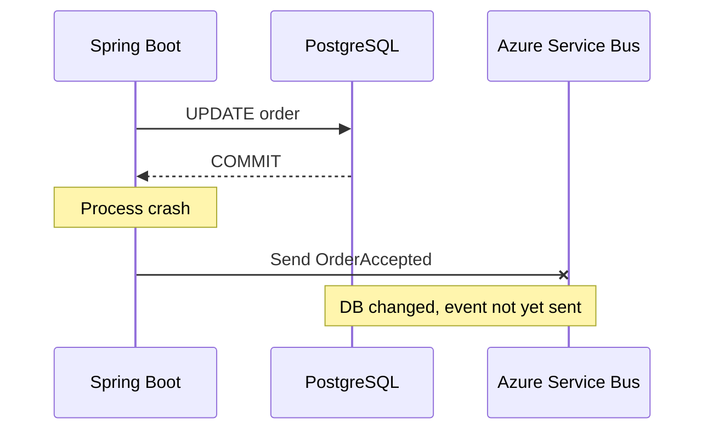
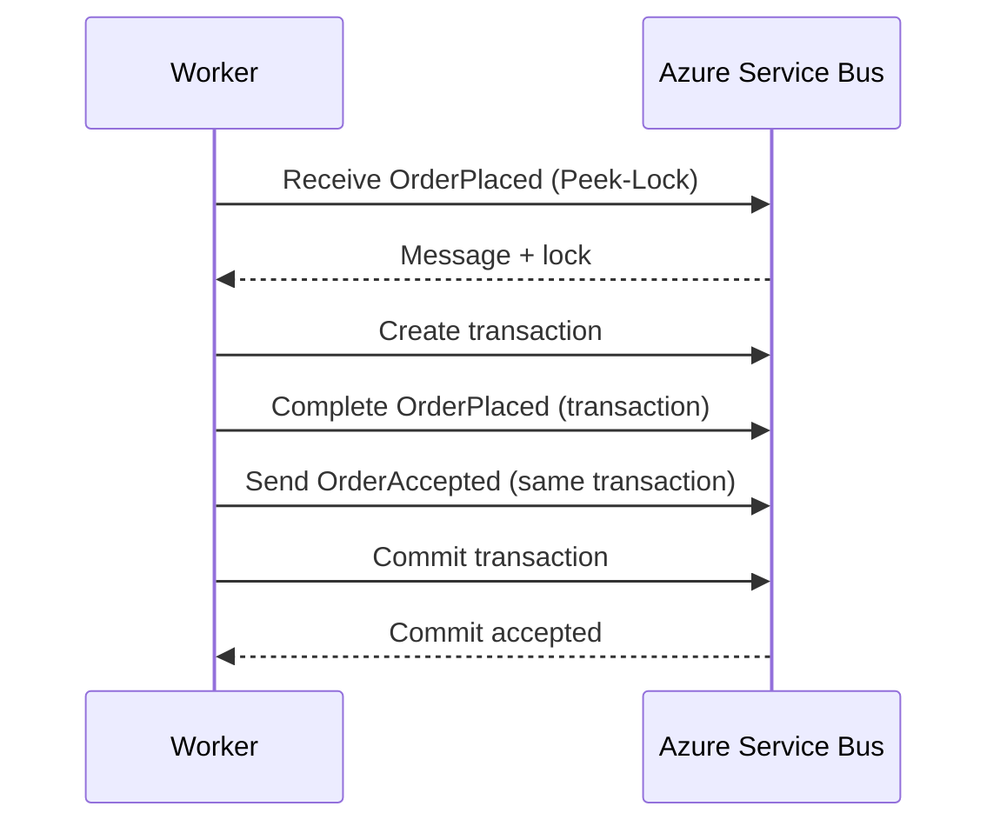
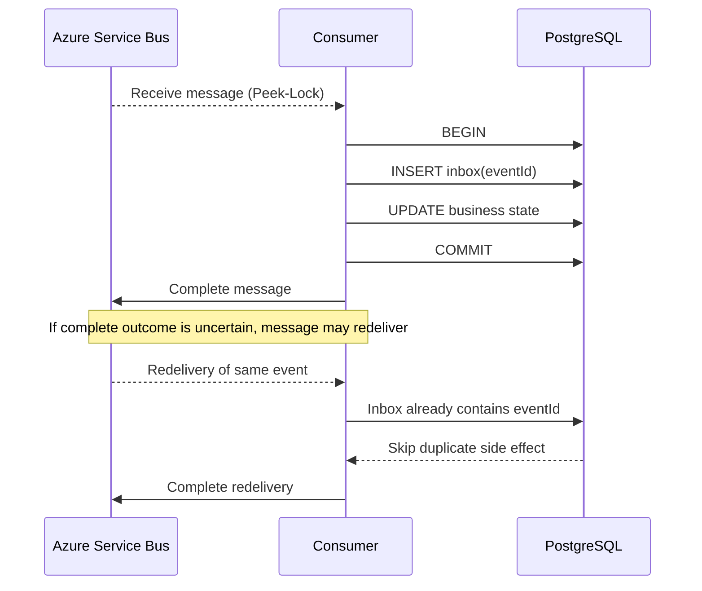
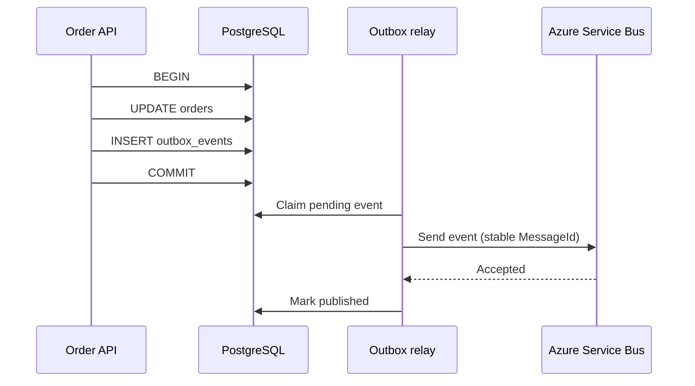
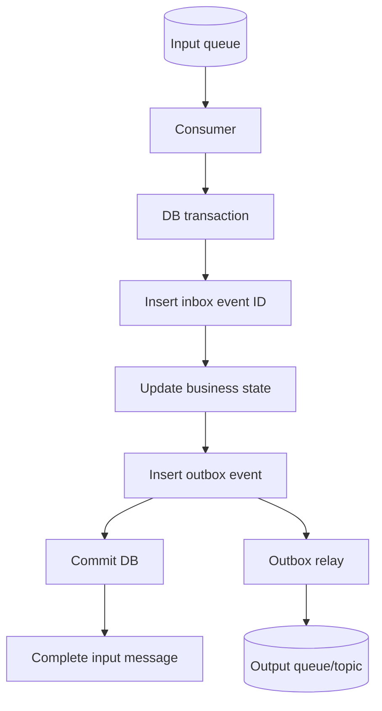
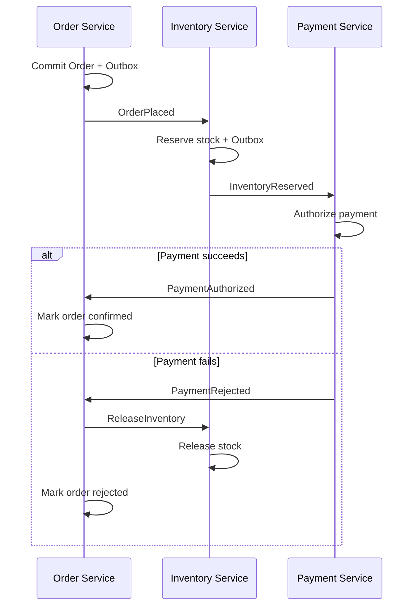

# Transaction limits and boundaries with database transactions

> **Chapter:** Azure Service Bus  
> **Module:** SPRING_CLOUD_PROVIDER_INTEGRATION  
> **Objective:** Distinguish Azure Service Bus transactions from database transactions in Spring Boot; use the Java SDK to group broker operations; handle the gap between DB commit and message settlement using inbox, idempotency, and transactional outbox.

## 1. A single business action often touches multiple systems

Suppose a Spring Boot application receives an `OrderPlaced` event from the `orders-in` queue. The worker must update order status in PostgreSQL, reserve inventory in another service, send an `OrderAccepted` event to the `orders-events` queue, and then complete the input message.

Each system has its own transaction mechanism. PostgreSQL has database transactions; Service Bus has broker transactions; the inventory service may have its own transaction. A Spring `@Transactional` annotation by default manages only the resource supported by its configured transaction manager. It does not automatically combine the database, Service Bus, and HTTP APIs into one atomic transaction.

If the application writes to the database first and then sends the message, the process can crash after DB commit but before send. The order is updated, yet no event reaches downstream systems. If it sends the message first and the DB rolls back, downstream systems receive an event describing an uncommitted change.

This is the **dual-write problem**: two independent writes need to happen together, yet no shared transaction covers both.



A reliable messaging system must define which resources belong to the same transaction, when the DB commits, when the broker completes the message, and how to recover if the process crashes between the two operations or an acknowledgement is lost.

## 2. Different transaction types have different scopes

| Mechanism | Protected resources | Covers PostgreSQL and Service Bus together? |
| --- | --- | --- |
| Database transaction via Spring JDBC/JPA | One database/resource managed by the DB transaction manager | Not automatically |
| Azure Service Bus transaction | Broker-supported messaging operations within the transaction scope | No |
| JMS local transaction | Operations within a JMS session/connection transaction | Does not automatically include JDBC |
| JTA/XA distributed transaction | Multiple XA resources if all resources and the transaction manager support it | Azure Service Bus JMS does not support XA/JTA distributed transactions |
| Inbox/idempotency | DB commits once per logical event; broker settlement follows | Does not create a shared transaction, but recovers safely on redelivery |
| Transactional outbox | Business state and event record commit atomically in the database | Does not commit DB and broker simultaneously; a relay sends after commit |

**Transaction does not mean every participating system automatically commits or rolls back together.** You must identify the transaction manager and which resources are actually enlisted.

In Spring Boot, `@Transactional` usually uses `PlatformTransactionManager` or `ReactiveTransactionManager`. With JDBC/JPA, that transaction manager coordinates database connections/persistence contexts. The Azure Service Bus native SDK has its own `ServiceBusTransactionContext`, managed by sender/receiver clients. These two contexts do not connect automatically.

## 3. Azure Service Bus transactions

Azure Service Bus is a transactional message broker. A broker transaction groups multiple messaging operations into one unit: either all operations inside the transaction commit together, or they roll back.

### 3.1. Supported tiers and scope limits

- **Basic:** does not support Service Bus transactions.
- **Standard and Premium:** support transactions.
- A transaction can span operations on a single queue, topic, or subscription.
- Cross-entity transactions can group operations across multiple entities within the same namespace when clients are configured properly.
- You cannot open a Service Bus transaction and automatically enlist PostgreSQL, Cosmos DB, Blob Storage, or HTTP APIs into that transaction.
- Entity management operations such as creating/deleting queues are outside messaging transactions.

### 3.2. Operations supported inside a transaction

| Operation | Can participate in a transaction? | Meaning |
| --- | --- | --- |
| Send | Yes | Send one or more messages |
| Complete | Yes | Settle a received message |
| Abandon | Yes | Return a message to the receive stream |
| Dead-letter | Yes | Move a message to the DLQ |
| Defer | Yes | Put a message into deferred state |
| Renew lock | Yes | Renew lock within supported scope |
| Receive | Outside transaction scope | Receive in Peek-Lock first, then open a transaction to settle/send |
| Management operation | No | Creating/deleting/updating entities is outside messaging transactions |

Applications typically receive the message in Peek-Lock mode first. Once they hold the message and lock token, they start a transaction and execute settlement along with any needed sends. The broker ensures completing the input message and emitting outbound messages commit together.

### 3.3. The consume-transform-send flow

A worker receives `OrderPlaced` and emits `OrderAccepted`. If completing the input message and sending the output message share one Service Bus transaction, the broker prevents ending up with the input completed without an output event, or an output event emitted while the input remains unsettled.



This transaction only protects operations inside Service Bus. If the worker also updates PostgreSQL, the database remains outside the broker transaction.

## 4. Using ServiceBusTransactionContext in the Azure SDK for Java

The native Java SDK provides `ServiceBusTransactionContext`. The application creates a context via a sender or receiver, passes that context to operations participating in the transaction, and then commits or rolls back.

### 4.1. Creating a transaction for a single entity

Example sending two messages to the same queue within one transaction:

```java
import com.azure.core.credential.TokenCredential;
import com.azure.messaging.servicebus.ServiceBusClientBuilder;
import com.azure.messaging.servicebus.ServiceBusSenderClient;
import com.azure.messaging.servicebus.ServiceBusMessage;
import com.azure.messaging.servicebus.ServiceBusTransactionContext;

public void sendBatchAtomically(
        String fullyQualifiedNamespace,
        TokenCredential credential) {

    try (ServiceBusSenderClient sender =
                 new ServiceBusClientBuilder()
                         .credential(fullyQualifiedNamespace, credential)
                         .sender()
                         .queueName("orders-events")
                         .buildClient()) {

        ServiceBusTransactionContext transaction =
                sender.createTransaction();
        boolean commitStarted = false;

        try {
            sender.sendMessage(
                    new ServiceBusMessage("OrderAccepted:order-123"),
                    transaction);

            sender.sendMessage(
                    new ServiceBusMessage(
                            "InventoryReservationRequested:order-123"),
                    transaction);

            commitStarted = true;
            sender.commitTransaction(transaction);

        } catch (RuntimeException exception) {
            if (!commitStarted) {
                try {
                    sender.rollbackTransaction(transaction);
                } catch (RuntimeException rollbackException) {
                    exception.addSuppressed(rollbackException);
                }
            }
            throw exception;
        }
    }
}
```

Both send calls share the same context. Messages become committed results only after `commitTransaction` succeeds. If any operation in the transaction fails before commit, the application should roll back and handle the error per policy.

This is an illustrative snippet; in a Spring Boot app, manage the sender as a long-lived bean rather than creating/closing a client per request. Credentials can come from `DefaultAzureCredential` or Managed Identity.

### 4.2. Completing a message and sending an event in the same transaction

This pattern is useful for workers forwarding messages between two queues in the same namespace. The message is received first in Peek-Lock mode; then the transaction includes completing the input and sending the output.

```java
import com.azure.messaging.servicebus.ServiceBusReceiverClient;
import com.azure.messaging.servicebus.ServiceBusSenderClient;
import com.azure.messaging.servicebus.ServiceBusReceivedMessage;
import com.azure.messaging.servicebus.ServiceBusMessage;
import com.azure.messaging.servicebus.ServiceBusTransactionContext;
import com.azure.messaging.servicebus.models.CompleteOptions;

public void forwardAtomically(
        ServiceBusReceiverClient inputReceiver,
        ServiceBusSenderClient outputSender) {

    ServiceBusReceivedMessage input =
            inputReceiver.receiveMessage();

    if (input == null) {
        return;
    }

    ServiceBusTransactionContext transaction =
            inputReceiver.createTransaction();

    boolean commitStarted = false;

    try {
        ServiceBusMessage output =
                new ServiceBusMessage(input.getBody())
                        .setMessageId(input.getMessageId() + ":forwarded")
                        .setCorrelationId(input.getCorrelationId());

        inputReceiver.complete(
                input,
                new CompleteOptions().setTransactionContext(transaction));

        outputSender.sendMessage(output, transaction);

        commitStarted = true;
        inputReceiver.commitTransaction(transaction);

    } catch (RuntimeException exception) {
        if (!commitStarted) {
            try {
                inputReceiver.rollbackTransaction(transaction);
            } catch (RuntimeException rollbackException) {
                exception.addSuppressed(rollbackException);
            }
        }

        // If commit has already started and client loses acknowledgement,
        // treat outcome as uncertain and rely on idempotency/reconciliation.
        throw exception;
    }
}
```

This example requires the receiver and sender to be created with compatible client configuration, in the same namespace, targeting the proper entities. `CompleteOptions.setTransactionContext` attaches the complete operation to the transaction; `sendMessage(message, transaction)` attaches the send to the same context.

If `inputReceiver` and `outputSender` target the same entity, the transaction stays scoped to that entity. If they target two different entities, build both from the same `ServiceBusClientBuilder` with `enableCrossEntityTransactions()` enabled; merely sharing a namespace is not enough.

If the transaction commits successfully, the broker applies both operations. If it rolls back, the input message remains uncompleted and can be redelivered, while the output event is never committed.

**Note on uncertain commit outcomes:** if the client loses connectivity right while sending the commit, the application may not know whether the broker committed. Never assume a commit exception guarantees a rollback. Use stable `MessageId`/event IDs, idempotent consumers, and state reconciliation.

### 4.3. Cross-entity transactions

When a transaction must operate across multiple queues/topics/subscriptions in the same namespace, create the clients from a single `ServiceBusClientBuilder` with `enableCrossEntityTransactions()`:

```java
ServiceBusClientBuilder builder =
        new ServiceBusClientBuilder()
                .credential(fullyQualifiedNamespace, credential)
                .enableCrossEntityTransactions();

ServiceBusReceiverClient orderReceiver =
        builder.receiver()
                .queueName("orders-in")
                .buildClient();

ServiceBusSenderClient eventSender =
        builder.sender()
                .queueName("orders-events")
                .buildClient();

ServiceBusSenderClient auditSender =
        builder.sender()
                .queueName("audit-events")
                .buildClient();
```

Then pass the same `ServiceBusTransactionContext` to settlement and send calls. Cross-entity transactions use the broker's **send-via** mechanism. The first entity touched acts as the transfer entity, so operation order and participating entities must follow SDK guidance. If the receiver differs from the send-via entity, the broker cannot route the receive through the transfer entity and the operation may fail.

Do not use cross-entity transactions to span different namespaces or other Azure services. The scope is limited to Service Bus entities within the same namespace. Read the official samples and test on a Standard/Premium namespace before adopting.

### 4.4. Transaction timeouts and retries

- Service Bus transactions have short lifetimes; the Java API reference notes a timeout of around **2 minutes** from the first operation.
- Keep transactions small and fast. Never download large files, call external APIs, or run heavy business processing inside a broker transaction.
- Service Bus does not automatically retry operations executed within a transaction scope. This is intentional to avoid re-sending an operation the broker may already have accepted inside a pending transaction.
- When an operation inside a transaction fails, the application must decide to roll back or handle uncertain state; do not put infinite retry loops inside a transaction.
- Receive operations are outside transaction scope. Receive in Peek-Lock first, then perform settlement/sends inside the transaction.

## 5. Why do Service Bus transactions not include databases?

`ServiceBusTransactionContext` is the broker's transaction context. `DataSourceTransactionManager` or `JpaTransactionManager` is the database transaction manager. They coordinate two different resource types.

The following example is **not** an atomic transaction:

```java
@Transactional
public void handleOrder(ServiceBusReceivedMessage message) {
    orderRepository.markAccepted(message.getMessageId());

    // This send uses a separate broker transaction or no broker transaction.
    sender.sendMessage(new ServiceBusMessage("OrderAccepted"));

    // Only when the method finishes does Spring complete the database transaction.
}
```

If the send succeeds while the database commit fails, downstream consumers may receive an event for an uncommitted order. If the database commits while the send fails, the order is updated with no event emitted.

Even if you create a `ServiceBusTransactionContext` inside a `@Transactional` method, Spring does not automatically enlist the JDBC connection into the Service Bus transaction. The two contexts merely sit inside the same Java method; that does not produce an atomic commit across both resources.

### 5.1. Why not use JTA/XA to solve it?

An XA/JTA distributed transaction requires every participating resource to expose a compatible XA interface and a transaction manager to coordinate prepare/commit. Microsoft confirms that Azure Service Bus JMS does not support XA/JTA distributed transactions. Therefore, you cannot rely on `JtaTransactionManager` to enlist Service Bus alongside JDBC for two-phase commit.

Spring can configure multiple transaction managers, but that merely selects which transaction manager governs each method or resource. Two independent transaction managers do not merge into one atomic distributed transaction.

### 5.2. After-commit does not mean durable publishing

You can use an after-commit callback, such as `@TransactionalEventListener(phase = AFTER_COMMIT)`, to send a message after the DB commits. This prevents publishing before the database transaction succeeds, yet still leaves a gap:

1. Database commit succeeds.
2. Process crashes before the callback sends the message.
3. No outbox record exists for another worker to detect the missing event.

After-commit callbacks work for non-critical side tasks that do not require durability. For critical integration events, use a transactional outbox.

## 6. Consumer: inbox and idempotency protect database transactions

For consumers, the safe sequence is:

1. Receive the message in Peek-Lock mode.
2. Open a database transaction.
3. Record the event/message ID in an inbox table with a unique constraint.
4. If the event has not been processed yet, update business state in the same transaction.
5. Commit the database.
6. After DB commit, complete the message on Service Bus.

If the DB transaction fails, do not complete the message. The broker can redeliver it. If the DB commits successfully yet `complete` fails or its acknowledgement is lost, the broker can also redeliver it. The inbox lets the redelivery recognize the event was already processed and skip side effects.



### 6.1. Creating an inbox table

PostgreSQL example:

```sql
CREATE TABLE processed_events (
    event_id       VARCHAR(200) PRIMARY KEY,
    message_id     VARCHAR(200) NOT NULL,
    processed_at   TIMESTAMPTZ NOT NULL DEFAULT now()
);
```

Prefer a stable business event ID as the deduplication key in case the same event is re-sent with a new `MessageId` during replays. Still store `MessageId` for broker tracing.

### 6.2. Inserting the idempotency record in the same transaction

Example repository using JDBC:

```java
@Repository
public class InboxRepository {

    private final JdbcTemplate jdbcTemplate;

    public InboxRepository(JdbcTemplate jdbcTemplate) {
        this.jdbcTemplate = jdbcTemplate;
    }

    public boolean insertIfAbsent(String eventId, String messageId) {
        int inserted = jdbcTemplate.update("""
                INSERT INTO processed_events(event_id, message_id)
                VALUES (?, ?)
                ON CONFLICT (event_id) DO NOTHING
                """,
                eventId,
                messageId);

        return inserted == 1;
    }
}
```

Returning `true` means the current transaction claimed the new event. Returning `false` means the event was already processed previously. The unique constraint serves as the final safeguard if two consumers attempt to record the same event concurrently.

### 6.3. Coordinating DB commit before complete

Use `TransactionTemplate` so the commit boundary is explicit in code:

```java
@Service
public class OrderMessageHandler {

    private final TransactionTemplate transactionTemplate;
    private final InboxRepository inboxRepository;
    private final OrderRepository orderRepository;
    private final ServiceBusReceiverClient receiver;

    public OrderMessageHandler(
            TransactionTemplate transactionTemplate,
            InboxRepository inboxRepository,
            OrderRepository orderRepository,
            ServiceBusReceiverClient receiver) {
        this.transactionTemplate = transactionTemplate;
        this.inboxRepository = inboxRepository;
        this.orderRepository = orderRepository;
        this.receiver = receiver;
    }

    public void handle(ServiceBusReceivedMessage message) {
        String eventId = readEventId(message);

        // executeWithoutResult returns only after the DB transaction finishes.
        transactionTemplate.executeWithoutResult(status -> {
            boolean firstProcessing =
                    inboxRepository.insertIfAbsent(
                            eventId,
                            message.getMessageId());

            if (firstProcessing) {
                orderRepository.applyOrderPlaced(message.getBody());
            }
        });

        // DB committed. If complete fails, redelivery will be blocked by the inbox.
        receiver.complete(message);
    }
}
```

This example assumes `readEventId` decodes the payload/property per the application's contract. In real code, inject the receiver as a bean or pass the appropriate context, and manage locks/settlement according to the processor lifecycle.

Never call `receiver.complete` inside the database transaction callback when your goal is completing only after commit. If `complete` runs before DB commit, the broker can delete the message and then the database rolls back, losing the chance for redelivery.

### 6.4. Handling failures at each point

| Failure point | DB state | Message state | Recovery action |
| --- | --- | --- | --- |
| Before DB commit | Rolled back | Not completed | Message redelivers; reprocess |
| Inside DB transaction | Rolled back | Not completed | Message redelivers; reprocess |
| After DB commit, before complete | Committed | May stay active / lock expires | Redelivery; inbox detects already-processed event |
| Complete succeeds | Committed | Settled | Done |
| Complete times out / ack lost | Committed | Broker outcome uncertain | Redelivery if applicable; inbox guards side effects |

If the DB transaction fails, abandon the message while the lock is still valid or let the lock expire per policy. If `complete` fails after DB commit, do not blindly rerun the business update; let the inbox handle redelivery.

## 7. Producer: transactional outbox solves dual-write

For producers, business state and the event must be recorded together. The transactional outbox pattern achieves this with a single database transaction:

- Update business tables.
- Insert the event into an outbox table.
- Commit both inside the same DB transaction.
- A relay worker reads the outbox and sends events to Service Bus.
- Once sending is confirmed, the relay marks the outbox row as published.

If the DB transaction rolls back, both the business update and the outbox event roll back. If the DB commits, the event remains in the outbox so the relay can send it after recovery.



An outbox does not create a distributed DB + Service Bus transaction. It persists the event in the same transaction as business state and publishes asynchronously. The relay may re-send the same event if an acknowledgement or marking as published is uncertain, so consumers must still be idempotent.

### 7.1. Creating an outbox table

```sql
CREATE TABLE outbox_events (
    event_id       VARCHAR(200) PRIMARY KEY,
    aggregate_id   VARCHAR(200) NOT NULL,
    event_type     VARCHAR(200) NOT NULL,
    payload        JSONB NOT NULL,
    occurred_at    TIMESTAMPTZ NOT NULL DEFAULT now(),
    published_at   TIMESTAMPTZ,
    attempts       INTEGER NOT NULL DEFAULT 0,
    lease_owner    VARCHAR(200),
    lease_until    TIMESTAMPTZ
);

CREATE INDEX idx_outbox_pending
    ON outbox_events (occurred_at)
    WHERE published_at IS NULL;
```

Key columns:

- `event_id` is the stable logical event ID, also used as `MessageId`.
- `aggregate_id` is the business key; can serve as `SessionId` if per-aggregate ordering is needed.
- `event_type` identifies the event type.
- `payload` stores the serialized event matching its schema version.
- `published_at` is written only after Service Bus confirms the send.
- `attempts` tracks how many times the relay tried to send.
- `lease_owner` and `lease_until` allow multiple relay instances to claim rows without concurrently sending the same event.

### 7.2. Business update and outbox insert in the same transaction

Spring service example:

```java
@Service
public class OrderApplicationService {

    private final OrderRepository orderRepository;
    private final OutboxRepository outboxRepository;

    public OrderApplicationService(
            OrderRepository orderRepository,
            OutboxRepository outboxRepository) {
        this.orderRepository = orderRepository;
        this.outboxRepository = outboxRepository;
    }

    @Transactional
    public void placeOrder(CreateOrderCommand command) {
        Order order = orderRepository.create(command);

        OrderPlacedEvent event = new OrderPlacedEvent(
                order.getId(),
                order.getCustomerId(),
                order.getTotal(),
                1);

        outboxRepository.insert(
                event.eventId(),
                order.getId(),
                "OrderPlaced",
                serialize(event));
    }
}
```

If the outbox insert fails, the business update rolls back. If the business update fails, the outbox insert rolls back. Both operations belong to the same Spring-managed database transaction.

Do not call the Service Bus sender directly inside this method if you want to avoid dual-write. Sending is performed by the relay after commit.

### 7.3. Relay sending events with a stable MessageId

The relay reads unpublished rows, claims them via a lease, commits the claim transaction, and only then calls Service Bus. After a successful send, the relay updates the published state.

Example send logic:

```java
public void publishOutboxEvent(OutboxEvent event) {
    ServiceBusMessage message =
            new ServiceBusMessage(event.payload())
                    .setMessageId(event.eventId())
                    .setSubject(event.eventType())
                    .setContentType("application/json")
                    .setCorrelationId(event.eventId());

    if (sessionsEnabled) {
        message.setSessionId(event.aggregateId());
    }

    sender.sendMessage(message);

    // Mark published only after send is confirmed.
    outboxRepository.markPublished(event.eventId());
}
```

If sending times out after the broker received the message, the relay can retry sending. Keep the exact same `MessageId` for the same event. Duplicate detection can discard duplicate sends within its configured window, while a consumer inbox remains essential because duplicate detection does not protect receive-side redelivery.

If sending succeeds while updating `published_at` in the DB fails, the relay will re-send once the lease expires. This is intentional at-least-once behavior. Never mark `published` before sending because crashing between the DB update and the send will lose the event.

### 7.4. Claiming outbox rows with a lease

A relay can claim a batch in a short transaction. PostgreSQL example:

```sql
WITH candidates AS (
    SELECT event_id
    FROM outbox_events
    WHERE published_at IS NULL
      AND (lease_until IS NULL OR lease_until < now())
    ORDER BY occurred_at
    FOR UPDATE SKIP LOCKED
    LIMIT 50
)
UPDATE outbox_events o
SET lease_owner = :worker_id,
    lease_until = now() + interval '60 seconds',
    attempts = attempts + 1
FROM candidates c
WHERE o.event_id = c.event_id
RETURNING o.*;
```

Commit the claim transaction before making network requests. Once sending succeeds, update `published_at` and clear the lease. If a worker crashes, the lease expires so another worker can reclaim the row.

When per-aggregate ordering is required, ensure the relay never emits a newer event version ahead of an older one. Claim by aggregate/version, shard by aggregate key across workers, or use Service Bus sessions with `SessionId = aggregateId`. Setting `SessionId` alone cannot fix ordering if the producer relay already sent events out of order.

## 8. How do inbox and outbox work alongside Service Bus transactions?

The three mechanisms play different roles:

- **Service Bus transaction:** atomicity across broker operations like completing an input message and sending an output message.
- **Inbox/idempotency:** records processed events in the same DB transaction as business updates; guards against broker redelivery.
- **Transactional outbox:** writes outbound events alongside business updates in the DB transaction; guards against producer crashes before sending.

A consumer can combine both inbox and outbox inside a single DB transaction:

1. Receive the input message.
2. Open a DB transaction.
3. Insert the event ID into the inbox.
4. Update business state.
5. Insert the outbound event into the outbox.
6. Commit the DB transaction.
7. Complete the input message on Service Bus.
8. A separate relay sends outbound events from the outbox.

If step 7 fails, the input message can redeliver, and the inbox blocks duplicate side effects. If step 8 has not happened yet, the outbox retains the event for the relay to continue.



This is a clean design for integration services that must both update a database and emit events.

## 9. Sagas and compensation for multi-service workflows

A business process may span multiple services and separate databases—for example, ordering across Order Service, Inventory Service, and Payment Service. Never keep a broker or DB transaction open across remote service calls.

Use a saga:

1. Order Service commits the order and an outbox event.
2. Inventory Service receives the event, reserves stock in a DB transaction, and emits the result.
3. Payment Service authorizes payment and emits the result.
4. Order Service receives the result and updates status.
5. If payment fails after reserving stock, emit a command to release inventory as compensation.

Each step has its own local transaction, inbox/outbox, and idempotency. Compensation is a new business action restoring an appropriate state; it is not an ACID rollback across services.



Sagas fit long-running workflows spanning multiple resources where compensating actions can be defined. Persist workflow state and correlation IDs durably; never rely on a running thread or a message lock held for many minutes.

## 10. Failure scenarios and recovery

| Scenario | DB | Service Bus | How to recover |
| --- | --- | --- | --- |
| DB rollback before commit | Unchanged | Message not completed | Redelivery and reprocess |
| DB commit, process crashes before complete | Updated | Message may redeliver | Inbox detects already-processed event and completes |
| Complete succeeds, DB uncommitted | Unchanged | Message removed | Dangerous ordering; never complete before DB commit |
| DB commit, outbox relay has not run | Business + outbox persisted | No output event yet | Relay picks up from outbox |
| Send succeeds, marking outbox published fails | Outbox still pending | Event may already exist | Relay re-sends with same `MessageId`; consumer is idempotent |
| Mark published before send then crash | Outbox marked done | Event never sent | Event can be lost; never use this ordering |
| Service Bus transaction rollback | Unrelated to DB | Settlement/send in transaction rolled back | Input message remains eligible for redelivery |
| Service Bus commit acknowledgement lost | Unknown via client | Commit outcome uncertain | Rely on event ID, redelivery, and reconciliation |
| External API times out after executing | External resource may have changed | Message may redeliver | Idempotency key/operation ID and status lookup |
| Replay same event | DB may have already processed it | Message re-sent | Inbox deduplicates by original event ID |

## 11. Common design mistakes

### 11.1. Completing a message before DB commit

If a consumer completes a message and then commits the database, crashing/rolling back after `complete` deletes the message from the receive stream while business state stays uncommitted. Always commit the DB first and complete afterward; the inbox protects you if `complete` is uncertain.

### 11.2. Sending an event inside @Transactional and assuming shared atomicity

Calling a sender inside a `@Transactional` method does not enlist Service Bus into the database transaction. If the DB rolls back after sending, the event can still exist. Use an outbox to persist events alongside DB state and relay after commit.

### 11.3. Relying solely on AFTER_COMMIT callbacks for critical events

The callback runs only after commit, yet the process can still crash after commit and before the callback finishes sending. An outbox persists events durably so another worker can send after a restart.

### 11.4. Marking outbox published before sending

If you update the DB to published before sending, crashing between the two operations loses the event. Mark published only after sending is confirmed. Accept potential duplicate sends and protect them with stable `MessageId`s and an inbox.

### 11.5. Holding transactions open too long

Never call Blob Storage, HTTP APIs, or run heavy file processing inside a database or broker transaction. Long transactions hold locks, connections, and resources; Service Bus transactions also have short timeouts. Split work into steps/jobs with checkpoints.

### 11.6. Using a new MessageId for the same event on retry

If each retry generates a new ID, duplicate detection cannot catch duplicate sends and `MessageId`-based inboxes can fail as well. Keep the event ID stable across retries/replays; distinguish the business event ID from per-delivery IDs.

### 11.7. Assuming a failed transaction commit definitely rolled back

Losing connection during commit creates an uncertain outcome. You cannot rely on a client-side exception to conclude the broker did not commit. Reconcile using stable IDs, inbox/outbox tables, and business state.

## 12. Testing transactions and dual-write boundaries

Tests must intentionally inject crashes/failures across commit boundaries, not just assert that a method returns without error.

| Test | How to inject failure | Expected outcome |
| --- | --- | --- |
| Service Bus atomic send | Send two messages in one transaction then roll back | Neither message is committed |
| Complete + send | Complete input and send output in a transaction then commit | Both take effect together |
| Cross-entity | Use a builder with cross-entity transactions enabled | Settlement/sends across entities in the same namespace commit together |
| Basic tier | Attempt creating a transaction on Basic | Feature is unsupported |
| DB rollback | Throw exception before DB commit | Inbox/business/outbox roll back; message not completed |
| DB commit before complete | Crash after commit, before complete | Redelivery; inbox prevents duplicate side effects |
| Complete timeout | Drop settlement acknowledgement | Outcome may be uncertain; consumer handles redelivery safely |
| Outbox relay crash before send | Stop worker after claim | Lease expires, another worker sends |
| Outbox relay crash after send | Stop worker before marking published | Event may re-send with the same `MessageId` |
| Outbox DB failure | Fail marking published | Retried later; consumer is idempotent |
| Topic duplicate | Republish same event to topic | Consumers on each subscription handle idempotently |
| Saga compensation | Payment fails after inventory reservation | Inventory released and order moves to appropriate state |

### 12.1. Testing the inbox with a unique constraint

1. Send an event with a fixed event ID.
2. Consumer inserts into the inbox and updates business state.
3. Simulate failure before `complete`.
4. Wait for the message to redeliver.
5. Verify redelivery does not increase business record counts or repeat side effects.
6. Verify the message is eventually completed.

### 12.2. Testing the outbox at crash points

1. Call the API to create an order.
2. Verify the order and outbox event commit together.
3. Stop the relay before sending; restart and verify the event is sent.
4. Stop the relay after sending but before marking published.
5. Restart; verify the event may re-send yet the consumer applies it only once.
6. Verify the outbox row is marked published after a successful send.

### 12.3. Testing Service Bus transactions on a real namespace

Do not assume the emulator fully simulates transactions, cross-entity send-via, tiers, and broker behavior. Use a dedicated Standard/Premium test namespace to verify Java SDK transactions, RBAC, queues/topics/subscriptions, and commits/rollbacks.

## 13. Hands-on lab: processing OrderPlaced with PostgreSQL and Service Bus

**Scenario:** An Order API persists orders to PostgreSQL and emits `OrderPlaced`. A consumer receives the message, updates status, and emits `OrderAccepted`. Workers must tolerate process crashes at every point between the DB and broker.

### Part A — Try unsafe dual-write

- Write a `@Transactional` method updating an order and calling the sender directly.
- Inject a failure after DB commit yet before send.
- Observe the order exists while the event is missing.
- Reverse the order: send first, then roll back the DB.
- Observe the event is received even though the order never committed.

### Part B — Transactional outbox

- Create an outbox table.
- Update the order and insert the event in the same DB transaction.
- Write a relay claiming rows via a lease.
- Send messages with `MessageId = eventId`.
- Mark published after send is confirmed.
- Crash after send before marking; verify duplicates produce no duplicate side effects.

### Part C — Inbox consumer

- Create a `processed_events` table with a unique event ID.
- Have the consumer use `TransactionTemplate` to insert into the inbox and update the order in the same DB transaction.
- Complete the message after the transaction returns.
- Crash after DB commit before complete.
- Verify redelivery is recognized and completed safely.

### Part D — Service Bus transactions

- Receive a message in Peek-Lock mode.
- Create a `ServiceBusTransactionContext`.
- Complete the input message and send the output message using the same context.
- Test commit and rollback.
- Enable cross-entity transactions when sending between two queues in the same namespace.
- Verify the transaction does not encompass PostgreSQL operations.

### Part E — Saga

- Add simulated Inventory Service and Payment Service.
- Persist state at each step.
- Send events via outbox.
- Simulate payment failure after reserving stock.
- Emit a compensation command and verify inventory is released.

**Completion criteria:** learners explain Service Bus and DB transaction scopes; implement sends/settlement inside a broker transaction; identify dual-write failure windows; use an inbox to guard redeliveries and an outbox to prevent lost events; and design sagas for multi-service workflows.

---

## 14. Checklist before deploying

| Area | Question |
| --- | --- |
| Service Bus tier | Does the namespace use Standard/Premium if transactions are required? |
| Transaction scope | Which broker operations are grouped inside the transaction? |
| Cross entity | Are `enableCrossEntityTransactions` and same-namespace requirements met? |
| Receive | Is the message received in Peek-Lock before starting the transaction? |
| Timeout | Does the transaction finish quickly within broker limits? |
| Retry | Do you avoid auto-retrying operations inside a transaction scope? |
| DB transaction | Which exact resources does the Spring transaction manager govern? |
| Commit order | Does DB commit happen before completing the message? |
| Inbox | Does the event ID have a unique constraint and share the business update transaction? |
| Outbox | Do business state and outbox row share the same DB transaction? |
| Relay | Does it use leases, retries, and a stable `MessageId`? |
| Consumer | Is it idempotent when events redeliver or replay? |
| Topic | Could replay cause other subscriptions to reprocess the event? |
| Saga | Do long workflows have explicit state and compensation? |
| Observability | Are event IDs, correlation IDs, transaction outcomes, and outbox age logged? |
| Testing | Are crashes before/after DB commit, send, and settlement tested? |

## Takeaways

- **Spring `@Transactional`** only coordinates resources owned by the chosen transaction manager; calling the Service Bus SDK inside the method does not enlist the broker into the DB transaction.
- **Azure Service Bus transactions** group send, complete, abandon, dead-letter, defer, and lock renewal; receive sits outside scope.
- Service Bus transactions support Standard/Premium; Basic does not support them. Cross-entity transactions require the same namespace and enabling the feature on the client builder.
- The Java SDK uses `ServiceBusTransactionContext`, `CompleteOptions.setTransactionContext`, and send calls with the same context before commit/rollback.
- Service Bus transactions have short timeouts, and operations inside a transaction are not automatically retried by the SDK.
- **Inbox/idempotency** persists the event ID alongside business updates in a DB transaction before completing the message.
- **Transactional outbox** persists business state and the event in the same DB transaction; a relay sends after commit with a stable `MessageId`.
- Inbox/outbox deliver at-least-once resilience and eventual consistency; they do not provide end-to-end exactly-once semantics.
- For multi-service workflows, use sagas and compensation rather than holding long transactions across systems.

When integrating Spring Boot with Azure Service Bus, define transaction boundaries before writing code. Use broker transactions for messaging operations that must be atomic with each other; use database transactions to protect business state; combine inbox and outbox to bridge the two worlds recoverably. That is the foundation for reliable message processing amid process crashes, timeouts, or uncertain acknowledgements.

### Official documentation

- [Transactions in Azure Service Bus](https://learn.microsoft.com/en-us/azure/service-bus-messaging/service-bus-transactions)
- [Service Bus transaction troubleshooting](https://learn.microsoft.com/en-us/azure/service-bus-messaging/service-bus-troubleshooting-guide)
- [ServiceBusTransactionContext Java API](https://learn.microsoft.com/en-us/java/api/com.azure.messaging.servicebus.servicebustransactioncontext?view=azure-java-stable)
- [ServiceBusSenderClient Java API](https://learn.microsoft.com/en-us/java/api/com.azure.messaging.servicebus.servicebussenderclient?view=azure-java-stable)
- [ServiceBusReceiverClient Java API](https://learn.microsoft.com/en-us/java/api/com.azure.messaging.servicebus.servicebusreceiverclient?view=azure-java-stable)
- [CompleteOptions Java API](https://learn.microsoft.com/en-us/java/api/com.azure.messaging.servicebus.models.completeoptions?view=azure-java-stable)
- [Choose between JMS and native SDK for Azure Service Bus](https://learn.microsoft.com/en-us/azure/service-bus-messaging/service-bus-jms-versus-native-sdk)
- [Prevent message loss and duplicate processing](https://learn.microsoft.com/en-us/azure/service-bus-messaging/service-bus-message-loss-and-duplicates)
- [Transactional outbox pattern with Azure Cosmos DB](https://learn.microsoft.com/en-us/azure/architecture/databases/guide/transactional-out-box-cosmos)
- [Spring Framework: Using @Transactional](https://docs.spring.io/spring-framework/reference/data-access/transaction/declarative/annotations.html)
- [Spring Framework: Transaction implementation](https://docs.spring.io/spring/reference/7.0/data-access/transaction/declarative/tx-decl-explained.html)

Verify Spring Boot/JDK versions, Spring transaction manager, Azure SDK version, tier, queues/topics/subscriptions, and cross-entity configuration before deploying. Broker transactions and database transactions are separate scopes; test failure windows on a test namespace and database close to production.
