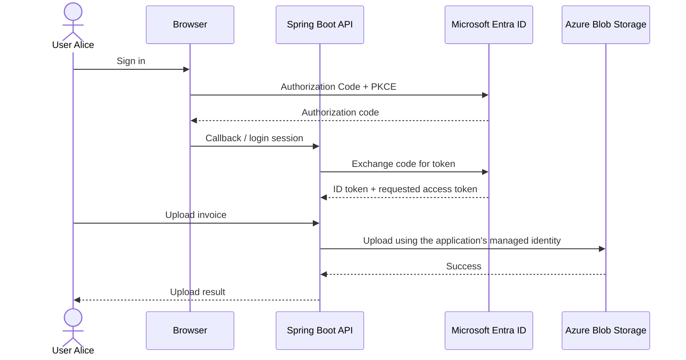
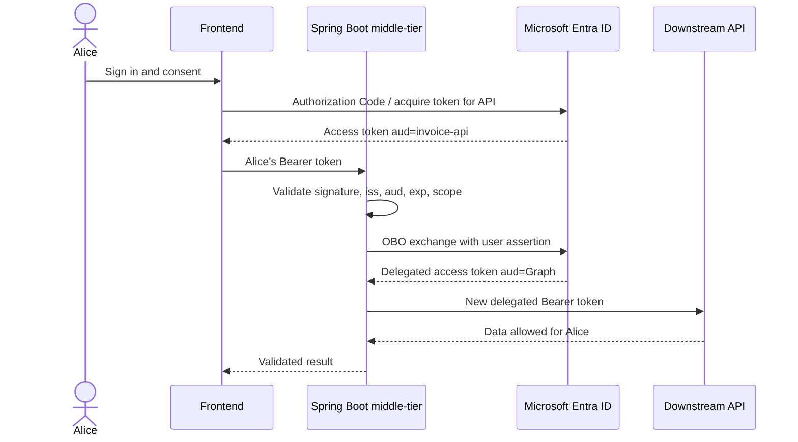

# Distinguishing Application Identity Calling Azure from Signed-In User Identity

> **Chapter:** Microsoft Entra ID  
> **Module:** SPRING_CLOUD_PROVIDER_INTEGRATION — hands-on integration of Spring Boot with managed services on AWS, Azure, and Google Cloud via the corresponding Spring Cloud libraries; focusing on identity, permissions, storage, messaging, data, and secret protection.

A Spring Boot application can simultaneously serve employees signing in with an organization account and call Azure Blob Storage on its own to store documents. These two activities happen within the same process, but they do not necessarily use the same identity. The signed-in user might be Alice; the application calling Storage might be the managed identity `invoice-api-staging`. Confusing the two identities can easily lead to overly broad permissions, misattributing who performed an operation, or sending the wrong token when calling a downstream API.

This lesson explains how Microsoft Entra ID represents **user identity** and **application identity**, how to choose the appropriate OAuth 2.0 flow, and how to configure Spring Boot/Spring Security to authenticate the right principal. Three recurring scenarios run throughout the lesson:

1. A workload calls an Azure resource on its own using the application's own identity.
2. A user signs in to a web application and accesses features according to their permissions.
3. An API receives a request with a user context and then calls another API on behalf of that user using the On-Behalf-Of (OBO) flow.

## 1. Learning Objectives

After this lesson, you will be able to:

- Distinguish between a user object, application object, service principal, and managed identity in Microsoft Entra ID.
- Explain why `client ID`, `object ID`, and `tenant ID` are three distinct values.
- Choose among managed identity/workload identity, client credentials, authorization code, and OBO based on context.
- Distinguish between delegated permissions, application permissions, app roles, and Azure RBAC.
- Identify key claims in an access token and validate signature, `iss`, `aud`, lifetime, tenant, and permissions.
- Configure Spring Boot as an OAuth2 Login client, OAuth2 Resource Server, or OAuth2 Client calling downstream APIs.
- Test app-only and user-delegated flows separately, avoiding accidental use of local credentials in production.

## 2. Four Objects to Distinguish in Microsoft Entra ID

Microsoft Entra ID does not merely store a list of users. It also manages applications, application representations per tenant, workload identities, and access permissions.

| Object | Meaning | Example |
|---|---|---|
| **User object** | Represents a user within a tenant | Employee `alice@contoso.example` |
| **Application object** | The application definition in the owning tenant; contains sign-in settings, redirect URIs, exposed APIs, app roles, and credential metadata | App registration `invoice-portal` |
| **Service principal** | The representation of an application within a specific tenant; the entity granted permissions/consent and recorded when the application acts | Enterprise application `invoice-portal` in the Contoso tenant |
| **Managed identity** | An Azure-managed identity for a workload; represented in Entra by a service principal, without requiring the application to store secrets to acquire tokens | System-assigned identity of Azure App Service |

### Application Object and Service Principal

When registering an application in the owning tenant, Entra creates an **application object**. If the application is used in another tenant (for example, a multitenant app consented to by a customer), that tenant has a corresponding **service principal**. The application object is the blueprint/root definition; the service principal is the application's representation in a given tenant and is tied to permissions, consent, assignments, and sign-in logs in that tenant.

A multitenant application can have one application object in the developer's tenant and many service principals across customer tenants. Therefore, when investigating incidents, you must identify the tenant issuing the token and the corresponding service principal in that tenant.

### Client ID, Object ID, and Tenant ID

| ID | Identifies | Scope |
|---|---|---|
| `client ID` / `application ID` | The application a client uses when requesting a token | Used to configure the OAuth client |
| `object ID` | A specific object (user, application object, service principal, or managed identity) | Differs across objects and tenants |
| `tenant ID` / directory ID | The tenant that issues tokens and holds the corresponding principal/consent | Used to select the appropriate authority/issuer |

Do not copy the application object's `object ID` into `client-id`, and do not use `client ID` as the `principal ID` when configuring a role assignment. The Azure portal displays these values on different blades, so check the field labels carefully.

### Managed Identity Is an Application Identity

A managed identity is neither an employee account nor "a secret automatically hidden inside a VM." Azure issues an identity to a resource/workload, and the SDK can request tokens through the platform-supported endpoint/credential provider. There are two types:

- **System-assigned:** tied to the lifecycle of a single Azure resource; deleting the resource also deletes the attached identity.
- **User-assigned:** a standalone Azure resource that can be attached to multiple workloads and has its own lifecycle. When multiple identities are attached, you must select the right one via its client ID or corresponding configuration.

A managed identity still has a service principal in Entra and still must be granted permissions on Azure resources. It eliminates having the application manage a client secret itself; it does not automatically grant read access to every storage account.

References: [Microsoft identity platform — Application model](https://learn.microsoft.com/entra/identity-platform/application-model), [Managed identities for Azure resources](https://learn.microsoft.com/entra/identity/managed-identities-azure-resources/overview).

## 3. Two Types of Principals Can Participate in the Same Request

Consider an invoice storage flow:



In the flow above:

- Alice is the **signed-in user**. Spring Security can create an `Authentication` representing Alice to enforce URL access, business rules, and auditing.
- `invoice-api-staging` is the **application/workload identity**. The SDK uses this identity to acquire tokens for Azure Storage.
- Storage checks the permissions of the principal that signed the request from the application. If the app uses a managed identity, Storage evaluates that managed identity's permissions; it does not automatically know that Alice was the person who clicked the upload button.

If policy requires Storage to evaluate Alice's permissions on each individual file, using a managed identity alone will not automatically create a delegated context. In that case, you need an appropriate delegation design—such as a downstream API supporting OAuth delegated/OBO access, or having the application check Alice's permissions before acting with the app identity. Never assume that "a user is signed in" automatically means "the Azure SDK is calling under the user's identity."

## 4. Choosing the Right OAuth 2.0 Flow

| Need | Flow / Identity | Is a user in the token? | Typical use case |
|---|---|---|---|
| Workload calls an Azure resource on its own | Managed identity / workload identity | No; the application is the principal | Spring Boot running on Azure reading Blob, Key Vault |
| Daemon calls an API with the application's permissions | Client credentials | No; app-only | Background job syncing data with an API |
| User signs in to a web app | Authorization Code (typically with PKCE) + OpenID Connect | Yes | Employee portal, dashboard |
| API calls another API on behalf of a user | On-Behalf-Of | Yes; downstream permissions are delegated | Middle-tier receives Alice's request and reads Graph data Alice is allowed to view |
| User accesses an API directly with an access token | Delegated access token | Yes | SPA/mobile calling a Spring Boot API |

**Do not use client credentials to impersonate a user.** Client credentials prove that the application is calling the API with the application's own permissions. Conversely, do not use authorization code just to run a batch job with no user; use workload identity/client credentials as appropriate.

### App-Only and Delegated Differ in Permissions

- **Application permission:** permission granted directly to an application/service principal. Commonly used for daemons or workloads without a user. Application permissions require admin consent.
- **Delegated permission:** permission allowing an application to act on behalf of a signed-in user; effective access is constrained by both consent and the user's permissions/context under the API's policy.

In Microsoft Graph or custom APIs, app-only permissions are commonly represented as **app roles**. Delegated permissions are represented as **scopes**. An API may support both types, or only one of them.

References: [Application and delegated permissions](https://learn.microsoft.com/en-us/troubleshoot/entra/entra-id/app-integration/application-delegated-permission-access-tokens-identity-platform), [Scopes and permissions](https://learn.microsoft.com/entra/identity-platform/scopes-oidc), [Client credentials flow](https://learn.microsoft.com/en-us/entra/identity-platform/v2-oauth2-client-creds-grant-flow).

## 5. Flow A — Application Accessing Azure on Its Own via Managed Identity

This model is typically appropriate when Spring Boot calls Storage, Key Vault, or other Azure services using the workload's permissions. No user sign-in is required for the application to obtain a token to access the resource.

### 5.1. Assigning an Identity to the Workload

1. Choose the Azure compute resource running the application (App Service, Container Apps, VM, AKS, or a service supporting workload identity).
2. Enable a system-assigned managed identity or attach a user-assigned managed identity.
3. Record the tenant ID, the user-assigned identity's client ID (if used), the principal/object ID, and the attached resource.
4. Assign the least-privilege **data-plane** role on the exact target resource. For example, reading blobs uses an appropriate blob data reader role; uploading requires a data role with write permission.
5. Wait for the role assignment to propagate and verify it from the workload itself.

Do not confuse Azure resource management permissions with data read/write permissions. A control-plane role for managing a Storage Account does not automatically grant permission to read blob contents.

### 5.2. Spring Cloud Azure and Azure Identity

With Spring Boot using Spring Cloud Azure, import the appropriate BOM and add the service starter. For example, Blob Storage:

```xml
<!-- Inside <dependencies> of a Maven project that has imported the Spring Cloud Azure BOM -->
<dependency>
    <groupId>com.azure.spring</groupId>
    <artifactId>spring-cloud-azure-starter-storage-blob</artifactId>
</dependency>
```

To illustrate selecting a managed identity, configure:

```yaml
spring:
  cloud:
    azure:
      credential:
        managed-identity-enabled: true
        # Only set client-id when selecting a user-assigned identity:
        client-id: ${AZURE_CLIENT_ID:}
```

When using a system-assigned identity, you do not need to set client ID. When using a user-assigned identity, provide the exact client ID of the identity attached to the workload. Verify prefixes/properties against the Spring Cloud Azure version you are using; specific services may support per-service credential configuration.

A flexible option for both local development and workloads is `DefaultAzureCredential`. Example creating the credential with the Azure Identity SDK:

```java
import com.azure.core.credential.TokenCredential;
import com.azure.identity.DefaultAzureCredentialBuilder;
import org.springframework.context.annotation.Bean;
import org.springframework.context.annotation.Configuration;

@Configuration(proxyBeanMethods = false)
public class AzureIdentityConfiguration {

    @Bean
    TokenCredential tokenCredential() {
        return new DefaultAzureCredentialBuilder().build();
    }
}
```

Azure SDK clients can accept this `TokenCredential`. If Spring Cloud Azure auto-configuration already creates the client, configure it to use the credential bean via the mechanism supported by that version; avoid manually creating a second client with a different identity unknowingly.

`DefaultAzureCredential` can select environment credentials, managed identity, workload identity, IDE credentials, or Azure CLI depending on the version and environment. This is convenient for development, but you must verify the credential source in real environments. Local development might be using a developer account while production uses a managed identity.

References: [Spring Cloud Azure Authentication](https://learn.microsoft.com/azure/developer/java/spring-framework/authentication), [Azure Identity credential chains](https://learn.microsoft.com/azure/developer/java/sdk/authentication/credential-chains).

### 5.3. When to Use a Service Principal with a Secret/Certificate?

An application can authenticate as a service principal via client ID and a client secret, certificate, or federated credential. This is useful when a workload has no managed identity but still needs an app-only token.

Preference order by scenario:

1. Managed identity when the workload runs on Azure and the service supports it.
2. Workload identity federation when an external platform supports trusted identity federation.
3. Certificates or credentials without long-lived secrets if the organization requires a service principal.
4. Client secrets only when required for compatibility; store them in a secret manager, set expiry/rotation, and never commit them to source.

The service principal is the application's principal. A client secret/certificate is **the method proving the application possesses the credential**, not an employee's identity.

## 6. Flow B — User Signing In to a Spring Boot Application

If the application has a web UI for employees to sign in, use OpenID Connect on top of the OAuth 2.0 Authorization Code flow. Spring Security OAuth2 Client supports `oauth2Login`; Entra performs authentication and returns an ID token so the client can establish the user session.

### 6.1. Registering the Application in Entra

In the Microsoft Entra admin center:

1. Open **Entra ID → App registrations → New registration**.
2. Choose single-tenant or multitenant according to your organizational model; do not choose multitenant unless you have a requirement to serve external tenants.
3. Record the **Application (client) ID** and **Directory (tenant) ID**.
4. Add the appropriate platform (Web for server-side Spring Boot).
5. Register a redirect URI matching the application URL, such as `http://localhost:8080/login/oauth2/code/entra` for local development.
6. If it is a confidential web application, configure an appropriate credential; prefer certificates/federated credentials based on your deployment capabilities. Use secrets only for examples/managed environments.
7. Only add API permissions if the application actually calls other APIs. `openid`, `profile`, and `email` are OIDC scopes for sign-in and do not automatically grant permission to read Microsoft Graph or Storage.

The redirect URI must match the registered configuration exactly. Production requires HTTPS and the proper public URL; never use a localhost redirect URI in production.

### 6.2. Configuring Spring Security OAuth2 Login

Add the OAuth2 Client dependency:

```xml
<dependency>
    <groupId>org.springframework.boot</groupId>
    <artifactId>spring-boot-starter-oauth2-client</artifactId>
</dependency>
```

Example `application.yml` for a single tenant:

```yaml
spring:
  security:
    oauth2:
      client:
        registration:
          entra:
            provider: entra
            client-id: ${ENTRA_CLIENT_ID}
            client-secret: ${ENTRA_CLIENT_SECRET}
            authorization-grant-type: authorization_code
            redirect-uri: "{baseUrl}/login/oauth2/code/{registrationId}"
            scope:
              - openid
              - profile
              - email
        provider:
          entra:
            issuer-uri: https://login.microsoftonline.com/${ENTRA_TENANT_ID}/v2.0
```

This is an example for a **server-side confidential web app**. `ENTRA_CLIENT_SECRET` must be injected from a secret store/CI secret; never put the literal value in committed YAML. Public client applications (SPA/mobile) have their own PKCE model and must never embed a client secret in the browser. When using certificates or a dedicated Entra starter, the way credentials are provided may differ.

Spring Security login configuration:

```java
import org.springframework.context.annotation.Bean;
import org.springframework.context.annotation.Configuration;
import org.springframework.security.config.Customizer;
import org.springframework.security.config.annotation.web.builders.HttpSecurity;
import org.springframework.security.web.SecurityFilterChain;

@Configuration
public class WebLoginSecurity {

    @Bean
    SecurityFilterChain webSecurity(HttpSecurity http) throws Exception {
        http
            .authorizeHttpRequests(auth -> auth
                .requestMatchers("/", "/assets/**", "/error").permitAll()
                .anyRequest().authenticated())
            .oauth2Login(Customizer.withDefaults());
        return http.build();
    }
}
```

After login, a controller can read the principal from Spring Security:

```java
import org.springframework.security.core.annotation.AuthenticationPrincipal;
import org.springframework.security.oauth2.core.oidc.user.OidcUser;
import org.springframework.web.bind.annotation.GetMapping;
import org.springframework.web.bind.annotation.RestController;

@RestController
public class ProfileController {

    @GetMapping("/me")
    public ProfileView me(@AuthenticationPrincipal OidcUser user) {
        return new ProfileView(
                user.getClaimAsString("tid"),
                user.getClaimAsString("oid"),
                user.getFullName());
    }

    public record ProfileView(String tenantId, String objectId, String displayName) {}
}
```

This example only returns illustrative fields. A production API must decide which fields may be exposed, never use email/display name for authorization decisions, and never dump all claims externally.

### 6.3. ID Tokens and Access Tokens Are Not Interchangeable

- **ID token:** issued to the client application to confirm the login session and user identity claims under OIDC.
- **Access token:** issued for a specific resource/API; the client sends this token to the exact API matching its `aud`.

Never send an ID token to Microsoft Graph, Azure Storage, or a Spring Boot API as a bearer token. Never use an access token intended for Graph to call an internal API. Each token has its own audience, scopes/permissions, and validation policy.

References: [Secure Spring Boot apps using Microsoft Entra ID](https://learn.microsoft.com/azure/developer/java/identity/enable-spring-boot-webapp-authentication-entra-id), [Spring Security OAuth2](https://docs.spring.io/spring-security/reference/servlet/oauth2/).

## 7. Flow C — Protecting a Spring Boot API with Entra Access Tokens

When an SPA, mobile app, or another backend calls a Spring Boot API, the API must act as an **OAuth2 Resource Server**. The API validates the access token issued by Entra specifically for that API.

### 7.1. Registering the API and Exposing Scopes/App Roles

In the API's app registration:

1. Open **Expose an API** and set the Application ID URI, for example `api://<API_CLIENT_ID>`.
2. If users call on their behalf, create a delegated scope, for example `Invoices.Read`.
3. If a workload/daemon needs to call the API without a user, create an app role targeting applications, for example `Invoices.Read.All` with the appropriate allowed member types.
4. In the client's app registration, add the appropriate permission and grant the required consent.
5. For application permissions, admin consent is mandatory. For delegated permissions, consent may be granted by a user or admin depending on the permission type and tenant policy.

Scopes and app roles are the **API's** permission contract. They are not the same as Azure RBAC role assignments on Blob/Key Vault.

### 7.2. Configuring the Resource Server

Add the dependency:

```xml
<dependency>
    <groupId>org.springframework.boot</groupId>
    <artifactId>spring-boot-starter-oauth2-resource-server</artifactId>
</dependency>
```

Set the issuer URI for the Entra tenant:

```yaml
spring:
  security:
    oauth2:
      resourceserver:
        jwt:
          issuer-uri: https://login.microsoftonline.com/${ENTRA_TENANT_ID}/v2.0

app:
  security:
    audience: ${ENTRA_API_AUDIENCE}
```

For example, `ENTRA_API_AUDIENCE` is the Application ID URI or the actual audience emitted by Entra in tokens for the API. Do not guess the audience from the frontend's client ID; inspect an access token issued for the API in a test environment and verify the app registration settings.

Spring Security filter chain configuration:

```java
import org.springframework.context.annotation.Bean;
import org.springframework.context.annotation.Configuration;
import org.springframework.security.config.Customizer;
import org.springframework.security.config.annotation.web.builders.HttpSecurity;
import org.springframework.security.web.SecurityFilterChain;

@Configuration
public class ApiResourceServerSecurity {

    @Bean
    SecurityFilterChain apiSecurity(HttpSecurity http) throws Exception {
        http
            .authorizeHttpRequests(auth -> auth
                .requestMatchers("/api/invoices/**")
                    .hasAuthority("SCOPE_Invoices.Read")
                .anyRequest().authenticated())
            .oauth2ResourceServer(oauth2 ->
                oauth2.jwt(Customizer.withDefaults()));
        return http.build();
    }
}
```

By default, Spring Security maps scopes from the `scope`/`scp` claim into authorities prefixed with `SCOPE_`. Thus, scope `Invoices.Read` corresponds to `SCOPE_Invoices.Read`. The configuration above illustrates an API that accepts only a delegated scope for the invoices endpoint.

### 7.3. Validating Audience Alongside Issuer and Lifetime

When `issuer-uri` is configured, Spring Security by default validates the JWT signature via public keys/JWKS, the issuer, and timestamps such as `exp` and `nbf`. For an API, you must also validate `aud` to ensure the token was issued **for this API**, not for another resource.

Example adding an audience validator:

```java
import java.util.List;

import org.springframework.beans.factory.annotation.Value;
import org.springframework.context.annotation.Bean;
import org.springframework.context.annotation.Configuration;
import org.springframework.security.oauth2.core.DelegatingOAuth2TokenValidator;
import org.springframework.security.oauth2.core.OAuth2TokenValidator;
import org.springframework.security.oauth2.core.validator.JwtClaimValidator;
import org.springframework.security.oauth2.jwt.Jwt;
import org.springframework.security.oauth2.jwt.JwtClaimNames;
import org.springframework.security.oauth2.jwt.JwtDecoder;
import org.springframework.security.oauth2.jwt.JwtValidators;
import org.springframework.security.oauth2.jwt.NimbusJwtDecoder;

@Configuration
public class EntraJwtValidationConfiguration {

    @Bean
    JwtDecoder jwtDecoder(
            @Value("${spring.security.oauth2.resourceserver.jwt.issuer-uri}")
            String issuer,
            @Value("${app.security.audience}") String expectedAudience) {

        NimbusJwtDecoder decoder =
                NimbusJwtDecoder.withIssuerLocation(issuer).build();

        OAuth2TokenValidator<Jwt> issuerAndTime =
                JwtValidators.createDefaultWithIssuer(issuer);

        OAuth2TokenValidator<Jwt> audience =
                new JwtClaimValidator<List<String>>(
                        JwtClaimNames.AUD,
                        values -> values != null
                                && values.contains(expectedAudience));

        decoder.setJwtValidator(
                new DelegatingOAuth2TokenValidator<>(
                        issuerAndTime, audience));
        return decoder;
    }
}
```

This is an example validator for a single audience string and a single tenant; verify imports/packages/APIs against the Spring Security version in your project's BOM. If the API accepts multiple audiences, use an explicit allowlist and test each value. For multitenant applications, you must validate issuer and tenant against an allowlist of permitted tenants; never accept every issuer merely because the `common` or `organizations` endpoint is used.

References: [Spring Security — JWT validation](https://docs.spring.io/spring-security/reference/servlet/oauth2/resource-server/jwt.html).

## 8. Reading Access Tokens to Tell Whether an Application or User Is Calling the API

Entra JWT access tokens commonly include the following claims:

| Claim | Meaning | Notes |
|---|---|---|
| `iss` | Issuer that minted the token | Must match a trusted issuer/tenant policy |
| `aud` | Target resource/API receiving the token | The API must validate its own audience |
| `tid` | Tenant ID | Used in tenant decisions/tenant allowlists |
| `oid` | Object ID of the subject in the tenant | Can be a user or a service principal depending on the token |
| `azp` | Client application ID in v2 tokens | v1 tokens typically use `appid` |
| `scp` | List of delegated scopes in user tokens | Indicates delegated permissions granted to the client |
| `roles` | App roles/permissions | May represent application permissions in app-only tokens or user app roles in user tokens |
| `idtyp` | Token type, if the resource configures this optional claim | `app` is a clear signal for an app-only token |
| `exp`, `nbf` | Token validity timestamps | Must be validated before use |

### Do Not Infer App-Only Solely from Roles

`roles` can appear in a delegated token if the user is assigned an app role of the API. For application tokens, permissions usually appear in `roles` and the `scp` claim is absent. However, for an API to distinguish app-only tokens reliably, Microsoft recommends configuring the optional claim `idtyp`; when this claim has the value `app`, the token is app-only.

Do not rely on heuristics like "having `roles` means it's an application" or "missing `scp` definitely means it's an application" without checking the token context. An ID token also lacks `scp`; a token with the wrong audience could be sent to the API by mistake. The API must validate token type, audience, and permissions according to its contract.

### Which Claims Should Not Be Used as Authorization Keys?

Do not use `email`, `preferred_username`, `upn`, or `name` to decide whether a user is authorized to read data. These display claims can change and are not trustworthy authorization identifiers. Use validated object ID/tenant ID or app roles/scopes, combined with business-level permission checks on application data.

### `azp` Is Not the User

`azp` (v2) or `appid` (v1) identifies the client application that obtained the token. In a delegated token, this claim can still appear alongside user claims. Therefore, it does not prove that the request has no user. When you need to allow a specific client app to call an API, verify the client ID **and** the appropriate token type/permissions.

References: [Access token claims reference](https://learn.microsoft.com/entra/identity-platform/access-token-claims-reference), [Optional claims reference](https://learn.microsoft.com/en-us/entra/identity-platform/optional-claims-reference), [Validate claims](https://learn.microsoft.com/en-us/entra/identity-platform/claims-validation).

## 9. Mapping Scopes and App Roles into Spring Security

Spring Security maps scopes to `SCOPE_...` authorities by default. The `roles` claim does not receive the same mapping by default. If the API uses app roles, you can add a custom converter.

Example combining scopes and roles:

```java
import java.util.ArrayList;
import java.util.Collection;
import java.util.List;

import org.springframework.context.annotation.Bean;
import org.springframework.context.annotation.Configuration;
import org.springframework.core.convert.converter.Converter;
import org.springframework.security.core.GrantedAuthority;
import org.springframework.security.core.authority.SimpleGrantedAuthority;
import org.springframework.security.oauth2.jwt.Jwt;
import org.springframework.security.oauth2.server.resource.authentication.JwtAuthenticationConverter;
import org.springframework.security.oauth2.server.resource.authentication.JwtGrantedAuthoritiesConverter;

@Configuration
public class EntraAuthoritiesConfiguration {

    @Bean
    JwtAuthenticationConverter jwtAuthenticationConverter() {
        JwtGrantedAuthoritiesConverter scopeConverter =
                new JwtGrantedAuthoritiesConverter();

        Converter<Jwt, Collection<GrantedAuthority>> combined = jwt -> {
            List<GrantedAuthority> authorities =
                    new ArrayList<>(scopeConverter.convert(jwt));

            List<String> roles = jwt.getClaimAsStringList("roles");
            if (roles != null) {
                roles.stream()
                        .map(role -> new SimpleGrantedAuthority(
                                "APPROLE_" + role))
                        .forEach(authorities::add);
            }
            return authorities;
        };

        JwtAuthenticationConverter converter =
                new JwtAuthenticationConverter();
        converter.setJwtGrantedAuthoritiesConverter(combined);
        return converter;
    }
}
```

Attach the converter to the resource server:

```java
http.oauth2ResourceServer(oauth2 -> oauth2
        .jwt(jwt -> jwt.jwtAuthenticationConverter(
                jwtAuthenticationConverter)));
```

Use `hasAuthority("APPROLE_Invoices.Read.All")` for an app role defined in the API, and `hasAuthority("SCOPE_Invoices.Read")` for a delegated scope. These are two distinct permission contracts. If an endpoint only allows app-only daemons, you must also verify the token type (for example optional claim `idtyp=app`) and permitted client/role; checking `APPROLE_` alone may not suffice because a user token can also contain app roles assigned to the user.

The converter above is a simple template; avoid trusting arbitrary roles if the token has not had its issuer/audience validated. Never add default authorities when claims are absent.

## 10. Flow D — Client Credentials: Application Calling an API with Its Own Permissions

When a batch job or backend needs to call an API without a user, use client credentials. In Entra, the client app is granted an application permission/app role on the target API, and admin consent is granted beforehand. The client requests a token with a scope of the form `resource/.default`, such as `api://<DOWNSTREAM_API_CLIENT_ID>/.default`.

### 10.1. Registering Permissions

1. The target API declares an app role for applications, for example `Invoices.Read.All`.
2. The client application adds an Application permission pointing to that role.
3. A tenant administrator grants admin consent.
4. The client's service principal in the tenant holds the consented permission.
5. The client uses a certificate, federated credential, managed identity, or protected secret to obtain a token.

`/.default` requests the static permissions configured/consented for that resource; it is not a wildcard to bypass permission checks.

### 10.2. Configuring Spring Security OAuth2 Client

Example with a confidential client and a client secret injected from a secret store:

```yaml
spring:
  security:
    oauth2:
      client:
        registration:
          entra-app:
            provider: entra
            client-id: ${ENTRA_CLIENT_ID}
            client-secret: ${ENTRA_CLIENT_SECRET}
            authorization-grant-type: client_credentials
            scope:
              - api://${DOWNSTREAM_API_CLIENT_ID}/.default
        provider:
          entra:
            issuer-uri: https://login.microsoftonline.com/${ENTRA_TENANT_ID}/v2.0
```

Do not use secrets in production if they can be replaced with certificates or federated credentials. For workloads running on Azure, prefer managed identity for Azure resource access; when an OAuth client to a custom API is needed, choose a token acquisition mechanism compatible with workload identity and API permissions.

### 10.3. Acquiring Tokens via OAuth2AuthorizedClientManager

```java
import org.springframework.context.annotation.Bean;
import org.springframework.context.annotation.Configuration;
import org.springframework.security.oauth2.client.AuthorizedClientServiceOAuth2AuthorizedClientManager;
import org.springframework.security.oauth2.client.ClientRegistrationRepository;
import org.springframework.security.oauth2.client.OAuth2AuthorizedClientManager;
import org.springframework.security.oauth2.client.OAuth2AuthorizedClientProviderBuilder;
import org.springframework.security.oauth2.client.OAuth2AuthorizedClientService;

@Configuration
public class AppOnlyOAuthClientConfiguration {

    @Bean
    OAuth2AuthorizedClientManager authorizedClientManager(
            ClientRegistrationRepository registrations,
            OAuth2AuthorizedClientService authorizedClients) {

        var provider = OAuth2AuthorizedClientProviderBuilder.builder()
                .clientCredentials()
                .build();

        var manager = new AuthorizedClientServiceOAuth2AuthorizedClientManager(
                registrations, authorizedClients);
        manager.setAuthorizedClientProvider(provider);
        return manager;
    }
}
```

When calling the API:

```java
import org.springframework.security.oauth2.client.OAuth2AuthorizeRequest;
import org.springframework.security.oauth2.client.OAuth2AuthorizedClient;
import org.springframework.security.oauth2.client.OAuth2AuthorizedClientManager;

public class InvoiceDownstreamClient {
    private final OAuth2AuthorizedClientManager manager;

    public InvoiceDownstreamClient(OAuth2AuthorizedClientManager manager) {
        this.manager = manager;
    }

    public String obtainApplicationAccessToken() {
        OAuth2AuthorizeRequest request = OAuth2AuthorizeRequest
                .withClientRegistrationId("entra-app")
                .principal("invoice-batch-worker")
                .build();

        OAuth2AuthorizedClient client = manager.authorize(request);
        if (client == null) {
            throw new IllegalStateException(
                    "Could not authorize the Entra application client");
        }
        return client.getAccessToken().getTokenValue();
    }
}
```

The returned token is meant for the downstream API. Never log the token value; only log permitted metadata such as registration ID, target resource, outcome, and request ID. In a real application, use `RestClient`/`WebClient` or an interceptor to attach the bearer token and let the OAuth2 client manager handle token acquisition and refresh.

## 11. Flow E — On-Behalf-Of: API Calling Another API on Behalf of a User

OBO is used when a Spring Boot API receives an **access token representing a user** from a client and then needs to call a downstream API using that user's delegated permissions.

Example:

1. Alice signs in to the frontend.
2. The frontend obtains an access token whose audience is `invoice-api`.
3. The frontend sends that token to the Spring Boot API.
4. The API validates signature, issuer, audience, lifetime, and scopes.
5. The API uses the inbound token as a user assertion to ask Entra for a new token for Microsoft Graph or a downstream API.
6. The API calls downstream with the new token; downstream evaluates delegated permissions and the user's context.



### OBO Is Not Forwarding the Inbound Token

The inbound token has `aud=invoice-api`; Graph requires a token with Graph's audience. Forwarding the raw `invoice-api` token directly to Graph will generally be rejected for having the wrong audience. The middle-tier must exchange the token via OBO and use the new access token intended for the downstream resource.

OBO uses **delegated scopes**, not application permissions in place of the user. If the work has no user context (such as a cron job), use client credentials instead of OBO.

### MSAL4J Illustration

The following example uses a confidential client with a client secret so the components are easy to see. Production should prefer certificates or federated credentials according to organizational policy. The inbound token must be an **access token already validated by the API**, never an ID token.

```java
import com.microsoft.aad.msal4j.ClientCredentialFactory;
import com.microsoft.aad.msal4j.ConfidentialClientApplication;
import com.microsoft.aad.msal4j.IAuthenticationResult;
import com.microsoft.aad.msal4j.IClientCredential;
import com.microsoft.aad.msal4j.OnBehalfOfParameters;
import com.microsoft.aad.msal4j.UserAssertion;

import java.util.Set;

public class EntraOnBehalfOfClient {

    public String acquireDownstreamToken(
            String tenantId,
            String clientId,
            String clientSecret,
            String validatedInboundAccessToken) throws Exception {

        IClientCredential credential =
                ClientCredentialFactory.createFromSecret(clientSecret);

        ConfidentialClientApplication application =
                ConfidentialClientApplication.builder(clientId, credential)
                        .authority("https://login.microsoftonline.com/" + tenantId)
                        .build();

        UserAssertion assertion =
                new UserAssertion(validatedInboundAccessToken);

        OnBehalfOfParameters parameters = OnBehalfOfParameters.builder(
                Set.of("https://graph.microsoft.com/User.Read"),
                assertion)
                .build();

        IAuthenticationResult result =
                application.acquireToken(parameters).join();

        return result.accessToken();
    }
}
```

This is an MSAL4J illustration; pin the library version and check the corresponding API in your project. The client application must be configured with delegated permissions to the downstream API, hold valid consent, and have credentials to authenticate the middle-tier. Never store inbound tokens in logs or databases as long-lived credentials.

References: [Microsoft identity platform — On-Behalf-Of flow](https://learn.microsoft.com/entra/identity-platform/v2-oauth2-on-behalf-of-flow), [Spring Boot Entra starter scenarios](https://learn.microsoft.com/azure/developer/java/spring-framework/spring-boot-starter-for-entra-developer-guide).

## 12. Distinguishing Entra API Permissions, App Roles, and Azure RBAC

Three concepts are often lumped together as "roles," yet they apply at different layers:

| Mechanism | Where configured? | Purpose | Example |
|---|---|---|---|
| Delegated API scope | Expose an API / API permissions | Allows a client to call an API on behalf of a user | `Invoices.Read` |
| Application permission / app role | API app registration and client permissions/consent | Allows a service principal to call an API without a user | `Invoices.Read.All` |
| User app role assignment | Application's app roles and assignment to users/groups | Business-role authorization inside an application | `Invoice.Approver` |
| Azure RBAC role | IAM/Access control on an Azure resource/scope | Management or data-plane permissions on a resource | `Storage Blob Data Reader` |

Examples:

- Spring Boot uses managed identity to read Blob: assign `Storage Blob Data Reader` at the appropriate container/storage scope.
- User Alice signs in to the portal and is allowed to view invoices: the application checks the delegated scope and/or app role assigned to Alice, then enforces business ACLs.
- A batch app calls a custom Invoice API: grant the application permission/app role to the batch app's service principal along with admin consent.

Do not expect the `roles` claim in an Azure Storage token to always list every Azure RBAC role assignment. Azure resource services enforce authorization via their own RBAC/resource policy mechanisms; app roles in access tokens are for API authorization according to the token contract.

## 13. Testing App Identity and User Identity Separately

Having only one test showing "the API returns 200" is not enough to prove the application uses the right token type. Separate the test cases:

| Test | Token / identity | Expected result |
|---|---|---|
| User signs in on the web | OIDC authorization code, ID token for client | Spring Security creates an authenticated user principal |
| User calls API | Delegated access token, `aud` matches API, required scope present | API allows access to endpoints granted that scope |
| App-only calls API | Application token with app role and app-only token type | Only endpoints allowing workload apps are accessible |
| Wrong audience token | Access token issued for Graph/Storage or another API | API rejects |
| Expired token / invalid signature | Invalid JWT | API returns 401 |
| Valid user missing scope | Delegated token without required scope | API returns 403 |
| Valid app missing app role | App-only token without required role | API returns 403 |
| OBO missing delegated consent | Valid user assertion, but downstream permission not consented | OBO token request fails; do not fall back to app-only if business logic requires user context |
| Managed identity missing Azure RBAC | Valid app token, insufficient resource authorization | Azure resource denies; requires role at the right scope |

### Mock Testing in Spring Security

`spring-security-test` supports mocking requests with JWTs or OAuth2 logins to verify authorization logic without calling Entra in every unit test. Example using MockMvc `jwt()` to test a scope:

```java
import static org.springframework.security.test.web.servlet.request
        .SecurityMockMvcRequestPostProcessors.jwt;
import static org.springframework.test.web.servlet.request.MockMvcRequestBuilders.get;
import static org.springframework.test.web.servlet.result.MockMvcResultMatchers.status;

import org.junit.jupiter.api.Test;
import org.springframework.beans.factory.annotation.Autowired;
import org.springframework.boot.test.autoconfigure.web.servlet.AutoConfigureMockMvc;
import org.springframework.boot.test.context.SpringBootTest;
import org.springframework.test.web.servlet.MockMvc;

@SpringBootTest
@AutoConfigureMockMvc
class InvoiceApiSecurityTest {

    @Autowired
    MockMvc mvc;

    @Test
    void acceptsTokenWithRequiredScope() throws Exception {
        mvc.perform(get("/api/invoices/42")
                .with(jwt().jwt(token -> token
                        .claim("scp", "Invoices.Read"))))
                .andExpect(status().isOk());
    }
}
```

This tests authorization logic using a mock JWT; it does **not** verify Entra signatures, issuer, audience, consent, tenant, or real credentials. You must add integration tests in a test tenant to verify real tokens, identities, and Azure resource permissions. Write separate tests for app-only tokens having `roles` and `idtyp=app` if the API distinguishes caller types.

## 14. Common Errors and Troubleshooting

| Symptom | Common cause | Resolution |
|---|---|---|
| User can sign in, yet Blob returns 403 | App uses managed identity, but identity lacks data-plane RBAC | Verify the SDK principal and assign a Blob read/write role at the right scope |
| `DefaultAzureCredential` uses developer user locally, managed identity in production | Credential chain selects different sources by environment | Document the expected identity; inspect credential source and workload logs |
| `AADSTS7000215` or invalid client secret | Wrong or expired secret, or mismatched client ID/tenant | Verify credential in app registration and rotate per procedure |
| `AADSTS500011` / resource principal not found | Resource/audience or service principal/consent is in the wrong tenant or missing | Check API resource URI, tenant, and service principal provisioning |
| API returns 401 even though decoded token shows `scp` | Wrong signature, issuer, audience, token version, or expired token | Check all validators; do not look only at payload claims |
| API returns 403 even though user is signed in | Missing delegated scope/app role or business policy check | Check consent, `scp`, `roles`, assignments, and data-level permissions |
| App-only token has no `scp` | Normal for client credentials | Check app roles in `roles`, and `idtyp=app` if configured |
| User token contains `roles` | User may have been assigned an API app role | Do not infer an app-only token solely from `roles` |
| Graph rejects token sent by Spring Boot | Token `aud` is the Spring Boot API, not Graph | Use OBO or client credentials as needed; acquire a token for the right resource |
| OBO returns consent/permission error | Client not granted delegated permission or missing consent | Configure downstream delegated scopes and appropriate consent |
| Token from another tenant is rejected | Single-tenant API or issuer/tenant not in allowlist | Define multitenant policy explicitly; never open up issuers arbitrarily |
| Access token expires during a long request | Token cache/refresh or system clock skew | Use OAuth2 client/MSAL to manage token lifecycle and synchronize clocks |

### Checklist When Investigating 401/403

1. Determine whether the token is **user-delegated** or **app-only**.
2. Check which resource the token was issued for (`aud`).
3. Check the tenant (`tid`) and issuer (`iss`).
4. Verify the client application (`azp`/`appid`) and subject (`oid`).
5. Check delegated scopes `scp` or application roles `roles`.
6. If calling an Azure resource, also check Azure RBAC/resource policies at the data plane.
7. Cross-reference sign-in logs, service principal sign-in logs, audit logs, and request IDs.

## 15. Security Rules for Deployment

- Use managed identity/workload identity for workloads whenever the platform supports it.
- Never embed client secrets/private keys in source code, container images, or committed `application.yml` files.
- If secrets are used, fetch them from a secret manager, restrict read access, and maintain a rotation schedule.
- Request only the delegated scopes/application permissions truly needed; application permissions require admin consent and can have broad blast radius.
- Never reuse one API's token for another API; always validate audience.
- Never log bearer tokens, refresh tokens, client secrets, or full claim sets unnecessarily.
- Separate app-only endpoints and user-delegated endpoints under explicit authorization contracts.
- For multitenant APIs, validate tenants and issuers against an allowlist.
- For OBO, exchange tokens only after validating the inbound access token; never use an ID token as a user assertion.
- Never fall back from delegated to app-only when OBO fails if doing so alters the permission semantics of the request.
- Use HTTPS, secure cookies/sessions, and appropriate CSRF protection for web logins; stateless APIs need session/CSRF settings aligned with their actual model.

## 16. Hands-On Exercise

**Context:** An invoice management application consists of an employee web portal, a Spring Boot API, and a background worker. The portal lets employees sign in with Entra ID; the API reads Blob Storage; the worker runs on a schedule and calls the API to aggregate reports.

### Part A — Identity Model

1. Create an app registration for the web client and an app registration for the API; identify the application object, service principal, client ID, object ID, and tenant ID.
2. Assign a managed identity to the API workload and grant a Blob reader role at the right scope.
3. Create a delegated scope `Invoices.Read` and an app role `Invoices.Read.All` on the API.
4. Identify which app-only permission the worker needs and who grants admin consent.

### Part B — Spring Boot Configuration

1. Configure OAuth2 Login Authorization Code for the web portal.
2. Configure Resource Server for `/api/**`, validating issuer and audience.
3. Map `SCOPE_Invoices.Read` and `APPROLE_Invoices.Read.All` into authorization rules.
4. Configure the Azure SDK to use managed identity to read Blob; verify the identity and role.
5. Configure worker client credentials to call the API without a user context.
6. Design a downstream endpoint requiring OBO and explain why you cannot send the raw access token whose audience is the middle-tier API directly to Graph.

### Part C — Testing and Reporting

Run the cases: user with allowed scope; user missing scope; app-only with app role; app-only missing role; wrong-audience token; managed identity missing Blob RBAC; OBO missing consent. Record redacted token types/claims as needed, principal, resource, outcome, and remediation. Do not save real tokens.

**Sample results table:**

| Request | Principal | Token type | Permission | Resource | Result |
|---|---|---|---|---|---|
| Employee views invoice | User object ID | Delegated | `Invoices.Read` | Invoice API | 200 |
| User missing scope | User object ID | Delegated | Missing `Invoices.Read` | Invoice API | 403 |
| Aggregator worker | Service principal | App-only | `Invoices.Read.All` | Invoice API | 200 |
| API reads Blob | Managed identity | App identity | Blob data read | Storage | 200 |
| API calls Graph for Alice | User + middle-tier app | OBO delegated | `User.Read` | Graph | 200 |

**Pass criteria:** Able to explain which requests run under user identity and which under app identity; chooses the right flow; validates tokens and permissions at the right layer; proves via tests that one principal type cannot automatically inherit the other's permissions.

## Official References

1. [Microsoft identity platform — Application model](https://learn.microsoft.com/entra/identity-platform/application-model): application objects and service principals.
2. [Microsoft Entra — Managed identities overview](https://learn.microsoft.com/entra/identity/managed-identities-azure-resources/overview): system-assigned and user-assigned identities.
3. [Spring Cloud Azure — Authentication](https://learn.microsoft.com/azure/developer/java/spring-framework/authentication): credential types, managed identity, and `DefaultAzureCredential`.
4. [Spring Security — OAuth2 Login and OAuth2 Client](https://docs.spring.io/spring-security/reference/servlet/oauth2/): login and client roles.
5. [Microsoft Entra — Secure Spring Boot web apps](https://learn.microsoft.com/azure/developer/java/identity/enable-spring-boot-webapp-authentication-entra-id): user sign-in in Spring Boot.
6. [Microsoft Entra — Spring Boot starter developer guide](https://learn.microsoft.com/azure/developer/java/spring-framework/spring-boot-starter-for-entra-developer-guide): web app, resource server, and downstream API scenarios.
7. [Microsoft identity platform — Client credentials flow](https://learn.microsoft.com/entra/identity-platform/v2-oauth2-client-creds-grant-flow): app-only permissions and token requests.
8. [Microsoft identity platform — On-Behalf-Of flow](https://learn.microsoft.com/entra/identity-platform/v2-oauth2-on-behalf-of-flow): middle-tier calling downstream on behalf of a user.
9. [Microsoft identity platform — Access token claims](https://learn.microsoft.com/entra/identity-platform/access-token-claims-reference): `scp`, `roles`, `oid`, `tid`, `azp`, and `appid`.
10. [Microsoft identity platform — Optional claims](https://learn.microsoft.com/entra/identity-platform/optional-claims-reference): the `idtyp` claim.
11. [Microsoft identity platform — Validate claims](https://learn.microsoft.com/entra/identity-platform/claims-validation): checking actor, scopes, and claims.
12. [Spring Security — JWT Resource Server](https://docs.spring.io/spring-security/reference/servlet/oauth2/resource-server/jwt.html): signatures, issuer, timestamps, audience, and custom validators.

> **Remember:** A signed-in user and an application calling Azure are two distinct principals, even when both appear within the same request. Choose the flow by asking **who is acting**, check **which API** the token is issued for, and grant permissions at the right layer: delegated scopes/app roles for APIs, Azure RBAC for Azure resources. Never infer user permissions from a managed identity, or application permissions from a user login session.
