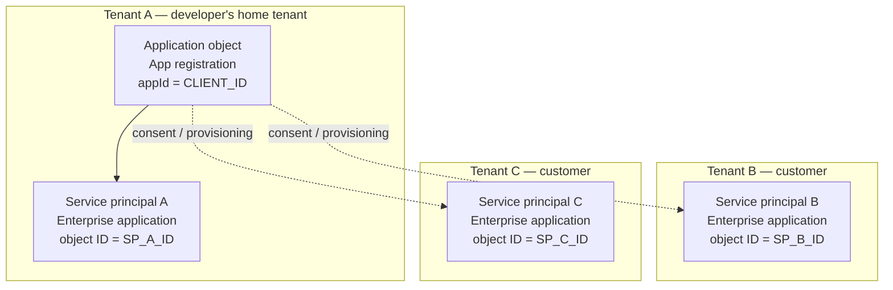
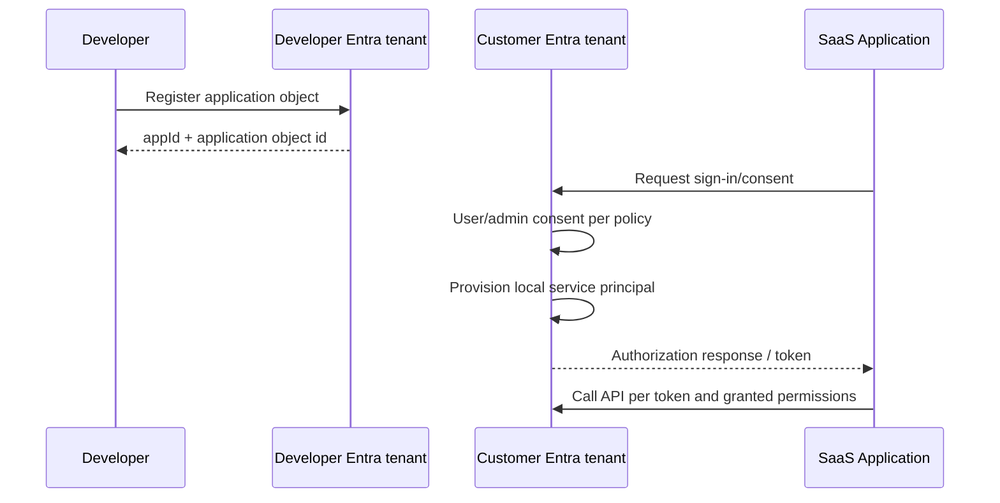

# App Registration, Tenant, Application ID, and Service Principal

> **Chapter:** Microsoft Entra ID  
> **Module:** SPRING_CLOUD_PROVIDER_INTEGRATION — hands-on integration of Spring Boot with managed services on AWS, Azure, and Google Cloud via the corresponding Spring Cloud libraries.

When configuring Spring Boot to sign in with Microsoft Entra ID, development teams often receive a sheet of identifiers containing a Tenant ID, Application (client) ID, Object ID, Application ID URI, and sometimes a Service principal ID. All of these values look like identifiers, yet they represent different objects. Entering an Object ID into `client-id`, or using an Application ID URI instead of a Tenant ID, can prevent the application from acquiring tokens or produce tokens with the wrong audience.

This lesson builds a clear mental model of **tenant**, **app registration**, **application object**, **application/client ID**, **service principal**, and **Application ID URI**. You will trace an application's lifecycle from registration in its home tenant to approval in a customer tenant, and map those values accurately into Spring Boot configuration.

## 1. Learning Objectives

After this lesson, you will be able to:

1. Explain how a tenant serves as a directory and identity-policy boundary in Microsoft Entra ID.
2. Distinguish between an app registration, an application object, and an Enterprise application/service principal.
3. Read `appId`, `id`, and `tenantId` accurately and understand why the client ID stays the same while object IDs differ across tenants.
4. Distinguish the Application (client) ID from the Application ID URI and know which URI identifies an API.
5. Describe the one-application-object-to-many-service-principals relationship in a multitenant model.
6. Understand consent, provisioning, and how a service principal is created in a customer tenant.
7. Choose appropriate supported account types, redirect URIs, API permissions, app roles, and credentials.
8. Map tenant/client IDs and issuer URIs into Spring Security/Spring Cloud Azure without mistaking them for object IDs.

## 2. What Is a Tenant?

A **Microsoft Entra tenant** is a dedicated instance of the Microsoft Entra ID directory for an organization or an identity administration boundary. A tenant contains objects such as users, groups, devices, application objects, service principals, and security settings. Tenant administrators enforce authentication policies, Conditional Access, consent, application management, and access rules within that tenant's scope.

An organization may have multiple tenants, for example:

- A production tenant managing employees and internal applications.
- A sandbox tenant for testing app registrations, consent, and policies.
- Customer B's tenant running a multitenant SaaS application.

### Tenant ID and Tenant Domain

Every tenant has a GUID **Directory (tenant) ID**. This is the stable identifier of the tenant and commonly appears in:

- Authority/issuer URLs when requesting or validating tokens.
- Spring Boot OAuth2/OIDC configuration.
- Microsoft Graph when querying the directory.
- Audit/sign-in logs and operational reports.

A tenant also has a default domain such as contoso.onmicrosoft.com and may have verified custom domains such as contoso.com. Domains help users sign in and route by organization; they do not replace the tenant ID in every API or configuration. A tenant's display name can also change, so deployment records should store the tenant ID.

### One User Can Exist in Multiple Tenants

Alice has a home identity in the Contoso tenant. If Alice is invited as a guest into the Fabrikam tenant, Fabrikam has a user object representing Alice. The two objects can have different `oid` values and are governed by each tenant's own policies. Therefore, when processing tokens, an application should evaluate the `tid` + `oid` pair in the issuing tenant rather than relying solely on email or display name.

### A Tenant Is an Administrative Boundary, Not a Resource Group

A tenant manages Entra identities and policies. An Azure subscription/resource group manages Azure resources and is associated with a tenant. A subscription is linked to one tenant at a time; however, a tenant can govern multiple subscriptions. Do not confuse them:

| Identifier | Represents | Example |
|---|---|---|
| Tenant ID | Entra directory | 11111111-1111-1111-1111-111111111111 |
| Subscription ID | Azure subscription | 22222222-2222-2222-2222-222222222222 |
| Resource group | Group of resources in a subscription | rg-invoice-staging |
| Application/client ID | Registered application | 33333333-3333-3333-3333-333333333333 |

References: [Tenancy in Microsoft Entra ID](https://learn.microsoft.com/entra/identity-platform/single-and-multi-tenant-apps).

## 3. App Registration and Application Object

**App registration** is the action/experience in the Microsoft Entra admin center to declare how an application integrates with the identity platform. When registering, a developer specifies the application type, supported account types, redirect URIs, API permissions, exposed scopes, app roles, and client authentication method.

The core artifact created is an **application object** in the application's home tenant. You can think of the application object as the application's definition or blueprint:

- What name and identifiers does the application have?
- Who is allowed to sign in under supported account types?
- How are tokens issued to clients/APIs according to configuration?
- What are the redirect URIs for the web app or SPA?
- What scopes/app roles does the application expose?
- Which API permissions to other resources does the application require?
- Does the client authenticate with a secret, certificate, or federated credential?

The application object is managed under **App registrations**. It holds the shared definition of the application in the owning tenant (home tenant).

### An App Registration Is Not a Spring Boot Binary

Registering an app does not build a JAR, deploy an API, or automatically provision an Azure Storage account. It creates identity configuration in Entra so the application can participate in OAuth 2.0/OIDC. Spring Boot still must be configured to use the proper authority, client ID, redirect URI, token validation, and credentials.

### An App Registration Can Serve Multiple Roles

An application object can represent:

- A web application using OAuth2 Login.
- An SPA or mobile client.
- A web API receiving access tokens.
- A daemon/background worker calling APIs via client credentials.
- An integration app requiring scopes, app roles, or credentials.

A large product may split its frontend, API, and worker into separate app registrations to bound credentials, permissions, and blast radius. You do not have to use a single client ID for every component.

## 4. Service Principal and Enterprise Application

A **service principal** is the local representation of an application in a specific tenant. It is the security principal the tenant uses to govern the application locally: consented permissions, app role assignments, user/group assignments, enabled/disabled state, and sign-in activity.

In the Microsoft Entra admin center, service principals are typically managed under **Enterprise applications**. Thus, when operational documentation says "open Enterprise applications," you are usually working with the application's service principal in the current tenant.

### Relationship Between Application Object and Service Principal

Picture it as follows:



In the diagram:

- The application object resides in tenant A, where the application was registered.
- Service principal A represents the application inside the home tenant itself.
- When the multitenant application is consented to in tenants B and C, each tenant gets its own service principal.
- All of these service principals reference the same application ID, yet each service principal has its own object ID and is governed within its respective tenant.

This is a **one-application-object-to-many-service-principals** relationship. A service principal is not an independent copy of the entire application object; it is a tenant-local instance/representation that inherits certain global definitions while holding tenant-specific settings and assignments.

### Where Do App Registration and Enterprise Application Differ?

| Management perspective | App registrations | Enterprise applications |
|---|---|---|
| Primary object | Application object | Service principal |
| Core question | How is the application defined and how does it request tokens? | How is this application instance permitted to operate in the tenant? |
| Common settings | Redirect URIs, supported account types, exposed API, app roles, API permissions, credential metadata | User/group assignments, consent, sign-in logs, local properties, app role assignments, access controls |
| Tenant | Primarily the home tenant | The current tenant where the service principal exists |
| Administrators | Developers/app owners and admins with appropriate rights | Tenant admins/application admins and users with rights to manage Enterprise applications |

Some properties can be viewed from both experiences or synchronized from the application object. This table distinguishes administrative purpose—it does not mean the two objects are unrelated.

### A Service Principal Is Not a User Account

A service principal is an application identity. It can sign in with a certificate, client secret, federated credential, or managed identity mechanism depending on its type. It has no user password and must not be used as an interactive employee account.

References: [Application and service principal objects](https://learn.microsoft.com/entra/identity-platform/app-objects-and-service-principals), [Enterprise applications](https://learn.microsoft.com/entra/identity/enterprise-apps/what-is-an-application).

## 5. Distinguishing Key Identifiers

This is essential to master before filling in Spring Boot configuration or creating role assignments.

| Portal / Microsoft Graph name | Common property name | Represents | Scope |
|---|---|---|---|
| Directory (tenant) ID | tenantId / tenant id | Tenant | One directory |
| Application (client) ID | Application appId; often called clientId | Logical application | Identical across service principals of the same app |
| Application object ID | Application id | Application object in home tenant | One application object |
| Service principal object ID | Service principal id | App instance in a tenant | Differs per tenant |
| Service principal appId | appId | Link back to logical application | Matches application/client ID |
| Application ID URI | identifierUris | Resource/API identifier | Used in scopes/resource identifiers |

### Sample Mock Values

Suppose the SaaS app invoice-api is registered in the developer's tenant:

| Value | Tenant A | Tenant B |
|---|---|---|
| Tenant ID | 11111111-1111-1111-1111-111111111111 | aaaaaaaa-aaaa-aaaa-aaaa-aaaaaaaaaaaa |
| Application/client ID | 33333333-3333-3333-3333-333333333333 | Same 33333333-3333-3333-3333-333333333333 |
| Application object ID | 44444444-4444-4444-4444-444444444444 | No root application object in tenant B |
| Service principal object ID | 55555555-5555-5555-5555-555555555555 | bbbbbbbb-bbbb-bbbb-bbbb-bbbbbbbbbbbb |

The Client ID identifies the logical application and remains the same across tenants. The service principal's Object ID is a local object identifier and therefore differs. When calling Microsoft Graph in tenant B to manage the service principal, you must use service principal B's object ID, not application object A's object ID.

### Common Mistakes When Entering IDs

- `client-id` in a Spring OAuth2 client must be the **Application (client) ID**, not the object ID.
- `issuer-uri`/authority needs the tenant ID or appropriate authority, not the application ID.
- Azure RBAC role assignments for a managed identity/service principal require the right principal/object ID in the tenant/resource context, not the client ID.
- Microsoft Graph `GET /applications/{id}` expects the application object's object ID; `GET /servicePrincipals/{id}` expects the service principal's object ID.
- `appId` on the application and on the service principal share the same value; the `id` values of the two objects differ.

## 6. What Is an Application ID URI?

**Application ID URI** is the unique identifier of an API/resource exposed by an application object. It helps clients identify the resource when requesting permissions/scopes. A common example:

```text
api://33333333-3333-3333-3333-333333333333
```

If the app registration represents a Spring Boot API, this URI can be used as the prefix when exposing scopes:

```text
api://33333333-3333-3333-3333-333333333333/Invoices.Read
```

Clients request the scope api://<API_CLIENT_ID>/Invoices.Read to ask for delegated permission (the specific scope name is defined by the API). For application permissions, clients typically request api://<API_CLIENT_ID>/.default to receive the application permissions configured and consented for that resource.

### Application ID URI Is Not the Client ID

| Value | What is it used for? |
|---|---|
| Application/client ID | Identifies the app registration/client in OAuth requests |
| Application ID URI | Identifies the resource/API a client wants to access |
| Full scope | Identifies a specific permission on the resource, typically formatted as Application ID URI + scope-name |
| Tenant ID | Selects the directory/authority issuing tokens |

In some token configurations, `aud` may be the GUID client ID or the Application ID URI. Never assume the audience is always one or the other without inspecting an actual token and checking the API's access token version configuration. The API must validate the audience matching its contract.

### Uniqueness Rules for Application ID URI

An Application ID URI must be unique under Entra's rules:

- For single-tenant apps, the URI must be unique within the tenant.
- For multitenant apps, the URI must be unique across all tenants so it can identify the resource across tenants.

The URI does not have to point to a live website. It is a protocol identifier, not an HTTP endpoint URL that clients automatically send requests to. The real API endpoint is configured separately in the application.

References: [Expose a web API](https://learn.microsoft.com/entra/identity-platform/quickstart-configure-app-expose-web-apis), [Convert an app to multitenant](https://learn.microsoft.com/entra/identity-platform/howto-convert-app-to-be-multi-tenant).

## 7. Single-Tenant and Multitenant

When registering an app, the **Supported account types** field determines which kinds of accounts can sign in to the application.

| Portal option | Model | When to use |
|---|---|---|
| Accounts in this organizational directory only | Single-tenant | Internal apps serving only a single organization/tenant |
| Accounts in any organizational directory | Multitenant | SaaS or APIs serving multiple organizations using Entra work/school accounts |
| Accounts in any organizational directory and personal Microsoft accounts | Multitenant + personal Microsoft accounts | Products needing to support both organizations and personal Microsoft accounts |
| Personal Microsoft accounts only | Consumer account | Products serving only personal Microsoft accounts |

### Single-Tenant

Single-tenant fits internal apps, employee portals, or APIs serving only one tenant. The authority typically uses the specific tenant ID:

```text
https://login.microsoftonline.com/<TENANT_ID>/v2.0
```

The advantage is a clear tenant boundary and straightforward issuer and policy control. If another customer needs to use the application, you must either shift to a multitenant registration/provisioning design or deploy a separate registration.

### Multitenant

Multitenant allows users from multiple Microsoft Entra tenants to sign in. The application object still resides in the provider's home tenant; each customer tenant gets a local service principal once the application is consented to/provisioned.

Multitenant **does not mean** the application automatically gets to read every tenant's data. The application must:

1. Validate that tokens were issued by a valid tenant.
2. Identify the request's tenant via the `tid` claim.
3. Map the tenant to the customer's own configuration and data.
4. Manage consent, admin approval, service principals, and permissions in each tenant.
5. Prevent tenant A's data from being accessed from a tenant B session.

Never accept every tenant just because the API uses the `common` or `organizations` authority. You must enforce an onboarding/allowlist policy or an appropriate customer and issuer verification process.

### When Should You Avoid Multitenancy?

Do not choose multitenant just to "skip configuring a tenant ID." If an app serves only employees of one organization, single-tenant is clearer and exposes a smaller administrative surface. Multitenancy adds responsibility for consent, tenant isolation, onboarding, support, and service principal lifecycle.

Microsoft recommends most applications start single-tenant unless there is a requirement to serve external tenants. Furthermore, a multitenant app does not automatically work across separate sovereign cloud boundaries; check the corresponding cloud/authority.

References: [Single and multitenant apps](https://learn.microsoft.com/entra/identity-platform/single-and-multi-tenant-apps), [Register an application](https://learn.microsoft.com/entra/identity-platform/quickstart-register-app).

## 8. Consent and Service Principal Provisioning Lifecycle in a Customer Tenant

Consent is the mechanism by which a tenant or user authorizes an application to access a resource with the requested permissions. In a multitenant model, consent is a key part of provisioning the service principal in the customer tenant.

### Simplified Flow



In the home tenant, when creating an app registration via the portal, Entra automatically creates both the application object and the corresponding service principal in that tenant. When using Microsoft Graph to create an application object via API, creating the service principal is a separate step and must be performed if you want a local instance.

In a customer tenant, when a multitenant app is used and consented to, a service principal is provisioned in that tenant. The customer's administrator can manage the local Enterprise application, review sign-in logs, and control user assignments and permission grants per policy.

### User Consent and Admin Consent

- **User consent:** a user approves permissions that tenant policy allows users to consent to themselves. Not all permissions permit user consent.
- **Admin consent:** an authorized administrator approves permissions on behalf of the tenant. Application permissions normally require admin consent; many sensitive delegated permissions may also require an admin.
- **Permission grant:** records the consented delegated permissions or application role assignments granted to the service principal.

Consent is not an Azure RBAC assignment for Blob Storage. If a service principal needs to read blobs, it still must be granted an Azure data-plane role on the target resource.

### Governing the Service Principal in a Customer Tenant

Under **Enterprise applications**, a tenant admin can:

- Enable/disable the service principal.
- Inspect granted permissions/consents.
- Assign users/groups if the application requires assignment.
- Inspect sign-in logs and enforce access controls per tenant policy.
- Manage local properties, role assignments, and provisioning settings as appropriate.

Modifying the application object in the home tenant does not mean every local setting in customer tenants disappears or changes identically. You must distinguish the root definition from tenant-local assignments and consents.

## 9. Types of Service Principals

In Microsoft Graph, a service principal has a `servicePrincipalType` property. Common types include:

| Type | Meaning | Example |
|---|---|---|
| Application | Service principal representing an application object/app registration | Enterprise application of a SaaS or internal API |
| ManagedIdentity | Service principal representing an Azure managed identity | System-assigned or user-assigned identity |
| Legacy | Certain legacy-model service principals | Depending on older apps/services |

### Service Principal for an App Registration

This is the type usually referenced when configuring OAuth clients, admin consent, and Enterprise applications. It links to an application object via `appId`, while having its own `id` in the tenant.

### Service Principal for a Managed Identity

A managed identity is also represented by a service principal in Entra, but it should not be treated like a regular app registration:

- Azure manages credential lifecycles.
- No client secret is created for the application to store.
- System-assigned identities are tied to an Azure resource's lifecycle.
- User-assigned identities have an independent lifecycle and can be attached to multiple resources.
- Access to Storage/Key Vault must still be granted on the resource itself.

In some APIs and portal blades, a managed identity does not have a corresponding developer-created application object. When looking it up, rely on `servicePrincipalType=ManagedIdentity`, its principal ID, and its resource association.

## 10. Key Properties in Application Objects and Service Principals

When working in the portal or Microsoft Graph, know which object owns each property.

| Application object (application) | Service principal (servicePrincipal) |
|---|---|
| id — object ID of the application | id — local object ID of the service principal |
| appId — Application/client ID | appId — references the same application ID |
| displayName — application name | displayName — instance name in the tenant |
| signInAudience — supported account types | servicePrincipalType — Application/ManagedIdentity/Legacy |
| identifierUris — Application ID URIs | servicePrincipalNames — identifier names of the instance |
| web, spa, publicClient — redirect/platform settings | accountEnabled — service principal status |
| requiredResourceAccess — API permissions requested by the app | Delegated consent grants are stored in `oAuth2PermissionGrant` resources, linked to the service principal via `clientId` |
| appRoles — role definitions exposed by the API | appRoleAssignments — role assignments granted to the service principal |
| passwordCredentials, keyCredentials — secret/certificate metadata | Tenant-local assignments/consents and sign-in information |

Property names and capabilities may expand across Microsoft Graph API versions. Never copy entire objects into logs or documentation if they contain sensitive metadata. Secret values are usually returned only at credential creation time and cannot be read back in plaintext afterward.

## 11. Creating an App Registration in the Microsoft Entra Admin Center

Example: creating the Spring Boot web app invoice-portal, serving only the Contoso tenant.

### Step 1 — Select the Right Tenant

1. Sign in to the Microsoft Entra admin center with an account authorized to create app registrations.
2. Confirm the active tenant in the directory/tenant switcher.
3. Record the Directory (tenant) ID and tenant domain.
4. If using a sandbox tenant, ensure it is a test tenant rather than the production tenant.

Do not accidentally register in a personal tenant or the wrong tenant and then copy its IDs into production configuration.

### Step 2 — Create the App Registration

1. Open **Entra ID → App registrations → New registration**.
2. Give it a name, for example invoice-portal-staging.
3. Select **Accounts in this organizational directory only** for a single-tenant internal app.
4. For a web app, you can add the Web platform and appropriate redirect URI now, or create the registration first and configure Authentication afterward.
5. Select Register.

Once complete, the Overview page shows:

- Application (client) ID.
- Directory (tenant) ID.
- Object ID of the application object.

Save each value under its exact field name. Do not call all three "App ID."

### Step 3 — Configure Platform and Redirect URIs

Under **Authentication**:

- Select the Web platform for server-side Spring Boot OAuth2 Login.
- Add a redirect URI, such as https://localhost:8080/login/oauth2/code/entra if local development uses HTTPS, or a local URI matching your dev setup.
- Configure logout/front-channel URLs if needed by the application.
- Enable implicit grant only for specific legacy requirements; new applications should use Authorization Code flow and PKCE as appropriate for the client type.

The redirect URI must match the exact URI Spring Security sends in the authorization request. Production requires HTTPS and a controlled domain.

### Step 4 — Configure API Permissions

Under **API permissions**:

- Add permissions to Microsoft Graph or other APIs only when the application genuinely needs them.
- Distinguish Delegated permissions from Application permissions.
- Check admin consent requirements and tenant policy.
- Do not request Directory.ReadWrite.All or broad permissions if the application only needs to read a basic profile.

### Step 5 — Configure Credentials for a Confidential Client

Under **Certificates & secrets**:

- Prefer certificates or federated credentials for suitable workloads.
- Use client secrets only for compatibility; set short expirations per policy and maintain a rotation schedule.
- The secret value is shown only at creation; save it immediately to an approved secret manager.
- Never write secrets into Git, application.yml, logs, or container images.

### Step 6 — Inspect the Local Service Principal

Open **Enterprise applications** and find invoice-portal-staging. Check the service principal's Object ID. This Object ID differs from the Object ID on the App registrations page. When assigning Azure RBAC to the service principal itself, you must use the principal/object ID of that instance in the tenant.

References: [Quickstart: Register an application](https://learn.microsoft.com/entra/identity-platform/quickstart-register-app), [Create a service principal](https://learn.microsoft.com/entra/identity-platform/howto-create-service-principal-portal).

## 12. Example Reading App Registrations and Service Principals via Microsoft Graph

Microsoft Graph represents an application object with the `application` resource and a tenant-local instance with the `servicePrincipal` resource.

### Reading the Application Object

```http
GET https://graph.microsoft.com/v1.0/applications?$filter=appId eq '33333333-3333-3333-3333-333333333333'
Authorization: Bearer <GRAPH_ACCESS_TOKEN>
```

In the response, note:

- `id`: object ID of the application object.
- `appId`: application/client ID.
- `displayName`: name of the app registration.
- `signInAudience`: supported account types.
- `identifierUris`: Application ID URIs.

### Reading the Service Principal in the Current Tenant

```http
GET https://graph.microsoft.com/v1.0/servicePrincipals?$filter=appId eq '33333333-3333-3333-3333-333333333333'
Authorization: Bearer <GRAPH_ACCESS_TOKEN>
```

In the response:

- `id`: object ID of the local service principal.
- `appId`: linked application/client ID.
- `servicePrincipalType`: service principal type.
- `accountEnabled`: instance status.
- `appRoleAssignments` or delegated permission grants may require querying dedicated endpoints.

To query the intended tenant, the Graph token must be issued for Microsoft Graph and the caller needs the appropriate Microsoft Graph permissions/roles. Never use a token meant for a Spring Boot API to call Graph.

### Creating an Application Object and Service Principal via Graph

When automating with Microsoft Graph:

1. Call `POST /applications` to create the application object.
2. Read `appId` from the response.
3. Call `POST /servicePrincipals` with that `appId` to create the service principal in the required tenant.
4. Record the application `id` and the service principal `id` separately.

Example body to create a service principal:

```json
{
  "appId": "33333333-3333-3333-3333-333333333333"
}
```

In the portal app registration experience, Entra automatically creates the home tenant's service principal as part of registration. With Microsoft Graph, creating the application object and creating the service principal are two separate operations. The caller needs appropriate Graph permissions; directory administration actions may require higher application permissions or directory roles depending on tenant policy.

## 13. Mapping IDs into Spring Boot Configuration

Suppose Spring Boot is a server-side web app signing in with Entra. Three main values:

| Configuration variable | Where does it come from? | What is it used for? |
|---|---|---|
| ENTRA_TENANT_ID | Directory (tenant) ID | Builds the issuer/authority URL |
| ENTRA_CLIENT_ID | Application (client) ID / appId | Identifies the OAuth client |
| ENTRA_CLIENT_SECRET | Credential value created for a confidential client | Proves client identity; fetched from a secret manager |

**Do not use the Application object ID or Service principal object ID in place of ENTRA_CLIENT_ID.**

Example application.yml:

```yaml
spring:
  security:
    oauth2:
      client:
        registration:
          entra:
            provider: entra
            client-id: ${ENTRA_CLIENT_ID}
            client-secret: ${ENTRA_CLIENT_SECRET}
            authorization-grant-type: authorization_code
            redirect-uri: "{baseUrl}/login/oauth2/code/{registrationId}"
            scope:
              - openid
              - profile
        provider:
          entra:
            issuer-uri: https://login.microsoftonline.com/${ENTRA_TENANT_ID}/v2.0
```

In this configuration:

- `client-id` is the Application/client ID.
- `issuer-uri` contains the tenant ID.
- `client-secret` is the protected secret value, not the secret ID or object ID.
- `redirect-uri` must match the URI registered in the app registration.

### If Spring Boot Is a Resource Server

The API receives access tokens issued by Entra for that API:

```yaml
spring:
  security:
    oauth2:
      resourceserver:
        jwt:
          issuer-uri: https://login.microsoftonline.com/${ENTRA_TENANT_ID}/v2.0
app:
  security:
    audience: ${ENTRA_API_AUDIENCE}
```

`ENTRA_API_AUDIENCE` must be the audience Entra actually emits in access tokens for the API. If the API exposes scopes via an Application ID URI, requested scopes may look like `api://<API_CLIENT_ID>/Invoices.Read`. However, the audience in the token depends on the resource/access token version configuration; inspect a real token and validator rather than assuming `aud` is always the Application ID URI.

### If the Application Uses Managed Identity to Call Azure Resources

When a workload runs on Azure and uses a managed identity, do not configure an app registration's `client-secret` to access Blob. The SDK obtains tokens from the managed identity attached to the compute resource; data-plane permissions are granted to the managed identity's principal ID. A web portal's app registration (if any) and the workload's managed identity can be two separate identities.

## 14. Decision Table: Which ID Is Needed for Which Task?

| Task | Identifier to use |
|---|---|
| Configure Spring OAuth2 Client | Application/client ID |
| Build a tenant-specific authority/issuer | Tenant ID |
| Inspect app registration via Graph | Application object ID or filter by appId |
| Update local service principal | Service principal object ID |
| Grant Azure RBAC to a service principal | Principal/object ID of the service principal in the target tenant |
| Request a custom API scope | Application ID URI + scope name |
| Request application permissions via /.default | Resource identifier/Application ID URI + /.default |
| Identify a user in a token | `tid` + `oid` (in user context) |
| Identify a client application in a token | `azp` (v2) or `appid` (v1), depending on token version |
| Inspect a managed identity | Principal ID/object ID, client ID, and resource association depending on identity type |

## 15. App Registration Lifecycle and Governance

Registering an app is not a one-off task to forget. Applications require governance processes:

### Ownership

- Maintain at least one owner responsible for the app registration.
- An owner does not inherently hold tenant admin or Azure resource admin rights.
- Separate developer rights to manage the app definition from tenant admin rights to grant consent/roles.
- Record contacts, business owner, technical owner, and application purpose.

### Credential Lifecycle

- Track certificate/client secret expirations.
- Prefer certificates/federated credentials or managed identities where appropriate.
- Rotate credentials before expiration and verify overlap during transition.
- Revoke old credentials after confirming the workload uses the new one.
- Never store plaintext secrets in onboarding documentation.

### Permission Lifecycle

- Periodically review delegated scopes, application permissions, and app role assignments.
- Revoke consents that are no longer needed.
- Audit unused service principals.
- Monitor `accountEnabled`, user assignments, and sign-in activity.
- Verify Azure RBAC separately on Storage, Key Vault, Service Bus, and other resources.

### Deleting an Application

Deleting an application object in the home tenant can affect associated service principals and apps in other tenants. Before deleting:

1. Identify all tenants/service principals currently using it.
2. Drain traffic and revoke consents/permissions according to plan.
3. Remove dependencies in clients/APIs/workloads.
4. Revoke certificates/secrets/federated credentials.
5. Verify no active integrations remain.
6. Execute deletion under your organization's change-management process.

Do not delete a service principal in a customer tenant merely because the app registration in the home tenant was renamed; display names and object lifecycles are separate concerns.

## 16. Common Misconceptions

| Misconception | Reality | How to verify |
|---|---|---|
| App registration and Enterprise application are the same object | One is the application object; the other is the service principal | Compare `id` and `appId` in Graph |
| Application/client ID is the object ID | `appId` and `id` are two distinct properties | Check the exact labels on Overview |
| A service principal has the same object ID in every tenant | Each tenant has its own service principal object ID | Query the SP in each tenant |
| A multitenant app can access every tenant as soon as it is registered | Requires a local SP, consent, and appropriate permissions | Check Enterprise applications in the customer tenant |
| Application ID URI is an endpoint URL | It is a resource identifier in the OAuth protocol | Check Expose an API and `aud`/scope |
| Tenant name and tenant ID are completely interchangeable | Tenant ID is a GUID identifier; domain/name can change | Use Directory ID for issuer |
| Creating an app registration automatically creates an Azure Storage role | App registration only configures Entra identity | Check Azure IAM/RBAC separately |
| A service principal is a managed identity | Managed identity is one specialized kind of service principal | Check `servicePrincipalType` |
| Client secret ID is the secret value | Secret ID identifies the credential; the value is the secret string shown only upon creation | Save the value to a secret manager immediately |
| Admin consent grants access to every Azure resource | Consent grants API permissions; Azure RBAC is a separate mechanism | Check role assignments on the resource |
| Using the `common` tenant is automatically safe for multitenancy | The API must still validate issuer, tenant allowlist, and isolation | Test with a token from a disallowed tenant |

## 17. Hands-On Exercise

**Context:** Contoso develops a SaaS invoice management platform using Spring Boot. The Contoso tenant is the home tenant; customer Fabrikam wants to sign in using its own Entra tenant. The application has a web portal, an API, and a background worker. The API needs to read Blob Storage in its deployment environment.

### Part A — Draw the Object Model

1. Create the `invoice-portal` app registration in the Contoso tenant.
2. Create a separate `invoice-api` app registration if you want to separate the web client and resource API.
3. Record the tenant ID, application/client ID, and application object ID of each app.
4. Identify the corresponding service principals in Contoso.
5. Describe the service principal that will be provisioned in Fabrikam upon admin consent.
6. Explain why `appId` is the same between Contoso and Fabrikam while `servicePrincipal.id` differs.

### Part B — Configure the API

1. Set the Application ID URI for `invoice-api`.
2. Expose delegated scope `Invoices.Read`.
3. Create app role `Invoices.Read.All` targeting applications if the worker needs to call the API app-only.
4. Configure supported account types based on single-tenant vs. multitenant requirements.
5. Configure Spring OAuth2 Login/Resource Server with the appropriate tenant ID, client ID, and audience.
6. Verify redirect URIs and consent in a test tenant.

### Part C — Verify and Report

1. Query the application object and service principal via Microsoft Graph.
2. Record `id`, `appId`, `tenantId`, `identifierUris`, `signInAudience`, and `servicePrincipalType`.
3. Compare the service principal object ID across the two tenants.
4. Try a misconfiguration: use the application object ID as `client-id`; explain the error.
5. Try using the client ID instead of the principal ID when assigning Azure RBAC; explain why the local object ID must be selected.
6. Verify that app registration/API permissions and Azure Storage RBAC are two independent layers.

**Sample results table:**

| Property | Contoso tenant | Fabrikam tenant |
|---|---|---|
| Tenant ID | ... | ... |
| Application/client ID | ... | Same value |
| Application object ID | ... | No root object here |
| Service principal object ID | ... | ... |
| Supported account types | ... | Inherited from app registration |
| Consent/permission | ... | ... |
| Azure resource role | ... | ... |

**Pass criteria:** Able to accurately explain tenant, app registration, application object, application/client ID, Application ID URI, and service principal; identifies the right object ID in each tenant; configures Spring Boot with the right client/issuer/audience; never confuses API consent with Azure RBAC.

## 18. Pre-Production App Registration Checklist

- [ ] Confirmed the right home tenant and Directory (tenant) ID.
- [ ] Selected single-tenant/multitenant matching the actual user model.
- [ ] Recorded Application/client ID and Application object ID separately.
- [ ] Identified the local service principal and its object ID in each required tenant.
- [ ] Configured Application ID URI and scopes/app roles if the app is an API.
- [ ] Redirect URIs match the environment and platform exactly.
- [ ] Minimal API permissions; admin consent approved per process.
- [ ] Client secrets/certificates/federated credentials have an owner, expiry, and rotation plan.
- [ ] Spring Boot uses client ID for the OAuth client, tenant ID for the issuer, and the right audience for the Resource Server.
- [ ] Azure RBAC/data-plane roles granted separately on required resources.
- [ ] Verified sign-in logs and service principals in the right tenant.
- [ ] Documented process for reviewing, revoking permissions/credentials, and decommissioning the application.

## Official References

1. [Apps and service principals in Microsoft Entra ID](https://learn.microsoft.com/entra/identity-platform/app-objects-and-service-principals): application objects, service principals, and their one-to-many relationship.
2. [Microsoft identity platform application model](https://learn.microsoft.com/entra/identity-platform/application-model): application model, tenants, and provisioning via consent.
3. [Single and multitenant apps](https://learn.microsoft.com/entra/identity-platform/single-and-multi-tenant-apps): supported account types and multitenant responsibilities.
4. [Quickstart: Register an application](https://learn.microsoft.com/entra/identity-platform/quickstart-register-app): creating an app registration and reading client/tenant IDs.
5. [Application resource type](https://learn.microsoft.com/graph/api/resources/application): application properties in Microsoft Graph.
6. [Service principal resource type](https://learn.microsoft.com/graph/api/resources/serviceprincipal): service principal properties and identifiers.
7. [Create a service principal](https://learn.microsoft.com/entra/identity-platform/howto-create-service-principal-portal): creating and managing service principals.
8. [Expose a web API](https://learn.microsoft.com/entra/identity-platform/quickstart-configure-app-expose-web-apis): Application ID URI, scopes, and API permissions.
9. [Convert an app to multitenant](https://learn.microsoft.com/entra/identity-platform/howto-convert-app-to-be-multi-tenant): supported account types and App ID URI rules.
10. [Microsoft Graph — Applications API overview](https://learn.microsoft.com/graph/applications-concept-overview): managing application objects and service principals via Graph.

> **Remember:** `appId` identifies the logical application; `id` identifies a specific object; `tenantId` identifies the directory; Application ID URI identifies an API/resource. The application object is the definition in the home tenant, while a service principal is the instance governed inside each tenant. Mastering these four concepts makes Spring Boot, consent, and Azure RBAC configuration accurate.
