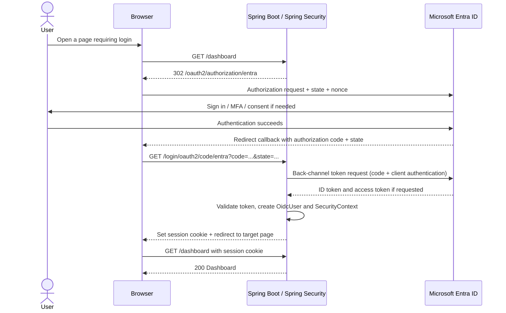

# Integrating OIDC Login with Spring Security

> **Chapter:** Microsoft Entra ID  
> **Module:** SPRING_CLOUD_PROVIDER_INTEGRATION — hands-on integration of Spring Boot with managed services on AWS, Azure, and Google Cloud via the corresponding Spring Cloud libraries.

An employee-facing Spring Boot application typically needs a login page, a session, and a way to identify the user on each request. Microsoft Entra ID can handle authentication via OpenID Connect (OIDC), while Spring Security handles redirects, callbacks, ID token validation, principal creation, and endpoint protection.

This lesson implements the **server-side web application** model: the browser is redirected to Entra to sign in; Spring Boot receives the authorization code at the callback, exchanges the code for tokens over the back channel, and establishes a login session. This approach suits internal portals, dashboards, and admin applications. The lesson also explains how to read user information, log out, handle redirects behind a reverse proxy, and test the login flow.

## 1. Learning Objectives

After this lesson, you will be able to:

1. Explain OIDC, the OAuth 2.0 Authorization Code flow, and the role of the ID token.
2. Create an app registration for a web application in Microsoft Entra ID.
3. Configure the redirect URI, tenant, client ID, and appropriate credentials.
4. Configure Spring Security OAuth2 Client with `oauth2Login()`.
5. Receive `OidcUser`, read necessary claims, and build a safe internal identifier.
6. Distinguish OIDC login from bearer access token authentication for REST APIs.
7. Configure logout, sessions, CSRF, and applications running behind a reverse proxy.
8. Test successful login, configuration errors, access control, and common troubleshooting scenarios.

## 2. Where Does OIDC Fit in the Login Process?

OAuth 2.0 is an authorization framework. OpenID Connect builds on top of OAuth 2.0 to provide a user authentication layer. When an application requests the `openid` scope, Entra can issue an **ID token** containing authentication details about the user and the login session.

Key components:

| Component | Role |
|---|---|
| Browser | Initiates login, follows redirects, and sends session cookies |
| Spring Boot / Spring Security | OAuth2 client, receives callback, exchanges authorization code, validates ID token, creates `Authentication` |
| Microsoft Entra ID | Authenticates the user, enforces tenant policies/MFA/Conditional Access, and issues tokens |
| App registration | Declares client ID, tenant/account types, redirect URI, and credentials |
| Session cookie | Maintains the browser's signed-in state with the application after callback |

### Authorization Code Flow



Spring Security manages `state`, `nonce`, callback handling, token exchange, and OIDC validation according to provider configuration. Do not write a custom callback endpoint that merely decodes a JWT and trusts the payload; doing so easily skips signature, issuer, audience, nonce, and lifetime checks.

### Security Parameters in the Flow

- `state`: binds the authorization response to the initiated request, protecting against CSRF in the OAuth redirect flow.
- `nonce`: binds the ID token to the initiated login attempt, protecting against replay/substitution.
- PKCE: binds the authorization code to a code verifier; especially critical for public clients and widely recommended overall.
- TLS: protects authorization responses, token exchanges, and cookies in transit.

Spring Security handles these flow values. The application must still configure HTTPS, exact redirect URIs, secure cookies, and proper session settings.

## 3. Preparing the App Registration in Microsoft Entra ID

The example uses the application `invoice-portal-staging`, allowing only accounts in the Contoso tenant to sign in.

### 3.1. Select the Right Tenant and Create the Registration

1. Open the Microsoft Entra admin center.
2. Select the directory/tenant used for the staging environment.
3. Navigate to **Entra ID → App registrations → New registration**.
4. Enter a name, for example `invoice-portal-staging`.
5. Choose **Accounts in this organizational directory only** if the app serves only one tenant.
6. Complete the registration and record:
   - **Application (client) ID**.
   - **Directory (tenant) ID**.
   - **Object ID** of the application object for administration/lookup.

In Spring OAuth2 client configuration, `client-id` is the **Application (client) ID**. Do not use the application object's Object ID or the service principal's Object ID instead.

### 3.2. Add the Web Platform and Redirect URI

In the app registration, open **Authentication → Add a platform → Web**. Register the redirect URI where Spring Security will receive the callback.

Local example:

```text
http://localhost:8080/login/oauth2/code/entra
```

Staging example:

```text
https://invoice-staging.example.com/login/oauth2/code/entra
```

The value must match the exact scheme, host, port, path, and redirect configuration the application sends to Entra. When behind a reverse proxy, ensure Spring Boot receives the proper forwarded host/protocol so `baseUrl` expands to the public URL.

Never register a local callback and reuse it for production. Production must use HTTPS and an organization-controlled hostname.

### 3.3. Choose Application Type and Credentials

A Spring Boot server-side web app is a **confidential client** because the backend can hold credentials. You can authenticate the client using:

- A certificate, typically well-suited to production environments with certificate management workflows.
- A federated credential when the deployment platform supports federation.
- A client secret if needed for compatibility; store it in a secret manager/secret store, restrict read access, set an expiration, and maintain a rotation process.

Never put secret values in Git, `application.yml`, Docker images, logs, or onboarding docs. A Secret ID/credential ID is not the secret value. If you create a client secret in the portal, save its value to the secret store immediately per approved process; the portal will not display the plaintext again afterward.

Public clients like SPAs/mobile apps cannot protect a client secret. For those architectures, use Authorization Code + PKCE with an appropriate client library; do not copy server-side Spring Boot confidential client settings into JavaScript code.

### 3.4. Minimal Scopes for Sign-In

OIDC login requires the `openid` scope. You can request `profile` and `email` if the app needs those corresponding profile claims. Entra does not guarantee every account has an `email` claim; `preferred_username` can also change and is not an authorization key.

Only add Microsoft Graph delegated scopes when the application actually calls Graph. Signing in successfully does not automatically grant permission to read mailboxes, extended profiles, or Azure Storage data.

## 4. Configuring Spring Boot

### 4.1. Dependencies

In a Maven project using compatible Spring Boot dependency management, add Spring Security and OAuth2 Client:

```xml
<dependencies>
    <dependency>
        <groupId>org.springframework.boot</groupId>
        <artifactId>spring-boot-starter-security</artifactId>
    </dependency>
    <dependency>
        <groupId>org.springframework.boot</groupId>
        <artifactId>spring-boot-starter-oauth2-client</artifactId>
    </dependency>
    <dependency>
        <groupId>org.springframework.boot</groupId>
        <artifactId>spring-boot-starter-web</artifactId>
    </dependency>
</dependencies>
```

Do not pin individual dependency versions when the Spring Boot BOM/parent manages them. Check the Spring Boot and Spring Security version matrix before upgrading.

### 4.2. Declare the OAuth2 Client

Example `application.yml`:

```yaml
server:
  port: 8080
  forward-headers-strategy: framework

spring:
  security:
    oauth2:
      client:
        registration:
          entra:
            provider: entra
            client-id: ${ENTRA_CLIENT_ID}
            client-secret: ${ENTRA_CLIENT_SECRET}
            client-name: Microsoft Entra ID
            authorization-grant-type: authorization_code
            redirect-uri: "{baseUrl}/login/oauth2/code/{registrationId}"
            scope:
              - openid
              - profile
              - email
        provider:
          entra:
            issuer-uri: https://login.microsoftonline.com/${ENTRA_TENANT_ID}/v2.0
```

Explanation:

| Property | Meaning |
|---|---|
| `registration.entra` | Internal registration name; used in `/oauth2/authorization/entra` |
| `client-id` | Application (client) ID in Entra |
| `client-secret` | Secret value of the confidential client; fetched from a secret store |
| `authorization-grant-type` | Authorization Code flow |
| `redirect-uri` | Callback path handled by Spring Security |
| `scope` | OIDC scopes requested by the application |
| `issuer-uri` | Tenant-specific issuer/authority; Spring uses OIDC discovery to fetch metadata and endpoints |

Environment variables to supply at runtime:

```bash
ENTRA_TENANT_ID=<directory-tenant-id>
ENTRA_CLIENT_ID=<application-client-id>
ENTRA_CLIENT_SECRET=<secret-value-from-secret-store>
```

These are variable names and placeholders, not real values. Never commit credential values. If using a certificate or federated credential, configure client authentication accordingly for your Spring Security/provider version; do not keep a dummy `client-secret` in the file.

### 4.3. OIDC Discovery

For a tenant-specific issuer, OIDC metadata is typically published at:

```text
https://login.microsoftonline.com/<TENANT_ID>/v2.0/.well-known/openid-configuration
```

The metadata describes the issuer, authorization endpoint, token endpoint, JWKS URI, UserInfo endpoint, and provider capabilities. Spring Security uses discovery when `issuer-uri` is configured. The host running the application must be able to reach the discovery and JWKS endpoints through allowed outbound networking/proxies.

Do not configure the issuer with a client ID or Application ID URI. The issuer identifies the token-issuing authority; the client ID identifies the application.

## 5. Enabling OAuth2 Login in Spring Security

Spring Security registers default endpoints:

| Endpoint | Function |
|---|---|
| `/oauth2/authorization/entra` | Starts login with the `entra` registration |
| `/login/oauth2/code/entra` | Receives the authorization response from Entra |
| `/logout` | Logs out the local session per Spring Security configuration |

Minimal filter chain:

```java
package com.example.invoice.security;

import org.springframework.context.annotation.Bean;
import org.springframework.context.annotation.Configuration;
import org.springframework.security.config.Customizer;
import org.springframework.security.config.annotation.web.builders.HttpSecurity;
import org.springframework.security.web.SecurityFilterChain;

@Configuration
public class WebSecurityConfiguration {

    @Bean
    SecurityFilterChain webSecurity(HttpSecurity http) throws Exception {
        http
            .authorizeHttpRequests(authorize -> authorize
                .requestMatchers("/", "/assets/**", "/favicon.ico", "/error")
                    .permitAll()
                .anyRequest().authenticated())
            .oauth2Login(Customizer.withDefaults())
            .logout(Customizer.withDefaults());

        return http.build();
    }
}
```

Spring Security keeps CSRF protection enabled by default for session-based web applications. Do not disable CSRF globally just to work around callback or form POST errors; OAuth `state` and CSRF tokens protect different boundaries. If an app has both browser sessions and a REST bearer API, design separate filter chains and CSRF policies for each endpoint group.

### Starting Login from an Application Page

You can render a link:

```html
<a href="/oauth2/authorization/entra">Sign in with Microsoft Entra ID</a>
```

Or protect `/dashboard`; when an unauthenticated user visits it, Spring Security redirects them to the configured login flow and provider. Do not build authorization URLs manually via query-string concatenation.

## 6. Reading User Information with `OidcUser`

After a successful OIDC login, Spring Security stores the `Authentication` in `SecurityContext`. For OIDC, the principal is typically `OidcUser`, containing the ID token and claims resolved from the UserInfo endpoint if the flow uses it.

Example controller:

```java
package com.example.invoice.web;

import org.springframework.security.core.annotation.AuthenticationPrincipal;
import org.springframework.security.oauth2.core.oidc.user.OidcUser;
import org.springframework.web.bind.annotation.GetMapping;
import org.springframework.web.bind.annotation.RestController;

@RestController
public class AccountController {

    @GetMapping("/me")
    public AccountView currentUser(@AuthenticationPrincipal OidcUser user) {
        return new AccountView(
                user.getSubject(),
                user.getClaimAsString("tid"),
                user.getClaimAsString("oid"),
                user.getFullName(),
                user.getClaimAsString("preferred_username"),
                user.getClaimAsString("email"));
    }

    public record AccountView(
            String subject,
            String tenantId,
            String objectId,
            String displayName,
            String preferredUsername,
            String email) {
    }
}
```

This is an illustrative endpoint. In production, return only the fields actually needed; never return the raw ID token, access token, or full claim set to the browser.

### Which Claims Are Suitable for Identifying Users?

| Claim | Meaning | How to use |
|---|---|---|
| `iss` | Issuer that minted the ID token | Must belong to a trusted issuer |
| `sub` | Subject per OIDC | Used with issuer as the OIDC identifier |
| `tid` | Tenant ID in Entra tokens | Tenant partitioning and policy |
| `oid` | User object ID within the tenant | Can be paired with `tid` as a tenant-local user key |
| `name` | Display name | Display only; mutable |
| `preferred_username` | Preferred sign-in name | Display/hint; not an authorization key |
| `email` | Email if issued | May be absent or change; never assume always present |

For user data in a multitenant application, the `tid` + `oid` pair is a useful tenant-local identifier. In general OIDC, subjects are scoped to the issuer; store `iss` + `sub` when following standard OIDC semantics. Guest users in a customer tenant have their own tenant-local object ID.

Never use `email` or `preferred_username` as a user's primary key or sole basis for granting permissions. Emails can change, be missing, or be updated independently.

### An ID Token Is Not an Access Token

OIDC login primarily uses the ID token for the client to confirm the login session. Access tokens are issued for specific resources/APIs. Never send an ID token to Microsoft Graph, Azure Storage, or your own API as a bearer access token. If the app needs to call Graph, it must request appropriate delegated scopes and use OAuth2 Client to manage authorized clients/access tokens.

## 7. Mapping App Roles to Web Application Permissions

Signing in successfully only proves the user has authenticated. It does not automatically grant business permissions such as viewing invoices, approving, or administering.

If the application declares app roles and assigns them to users/groups in Entra, the `roles` claim can be included in the appropriate token. The application can map those roles to Spring `GrantedAuthority` instances.

Example mapper:

```java
package com.example.invoice.security;

import java.util.Collection;
import java.util.HashSet;
import java.util.Set;

import org.springframework.context.annotation.Bean;
import org.springframework.context.annotation.Configuration;
import org.springframework.security.core.GrantedAuthority;
import org.springframework.security.core.authority.SimpleGrantedAuthority;
import org.springframework.security.core.authority.mapping.GrantedAuthoritiesMapper;
import org.springframework.security.oauth2.core.oidc.user.OidcUserAuthority;

@Configuration
public class OidcAuthoritiesConfiguration {

    @Bean
    GrantedAuthoritiesMapper userAuthoritiesMapper() {
        return authorities -> {
            Set<GrantedAuthority> mapped = new HashSet<>(authorities);

            for (GrantedAuthority authority : authorities) {
                if (authority instanceof OidcUserAuthority oidcAuthority) {
                    Object rolesClaim =
                            oidcAuthority.getIdToken().getClaims().get("roles");

                    if (rolesClaim instanceof Collection<?> roles) {
                        for (Object role : roles) {
                            if (role instanceof String roleName) {
                                mapped.add(new SimpleGrantedAuthority(
                                        "ROLE_" + roleName));
                            }
                        }
                    }
                }
            }
            return mapped;
        };
    }
}
```

Attach the mapper to OAuth2 Login:

```java
@Bean
SecurityFilterChain webSecurity(
        HttpSecurity http,
        GrantedAuthoritiesMapper userAuthoritiesMapper) throws Exception {

    http
        .authorizeHttpRequests(authorize -> authorize
            .requestMatchers("/", "/assets/**", "/error").permitAll()
            .requestMatchers("/admin/**").hasRole("Invoice.Admin")
            .requestMatchers("/approvals/**").hasRole("Invoice.Approver")
            .anyRequest().authenticated())
        .oauth2Login(oauth2 -> oauth2
            .userInfoEndpoint(userInfo -> userInfo
                .userAuthoritiesMapper(userAuthoritiesMapper)));

    return http.build();
}
```

These two snippets illustrate one combined configuration; in your project, combine them into **one** `SecurityFilterChain` bean rather than declaring two competing beans. `hasRole("Invoice.Admin")` checks the authority `ROLE_Invoice.Admin`.

Only map roles defined and governed in the app registration; never accept arbitrary role strings from requests. If using group claims, handle Entra group overage when the token omits the full group list; never assume the `groups` claim is always present.

## 8. Logging Out of the Application and Microsoft Entra ID

Logout has two scopes:

- **Local logout:** clears the application's `SecurityContext`/session.
- **OIDC provider logout:** redirects the browser to Entra's end-session endpoint to close the SSO session per provider policy.

Calling `/logout` with `Customizer.withDefaults()` only performs local logout. If you also need to sign out of the Entra session, use `OidcClientInitiatedLogoutSuccessHandler`:

```java
import org.springframework.context.annotation.Bean;
import org.springframework.context.annotation.Configuration;
import org.springframework.security.config.annotation.web.builders.HttpSecurity;
import org.springframework.security.oauth2.client.registration.ClientRegistrationRepository;
import org.springframework.security.oauth2.client.oidc.web.logout.OidcClientInitiatedLogoutSuccessHandler;
import org.springframework.security.web.SecurityFilterChain;

@Configuration
public class OidcLogoutConfiguration {

    @Bean
    SecurityFilterChain webSecurity(
            HttpSecurity http,
            ClientRegistrationRepository registrations) throws Exception {

        var logoutHandler =
                new OidcClientInitiatedLogoutSuccessHandler(registrations);
        logoutHandler.setPostLogoutRedirectUri("{baseUrl}");

        http
            .authorizeHttpRequests(auth -> auth
                .requestMatchers("/", "/assets/**", "/error").permitAll()
                .anyRequest().authenticated())
            .oauth2Login(org.springframework.security.config.Customizer.withDefaults())
            .logout(logout -> logout
                .logoutSuccessHandler(logoutHandler));

        return http.build();
    }
}
```

This snippet shows a filter chain with OIDC login and provider logout. When adopting it, merge it with your application's actual authorization rules. Verify that OIDC metadata includes `end_session_endpoint` and that the post-logout redirect URI is properly registered/accepted by Entra. Logging out of Entra does not necessarily terminate every other application's session; SSO and individual app sessions have independent lifecycles.

If the application only needs local logout, use the default handler and clear the session/cookies. Never claim the user has been signed out of all Microsoft 365 apps merely because the Spring session was cleared.

## 9. Running Spring Boot Behind a Reverse Proxy

In staging/production, TLS often terminates at an ingress, application gateway, or reverse proxy. Spring Boot may see the internal request as HTTP on an internal host, while the browser visits a public HTTPS URL. If the app constructs a redirect URI from the wrong scheme or host, Entra will reject the callback.

Verify:

1. The proxy forwards trusted `Forwarded` or `X-Forwarded-*` headers.
2. Spring Boot processes forwarded headers, e.g., `server.forward-headers-strategy: framework` depending on the Boot version.
3. The proxy only accepts forwarded headers from trusted sources; never allow internet clients to spoof host/proto.
4. The generated redirect URI matches `https://<public-host>/login/oauth2/code/entra`.
5. Session cookies carry `Secure`, `HttpOnly`, and `SameSite` attributes suited to the architecture.
6. The callback path is routed intact by the proxy to the application.

Never use wildcard redirect URIs to work around host/path issues. Fix the canonical public URL and forwarded-header trust boundary.

### Cookies and Sessions

For web applications:

- Use HTTPS end-to-end.
- Set session cookies `Secure` and `HttpOnly`.
- Choose `SameSite` compatible with your redirect/login architecture; test in real browsers.
- Bound session timeouts and provide invalidation mechanisms.
- Never place access tokens/ID tokens in URLs or `localStorage`.
- Use CSRF protection for state-changing operations relying on cookie sessions.

## 10. Testing OIDC Login

Separate unit/security tests from integration tests against a real Entra tenant.

### 10.1. Mocking OIDC Login with Spring Security Test

Add `spring-security-test` in test scope:

```xml
<dependency>
    <groupId>org.springframework.security</groupId>
    <artifactId>spring-security-test</artifactId>
    <scope>test</scope>
</dependency>
```

Example testing `/me` with a mock OIDC principal:

```java
import static org.springframework.security.test.web.servlet.request
        .SecurityMockMvcRequestPostProcessors.oidcLogin;
import static org.springframework.test.web.servlet.request.MockMvcRequestBuilders.get;
import static org.springframework.test.web.servlet.result.MockMvcResultMatchers.jsonPath;
import static org.springframework.test.web.servlet.result.MockMvcResultMatchers.status;

import org.junit.jupiter.api.Test;
import org.springframework.beans.factory.annotation.Autowired;
import org.springframework.boot.test.autoconfigure.web.servlet.AutoConfigureMockMvc;
import org.springframework.boot.test.context.SpringBootTest;
import org.springframework.test.web.servlet.MockMvc;

@SpringBootTest
@AutoConfigureMockMvc
class OidcAccountControllerTest {

    @Autowired
    MockMvc mvc;

    @Test
    void returnsCurrentOidcUserClaims() throws Exception {
        mvc.perform(get("/me").with(oidcLogin()
                        .idToken(token -> token
                                .claim("tid", "11111111-1111-1111-1111-111111111111")
                                .claim("oid", "22222222-2222-2222-2222-222222222222")
                                .claim("name", "Alice Example")
                                .claim("preferred_username", "alice@example.test"))))
                .andExpect(status().isOk())
                .andExpect(jsonPath("$.tenantId")
                        .value("11111111-1111-1111-1111-111111111111"))
                .andExpect(jsonPath("$.objectId")
                        .value("22222222-2222-2222-2222-222222222222"));
    }
}
```

Mock `oidcLogin()` creates a synthetic principal to test controllers and authorization rules. It does not call Entra, and does not verify real token signatures, tenants, consent, or redirect URIs. This is a unit/security test, not end-to-end proof of identity provider integration.

### 10.2. Integration Testing Against a Test Tenant

Create a dedicated app registration for the test environment and verify:

1. Opening `/dashboard` unauthenticated redirects the browser to Entra.
2. Test user completes sign-in → callback succeeds and a session is created.
3. `/me` returns the expected `tid`, `oid`, and allowed display claims.
4. A user without the app role cannot access `/admin/**`.
5. Logout clears the session; if provider logout is enabled, the browser redirects to Entra's end-session endpoint and returns to the expected URI.
6. A wrong redirect URI, wrong tenant, or expired secret produces diagnosable errors.

Never use production accounts or production secrets in tests. Never save HAR files, browser traces, or logs containing authorization codes, cookies, ID tokens, access tokens, or client secrets.

### 10.3. Test Matrix

| Scenario | Expected result |
|---|---|
| Access public page | 200, no login required |
| Access private page unauthenticated | Redirect to `/oauth2/authorization/entra` or authorization endpoint |
| Sign in with valid tenant | Valid callback, session established |
| Invalid token/issuer | Authentication fails |
| User lacking app role | Login succeeds, but role-protected endpoint is denied |
| Expired session | Re-authentication required |
| POST missing CSRF token | Rejected per CSRF policy |
| Local logout | Local session cleared |
| OIDC logout | Provider redirect occurs if handler is configured |

## 11. Distinguishing OAuth2 Login from Resource Server

A single system may serve both employee web pages and REST APIs for SPAs or other services. These two use cases use different tokens and security chains:

| Characteristic | OAuth2 Login (OIDC client) | OAuth2 Resource Server |
|---|---|---|
| Application role | Client signing in users | API accepting bearer tokens |
| Primary token | ID token to confirm user login; access token if calling downstream | Access token with the API's audience |
| Statefulness | Typically session/cookie | Typically stateless bearer token |
| Spring configuration | `oauth2Login()` | `oauth2ResourceServer().jwt()` |
| Principal | `OidcUser` | `Jwt`/`JwtAuthenticationToken` |
| Redirects to Entra | Yes | Does not redirect; returns 401 when token missing |
| Example | Employee portal | `/api/invoices/**` |

Never use a login ID token as a bearer token for a REST API. When an API receives an access token, it must validate the issuer, audience, lifetime, and the API's own scopes/app roles. If both are needed in one application, split filter chains by request matcher and order, and carefully verify CSRF/session policies for each endpoint group.

## 12. Common Errors

| Error / symptom | Common cause | Resolution |
|---|---|---|
| `AADSTS50011` | Redirect URI sent in the request does not match a registered URI | Compare scheme, host, port, path, and forwarded headers |
| `AADSTS700016` | Application/client ID does not exist in the current tenant/authority | Check client ID, tenant ID, and app registration |
| `AADSTS7000215` | Wrong/expired client secret value or secret ID entered by mistake | Create/rotate credential and inject the real secret value |
| `AADSTS50105` | User is not assigned to the Enterprise application while assignment is required | Assign the appropriate user/group or adjust assignment policy |
| Login succeeds, but `/me` lacks `email` | Entra did not emit an email claim for that account, or scopes/optional claims are not set | Do not depend on email; use stable identifiers and handle optional claims |
| Redirect loop behind proxy | Spring builds redirect URI with HTTP/internal host, or cookie is not sent | Configure forwarded headers, public base URL, and cookies |
| `invalid_nonce` or state/correlation error | Cookie/session lost across redirects, multiple instances without shared sessions, mismatched callback host | Check cookie `SameSite`/domain, sticky/shared sessions, and canonical host |
| Discovery/JWKS timeout | Outbound DNS/proxy/firewall cannot reach Entra | Check network, proxy, and certificate trust |
| Login works, yet admin page returns 403 | User lacks app role assignment or roles are not mapped to authorities | Check app role assignment, `roles` claim, and mapper |
| Logout returns to app, yet SSO remains | Only local logout ran, or provider session did not end | Configure OIDC provider logout and verify end-session metadata |
| API returns 401 when sent an ID token | An ID token is not an access token meant for the API | Request an access token with the right audience and use Resource Server |

### Diagnostic Order

1. Confirm the right tenant and Application (client) ID.
2. Inspect the actual redirect URI in the authorization request.
3. Check the issuer discovery endpoint and metadata.
4. Confirm the browser preserves `state`/`nonce`/session cookies across redirects.
5. Check client authentication and credential expiration.
6. Check callback handling, ID token validation, and emitted claims.
7. Check roles/authorities after authentication.
8. Cross-reference Entra sign-in logs using timestamps, correlation IDs, and request IDs; never save tokens.

## 13. Security When Taking OIDC Login to Production

- Use a tenant-specific issuer for single-tenant apps.
- Pick supported account types matching requirements; do not enable multitenancy unnecessarily.
- Use HTTPS and explicitly registered redirect URIs.
- Use certificates/federated credentials or managed secrets with expirations and rotation.
- Never log authorization codes, ID tokens, access tokens, refresh tokens, cookies, or client secrets.
- Keep `state`, `nonce`, and CSRF protection active; never disable filters to fix redirect errors.
- Protect session cookies with `Secure`, `HttpOnly`, and appropriate `SameSite`.
- Validate `iss`, `aud`, lifetime, and issuer per provider; never merely decode the JWT.
- Use `tid` + `oid` or `iss` + `sub` for stable identification; never authorize by email.
- Limit stored claims and profile attributes to only what business logic requires.
- When scaling across multiple instances, configure shared session stores and consistent key material to handle callbacks.
- Behind a reverse proxy, trust forwarded headers only from controlled proxies.
- Periodically review app roles, API permissions, and consents.

## 14. Hands-On Exercise

**Context:** Build an invoice management portal for Contoso employees using Spring Boot. Users sign in via Microsoft Entra ID. `/dashboard` requires authentication; `/admin/**` is restricted to users with app role `Invoice.Admin`; `/me` returns a permitted subset of identity claims.

### Part A — App Registration

1. Create a single-tenant app registration for the web application.
2. Record the tenant ID and Application/client ID.
3. Add the Web platform and local redirect URI.
4. Create a credential for the confidential client and store it in a secret store.
5. Verify the tenant's discovery endpoint.

### Part B — Spring Security

1. Add the OAuth2 Client dependency.
2. Configure the `entra` registration, tenant-specific issuer URI, and OIDC scopes.
3. Configure `SecurityFilterChain` with public/private routes and `oauth2Login()`.
4. Create `/me` accepting `OidcUser`; return only `tid`, `oid`, `sub`, and needed display name.
5. Add app role `Invoice.Admin`, assign it to a test user, and map the `roles` claim to authorities.
6. Configure local logout; then try OIDC provider logout if required.

### Part C — Testing

1. Mock OIDC login with MockMvc to test `/me` and role rules.
2. Run an integration test against a test tenant, verifying redirect/callback.
3. Test an incorrect redirect URI and explain the error.
4. Test a user without the app role accessing `/admin/**`.
5. Test cookies/sessions through a reverse proxy if deployed behind an ingress.
6. Inspect logs to ensure no codes, tokens, cookies, or secrets appear.

**Sample results table:**

| Test case | Expected result | Actual result |
|---|---|---|
| Anonymous visits `/` | 200 | ... |
| Anonymous visits `/dashboard` | Redirect to login | ... |
| Valid user visits `/me` | 200 and permitted claims | ... |
| User without `Invoice.Admin` visits `/admin` | 403 | ... |
| User with `Invoice.Admin` visits `/admin` | 200 | ... |
| Callback with wrong redirect URI | Rejected by Entra | ... |
| Local logout | Session cleared | ... |

**Pass criteria:** The learner can configure full OIDC login, distinguish ID tokens from access tokens, read claims properly, enforce roles post-login, and handle callbacks/logout securely.

## Official References

1. [Spring Security — OAuth2 Login](https://docs.spring.io/spring-security/reference/servlet/oauth2/login/index.html): configuring login clients and callbacks.
2. [Spring Security — OAuth2 Client](https://docs.spring.io/spring-security/reference/servlet/oauth2/client/index.html): client registrations, authorized clients, and token lifecycle.
3. [Spring Security — Testing OAuth2](https://docs.spring.io/spring-security/reference/servlet/test/mockmvc/oauth2.html): mocking OIDC/OAuth2 principals in MockMvc.
4. [Microsoft identity platform — OpenID Connect](https://learn.microsoft.com/entra/identity-platform/v2-protocols-oidc): OIDC discovery, authorization requests, and ID tokens.
5. [Microsoft identity platform — Authorization code flow](https://learn.microsoft.com/entra/identity-platform/v2-oauth2-auth-code-flow): authorization code, PKCE, and token exchange.
6. [Quickstart: Register an application](https://learn.microsoft.com/entra/identity-platform/quickstart-register-app): app registration and tenant/client IDs.
7. [Configure authentication in an app registration](https://learn.microsoft.com/entra/identity-platform/quickstart-register-app): platforms, redirect URIs, and authentication settings.
8. [Microsoft identity platform — ID token claims](https://learn.microsoft.com/entra/identity-platform/id-token-claims-reference): claims in ID tokens.
9. [Microsoft identity platform — Optional claims](https://learn.microsoft.com/entra/identity-platform/optional-claims-reference): configuring optional claims.
10. [Spring Boot — Forwarded Headers](https://docs.spring.io/spring-boot/reference/howto/webserver.html): handling requests behind a reverse proxy.

> **Remember:** OIDC login authenticates users and creates an application session. Spring Security manages authorization redirects, callbacks, `state`, `nonce`, and token validation; Entra manages identities and issues tokens. Use the right tenant/client/redirect URI, keep sessions and CSRF secure, and distinguish a login ID token from an access token meant for an API.
