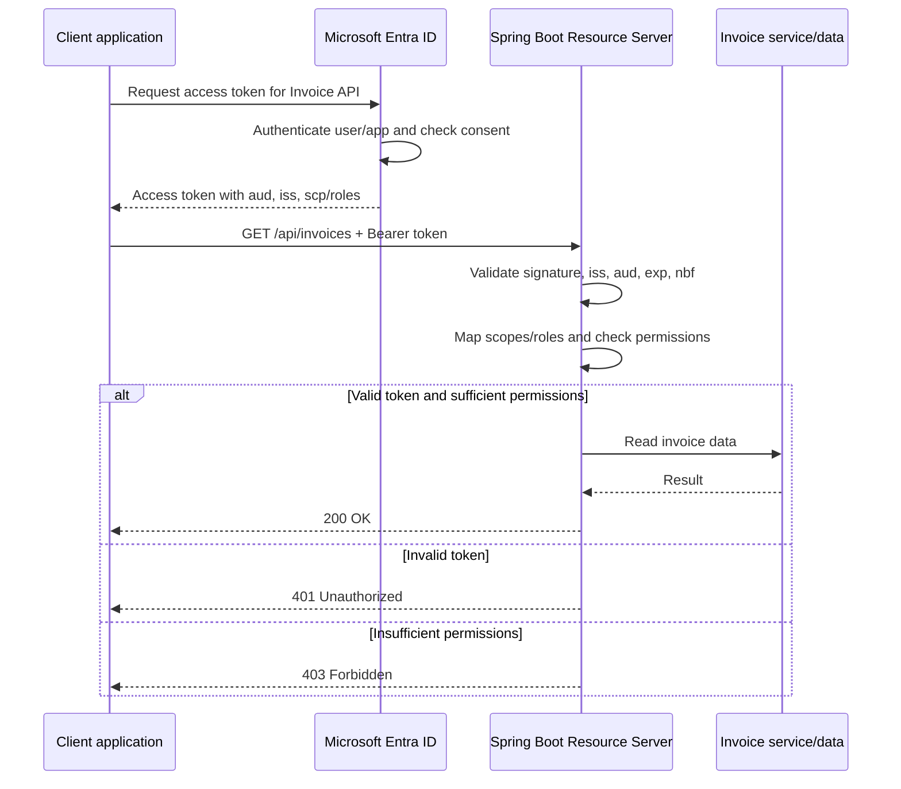

# Protecting APIs with OAuth2 Resource Server

> **Chapter:** Microsoft Entra ID  
> **Module:** SPRING_CLOUD_PROVIDER_INTEGRATION — hands-on integration of Spring Boot with managed services on AWS, Azure, and Google Cloud via the corresponding Spring Cloud libraries. This lesson focuses on protecting Spring Boot APIs with access tokens issued by Microsoft Entra ID.

An invoice API may be called by a web portal, a mobile app, another backend service, or a scheduled worker. The API needs to know which client sent the request, whether a user is delegating access, and whether the caller is authorized to perform the operation. Microsoft Entra ID issues access tokens; Spring Security Resource Server validates the token and turns its permissions into authorities enforced at endpoints.

The key point is that **the API must validate that the access token was issued for this API itself**. A token with a valid signature can still be invalid for the API if its issuer (`iss`), audience (`aud`), or permissions do not match. This lesson implements the pattern where Spring Boot accepts bearer JWTs from Entra, validates issuer/audience/lifetime, maps delegated scopes and application app roles, and enforces permissions at endpoints.

## 1. Learning Objectives

After this lesson, you will be able to:

1. Explain the role of an OAuth2 Resource Server and distinguish it from OAuth2 Login.
2. Register a Spring Boot API in Microsoft Entra ID and expose delegated scopes/app roles.
3. Configure Spring Security to accept bearer access tokens via the HTTP `Authorization` header.
4. Validate JWT signatures, issuer (`iss`), audience (`aud`), lifetime, and tenant.
5. Understand Entra claims such as `scp`, `roles`, `tid`, `oid`, `azp`, `appid`, and `idtyp`.
6. Map delegated scopes and application roles into Spring `GrantedAuthority` instances.
7. Protect endpoints with request authorization and method security.
8. Distinguish 401 (authentication/invalid token) from 403 (authenticated but lacking permission).
9. Test the API with mock JWTs in MockMvc and verify integration against a test tenant.

## 2. How Does a Resource Server Work?

An OAuth2 Resource Server is an application/API that accepts an access token from a client and validates it before processing the request. In this lesson:

- **Authorization Server:** Microsoft Entra ID, which authenticates the principal and issues access tokens.
- **Client:** web portal, SPA, mobile app, worker, or backend calling the API.
- **Resource Server:** Spring Boot API protecting invoice data.
- **Access token:** bearer credential sent by the client in each request.

Basic flow:



The client does not validate the target API's access token on its own. The Resource Server is responsible for validating that the token was issued for that API. If a token has a valid signature but was issued for Microsoft Graph or another API, the Invoice API must reject it.

### What Does Bearer Token Mean?

The client sends the token in an HTTP header:

```http
GET /api/invoices/42 HTTP/1.1
Host: api.example.com
Authorization: Bearer <ACCESS_TOKEN>
Accept: application/json
```

Anyone who holds a bearer token can use it within its scope and lifetime. Therefore:

- Transmit tokens only over HTTPS.
- Never put tokens in query strings, URLs, logs, or analytics.
- Never store tokens in source code or container images.
- Never send tokens to untrusted hosts.
- Never use an ID token in place of an access token.

## 3. Registering the Spring Boot API in Microsoft Entra ID

Assume the API is named `invoice-api` and accepts tokens only from the Contoso tenant in the first example.

### 3.1. Create an App Registration for the API

1. Open the Microsoft Entra admin center and select the right tenant.
2. Navigate to **Entra ID → App registrations → New registration**.
3. Name it `invoice-api-staging`.
4. Choose **Accounts in this organizational directory only** if the API serves only one tenant.
5. Register and record the Application (client) ID and Directory (tenant) ID.

The Application/client ID identifies the API in Entra. It is not the Object ID of the application object or service principal.

### 3.2. Expose the API and Create a Delegated Scope

In the API's app registration, open **Expose an API**:

1. Set the Application ID URI, for example `api://<INVOICE_API_CLIENT_ID>`.
2. Choose **Add a scope**.
3. Set the scope name to `Invoices.Read`.
4. Configure a clear consent display name/description.
5. Set its state to enabled.

Clients can request the delegated scope:

```text
api://<INVOICE_API_CLIENT_ID>/Invoices.Read
```

This scope allows a client to call the API on behalf of a signed-in user. The API still must check the user's business permissions on specific invoices.

### 3.3. Create an App Role for Application Permissions

If a worker/daemon needs to call the API without a user, create an app role targeting applications, for example:

| Property | Sample value |
|---|---|
| Display name | Read all invoices |
| Value | `Invoices.Read.All` |
| Allowed member types | Applications |
| Description | Allows workloads to read invoices via the API |
| Enabled | Yes |

The client application adds an **Application permission** targeting this app role, and a tenant admin grants admin consent. Client credentials requests typically use a resource scope of the form:

```text
api://<INVOICE_API_CLIENT_ID>/.default
```

`/.default` requests the application permissions configured and consented for the resource; it does not bypass the permission grant step.

### 3.4. Delegated Scopes and App Roles Differ

| Permission type | Caller | Typical claim in access token | Meaning |
|---|---|---|---|
| Delegated permission | Client acting on behalf of a user | `scp` | Scope consented for the client and user context |
| Application permission | Workload calling with its own permissions | `roles` | App role/permission granted to the service principal |
| User app role | Signed-in user assigned a role | `roles` | User's role on the API/app |

The `roles` claim can appear in a user token if the user is assigned an app role. Therefore, do not classify a token as app-only merely because `roles` is present. If the API needs to identify app-only tokens reliably, configure the optional claim `idtyp` and require `app` on workload-only endpoints.

References: [Expose a web API](https://learn.microsoft.com/entra/identity-platform/quickstart-configure-app-expose-web-apis), [Access token claims reference](https://learn.microsoft.com/entra/identity-platform/access-token-claims-reference).

## 4. Adding the Resource Server Dependency to Spring Boot

With Maven and Spring Boot dependency management:

```xml
<dependencies>
    <dependency>
        <groupId>org.springframework.boot</groupId>
        <artifactId>spring-boot-starter-oauth2-resource-server</artifactId>
    </dependency>
    <dependency>
        <groupId>org.springframework.boot</groupId>
        <artifactId>spring-boot-starter-security</artifactId>
    </dependency>
    <dependency>
        <groupId>org.springframework.boot</groupId>
        <artifactId>spring-boot-starter-web</artifactId>
    </dependency>
</dependencies>
```

The Resource Server handles bearer token authentication and JWT decoding/validation. Spring Boot's OAuth2 Resource Server starter pulls the necessary components into the dependency graph. To test security with MockMvc, add `spring-security-test` in test scope:

```xml
<dependency>
    <groupId>org.springframework.security</groupId>
    <artifactId>spring-security-test</artifactId>
    <scope>test</scope>
</dependency>
```

Do not pin Spring Security versions manually if the Spring Boot BOM already manages them. Choose a compatible Spring Boot/Spring Security release line and record the actual build version.

## 5. Configuring Issuer and Audience

Two critical claims to validate are:

- `iss` (issuer): who issued the token.
- `aud` (audience): which resource/API the token was issued for.

### 5.1. Entra Tenant-Specific Issuer

For a v2.0 access token from the Contoso tenant, the issuer typically has the form:

```text
https://login.microsoftonline.com/<TENANT_ID>/v2.0
```

This value must match the token's `iss` claim. v1.0 tokens use a different issuer format; if the API accepts v1 tokens, configure the issuer/validator according to that token version and its metadata. Never copy an issuer URI from another example and assume it holds for every tenant/token version.

### 5.2. Audience of an Entra Access Token

Audience depends on the access token version:

| Token version (`ver`) | Typical `aud` format |
|---|---|
| v2.0 | GUID Application/client ID of the API |
| v1.0 | Declared Application ID URI of the API or configured resource identifier |

Thus, even though the client requests a scope using the Application ID URI, `aud` in a v2.0 token is typically the API's GUID client ID. Always inspect an actual access token in a test environment and configure the audience according to the token version the API accepts.

Do not confuse:

- `client_id` in the client's registration: identifies the application calling the API.
- `aud` in the access token: identifies the API receiving the token.
- `iss`: identifies the tenant/authority issuing the token.
- Full scope: identifies the permission the client requests on the API.

### 5.3. Configuring Spring Boot via `application.yml`

Example for a single-tenant API issuing/accepting v2.0 tokens:

```yaml
spring:
  security:
    oauth2:
      resourceserver:
        jwt:
          issuer-uri: https://login.microsoftonline.com/${ENTRA_TENANT_ID}/v2.0
          audiences:
            - ${ENTRA_API_CLIENT_ID}
```

`issuer-uri` tells Spring the trusted issuer and where discovery/JWKS are published. `audiences` requires tokens to carry the API's audience. Spring Boot configures the decoder to verify signature, issuer, lifetime, and audience. If the API accepts v1 tokens, configure the exact v1 issuer and audience; do not blindly use v2 values.

Environment variables:

```bash
ENTRA_TENANT_ID=<directory-tenant-id>
ENTRA_API_CLIENT_ID=<application-client-id-of-the-api>
```

Do not use the frontend/worker client ID as the audience. The audience is the API resource receiving the token.

### 5.4. OIDC Discovery and JWKS

Spring Security uses issuer metadata to locate public signing keys (JWKS). When Entra rotates signing keys, JWKS can publish new keys; Spring Security refreshes the keys used to verify JWTs through the decoder's mechanism.

Never hardcode Entra signing keys in the application. The Resource Server only needs to fetch public keys from the trusted endpoint over TLS. If the environment has a proxy/firewall, allow outbound access to the discovery/JWKS endpoints.

References: [Spring Boot OAuth2 Resource Server](https://docs.spring.io/spring-boot/reference/security/oauth2.html), [Spring Security JWT Resource Server](https://docs.spring.io/spring-security/reference/servlet/oauth2/resource-server/jwt.html), [Microsoft claims validation](https://learn.microsoft.com/entra/identity-platform/claims-validation).

## 6. Configuring `SecurityFilterChain` for a REST API

Pure bearer-token APIs typically do not use browser sessions. You can set the session policy to `STATELESS` and disable CSRF on this chain **only when** endpoints authenticate via the `Authorization` bearer header and never accept cookie sessions for state-changing operations.

The example below uses the `/api/**` matcher. If the application is strictly an API and every request belongs to the API, you may omit `securityMatcher` so the chain covers the entire app. If the app also has web pages or other endpoints, another filter chain must cover the remaining requests; never leave requests outside the matcher unprotected.

Example:

```java
package com.example.invoice.security;

import org.springframework.context.annotation.Bean;
import org.springframework.context.annotation.Configuration;
import org.springframework.security.config.Customizer;
import org.springframework.security.config.annotation.web.builders.HttpSecurity;
import org.springframework.security.config.http.SessionCreationPolicy;
import org.springframework.security.web.SecurityFilterChain;

@Configuration
public class ApiSecurityConfiguration {

    @Bean
    SecurityFilterChain apiSecurity(HttpSecurity http) throws Exception {
        http
            .securityMatcher("/api/**")
            .csrf(csrf -> csrf.disable())
            .sessionManagement(session -> session
                .sessionCreationPolicy(SessionCreationPolicy.STATELESS))
            .authorizeHttpRequests(authorize -> authorize
                .requestMatchers("/api/public/**").permitAll()
                .requestMatchers("/api/invoices/**")
                    .hasAuthority("SCOPE_Invoices.Read")
                .requestMatchers("/api/jobs/**")
                    .hasAuthority("APPROLE_Invoices.Process")
                .anyRequest().authenticated())
            .oauth2ResourceServer(oauth2 ->
                oauth2.jwt(Customizer.withDefaults()));

        return http.build();
    }
}
```

This is a bearer-only API chain. If the same application has a web portal using cookies/sessions, create a separate chain with an appropriate matcher and order, keeping CSRF protection enabled for web sessions. Never disable CSRF across the entire application merely because one group of endpoints is a REST API.

Spring Security defaults:

- Returns 401 if the bearer token is missing or invalid.
- Returns 403 if the token is authenticated but lacks the required authority.
- Does not redirect API callers to a login page like OAuth2 Login does.

## 7. Which Claims Are in an Entra Access Token?

The following claims are commonly useful when protecting an API:

| Claim | Meaning | How to use |
|---|---|---|
| `iss` | Issuer | Match against trusted authority/tenant |
| `aud` | API receiving the token | Must match the current API |
| `ver` | Access token version | Determines format/issuer/audience rules |
| `tid` | Tenant ID | Tenant verification and data partitioning |
| `oid` | Object ID of the subject in the tenant | Tenant-local identifier; subject may be a user or a service principal |
| `sub` | Token subject | Subject identifier per token contract |
| `scp` | Delegated scopes, space-separated string | Check user/client delegated permissions |
| `roles` | List of app roles/permissions | Check application permissions or user app roles |
| `azp` | Client application ID in v2 tokens | Identify the client calling the API |
| `appid` | Client application ID in v1 tokens | Equivalent role to `azp` by token version |
| `idtyp` | Token type if configured to be emitted | Value `app` signals an app-only token |
| `exp`, `nbf`, `iat` | Token validity/timestamps | Verify the token is within its valid window |

### `scp` and `roles`

Delegated tokens typically carry an `scp` claim listing scopes the client may exercise on behalf of the user. Example:

```json
{
  "scp": "Invoices.Read Profile.Read",
  "tid": "11111111-1111-1111-1111-111111111111",
  "oid": "22222222-2222-2222-2222-222222222222",
  "aud": "33333333-3333-3333-3333-333333333333"
}
```

Application tokens obtained via client credentials typically omit `scp`; application permissions appear in `roles`. User tokens can also carry `roles` if the user has been assigned an app role. Therefore:

- Scopes are suited to checking delegated permissions like `Invoices.Read`.
- App roles are suited to checking workload permissions like `Invoices.Process`.
- Never infer app-only merely because a token contains `roles`.
- If a route only allows app-only callers, configure the optional `idtyp` claim in access tokens and require `app`, alongside checking permitted roles and clients.

### `azp`/`appid` Identifies the Client, Not the User

A delegated token can contain both user claims and the client application claim. `azp` or `appid` identifies which client app requested the token; it does not by itself prove the request is app-only. If the API accepts only specific clients, check the client ID against an allowlist alongside scopes/roles and token type.

### Do Not Use Email for Authorization

Never use `email`, `preferred_username`, or `name` as the sole basis to allow access. These values can change or be absent. Use `tid` + `oid` (or `iss` + `sub` identifiers) together with scopes/app roles and business-level authorization.

References: [Access token claims reference](https://learn.microsoft.com/entra/identity-platform/access-token-claims-reference), [Optional claims reference](https://learn.microsoft.com/entra/identity-platform/optional-claims-reference).

## 8. Mapping Delegated Scopes and App Roles into Spring Authorities

Spring Security uses `JwtAuthenticationConverter` to turn a JWT into an `Authentication`. `JwtGrantedAuthoritiesConverter` maps scopes to `SCOPE_`-prefixed authorities by default. With Entra, the delegated claim is typically named `scp`; you can configure that explicitly so only that claim is read. App roles live in `roles`, so an additional converter is needed.

Example combining scopes and roles:

```java
package com.example.invoice.security;

import java.util.ArrayList;
import java.util.Collection;
import java.util.List;

import org.springframework.context.annotation.Bean;
import org.springframework.context.annotation.Configuration;
import org.springframework.core.convert.converter.Converter;
import org.springframework.security.core.GrantedAuthority;
import org.springframework.security.core.authority.SimpleGrantedAuthority;
import org.springframework.security.oauth2.jwt.Jwt;
import org.springframework.security.oauth2.server.resource.authentication.JwtAuthenticationConverter;
import org.springframework.security.oauth2.server.resource.authentication.JwtGrantedAuthoritiesConverter;

@Configuration
public class EntraAuthoritiesConfiguration {

    @Bean
    JwtAuthenticationConverter jwtAuthenticationConverter() {
        JwtGrantedAuthoritiesConverter scopeConverter =
                new JwtGrantedAuthoritiesConverter();
        scopeConverter.setAuthoritiesClaimName("scp");
        scopeConverter.setAuthorityPrefix("SCOPE_");

        Converter<Jwt, Collection<GrantedAuthority>> combined = jwt -> {
            Collection<GrantedAuthority> authorities = new ArrayList<>();

            Collection<GrantedAuthority> scopes = scopeConverter.convert(jwt);
            if (scopes != null) {
                authorities.addAll(scopes);
            }

            List<String> roles = jwt.getClaimAsStringList("roles");
            if (roles != null) {
                roles.stream()
                    .map(role -> new SimpleGrantedAuthority("APPROLE_" + role))
                    .forEach(authorities::add);
            }
            return authorities;
        };

        JwtAuthenticationConverter converter = new JwtAuthenticationConverter();
        converter.setJwtGrantedAuthoritiesConverter(combined);
        return converter;
    }
}
```

Attach the converter to the Resource Server:

```java
@Bean
SecurityFilterChain apiSecurity(
        HttpSecurity http,
        JwtAuthenticationConverter jwtAuthenticationConverter) throws Exception {

    http
        .securityMatcher("/api/**")
        .csrf(csrf -> csrf.disable())
        .sessionManagement(session -> session
            .sessionCreationPolicy(SessionCreationPolicy.STATELESS))
        .authorizeHttpRequests(authorize -> authorize
            .requestMatchers("/api/invoices/**")
                .hasAuthority("SCOPE_Invoices.Read")
            .requestMatchers("/api/jobs/**")
                .hasAuthority("APPROLE_Invoices.Process")
            .anyRequest().authenticated())
        .oauth2ResourceServer(oauth2 -> oauth2
            .jwt(jwt -> jwt.jwtAuthenticationConverter(jwtAuthenticationConverter)));

    return http.build();
}
```

This is another complete filter chain snippet illustrating how to attach the converter. In an actual application, declare one appropriate `SecurityFilterChain` bean for the API and avoid duplicate chains with overlapping matchers/priorities.

Mapping result:

| Claim | Value | Spring authority |
|---|---|---|
| `scp` | `Invoices.Read` | `SCOPE_Invoices.Read` |
| `roles` | `Invoices.Process` | `APPROLE_Invoices.Process` |

Never add default authorities when claims are missing. A token without scopes/roles must not automatically receive permissions merely because it passed signature verification.

## 9. Protecting Endpoints and Methods

Permissions can be checked at the URL layer:

```java
import java.util.List;

import org.springframework.web.bind.annotation.GetMapping;
import org.springframework.web.bind.annotation.RequestMapping;
import org.springframework.web.bind.annotation.RestController;

@RestController
@RequestMapping("/api/invoices")
public class InvoiceController {

    @GetMapping
    public List<InvoiceView> listInvoices() {
        return List.of();
    }

    public record InvoiceView(String id) {
    }
}
```

With the filter chain above, requests to `/api/invoices` require `SCOPE_Invoices.Read`.

Method security can be used when placing rules close to business logic:

```java
import org.springframework.security.access.prepost.PreAuthorize;
import org.springframework.stereotype.Service;

@Service
public class InvoiceService {

    @PreAuthorize("hasAuthority('SCOPE_Invoices.Read')")
    public InvoiceView findInvoice(String invoiceId) {
        // Check access permission on the specific invoice before returning data.
        return null;
    }
}
```

Enable method security:

```java
import org.springframework.context.annotation.Configuration;
import org.springframework.security.config.annotation.method.configuration.EnableMethodSecurity;

@Configuration
@EnableMethodSecurity
public class MethodSecurityConfiguration {
}
```

A scope determines whether the client/user can invoke an API feature group; it does not replace per-record business authorization. For example, `Invoices.Read` does not mean Alice may read every customer's invoices. The service must still check the invoice's owner, tenant, organization, or ACL.

### Reading the Principal in a Controller

In Resource Server, the default principal is typically `Jwt`:

```java
import org.springframework.security.core.annotation.AuthenticationPrincipal;
import org.springframework.security.oauth2.jwt.Jwt;
import org.springframework.web.bind.annotation.GetMapping;
import org.springframework.web.bind.annotation.RestController;

@RestController
public class CallerController {

    @GetMapping("/api/whoami")
    public CallerView whoAmI(@AuthenticationPrincipal Jwt jwt) {
        return new CallerView(
                jwt.getClaimAsString("tid"),
                jwt.getClaimAsString("oid"),
                jwt.getClaimAsString("azp"),
                jwt.getClaimAsString("appid"));
    }

    public record CallerView(
            String tenantId,
            String objectId,
            String clientIdV2,
            String clientIdV1) {
    }
}
```

This is an illustrative endpoint for development environments. Never return all claims or raw tokens to clients in production; return only information that is genuinely needed and safe to expose.

## 10. Separating User-Delegated and App-Only Endpoints

An API may serve both users and workloads. Explicitly define which endpoints accept which caller types:

| Endpoint | Caller | Permission checked | Suggestion |
|---|---|---|---|
| `GET /api/invoices/**` | User/client on behalf of user | `SCOPE_Invoices.Read` | Also check user permissions on the invoice |
| `POST /api/invoices/**` | User/client on behalf of user | `SCOPE_Invoices.Write` | Check tenant/owner and business rules |
| `POST /api/jobs/reconcile` | App-only worker | `APPROLE_Invoices.Process` and `idtyp=app` if configured | Reject user tokens on this route |

### Optional Claim `idtyp`

If you need to distinguish app-only tokens unambiguously, configure Entra to emit the optional `idtyp` claim in the API's access tokens. When a token has `idtyp=app`, the API can treat it as an app-only signal after validating signature, issuer, audience, and other claims. Never permit sensitive endpoints based solely on `roles`, because user tokens can also contain app roles.

If the app has not configured/received `idtyp`, design the API strictly around verifiable permission contracts rather than guessing token types from absent claims. Inspect optional claims settings and actual access tokens in a test tenant.

### Restricting the Client Application

If only one specific worker client may call an endpoint, you can also check `azp` (v2) or `appid` (v1) against an allowlist. Combine this with app roles and token type; a client ID alone does not prove the client is authorized to process the data.

## 11. Single-Tenant and Multitenant APIs

### Single-Tenant

This is the easiest model to control for internal APIs. Configure the issuer with the specific tenant ID:

```yaml
spring:
  security:
    oauth2:
      resourceserver:
        jwt:
          issuer-uri: https://login.microsoftonline.com/${ENTRA_TENANT_ID}/v2.0
          audiences:
            - ${ENTRA_API_CLIENT_ID}
```

The API accepts only tokens whose issuer matches the tenant, whose audience matches the API, and whose permissions are valid.

### Multitenant

A SaaS API may need to accept tokens from multiple tenants. In that case, never swap in `common` and skip issuer/tenant validation. The API must:

1. Identify onboarded tenants present in an allowlist.
2. Validate that the actual issuer matches the tenant and token version.
3. Verify `tid` matches the validated tenant.
4. Verify the audience is still this API.
5. Enforce tenant isolation for data and authorization.
6. Reject tenants that have not consented/provisioned or whose access was revoked.

Spring Security can use `AuthenticationManagerResolver` to select a decoder/manager based on the validated issuer or tenant. Restrict tenants before fetching discovery metadata and loading JWKS; never create decoders dynamically for any arbitrary `tid` submitted by a caller. If there is only one tenant, using a tenant-specific issuer URI is simpler.

## 12. Calling the API with the Right Audience Token

The client must request a token for the target API before sending the request. Some examples:

- SPA/web client: authorization code flow with delegated scope `api://<API_CLIENT_ID>/Invoices.Read`.
- Backend daemon: client credentials with `api://<API_CLIENT_ID>/.default`, after admin consent for the application permission.
- Middle-tier API: OBO to exchange the user assertion for a downstream API token when acting on behalf of the user.

Example calling the API with curl:

```bash
curl --request GET \
  --url https://localhost:8080/api/invoices \
  --header "Authorization: Bearer <ACCESS_TOKEN>" \
  --header "Accept: application/json"
```

The token must be acquired for the Invoice API—not an ID token and not an access token whose audience is Microsoft Graph. Never paste real tokens into terminal history, issue trackers, or documentation.

## 13. Testing the Resource Server

Two testing layers are needed:

- **Security/unit tests:** verify authority mapping and endpoint rules using mock JWTs.
- **Integration tests:** use real tokens from a test tenant to verify signatures, issuers, audiences, consent, and permissions.

### 13.1. MockMvc with Mock JWTs

Example testing a delegated scope:

```java
import static org.springframework.security.test.web.servlet.request
        .SecurityMockMvcRequestPostProcessors.jwt;
import static org.springframework.test.web.servlet.request.MockMvcRequestBuilders.get;
import static org.springframework.test.web.servlet.request.MockMvcRequestBuilders.post;
import static org.springframework.test.web.servlet.result.MockMvcResultMatchers.status;

import java.util.List;

import org.junit.jupiter.api.Test;
import org.springframework.beans.factory.annotation.Autowired;
import org.springframework.boot.test.autoconfigure.web.servlet.AutoConfigureMockMvc;
import org.springframework.boot.test.context.SpringBootTest;
import org.springframework.test.web.servlet.MockMvc;

@SpringBootTest
@AutoConfigureMockMvc
class InvoiceResourceServerTest {

    @Autowired
    MockMvc mvc;

    @Test
    void acceptsDelegatedTokenWithReadScope() throws Exception {
        mvc.perform(get("/api/invoices")
                .with(jwt().jwt(token -> token
                        .claim("scp", "Invoices.Read")
                        .claim("tid", "11111111-1111-1111-1111-111111111111")
                        .claim("oid", "22222222-2222-2222-2222-222222222222"))))
                .andExpect(status().isOk());
    }

    @Test
    void rejectsTokenWithoutRequiredScope() throws Exception {
        mvc.perform(get("/api/invoices")
                .with(jwt().jwt(token -> token
                        .claim("scp", "Profile.Read"))))
                .andExpect(status().isForbidden());
    }
}
```

If your custom converter requires `roles`, `idtyp`, or audience, add those claims in the test. The `jwt()` request post-processor synthesizes a mock principal/token to check authorization; it does not run signature, issuer, audience, or timestamp validation of a real JWT. Thus, the test above does not prove real Entra tokens are accepted.

### 13.2. Testing App Roles

For an app-only endpoint, construct a mock JWT with `roles`:

```java
@Test
void acceptsWorkerWithRequiredApplicationRole() throws Exception {
    mvc.perform(post("/api/jobs/reconcile")
            .with(jwt().jwt(token -> token
                    .claim("roles", List.of("Invoices.Process"))
                    .claim("idtyp", "app")
                    .claim("azp", "44444444-4444-4444-4444-444444444444"))))
            .andExpect(status().isAccepted());
}
```

This test only proves Spring mapping/authorization. If your code has a custom app-only validator, test that validator with tokens both with and without `idtyp=app`, roles, and client IDs.

### 13.3. Integration Testing with a Test Entra Tenant

1. Create a dedicated API app registration for testing and expose scopes/app roles.
2. Create dedicated client app registrations and grant appropriate permissions.
3. Acquire delegated and application tokens via the corresponding flows.
4. Call the API over HTTPS and verify responses.
5. Test wrong-audience, wrong-tenant, expired, and insufficient-permission tokens.
6. Cross-reference Entra sign-in/service principal logs and API request IDs.

Never write real tokens into test reports, CI artifacts, or logs. Use a secret store and a test tenant; never run destructive tests against production.

### Test Matrix

| Case | Expected result |
|---|---|
| Missing bearer token on protected endpoint | 401 |
| Bad signature or expired token | 401 |
| Wrong issuer token | 401 |
| Token with Graph audience instead of Invoice API | 401 |
| Valid token missing `Invoices.Read` | 403 |
| Delegated token with right scope | 200 if business authorization allows |
| App-only token missing app role | 403 |
| App-only token with accepted role and token type | 202/200 per endpoint |
| Token from non-allowlisted tenant | 401/403 per error policy |
| Valid token where user does not own the invoice | 403 or 404 per resource-disclosure policy |

## 14. 401 and 403: Interpreting Errors Correctly

| HTTP status | Meaning | Example |
|---|---|---|
| 401 Unauthorized | API could not authenticate the caller | Missing token, expired token, invalid signature, wrong issuer/audience |
| 403 Forbidden | Caller is authenticated but lacks permission | Missing scope, app role, or business permission |

In bearer token flows, 401 typically includes a `WWW-Authenticate: Bearer` challenge. Do not try to fix a 403 by asking the client to sign in again when the cause is a missing permission; either grant the right permission or reject the operation.

Never return internal details such as signing keys, full token payloads, secrets, tenant configuration, or stack traces to clients. Server logs should include correlation/request IDs and sanitized error codes.

## 15. Common Errors and Troubleshooting

| Symptom | Possible cause | Resolution |
|---|---|---|
| API always returns 401 | Issuer URI does not match token version/tenant | Inspect `iss`, `ver`, and compare discovery metadata and tenant |
| JWT decodes fine, yet API rejects it | Decoding does not verify signature; or wrong `aud`/`iss`/lifetime | Check decoder/validator, not just base64 decoding |
| Valid token returns 403 | Missing scope or app role | Check `scp`, `roles`, consent, and assignments |
| Scope is in token, yet authority is missing | Converter reads the wrong claim or prefix | Check `JwtGrantedAuthoritiesConverter` and authority names |
| Worker token lacks `scp` | Normal for client credentials | Check `roles` application permissions |
| User token has `roles` | User may be assigned an app role | Do not treat every token with `roles` as app-only |
| Graph token sent to the API | Client requested token for the wrong resource | Request a token with the Invoice API's audience |
| Tenant B is rejected | API is configured as single-tenant | Enable multitenancy only with proper onboarding/allowlists and validators |
| Discovery/JWKS error | Network, DNS, proxy, or metadata endpoint issue | Check outbound connectivity/TLS and issuer metadata |
| API temporarily errors after signing key rotation | JWKS/cache/network or decoder fails to refresh | Check JWKS endpoint, key ID (`kid`), and cache behavior |
| Stateless API still creates sessions | Another filter/chain or wrong session configuration | Review matchers, chain order, and session policy |
| CORS preflight gets 401 | `OPTIONS` not handled before authorization or CORS not configured | Configure explicit CORS policy; never open wildcard credentials |

### 401/403 Investigation Workflow

1. Determine whether the request sent a bearer token.
2. Verify whether the token is an access token meant for the current API.
3. Check `ver`, `iss`, `aud`, `exp`, and `nbf`.
4. Verify `tid` belongs to an accepted tenant.
5. Check delegated scope `scp` or application/user role `roles`.
6. For app-only endpoints, check token type and client allowlist per design.
7. Check business authorization on the specific resource.
8. Cross-reference Entra and API logs using correlation ID/request ID; never log tokens.

## 16. API Security in Production Deployment

- Accept only access tokens intended for your own API; enforce `aud` validation.
- Validate signature, issuer, lifetime, and tenant per policy.
- Use a tenant-specific issuer if the API is single-tenant.
- If multitenant, validate issuer/tenant via an allowlist and enforce tenant isolation.
- Grant minimal delegated scopes/app roles; review consents periodically.
- Never use email, UPN, or display name as authorization keys.
- Separate app-only routes from user-delegated routes when permission semantics differ.
- Never classify app-only solely by `roles`; use token type/`idtyp` if needed.
- Never log bearer tokens, authorization headers, cookies, or secrets.
- Disable CSRF only when the API is truly bearer-only and never uses cookie authentication.
- Configure CORS strictly for required origins/methods/headers; CORS does not replace authentication.
- Enforce payload limits, rate limits, and input validation after authenticating tokens.
- Apply business authorization on every resource; scopes do not replace ACLs.
- Synchronize system clocks to avoid `exp`/`nbf` errors.
- Monitor key discovery/JWKS and outbound connectivity to support key rotation.

## 17. Hands-On Exercise

**Context:** Build an Invoice API with Spring Boot. A web portal calls the API on behalf of employees; a background worker calls a reconcile endpoint without a user context. The API stores invoices in Azure Blob Storage.

### Part A — Entra Configuration

1. Create the `invoice-api` app registration.
2. Expose the delegated scope `Invoices.Read`.
3. Create app role `Invoices.Process` for applications.
4. Create client apps for the portal and the worker.
5. Grant delegated permission to the portal; grant application permission and admin consent to the worker.
6. Configure the API's access token version and record the actual `aud` in test tokens.

### Part B — Spring Boot Configuration

1. Add the Resource Server dependency.
2. Configure the tenant-specific issuer URI and API audience.
3. Create a stateless `SecurityFilterChain` for `/api/**`.
4. Map `scp` to `SCOPE_...` and `roles` to `APPROLE_...`.
5. Protect `/api/invoices/**` with the delegated scope.
6. Protect `/api/jobs/reconcile` with the app role and app-only token type per design.
7. Add method security to check permissions on individual invoices.

### Part C — Testing

1. Mock JWTs with valid and missing scopes.
2. Mock JWTs with app role and app-only marker.
3. Test wrong audience/issuer in validator tests.
4. Acquire real tokens in a test tenant and call the API over HTTPS.
5. Verify 401, 403, CORS, and that no tokens are written to logs.
6. Record results with request IDs and sanitized configurations.

**Sample report:**

| Request | Principal | Token type | Permission claim | Audience | Result |
|---|---|---|---|---|---|
| Employee reads invoice | User | Delegated | `scp=Invoices.Read` | Invoice API | 200/403 per ACL |
| User missing scope | User | Delegated | No read scope | Invoice API | 403 |
| Reconcile worker | Service principal | App-only | `roles=Invoices.Process` | Invoice API | 202 |
| Graph token calls Invoice API | User/app | Depends on token | Valid for Graph | Microsoft Graph | 401 at Invoice API |
| Expired token | User/app | Expired JWT | Any | Invoice API | 401 |

**Pass criteria:** The API accepts only tokens with valid signatures, issuer, audience, and lifetime; scopes/app roles are mapped accurately; user and workload endpoints have distinct permissions; tests clearly demonstrate 401 and 403.

## Official References

1. [Spring Boot — OAuth2 Resource Server](https://docs.spring.io/spring-boot/reference/security/oauth2.html): configuring issuer, audience, and JWT Resource Server.
2. [Spring Security — JWT Resource Server](https://docs.spring.io/spring-security/reference/servlet/oauth2/resource-server/jwt.html): JWT decoders, validators, authorities converters, and key rotation.
3. [Spring Security — Testing OAuth2](https://docs.spring.io/spring-security/reference/servlet/test/mockmvc/oauth2.html): testing bearer tokens/JWTs with MockMvc.
4. [Microsoft identity platform — Access token claims reference](https://learn.microsoft.com/entra/identity-platform/access-token-claims-reference): `aud`, `iss`, `scp`, `roles`, `tid`, `oid`, `azp`, and `appid`.
5. [Microsoft identity platform — Validate claims](https://learn.microsoft.com/entra/identity-platform/claims-validation): audience, tenant, subject, and actor validation.
6. [Microsoft identity platform — Expose a web API](https://learn.microsoft.com/entra/identity-platform/quickstart-configure-app-expose-web-apis): Application ID URI, delegated scopes, and app roles.
7. [Microsoft identity platform — Optional claims](https://learn.microsoft.com/entra/identity-platform/optional-claims-reference): configuring optional claims such as `idtyp`.
8. [Microsoft identity platform — Client credentials flow](https://learn.microsoft.com/entra/identity-platform/v2-oauth2-client-creds-grant-flow): application permissions and app-only tokens.
9. [Microsoft identity platform — On-Behalf-Of flow](https://learn.microsoft.com/entra/identity-platform/v2-oauth2-on-behalf-of-flow): middle-tier acquiring delegated tokens for downstream APIs.

> **Remember:** A Resource Server needs to know more than whether a token's signature is valid. The API must verify that the token was issued by a trusted tenant, intended for this exact API (`aud`), still within its valid lifetime, and carrying the right scopes/app roles. Delegated scopes, application roles, and business permissions are distinct control layers; enforce each layer before returning data.
