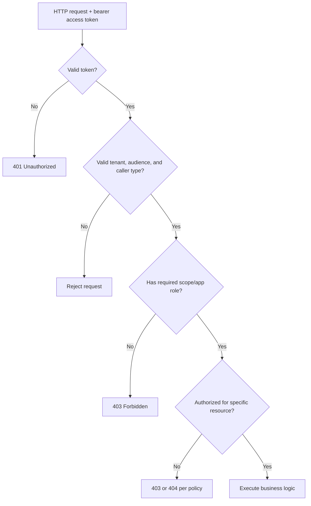

# Scopes, Application Roles, and In-App Permission Checks

> **Chapter:** Microsoft Entra ID  
> **Module:** SPRING_CLOUD_PROVIDER_INTEGRATION — hands-on integration of Spring Boot with managed services on AWS, Azure, and Google Cloud via the corresponding Spring Cloud libraries. This lesson focuses on designing API permissions and enforcing authorization inside a Spring Boot application.

An employee may sign in to a portal successfully and still not be allowed to approve invoices. A worker may be allowed to call an API to run reconciliation without any signed-in user. Both requests may carry valid access tokens, yet their permissions differ.

Microsoft Entra ID provides two key mechanisms to represent API permissions: **delegated scopes** for clients acting on behalf of users, and **application roles/application permissions** for applications or user roles. Spring Security reads claims from the access token, maps them to authorities, and enforces policies at the URL, method, and business-logic layers.

This lesson helps you design a permission model from business requirements, configure scopes/app roles in Entra, inspect `scp`/`roles` claims, and build multi-layered authorization in Spring Boot. The focus is on accurately determining **who is calling**, **which action they may perform**, and **on which resource**.

## 1. Learning Objectives

After this lesson, you will be able to:

1. Distinguish authentication from authorization; explain why a successful login does not imply business permissions.
2. Design delegated scopes around API actions and application roles around roles/workloads.
3. Configure scopes and app roles in the API's app registration.
4. Describe consent, app role assignments, and how permissions appear in access tokens.
5. Distinguish `scp` from `roles` claims, including when a user token contains both.
6. Map scopes/roles into Spring `GrantedAuthority` instances with clear prefixes.
7. Protect endpoints with `SecurityFilterChain`, `@PreAuthorize`, and per-record authorization checks.
8. Design tenant isolation and avoid granting access based on email, client-supplied headers, or unverified data.
9. Test allowed, missing-scope, missing-role, and non-owner resource scenarios.
10. Manage the lifecycle of permissions, consents, and role assignments under least privilege.

## 2. Authentication and Authorization Answer Two Different Questions

**Authentication** answers: "Who is the caller, and is the token trustworthy?" With Entra, Spring Resource Server verifies the access token's signature, issuer, audience, and lifetime.

**Authorization** answers: "Which action is the caller permitted to perform on which resource?" After authentication, the API evaluates scopes, app roles, internal roles, ownership, and business policies.

Invoice system example:

- Alice signs in successfully via Entra: authentication succeeds.
- Alice has scope `Invoices.Read`: the client may call the API to read invoices on Alice's behalf.
- Alice is assigned app role `Invoice.Approver`: the app may allow Alice to use the approval feature.
- Alice may only approve invoices belonging to her own unit: the API still must check permissions on each individual invoice.
- Worker `invoice-reconcile` has app role `Invoice.Batch.Process`: the worker may call the app-only reconciliation endpoint.

No single claim replaces all of these verification layers.

### Authorization Decision Model



This is a conceptual model. Check ordering in code may vary, yet the API must preserve these trust boundaries: token, tenant, permission, and resource-level authorization.

## 3. What Is a Delegated Scope?

A **delegated permission** allows a client to call an API on behalf of a signed-in user. A scope describes an action the client may request on the API, such as:

- `Invoices.Read`: read invoices.
- `Invoices.Write`: create or update invoices.
- `Invoices.Submit`: submit invoices into the processing workflow.

The API publishes these scopes in its own app registration under **Expose an API**. The client application adds the corresponding delegated permission under **API permissions**, and users/admins grant consent per tenant policy.

### A Scope Is Not a User Role

A scope answers "what kind of API operations may the client call on the user's behalf?" It does not necessarily say whether Alice is an accountant, manager, or approver. Two users may sign in through the same client with the exact same scope while having different business permissions.

Example:

- The portal holds delegated scope `Invoices.Read`.
- Alice can view invoices for department A.
- Bob can view invoices for department B.
- Both tokens contain `Invoices.Read`, yet the API must filter data by user/tenant/ACL.

### Configuring Scopes in Entra

In the API's app registration:

1. Open **Expose an API**.
2. Set the Application ID URI, e.g. `api://<INVOICE_API_CLIENT_ID>`.
3. Choose **Add a scope**.
4. Set the scope name to `Invoices.Read`.
5. Provide a clear consent display name and description for administrators/users.
6. Set its state to enabled and save.

Clients request the full scope:

```text
api://<INVOICE_API_CLIENT_ID>/Invoices.Read
```

In a delegated access token for the API, Entra typically emits an `scp` claim containing granted scopes separated by spaces:

```json
{
  "aud": "33333333-3333-3333-3333-333333333333",
  "scp": "Invoices.Read Invoices.Submit",
  "tid": "11111111-1111-1111-1111-111111111111",
  "oid": "22222222-2222-2222-2222-222222222222"
}
```

This is a condensed illustrative payload, not a real token. The Resource Server must verify the signature and security claims before trusting anything in the payload.

### What Does Consent Mean?

- User consent records that a user approved delegated permissions when tenant policy allows it.
- Admin consent records that an administrator approved permissions on behalf of the tenant.
- A tenant can restrict or disable user consent; in that case, clients require an admin approval workflow.
- Scopes are defined in the API's app registration, whereas the client declares the permissions it requests.

Consent does not mean every user can access every record. The API must still check business and data-level permissions.

## 4. What Are Application Roles and Application Permissions?

An **app role** is a role defined by an application/API. A role can be assigned to users, groups, or applications depending on `allowedMemberTypes`. When assigned appropriately, Entra can include the role value in the token's `roles` claim.

There are two common uses:

1. **User app role:** assigned to users/groups to represent business roles inside the application, such as `Invoice.Approver` or `Invoice.Admin`.
2. **Application permission:** assigned to a client application's service principal so a workload can call the API without a user, such as `Invoice.Batch.Process`.

### Defining App Roles in an App Registration

In the API's app registration, open **App roles** and create a role. Example:

| Property | Role for users | Role for workloads |
|---|---|---|
| Display name | Invoice approver | Process invoice batches |
| Value | `Invoice.Approver` | `Invoice.Batch.Process` |
| Allowed member types | Users/Groups | Applications |
| Description | Allowed to approve invoices | Allowed to run batch reconciliation |
| Enabled | Yes | Yes |

`allowedMemberTypes` typically uses `User` and/or `Application`. In the portal, selecting `Users/Groups` allows assigning the role to users/groups; `Applications` allows granting the role as an application permission to a client's service principal.

If a business area has both users and workloads, define separate roles by principal type and purpose. Never reuse one ambiguous role name for both users and daemons if the API needs to distinguish the two caller types clearly.

### Granting an Application Permission to a Client

Example where a worker needs to call the Invoice API:

1. The API defines app role `Invoice.Batch.Process` with member type `Applications`.
2. In the worker's app registration, open **API permissions**.
3. Choose **Add a permission → My APIs → Invoice API → Application permissions**.
4. Select role `Invoice.Batch.Process`.
5. A tenant admin clicks **Grant admin consent**.
6. Verify that the worker's service principal has an app role assignment to the API's service principal.

The worker requests a token using client credentials with the resource scope:

```text
api://<INVOICE_API_CLIENT_ID>/.default
```

`/.default` requests the application permissions configured and consented for that resource. It does not create role assignments automatically and is not a wildcard permission.

In an app-only access token, application permissions typically appear in `roles`; the `scp` claim is normally absent because there is no user-delegated context.

### App Roles Do Not Grant Azure RBAC Automatically

An app role is an API-level permission under the token contract. Azure RBAC is the mechanism granting access to Azure resources like Blob Storage, Key Vault, or Service Bus. If the worker has `Invoice.Batch.Process` and also needs to read Blob Storage, the workload's managed identity/service principal still must be granted an appropriate data-plane role on Storage.

## 5. Distinguishing Scopes, App Roles, and Azure RBAC

| Mechanism | Where defined / granted? | Principal | Claim / token | Example |
|---|---|---|---|---|
| Delegated scope | Expose an API, API permissions, and consent | Client + user | `scp` | `Invoices.Read` |
| User app role | App roles and user/group assignment | User/group | `roles` | `Invoice.Approver` |
| Application permission | API app roles, client API permissions, and admin consent | Client service principal | `roles` in app-only token | `Invoice.Batch.Process` |
| Azure RBAC | IAM/Access control on Azure resource/scope | User, group, service principal, or managed identity | Not necessarily a custom API `roles` claim | `Storage Blob Data Reader` |

Never look at `roles` in an Invoice API access token to conclude the caller can read Azure Blob Storage. Storage enforces authorization via its own resource role assignments and policies.

## 6. `scp` and `roles` Can Coexist in a User Token

A common design mistake is assuming:

- Having `scp` means only scopes exist, no roles.
- Having `roles` means it is definitely app-only.

Both assumptions are unsafe.

A delegated access token can contain:

- `scp`: delegated scopes granted to the client.
- `roles`: app roles assigned to the user on the API.

An application access token typically contains:

- `roles`: application permissions granted to the service principal.
- No `scp`, because there is no user context.

Therefore, the API must evaluate the token context and permission contract. If an endpoint is app-only, configure the optional `idtyp` claim in access tokens and require `app`, while also checking application roles and a client allowlist if needed. Never infer caller type solely from `roles` or the absence of `scp`.

### Illustrative Claims

User token with delegated scope and user app role:

```json
{
  "aud": "33333333-3333-3333-3333-333333333333",
  "tid": "11111111-1111-1111-1111-111111111111",
  "oid": "22222222-2222-2222-2222-222222222222",
  "scp": "Invoices.Read",
  "roles": ["Invoice.Approver"],
  "azp": "44444444-4444-4444-4444-444444444444"
}
```

App-only token:

```json
{
  "aud": "33333333-3333-3333-3333-333333333333",
  "tid": "11111111-1111-1111-1111-111111111111",
  "oid": "55555555-5555-5555-5555-555555555555",
  "roles": ["Invoice.Batch.Process"],
  "idtyp": "app",
  "azp": "66666666-6666-6666-6666-666666666666"
}
```

GUIDs and claims in these examples are illustrative only. Real tokens also carry `iss`, `exp`, `nbf`, `ver`, and other claims depending on configuration.

## 7. Designing a Permission Model from Business Requirements

Before creating scopes/roles, list the API actions and legitimate callers. Never start by creating a single `Admin` role and using it on every endpoint.

### Sample Permission Catalog

| Business action | Intended caller | Permission | Additional checks |
|---|---|---|---|
| List invoices | Employee via portal | Delegated scope `Invoices.Read` | Return only invoices in authorized tenant/unit |
| Create invoice | Employee via portal | Delegated scope `Invoices.Write` | Validate state and input payload |
| Approve invoice | User with approver role | Scope `Invoices.Submit` + app role `Invoice.Approver` | Check approval limits, creator, and workflow |
| Run batch reconciliation | App-only worker | Application role `Invoice.Batch.Process` | Accept only app-only tokens from registered worker |
| Manage API configuration | Administrator | User app role `Invoice.Admin` | Audit all changes |

This is a design example; permission names should reflect the API's actual behavior. Scopes usually express functional API access, while app roles express roles/permissions assigned to principals. An API may use only scopes, only app roles, or a combination when there is a clear reason.

### Naming Conventions

- Use short, stable, action-oriented names: `Invoices.Read`, `Invoices.Write`, `Invoices.Submit`.
- User app roles express responsibility: `Invoice.Approver`, `Invoice.Admin`.
- Workload app roles express jobs: `Invoice.Batch.Process`, `Invoice.Export.Run`.
- Avoid vague names like `FullAccess` or `PowerUser` without clear scope descriptions.
- Never reuse the same role value for two different meanings.
- Write descriptions specifying the action, data scope, and allowed principal types.

### Least Privilege

Each client should request only the permissions it needs. A portal that reads invoices does not need application permission to delete invoices. A reconciliation worker does not need user-management permissions. Administrators should not use daemon credentials to perform interactive actions.

Separate app registrations across frontend, API, and worker when doing so reduces credential sharing, permission sprawl, and blast radius.

## 8. Mapping Scopes and App Roles into Spring Security

Spring Resource Server validates the JWT and converts it into a `JwtAuthenticationToken`. `JwtGrantedAuthoritiesConverter` can map scopes; we add a converter for the `roles` claim.

In Entra delegated tokens, scopes are usually emitted under `scp`. Configure that claim explicitly so authorities take the form `SCOPE_...`. App roles are mapped to `APPROLE_...` so they are never confused with scopes.

### Combined Converter

```java
package com.example.invoice.security;

import java.util.ArrayList;
import java.util.Collection;
import java.util.List;

import org.springframework.context.annotation.Bean;
import org.springframework.context.annotation.Configuration;
import org.springframework.core.convert.converter.Converter;
import org.springframework.security.core.GrantedAuthority;
import org.springframework.security.core.authority.SimpleGrantedAuthority;
import org.springframework.security.oauth2.jwt.Jwt;
import org.springframework.security.oauth2.server.resource.authentication.JwtAuthenticationConverter;
import org.springframework.security.oauth2.server.resource.authentication.JwtGrantedAuthoritiesConverter;

@Configuration
public class EntraAuthorityConfiguration {

    @Bean
    JwtAuthenticationConverter entraJwtAuthenticationConverter() {
        JwtGrantedAuthoritiesConverter scopeConverter =
                new JwtGrantedAuthoritiesConverter();
        scopeConverter.setAuthoritiesClaimName("scp");
        scopeConverter.setAuthorityPrefix("SCOPE_");

        Converter<Jwt, Collection<GrantedAuthority>> combined = jwt -> {
            Collection<GrantedAuthority> result = new ArrayList<>();

            Collection<GrantedAuthority> scopes = scopeConverter.convert(jwt);
            if (scopes != null) {
                result.addAll(scopes);
            }

            List<String> roles = jwt.getClaimAsStringList("roles");
            if (roles != null) {
                roles.stream()
                        .map(role -> new SimpleGrantedAuthority("APPROLE_" + role))
                        .forEach(result::add);
            }

            return result;
        };

        JwtAuthenticationConverter converter = new JwtAuthenticationConverter();
        converter.setJwtGrantedAuthoritiesConverter(combined);
        return converter;
    }
}
```

Mapping result:

| Claim in token | Value | Spring authority |
|---|---|---|
| `scp` | `Invoices.Read` | `SCOPE_Invoices.Read` |
| `scp` | `Invoices.Write` | `SCOPE_Invoices.Write` |
| `roles` | `Invoice.Approver` | `APPROLE_Invoice.Approver` |
| `roles` | `Invoice.Batch.Process` | `APPROLE_Invoice.Batch.Process` |

The converter never grants default permissions when claims are missing. It merely translates permissions already carried by the token after JWT verification.

### Attaching the Converter to Resource Server

```java
import org.springframework.context.annotation.Bean;
import org.springframework.context.annotation.Configuration;
import org.springframework.security.config.annotation.web.builders.HttpSecurity;
import org.springframework.security.config.http.SessionCreationPolicy;
import org.springframework.security.oauth2.server.resource.authentication.JwtAuthenticationConverter;
import org.springframework.security.web.SecurityFilterChain;

@Configuration
public class ApiSecurityConfiguration {

    @Bean
    SecurityFilterChain apiSecurity(
            HttpSecurity http,
            JwtAuthenticationConverter entraJwtAuthenticationConverter)
            throws Exception {

        http
            .securityMatcher("/api/**")
            .csrf(csrf -> csrf.disable())
            .sessionManagement(session -> session
                .sessionCreationPolicy(SessionCreationPolicy.STATELESS))
            .authorizeHttpRequests(authorize -> authorize
                .requestMatchers("/api/public/**").permitAll()
                .requestMatchers("/api/invoices/**")
                    .hasAuthority("SCOPE_Invoices.Read")
                .requestMatchers("/api/approvals/**")
                    .hasAuthority("APPROLE_Invoice.Approver")
                .requestMatchers("/api/jobs/**")
                    .hasAuthority("APPROLE_Invoice.Batch.Process")
                .anyRequest().authenticated())
            .oauth2ResourceServer(oauth2 -> oauth2
                .jwt(jwt -> jwt.jwtAuthenticationConverter(
                        entraJwtAuthenticationConverter)));

        return http.build();
    }
}
```

This is an illustrative chain for a bearer-only API. If the application has browser sessions or endpoints outside `/api/**`, another chain must cover the remaining requests. Disable CSRF only when the API does not rely on cookies/sessions for authentication; keep CSRF protection enabled for session-based web applications.

### `hasRole` or `hasAuthority`?

- `hasAuthority("APPROLE_Invoice.Approver")` compares the exact authority string.
- `hasRole("Invoice.Approver")` automatically prepends `ROLE_`, checking `ROLE_Invoice.Approver`.

Because the converter here uses the `APPROLE_` prefix, use `hasAuthority` or change the prefix convention consistently. Avoid both adding `ROLE_` in the converter and passing an already-prefixed string into `hasRole`.

## 9. Checking Permissions at URL and Method Layers

URL authorization is the first line of defense, ideal for endpoint groups:

```java
authorize
    .requestMatchers(HttpMethod.GET, "/api/invoices/**")
        .hasAuthority("SCOPE_Invoices.Read")
    .requestMatchers(HttpMethod.POST, "/api/invoices/**")
        .hasAuthority("SCOPE_Invoices.Write")
    .requestMatchers("/api/approvals/**")
        .hasAuthority("APPROLE_Invoice.Approver")
    .requestMatchers("/api/jobs/**")
        .hasAuthority("APPROLE_Invoice.Batch.Process")
    .anyRequest().authenticated();
```

This snippet assumes `org.springframework.http.HttpMethod` is imported and sits inside the `authorizeHttpRequests` DSL. Use method-specific matchers so `GET` is not accidentally treated like `POST`.

Method security places policy close to business logic:

```java
import org.springframework.security.access.prepost.PreAuthorize;
import org.springframework.stereotype.Service;

@Service
public class InvoiceApprovalService {

    @PreAuthorize("hasAuthority('APPROLE_Invoice.Approver')")
    public void approve(String invoiceId) {
        // Validate state, limits, and workflow before approving.
    }
}
```

Enable method security:

```java
import org.springframework.context.annotation.Configuration;
import org.springframework.security.config.annotation.method.configuration.EnableMethodSecurity;

@Configuration
@EnableMethodSecurity
public class MethodSecurityConfiguration {
}
```

Method security does not replace checks on specific data. The approver role only indicates the user has general approval responsibilities; business logic still must verify whether the invoice is awaiting approval, falls within the approver's scope, and stays within approval limits.

## 10. Checking Permissions per Resource

Scopes and app roles are usually API/feature-level permissions. The application must also enforce permissions on individual objects (object-level authorization).

Examples:

- Alice has `SCOPE_Invoices.Read`, yet may only read invoices belonging to Alice's tenant and unit.
- Bob has `APPROLE_Invoice.Approver`, yet may not approve an invoice created by Bob himself.
- The worker has `APPROLE_Invoice.Batch.Process`, yet may only process batches for its configured tenant.

### Reading Identifiers from the Verified Principal

In Resource Server, the principal can be `Jwt`. Use `tid` and `oid` after the decoder has validated the token:

```java
import org.springframework.security.core.annotation.AuthenticationPrincipal;
import org.springframework.security.oauth2.jwt.Jwt;
import org.springframework.web.bind.annotation.GetMapping;
import org.springframework.web.bind.annotation.PathVariable;
import org.springframework.web.bind.annotation.RestController;

@RestController
public class InvoiceController {

    private final InvoiceQueryService invoiceQueryService;

    public InvoiceController(InvoiceQueryService invoiceQueryService) {
        this.invoiceQueryService = invoiceQueryService;
    }

    @GetMapping("/api/invoices/{invoiceId}")
    public InvoiceView getInvoice(
            @PathVariable String invoiceId,
            @AuthenticationPrincipal Jwt jwt) {

        String tenantId = jwt.getClaimAsString("tid");
        String subjectObjectId = jwt.getClaimAsString("oid");
        return invoiceQueryService.findVisibleInvoice(
                tenantId, subjectObjectId, invoiceId);
    }
}
```

This illustrative controller assumes `InvoiceView` and `InvoiceQueryService` exist in the application. Never accept `tenantId` or `userId` from client-supplied query params/headers instead of the principal. If a request sends `X-Tenant-ID`, use it only as a selector after verifying the caller is allowed to choose that tenant; never treat headers as proof of identity.

### Embedding Tenant Constraints in Data Queries

Example service:

```java
import org.springframework.stereotype.Service;

@Service
public class InvoiceQueryService {

    private final InvoiceRepository repository;

    public InvoiceQueryService(InvoiceRepository repository) {
        this.repository = repository;
    }

    public InvoiceView findVisibleInvoice(
            String tenantId, String subjectId, String invoiceId) {

        return repository
                .findByTenantIdAndIdAndAllowedSubject(
                        tenantId, invoiceId, subjectId)
                .orElseThrow(InvoiceNotFoundException::new);
    }
}
```

The repository method name is illustrative; actual implementations should join ACL/organization memberships per the data model. Including the tenant condition in the query prevents loading a record by mistake and forgetting a check in another code branch.

Depending on policy, the API can return 404 when a record is out of scope to avoid leaking resource existence, or 403 when existence disclosure is acceptable but the caller lacks permission. Be consistent and never use status codes as a substitute for real authorization.

## 11. Distinguishing User Roles from Application Roles in the API

If an endpoint is meant only for users, checking `APPROLE_Invoice.Approver` alone may be insufficient when the API also allows granting that role to applications. If the role targets only `Users/Groups`, an app-only principal cannot be assigned that role; that is a clean separation.

If a role allows both `Users/Groups` and `Applications`, you must also check the caller type. You can configure the optional `idtyp` claim so the API recognizes app-only tokens:

- `idtyp=app`: app-only token.
- Missing claim or different value: never guess; handle according to the defined token contract.

Example checking caller type in the business layer:

```java
import org.springframework.security.access.AccessDeniedException;
import org.springframework.security.core.Authentication;
import org.springframework.security.oauth2.server.resource.authentication.JwtAuthenticationToken;
import org.springframework.stereotype.Component;

@Component("callerPolicy")
public class CallerPolicy {

    public boolean isApplicationCaller(Authentication authentication) {
        if (!(authentication instanceof JwtAuthenticationToken jwtAuth)) {
            return false;
        }

        String idtyp = jwtAuth.getToken().getClaimAsString("idtyp");
        return "app".equals(idtyp);
    }

    public void requireApplicationCaller(Authentication authentication) {
        if (!isApplicationCaller(authentication)) {
            throw new AccessDeniedException("Application caller required");
        }
    }
}
```

It can be used in method security:

```java
@PreAuthorize("""
    hasAuthority('APPROLE_Invoice.Batch.Process')
    and @callerPolicy.isApplicationCaller(authentication)
    """)
public void reconcileBatch(String batchId) {
    // Only app-only workloads with the matching role may run.
}
```

This example illustrates Java text block syntax and Spring method security; ensure `idtyp` is actually configured to be emitted in the API's access tokens. If the claim is absent, the expression evaluates to `false` and the request is denied.

## 12. Tenant Isolation and Multitenant Authorization

In multitenant SaaS, a valid token from tenant A must never access tenant B's data simply because both share the `Invoices.Read` scope.

The API must:

1. Validate issuer and audience.
2. Verify `tid` is in the list of onboarded tenants.
3. Map the tenant ID to an internal tenant/customer record.
4. Include the tenant ID in every tenant-scoped data query.
5. Check user membership/roles within that tenant.
6. Never trust a tenant ID submitted by a browser/client if it does not match the verified principal.
7. Maintain procedures to suspend tenants, revoke consents, and block tokens/permissions when a customer leaves.

For guest users, the same person can have different object IDs in their home tenant versus a resource tenant. Authorization must follow the token-issuing tenant and the corresponding local identity. Never correlate users across tenants solely by email.

### Do Not Use Group Claims Naively

Entra can emit group claims for users, but when a user belongs to too many groups, the token may emit an overage indicator instead of the full list. The API must never assume the `groups` claim always contains all group memberships. If authorization relies on groups:

- Specify group IDs and tenants explicitly.
- Handle overage through an appropriate flow, such as querying Microsoft Graph with proper delegated permissions.
- Cache results with appropriate TTLs and invalidation.
- Avoid granting permissions based on a group name submitted by the client.

App roles generally establish a cleaner permission contract for applications; groups fit when organizations want centralized membership management. Choose based on operational needs.

## 13. Testing Authorization

A test verifying only "a valid token returns 200" is insufficient. Test both permitted and denied paths.

### 13.1. Testing Delegated Scopes

Add `spring-security-test` in test scope. MockMvc example:

```java
import static org.springframework.security.test.web.servlet.request
        .SecurityMockMvcRequestPostProcessors.jwt;
import static org.springframework.test.web.servlet.request.MockMvcRequestBuilders.get;
import static org.springframework.test.web.servlet.result.MockMvcResultMatchers.status;

import org.junit.jupiter.api.Test;
import org.springframework.beans.factory.annotation.Autowired;
import org.springframework.boot.test.autoconfigure.web.servlet.AutoConfigureMockMvc;
import org.springframework.boot.test.context.SpringBootTest;
import org.springframework.test.web.servlet.MockMvc;

@SpringBootTest
@AutoConfigureMockMvc
class InvoiceAuthorizationTest {

    @Autowired
    MockMvc mvc;

    @Test
    void allowsReadScope() throws Exception {
        mvc.perform(get("/api/invoices")
                .with(jwt().jwt(token -> token
                        .claim("scp", "Invoices.Read")
                        .claim("tid", "11111111-1111-1111-1111-111111111111")
                        .claim("oid", "22222222-2222-2222-2222-222222222222"))))
                .andExpect(status().isOk());
    }

    @Test
    void deniesTokenWithoutReadScope() throws Exception {
        mvc.perform(get("/api/invoices")
                .with(jwt().jwt(token -> token
                        .claim("scp", "Profile.Read"))))
                .andExpect(status().isForbidden());
    }
}
```

### 13.2. Testing User Roles and App-Only Roles

Example testing an approval endpoint:

```java
@Test
void allowsApproverRole() throws Exception {
    mvc.perform(post("/api/approvals/INV-100/approve")
            .with(jwt().jwt(token -> token
                    .claim("roles", List.of("Invoice.Approver"))))
            .andExpect(status().isOk());
}

@Test
void deniesWorkerRoleOnApprovalEndpoint() throws Exception {
    mvc.perform(post("/api/approvals/INV-100/approve")
            .with(jwt().jwt(token -> token
                    .claim("roles", List.of("Invoice.Batch.Process"))
                    .claim("idtyp", "app"))))
            .andExpect(status().isForbidden());
}
```

This snippet extends the test class above; add imports for `MockMvcRequestBuilders.post` and `java.util.List` if merging into the same file. User tokens do not need to assume `idtyp=user`; `idtyp=app` is an optional signal to identify app-only tokens. State-changing `POST` requests also require CSRF tokens if the tested filter chain enables CSRF; the bearer-only API example disables CSRF per the boundary described in the Resource Server lesson.

Mock `jwt()` tests authorization logic and authority mapping. It does not validate real signatures, issuers, audiences, `exp`, `nbf`, or consent. You need integration tests with tokens from a test tenant to verify the decoder and Entra configuration.

### 13.3. Minimum Test Matrix

| Caller | Claim / permission | Endpoint | Expected result |
|---|---|---|---|
| User with read scope | `scp=Invoices.Read` | `GET /api/invoices` | 200 if ACL permits |
| User missing read scope | `scp=Profile.Read` | `GET /api/invoices` | 403 |
| User with approver role | `roles=Invoice.Approver` | `POST /api/approvals/**` | Passes role check; still checks workflow |
| User with only approver role | Missing read scope | `GET /api/invoices` | 403 if endpoint requires scope |
| Worker with app role | `roles=Invoice.Batch.Process`, `idtyp=app` | `POST /api/jobs/**` | 202/200 per contract |
| Worker with only app role | Missing `Invoice.Approver` | `POST /api/approvals/**` | 403 |
| Valid user role, wrong tenant | Disallowed `tid` | Any tenant-scoped endpoint | Rejected |
| Valid user role, does not own invoice | Valid scope/role | `GET` specific invoice | 403 or 404 per policy |
| Wrong audience token | `aud` is another API | Any protected endpoint | 401 |

## 14. 401, 403, and Business Errors

| Status | Meaning | Example |
|---|---|---|
| 401 Unauthorized | Caller cannot be authenticated | Missing token, expired token, bad signature/issuer/audience |
| 403 Forbidden | Valid token, missing permission | Missing delegated scope or app role |
| 403/404 per policy | Has API permission, lacks permission on object | Invoice belongs to another tenant/unit |
| 409 Conflict | Caller is authorized, yet operation is invalid for business state | Invoice already approved or no longer pending approval |

Do not turn business errors into 401. Do not ask the user to sign in again when the issue is a missing scope/role. Never return sensitive data in error bodies explaining why a resource exists.

## 15. Managing Permissions Across the Application Lifecycle

Permission models evolve alongside the product. Govern them from design through revocation:

### When Adding Permissions

1. Document the use case and caller type.
2. Determine whether a scope or an app role fits.
3. Define the name, description, and allowed member types.
4. Update client API permissions and consent plans.
5. Update Spring authority mappings and authorization rules.
6. Add positive and negative tests.
7. Roll out under versioning/deprecation policies.

### When Changing or Revoking Permissions

- Never change the semantics of a scope/role already used by clients without a compatibility plan.
- Notify client owners and administrators before revocation.
- Remove unneeded permissions from client registrations.
- Revoke consents or app role assignments when workloads are retired.
- Remember already-issued access tokens may stay valid until expiry; never assume deleting an assignment immediately invalidates existing tokens.
- For emergency revocation incidents, apply appropriate API/tenant-side blocks, shorten token lifetimes within policy capabilities, and handle related sessions/caches.

### Audits and Reviews

Periodically audit:

- Which clients request the API's scopes?
- Which service principals hold application roles?
- Which users/groups hold admin/approval roles?
- Which permissions are no longer used?
- Which tenants have been offboarded?
- Are there orphaned credentials or clients without owners?
- Are permission changes audited and approved?

Never grant a broad role as a temporary workaround for a 403 without identifying the root cause.

## 16. Common Design Mistakes

| Mistake | Consequence | Fix |
|---|---|---|
| Treating a scope as a business role | Two users with the same scope unintentionally receive identical data access | Check app roles and ACL/resource ownership |
| Treating every `roles` claim as app-only | User tokens with roles are misclassified | Check caller type, `idtyp`, and member type |
| Using one `Admin` role for everything | Overly broad privileges, hard to audit | Split roles by duty and scope |
| Checking scopes only at the URL layer | Users may read out-of-scope objects | Add object-level authorization and tenant filters |
| Trusting `X-User-ID` or `X-Tenant-ID` | Callers spoof identity/tenant | Read subject/tenant from verified tokens |
| Using email as a user key | Emails change or collide across tenants | Use `tid` + `oid` or `iss` + `sub` |
| Granting Azure RBAC instead of app roles | Permissions granted at the wrong layer | Distinguish whether the target is an API or an Azure service |
| Disabling CSRF for the entire app | Web sessions become vulnerable to CSRF | Disable only on bearer-only chains |
| Skipping negative permission tests | Mapping bugs may leave endpoints unintentionally open | Test missing scopes/roles/tenants/ownership |
| Allowing all tenants | Unexpected tenants access the SaaS app | Enforce tenant onboarding and allowlists |
| Granting long-lived permissions without review | Stale permissions persist after use cases end | Review consents/assignments and revoke regularly |

## 17. Hands-On Exercise

**Context:** Build an enterprise Invoice API. Employees read and submit invoices via a portal. Only employees with the approver role may approve. A background worker has batch reconciliation permissions. The API serves multiple units within the same tenant.

### Part A — Design the Permission Catalog

1. List endpoints and actions: read, create, submit, approve, reconcile.
2. Choose delegated scopes for the portal.
3. Define user app roles `Invoice.Approver` and `Invoice.Admin`.
4. Define application role `Invoice.Batch.Process` for the worker.
5. Specify allowed member types, consent/assignments, and legitimate callers for each endpoint.

### Part B — Entra and Spring Configuration

1. Expose scopes in the API's app registration.
2. Create app roles with the right member types.
3. Grant delegated permissions to the portal and application permissions to the worker.
4. Configure admin consent and verify service principal role assignments.
5. Map `scp` to `SCOPE_...` and `roles` to `APPROLE_...`.
6. Protect URLs/methods according to the permission catalog.
7. Enforce `tid` + `oid` and tenant/ownership checks in services/repositories.

### Part C — Testing

1. Test a user with read scope and a user missing that scope.
2. Test an approver and a regular user.
3. Test the app-only worker with the right role and with a missing role.
4. Test the worker calling an approver-only endpoint.
5. Test a user with scope trying to read an invoice from another tenant.
6. Test wrong-audience and disallowed-tenant tokens.
7. Write a report specifying which layer rejected each request: token, permission, or business authorization.

**Sample permission matrix:**

| Principal | GET invoice | POST invoice | Approve | Batch reconcile | Data boundary |
|---|---|---|---|---|---|
| Regular employee | `Invoices.Read` | `Invoices.Write` | No | No | User's unit |
| Approver | `Invoices.Read` | Per policy | `Invoice.Approver` | No | Assigned scope |
| Admin | Per policy | Per policy | `Invoice.Admin` | Per policy | Per tenant and audited |
| Worker | No delegated scope | No | No | `Invoice.Batch.Process` | Configured tenant/job |

**Pass criteria:** The permission model clearly distinguishes delegated scopes, user app roles, application permissions, and Azure RBAC; Spring Security maps claims accurately; the API checks permissions at both feature and resource levels; tests prove callers cannot exceed granted permissions.

## Official References

1. [Microsoft identity platform — Scopes and permissions](https://learn.microsoft.com/entra/identity-platform/scopes-oidc): delegated scopes and consent.
2. [Microsoft identity platform — App roles](https://learn.microsoft.com/entra/identity-platform/howto-add-app-roles-in-apps): defining app roles and assignments.
3. [Microsoft identity platform — Access token claims reference](https://learn.microsoft.com/entra/identity-platform/access-token-claims-reference): `scp`, `roles`, `tid`, `oid`, `azp`, `appid`.
4. [Microsoft identity platform — Client credentials flow](https://learn.microsoft.com/entra/identity-platform/v2-oauth2-client-creds-grant-flow): application permissions and `/.default`.
5. [Microsoft identity platform — Optional claims](https://learn.microsoft.com/entra/identity-platform/optional-claims-reference): configuring the `idtyp` claim.
6. [Microsoft Entra — Assign users and groups to an application](https://learn.microsoft.com/entra/identity/enterprise-apps/assign-user-or-group-access-portal): assigning users/groups to Enterprise applications.
7. [Spring Security — JWT Resource Server](https://docs.spring.io/spring-security/reference/servlet/oauth2/resource-server/jwt.html): JWT authentication and authorities conversion.
8. [Spring Security — Method Security](https://docs.spring.io/spring-security/reference/servlet/authorization/method-security.html): `@PreAuthorize` and method authorization.
9. [Spring Security — Testing OAuth2](https://docs.spring.io/spring-security/reference/servlet/test/mockmvc/oauth2.html): testing JWT/OAuth2 in MockMvc.

> **Remember:** Delegated scopes let clients call an API on behalf of a user; app roles can represent either user roles or application permissions depending on member type and assignment. `scp` and `roles` are permission data inside the token, yet the API must still validate caller type, tenant, and per-resource permissions. Design permissions around business actions, follow least privilege, and test denied cases too.
