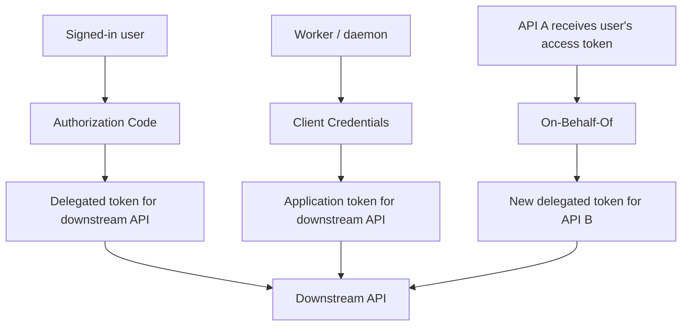
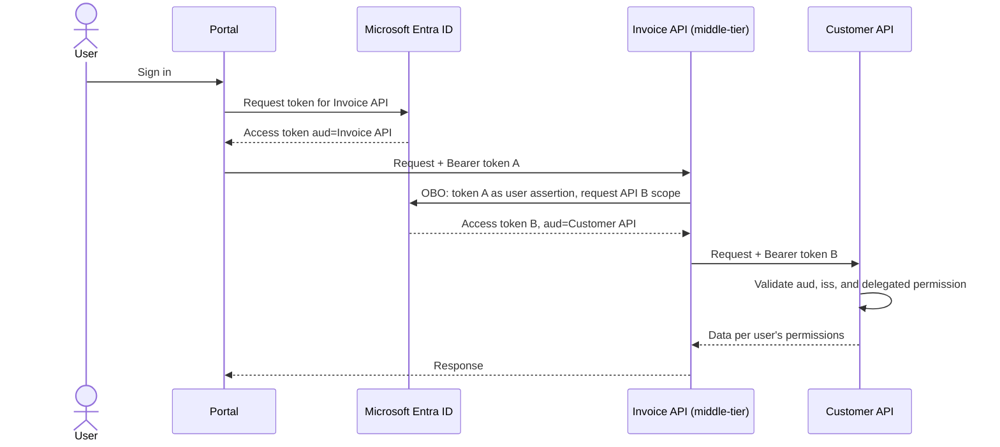

# Acquiring Tokens to Call Downstream APIs with the Right Flow

> **Chapter:** Microsoft Entra ID  
> **Module:** SPRING_CLOUD_PROVIDER_INTEGRATION — hands-on integration of Spring Boot with managed services on AWS, Azure, and Google Cloud via the corresponding Spring Cloud libraries. This lesson focuses on acquiring access tokens so Spring Boot can call downstream APIs using the right OAuth 2.0 flow.

A Spring Boot application rarely just receives a request and returns a response. A portal may need to read a profile from Microsoft Graph; an Invoice API may call a Customer API to fetch customer details; a worker may call a reconciliation API on a schedule. In these cases, the application must acquire an access token intended for the target API, attach the token on outbound requests, and manage token renewal when needed.

No single OAuth flow fits every scenario. If a user is signed in and the application calls an API on their behalf, use **Authorization Code with delegated permissions**. If a workload calls an API on its own using the application's own permissions, use **Client Credentials**. If a middle-tier API receives a user token and calls another API on behalf of that user, use **On-Behalf-Of (OBO)**.

This lesson implements these three scenarios with Microsoft Entra ID and Spring Boot. You will use Spring Security OAuth2 Client/`OAuth2AuthorizedClientManager` for directly supported flows, use MSAL4J for OBO, and understand how token caching and refresh work without managing raw token strings manually.

## 1. Learning Objectives

After this lesson, you will be able to:

1. Choose the right flow based on whether there is a user context or a workload identity.
2. Distinguish an access token meant for a downstream API from an ID token and the current API's inbound token.
3. Configure Entra app registrations, delegated scopes, and application permissions for the target API.
4. Acquire delegated access tokens using OAuth2 Client in Spring Security.
5. Use `OAuth2AuthorizedClientManager` to acquire and manage tokens for client credentials.
6. Use MSAL4J to perform OBO when a middle-tier API needs to call a downstream API on behalf of a user.
7. Send tokens via `Authorization: Bearer` in `RestClient` or `WebClient`.
8. Understand token caching, refresh, consent, credential rotation, and common downstream errors.
9. Test token acquisition and outbound API calls without leaking tokens or secrets.

## 2. Choosing the Flow Based on Caller Context

Before writing code, answer two questions:

- Does the request have a signed-in user whose permissions must be preserved?
- Or is a workload performing work on its own using the application's own permissions?

| Scenario | OAuth flow | Token represents | Primary permission |
|---|---|---|---|
| Signed-in web app calling Microsoft Graph on behalf of user | Authorization Code | User + client | Delegated scope |
| Background worker without a user | Client Credentials | Application/service principal | Application permission/app role |
| API A receives user access token, then calls API B on behalf of user | On-Behalf-Of | User via middle-tier API | Delegated permission to API B |
| SPA calling an API directly | Authorization Code + PKCE on public client | User + client | Delegated scope |

Never use Client Credentials just to avoid a sign-in screen when business logic truly requires the user's identity and permissions. Conversely, never use OBO for a worker that has no user assertion.

### Diagram of the Three Main Flows



Each flow produces a token for a specific resource/audience. Holding a valid token for API A does not mean that token can be used against API B.

## 3. Key Concepts to Distinguish

| Concept | Meaning |
|---|---|
| ID token | Tells the OIDC client the user has authenticated; never used as a bearer token to call APIs |
| Access token | Token issued for a specific resource/API |
| Delegated permission | Client calls an API on behalf of a user |
| Application permission | Workload calls an API using the application's own permissions |
| Audience (`aud`) | API/resource intended to receive the token |
| Scope (`scp`) | Delegated permissions granted for the API |
| App role (`roles`) | Roles/permissions assigned to users or applications depending on configuration |
| Authorized client | Spring object holding registration, principal, and issued OAuth2 tokens |
| Token cache | Where the OAuth library stores state/tokens for reuse or renewal |

### Do Not Blindly Forward Inbound Tokens

Suppose a browser obtains a token with `aud=Invoice API` and sends it to the Invoice API. The Invoice API needs to call the Customer API. The inbound token was issued for the Invoice API, not the Customer API. Sending that exact token to the Customer API will normally be rejected due to an audience mismatch.

Choose the right handling strategy:

- If the downstream API is actually the resource matching the inbound token's audience and permissions suffice, that token may be used per the API contract.
- If the middle-tier needs to call another API on behalf of the user, use OBO to exchange the user assertion for a new access token carrying the target API's audience.
- If the middle-tier calls an API using the workload's own permissions, use Client Credentials.

Never alter the `aud` claim by modifying a JWT. Tokens must be minted by the authorization server for the exact target resource.

## 4. Preparing Microsoft Entra ID for Downstream APIs

Example system components:

- `invoice-portal`: web app for employees.
- `invoice-api`: API receiving requests from the portal.
- `customer-api`: downstream API providing customer details.
- `invoice-worker`: background workload.

### 4.4. Dependencies Used in the Examples

With Maven and Spring Boot dependency management, OAuth2 Client serves Authorization Code/Client Credentials; Resource Server validates inbound tokens for API A in the OBO flow; MSAL4J performs the token exchange:

```xml
<dependencies>
    <dependency>
        <groupId>org.springframework.boot</groupId>
        <artifactId>spring-boot-starter-web</artifactId>
    </dependency>
    <dependency>
        <groupId>org.springframework.boot</groupId>
        <artifactId>spring-boot-starter-oauth2-client</artifactId>
    </dependency>
    <dependency>
        <groupId>org.springframework.boot</groupId>
        <artifactId>spring-boot-starter-oauth2-resource-server</artifactId>
    </dependency>
    <dependency>
        <groupId>com.microsoft.azure</groupId>
        <artifactId>msal4j</artifactId>
        <version>${msal4j.version}</version>
    </dependency>
</dependencies>
```

Add Resource Server only if the application accepts inbound bearer tokens like API A; a pure Client Credentials worker does not need that starter. Manage the MSAL4J version in dependency management and do not pin Spring Security versions manually when the Spring Boot BOM already manages them.

### 4.1. Downstream API Exposes a Delegated Scope

In the app registration for `customer-api`:

1. Open **Expose an API**.
2. Set the Application ID URI, e.g., `api://<CUSTOMER_API_CLIENT_ID>`.
3. Create delegated scope `Customers.Read`.
4. Provide a clear consent display name/description.
5. Enable the scope and save.

The full scope takes the form:

```text
api://<CUSTOMER_API_CLIENT_ID>/Customers.Read
```

Clients need this delegated permission when calling the Customer API on behalf of a user.

### 4.2. Downstream API Exposes an Application Role

If `invoice-worker` needs to read customers without a user context:

1. Create app role `Customers.Read.All` in the app registration for `customer-api`.
2. Select allowed member type `Applications`.
3. Clearly describe the permission the workload is allowed to exercise.
4. In the app registration for `invoice-worker`, add an Application permission targeting Customer API.
5. Select role `Customers.Read.All`.
6. Have a tenant admin grant admin consent.

The worker will request the resource scope:

```text
api://<CUSTOMER_API_CLIENT_ID>/.default
```

`/.default` requests the application permissions configured and consented for that resource. It does not automatically grant permissions if app role assignment/admin consent is missing.

### 4.3. Permissions for OBO Middle-Tier

If `invoice-api` receives a user token and then calls `customer-api`:

1. `invoice-api` needs a confidential client identity in Entra.
2. `customer-api` exposes delegated scope `Customers.Read`.
3. `invoice-api`'s app registration adds delegated permission to `customer-api`.
4. Tenant admin/user consent is granted per policy.
5. `invoice-api` authenticates as a confidential client using a certificate or managed credential.
6. API A exposes delegated scope `access_as_user`; the client sends an access token issued for `invoice-api` with this scope. It must be an access token, not an ID token.

OBO uses the inbound token as a user assertion so Entra can issue a new token for the Customer API. It does not convert app-only permissions into delegated permissions.

## 5. Flow A — Web App Acquiring Delegated Tokens via Authorization Code

This scenario applies when a Spring Boot web app has signed in a user via OIDC and needs to call a downstream API on behalf of that user.

### 5.1. Configure the OAuth2 Client

Example `application.yml`:

```yaml
spring:
  security:
    oauth2:
      client:
        registration:
          entra-graph:
            provider: entra
            client-id: ${ENTRA_CLIENT_ID}
            client-secret: ${ENTRA_CLIENT_SECRET}
            client-name: Microsoft Entra ID
            authorization-grant-type: authorization_code
            redirect-uri: "{baseUrl}/login/oauth2/code/{registrationId}"
            scope:
              - openid
              - profile
              - offline_access
              - https://graph.microsoft.com/User.Read
        provider:
          entra:
            issuer-uri: https://login.microsoftonline.com/${ENTRA_TENANT_ID}/v2.0
```

The registration ID is `entra-graph`; Spring uses it in the login initiation endpoint `/oauth2/authorization/entra-graph`. The `openid` scope requests OIDC login; `https://graph.microsoft.com/User.Read` requests delegated access to Microsoft Graph. `offline_access` is requested when the application needs refresh tokens under Entra policies.

In the app registration, configure the Web platform and exact redirect URI, for example:

```text
https://invoice-portal.example.com/login/oauth2/code/entra-graph
```

Client ID is the Application (client) ID. Tenant ID goes into the issuer URI. A secret is only one option for confidential client authentication; production can use certificates or federated credentials depending on the environment.

### 5.2. Enable OAuth2 Login

```java
package com.example.invoice.security;

import org.springframework.context.annotation.Bean;
import org.springframework.context.annotation.Configuration;
import org.springframework.security.config.Customizer;
import org.springframework.security.config.annotation.web.builders.HttpSecurity;
import org.springframework.security.web.SecurityFilterChain;

@Configuration
public class WebSecurityConfiguration {

    @Bean
    SecurityFilterChain webSecurity(HttpSecurity http) throws Exception {
        http
            .authorizeHttpRequests(authorize -> authorize
                .requestMatchers("/", "/assets/**", "/error").permitAll()
                .anyRequest().authenticated())
            .oauth2Login(Customizer.withDefaults());
        return http.build();
    }
}
```

When a user visits a private page, Spring Security redirects them to Entra. After callback, Spring stores an `OAuth2AuthorizedClient` bound to the registration and signed-in principal. The authorized client holds the access token for the requested scopes/resources; the ID token is used for OIDC login.

### 5.3. Calling Microsoft Graph with the Managed Token

You can inject the authorized client into a controller via `@RegisteredOAuth2AuthorizedClient`:

```java
package com.example.invoice.web;

import org.springframework.security.oauth2.client.OAuth2AuthorizedClient;
import org.springframework.security.oauth2.client.annotation.RegisteredOAuth2AuthorizedClient;
import org.springframework.web.bind.annotation.GetMapping;
import org.springframework.web.bind.annotation.RestController;
import org.springframework.web.client.RestClient;

@RestController
public class GraphProfileController {

    private final RestClient graphClient;

    public GraphProfileController(RestClient.Builder builder) {
        this.graphClient = builder
                .baseUrl("https://graph.microsoft.com/v1.0")
                .build();
    }

    @GetMapping("/profile/from-graph")
    public GraphProfile profile(
            @RegisteredOAuth2AuthorizedClient("entra-graph")
            OAuth2AuthorizedClient authorizedClient) {

        String accessToken = authorizedClient.getAccessToken().getTokenValue();

        return graphClient.get()
                .uri("/me?$select=id,displayName,userPrincipalName")
                .headers(headers -> headers.setBearerAuth(accessToken))
                .retrieve()
                .body(GraphProfile.class);
    }

    public record GraphProfile(
            String id,
            String displayName,
            String userPrincipalName) {
    }
}
```

The snippet illustrates:

- Using the access token from the authorized client, never the ID token.
- Sending the token in the `Authorization` header.
- Scoping Graph permissions to `User.Read`.
- Never returning tokens to the browser or writing tokens to logs.

In a real application, define `RestClient` as a shared bean, configure timeouts, error handlers, and logging that strips authorization headers. Controllers should not embed retry or token-lifecycle logic directly.

### 5.4. When to Use `OAuth2AuthorizedClientManager`?

`@RegisteredOAuth2AuthorizedClient` fits when a controller needs a logged-in authorized client. When acquiring tokens from a service, scheduler, or shared component, use `OAuth2AuthorizedClientManager` to decouple token acquisition from the HTTP client.

For servlet applications, `DefaultOAuth2AuthorizedClientManager` works with `OAuth2AuthorizedClientRepository` and the HTTP request context. Example configuring a provider for Authorization Code and refresh token:

```java
import org.springframework.context.annotation.Bean;
import org.springframework.context.annotation.Configuration;
import org.springframework.security.oauth2.client.OAuth2AuthorizedClientManager;
import org.springframework.security.oauth2.client.OAuth2AuthorizedClientProvider;
import org.springframework.security.oauth2.client.OAuth2AuthorizedClientProviderBuilder;
import org.springframework.security.oauth2.client.registration.ClientRegistrationRepository;
import org.springframework.security.oauth2.client.web.DefaultOAuth2AuthorizedClientManager;
import org.springframework.security.oauth2.client.web.OAuth2AuthorizedClientRepository;

@Configuration
public class WebOAuth2ClientConfiguration {

    @Bean
    OAuth2AuthorizedClientManager webAuthorizedClientManager(
            ClientRegistrationRepository registrations,
            OAuth2AuthorizedClientRepository authorizedClients) {

        OAuth2AuthorizedClientProvider provider =
                OAuth2AuthorizedClientProviderBuilder.builder()
                        .authorizationCode()
                        .refreshToken()
                        .build();

        var manager = new DefaultOAuth2AuthorizedClientManager(
                registrations, authorizedClients);
        manager.setAuthorizedClientProvider(provider);
        return manager;
    }
}
```

The manager coordinates authorizing/re-authorizing by registration and principal. In a delegated flow, the user must have a valid sign-in session; when the access token expires, the refresh token provider can fetch a new access token if a refresh token exists and is still accepted by Entra. If refresh fails due to revoked consent, Conditional Access, or sign-in policies, the app may need to prompt the user to re-authenticate.

## 6. Flow B — Client Credentials for Workloads Without a User

Workers, schedulers, or service-to-service jobs typically have no browser and no user session. The workload authenticates with its application identity and receives an application token.

### 6.1. Configure Client Registration

Example `application.yml`:

```yaml
spring:
  security:
    oauth2:
      client:
        registration:
          invoice-batch:
            provider: entra
            client-id: ${WORKER_CLIENT_ID}
            client-secret: ${WORKER_CLIENT_SECRET}
            authorization-grant-type: client_credentials
            scope:
              - ${CUSTOMER_API_APPLICATION_SCOPE}
        provider:
          entra:
            issuer-uri: https://login.microsoftonline.com/${ENTRA_TENANT_ID}/v2.0
```

Example values supplied via environment/secret manager:

```bash
ENTRA_TENANT_ID=<directory-tenant-id>
WORKER_CLIENT_ID=<worker-application-client-id>
WORKER_CLIENT_SECRET=<worker-client-secret-value>
CUSTOMER_API_APPLICATION_SCOPE=api://<CUSTOMER_API_CLIENT_ID>/.default
```

The worker needs an Application permission to the Customer API plus admin consent. Do not put delegated scope `Customers.Read` in this registration because client credentials has no user context.

### 6.2. Configure `AuthorizedClientServiceOAuth2AuthorizedClientManager`

For a worker without a servlet request, use `AuthorizedClientServiceOAuth2AuthorizedClientManager` together with `OAuth2AuthorizedClientService`:

```java
package com.example.invoice.worker;

import org.springframework.context.annotation.Bean;
import org.springframework.context.annotation.Configuration;
import org.springframework.security.oauth2.client.OAuth2AuthorizedClientManager;
import org.springframework.security.oauth2.client.OAuth2AuthorizedClientProvider;
import org.springframework.security.oauth2.client.OAuth2AuthorizedClientProviderBuilder;
import org.springframework.security.oauth2.client.OAuth2AuthorizedClientService;
import org.springframework.security.oauth2.client.registration.ClientRegistrationRepository;
import org.springframework.security.oauth2.client.AuthorizedClientServiceOAuth2AuthorizedClientManager;

@Configuration
public class WorkerOAuth2Configuration {

    @Bean
    OAuth2AuthorizedClientManager workerAuthorizedClientManager(
            ClientRegistrationRepository registrations,
            OAuth2AuthorizedClientService authorizedClientService) {

        OAuth2AuthorizedClientProvider provider =
                OAuth2AuthorizedClientProviderBuilder.builder()
                        .clientCredentials()
                        .build();

        var manager = new AuthorizedClientServiceOAuth2AuthorizedClientManager(
                registrations, authorizedClientService);
        manager.setAuthorizedClientProvider(provider);
        return manager;
    }
}
```

This configuration is for a worker/service context. Do not use this bean in place of `DefaultOAuth2AuthorizedClientManager` for servlet web login when the application needs to handle Authorization Code inside HTTP requests.

### 6.3. Request a Token and Call the API

```java
package com.example.invoice.worker;

import org.springframework.security.oauth2.client.OAuth2AuthorizeRequest;
import org.springframework.security.oauth2.client.OAuth2AuthorizedClient;
import org.springframework.security.oauth2.client.OAuth2AuthorizedClientManager;
import org.springframework.stereotype.Component;
import org.springframework.web.client.RestClient;

@Component
public class CustomerBatchClient {

    private final OAuth2AuthorizedClientManager authorizedClientManager;
    private final RestClient customerClient;

    public CustomerBatchClient(
            OAuth2AuthorizedClientManager authorizedClientManager,
            RestClient.Builder builder) {
        this.authorizedClientManager = authorizedClientManager;
        this.customerClient = builder
                .baseUrl("https://customer-api.example.com")
                .build();
    }

    public void startReconciliation() {
        OAuth2AuthorizeRequest authorizeRequest =
                OAuth2AuthorizeRequest
                        .withClientRegistrationId("invoice-batch")
                        .principal("invoice-reconcile-worker")
                        .build();

        OAuth2AuthorizedClient client =
                authorizedClientManager.authorize(authorizeRequest);

        if (client == null || client.getAccessToken() == null) {
            throw new IllegalStateException(
                    "Unable to obtain Customer API access token");
        }

        String accessToken = client.getAccessToken().getTokenValue();

        customerClient.post()
                .uri("/internal/reconciliation/start")
                .headers(headers -> headers.setBearerAuth(accessToken))
                .retrieve()
                .toBodilessEntity();
    }
}
```

The principal name here is a stable identifier for the worker in the authorized client store. It is not a signed-in user. Use a distinct name per workload so cached/authorized clients are never mixed across jobs with different identities or permissions.

### 6.4. Token Lifecycle for Client Credentials

Client Credentials does not issue refresh tokens to workloads. When a token is near or past expiry, the authorized client provider acquires a new access token using the client credential. `OAuth2AuthorizedClientService` persists the authorized client so the manager can manage state.

In multi-instance environments:

- Choose an authorized client store suited to the instance count and deployment model.
- Protect stored token data at rest; restrict read access.
- Never assume an in-memory store is shared across pods.
- Prefer certificates or workload federation/managed identity where supported by the platform instead of long-lived client secrets.
- When rotating client secrets/certificates, update credentials with an overlap window and verify new tokens before revoking old credentials.

## 7. Flow C — On-Behalf-Of When an API Calls Another API on Behalf of a User

OBO fits middle-tier architectures:

1. Client signs in the user and acquires an access token for API A.
2. Client calls API A with that bearer token.
3. API A needs to call API B while preserving user context.
4. API A sends the inbound access token as a user assertion to Entra.
5. Entra issues a new access token for API B according to consented delegated permissions.
6. API A calls API B with the new token.

### OBO Diagram



Token A and Token B have different audiences. API A must not send Token A to API B when that token was not issued for API B.

### 7.1. Prerequisites for OBO to Work

- API A is a confidential client and holds a credential to authenticate with Entra.
- The inbound access token has API A as its audience.
- The inbound token carries a user context and the delegated scope `access_as_user` exposed by API A.
- API A has delegated permissions to API B.
- User/admin consent has been granted per policy.
- API B accepts the issued issuer, audience, and delegated scopes.

OBO does not work with app-only inbound tokens because there is no user assertion. If API A calls API B using its own permissions, use Client Credentials.

Before executing OBO, API A must validate the inbound token as a Resource Server. For single-tenant v2.0 tokens, configure API A's own issuer and audience:

```yaml
spring:
  security:
    oauth2:
      resourceserver:
        jwt:
          issuer-uri: https://login.microsoftonline.com/${ENTRA_TENANT_ID}/v2.0
          audiences:
            - ${INVOICE_API_CLIENT_ID}
```

The endpoint receiving the request must require scope `access_as_user`. Never take a user assertion from a request body or query parameter; take the token from the principal already validated by Resource Server.

### 7.2. MSAL4J Dependency

Spring Security OAuth2 Client supports standard grants like Authorization Code, Refresh Token, and Client Credentials. OBO is a Microsoft identity platform-specific flow; Microsoft Authentication Library for Java (MSAL4J) can perform the token exchange.

Add the MSAL4J dependency using a version approved by your organization and compatible with the application's Java/runtime version:

```xml
<dependency>
    <groupId>com.microsoft.azure</groupId>
    <artifactId>msal4j</artifactId>
    <version>${msal4j.version}</version>
</dependency>
```

Do not copy an arbitrary version into production. Manage versions through dependency management and apply security updates per project policy.

### 7.3. Creating a Reusable Confidential Client

Example configuring the MSAL4J client once at application startup:

```java
package com.example.invoice.obo;

import org.springframework.boot.context.properties.ConfigurationProperties;

@ConfigurationProperties(prefix = "entra")
public record EntraClientProperties(
        String tenantId,
        String clientId,
        String clientSecret) {
}
```

Place that record in `EntraClientProperties.java`. Supply the corresponding values via secret manager or environment:

```yaml
entra:
  tenant-id: ${ENTRA_TENANT_ID}
  client-id: ${INVOICE_API_CLIENT_ID}
  client-secret: ${INVOICE_API_CLIENT_SECRET}
```

Place the confidential client bean in `MsalConfiguration.java`:

```java
package com.example.invoice.obo;

import com.microsoft.aad.msal4j.ClientCredentialFactory;
import com.microsoft.aad.msal4j.ConfidentialClientApplication;
import com.microsoft.aad.msal4j.IConfidentialClientApplication;
import org.springframework.boot.context.properties.EnableConfigurationProperties;
import org.springframework.context.annotation.Bean;
import org.springframework.context.annotation.Configuration;

@Configuration
@EnableConfigurationProperties(EntraClientProperties.class)
public class MsalConfiguration {

    @Bean
    IConfidentialClientApplication downstreamConfidentialClient(
            EntraClientProperties properties) throws Exception {

        return ConfidentialClientApplication
                .builder(properties.clientId(),
                        ClientCredentialFactory.createFromSecret(
                                properties.clientSecret()))
                .authority("https://login.microsoftonline.com/"
                        + properties.tenantId())
                .build();
    }
}
```

The example uses a client secret for readability. In production, prefer certificates or credential federation where suitable; secrets must come from a secret store and never be stored in source/config version control. Reuse a shared confidential client rather than creating a new one per request to leverage caching and avoid overhead.

The Authorization Code, Client Credentials, and OBO examples represent three configurations for three deployment roles. If a single Spring Boot app genuinely needs multiple managers of the same interface type, name beans explicitly and use qualifiers so injection never picks the wrong manager.

### 7.4. Exchanging the User Assertion for an API B Token

```java
package com.example.invoice.obo;

import com.microsoft.aad.msal4j.IAuthenticationResult;
import com.microsoft.aad.msal4j.IConfidentialClientApplication;
import com.microsoft.aad.msal4j.OnBehalfOfParameters;
import com.microsoft.aad.msal4j.UserAssertion;
import java.util.Set;
import org.springframework.stereotype.Service;

@Service
public class DownstreamTokenService {

    private final IConfidentialClientApplication confidentialClient;

    public DownstreamTokenService(
            IConfidentialClientApplication confidentialClient) {
        this.confidentialClient = confidentialClient;
    }

    public String acquireCustomerApiToken(String inboundAccessToken) {
        UserAssertion userAssertion = new UserAssertion(inboundAccessToken);

        Set<String> scopes = Set.of(
                "api://<CUSTOMER_API_CLIENT_ID>/Customers.Read");

        OnBehalfOfParameters parameters =
                OnBehalfOfParameters.builder(scopes, userAssertion).build();

        IAuthenticationResult result =
                confidentialClient.acquireToken(parameters).join();

        return result.accessToken();
    }
}
```

In real code, obtain the inbound token from the `JwtAuthenticationToken`/`Jwt` already verified by Resource Server, never an arbitrary raw token from a query parameter. The scope must be a delegated scope exposed by API B and consented for API A.

### 7.5. Calling API B with the OBO Token

```java
@RestController
public class CustomerLookupController {

    private final DownstreamTokenService tokenService;
    private final RestClient customerClient;

    public CustomerLookupController(
            DownstreamTokenService tokenService,
            RestClient.Builder builder) {
        this.tokenService = tokenService;
        this.customerClient = builder
                .baseUrl("https://customer-api.example.com")
                .build();
    }

    @GetMapping("/api/customers/{customerId}")
    public CustomerView customer(
            @PathVariable String customerId,
            @AuthenticationPrincipal Jwt inboundJwt) {

        String downstreamToken =
                tokenService.acquireCustomerApiToken(inboundJwt.getTokenValue());

        return customerClient.get()
                .uri("/api/customers/{id}", customerId)
                .headers(headers -> headers.setBearerAuth(downstreamToken))
                .retrieve()
                .body(CustomerView.class);
    }
}
```

This is a condensed example; add imports for `Jwt`, `AuthenticationPrincipal`, `PathVariable`, `GetMapping`, and `RestController`, and define `CustomerView`. In production, configure the downstream client as a shared bean with timeouts/error mapping, and avoid exposing internal MSAL/Entra errors directly to browsers.

### 7.6. Token Cache and Consent/Conditional Access Errors

MSAL4J manages a token cache inside the confidential client. For multi-instance applications, consider cache persistence/distribution per MSAL guidance so users do not needlessly re-acquire tokens and nodes stay consistent.

OBO can fail if:

- API A has not been granted delegated permissions to API B.
- User/admin consent has not been granted.
- The inbound assertion is expired, has the wrong audience, or lacks a user context.
- Conditional Access/MFA requires additional user interaction.
- API B rejects the requested tenant/issuer or scope.

If the downstream API returns a claims challenge, the middle-tier must propagate/handle it per Entra's protocol so the client can prompt the user to satisfy the policy. Never log raw challenge headers or tokens; never turn Conditional Access errors into infinite backend retries.

## 8. Comparing Authorization Code, Client Credentials, and OBO

| Criterion | Authorization Code | Client Credentials | OBO |
|---|---|---|---|
| Has user context | Yes | No | Yes |
| Initial caller | Browser/web client | Workload | Client calling middle-tier |
| Backend credential | Yes for confidential web app | Yes | Yes |
| Token represents | User + client | Application | User via middle-tier |
| Scope / permission | Delegated scopes | Application permissions via `/.default` | Delegated scopes of downstream API |
| Refresh / cache | Refresh token if issued; managed by authorized client | Fetches new access token using client credential; no refresh token | MSAL token cache/OBO |
| Suitable flow | Portal calling Graph for user | Scheduled worker calling API | API A calling API B for user |
| Do not use when | No user context | Need to preserve user permissions | No inbound user assertion |

### Decision Tree

1. Does the downstream API require the current user's permissions?
   - Yes, and Spring Boot is the web app directly signing in the user: use Authorization Code.
   - Yes, but the request passes through a middle-tier API that already received a user token: use OBO.
   - No, the workload executes the task on its own: use Client Credentials.
2. Does the target API match the audience of the current token?
   - You may reuse the current token if it was issued for the target API and has sufficient permissions.
   - No: acquire a new token for the target API using the matching flow.
3. Has the caller been consented/granted permissions?
   - No: complete permission and consent configuration before calling the API.

## 9. Managing Authorized Clients, Caches, and Refresh Tokens

Do not write custom code storing raw access token strings in static variables, text files, or unprotected databases. Use the OAuth library's authorized client/token cache mechanisms.

### Spring `OAuth2AuthorizedClient`

Spring represents an authorized client with:

- Client registration: grant type, client ID, provider, and scopes.
- Principal name: user or workload identifier.
- Access token: current token and lifetime.
- Refresh token if issued by the authorization server.

`OAuth2AuthorizedClientManager` decides whether to reuse the current token, refresh it, or request a new token via configured grant providers. `OAuth2AuthorizedClientService` or a repository stores authorized clients per the application's setup.

### Differences Across Flows

| Flow | How a new token is obtained |
|---|---|
| Authorization Code | Refresh token if issued by Entra and still valid; otherwise the user may need to sign in again |
| Client Credentials | Requests a new access token with the application's credential when the old token expires |
| OBO | MSAL4J checks its cache and performs OBO token acquisition as needed; may require user interaction if policy demands |

There is no refresh token in Client Credentials. Never try to store fake refresh tokens or resort to password grants to work around token expiration.

### Caching in Multi-Instance Environments

- An in-memory cache suits simple single-instance apps, yet is not automatically shared across instances.
- If sharing/persistence is needed, pick an appropriate implementation and protect tokens at rest with encryption and access controls.
- Never share a single principal name across workloads with different permissions.
- Set retention limits and a process to delete authorized clients when a user or workload is revoked.
- When scaling out, watch for race conditions when multiple nodes concurrently refresh or acquire tokens.
- For OBO, follow MSAL token cache serialization guidance; never build a raw token cache without eviction or cryptography.

### Refresh Tokens Are Sensitive Credentials, Not Arbitrarily Exportable

Refresh tokens are sensitive credentials. Never return refresh tokens to frontends, log them, or put them in custom cookies. Let the OAuth library manage them and handle rotation/replacement per protocol. When a user's consent is revoked or policies change, refresh may fail and require re-authentication/re-consent.

## 10. Sending Access Tokens Safely to Downstream APIs

### Using `RestClient`

With Spring Framework 6.1+:

```java
RestClient client = RestClient.builder()
        .baseUrl("https://customer-api.example.com")
        .build();

CustomerView customer = client.get()
        .uri("/api/customers/{id}", customerId)
        .headers(headers -> headers.setBearerAuth(accessToken))
        .retrieve()
        .body(CustomerView.class);
```

This snippet only illustrates attaching the token to a request. `accessToken` must be acquired from an authorized client manager/MSAL via the right flow, never from static configuration.

### Using `WebClient`

For reactive applications or codebases using `WebClient`:

```java
WebClient client = WebClient.builder()
        .baseUrl("https://customer-api.example.com")
        .defaultHeader(HttpHeaders.AUTHORIZATION, "Bearer " + accessToken)
        .build();

Mono<CustomerView> response = client.get()
        .uri("/api/customers/{id}", customerId)
        .retrieve()
        .bodyToMono(CustomerView.class);
```

The example above suits a single request/client holding a fetched token. In real applications, avoid setting one user's token as a default header on a singleton `WebClient` shared across all users. Attach the header per request or use an OAuth2-aware filter/client integrated with Spring Security.

### Outbound HTTP Rules

- Call only configured/allowlisted downstream hosts.
- Send bearer tokens only over HTTPS.
- Never log `Authorization` headers, tokens, cookies, or refresh tokens.
- Configure connect/read timeouts and response size limits.
- Handle 401/403/429/5xx based on root cause; never retry indefinitely.
- Retry only idempotent requests or requests with an idempotency key.
- Never forward tokens across redirects to another host; disable or tightly control automatic redirects on bearer-authenticated requests.
- Never share one token-bearing `RestClient` across multiple principals.

## 11. Handling Errors When Calling Downstream APIs

| Symptom | Common cause | Direction |
|---|---|---|
| Entra returns an error acquiring token | Wrong tenant/client ID, credential, authority, or grant type | Check registration and credential per flow |
| `invalid_scope` | Scope targets wrong resource, wrong name, or is not exposed | Check Application ID URI and published scopes |
| `consent_required` / admin approval | Client lacks permission consent | Complete user/admin consent per policy |
| Token acquired, yet downstream returns 401 | Wrong audience/issuer, expired token, or sent to wrong API | Check `aud`, `iss`, `exp`, and target resource |
| Downstream returns 403 | Valid token missing delegated scope/app role or ACL | Check `scp`, `roles`, consent, and business permissions |
| Client Credentials has no `scp` | Normal because there is no user context | Check application permissions in `roles` |
| OBO fails to acquire token | Inbound token wrong audience, missing user assertion, or missing delegated consent | Check token meant for middle-tier and API B permissions |
| OBO requires interaction | Conditional Access/MFA or claims challenge | Propagate challenge per supported flow so user satisfies policy |
| Token expires during a long-running job | Token not re-acquired or authorized client unmanaged | Use manager/cache and acquire token close to call time |
| Multiple instances acquire tokens repeatedly | Local cache not shared or unstable principal key | Design cache/persistence and principal naming |

### Do Not Retry All Errors the Same Way

- 401 may justify acquiring a fresh token once if the previous token expired; if audience/issuer is wrong, retrying with the same token will not help.
- 403 usually indicates a permission/consent/ACL failure; repeatedly requesting new tokens will not create permissions.
- 429 must honor `Retry-After` and apply backoff.
- 5xx/network timeouts can use bounded retries for idempotent requests.
- Claims challenges/OBO require the appropriate interactive flow, not a backend retry loop.

## 12. Securing Credentials and Workload Identities

### Credentials for Confidential Clients

Priority order depending on platform and policy:

1. Managed identity/workload identity federation when the deployment environment supports it and the resource flow fits.
2. Managed and rotated certificates.
3. Client secrets in a secret manager, short-lived with controlled rotation.

Never commit secrets to Git, bake them into container images, or print environment variables to logs. Restrict permissions so only the required workload can read credentials.

### Managed Identity in Azure

If a worker runs on an Azure service supporting managed identities, it can use an Azure-managed identity to request tokens without storing a client secret itself. In that case:

- Enable a system-assigned or attach a user-assigned managed identity on the resource.
- Grant permissions to that identity on the target API/resource.
- Use Azure Identity/Spring Cloud Azure according to your architecture to acquire tokens.
- Never create an extra client secret just to mimic a managed identity.

Managed identity is an option for Azure workloads; it does not replace delegated flows when an application must act on behalf of a user.

### Separating Registrations and Permissions

- Web clients hold only the delegated permissions they need.
- Middle-tier APIs hold only the downstream delegated permissions needed for OBO.
- Workers hold only the application permissions needed for their jobs.
- Never share client secrets across portal, API, and worker.
- Periodically review consents and app role assignments.

## 13. Testing Token Acquisition and Downstream Calls

Split tests into three layers:

1. **Unit tests:** verify the service picks the right registration/flow, attaches tokens to requests, and handles errors.
2. **Component tests:** mock the downstream API to verify URL, headers, timeouts, and response mapping.
3. **Integration tests:** use a test Entra tenant to fetch real tokens, verify permissions/consent/audience, and call a real API.

### Test Matrix by Flow

| Flow | Case | Expected result |
|---|---|---|
| Authorization Code | User signs in and consents to Graph scope | Authorized client holds Graph access token |
| Authorization Code | User lacks consent or blocked by Conditional Access | Login/token acquisition fails or requires interaction |
| Client Credentials | Worker has application role and admin consent | Token has API B audience and matching role |
| Client Credentials | Missing app role/admin consent | Entra rejects or API B returns 403 depending on step |
| OBO | Valid inbound token with API A audience and delegated consent | New token acquired for API B |
| OBO | Inbound token meant for another API | Token exchange fails |
| OBO | App-only inbound token | OBO inappropriate; use client credentials if business allows |
| Outbound | Wrong-audience token | API B returns 401 |
| Outbound | Right audience, missing permission | API B returns 403 |
| Cache | Expired access token | Manager/MSAL acquires a new token per flow |

### Component Testing Outbound Bearer Headers

You can use `MockRestServiceServer` to verify the client sends the token in the right header without calling a real API:

```java
import static org.springframework.test.web.client.match.MockRestRequestMatchers.header;
import static org.springframework.test.web.client.match.MockRestRequestMatchers.requestTo;
import static org.springframework.test.web.client.response.MockRestResponseCreators.withSuccess;

import org.junit.jupiter.api.Test;
import org.springframework.http.MediaType;
import org.springframework.test.web.client.MockRestServiceServer;
import org.springframework.web.client.RestClient;

class CustomerClientTest {

    @Test
    void sendsBearerTokenToConfiguredDownstream() {
        RestClient.Builder builder = RestClient.builder();
        MockRestServiceServer server =
                MockRestServiceServer.bindTo(builder).build();

        RestClient client = builder
                .baseUrl("https://customer-api.example.test")
                .build();

        server.expect(requestTo(
                        "https://customer-api.example.test/api/customers/C-42"))
                .andExpect(header(
                        "Authorization", "Bearer test-access-token"))
                .andRespond(withSuccess(
                        "{\"id\":\"C-42\",\"name\":\"Example\"}",
                        MediaType.APPLICATION_JSON));

        client.get()
                .uri("/api/customers/{id}", "C-42")
                .headers(headers -> headers.setBearerAuth("test-access-token"))
                .retrieve()
                .toBodilessEntity();

        server.verify();
    }
}
```

The token in the test is a dummy string. This test verifies outbound HTTP wiring; it does not verify real tokens, consent, audience, or Entra signatures. Those require integration tests against a test tenant.

### Log Safety Check

Before finishing tests, search logs to confirm none of the following appear:

- `Authorization: Bearer ...`
- Access tokens, ID tokens, or refresh tokens.
- Client secrets/certificate private keys.
- Authorization codes or OBO user assertions.
- Session cookies or credentials.

Logs should contain only correlation IDs, non-sensitive registration IDs, configured downstream hosts, HTTP statuses, and sanitized error codes.

## 14. Hands-On Exercise

**Context:** An Invoice system consists of an employee portal, an Invoice API, and a Customer API. The portal needs to read Graph profiles; the Invoice API needs to fetch customer information on behalf of users; a background worker needs to call the Customer API for nightly reconciliation.

### Part A — Choose the Flows

1. Portal calling Graph `/me`: choose the flow and appropriate permissions.
2. Worker calling Customer API without a user: choose the flow and application role.
3. Invoice API receiving a user token and calling Customer API: choose the flow and explain why you cannot forward the inbound token.
4. Diagram the audience of each access token.

### Part B — Spring Boot Configuration

1. Create an OAuth2 client registration for delegated Graph access.
2. Enable `oauth2Login()` and use the authorized client to call Graph.
3. Create a `client_credentials` registration for the worker.
4. Configure `AuthorizedClientServiceOAuth2AuthorizedClientManager`.
5. Create an MSAL4J confidential client for OBO.
6. Send access tokens per request using `RestClient`.
7. Configure appropriate token caching and credential storage.

### Part C — Testing

1. Verify the Graph token has the Microsoft Graph audience.
2. Verify the worker token has the Customer API audience and application role.
3. Verify the OBO token has the Customer API audience and delegated scope.
4. Try sending the Invoice API token directly to the Customer API and record the audience error.
5. Try revoking consent/roles and verify downstream errors.
6. Test cache behavior when tokens expire and confirm no tokens/secrets are logged.

**Sample results:**

| Caller | Flow | Token audience | Permission | Target API |
|---|---|---|---|---|
| Portal user | Authorization Code | Microsoft Graph | `User.Read` delegated | Graph `/me` |
| Invoice worker | Client Credentials | Customer API | `Customers.Read.All` application | Customer API batch |
| Invoice API on behalf of user | OBO | Customer API | `Customers.Read` delegated | Customer API lookup |

**Pass criteria:** Chooses the right flow based on user context, acquires tokens for the right audience, manages authorized clients/caches, handles credentials securely, and demonstrates all three flows with separate tests.

## Official References

1. [Spring Security — OAuth2 Client](https://docs.spring.io/spring-security/reference/servlet/oauth2/client/index.html): client registrations, authorized clients, and token lifecycles.
2. [Spring Security — Authorized Client Manager](https://docs.spring.io/spring-security/reference/servlet/oauth2/client/core.html): `OAuth2AuthorizedClientManager` and authorized client providers.
3. [Spring Security — OAuth2 Login](https://docs.spring.io/spring-security/reference/servlet/oauth2/login/index.html): Authorization Code login for web applications.
4. [Microsoft identity platform — Authorization code flow](https://learn.microsoft.com/entra/identity-platform/v2-oauth2-auth-code-flow): delegated access and refresh tokens.
5. [Microsoft identity platform — Client credentials flow](https://learn.microsoft.com/entra/identity-platform/v2-oauth2-client-creds-grant-flow): application permissions and `/.default`.
6. [Microsoft identity platform — On-Behalf-Of flow](https://learn.microsoft.com/entra/identity-platform/v2-oauth2-on-behalf-of-flow): exchanging user assertions for downstream API tokens.
7. [MSAL for Java](https://learn.microsoft.com/entra/msal/java/): confidential client configuration, token acquisition, and caching.
8. [Microsoft identity platform — Scopes and permissions](https://learn.microsoft.com/entra/identity-platform/scopes-oidc): delegated scopes, consent, and resource identifiers.
9. [Microsoft identity platform — Access token claims reference](https://learn.microsoft.com/entra/identity-platform/access-token-claims-reference): audience, issuer, scopes, and roles.
10. [Spring Framework — REST Clients](https://docs.spring.io/spring-framework/reference/integration/rest-clients.html): `RestClient` and `WebClient`.

> **Remember:** Authorization Code acquires delegated tokens when a web app calls an API on behalf of a user; Client Credentials acquires application tokens for workloads without a user; OBO exchanges an inbound user assertion for a new token for a downstream API. Always acquire tokens for the right audience, use the library's authorized client/token cache, and never forward tokens or credentials beyond their granted scope.
