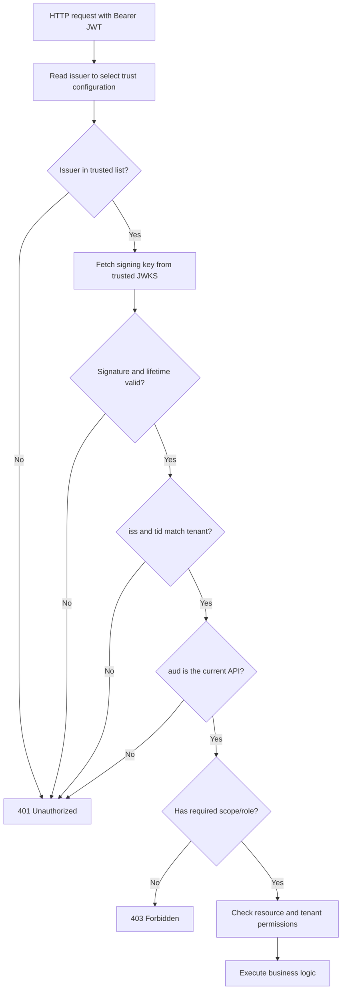

# Validating Issuer, Audience, and Multitenant Trust Boundaries

> **Chapter:** Microsoft Entra ID  
> **Module:** SPRING_CLOUD_PROVIDER_INTEGRATION — hands-on integration of Spring Boot with managed services on AWS, Azure, and Google Cloud via the corresponding Spring Cloud libraries. This lesson focuses on validating access tokens issued by Microsoft Entra ID and designing trust boundaries for single-tenant/multitenant APIs.

A SaaS API may serve multiple organizations. Users in both the Contoso and Fabrikam tenants can sign in successfully with Microsoft Entra ID, yet the API must only accept tokens from onboarded tenants. A token with a valid signature could still have been issued for Microsoft Graph, another API, or an untrusted tenant. Checking only the signature can allow the API to accept the wrong caller.

Three pieces of information must be validated before processing a request:

- **Issuer (`iss`):** which tenant/authority issued the token?
- **Audience (`aud`):** which API was the token issued for?
- **Tenant (`tid`):** which directory tenant does the token belong to, and is that tenant permitted by trust policy?

For multitenant APIs, you must validate the per-tenant issuer, the API's own audience, and the tenant allowlist together. Spring Security Resource Server can verify JWT signatures against Entra's JWKS; the application adds validators and an `AuthenticationManager` resolver keyed by permitted issuers.

## 1. Learning Objectives

After this lesson, you will be able to:

1. Explain the roles of `iss`, `aud`, `tid`, and `ver` in Entra access tokens.
2. Distinguish authority endpoints `common`, `organizations`, and `consumers` from the actual issuer inside tokens.
3. Recognize issuer/audience differences between v1.0 and v2.0 access tokens.
4. Configure Spring Boot Resource Server for a single-tenant API.
5. Build a tenant allowlist and a resolver selecting decoders/managers by issuer.
6. Validate signature, lifetime, issuer, audience, and tenant ID under a unified trust policy.
7. Distinguish tenant onboarding from a token merely asserting `tid`.
8. Test tokens with wrong audience, issuer, tenant, and signature.
9. Avoid SSRF, tenant confusion, and cross-tenant data access in multitenant SaaS.

## 2. Access Token Trust Boundaries

An access token is a bearer credential. The API must trust a token only after verifying its signature using signing keys fetched from a trusted issuer's metadata/JWKS. After that step, the API continues verifying whether the token has the right purpose and belongs to an allowed tenant.

### Security Verification Dimensions

| Component | Question | Example |
|---|---|---|
| Signature and lifetime | Was the token signed by a valid key and is it currently valid? | `kid`, `exp`, `nbf` |
| Issuer | Which tenant/authority issued the token? | `https://login.microsoftonline.com/<TENANT_ID>/v2.0` |
| Audience | Is this token meant for this API? | Client ID of `invoice-api` in v2 tokens |
| Tenant policy | Has this tenant been accepted by the organization? | `tid` in allowlist |
| Permission | Does the caller hold the required scope/app role? | `scp=Invoices.Read`, `roles=Invoice.Batch.Process` |

These steps serve distinct purposes. A valid signature does not prove the audience is right. The right audience does not prove the tenant was onboarded. An allowed tenant does not automatically grant business permissions.

### Validation Flow



In implementation, Spring Resource Server performs JWT validation inside the filter chain. A resolver can select a configuration by issuer before the decoder checks the signature; the issuer read at that stage is untrusted and used strictly as a lookup key into a controlled configuration map.

## 3. Understanding Entra's `iss`, `aud`, `tid`, and `ver`

### `iss` — Issuer

The issuer identifies the authority/tenant that minted the token. For a tenant-specific Microsoft Entra v2.0 access token, the issuer typically looks like:

```text
https://login.microsoftonline.com/<TENANT_ID>/v2.0
```

For v1.0 tokens, the issuer typically looks like:

```text
https://sts.windows.net/<TENANT_ID>/
```

The issuer must be validated accurately against the accepted token version and authority. Never rewrite issuer strings arbitrarily, strip the tenant ID, or ignore the trailing `/` on v1 issuers.

### `aud` — Audience

Audience identifies the target resource/API receiving the token. The API must reject tokens whose audience is Microsoft Graph or another API, even if signature and lifetime are valid.

In Entra:

| Access token | Typical audience |
|---|---|
| v2.0 | GUID Application (client) ID of the API |
| v1.0 | Application ID URI of the API or matching resource identifier per actual configuration/token |

A client may request scopes using the Application ID URI, yet v2 tokens commonly carry the API's GUID client ID in `aud`. Therefore, never deduce `aud` from a scope string; inspect actual tokens for the resource and configure the API to accept only explicitly defined audiences.

### `tid` — Tenant ID

`tid` is the identifier of the directory tenant containing the token's principal. For multitenant APIs, `tid` helps:

- Identify the internal tenant/customer.
- Enforce the tenant allowlist.
- Construct partition keys or tenant filters for data.
- Verify `tid` matches the tenant in the validated issuer.

Never trust `tid` before verifying the signature. A caller can craft a fake JWT containing any tenant ID; claims become trustworthy only after the decoder validates the token.

### `ver` — Token Version

`ver` indicates the access token version, usually `1.0` or `2.0`. The version affects issuer formatting, audience formatting, and certain other claims. APIs should standardize on one token version if possible. If both v1 and v2 must be accepted, configure dedicated validators for each format; never use an overly broad unified issuer/audience rule.

### Related Claims

| Claim | Meaning | Notes |
|---|---|---|
| `azp` | Client application ID in v2 tokens | Can allowlist clients if API accepts only specific clients |
| `appid` | Client application ID in v1 tokens | Never use in place of audience |
| `oid` | Object ID of user/service principal in tenant | Combine with `tid` for tenant-local identification |
| `sub` | Subject per token contract | Can differ across apps/resources |
| `scp` | Delegated scopes | Used for post-authentication authorization |
| `roles` | App roles/application permissions | Does not by itself prove app-only |
| `exp`, `nbf`, `iat` | Validity timestamps | Decoder must validate timestamps |

Never use `email`, `preferred_username`, or display names as tenant keys or durable authorization identifiers.

If the API allows only specific client applications, you may also verify `azp` (v2) or `appid` (v1) against an allowlist after token verification. Client allowlists are an additional constraint; they do not replace audience validation.

## 4. `common`, `organizations`, and Real Issuers Are Not the Same

The Microsoft identity platform provides common authority aliases:

| Authority segment | General meaning |
|---|---|
| `common` | Allows multiple account types depending on app configuration, potentially including work/school and personal Microsoft accounts |
| `organizations` | Work/school accounts in Microsoft Entra |
| `consumers` | Personal Microsoft accounts |
| Specific Tenant ID/domain | Restricts authority to a single tenant |

Example authorization endpoint:

```text
https://login.microsoftonline.com/organizations/oauth2/v2.0/authorize
```

This is an authority alias used to initiate authorization. When Entra mints an access token for a specific tenant, the `iss` claim still identifies the actual tenant, for example:

```text
https://login.microsoftonline.com/11111111-1111-1111-1111-111111111111/v2.0
```

Therefore:

- Never configure `iss` as `.../common/v2.0` merely because clients sign in via `/common` or `/organizations`.
- Never treat signing in via `organizations` as proof that the tenant has been accepted by the SaaS product.
- Never accept every tenant simply because a token has an issuer on a Microsoft domain.
- The authority alias determines which account categories can authenticate; the API's tenant allowlist determines which tenants may access service data.

For organization-only products, you typically pick a tenant-specific authority for single-tenant APIs or `organizations` for multitenant sign-in experiences; the API still must validate tenants according to its own policy.

## 5. Single-Tenant API with Spring Boot

If the API serves only one directory tenant, configuring a tenant-specific issuer keeps the trust policy simple.

### 5.1. Configure `application.yml`

Example API accepting only v2.0 tokens from one tenant:

```yaml
spring:
  security:
    oauth2:
      resourceserver:
        jwt:
          issuer-uri: https://login.microsoftonline.com/${ENTRA_TENANT_ID}/v2.0
          audiences:
            - ${INVOICE_API_CLIENT_ID}
```

Environment variables:

```bash
ENTRA_TENANT_ID=<directory-tenant-id>
INVOICE_API_CLIENT_ID=<application-client-id-of-invoice-api>
```

`issuer-uri` is the issuer of the token-issuing tenant; `audiences` is the audience of the API receiving tokens. Do not use the portal/worker's client ID as the audience when tokens are issued for Invoice API.

### 5.2. Configure `SecurityFilterChain`

```java
package com.example.invoice.security;

import org.springframework.context.annotation.Bean;
import org.springframework.context.annotation.Configuration;
import org.springframework.security.config.Customizer;
import org.springframework.security.config.annotation.web.builders.HttpSecurity;
import org.springframework.security.config.http.SessionCreationPolicy;
import org.springframework.security.web.SecurityFilterChain;

@Configuration
public class ApiSecurityConfiguration {

    @Bean
    SecurityFilterChain apiSecurity(HttpSecurity http) throws Exception {
        http
            .securityMatcher("/api/**")
            .csrf(csrf -> csrf.disable())
            .sessionManagement(session -> session
                .sessionCreationPolicy(SessionCreationPolicy.STATELESS))
            .authorizeHttpRequests(authorize -> authorize
                .requestMatchers("/api/public/**").permitAll()
                .anyRequest().authenticated())
            .oauth2ResourceServer(oauth2 ->
                    oauth2.jwt(Customizer.withDefaults()));

        return http.build();
    }
}
```

This chain is for a bearer-only API. Disable CSRF only when endpoints do not use cookies/sessions for authentication; if the same application also has web sessions, keep CSRF enabled on a separate web chain. If there are requests outside `/api/**`, another chain must cover them.

Spring Boot configures the decoder from the issuer URI and audience. The decoder verifies the JWT signature using public keys from JWKS, the issuer, and validity timestamps; audience is checked per `audiences`. If configuring a custom decoder, preserve timestamp and issuer validators instead of checking only the signature.

## 6. Multitenant: Determining Which Tenants Are Trusted

A multitenant API may allow multiple organizations to onboard. A tenant existing in Microsoft Entra does not mean that tenant is a customer of your application.

### Tenant Allowlist

A tenant is permitted to call the API when it satisfies onboarding policy, for example:

1. The tenant's administrator consented to the required permissions.
2. A tenant record has been provisioned in the SaaS system.
3. Its subscription/contract is not suspended or expired.
4. Its Tenant ID is present in the allowlist.
5. The API can enforce data isolation for that tenant.

Store Tenant IDs as GUIDs rather than using domains/emails as trust keys. Tenant domains can change or a tenant can have multiple domains; the Tenant ID is a more stable directory identifier.

For guest users, tokens are issued in the resource tenant the guest is accessing. `tid` and `oid` must be interpreted in that tenant's context; never link a guest to a home-tenant account solely by email or UPN.

### Configuring the Allowlist

Example:

```yaml
entra:
  api-client-id: ${INVOICE_API_CLIENT_ID}
  trusted-tenant-ids:
    - 11111111-1111-1111-1111-111111111111
    - 22222222-2222-2222-2222-222222222222
```

In production, allowlists are typically managed by an onboarding/configuration service or access-controlled database. The YAML example fits a small tenant set updated via deployments; it is not a solution for managing thousands of dynamic tenants.

### Never Fetch Arbitrary Issuer URLs from Tokens

A JWT is caller-supplied data. If an application reads `iss` and fetches OpenID metadata/JWKS from that URL without checking an allowlist, an attacker could exploit it to:

- Force the server to call internal hosts or unintended endpoints (SSRF).
- Create large numbers of issuers/decoders, bloating caches or exhausting resources.
- Trick the system into trusting an out-of-policy authority.

The issuer inside a token must only be used to look up an already-trusted configuration. Never interpolate an arbitrary `iss` into an HTTP request or create decoders automatically before the tenant/issuer is approved.

## 7. Resolver Selecting `AuthenticationManager` by Issuer

For a known set of tenants, you can pre-create an `AuthenticationManager` per issuer. Each manager holds a decoder using Entra signing keys and dedicated validators for issuer, audience, and tenant.

### 7.1. Issuer Rule for v2.0

For tenant ID `T`, the expected issuer is:

```text
https://login.microsoftonline.com/T/v2.0
```

In the code example, `T` comes from the tenant allowlist, normalized via `UUID`, and is used to construct the issuer. The decoder uses Entra's tenant-independent JWKS endpoint:

```text
https://login.microsoftonline.com/common/discovery/v2.0/keys
```

The JWKS endpoint supplies public signing keys. That does not mean the API accepts all tenants: validators still match the issuer and tenant ID against the allowlist configuration.

### 7.2. Creating a Decoder with Issuer, Audience, and Tenant Validators

```java
package com.example.invoice.security;

import java.util.UUID;

import org.springframework.security.oauth2.core.OAuth2Error;
import org.springframework.security.oauth2.core.OAuth2TokenValidator;
import org.springframework.security.oauth2.core.OAuth2TokenValidatorResult;
import org.springframework.security.oauth2.core.DelegatingOAuth2TokenValidator;
import org.springframework.security.oauth2.jwt.Jwt;
import org.springframework.security.oauth2.jwt.JwtValidators;
import org.springframework.security.oauth2.jwt.NimbusJwtDecoder;

public final class EntraJwtDecoderFactory {

    private static final String JWKS_URI =
            "https://login.microsoftonline.com/common/discovery/v2.0/keys";

    private EntraJwtDecoderFactory() {
    }

    public static NimbusJwtDecoder forTenant(
            UUID trustedTenantId, String apiClientId) {

        String tenantId = trustedTenantId.toString();
        String issuer = "https://login.microsoftonline.com/"
                + tenantId + "/v2.0";

        NimbusJwtDecoder decoder =
                NimbusJwtDecoder.withJwkSetUri(JWKS_URI).build();

        OAuth2TokenValidator<Jwt> issuerAndTimeValidator =
                JwtValidators.createDefaultWithIssuer(issuer);

        decoder.setJwtValidator(new DelegatingOAuth2TokenValidator<>(
                issuerAndTimeValidator,
                audienceValidator(apiClientId),
                tenantValidator(trustedTenantId),
                v2TokenValidator()));

        return decoder;
    }

    public static OAuth2TokenValidator<Jwt> audienceValidator(
            String expectedAudience) {
        return jwt -> jwt.getAudience().contains(expectedAudience)
                ? OAuth2TokenValidatorResult.success()
                : OAuth2TokenValidatorResult.failure(
                        new OAuth2Error(
                                "invalid_token",
                                "Token audience is not this API",
                                null));
    }

    public static OAuth2TokenValidator<Jwt> tenantValidator(
            UUID trustedTenantId) {
        String expectedTenantId = trustedTenantId.toString();
        return jwt -> expectedTenantId.equalsIgnoreCase(
                jwt.getClaimAsString("tid"))
                ? OAuth2TokenValidatorResult.success()
                : OAuth2TokenValidatorResult.failure(
                        new OAuth2Error(
                                "invalid_token",
                                "Token tenant does not match issuer",
                                null));
    }

    public static OAuth2TokenValidator<Jwt> v2TokenValidator() {
        return jwt -> "2.0".equals(jwt.getClaimAsString("ver"))
                ? OAuth2TokenValidatorResult.success()
                : OAuth2TokenValidatorResult.failure(
                        new OAuth2Error(
                                "invalid_token",
                                "Only Entra v2.0 access tokens are accepted",
                                null));
    }
}
```

Key points:

- `JwtValidators.createDefaultWithIssuer` retains default issuer and timestamp checks.
- The audience validator requires `aud` to contain the exact client ID of Invoice API.
- The tenant validator requires `tid` to match the tenant used to construct the decoder.
- The version validator accepts only `ver=2.0`; v1 tokens require a dedicated decoder/policy.
- `NimbusJwtDecoder` verifies signatures using signing keys fetched from JWKS.
- Decoders are created only for tenants already on the allowlist.

If the API uses v1.0 tokens, do not swap v2 issuers for v1 arbitrarily. Create a separate validator configuration using issuer `https://sts.windows.net/<TENANT_ID>/`, the actual v1 token audience, and appropriate metadata/JWKS.

### 7.3. Creating an `AuthenticationManager` per Tenant

Use `@ConfigurationProperties` to bind the tenant list from YAML:

```java
package com.example.invoice.security;

import java.util.List;

import org.springframework.boot.context.properties.ConfigurationProperties;

@ConfigurationProperties(prefix = "entra")
public record EntraTrustProperties(
        String apiClientId,
        List<String> trustedTenantIds) {
}
```

```java
package com.example.invoice.security;

import jakarta.servlet.http.HttpServletRequest;
import java.util.HashMap;
import java.util.Map;
import java.util.UUID;

import org.springframework.boot.context.properties.EnableConfigurationProperties;
import org.springframework.context.annotation.Bean;
import org.springframework.context.annotation.Configuration;
import org.springframework.security.authentication.AuthenticationManager;
import org.springframework.security.authentication.ProviderManager;
import org.springframework.security.oauth2.server.resource.authentication.JwtAuthenticationProvider;
import org.springframework.security.oauth2.server.resource.authentication.JwtIssuerAuthenticationManagerResolver;
import org.springframework.security.authentication.AuthenticationManagerResolver;

@Configuration
@EnableConfigurationProperties(EntraTrustProperties.class)
public class MultiTenantResourceServerConfiguration {

    @Bean
    AuthenticationManagerResolver<HttpServletRequest> tenantResolver(
            EntraTrustProperties properties) {

        Map<String, AuthenticationManager> managers = new HashMap<>();

        for (String configuredId : properties.trustedTenantIds()) {
            UUID tenantId = UUID.fromString(configuredId);
            String issuer = "https://login.microsoftonline.com/"
                    + tenantId + "/v2.0";

            var decoder = EntraJwtDecoderFactory.forTenant(
                    tenantId, properties.apiClientId());
            var provider = new JwtAuthenticationProvider(decoder);
            managers.put(issuer, new ProviderManager(provider));
        }

        return new JwtIssuerAuthenticationManagerResolver(
                issuer -> managers.get(issuer));
    }
}
```

The resolver reads the issuer from the token to look up the map. The map holds only issuers built from the tenant allowlist; unknown issuers have no manager and are rejected. Once a manager is selected, the decoder still verifies signature, issuer, audience, lifetime, and `tid`.

Because issuers are built from normalized UUIDs in the allowlist, the map uses canonical strings. Never lowercase/trim an issuer taken from a token just to make a mismatched issuer pass; issuer matching must adhere strictly to configured values.

Attach the resolver to the filter chain:

```java
package com.example.invoice.security;

import jakarta.servlet.http.HttpServletRequest;
import org.springframework.context.annotation.Bean;
import org.springframework.context.annotation.Configuration;
import org.springframework.security.authentication.AuthenticationManagerResolver;
import org.springframework.security.config.annotation.web.builders.HttpSecurity;
import org.springframework.security.config.http.SessionCreationPolicy;
import org.springframework.security.web.SecurityFilterChain;

@Configuration
public class MultiTenantApiSecurityConfiguration {

    @Bean
    SecurityFilterChain apiSecurity(
            HttpSecurity http,
            AuthenticationManagerResolver<HttpServletRequest> tenantResolver)
            throws Exception {

        http
            .securityMatcher("/api/**")
            .csrf(csrf -> csrf.disable())
            .sessionManagement(session -> session
                .sessionCreationPolicy(SessionCreationPolicy.STATELESS))
            .authorizeHttpRequests(authorize -> authorize
                .requestMatchers("/api/public/**").permitAll()
                .anyRequest().authenticated())
            .oauth2ResourceServer(oauth2 ->
                oauth2.authenticationManagerResolver(tenantResolver));

        return http.build();
    }
}
```

This pattern suits a static tenant list configured at startup. When the list changes, the application must reload configurations/managers in a controlled manner. When using a dynamic tenant registry, create a manager only after verifying the tenant is onboarded; use bounded caches with eviction and protection against mass decoder creation.

## 8. Dynamic Tenants and Large-Scale SaaS

A YAML tenant list does not scale when customers onboard continuously. You can build an `AuthenticationManagerResolver` backed by a tenant registry, provided the trust sequence stays strict:

1. Read the issuer from the unverified JWT solely as a routing hint.
2. Parse the tenant ID from the issuer using only supported formats; never accept arbitrary issuer URLs.
3. Query the internal tenant registry to verify the tenant is active/approved.
4. Construct the canonical issuer from the format-validated tenant ID.
5. Fetch or create the decoder from a bounded cache; use only fixed Microsoft metadata/JWKS endpoints.
6. Validate signature, issuer, audience, `tid`, timestamps, and token version.
7. Check whether the tenant is still active at authorization/data-access time per business rules.

Never let the `tid` claim create a new tenant on its own. The tenant registry must be updated only through an onboarding workflow with administrator/consent verification.

### When a Tenant Is Suspended or Offboarded

- Reject new requests based on tenant registry status.
- Revoke app role assignments/consents when required by offboarding workflows.
- Evict related tenant/authorized-client caches per policy.
- Retain audit records of when suspension/offboarding occurred.
- Do not rely on old access tokens vanishing immediately; already-issued JWTs may remain valid until `exp`.

## 9. Audience Validation: Rejecting Tokens Meant for Other APIs

A common bug is validating issuer and signature while skipping audience. In that case, a Microsoft Graph token or a token for another service in the same tenant could be mistakenly accepted by the API.

### Audience Rules

- Accept only audiences belonging to the current API.
- With v2.0, this is normally the API's GUID client ID.
- With v1.0, verify the actual audience from tokens and API registration; configure explicitly if truly supported.
- If multiple valid audiences exist during a migration, list them explicitly and set a deadline to retire the old value.
- Never use wildcards, substrings, or prefix matching.

Example validator accepting a controlled set of audiences:

```java
Set<String> acceptedAudiences = Set.of(
        "33333333-3333-3333-3333-333333333333");

OAuth2TokenValidator<Jwt> audienceValidator = jwt ->
        jwt.getAudience().stream().anyMatch(acceptedAudiences::contains)
                ? OAuth2TokenValidatorResult.success()
                : OAuth2TokenValidatorResult.failure(
                        new OAuth2Error("invalid_token",
                                "Unexpected audience", null));
```

In production, the accepted audience list must be a reviewed configuration. Never add Microsoft Graph or another API's audience just to make a test pass.

## 10. Single-Tenant vs. Multitenant: Which Policy to Choose?

| Criterion | Single-tenant | Multitenant |
|---|---|---|
| Issuer | One tenant-specific issuer | One specific issuer per tenant |
| Tenant trust | Fixed configured Tenant ID | Tenant registry/allowlist |
| Decoder | One decoder | Per-issuer or per-tenant decoder/manager |
| Onboarding | Usually within the same organization | Requires consent, onboarding, and subscription state |
| Data isolation | Fixed tenant, still requires internal authorization | Mandatory tenant filter on all data |
| Primary risk | Wrong audience or misconfigured tenant | Tenant confusion, overly broad issuer trust, data leakage |

Single-tenant should generally configure a specific issuer instead of `common`. Enable multitenancy only when the product has clear onboarding, tenant isolation, offboarding, and auditing processes.

## 11. Testing Trust Boundaries

Tests must prove that the API rejects tokens with valid signatures yet wrong audience/tenant, in addition to bad signatures or expired tokens.

### Test Matrix

| Case | Issuer | Audience | `tid` | Result |
|---|---|---|---|---|
| Valid token for tenant A | Trusted A | Invoice API | A | Passes authentication |
| Unonboarded tenant B token | B not in allowlist | Invoice API | B | 401 |
| Tenant A token meant for Graph | Trusted A | Microsoft Graph | A | 401 |
| Tenant A issuer with different `tid` | Trusted A | Invoice API | B | 401 |
| Token with invalid signature | Claims to be A | Invoice API | A | 401 |
| Expired token | Trusted A | Invoice API | A | 401 |
| Token before `nbf` | Trusted A | Invoice API | A | 401 |
| Valid token missing scope | Trusted A | Invoice API | A | 403 |
| Valid trust, suspended tenant | Previously trusted A | Invoice API | A | Rejected per tenant policy |

### Validator Unit Tests

Validators are separated into methods so they can be unit-tested directly:

```java
import static org.assertj.core.api.Assertions.assertThat;

import java.time.Instant;
import java.util.List;
import java.util.UUID;

import org.junit.jupiter.api.Test;
import org.springframework.security.oauth2.jwt.Jwt;

class AudienceValidatorTest {

    private final String apiAudience =
            "33333333-3333-3333-3333-333333333333";

    @Test
    void acceptsTokenForThisApi() {
        Jwt jwt = Jwt.withTokenValue("test")
                .header("alg", "RS256")
                .claim("aud", List.of(apiAudience))
                .claim("tid", "11111111-1111-1111-1111-111111111111")
                .claim("ver", "2.0")
                .issuedAt(Instant.now())
                .expiresAt(Instant.now().plusSeconds(300))
                .build();

        assertThat(EntraJwtDecoderFactory.audienceValidator(apiAudience)
                .validate(jwt).getErrors()).isEmpty();
        assertThat(EntraJwtDecoderFactory.tenantValidator(UUID.fromString(
                "11111111-1111-1111-1111-111111111111"))
                .validate(jwt).getErrors()).isEmpty();
        assertThat(EntraJwtDecoderFactory.v2TokenValidator()
                .validate(jwt).getErrors()).isEmpty();
    }

    @Test
    void doesNotTreatGraphAudienceAsThisApi() {
        Jwt jwt = Jwt.withTokenValue("test")
                .header("alg", "RS256")
                .claim("aud", List.of("https://graph.microsoft.com"))
                .claim("tid", "11111111-1111-1111-1111-111111111111")
                .claim("ver", "2.0")
                .issuedAt(Instant.now())
                .expiresAt(Instant.now().plusSeconds(300))
                .build();

        assertThat(EntraJwtDecoderFactory.audienceValidator(apiAudience)
                .validate(jwt).getErrors()).isNotEmpty();
    }

    @Test
    void rejectsTenantMismatch() {
        Jwt jwt = Jwt.withTokenValue("test")
                .header("alg", "RS256")
                .claim("aud", List.of(apiAudience))
                .claim("tid", "22222222-2222-2222-2222-222222222222")
                .claim("ver", "2.0")
                .issuedAt(Instant.now())
                .expiresAt(Instant.now().plusSeconds(300))
                .build();

        assertThat(EntraJwtDecoderFactory.tenantValidator(UUID.fromString(
                "11111111-1111-1111-1111-111111111111"))
                .validate(jwt).getErrors()).isNotEmpty();
    }
}
```

These tests verify audience, tenant, and token version validators using synthetic `Jwt` objects. They do not test signatures, issuer/time checks applied by the decoder, or JWKS fetching; those require decoder/integration tests with signed tokens in a test environment.

### Integration Testing Against Test Tenants

1. Create a dedicated API app registration for testing.
2. Configure the audience and token version to be tested.
3. Set up two test tenants: one allowlisted tenant and one non-allowlisted tenant.
4. Acquire a token for the target API from the trusted tenant.
5. Acquire a Graph token or a token for another API in the same tenant.
6. Call the endpoint with each token and record HTTP statuses.
7. Test expired/wrong-tenant tokens using a safe test token suite rather than editing payloads and assuming signatures stay valid.
8. Confirm logs never record bearer tokens.

## 12. Common Errors and Troubleshooting

| Symptom | Possible cause | Resolution |
|---|---|---|
| Valid Entra token yet API returns 401 | `iss` configured with wrong tenant or token version | Inspect `iss`, `ver`, and compare against canonical issuer |
| Sign-in via `/organizations` works yet API rejects | Authority alias confused with issuer, or tenant not onboarded | Check `iss`, `tid`, and tenant registry |
| API mistakenly accepts Graph token | Missing audience validation | Enforce `aud` check via allowlist |
| Unintended tenants are accepted | `common` used as a trust rule or resolver fetches arbitrary issuers | Look up managers strictly from the tenant allowlist |
| Tenant A issuer yet `tid` claim is B | Token/validator mismatch or broken trust config | Require `tid` to match the tenant in the issuer |
| After key rotation, new tokens are rejected | JWKS cannot refresh or blocked by network | Check JWKS endpoint, `kid`, TLS, and cache |
| v1 tokens are rejected | API supports only v2 or v1 issuer/audience unconfigured | Standardize on v2 or add a separate v1 validator |
| Multitenant API memory grows steadily | Creating decoders/caches for arbitrary issuers | Allowlist first, bound caches with eviction |
| Tenant A request reads tenant B data | Token authenticated without tenant-scoping queries | Use verified `tid` in repositories/services |

### Investigation Checklist

1. Is the token an access token intended for the current API?
2. Does the signature verify against trusted JWKS?
3. Does `iss` match the canonical issuer for `ver`?
4. Does `aud` contain the exact audience of the API?
5. Does `tid` match the tenant in the issuer and appear on the allowlist?
6. Is the tenant active/onboarded?
7. Does the caller hold the required scope/app role?
8. Do data queries constrain tenant and object permissions?

Never use online JWT decoding tools or log real tokens to debug production. When you need to inspect claims, use a test environment with protected/redacted token data.

## 13. Protecting Tenant Data Once a Token Is Valid

Issuer/audience/tenant validation only establishes that a request belongs to a trusted principal/tenant. The API must still enforce tenant isolation at the data layer:

- Read `tid` from the validated `Jwt`, never from headers/query params as an identity source.
- Map `tid` to an internal tenant record and verify active status.
- Include the tenant ID in every tenant-scoped query.
- Use composite keys or unique constraints including the tenant ID to prevent cross-tenant ID collisions.
- Enforce membership/ACLs on every resource.
- Never omit tenant ID from cache keys when cached data is tenant-dependent.
- Include tenant ID in audit events, correlation contexts, and metric labels per data-protection policy.
- Never return errors leaking another tenant's resources; choose 403/404 consistently per policy.

If the API calls Storage, Service Bus, or Key Vault, permissions on those resources are still evaluated against the workload's identity/role assignments. Trusting an Entra access token for the API does not automatically grant Azure RBAC.

## 14. Hands-On Exercise

**Context:** Invoice API is deployed as SaaS for two customers, Contoso and Fabrikam. Both use Microsoft Entra ID. A third, un-onboarded tenant attempts to call the API using a valid token issued by Entra. The API must accept only tokens with the right audience and from permitted tenants.

### Part A — Analyze Tokens

1. Acquire a v2.0 access token for Invoice API from the Contoso tenant in a test environment.
2. Record `iss`, `aud`, `tid`, `ver`, `exp`, `scp`, or `roles`.
3. Acquire a Graph token from the same tenant and compare `aud`.
4. Acquire a token from the Fabrikam tenant and compare issuer/tenant.
5. Explain why `/organizations` is not the `iss` value of a tenant-specific token.

### Part B — Spring Boot Configuration

1. Configure single-tenant issuer and audience.
2. Switch to a multitenant resolver with an allowlist for Contoso/Fabrikam.
3. Build a decoder with issuer, audience, timestamp, and `tid` validators.
4. Use Entra's trusted JWKS endpoint.
5. Ensure issuers outside the allowlist never instantiate decoders or trigger outbound metadata requests.
6. Use the verified `tid` to scope data queries.

### Part C — Testing

1. Contoso token with right audience authenticates.
2. Un-onboarded tenant token is rejected.
3. Graph token from the same tenant is rejected due to audience.
4. Token whose `tid` mismatches its issuer is rejected.
5. Expired/bad-signature tokens are rejected.
6. Trusted token missing scope receives 403.
7. Suspended tenant cannot read new data.
8. Verify logs contain no bearer tokens.

**Sample report:**

| Test case | `iss` | `aud` | `tid` | Result |
|---|---|---|---|---|
| Valid Contoso | Contoso tenant v2 | Invoice API | Contoso | 200 |
| Valid Fabrikam | Fabrikam tenant v2 | Invoice API | Fabrikam | 200 if active |
| Un-onboarded tenant | Tenant C v2 | Invoice API | Tenant C | 401 |
| Graph token | Contoso tenant v2 | Microsoft Graph | Contoso | 401 |
| Mismatched `tid` | Contoso issuer | Invoice API | Fabrikam | 401 |
| Missing scope | Contoso tenant v2 | Invoice API | Contoso | 403 |
| Suspended tenant | Contoso tenant v2 | Invoice API | Contoso | Rejected per policy |

**Pass criteria:** The API validates signature, issuer, audience, lifetime, and tenant; only onboarded tenants gain access; wrong-resource tokens are rejected; data is always queried within the verified tenant context.

## Official References

1. [Microsoft identity platform — Access token claims reference](https://learn.microsoft.com/entra/identity-platform/access-token-claims-reference): issuer, audience, tenant, token version, and claims.
2. [Microsoft identity platform — Validate claims](https://learn.microsoft.com/entra/identity-platform/claims-validation): validating issuer, audience, tenant, and subject.
3. [Microsoft identity platform — OpenID Connect metadata](https://learn.microsoft.com/entra/identity-platform/v2-protocols-oidc): authority, discovery metadata, and signing keys.
4. [Microsoft identity platform — Signing key rollover](https://learn.microsoft.com/entra/identity-platform/signing-key-rollover): updating public signing keys.
5. [Spring Security — JWT Resource Server](https://docs.spring.io/spring-security/reference/servlet/oauth2/resource-server/jwt.html): JWT decoders, validators, and JWKS.
6. [Spring Security — Multi-tenancy](https://docs.spring.io/spring-security/reference/servlet/oauth2/resource-server/multitenancy.html): `JwtIssuerAuthenticationManagerResolver` and multitenant Resource Server.
7. [Spring Boot — OAuth2 Resource Server](https://docs.spring.io/spring-boot/reference/security/oauth2.html): configuring issuer and audience for Resource Server.

> **Remember:** `iss` identifies the issuing tenant/authority, `aud` identifies the API receiving the token, and `tid` binds the principal to a directory tenant. For multitenant APIs, trust only allowlisted issuers, validate signature/lifetime/audience/tenant together, and use the verified tenant to isolate data. `common` or `organizations` are authority aliases, not rules to accept every tenant.
