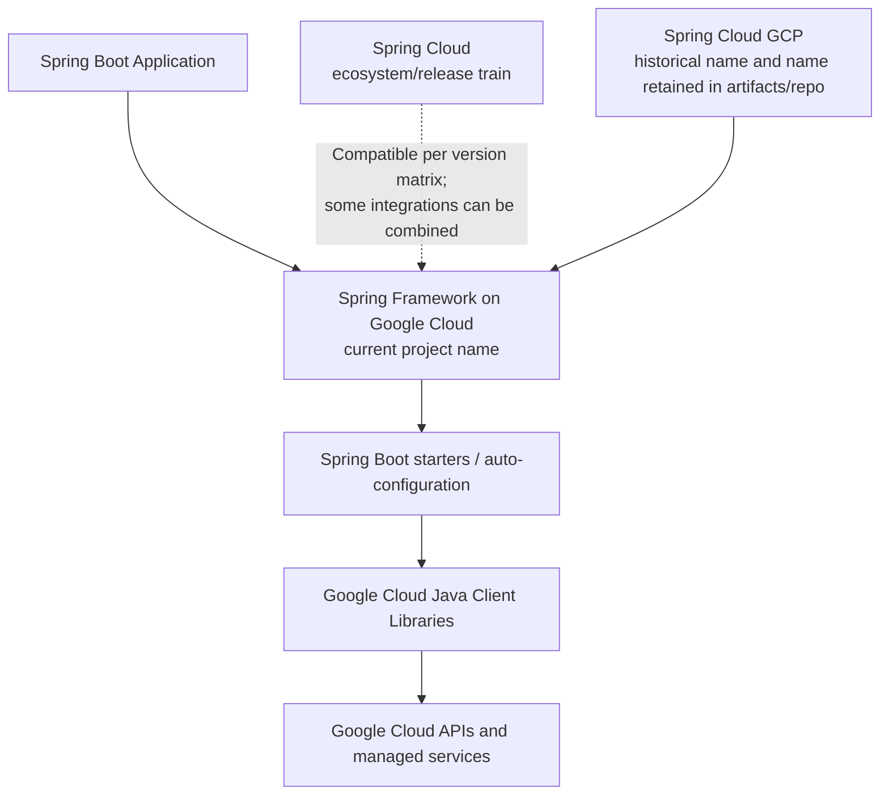

# Spring Cloud GCP and the Spring Framework on Google Cloud Project Name

When looking for documentation on integrating Spring Boot with Google Cloud, you may come across multiple names: **Spring Cloud GCP**, **Spring Framework on Google Cloud**, the `spring-cloud-gcp` repository, the `spring-cloud-gcp-starter-pubsub` Maven artifact, and the `spring.cloud.gcp.*` property prefix. These names do not refer to independent products. They belong to the same project line for integrating Spring with Google Cloud, but appeared at different points in time and at different technical layers.

Understanding the project name correctly helps you choose the right documentation, dependencies, BOM, and Java packages. This is especially important as the `SPRING_CLOUD_PROVIDER_INTEGRATION` module aims to integrate Spring Boot with managed services from AWS, Azure, and Google Cloud: each provider has its own library suite, release cadence, and configuration conventions.

This lesson explains the naming history, the project's place in the Spring ecosystem, its core components, how to choose a version, and a getting-started example with Google Cloud Pub/Sub.

## 1. First, Distinguish Three Common Names

| Name | Meaning | How to Understand It |
| --- | --- | --- |
| **Spring Cloud GCP** | The project name widely used in documentation and earlier development stages | A historical/legacy name that still appears on the Spring project page, repository, artifacts, and some properties |
| **Spring Framework on Google Cloud** | The name used in the project's current reference documentation and README | The current display name for the Spring integration suite with Google Cloud services |
| **Spring Cloud** | The ecosystem of projects supporting distributed architecture, configuration, discovery, messaging, routing, etc. | A different umbrella project/release train; not identical to Spring Framework on Google Cloud |

You can visualize the relationship as follows:



**Key takeaway:** `Spring Framework on Google Cloud` is the project name currently used in the current reference documentation. `Spring Cloud GCP` still appears in many places due to project history and because repository/artifact/property names were not changed across the board. Do not conclude that they are two different libraries based solely on the name shown on a search page.

## 2. History and Why Multiple Names Exist

The project started as **Spring Cloud GCP**, aiming to bring Google Cloud services into Spring applications through familiar abstractions, starters, and auto-configuration. Starting from version 2.0, the project moved to its own development repository under the GoogleCloudPlatform organization and was **separated from the Spring Cloud release train**.

This separation brought technical changes during the upgrade path:

- The project's dependency management BOM is declared separately as `spring-cloud-gcp-dependencies`.
- The Maven group ID for artifacts changed from `org.springframework.cloud` to `com.google.cloud`.
- Java packages changed from `org.springframework.cloud.gcp` to `com.google.cloud.spring`.
- The common property prefix `spring.cloud.gcp.*` and many `spring-cloud-gcp-*` artifact IDs were kept for historical compatibility and module organization.

The Spring project page still has the title **Spring Cloud GCP** and notes that the project is no longer part of the Spring Cloud release train. Meanwhile, the repository README and reference documentation currently use the name **Spring Framework on Google Cloud**. This is a display-label inconsistency across pages, not a sign of two competing library suites.

### High-Level Timeline

| Stage | Common Name/Structure | Meaning |
| --- | --- | --- |
| Early stage | Spring Cloud GCP 1.x | Project integrating Google Cloud with Spring; dependencies tied to the early Spring Cloud ecosystem |
| From 2.0 | GoogleCloudPlatform repository, dedicated BOM, group ID `com.google.cloud` | Project separated from the release train; new dependency/package conventions began |
| Subsequent generations | Spring Cloud GCP 3.x, 4.x, 5.x… | Continued expanding alongside Spring Boot/Spring Framework generations |
| Current documentation | Spring Framework on Google Cloud | Project name in the README and reference documentation; artifacts still carry `spring-cloud-gcp` |

The 2.0 milestone is important to note when reading older code. If a tutorial uses the `org.springframework.cloud.gcp.*` package or the `org.springframework.cloud` Maven group, you cannot simply copy it as-is into a current project. You must cross-check the migration guide and BOM version.

## 3. How Does Spring Framework on Google Cloud Relate to Spring Cloud?

**Spring Framework on Google Cloud is a project for integrating Google Cloud services into Spring applications.** It provides starters, auto-configuration, templates, abstractions, and Spring Data/Spring Integration integrations so developers can use Google Cloud with the familiar Spring programming model.

**Spring Cloud** is a broader ecosystem. It provides projects such as:

- Spring Cloud Config for distributed configuration.
- Spring Cloud Stream for a function/binder-oriented messaging model.
- Spring Cloud Bus for broadcasting events across instances.
- Spring Cloud Gateway, Circuit Breaker, and components for distributed systems.

The two names sound similar, but they do not share the same scope. Spring Framework on Google Cloud can integrate with certain Spring Cloud components—for example, the Pub/Sub binder or Spring Cloud Bus depending on the version—but it is **not all of Spring Cloud**, nor is its versioning managed by replacing the Spring Cloud BOM.

### Why Does “Spring Cloud GCP” Still Appear in Artifacts?

Maven artifacts are technical identifiers published to Maven Central. Rebranding a name does not require renaming every artifact, package, property prefix, and repository slug. For example:

| Layer | Current Name Seen | Example |
| --- | --- | --- |
| Project name | Spring Framework on Google Cloud | Name in the reference documentation |
| Historical name | Spring Cloud GCP | Spring project page and older documentation |
| Repository | `GoogleCloudPlatform/spring-cloud-gcp` | Where the source code is hosted |
| Maven group ID | `com.google.cloud` | Current artifact group |
| Maven artifact ID | `spring-cloud-gcp-starter-pubsub` | Starter for Pub/Sub |
| Java package | `com.google.cloud.spring.*` | Current code package |
| Spring property prefix | `spring.cloud.gcp.*` | Configures project ID, credentials, storage, Pub/Sub, etc. |

Therefore, when you see a dependency containing `spring-cloud-gcp`, do not assume the project is still in the Spring Cloud release train. Check the **group ID, BOM, and version compatibility**.

## 4. What Integrations Does the Project Provide?

The scope goes beyond a single client for Google Cloud. The modules help connect managed services with Spring abstractions:

| Group | Representative Services/Integrations | Value for Spring Applications |
| --- | --- | --- |
| Core | Project ID, credentials provider, environment detection | Auto-configures project info and Google Cloud identity |
| Object storage | Google Cloud Storage | Reads/writes objects, integrates with Spring Resource and Spring Integration |
| Messaging | Cloud Pub/Sub | Publish/subscribe, template, Spring Integration channel adapter |
| Event streaming | Pub/Sub Stream Binder | Connects the Spring Cloud Stream model with Pub/Sub where module/version supports it |
| SQL | Cloud SQL MySQL/PostgreSQL | Supports JDBC/R2DBC connections and IAM database authentication per configuration |
| NoSQL/data | Cloud Spanner, Datastore, Firestore | Spring Data mapping, templates, and repositories |
| Cache | Memorystore for Redis | Integrates with Spring Data Redis and Spring Cache |
| Observability | Cloud Logging, Cloud Trace, Cloud Monitoring | Sends logs, traces, and metrics to Google Cloud observability |
| Security | Cloud IAP, Firebase Authentication | Identity/authentication integration for applications |
| Secrets and keys | Secret Manager, Cloud KMS | Reads secrets and uses encryption/decryption APIs |
| Configuration | Parameter Manager, Runtime Configuration API, Google Cloud Config | Loads or manages parameters depending on module and version |
| Analytics/AI | BigQuery, Cloud Vision | Analytical data querying and image processing |
| Newer databases | AlloyDB | Integration with the PostgreSQL-compatible managed database |

The feature list changes by version. A module may exist in the repository but not be included in the starter/version you are using, or artifact names and configuration methods may change. Check the reference documentation for your exact version before adopting it in a project.

### Role of Starters

Starters let Spring Boot auto-configure the necessary beans when the corresponding dependency is present. For example:

- The Core starter provides shared components for project ID and credentials.
- The Pub/Sub starter provides beans such as `PubSubTemplate` and Pub/Sub management components.
- The Storage starter configures Google Cloud Storage integration with Spring Resource.
- Data starters configure repositories/templates for Spanner, Datastore, or Firestore.
- Logging/Trace starters add corresponding observability integrations.

Adding a starter does not automatically grant the application access to every service. Auto-configuration creates clients and beans; **IAM permissions, project, resources, API enablement, and networking** must still be prepared in Google Cloud.

## 5. Choosing a Version: Dedicated BOM and Compatibility Matrix

Spring Framework on Google Cloud has its **own versioning**. It does not derive its version from the Spring Cloud release train name. The project publishes its own BOM to manage the versions of starters and related libraries.

### 5.1. Compatibility Matrix

According to the compatibility table in the version 8.3.1 reference documentation checked on **24/11/2026**, the main published branches are as follows:

| Spring Framework on Google Cloud | Spring Cloud | Spring Boot | Spring Framework | Status in Documentation Table |
| --- | --- | --- | --- | --- |
| 8.x | 2025.1.x (Oakwood) | 4.0.x, 4.1.x | 7.0.0+ | Supported |
| 7.x | 2025.0.x (Northfields) | 3.5.x | 6.2.8+ | Supported |
| 6.x | 2024.0.x | 3.4.x | 6.2.0+ | Critical patches only |
| 5.x | 2023.0.x | 3.2.x, 3.3.x (trace module exception) | 6.1.x | No longer supported per current table |
| 4.x | 2022.0.x | 3.0.x, 3.1.x | 6.0.x | No longer supported per current table |
| 3.x | 2021.0.x | 2.6.x, 2.7.x | 5.3.x | Critical patches only |
| 2.x | 2020.0.x | 2.4.x, 2.5.x | 5.3.x | No longer supported per current table |

This table is a **snapshot at the time of writing**, not a perpetual support guarantee. Before choosing a version:

1. Identify the Spring Boot version in use.
2. Look up the compatible Spring Framework on Google Cloud branch.
3. Check the Spring Cloud release train if the application also has Spring Cloud dependencies.
4. Check the Java baseline, required modules, and exception notes.
5. Use the BOM for the right branch; do not manually bump an individual starter to a version newer than the BOM.

For example, an application using Spring Boot 3.5.x should look up the 7.x branch per the current table; do not choose 8.x just because the version number is higher. If migrating to Spring Boot 4.x, look up the 8.x branch and review Spring Boot 4 changes.

### 5.2. Declaring the BOM with Maven

The example below illustrates BOM 8.3.1 from the current documentation. When applying it, substitute the version compatible with your project's Spring Boot/Spring Cloud versions:

```xml
<dependencyManagement>
    <dependencies>
        <dependency>
            <groupId>com.google.cloud</groupId>
            <artifactId>spring-cloud-gcp-dependencies</artifactId>
            <version>8.3.1</version>
            <type>pom</type>
            <scope>import</scope>
        </dependency>
    </dependencies>
</dependencyManagement>

<dependencies>
    <dependency>
        <groupId>com.google.cloud</groupId>
        <artifactId>spring-cloud-gcp-starter-pubsub</artifactId>
    </dependency>
</dependencies>
```

The BOM ensures that modules from the same project use versions tested together. When declaring dependencies, you do not need to specify a version for each starter if the BOM already manages that artifact.

### 5.3. Declaring the BOM with Gradle

```groovy
dependencies {
    implementation platform(
        "com.google.cloud:spring-cloud-gcp-dependencies:8.3.1"
    )

    implementation "com.google.cloud:spring-cloud-gcp-starter-pubsub"
}
```

The syntax above uses Groovy DSL. With Gradle Kotlin DSL, you can write:

```kotlin
dependencies {
    implementation(platform(
        "com.google.cloud:spring-cloud-gcp-dependencies:8.3.1"
    ))

    implementation("com.google.cloud:spring-cloud-gcp-starter-pubsub")
}
```

If the application also uses Spring Cloud Config, Stream, or Bus, you still need the Spring Cloud BOM matching your Spring Boot version. The Spring Cloud BOM and the Spring Framework on Google Cloud BOM **manage two different groups of artifacts**; check dependency convergence to avoid transitive version conflicts.

## 6. Core: Project ID and Credentials

Integration modules need to know the **Google Cloud project** and the **identity used to call APIs**. The Core starter provides the primary abstractions:

- `GcpProjectIdProvider`: supplies the project ID.
- `CredentialsProvider`: supplies credentials for Google Cloud Java Client Libraries to authenticate requests.
- `GcpEnvironmentProvider`: helps detect the running Google Cloud environment.

Specialized starters use these components to configure clients. If you need to customize how the project ID or credentials are obtained, the application can provide appropriate beans using the version's extension points.

### 6.1. Determining the Project ID

You can explicitly declare the project in `application.yml`:

```yaml
spring:
  cloud:
    gcp:
      project-id: ${GOOGLE_CLOUD_PROJECT}
```

`spring.cloud.gcp.project-id` is a property provided by the project. If not declared, the Core starter can automatically discover the project ID from environment sources described in the documentation, such as:

1. The `GOOGLE_CLOUD_PROJECT` environment variable.
2. The App Engine project ID.
3. The project ID in the credentials file pointed to by `GOOGLE_APPLICATION_CREDENTIALS`.
4. The currently selected project in the Google Cloud SDK.
5. The Compute Engine environment metadata server.

Auto-discovery is convenient when running on Google Cloud, but in CI/CD or multi-project environments, explicitly declaring the project ID reduces the risk of sending requests to the wrong project. A project ID is an identifier, not a credential.

### 6.2. Application Default Credentials

By default, the Core starter's `CredentialsProvider` uses **Application Default Credentials (ADC)**. ADC is a mechanism that discovers credentials based on the runtime environment, sparing your code from having to read and manage private keys directly.

Common environments:

| Environment | Identity Provisioning Approach to Consider |
| --- | --- |
| Developer workstation | ADC from Google Cloud CLI for the developer account |
| Compute Engine | Service account attached to the VM and metadata server |
| Google Kubernetes Engine | Workload Identity Federation for GKE to bind a Kubernetes Service Account to a Google IAM principal |
| Cloud Run | Service account attached to the service/revision |
| CI/CD outside Google Cloud | Workload Identity Federation instead of long-lived service account keys when supported by the platform |

In production environments, prefer **workload identity or short-lived credentials**. Avoid packaging JSON service account keys into source code, container images, configuration files, or build artifacts.

### 6.3. Credential Keys Are Only a Special-Case Option Requiring Strict Management

The documentation includes properties such as `spring.cloud.gcp.credentials.location` and `spring.cloud.gcp.credentials.encoded-key` for cases where a service account key must be used. Syntactic example:

```yaml
spring:
  cloud:
    gcp:
      credentials:
        location: file:/run/secrets/gcp-service-account.json
```

This example points to a securely mounted secret file; it is not a recommendation to put private keys into a repository. The file must have restricted read permissions, rotation management, and its contents must never be printed to logs. When running on a Google Cloud environment that supports ADC, it is usually better to let the starter auto-detect credentials instead of setting a key file property.

**Distinguishing authentication and authorization:**

- Authentication determines which principal the application is acting as.
- Authorization is controlled by IAM to govern what operations that principal is allowed to perform on a project/resource.
- OAuth scopes can restrict token scope in some environments, but they do not replace IAM roles and permissions.

For example, a workload can authenticate successfully and still receive `PERMISSION_DENIED` if it lacks permission to publish to a Pub/Sub topic.

## 7. Hands-On Example: Publishing Messages to Google Cloud Pub/Sub

Let us start with a Spring Boot application responsible for sending an `order-created` event to Pub/Sub.

### 7.1. Adding the Starter and Configuring Project/Topic

In Maven, add the BOM and `spring-cloud-gcp-starter-pubsub` as shown in Section 5. In `application.yml`:

```yaml
spring:
  cloud:
    gcp:
      project-id: ${GOOGLE_CLOUD_PROJECT}

app:
  messaging:
    topic: ${ORDERS_TOPIC}
```

`GOOGLE_CLOUD_PROJECT` is the project containing the topic or the default project for the client; `ORDERS_TOPIC` is the topic name in the current project. If publishing to a different project, the documentation supports the full name format `projects/{project}/topics/{topic}`.

### 7.2. Using `PubSubTemplate`

The Pub/Sub starter auto-configures `PubSubTemplate` for sending messages:

```java
package example.orders.messaging;

import java.util.concurrent.ExecutionException;

import org.springframework.beans.factory.annotation.Value;
import org.springframework.stereotype.Service;

import com.google.cloud.spring.pubsub.core.PubSubTemplate;

@Service
public class OrderEventPublisher {

    private final PubSubTemplate pubSubTemplate;
    private final String topicName;

    public OrderEventPublisher(
            PubSubTemplate pubSubTemplate,
            @Value("${app.messaging.topic}") String topicName) {
        this.pubSubTemplate = pubSubTemplate;
        this.topicName = topicName;
    }

    public void publish(String payload)
            throws InterruptedException, ExecutionException {
        // publish is asynchronous; get() waits for the send result.
        pubSubTemplate.publish(topicName, payload).get();
    }
}
```

The example uses a `String` payload to take advantage of the default converter. If sending POJOs as JSON, you need to configure an appropriate `PubSubMessageConverter`, such as a Jackson-based converter. In a real application, consider how to handle futures, timeouts, retries, idempotency, and publish errors; do not ignore asynchronous results.

### 7.3. Required IAM Permissions

The application's principal must be granted publish permission on the target topic, typically through an appropriate role such as `roles/pubsub.publisher` scoped to the topic. Do not grant broader project-wide permissions than necessary just to make an example work.

Keep these distinctions clear:

- The topic exists and its name is correct.
- The project ID points to the right project.
- The principal has authenticated successfully.
- The principal has permission to publish to the topic.

These are four separate conditions. The starter can auto-configure the client, but it does not automatically create IAM permissions or resources unless the application explicitly calls administrative APIs.

## 8. Representative Modules and When to Use Them

### 8.1. Google Cloud Storage

The Storage starter integrates Google Cloud Storage with Spring Resource and client APIs. It is suitable when the application needs to:

- Store uploaded files, images, reports, or objects.
- Read/write objects using Spring abstractions.
- Use Spring Integration channel adapters to compose file-processing flows.

Distinguish bucket, object name, project, and location. Configuring the client does not automatically grant permissions; the workload needs read/write permissions on the appropriate bucket or prefix as designed.

### 8.2. Cloud SQL

The Cloud SQL module supports connecting to managed databases via JDBC/R2DBC depending on the engine and version. When choosing a module, check:

- Whether the database engine is MySQL or PostgreSQL.
- Whether JDBC or R2DBC is used.
- Network/private IP, connector/proxy, and TLS.
- Password authentication vs. IAM database authentication.
- Connection pool, transactions, timeouts, and rotation.

Do not assume the Cloud SQL starter completely replaces the JDBC driver or automatically solves all network configuration. Read the guide for your specific engine and version.

### 8.3. Spanner, Datastore, and Firestore

These are data services with different models:

| Service | Characteristics | Spring Integration Approach |
| --- | --- | --- |
| Cloud Spanner | Distributed relational database, SQL and transactions | Spring Data Cloud Spanner, templates/repositories |
| Cloud Datastore | Entity/kind-based NoSQL database | Spring Data Cloud Datastore |
| Cloud Firestore | Document database with its own API/semantics | Spring Data Cloud Firestore and reactive repositories depending on module |

Do not pick a library just because it has the word “database”. Evaluate data model, consistency, transactions, indexing, queries, and service limits before deciding.

### 8.4. Logging, Trace, and Monitoring

Observability starters help send logs, traces, and metrics to Google Cloud. However, consider:

- Whether sensitive data is being written into logs or spans.
- Whether correlation IDs and trace context propagate across HTTP/messaging.
- Ingestion cost, retention, and sampling.
- How it integrates with Spring Boot Micrometer/Actuator.
- Whether there is a duplicate exporter/agent already running on the infrastructure.

### 8.5. Secret Manager, KMS, and Parameter Manager

These modules serve different purposes:

- **Secret Manager:** stores and retrieves secrets such as API keys, passwords, and private keys.
- **Cloud KMS:** performs encryption/decryption operations or key management via API.
- **Parameter Manager:** manages structured and versioned configuration parameters.

Do not place secret values in `application.yml` or logs. You can store references and let the application use workload identity to access Secret Manager with least privilege. Built-in Config Data/refresh support depends on the version; follow the module's documentation rather than inferring behavior from the starter name.

## 9. Testing and Development Environments

Not every test requires a real Google Cloud account.

| Test Level | Tool/Approach | What It Verifies |
| --- | --- | --- |
| Unit test | Mock abstractions such as publisher/repository | Business logic independent of cloud APIs |
| Spring context test | Create a context with dummy configuration and starters | Beans/auto-configuration, validation |
| Emulator test | Pub/Sub Emulator, Datastore Emulator, or an appropriate emulator | Local communication and mapping |
| Testcontainers | Emulator modules/containers where supported | Isolated test environment initialization |
| Real cloud integration test | Dedicated test project, test resources, and minimal IAM | IAM, API enablement, networking, real service behavior |

Emulators do not prove production IAM, quotas, network policies, endpoints, or billing. Real cloud integration tests should use a dedicated project, cleanable data, and restricted permissions.

### Common Errors

| Error | Common Cause | How to Resolve |
| --- | --- | --- |
| Project ID not found | Missing property and ADC cannot detect a project | Set `GOOGLE_CLOUD_PROJECT` or configure the project ID |
| `Unauthenticated` | ADC cannot find valid credentials | Check runtime identity/ADC |
| `Permission denied` | Principal lacks IAM permission | Grant the appropriate role on the target resource |
| `Not found` | Wrong project, bucket/topic name, or resource not created | Verify project ID and resource name |
| Bean creation failed | Missing starter or auto-configuration disabled | Check dependencies, properties, and versions |
| Dependency conflict | BOM incompatible with Spring Boot/Spring Cloud | Check the compatibility matrix and dependency tree |
| Works locally but fails on GKE | Identity/network/metadata differences between local and cluster | Check Workload Identity, service account, and network policy |
| Message published successfully but consumer does not receive it | Wrong subscription, filter, ack deadline, or consumer config | Check topic-subscription relationship and subscriber lifecycle |

## 10. Things to Watch Out for When Upgrading from Legacy Names and Structures

When reading Spring Cloud GCP 1.x or 2.x+ projects, distinguish the project rename from technical changes.

| Component | Legacy 1.x Project | From 2.0 Onward |
| --- | --- | --- |
| Maven group ID | `org.springframework.cloud` | `com.google.cloud` |
| BOM | Spring Cloud release train BOM in legacy configuration | `com.google.cloud:spring-cloud-gcp-dependencies` |
| Java package | `org.springframework.cloud.gcp.*` | `com.google.cloud.spring.*` |
| Repository name | Pre-migration organization/repository | `GoogleCloudPlatform/spring-cloud-gcp` |
| Display name in current documentation | Spring Cloud GCP | Spring Framework on Google Cloud |

When upgrading:

1. Read the migration guide starting from the exact major version in use.
2. Update the group ID and BOM per the guide; do not only change the version number.
3. Migrate Java imports/packages per the migration guide.
4. Check for renamed or removed properties.
5. Test special modules such as Pub/Sub, Cloud SQL, Trace, and Secret Manager.
6. Inspect the dependency tree to ensure Spring Boot, Spring Framework, Spring Cloud, Spring Data, and Google Cloud libraries are compatible.

Some property names still retain the `spring.cloud.gcp.*` prefix even though the current project name changed. This is why you should follow the migration guide rather than performing a bulk search-and-replace of `gcp` across the codebase.

## 11. Distinguishing Spring Framework on Google Cloud from Other Options

Not every Java application running on Google Cloud needs this project's starters.

| Option | When Appropriate |
| --- | --- |
| Google Cloud Java Client Libraries directly | Non-Spring Java applications or when low-level control over API clients is desired |
| Spring Framework on Google Cloud | Spring applications wanting starters, auto-configuration, templates, Spring Data/Spring Integration |
| Spring Cloud Stream with Pub/Sub binder | Applications needing a function/binding model and multi-binder messaging abstraction |
| Spring Cloud Config | Need a distributed configuration server/workflow following the Spring Cloud Config model |
| Google Cloud SDK/CLI | Administration, deployment, and resource operations from the command line; does not replace runtime integration libraries |

Using Spring abstractions makes code more consistent with Spring applications, but it does not eliminate the need to understand Google Cloud semantics. Developers still need to understand Pub/Sub ack/retry, GCS object lifecycle, Spanner transactions, Cloud SQL connections, and IAM.

## 12. Guided Practice Exercise

Build a small Spring Boot service responsible for receiving order creation requests and publishing events to Pub/Sub.

1. **Identify project name and version:** locate the Spring Framework on Google Cloud documentation, read the compatibility matrix, and choose the BOM matching your current Spring Boot version.
2. **Add dependencies:** import `spring-cloud-gcp-dependencies` and add `spring-cloud-gcp-starter-pubsub`.
3. **Configure project:** declare `spring.cloud.gcp.project-id` or use environment-based ADC. Do not commit JSON private keys.
4. **Grant IAM:** create a test topic and grant least-privilege publish permissions to the application's principal.
5. **Create publisher:** inject `PubSubTemplate` and send a string payload or use a configured JSON converter.
6. **Create subscriber:** use a dedicated subscription to receive, process, and acknowledge messages according to policy.
7. **Test:** use the Pub/Sub Emulator or an isolated test environment; verify publish, receive, ack, and error handling.
8. **Observe:** add appropriate Actuator/metrics; do not log sensitive payloads or credentials.
9. **Practice upgrading:** compare an old Spring Cloud GCP example with current packages/artifacts; note the changes in group ID, BOM, and Java packages.

### Self-Assessment Questions

- Why does the current documentation use the name Spring Framework on Google Cloud while Maven artifacts still contain `spring-cloud-gcp`?
- Is Spring Cloud GCP still part of the Spring Cloud release train? Which BOM manages its dependencies?
- Why must you check the compatibility matrix before choosing a BOM?
- What are `GcpProjectIdProvider` and `CredentialsProvider` responsible for?
- How does ADC differ from storing a service account JSON file in a repository?
- Why does having the Pub/Sub starter not mean the application already has publish permissions?
- When should you use `PubSubTemplate`, a Spring Integration channel adapter, or the Spring Cloud Stream binder?
- What does a unit test with a mock publisher prove, and what does it not prove?

## 13. Key Takeaways

- **Spring Cloud GCP** is the historical name that still appears on the project page, repository, artifacts, and properties; **Spring Framework on Google Cloud** is the display name in the current README/reference documentation.
- The project separated from the Spring Cloud release train starting in 2.0 and has its **own BOM**: `com.google.cloud:spring-cloud-gcp-dependencies`.
- The current Maven group ID is `com.google.cloud`; the current Java package is `com.google.cloud.spring.*`; the property prefix is still typically `spring.cloud.gcp.*`.
- Choose a version according to the **Spring Boot/Spring Cloud/Spring Framework compatibility matrix**, not based on the highest version number.
- Starters/auto-configuration create beans and clients; **project ID, ADC/workload identity, IAM permissions, resources, and networking** still need to be configured properly.
- Use emulators and unit tests to speed up development, while still running integration tests in a dedicated cloud project to verify permissions and real service behavior.

## Official References

1. [Spring Cloud GCP — Spring project page](https://spring.io/projects/spring-cloud-gcp/)
2. [GoogleCloudPlatform/spring-cloud-gcp — current repository and README](https://github.com/GoogleCloudPlatform/spring-cloud-gcp)
3. [Spring Framework on Google Cloud Reference Documentation 8.3.1](https://googlecloudplatform.github.io/spring-cloud-gcp/8.3.1/reference/html/index.html)
4. [Original announcement of Spring Cloud GCP](https://cloud.google.com/blog/products/gcp/announcing-spring-cloud-gcp-integrating-your-favorite-java-framework-with-google-cloud)

The versions and compatibility matrix in this lesson reflect the 8.3.1 reference documentation checked on 24/11/2026. When starting a new project or upgrading, always re-check the official documentation for your chosen version.
