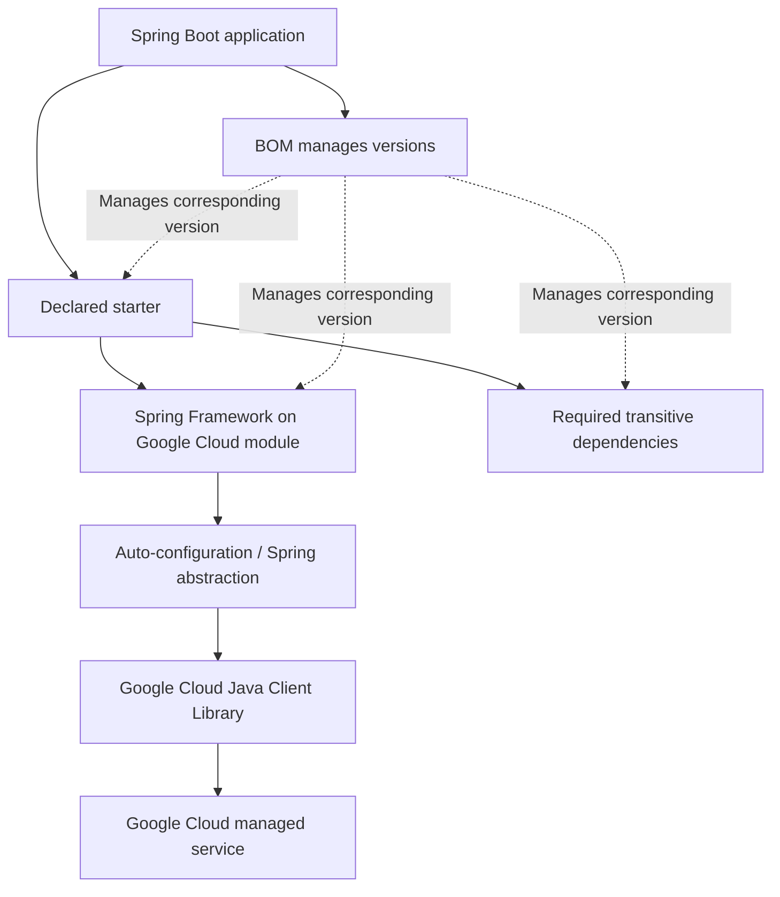

# BOM, Starters, and the Spring Boot Compatibility Matrix

When adding Google Cloud integration to a Spring Boot application, the first question is not just “which starter do I need?”. You must choose the **right library version for your Spring Boot version**, import the right **Bill of Materials (BOM)**, and add only the **starters** corresponding to the services you will use. If these three choices do not align, the project may encounter classpath errors, dependency conflicts, failed auto-configuration, or runtime-only failures.

In the **SPRING_CLOUD_PROVIDER_INTEGRATION** module, Spring Boot integrates with managed services from AWS, Azure, and Google Cloud. Each provider has its own BOM, starters, release cadence, and compatibility matrix. This lesson focuses on **Spring Framework on Google Cloud** (historically commonly known as **Spring Cloud GCP**): how the BOM manages dependencies, which modules starters package, how to cross-check Spring Boot/Spring Cloud versions, and how to inspect the actual dependencies after a build.

## 1. Distinguishing the BOM, Starters, and Integration Libraries

Three concepts frequently appear side by side but handle different responsibilities:

| Component | Role | Example in Spring Framework on Google Cloud |
| --- | --- | --- |
| **BOM (Bill of Materials)** | Manages a compatible set of dependency versions so the project does not have to declare individual versions for each module | **com.google.cloud:spring-cloud-gcp-dependencies** |
| **Starter** | A convenience dependency to bring an integration and its required dependencies onto the classpath; typically triggers auto-configuration | **com.google.cloud:spring-cloud-gcp-starter-pubsub** |
| **Module/library** | Contains the API, implementation, or abstraction performing a specific integration | **com.google.cloud:spring-cloud-gcp-pubsub** |
| **Auto-configuration** | Creates and configures Spring beans when classpath/property conditions match | Creates **PubSubTemplate** and related beans |
| **Google Cloud Java Client Library** | Low-level library that calls Google Cloud service APIs | Pub/Sub Java client, Storage client, Spanner client, etc. |

You can visualize the dependency chain as follows:



**The BOM does not add functionality to the application on its own.** It only provides version management rules. To use Pub/Sub, Storage, or Cloud SQL, the application must still declare the corresponding starter/module. Conversely, starters do not replace the BOM: without a BOM or version management elsewhere, the project may have to specify versions directly and easily suffer from dependency drift.

## 2. The Dedicated BOM of Spring Framework on Google Cloud

The current project name in the reference documentation is **Spring Framework on Google Cloud**; many Maven coordinates still retain the string **spring-cloud-gcp** due to project history. The primary BOM has the coordinates:

```text
com.google.cloud:spring-cloud-gcp-dependencies
```

This BOM manages the versions of the project's artifacts and related dependencies per release. For example, when the BOM manages the Pub/Sub starter, you can declare the starter without specifying a version directly on the dependency.

**For example:** for the 8.x line, use BOM 8.3.1 (released on 29/10/2026); for the 7.x line, use BOM 7.5.2 (released on 30/10/2026). These are the latest patch releases listed on the Releases page at the time of writing on 24/11/2026. Choosing between the two lines must be based on Spring Boot compatibility, not just on a higher version number.

A BOM is generally used according to these principles:

- Choose **one release line** compatible with Spring Boot.
- Use the latest patch release in that line, unless the project has already-tested constraints.
- Let the BOM manage the versions of starters within the same ecosystem.
- Override an individual dependency only when there is a technical reason and compatibility has been verified.
- Record the BOM version in the build file or version catalog so CI environments and developer workstations use the exact same configuration.

The Google Cloud BOM is neither the Spring Boot BOM nor the Spring Cloud BOM. These three BOMs have different management scopes; they must be coordinated properly when a project uses multiple ecosystems.

## 3. Compatibility Matrix: Spring Boot, Spring Cloud, and Spring Framework on Google Cloud

Spring Framework on Google Cloud has direct and transitive dependencies on Spring projects. Therefore, the documentation publishes a compatibility matrix between the **Google Cloud project version**, **Spring Cloud**, **Spring Boot**, and **Spring Framework**.

The table below summarizes the lines listed in the reference documentation along with the latest patch releases shown on the releases page as of 24/11/2026:

| Spring Framework on Google Cloud | Reference Patch Release | Compatible Spring Boot | Corresponding Spring Cloud | Spring Framework | Notes |
| --- | --- | --- | --- | --- | --- |
| **8.x** | 8.3.1 | 4.0.x, 4.1.x | 2025.1.x (Oakwood) | 7.0.0+ | Line for Spring Boot 4.x per published matrix |
| **7.x** | 7.5.2 | 3.5.x | 2025.0.x | 6.2.8+ | Line for Spring Boot 3.5 |
| **6.x** | 6.5.12 | 3.4.x | 2024.0.x | 6.2.0+ | Line for Spring Boot 3.4 |
| **5.x** | 5.13.12 | 3.2.x*, 3.3.x | 2023.0.x | 6.1.x | Trace module exception with Boot 3.2 |
| **4.x** | — | 3.0.x, 3.1.x | 2022.0.x | 6.x | Matrix marks as unsupported |
| **3.x** | 3.9.19 | 2.6.x, 2.7.x | 2021.0.x | 5.3.x | Older line; check Spring Boot/Spring Cloud support lifecycle |
| **2.x** | — | 2.4.x, 2.5.x | 2020.0.x | 5.3.x | Matrix marks as unsupported |

**\*** For the 5.x line, the documentation notes an exception for Trace when using Spring Boot 3.2.x.

**How to read the table:**

- If the application is using **Spring Boot 4.0.x or 4.1.x**, choose Google Cloud line **8.x** and Spring Cloud **2025.1.x** if the application also uses Spring Cloud.
- If the application is using **Spring Boot 3.5.x**, choose Google Cloud line **7.x**; the corresponding Spring Cloud line is **2025.0.x**.
- If the application is using **Spring Boot 3.4.x**, choose Google Cloud line **6.x**.
- If the application is using **Spring Boot 3.2.x or 3.3.x**, Google Cloud line **5.x** is the line paired by the documentation; check specific module exceptions.
- Do not choose line **4.x** just because the version number is higher than 3.x: the compatibility table marks line 4.x as unsupported.

### Matrix Boundaries and Newer Versions

The matrix is a published compatibility contract for specific release lines, not a rule for extrapolating major numbers. At the time of writing, Spring Cloud already has release train **2026.0.x** for Spring Boot **4.2.x**, whereas the Spring Framework on Google Cloud matrix referenced here lists line 8.x with Boot 4.0.x/4.1.x. Therefore, **do not assume that Google Cloud 8.x supports Boot 4.2.x** simply because Spring Cloud has a matching release train. Wait for the Google Cloud project's matrix to update or verify via official release notes/support policy before upgrading.

Similarly, a new patch release of the BOM does not automatically expand the supported Spring Boot range. Read the compatibility matrix and release notes for that specific release line.

## 4. Choosing a BOM Based on Your Spring Boot Version

Follow this order:

1. **Determine the actual Spring Boot version** from your project's parent/BOM or Gradle plugin.
2. **Look up the Spring Framework on Google Cloud compatibility table** to pick the release line.
3. If the application uses Spring Cloud projects (Config, Stream, Gateway, Bus, etc.), look up the **Spring Cloud release train** corresponding to Spring Boot.
4. Choose the latest **patch release** in the selected line, unless internal constraints apply.
5. Check the Java baseline, specific modules, exception notes, and migration changes.
6. Rebuild and inspect the dependency graph, rather than only looking at declaration files.

Decision examples:

| Scenario | Google Cloud BOM to Check First | Spring Cloud BOM if Used |
| --- | --- | --- |
| Spring Boot 4.0.x | **com.google.cloud:spring-cloud-gcp-dependencies:8.3.1** | **org.springframework.cloud:spring-cloud-dependencies:2025.1.x** |
| Spring Boot 4.1.x | 8.x line, check latest patch | 2025.1.x line |
| Spring Boot 3.5.x | **com.google.cloud:spring-cloud-gcp-dependencies:7.5.2** | 2025.0.x line |
| Spring Boot 3.4.x | 6.x line, check latest patch | 2024.0.x line |
| Spring Boot 3.2/3.3 | 5.x line, check module exceptions | 2023.0.x line |

Values like 2025.1.x and 2025.0.x in the table are **release lines**, not concrete versions to copy literally into a build file. When implementing, pick an official patch release in that line. Do not enter the letter x as a Maven/Gradle version.

### Why Must You Check Spring Cloud as Well?

Spring Framework on Google Cloud and Spring Cloud are two projects with separate BOMs. If you only add a GCP starter, the application might not need the Spring Cloud BOM. However, if the application also uses Spring Cloud Config, Stream, or Bus, those dependencies must be managed by the release train matching Spring Boot.

**Two things must be true simultaneously:**

- The Google Cloud BOM matches Spring Boot/Spring Framework according to Google Cloud's matrix.
- The Spring Cloud BOM matches Spring Boot according to Spring Cloud's matrix.

One BOM cannot be used to replace the other.

## 5. Declaring the BOM and Starters with Maven

Suppose the application uses Spring Boot 4.0.x and needs to publish events to Google Cloud Pub/Sub. The project already has a Spring Boot parent or Spring Boot BOM managing the Boot version; the section below adds the Google Cloud BOM and Pub/Sub starter.

```xml
<dependencyManagement>
    <dependencies>
        <dependency>
            <groupId>com.google.cloud</groupId>
            <artifactId>spring-cloud-gcp-dependencies</artifactId>
            <version>8.3.1</version>
            <type>pom</type>
            <scope>import</scope>
        </dependency>

        <!-- Only add this BOM if the project uses Spring Cloud modules. -->
        <dependency>
            <groupId>org.springframework.cloud</groupId>
            <artifactId>spring-cloud-dependencies</artifactId>
            <version>2025.1.5</version>
            <type>pom</type>
            <scope>import</scope>
        </dependency>
    </dependencies>
</dependencyManagement>

<dependencies>
    <dependency>
        <groupId>com.google.cloud</groupId>
        <artifactId>spring-cloud-gcp-starter-pubsub</artifactId>
    </dependency>
</dependencies>
```

In this example, the Google Cloud BOM manages the version for the Pub/Sub starter. The Spring Cloud BOM is only needed if the application actually has Spring Cloud dependencies; do not add it merely because the Google Cloud artifact contains the string spring-cloud-gcp.

If the project uses Spring Boot 3.5.x, replace the Google Cloud BOM with the **7.x** line (for example **7.5.2**) and the Spring Cloud release train with the **2025.0.x** line. Do not keep the 8.x BOM simply because it is a newer version.

### If Not Using Spring Boot Parent

You can import the Spring Boot BOM inside dependencyManagement alongside the other BOMs, but you must explicitly manage order and version scope. Do not arbitrarily declare multiple versions of the same dependency simultaneously. After adding the BOMs, inspect the effective POM to see the final versions Maven resolves.

## 6. Declaring the BOM and Starters with Gradle

With Groovy DSL:

```groovy
dependencies {
    implementation platform(
        "com.google.cloud:spring-cloud-gcp-dependencies:8.3.1"
    )

    // Only needed if the application uses Spring Cloud projects.
    implementation platform(
        "org.springframework.cloud:spring-cloud-dependencies:2025.1.5"
    )

    implementation "com.google.cloud:spring-cloud-gcp-starter-pubsub"
}
```

With Kotlin DSL:

```kotlin
dependencies {
    implementation(
        platform("com.google.cloud:spring-cloud-gcp-dependencies:8.3.1")
    )

    // Only needed if the application uses Spring Cloud projects.
    implementation(
        platform("org.springframework.cloud:spring-cloud-dependencies:2025.1.5")
    )

    implementation("com.google.cloud:spring-cloud-gcp-starter-pubsub")
}
```

**platform(...)** adds the BOM as dependency constraints so Gradle selects the managed versions. If stronger version enforcement is needed, Gradle offers **enforcedPlatform(...)**, but it should not be used as a default conflict fix: it can force transitive dependencies down to incompatible versions.

In real projects, you can place the BOM version in **gradle.properties**, a version catalog, or a convention plugin to avoid repeating versions across modules. The critical point is that **all modules within the same application use the same chosen release line**.

## 7. What Do Starters Provide and Which Starter Should You Choose?

A starter is a convenient entry point for an integration. The Spring Framework on Google Cloud documentation describes the following representative starters:

| Need | Maven Artifact | Capability |
| --- | --- | --- |
| Core/project/credentials | **com.google.cloud:spring-cloud-gcp-starter** | Auto-configures authentication and Google project settings |
| Pub/Sub messaging | **com.google.cloud:spring-cloud-gcp-starter-pubsub** | Publish/subscribe integration with Google Cloud Pub/Sub |
| Object storage | **com.google.cloud:spring-cloud-gcp-starter-storage** | Integrates Cloud Storage and Spring Resource |
| Cloud Spanner | **com.google.cloud:spring-cloud-gcp-starter-data-spanner** | Integrates Spanner with Spring Data |
| Cloud Datastore | **com.google.cloud:spring-cloud-gcp-starter-data-datastore** | Integrates Datastore |
| Cloud SQL MySQL | **com.google.cloud:spring-cloud-gcp-starter-sql-mysql** | Configures Cloud SQL connections for MySQL |
| Cloud SQL PostgreSQL | **com.google.cloud:spring-cloud-gcp-starter-sql-postgresql** | Configures Cloud SQL connections for PostgreSQL |
| Cloud Logging | **com.google.cloud:spring-cloud-gcp-starter-logging** | Integrates Cloud Logging |
| Cloud Trace | **com.google.cloud:spring-cloud-gcp-starter-trace** | Instrumentation for Cloud Trace |
| Runtime Config | **com.google.cloud:spring-cloud-gcp-starter-config** | Integrates Google Runtime Configuration API as a Spring Cloud Config server |
| Cloud Vision | **com.google.cloud:spring-cloud-gcp-starter-vision** | Integrates Google Cloud Vision |
| Security IAP | **com.google.cloud:spring-cloud-gcp-starter-security-iap** | Protects applications with Identity-Aware Proxy |
| Security Firebase | **com.google.cloud:spring-cloud-gcp-starter-security-firebase** | Integrates Firebase authentication |
| AlloyDB | **com.google.cloud:spring-cloud-gcp-starter-alloydb** | Integrates AlloyDB with PostgreSQL |

The complete list can vary by release line. A starter may only appear starting from a certain version or carry specific compatibility conditions. Check the artifact list in the reference documentation for your exact version before adding dependencies.

### Starters and Underlying Modules

For example, with Pub/Sub:

```text
com.google.cloud:spring-cloud-gcp-starter-pubsub
    └── com.google.cloud:spring-cloud-gcp-pubsub
        └── Google Cloud Pub/Sub Java client and required dependencies
```

Once **spring-cloud-gcp-starter-pubsub** is declared, you normally **do not need to also declare the spring-cloud-gcp-pubsub module** because the starter already pulls in that module and its required transitive dependencies. Only declare the underlying module directly when you have a specific reason, such as wanting full control over configuration instead of using the starter; in that case, you must know clearly which beans the application needs to create itself.

Nor does a starter automatically create topics, buckets, databases, or IAM permissions. It prepares the integration inside the application; resources and permissions must still be provisioned in Google Cloud.

## 8. Starter Selection Examples by Use Case

### 8.1. Application That Only Publishes Pub/Sub Events

Declare the Google Cloud BOM and the Pub/Sub starter:

```xml
<dependency>
    <groupId>com.google.cloud</groupId>
    <artifactId>spring-cloud-gcp-starter-pubsub</artifactId>
</dependency>
```

Configure the project and topic:

```yaml
spring:
  cloud:
    gcp:
      project-id: ${GOOGLE_CLOUD_PROJECT}

app:
  messaging:
    orders-topic: ${ORDERS_TOPIC}
```

The starter provides Pub/Sub integration beans, such as **PubSubTemplate**, according to the selected version. The application still requires the project to exist, the Pub/Sub API to be enabled, the topic to be created, and the workload identity to hold appropriate publish permissions.

### 8.2. Application Writing Objects and Publishing Events

If the same application both saves documents to Cloud Storage and publishes events, you can declare both starters:

```xml
<dependencies>
    <dependency>
        <groupId>com.google.cloud</groupId>
        <artifactId>spring-cloud-gcp-starter-storage</artifactId>
    </dependency>

    <dependency>
        <groupId>com.google.cloud</groupId>
        <artifactId>spring-cloud-gcp-starter-pubsub</artifactId>
    </dependency>
</dependencies>
```

Both starters are managed by the same Google Cloud BOM. Each integration still has its own configuration and permissions: storage needs appropriate permissions on the bucket, and Pub/Sub needs publish permissions on the topic. Do not assume permissions are identical just because both belong to the same project.

### 8.3. Application Using Cloud SQL

Choose the starter based on the database engine:

- MySQL: **spring-cloud-gcp-starter-sql-mysql**.
- PostgreSQL: **spring-cloud-gcp-starter-sql-postgresql**.

The Cloud SQL starter can provide **DataSource** configuration based on properties and instance details. The application still needs the JDBC driver, database instance, enabled API, networking, and proper identity/permissions. Do not add both starters if the application only connects to one engine and has no specific need for both.

## 9. Google Cloud BOM, Spring Cloud BOM, and Spring Boot BOM

An application may need multiple BOMs at the same time:

| BOM | Maven Coordinates | Primary Management Scope |
| --- | --- | --- |
| Spring Boot BOM | **org.springframework.boot:spring-boot-dependencies** | Dependencies belonging to Spring Boot and the Boot-managed ecosystem |
| Spring Cloud BOM | **org.springframework.cloud:spring-cloud-dependencies** | Projects in the Spring Cloud release train |
| Spring Framework on Google Cloud BOM | **com.google.cloud:spring-cloud-gcp-dependencies** | Google Cloud starters/modules and related dependencies managed by the project |
| Google Cloud Libraries BOM | **com.google.cloud:libraries-bom** | Google Cloud Java Client Libraries when direct management is needed |

Normally, **you do not need to import libraries-bom separately** if the Spring Framework on Google Cloud BOM already manages the required libraries. Only add another BOM when the project has direct dependencies on Google Cloud Java Client Libraries outside the scope managed by the GCP BOM or has verified specific version requirements.

### Avoiding Managing the Same Dependency in Multiple Places

Example risk:

- The GCP BOM selects a version of Google Cloud client library A.
- Another BOM or an explicit dependency in the application forces library A to a different version.
- Compilation may succeed, while runtime fails with **NoSuchMethodError**, **NoClassDefFoundError**, or serialization/authentication errors.

When multiple BOMs are present, determine the final version management source for any overlapping dependency. Maven has dependency management and BOM import rules; Gradle has platform constraints and conflict resolution. Do not assume BOM declaration order has identical semantics across all build tools.

If an override is necessary, document:
1. Which dependency is overridden.
2. Which BOM manages the default version.
3. Why a different version is required.
4. Which dependent modules have been tested.
5. How to roll back if runtime errors occur.

## 10. Inspecting Dependencies After Adding BOM/Starters

Build files only show **what was declared**. The dependency graph shows **what versions the application actually receives** after BOM processing, transitive dependencies, and conflict resolution.

### Maven

View the dependency tree:

```bash
mvn dependency:tree
```

Filter relevant groups:

```bash
mvn dependency:tree -Dincludes=com.google.cloud,org.springframework.cloud,org.springframework.boot
```

View the effective POM:

```bash
mvn help:effective-pom
```

Verify:
- Only the expected GCP release line is present.
- Required starters are present.
- There are no accidental modules of the same functionality from two different versions.
- Spring Boot and Spring Cloud are within the compatibility matrix.
- No explicit versions unintentionally override the BOM.

### Gradle

View runtime dependencies:

```bash
./gradlew dependencies --configuration runtimeClasspath
```

Check why Gradle selected a version for an artifact:

```bash
./gradlew dependencyInsight --dependency spring-cloud-gcp-starter-pubsub --configuration runtimeClasspath
```

You can use **dependencyInsight** with the name of a conflicting Google Cloud client library or Spring module to find the constraint source. On Windows, run **gradlew.bat** instead of **./gradlew** if your shell environment requires it.

### Symptoms Requiring Investigation

| Symptom | Possible Cause | Resolution Approach |
| --- | --- | --- |
| **NoSuchMethodError** at runtime | Runtime dependency version mismatches the API the module was compiled against | Inspect dependency tree/effective POM |
| Auto-configuration class not found | Missing starter or wrong artifact ID | Verify the exact starter and version |
| Spring Boot reports incompatibility | Selected GCP/Spring Cloud release line does not match Boot | Check the compatibility matrix; do not disable the compatibility verifier to bypass the error |
| Bean not created | Auto-configuration condition not met, missing property or dependency | Inspect the condition evaluation report and configuration |
| Two clients or two beans of the same type | Multiple overlapping starters/auto-configurations added | Check modules, enable/disable conditions, and custom beans |
| Runtime uses an unexpected version | An explicit version, platform, or another BOM is taking precedence | Inspect dependencyInsight/effective POM |

## 11. Common Mistakes When Choosing BOMs and Starters

1. **Picking the latest BOM without checking Spring Boot.** GCP 8.x is newer than 7.x, but that does not mean it fits a Boot 3.5 application.
2. **Confusing the Google Cloud BOM with the Spring Cloud BOM.** They manage different artifact groups; an application using both may need to import both.
3. **Thinking the BOM automatically adds modules.** The BOM only manages versions; starters bring integrations onto the classpath.
4. **Unnecessarily adding the underlying module alongside the starter.** This clutters the build file and easily causes conflicts when versions diverge.
5. **Pinning versions on individual starters despite having a BOM.** This defeats part of the BOM's value and makes upgrades harder.
6. **Changing Spring Boot while leaving the GCP BOM unchanged.** Always re-check the matrix after every framework major/minor upgrade.
7. **Using one Google Cloud BOM across all Boot major versions.** Different release lines may target different Spring generations.
8. **Assuming a starter grants cloud permissions.** Starters only configure clients; IAM, resources, API enablement, and networking are still managed in Google Cloud.
9. **Disabling the compatibility verifier to pass the build.** If the verifier reports incompatibility, fix the root cause instead of silencing the signal.
10. **Not inspecting runtime dependencies.** A successful build does not guarantee a consistent runtime classpath.

## 12. Safe BOM and Starter Upgrade Process

When upgrading from GCP 7.x to 8.x, do not just change one number in the BOM. Treat it as a framework upgrade:

1. Identify the target Spring Boot version and Spring Cloud line if used.
2. Look up the Spring Framework on Google Cloud compatibility matrix.
3. Read release notes/migration guides from the current major version to the target major version.
4. Upgrade the BOM and starters along one consistent branch; do not upgrade individual modules piecemeal unless guided.
5. Check the Java baseline, package/API changes, and replaced properties.
6. Run unit tests, Spring context tests, and integration tests for the services in use.
7. Verify IAM, ADC/workload identity, project ID, and resource mapping in a test environment.
8. Inspect the dependency tree and confirm there are no unintended version overrides.
9. Perform a controlled rollout, monitoring authentication, API errors, latency, and message processing.
10. Retain the ability to roll back to the previous BOM and image if adapters or clients fail at runtime.

If the application uses multiple providers, upgrading the GCP BOM does not mean you must upgrade Spring Cloud AWS or Spring Cloud Azure at the same time. However, all libraries must remain compatible with the **same Spring Boot/Spring Framework generation**. Managing changes per provider helps isolate issues more effectively.

## 13. Hands-On Exercise: Choosing BOM and Starters for an Order Application

A Spring Boot application has the following requirements:

- Write invoices to Google Cloud Storage.
- Publish the **order-created** event to Pub/Sub.
- Store order metadata in Cloud SQL PostgreSQL.
- Optionally use Spring Cloud Stream to process events with functions.

Steps:

1. Choose a Spring Boot version. If using Boot 4.0.x/4.1.x, look up GCP line 8.x; if using Boot 3.5.x, look up GCP line 7.x.
2. Import the corresponding **com.google.cloud:spring-cloud-gcp-dependencies** BOM.
3. Add the three required starters: Storage, Pub/Sub, and Cloud SQL PostgreSQL.
4. Only import the Spring Cloud BOM if you actually use Spring Cloud Stream or other Spring Cloud modules; pick the release train matching Boot.
5. Declare the project ID and configure bucket, topic, and database instance names per deployment. Do not commit private keys or passwords to Git.
6. Grant least-privilege IAM permissions to the workload principal: appropriate storage permissions, Pub/Sub publisher, and corresponding database connection permissions.
7. Run dependency tree/effective POM to verify final resolved versions.
8. Write Spring context tests confirming starters/beans are configured, and integration tests against a test project or appropriate emulators.
9. Intentionally test changing the BOM to an incompatible release line on an experimental branch to observe the compatibility verifier and dependency resolution; restore the valid version afterward.
10. Document the rationale for choosing the BOM, starters, Boot version, and release train so others can reproduce the build.

### Expected Outcomes

Learners can explain:
- Which versions a BOM manages and what it does not do.
- Which modules and dependencies a starter pulls in.
- Why Boot 3.5 and Boot 4.x require different GCP release lines.
- When the Spring Cloud BOM is needed alongside the GCP BOM.
- How to inspect actual versions on the classpath and resolve conflicts.

## 14. Key Takeaways

- The Google Cloud BOM has coordinates **com.google.cloud:spring-cloud-gcp-dependencies**; it manages versions and does not add integrations to the classpath by itself.
- Starters follow the form **com.google.cloud:spring-cloud-gcp-starter-***, packaging the modules and dependencies needed for each service.
- **Choose the BOM based on the Spring Boot compatibility matrix**, rather than mechanically picking the latest version.
- Line 8.x is paired in the documentation with Boot 4.0.x/4.1.x; line 7.x with Boot 3.5.x; older lines require careful checking of support status and module exceptions.
- The Spring Cloud BOM **org.springframework.cloud:spring-cloud-dependencies** is a separate BOM, added only when the application uses Spring Cloud projects.
- Inspect **dependency:tree**, **effective-pom**, Gradle **dependencies**, and **dependencyInsight** to know which versions are actually resolved.
- Starters do not create resources and do not grant IAM permissions; project, APIs, identity, roles, and networking must still be configured in Google Cloud.

## Official References

1. [Spring Framework on Google Cloud — Getting Started and compatibility matrix](https://googlecloudplatform.github.io/spring-cloud-gcp/8.2.2/reference/html/getting-started.html)
2. [Spring Framework on Google Cloud — Reference Documentation](https://googlecloudplatform.github.io/spring-cloud-gcp/reference/html/)
3. [Spring Framework on Google Cloud — Releases](https://github.com/GoogleCloudPlatform/spring-cloud-gcp/releases)
4. [Spring Cloud — Release train and Spring Boot compatibility](https://spring.io/projects/spring-cloud/)
5. [Spring Boot — System Requirements](https://docs.spring.io/spring-boot/system-requirements.html)

The matrix and patch versions in this lesson reflect documentation/releases checked on 24/11/2026. When starting a project or upgrading, re-check the compatibility page and release notes for the exact version you choose.
