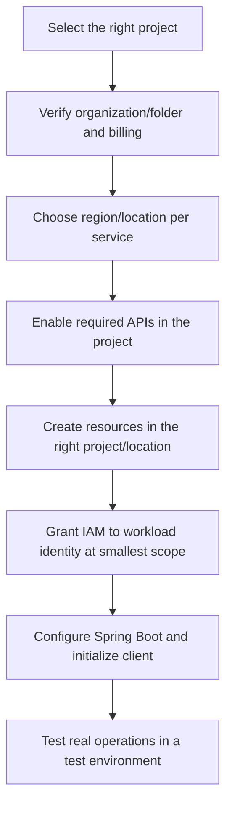
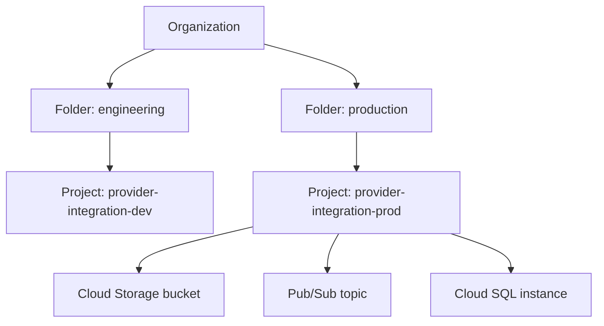
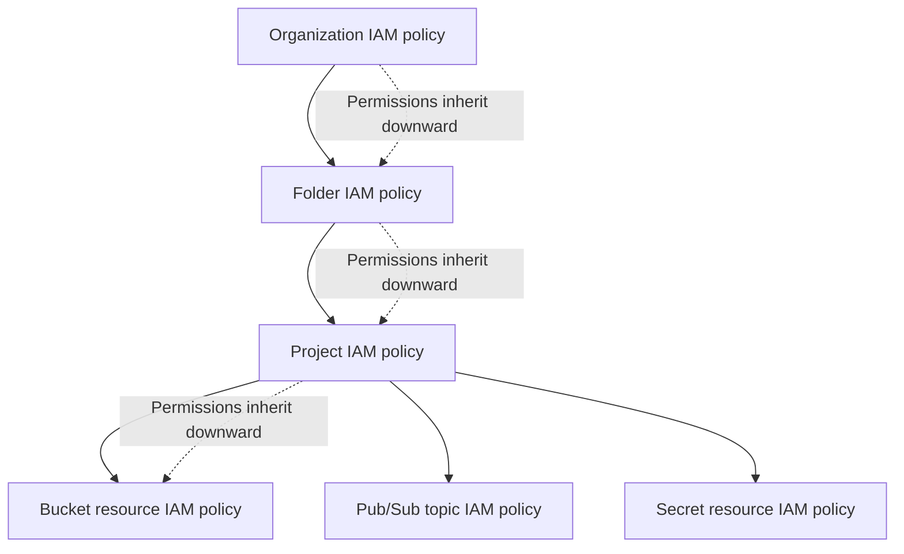

# Project ID, Region, Required APIs, and Resource Scope

A Spring Boot application can use the exact right Google Cloud libraries and still fail if it is configured with the wrong project, selects an unsupported location for a service, has not enabled the API, or the workload lacks permissions on the target resource. These four issues often surface together, yet belong to four distinct layers: **Project ID**, **region/location**, **API enablement**, and **resource/IAM scope**.

In the **SPRING_CLOUD_PROVIDER_INTEGRATION** module, Spring Boot integrates with managed services from AWS, Azure, and Google Cloud. This lesson focuses on the Google Cloud foundation: identifying the right project, choosing an appropriate region per service, enabling required APIs, and scoping permissions to the smallest possible resource scope.

## 1. Four Layers to Determine Before Creating a Client

| Layer | Question to Answer | Example | Where Configured/Managed |
| --- | --- | --- | --- |
| **Project** | Which project owns the API calls and resources the application uses? | `provider-integration-prod` | Resource Manager, Spring configuration, deployment environment |
| **Region/location** | In which geographic area is the resource or operation placed? | `asia-southeast1`, `asia-southeast2` | Service/resource-specific configuration |
| **API enablement** | Has the project enabled the API that the client needs to call? | `pubsub.googleapis.com` | Service Usage / API Library |
| **Resource scope and IAM** | Which specific resources are allowed to be accessed and what permissions does the principal hold? | Bucket `invoice-prod`, topic `orders-created` | Resource hierarchy, IAM policy, workload identity |

A sound initialization flow looks like this:



**No step substitutes for another.** Enabling the Pub/Sub API does not create a topic; creating a topic does not automatically grant publish permission; granting publish permission does not select the right project; and having the right Project ID does not determine which region a bucket should reside in.

## 2. Project Name, Project ID, and Project Number

Google Cloud provides three attributes often loosely called the “project name,” each serving a different role:

| Value | Who Creates/Assigns It? | Properties | When Used |
| --- | --- | --- | --- |
| **Project name** | Chosen by the project creator | Display name; can be changed | Identification in the Console and operational docs |
| **Project ID** | Chosen by the creator or suggested/assigned by Google Cloud | Globally unique identifier string across all of Google Cloud; deleted IDs are never reused | Application configuration, CLI commands, and common resource names |
| **Project number** | Assigned by Google Cloud | Numeric identifier of the project | Certain APIs/resource names, service agents, and admin operations requiring the project number |

Illustrative example:

```text
Project name:   Provider Integration - Production
Project ID:     provider-integration-prod
Project number: 123456789012
```

`provider-integration-prod` is the Project ID used in Spring Boot configuration. `123456789012` is the Project number assigned by Google Cloud; do not arbitrarily substitute it for Project ID across all APIs. Some resource names and service agents use the project number, whereas many other resource names use the Project ID.

**The Project name is not an identifier code should depend on.** Display names can be renamed to reflect team or environment changes; applications should use the Project ID managed as deployment configuration.

### Projects Within the Resource Hierarchy

Google Cloud organizes resources in a parent/child hierarchy:



- **Organization** typically represents the enterprise and is the root of the governance hierarchy.
- **Folder** is an optional grouping layer that can represent departments, teams, or environments.
- **Project** is the fundamental organizational unit containing service resources, configurations, permissions, and workload metadata.
- **Service resource** is a concrete resource such as a VM, bucket, topic, database, or secret.

IAM and organization policies can be attached at the organization/folder/project level and **inherited down to child resources**. Therefore, a permission granted on the production folder can affect every child project. When investigating an unexpected permission, inspect inherited policies as well, not just the direct policy on the bucket/topic.

Separating projects by dev/staging/prod environment helps isolate the blast radius of configuration, quotas, billing, and access permissions. Resources within one project can communicate according to networking and location rules; accessing resources in another project requires explicit connectivity and IAM configuration and is not allowed automatically.

## 3. Setting Project ID in Spring Boot and the Google Cloud SDK

Spring Framework on Google Cloud (historically commonly known as Spring Cloud GCP) supports configuring the project via property:

```yaml
spring:
  cloud:
    gcp:
      project-id: ${GOOGLE_CLOUD_PROJECT}
```

`spring.cloud.gcp.project-id` is a property of the Spring Framework on Google Cloud integration. The `GOOGLE_CLOUD_PROJECT` value is supplied per deployment environment. For each deployment, explicitly declare the project ID to prevent the client from accidentally picking up a project detected from a developer machine or credential context.

Example production profile:

```yaml
# application-prod.yml
spring:
  cloud:
    gcp:
      project-id: provider-integration-prod
```

In real systems, the project value should be injected via environment/Config Data rather than hardcoded in a shared artifact. You can verify the effective property via bound configuration and Actuator in a secured environment.

### 3.1. Do Not Confuse the gcloud CLI Project with the Application Project

The Google Cloud CLI stores a **default project for the active CLI configuration**:

```bash
gcloud config get-value project
gcloud config set project provider-integration-dev
gcloud config list --format="text(core.project)"
```

These commands read/change the default project that `gcloud` uses when a command does not specify another project. They **do not automatically modify** the `GOOGLE_CLOUD_PROJECT` environment variable, do not change the `spring.cloud.gcp.project-id` property of a running Spring Boot process, and do not change the project associated with all credentials.

To avoid enabling APIs or creating resources in the wrong project, prefer passing `--project` explicitly in scripts:

```bash
gcloud projects describe provider-integration-prod \
  --format="value(projectId,projectNumber,name)"

gcloud services list --enabled \
  --project=provider-integration-prod
```

In CI/CD, the project ID should be an explicit pipeline input, verified against the target environment before running infrastructure-modifying commands.

### 3.2. Project ID and Application Default Credentials Are Two Distinct Inputs

Project ID answers **which project the client operates in**; credentials answer **under which identity the request is sent**.

On a developer machine, `gcloud auth login` authenticates the Google Cloud CLI. For client libraries to use Application Default Credentials (ADC) from a developer account, one typically runs:

```bash
gcloud auth application-default login
```

In cloud environments, prefer a service account attached to the workload or appropriate Workload Identity Federation/ADC. Never package a service account private key into a repository or image just to “select a project.”

An application can use Project ID A as its default project while its credentials represent a principal provisioned from project B. This is not necessarily wrong, but you must clearly understand the API consumer project, the resource-owning project, and the resource's IAM policy. Do not treat ADC finding a credential as proof that the Project ID and permissions are correct.

## 4. Region, Zone, Multi-Region, and Location Are Not One Single Attribute

Google Cloud defines different geographic scopes:

| Scope | Meaning | Example |
| --- | --- | --- |
| **Global** | Resources or operations scoped globally across Google Cloud | Certain network resources and API endpoints |
| **Region** | Independent geographic area consisting of multiple zones | `asia-southeast1` (Singapore), `asia-southeast2` (Jakarta) |
| **Zone** | Deployment area within a region; treated as a failure domain | `asia-southeast1-a` |
| **Dual-region** | A configured pair of two regions for certain storage services | A single location code representing two regions |
| **Multi-region** | A large geographic area spanning multiple regions | `ASIA`, `EU`, `US` in Cloud Storage |

Regions and zones are abstractions over physical infrastructure. A zone is considered a failure domain; deploying across multiple zones within the same region improves resilience against zonal failures. Distributing across multiple regions can improve independence during a regional outage, but requires dedicated replication, consistency, networking, cost, and disaster recovery design.

### 4.1. Not Every Service Uses the Same Region

Location is chosen **per service and per resource**:

- Compute Engine VMs typically reside in a zone.
- Some IP addresses are regional resources.
- Cloud Storage buckets have a location that is a supported region, dual-region, or multi-region.
- Cloud SQL instances have a specific region.
- Spanner instance configuration defines the instance's topology/location.
- Pub/Sub has global, regional, and locational endpoints; message storage policies can restrict where messages are stored/processed.

Therefore, do not create a single `GCP_REGION` variable and apply it across every API without checking semantics. An application using Cloud Storage in `asia-southeast1` may publish to Pub/Sub via the global endpoint, while its Cloud SQL instance has its own chosen location.

### 4.2. What Criteria Should Guide Location Selection?

| Criterion | Questions to Consider |
| --- | --- |
| **Latency** | Where are users, workloads, databases, and dependent services located? |
| **Data residency** | Must data be stored/processed within a specific country or region? |
| **Availability** | Does the service support regional, dual-region, or multi-region? Need zonal or regional fault tolerance? |
| **Product availability** | Are the required service and features offered in that region? |
| **Cost** | How do storage, request, replication, and data transfer prices differ? |
| **Cross-region dependencies** | Must databases, buckets, message processors, and compute transfer data across regions? |

Do not select a region based solely on geographic proximity. Also weigh SLA, product availability, compliance requirements, data placement, and network paths.

### 4.3. Example with Cloud Storage

For a bucket, location determines where object data is stored. Example:

```yaml
app:
  gcp:
    storage:
      bucket: invoice-archive-prod
      location: asia-southeast1
```

The two keys `app.gcp.storage.bucket` and `app.gcp.storage.location` here are an **application-defined namespace**; they are not built-in Spring Cloud GCP properties. When creating a bucket, you must pass the location to the resource creation operation. Simply changing the YAML value later **does not migrate data or change the location of an existing bucket**. If you need to change location, check supported relocation features and service conditions; another common approach is creating a new bucket in the target location, transferring data, and cutting over.

Cloud Storage also offers dual-region and multi-region options. Multi-region does not mean “data is placed in every country in the area”; read the exact geographic scope and storage rules of the chosen location.

### 4.4. Example with Pub/Sub Endpoints

Pub/Sub provides the global endpoint `pubsub.googleapis.com` as well as regional/locational endpoints. The global endpoint is convenient, but requests can be routed according to service mechanisms; it does not by itself guarantee that data is processed in only one specific region.

If strict data residency is required, combine the appropriate endpoint with the topic's **message storage policy**. Regional endpoints route requests to the selected region and do not automatically fail over to another region; the topic's policy must permit that region. Do not just put `region=asia-southeast1` in YAML and assume Pub/Sub meets residency requirements.

## 5. API Enablement: Enabling Services in the Right Project

Google Cloud exposes APIs via service endpoints such as `pubsub.googleapis.com` or `storage.googleapis.com`. To use most Google Cloud APIs, you must first **enable the API in the project**.

Enabling an API registers the project to use that service. It can add monitoring data in the Console and surface the corresponding IAM roles. If the project has billing linked, API requests can incur charges according to the service's pricing and usage.

**API enablement is not granting IAM permissions.** After enabling the API, the principal still needs valid credentials and appropriate permissions. Likewise, an enabled API does not automatically create buckets, topics, databases, or secrets.

### 5.1. Common APIs in Integration Modules

| Service | Service Name to Enable | Used When |
| --- | --- | --- |
| Cloud Pub/Sub | `pubsub.googleapis.com` | Publishing/subscribing messages |
| Cloud Storage | `storage.googleapis.com` | Creating buckets, reading/writing objects via API |
| Cloud SQL Admin | `sqladmin.googleapis.com` | Integrating/managing Cloud SQL via API, connector, or related tools |
| Cloud Spanner | `spanner.googleapis.com` | Using Cloud Spanner |
| Secret Manager | `secretmanager.googleapis.com` | Reading/writing secrets via API |
| IAM Service Account Credentials | `iamcredentials.googleapis.com` | Using supported impersonation or credential-generation flows |
| Security Token Service | `sts.googleapis.com` | Using certain Workload Identity Federation flows |

This list is illustrative by need, not a list to enable wholesale for every application. A starter may call multiple APIs or require additional dependent APIs; check the documentation for your module, connector, and deployment. Some APIs are enabled by default when a project is created, so **list the actual status** before enabling more.

### 5.2. Enabling APIs via Console

1. Select the right project in the project selector in Google Cloud Console.
2. Open **APIs & Services → API Library**.
3. Search for the API by service name.
4. Double-check the currently selected project.
5. Click **Enable**.
6. Confirm the status on the APIs & Services page or via a CLI command.

When working across multiple environments, record the list of APIs in deployment/IaC docs so dev, staging, and prod stay consistent.

### 5.3. Enabling APIs via Google Cloud CLI

Explicitly specify the project and enable required APIs:

```bash
gcloud services enable \
  pubsub.googleapis.com \
  storage.googleapis.com \
  secretmanager.googleapis.com \
  --project=provider-integration-dev
```

For applications using Cloud SQL, add `sqladmin.googleapis.com` if required by the integration. Do not enable an API just because it appeared in a tutorial; enable only the services the workload actually uses.

List enabled APIs:

```bash
gcloud services list --enabled \
  --project=provider-integration-dev
```

Inspect a specific API:

```bash
gcloud services describe pubsub.googleapis.com \
  --project=provider-integration-dev
```

In these commands, `--project` avoids relying on gcloud's default project. If the command returns a permission error, the caller needs the corresponding Service Usage permission.

### 5.4. Who Is Allowed to Enable APIs?

To enable/disable services via Service Usage, the principal needs the `serviceusage.services.enable` permission on the project. A common predefined role for administrators managing API enablement is:

```text
roles/serviceusage.serviceUsageAdmin
```

This role is intended for **project bootstrap/administration workflows**, and should not be granted by default to an application's runtime service account. A workload running Spring Boot typically only needs permission to call the service it uses, such as publishing to a topic or writing objects to a bucket.

The Service Usage API is normally enabled by default in new projects. If this API has been disabled, managing other APIs via Service Usage can fail; verify and restore it via Console/CLI according to official guidance.

### 5.5. Dependent APIs and Multiple Projects

One API may depend on another; some enable operations automatically enable required dependencies. In multi-project architectures, distinguish:

- **Consumer/client project:** the project the application uses to make or consume API calls.
- **Resource project:** the project that owns the target bucket, topic, database, or resource.

Depending on the service, the API may need to be enabled in the request-originating project, the resource-owning project, or both. Do not apply a blanket rule across all services; consult the specific API documentation for cross-project access.

## 6. Resource Scope: Project, Service Resource, and Location Scope

The word “scope” can refer to several different concepts. Distinguish them:

| Scope Type | Meaning | Example |
| --- | --- | --- |
| **Project scope** | The project containing resources, configuration, API enablement, quotas, and part of policy | Project `provider-integration-prod` |
| **IAM scope** | The resource where a policy grants a role to a principal; permissions can inherit to child resources | Role at project, bucket, or topic level |
| **Location scope** | Whether a resource or operation is global, regional, zonal, dual-region, or multi-region | Zonal VM, regional Cloud SQL, multi-region bucket |
| **API scope** | The project scope in which a service is enabled/registered for consumption | Pub/Sub API enabled in the project |

These scopes are independent. For example, a bucket belongs to the production project, has location `asia-southeast1`, the Cloud Storage API is enabled in the project, and a principal holds object permissions on the bucket. A bucket being in a particular region does not change which project owns the bucket.

### 6.1. IAM Inheritance Along the Resource Hierarchy

IAM policies can be attached at multiple levels:



Roles granted at the organization/folder/project level can be inherited by child resources through IAM inheritance. Therefore, if a principal has overly broad permissions at the project level, granting a narrow role on a bucket will not restrict the broad permissions already inherited.

When designing permissions, prefer granting roles on the **specific resource when the service supports it**. If a role is required at project scope, restrict permissions with an appropriate role and avoid granting Owner/Editor to workloads.

### 6.2. Examples of Resource-Scoped Roles

| Use Case | Usable Resource Scope | Example Role/Permission |
| --- | --- | --- |
| Only creating new objects in a bucket | Bucket | `roles/storage.objectCreator` |
| Reading objects in a bucket | Bucket | `roles/storage.objectViewer` |
| Publishing messages | Pub/Sub topic | `roles/pubsub.publisher` |
| Reading secret values | Secret Manager secret | `roles/secretmanager.secretAccessor` |
| Connecting to Cloud SQL via connector/proxy | Usually requires a role on the instance's project | `roles/cloudsql.client` |

These roles are examples for specific operations, not a mandatory list. An adapter may need additional permissions for metadata, listing, or management operations. Check the actual API calls and pick the appropriate predefined/custom role rather than granting a broad role just to silence a 403 error.

**IAM and database authorization can also be two separate layers.** Cloud IAM permission to connect to Cloud SQL does not automatically create users or database permissions inside MySQL/PostgreSQL. Similarly, permission to read a secret does not automatically grant access to a bucket containing application data.

## 7. Combining Project ID, Location, and Resource Names in Spring Boot

Spring Cloud GCP provides a common property for the project ID. Values such as bucket, topic, instance name, and location should be placed in a dedicated namespace matching your application contract or the properties supported by a specific starter.

Example:

```yaml
spring:
  application:
    name: provider-integration
  cloud:
    gcp:
      project-id: ${GOOGLE_CLOUD_PROJECT}

app:
  gcp:
    environment: ${APP_ENVIRONMENT}
    storage:
      bucket: ${GCS_BUCKET}
      location: ${GCS_BUCKET_LOCATION}
    messaging:
      topic: projects/${GOOGLE_CLOUD_PROJECT}/topics/${ORDERS_TOPIC}
    database:
      cloud-sql-instance: ${CLOUD_SQL_INSTANCE}
```

In the configuration above:

- `spring.cloud.gcp.project-id` is a Spring Framework on Google Cloud integration property.
- `app.gcp.environment`, `app.gcp.storage.*`, `app.gcp.messaging.*`, and `app.gcp.database.*` are **application-defined keys**; Spring Cloud GCP does not assign semantics to them automatically.
- `GCS_BUCKET_LOCATION` applies only to the bucket created in that location; it does not configure a global region for all of GCP.
- `ORDERS_TOPIC` is the topic name in the specified project. When using a fully qualified resource name, the project in the resource name must match the approved project.
- `CLOUD_SQL_INSTANCE` typically represents the instance connection name in the format `project:region:instance` when using the corresponding connector.

Do not invent a `spring.cloud.gcp.region` property and assume every starter reads it as a default region. Google Cloud does not have a single uniform region applied across all resources; use the exact module properties or an application-specific namespace and pass location to the resource/client operations that require it.

### 7.1. Binding Resource Configuration with `@ConfigurationProperties`

Example using Spring Boot 3.x/4.x and Jakarta Bean Validation compatible with the project version:

```java
package example.cloud.config;

import jakarta.validation.constraints.NotBlank;
import org.springframework.boot.context.properties.ConfigurationProperties;
import org.springframework.validation.annotation.Validated;

@Validated
@ConfigurationProperties(prefix = "app.gcp.storage")
public record GcsStorageSettings(
        @NotBlank String bucket,
        @NotBlank String location
) {}
```

Register via `@ConfigurationPropertiesScan` or `@EnableConfigurationProperties(GcsStorageSettings.class)`. Add `spring-boot-starter-validation` if the application needs Bean Validation.

This bean verifies that the application received non-blank bucket and location values. It **does not prove** that the bucket exists, the location is supported, the project owns the bucket, or the principal has access permissions. Those require deployment contracts, API metadata checks, or dedicated integration tests.

### 7.2. Avoid Hardcoding Resources in Code

Do not write:

```java
storage.get("invoice-prod");
```

Instead, inject resource names from configuration and verify per environment:

```java
package example.cloud.storage;

import example.cloud.config.GcsStorageSettings;
import org.springframework.stereotype.Service;

@Service
public class InvoiceStorage {
    private final GcsStorageSettings settings;

    public InvoiceStorage(GcsStorageSettings settings) {
        this.settings = settings;
    }

    public String bucketName() {
        return settings.bucket();
    }
}
```

This snippet only illustrates reading configuration. A real Cloud Storage client must be configured via the corresponding starter/SDK and workload identity; `bucketName()` does not make requests or check IAM.

## 8. Example: Preparing a Project for Three Integrations

Suppose an application has three capabilities:

1. Save invoices to Cloud Storage.
2. Publish order events to Pub/Sub.
3. Store metadata in Cloud SQL PostgreSQL.

A minimal deployment table:

| Item | Example Value | Scope |
| --- | --- | --- |
| Project ID | `provider-integration-dev` | Project |
| Cloud Storage bucket | `invoice-archive-dev` | Bucket resource |
| Bucket location | `asia-southeast1` | Bucket location |
| Pub/Sub topic | `projects/provider-integration-dev/topics/orders-created` | Topic resource |
| Cloud SQL instance | `provider-integration-dev:asia-southeast1:orders-db` | Instance resource/location |
| Storage API | `storage.googleapis.com` | API enablement in project |
| Pub/Sub API | `pubsub.googleapis.com` | API enablement in project |
| Cloud SQL Admin API | `sqladmin.googleapis.com` | API enablement when required by integration |
| Application principal | Workload identity/service account attached to workload | Identity |
| Storage permission | Object creator on bucket | Bucket IAM |
| Publish permission | Pub/Sub publisher on topic | Topic IAM |
| Cloud SQL permission | Cloud SQL Client when using connector | Project IAM; database user/role still configured separately |

Bootstrap steps via CLI:

```bash
# Explicitly select the project for subsequent commands.
gcloud config set project provider-integration-dev

# Confirm project metadata.
gcloud projects describe provider-integration-dev

# Enable required APIs.
gcloud services enable \
  storage.googleapis.com \
  pubsub.googleapis.com \
  sqladmin.googleapis.com \
  --project=provider-integration-dev

# Verify enabled APIs.
gcloud services list --enabled \
  --project=provider-integration-dev
```

These commands only prepare the project and APIs. Creating buckets, topics, and databases and granting IAM are separate steps that can be done via Terraform, IaC tools, or appropriate administrative commands. Do not run bootstrap commands using the application's runtime service account.

### Configuring Identity and Permissions

After the resources exist:

- Attach the appropriate Workload Identity/service account to the workload.
- Grant properly scoped read/write roles on the bucket.
- Grant the publisher role on the target topic.
- Grant Cloud SQL connector permissions at the appropriate project/instance scope and create a database user with separate application privileges.
- If reading Secret Manager, grant secret accessor on the specific secrets needed rather than project-wide unless necessary.

When a request returns `PERMISSION_DENIED`, inspect the actual principal the SDK uses, direct and inherited IAM policies, target project/resource, VPC Service Controls if present, and the specific permission required by the operation.

## 9. Checking Project, APIs, and Resources Before Launch

You can organize a preflight checklist in sequence:

| Check | How to Verify | Expected Result |
| --- | --- | --- |
| Project ID | Compare environment with deployment manifest; `gcloud projects describe` | Matches dev/staging/prod |
| Project number | Cross-check metadata when an API/resource requires the number | Do not confuse ID with number |
| Active gcloud project | `gcloud config get-value project` | Correct project for CLI scripts |
| API enablement | `gcloud services list --enabled --project=...` | All APIs needed by modules are enabled |
| Resource location | Inspect bucket/instance/resource metadata | Location matches design |
| Resource name | Verify full resource name and project prefix | Points to target resource |
| Principal | Inspect workload identity/ADC | Correct runtime identity |
| IAM | Inspect policy and permissions required for operations | Least-privilege permissions in place |
| Billing/quota | Check billing link, quotas, and service limits | Expected request volume is supported |

For non-sensitive values, you can log the project ID, resource alias, location, and config generation for diagnostics. Never log access tokens, private keys, secret values, or signed URLs.

### API Enablement Does Not Replace Resource Verification

The following states can all occur at once:

- The Pub/Sub API is enabled, yet the topic has not been created.
- The topic exists, yet the principal lacks publish permission.
- The bucket exists, yet is in the wrong location for data requirements.
- The Cloud SQL instance is in the right region, yet the application points to the wrong project.
- The Project ID is right, yet the credentials belong to a different principal and are rejected by IAM.

Therefore, a health check that only calls API discovery or gets a successful response from a generic endpoint does not prove the application operates on the right resource. Test at the actual business-operation level in a test project.

## 10. Common Errors and How to Resolve Them

| Symptom | Common Cause | Investigation Path |
| --- | --- | --- |
| `Project not found` or wrong project | Wrong Project ID, deleted project, or principal cannot see the project | Cross-check Project ID/number and Resource Manager permissions |
| Works locally but cluster calls wrong project | Relied on project auto-detected from ADC or a different environment | Explicitly set `spring.cloud.gcp.project-id` and check effective properties |
| `SERVICE_DISABLED` / API not enabled | API not enabled in the required project | Check Service Usage and enable the exact service name |
| Cannot enable API | Missing `serviceusage.services.enable` or Service Usage API disabled | Check Service Usage Admin role and Service Usage API status |
| `PERMISSION_DENIED` despite API enabled | Principal lacks IAM permission on the resource | Identify principal, role, resource scope, and inherited policies |
| `NOT_FOUND` for bucket/topic/database | Wrong resource name or project prefix; resource not yet created | Verify full resource name and target project |
| Bucket location mismatch | App config location differs from bucket metadata | Read bucket metadata; do not rely solely on YAML values |
| Cloud SQL connector cannot connect | Wrong instance connection name, API, network, or IAM | Verify `project:region:instance`, Cloud SQL API, identity, and network |
| Pub/Sub receives messages but processes in unexpected region | Using global endpoint or unexpected message storage policy | Check endpoint type, topic policy, and allowed regions |
| gcloud command enables API in wrong environment | CLI default project differs from intended project | Pass `--project` on every command |
| Runtime service account unnecessarily holds API enable permission | Bootstrap permissions merged with application runtime permissions | Separate operator identity from workload identity |

Do not fix an API-disabled error by granting Owner/Editor to a service account. API enablement and runtime IAM are separate concerns; fixing the actual root cause preserves least privilege.

## 11. Hands-On Exercise: Preparing a GCP Project for Spring Boot

Create a dedicated sandbox project, for example `provider-integration-lab`. Do not use a production project for creating/deleting resources in this exercise.

### Step 1 — Identify the Project

- Select or create a project in the appropriate organization/folder.
- Record the Project ID and Project number.
- Confirm billing if the tested services require billing.
- Check gcloud's active project and application environment variables.

### Step 2 — Choose Locations

- Choose regions for the bucket and Cloud SQL based on workload placement, latency, data residency, availability, and cost.
- Verify the required services are offered in that region.
- If using Pub/Sub with residency requirements, determine the appropriate message storage policy and endpoint.
- Record locations in the deployment contract rather than using one default region for every service.

### Step 3 — Enable APIs

Enable the required APIs in the lab project:

```bash
gcloud services enable \
  storage.googleapis.com \
  pubsub.googleapis.com \
  sqladmin.googleapis.com \
  --project=provider-integration-lab
```

Then list enabled APIs again and store this list in your deployment record.

### Step 4 — Create Resources and Grant IAM

- Create a test bucket in the selected location.
- Create a test topic and subscription.
- Create a Cloud SQL instance if the lab includes a database.
- Grant permissions to the application's principal on the bucket/topic/instance according to actual operations.
- Do not grant project administration roles to the runtime workload.

### Step 5 — Configure Spring Boot

```yaml
spring:
  cloud:
    gcp:
      project-id: provider-integration-lab

app:
  gcp:
    storage:
      bucket: invoice-lab
      location: asia-southeast1
    messaging:
      topic: projects/provider-integration-lab/topics/orders-lab
```

The keys under `app.gcp.*` are application-defined examples. Use `@ConfigurationProperties` to bind and validate them; use the corresponding starters/SDKs to initialize clients.

### Step 6 — Test

- Confirm the client uses the right project.
- Publish a test message to the exact topic.
- Write an object with a unique name to the test bucket and read it back.
- If using Cloud SQL, connect with the configured connector/driver and execute a test query.
- Test with an unprivileged principal to observe IAM errors.
- Test with an invalid project ID or resource name in a test profile to confirm the application catches it early.

### Step 7 — Record Results

Save the Project ID, Project number, each resource's location, the list of enabled APIs, principals, and granted roles. Do not save secret values or access tokens. This serves as a contract that helps teammates reproduce environments and avoid misconfiguring staging/production.

## 12. Key Takeaways

- **Project name, Project ID, and Project number are different.** Use Project ID in application configuration when properties expect it; use Project number in APIs/resource names that require the project number.
- **Region is not a global project-wide attribute.** Location must be chosen per resource/service; distinguish global, regional, zonal, dual-region, and multi-region.
- **API enablement registers a service for a project**; it does not create resources or grant IAM permissions. Enable the exact APIs and verify their actual status.
- **Resource hierarchy** consists of organization, folder, project, and service resources; IAM can inherit downward from parent levels to child resources.
- **Grant permissions at the smallest possible scope**: bucket for object operations, topic for publishing, secret for reading secrets; separate API bootstrap permissions from workload runtime permissions.
- In Spring Boot, use `spring.cloud.gcp.project-id` for the integration's default project; configure locations and resource names per service rather than assuming a single shared `spring.cloud.gcp.region`.
- Verify project, APIs, resources, locations, principal, and IAM together before marking an application ready.

## Official References

1. [Organize resources — Project ID, Project number, and resource hierarchy](https://docs.cloud.google.com/docs/get-started/organize-resources)
2. [About resource hierarchy — Organization, Folder, Project, and IAM inheritance](https://docs.cloud.google.com/resource-manager/docs/cloud-platform-resource-hierarchy)
3. [Geography and regions — Regions, zones, and failure domains](https://docs.cloud.google.com/docs/geography-and-regions)
4. [Enable and disable services — Service Usage and gcloud services enable](https://docs.cloud.google.com/service-usage/docs/enable-disable)
5. [Enabled services — Prerequisites for calling Google Cloud APIs](https://docs.cloud.google.com/service-usage/docs/enabled-service)
6. [Cloud Storage bucket locations — Region, dual-region, and multi-region](https://docs.cloud.google.com/storage/docs/locations)
7. [Pub/Sub API endpoints — Global, regional, and locational endpoints](https://docs.cloud.google.com/pubsub/docs/reference/service_apis_overview)
8. [Google Cloud APIs — Getting started](https://docs.cloud.google.com/apis/docs/getting-started)

The example Project IDs, project numbers, buckets, topics, and instances in this lesson are illustrative data. Re-check the official service documentation for exact locations, APIs, and permission requirements before production deployment.
