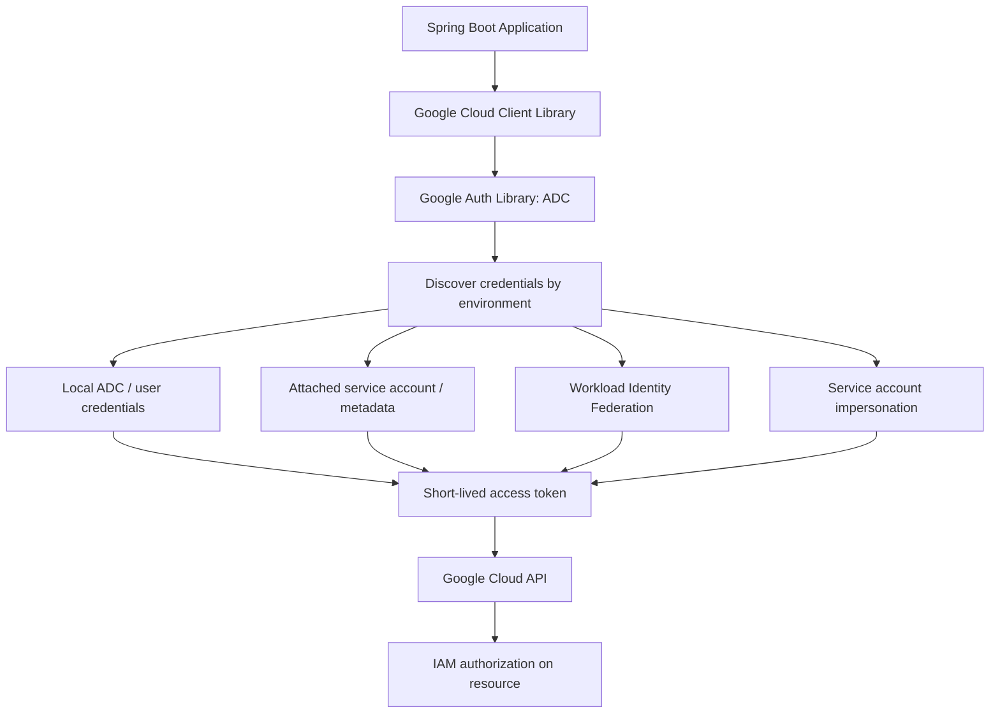
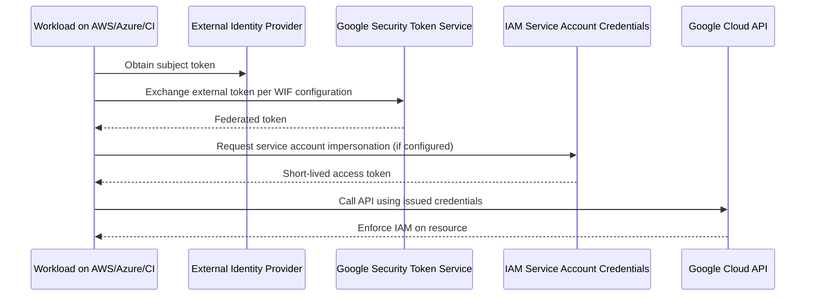

# Application Default Credentials and Identity Resolution Order

A Spring Boot application calling Cloud Storage, Pub/Sub, Cloud SQL, or Secret Manager needs an **identity for authentication** and a set of **IAM permissions for authorization**. In Java applications, the standard way to supply an identity to Google Cloud Client Libraries is **Application Default Credentials (ADC)**.

ADC allows the exact same codebase to run on a developer workstation, VM, GKE, Cloud Run, CI/CD, or AWS/Azure infrastructure without writing separate sign-in branches for each environment. The authentication library locates credentials according to the running environment, obtains access tokens as needed, and passes them to the client library.

In the **SPRING_CLOUD_PROVIDER_INTEGRATION** module, Spring Boot integrates with managed services from AWS, Azure, and Google Cloud. This lesson focuses on Google Cloud: how ADC selects a credential source, the precedence order in Google Auth Library for Java, how Spring Framework on Google Cloud uses ADC, and how to choose safe identities for local development, production, and multi-cloud environments.

## 1. What Is ADC and What Problem Does It Solve?

**Application Default Credentials** is a credential-discovery strategy implemented by Google authentication libraries. The application invokes a standard mechanism, while the library determines the appropriate credentials based on the environment:

- A developer workstation can use the developer's user credentials.
- An application running on Google Cloud can use a service account attached to the workload.
- Workloads running on AWS, Azure, or CI/CD outside Google Cloud can use Workload Identity Federation.
- An application needing to test a service account's permissions can use service account impersonation.

As a result, business code does not need to hold private keys or implement token acquisition flows manually. With Google Cloud Client Libraries, clients typically use ADC automatically if the application does not explicitly pass credentials.



ADC solves **how to locate an identity and obtain credentials**. ADC does not decide which buckets the application can read, which topics it can publish to, or which databases it can access. Those permissions are governed by IAM and service-level authorization.

### Distinguishing Four Concepts

| Concept | Question Answered | Example |
| --- | --- | --- |
| **ADC / credentials** | Which identity does the application authenticate as? | User account, service account, federated identity |
| **Access token** | What does the current request use to prove access? | Short-lived OAuth 2.0 bearer token |
| **Project ID** | Which default project does the client use or which project owns the resource? | `provider-integration-prod` |
| **IAM role/permission** | What operations can the principal perform on the resource? | Pub/Sub Publisher on a topic |

Project ID and credentials are two separate configurations. ADC can authenticate with a service account in project A while the application accesses a bucket belonging to project B, provided IAM and resource configuration allow it. Do not infer the project ID from the identity, nor infer permissions from successfully obtaining a token.

## 2. ADC Resolution Order in Java Applications

For Spring Boot applications, it is important to know how Google Auth Library for Java searches for credentials. The Java documentation currently publishes the following order for `GoogleCredentials.getApplicationDefault()`:

1. **The credentials file specified by `GOOGLE_APPLICATION_CREDENTIALS`.**
2. **Credentials created by the Google Cloud SDK using `gcloud auth application-default login`.**
3. **Built-in Google App Engine credentials.**
4. **Built-in Google Cloud Shell credentials.**
5. **Built-in Google Compute Engine credentials**, retrieved from the metadata server.

This is the search order described in the Google Auth Library for Java documentation. General ADC documentation currently groups sources into three categories: environment variable, local ADC file, and attached service account via metadata server; that presentation combines runtime credentials into one group. For Java applications, consult the documentation for the actual Google Auth Library version in your dependency graph if supported environments differ.

**The order above is not a security ranking.** The first source in the list does not mean it is always the source you should use. It is simply the lookup order checked by the library; choosing production credentials must still be based on your identity model and environment risk profile.

### 2.1. Source 1 — `GOOGLE_APPLICATION_CREDENTIALS`

This environment variable points to a JSON file. Depending on the file type, it can be:

- **Workload Identity Federation credential configuration**: describes how to obtain a subject token from AWS, Azure, an OIDC/SAML provider, or another external identity source and exchange it for short-lived Google Cloud credentials.
- **Workforce Identity Federation credential configuration**: intended for user/workforce identities from an external identity provider.
- **Service account key JSON**: a long-lived service account key. This is the type to avoid whenever identity federation or an attached service account is available.

Example on Linux/macOS:

```bash
export GOOGLE_APPLICATION_CREDENTIALS="/run/config/gcp-workload-identity.json"
```

Example in PowerShell:

```powershell
$env:GOOGLE_APPLICATION_CREDENTIALS = "C:\app\config\gcp-workload-identity.json"
```

A federation configuration file normally does not contain a Google service account private key. It describes the provider, audience, token source, and optionally the service account to impersonate. Even so, it remains security-sensitive configuration: protect write permissions on the file, the token source path, and declared endpoints.

If the environment variable points to a JSON key file, credentials from this source are evaluated before the local ADC file and the metadata server. Thus, a leftover environment variable in a container can cause the application to use a different identity than the service account attached to the workload.

### 2.2. Source 2 — Local ADC File Created by gcloud

When developing on a personal workstation, you can sign in with a user account to provide credentials for client libraries:

```bash
gcloud auth application-default login
```

This command creates a local ADC file in the default location:

| Operating System | Path |
| --- | --- |
| Linux/macOS | `$HOME/.config/gcloud/application_default_credentials.json` |
| Windows | `%APPDATA%\\gcloud\\application_default_credentials.json` |

The local ADC file can represent a user account or credentials impersonating a service account if the login command included the corresponding flags. Never commit this file to Git, never bake it into a Docker image, and never share it across developers.

**Important note:** `gcloud auth login` and `gcloud auth application-default login` serve two different purposes.

- `gcloud auth login` logs in the Google Cloud CLI itself.
- `gcloud auth application-default login` creates credentials used by Java applications/Cloud Client Libraries via ADC.

Therefore, `gcloud auth list` showing the account logged into the CLI is not sufficient to conclude that the Spring Boot application is using that same identity. The local ADC file may contain a different user or an impersonated service account.

### 2.3. Sources 3–5 — Built-In Runtime Credentials

If no credentials are found in the first two sources, Google Auth Library for Java can use built-in environment credentials:

| Runtime | Credential Source | Required Setup |
| --- | --- | --- |
| App Engine | App Engine built-in credentials | Attach an appropriate service account/identity to the application |
| Cloud Shell | Cloud Shell built-in credentials | Use the Cloud Shell environment with an authenticated account |
| Compute Engine | VM metadata server | Attach a service account to the VM and grant required IAM roles |

On modern Google Cloud runtimes, the standard deployment practice is to **attach an organization-managed service account to the workload**. ADC fetches short-lived credentials from the metadata server; the application does not need to store a private key file.

Environments like Cloud Run and GKE also provide appropriate workload identity mechanisms. Cloud Run uses the service account attached to the service/job; GKE should configure Workload Identity Federation for GKE to map a Kubernetes Service Account to a Google IAM principal. Do not assume every pod automatically uses the right service account just because the cluster runs on Google Cloud.

### What Happens When Multiple Sources Coexist?

ADC does not merge permissions from multiple identities. The library selects a credential source according to its implementation order; the selected credentials represent one specific principal or federation/impersonation flow.

For example:

- A container has `GOOGLE_APPLICATION_CREDENTIALS` pointing to a federation file.
- The host machine also has a local ADC file from `gcloud auth application-default login`.
- A pod running on GKE has Workload Identity configured.

If the file specified in the first source is valid, the application may use those federation credentials instead of the identity provided by GKE metadata. Therefore, do not leave stale credentials environment variables lying around unintentionally.

If the first file is misconfigured or unreadable, do not count on the library always ignoring the error and falling back to the next source. Fix the configured source and explicitly test the behavior on your exact library version.

## 3. ADC Is Not the Project ID Selection Order

A common mistake is confusing the **credential lookup order** with **project discovery order**.

- ADC selects credentials to authenticate requests.
- Spring Framework on Google Cloud's `GcpProjectIdProvider` provides the default Project ID for modules.
- The `spring.cloud.gcp.project-id` property can be declared explicitly to specify the default project.
- Certain services can accept a separate project/resource name per operation.

Example:

```yaml
spring:
  cloud:
    gcp:
      project-id: provider-integration-prod
```

This property specifies the default project for the Spring integration. It does not change the principal selected by ADC, nor does it grant IAM permissions to that principal.

Some Google Cloud APIs allow calling resources owned by a different project. In those cases, distinguish:

1. **The API/quota consumer project** if required by the service.
2. **The resource-owning project** such as the bucket, topic, secret, or database owner.
3. **The principal in the access token**.
4. **The IAM policy** on the resource project.

Do not use a Project ID picked up from the local SDK as proof that the target resource or principal is correct.

## 4. How Does Spring Framework on Google Cloud Use ADC?

Spring Framework on Google Cloud (historically known as Spring Cloud GCP) provides a Core starter to auto-configure shared components.

Each module typically uses:

- `GcpProjectIdProvider` to obtain the Project ID.
- `CredentialsProvider` to obtain credentials for authenticating and authorizing requests through Google Cloud Client Libraries.

The Core starter auto-configures `CredentialsProvider` and **uses ADC by default**. Therefore, in applications using Pub/Sub, Cloud Storage, Spanner, or other supported modules, you normally do not need to read credential files or generate access tokens manually.

Maven dependency example:

```xml
<dependency>
    <groupId>com.google.cloud</groupId>
    <artifactId>spring-cloud-gcp-starter</artifactId>
</dependency>

<dependency>
    <groupId>com.google.cloud</groupId>
    <artifactId>spring-cloud-gcp-starter-pubsub</artifactId>
</dependency>
```

The Spring Framework on Google Cloud BOM must be imported according to the compatibility matrix for your Spring Boot version. The Core starter sets up the credentials provider; the Pub/Sub starter uses that provider to configure Pub/Sub clients.

### 4.1. Spring Core Credentials Properties

The Core module supports several properties:

| Property | Role | When to Consider |
| --- | --- | --- |
| `spring.cloud.gcp.credentials.location` | Spring Resource path to a service account credentials file | Legacy integrations forced to use a key file |
| `spring.cloud.gcp.credentials.encoded-key` | Base64-encoded JSON private key content | Only for special requirements with proper secret management |
| `spring.cloud.gcp.credentials.scopes` | Comma-separated list of OAuth scopes | When credentials scopes need to be restricted/adjusted |

If `credentials.location` or `credentials.encoded-key` is declared, the application is configuring explicit credentials for Spring Core; do not assume ADC will always take precedence over these properties. Check the behavior of your exact release line and avoid configuring conflicting identity sources.

Key file reference example:

```yaml
spring:
  cloud:
    gcp:
      credentials:
        location: file:/run/secrets/gcp-service-account.json
```

This is supported integration syntax, but **it is not recommended for production if ADC with an attached identity or Workload Identity Federation is possible**. File paths can be logged or mis-mounted; a leaked private key can be used from anywhere until revoked.

Never put `encoded-key` values into repositories, plaintext CI variables, container images, or logs. Base64 is merely encoding, not encryption, and does not protect a private key.

### 4.2. OAuth Scopes Do Not Replace IAM Roles

Spring Core provides the `spring.cloud.gcp.credentials.scopes` property to select OAuth scopes. Scopes restrict the API scope requested by the application's token; IAM roles/permissions govern what operations a principal can perform on resources.

For example:

- A token with the Cloud Platform scope does not automatically grant permission to read every bucket.
- A service account with the Pub/Sub Publisher IAM role can still fail in some environments if its token lacks the necessary scope/API access.
- A scope specifying Pub/Sub does not replace IAM permissions on the topic.

Spring Framework on Google Cloud documentation supports the `DEFAULT_SCOPES` placeholder to retain the starter's default scopes and append additional required scopes. When adjusting scopes, inspect the scopes already used by the module and consult the Google Auth Library documentation. Never add overly broad scopes arbitrarily to work around IAM errors.

## 5. Choosing an Identity by Environment

The same application can use different credential sources depending on where it runs:

| Environment | Preferred Choice | Rationale |
| --- | --- | --- |
| Personal developer workstation | User ADC via `gcloud auth application-default login` | Easy development without separate keys |
| Workstation needing to test production permissions | ADC impersonating a service account | Tests workload policies with short-lived credentials |
| Compute Engine | Service account attached to the VM | Metadata server issues short-lived credentials |
| Cloud Run | Service account attached to the service/job | Per-workload identity |
| GKE | Workload Identity Federation for GKE | Maps Kubernetes Service Account to Google IAM |
| AWS workload calling Google Cloud | Workload Identity Federation | Uses AWS role/temporary credentials to exchange tokens |
| Azure workload calling Google Cloud | Workload Identity Federation | Uses Microsoft Entra ID/Azure identity |
| GitHub/GitLab CI/CD | Workload Identity Federation via OIDC | No long-lived service account keys stored |
| On-premises | Workload Identity Federation or organization-approved alternative | Links external IdP with Google Cloud |

### 5.1. Local Development with User ADC

Sign in with the Google Cloud CLI:

```bash
gcloud auth application-default login
```

Then run the Spring Boot application normally. Google Cloud Client Libraries and the Core starter will locate the local ADC file.

The user account should be granted just enough permissions on the test project/resources. Do not use an account with Owner/Editor on production to run a lab that only needs to publish to one topic.

If a quota project is needed for local ADC:

```bash
gcloud auth application-default set-quota-project provider-integration-dev
```

A quota project handles quota/billing attribution as required by APIs; it does not change the principal, does not change the resource-owning project, and does not grant business permissions. The user needs the corresponding Service Usage Consumer permission on the quota project.

### 5.2. Testing a Service Account with Impersonation

Instead of downloading a service account's private key locally, a developer can use their current user identity to request short-lived credentials for the target service account.

Example:

```bash
gcloud auth application-default login \
  --impersonate-service-account=orders-api@provider-integration-dev.iam.gserviceaccount.com
```

To impersonate, the user principal needs the appropriate permission on the target service account, typically the `roles/iam.serviceAccountTokenCreator` role. The relevant project must have the IAM Service Account Credentials API enabled per Google Cloud documentation.

After creating local ADC, Java client libraries that support impersonation can use those credentials just like regular ADC. Verify that your auth library version supports this feature and do not assume every non-Google library understands this credentials format.

Impersonation is useful when you need to accurately test a workload's permissions. The signed-in principal does not need all of the service account's permissions; it only needs permission to impersonate, while the target service account holds the business IAM roles.

### 5.3. Production on Google Cloud

For Compute Engine, Cloud Run, and environments supporting attached identities:

1. Create a dedicated user-managed service account for the workload.
2. Grant least-privilege roles on the required resources.
3. Attach the service account to the VM/service/job or configure identity per platform.
4. Do not set `GOOGLE_APPLICATION_CREDENTIALS` pointing to a key file if you intend to use metadata credentials.
5. Let ADC obtain short-lived credentials via the metadata server.
6. Test under the actual runtime identity before serving production traffic.

Avoid using pre-created default service accounts with broad permissions when your organization can create dedicated service accounts. Separating identities per application and environment makes revoking access and auditing logs much easier.

### 5.4. GKE and Workload Identity Federation for GKE

In GKE, distinguish:

- **Kubernetes Service Account (KSA):** workload identity within a Kubernetes namespace.
- **Google IAM service account (GSA):** traditional Google Cloud identity to which IAM roles can be attached.
- **Workload Identity Federation for GKE:** mechanism linking a KSA to a Google IAM principal, allowing pods to obtain credentials without JSON keys.

A typical design includes:

1. Selecting a dedicated KSA for the deployment.
2. Configuring cluster/workload identity per GKE documentation.
3. Creating an IAM binding for the KSA principal or linking to a GSA if the architecture uses service account impersonation.
4. Granting roles only on the necessary buckets/topics/secrets.
5. Deploying pods with the configured KSA.
6. Testing from inside the pod to confirm the client actually uses the intended workload identity.

Do not confuse a namespace's default KSA with a broadly privileged GSA. Never mount a JSON key into a Kubernetes Secret just to make ADC work when Workload Identity already meets the requirement.

### 5.5. AWS, Azure, and CI/CD Outside Google Cloud

Workloads running outside Google Cloud do not have a Google metadata server. You can use **Workload Identity Federation (WIF)** so an external identity provider issues a token, which Google Cloud then verifies and exchanges for short-lived credentials.

High-level steps:

1. Create a workload identity pool and provider in Google Cloud.
2. Configure trust with AWS IAM, Microsoft Entra ID, an OIDC/SAML provider, or a CI/CD platform.
3. Configure attribute mappings and attribute conditions so only authorized workloads/repositories/accounts are allowed.
4. Configure direct resource access permissions or allow impersonating a service account.
5. Generate a credential configuration file following `gcloud` instructions.
6. Set `GOOGLE_APPLICATION_CREDENTIALS` pointing to that configuration file.
7. Use Google Cloud Java Client Libraries via ADC as usual.

Example environment variable setup on Linux:

```bash
export GOOGLE_APPLICATION_CREDENTIALS="/etc/gcp/wif-credential-config.json"
```

A WIF file is a **credential configuration**, not a service account private key. The library takes a token from the external identity provider, exchanges it with Security Token Service, and optionally impersonates a service account to obtain a short-lived access token.

The critical control point is the trust policy: accept only the approved AWS account/role, Azure tenant/application, repository/branch/environment, or external subject. Overly broad attribute mappings/conditions can let unintended workloads access Google Cloud.

## 6. How Do Service Account Impersonation and WIF Differ?

The two mechanisms can be combined, but they are not synonymous:

| Aspect | Service Account Impersonation | Workload Identity Federation |
| --- | --- | --- |
| Goal | Use a current identity to obtain credentials for another service account | Trust an external identity to grant access to Google Cloud |
| Initial identity | User or workload that already holds Google credentials | AWS role, Azure identity, OIDC/SAML, certificate, or other IdP |
| Result | Short-lived credentials representing the target service account | Federated credentials; can optionally impersonate a service account |
| Key permission | Impersonation permission, typically `roles/iam.serviceAccountTokenCreator` | Trust provider/attribute mapping, IAM bindings for external principal or service account |
| Typical use case | Developer testing a workload's permissions | AWS/Azure/GitHub/GitLab workload calling Google Cloud |
| Google SA private key | Not needed | Not needed |

A WIF flow can look like this:



If WIF allows the principal to access resources directly, service account impersonation is not strictly necessary. If the organization wants to standardize permissions through a service account, configure the appropriate bindings and permissions. Do not grant broad permissions to an entire workload identity pool when only one provider/subject needs access.

## 7. Authentication, Authorization, OAuth Scopes, and Project Quota

ADC helps obtain credentials, but requests only succeed when all related layers are right.

| Layer | Example Error | How to Check |
| --- | --- | --- |
| Credentials source | ADC file not found, metadata server unreachable | Check env vars, local ADC, and runtime identity |
| Authentication | `UNAUTHENTICATED`, expired token, or invalid external token | Check provider, token exchange, and clock skew |
| OAuth scope | Token lacks required scope in a scope-enforcing environment | Check scopes and client configuration |
| IAM authorization | `PERMISSION_DENIED` | Check principal, role, and resource scope |
| API enablement | `SERVICE_DISABLED` | Check whether the API is enabled in the relevant project |
| Project/resource | `NOT_FOUND` or wrong resource name | Check Project ID, resource owner, and resource name |
| Quota/billing | Invalid quota project or limit exceeded | Check quota project, billing, and quotas |

**A valid access token does not guarantee permission to access a resource.** A user ADC may sign in successfully yet lack permission to publish to a topic. A service account may have permissions on a test bucket yet lack permissions on a production bucket.

### OAuth Scopes and IAM

An OAuth scope defines the API scope requested for an access token. An IAM role holds the permissions granted to a principal on a resource. When running on Compute Engine, OAuth scopes attached to the VM can restrict the token's reach; IAM still checks actual permissions. Both must allow the operation.

In many modern setups, the `cloud-platform` scope is used to let the token call Cloud APIs, while IAM roles restrict which resources the principal can access. Do not use broad scopes as a substitute for least-privilege IAM.

### Quota Project

Local ADC user credentials may contain a quota project. The quota project determines which project is billed/charged quota for certain requests, depending on the API. It is not the default resource project and does not change the identity.

If an API reports a missing `serviceusage.services.use` permission, you may need the Service Usage Consumer role on the quota project. Do not grant Owner just to bypass a quota project error.

## 8. Using ADC in Java and Spring Boot Code

### 8.1. Cloud Client Libraries Automatically Use ADC

When using Google Cloud Client Libraries, you usually only need to build the client using the service's API. Example with Cloud Storage:

```java
import com.google.cloud.storage.Storage;
import com.google.cloud.storage.StorageOptions;

public class StorageClientFactory {

    public Storage create(String projectId) {
        return StorageOptions.newBuilder()
                .setProjectId(projectId)
                // No credentials passed:
                // Cloud Client Library will use ADC.
                .build()
                .getService();
    }
}
```

This code does not read key files or tokens directly. The client library discovers ADC based on the environment and handles credential refreshes as supported by the auth library.

### 8.2. Explicitly Obtaining ADC When Integrating Other APIs

With certain Google API Client Libraries or when manually configuring a client that expects `GoogleCredentials`, you can call:

```java
import com.google.auth.oauth2.GoogleCredentials;

import java.io.IOException;

public class DefaultCredentialsFactory {

    public GoogleCredentials create() throws IOException {
        return GoogleCredentials.getApplicationDefault();
    }
}
```

You do not need to call this method just to “check” credentials before every request. With Cloud Client Libraries, letting the client use ADC by default is usually simpler and less error-prone.

Never extract an access token as a string, store it in a static field, and reuse it indefinitely. Tokens expire; keep the library-supported credentials/provider object so refresh mechanisms work properly.

### 8.3. Spring Core Auto-Configures `CredentialsProvider`

When using the Spring Framework on Google Cloud Core starter, you can let auto-configuration create `CredentialsProvider`. Pub/Sub, Storage, or other modules will use that provider to build clients.

Example configuring project and scopes:

```yaml
spring:
  cloud:
    gcp:
      project-id: ${GOOGLE_CLOUD_PROJECT}
      credentials:
        scopes: DEFAULT_SCOPES,https://www.googleapis.com/auth/cloud-vision
```

This example adds the Cloud Vision scope to the starter's default scopes. Only declare scopes that are needed and consult the documentation for your GCP starter version. If no customization is required, keeping the default configuration reduces the risk of missing scopes.

### 8.4. Customizing `CredentialsProvider` Only When Truly Necessary

An application can replace the credentials provider bean in special cases, but you must check the API and package of the release line in use. When supplying credentials manually:

- Never hardcode access tokens.
- Prefer `GoogleCredentials.getApplicationDefault()` or appropriate federation/impersonation.
- Ensure credentials support refresh.
- Provide the scopes needed by the client.
- Check auto-configuration and bean conditions so two competing providers are not created.
- Test the real client's identity and permissions, not merely that the bean was created.

Do not write custom metadata server/token exchange logic if Google Auth Library already officially supports it.

## 9. Checking and Diagnosing Which Identity the Application Is Using

When an application accesses the wrong project or encounters IAM errors, check in this order:

1. **Is `GOOGLE_APPLICATION_CREDENTIALS` set?** If so, what type of credentials does the file point to? Was the path set in the container/CI from another environment?
2. **Is there a local ADC file?** Did a developer run `gcloud auth application-default login` with a different account?
3. **Does the runtime have an attached identity?** Which service account/KSA is attached to the VM/Cloud Run/GKE?
4. **Are explicit credentials configured in Spring?** Check `spring.cloud.gcp.credentials.location` and `encoded-key`.
5. **What is the effective Project ID?** Check `spring.cloud.gcp.project-id` and property sources.
6. **Does the principal have IAM permissions?** Inspect direct roles, inherited roles, and the target resource.
7. **Are quota project and API enablement proper?** Separate quota/API errors from authentication errors.

### Common Local Commands

Sign in to Google Cloud CLI:

```bash
gcloud auth login
```

Create ADC for client libraries:

```bash
gcloud auth application-default login
```

List CLI accounts currently signed in:

```bash
gcloud auth list
```

Set a quota project for local ADC:

```bash
gcloud auth application-default set-quota-project provider-integration-dev
```

Revoke local ADC when no longer needed on the machine:

```bash
gcloud auth application-default revoke
```

`gcloud auth list` only shows Google Cloud CLI accounts; to identify the application's identity, check the ADC source read by the Java process. Never print access tokens to a terminal, logs, or support tickets. Tokens are bearer credentials: anyone holding a valid token can use it within its granted scope.

### Logs and Actuator

You may log non-sensitive metadata such as:

- Environment name and project ID.
- Adapter type in use.
- Configured service account name if permitted by your organization.
- Credential source per deployment contract (such as workload identity or local ADC), if determined without reading/writing tokens.
- Error codes and request IDs for correlating audit logs.

Never log:

- Access tokens, refresh tokens, or ID tokens.
- Private key JSON, encoded-key, or credential file contents.
- AWS/Azure/OIDC subject tokens.
- Full credentials objects or environments containing secrets.

Actuator `env` and `configprops` endpoints must be secured, mask sensitive values, and be exposed only to authorized operators. Do not treat an endpoint masking secrets as proof that the SDK is using the right identity.

## 10. Common Errors

| Symptom | Common Cause | How to Resolve |
| --- | --- | --- |
| ADC not found | No suitable env file, local ADC, or metadata server | Configure the appropriate credential source for the environment |
| Local app uses wrong user | Local ADC file was created from a different account | Re-authenticate ADC with the appropriate developer account |
| Container uses an old key | `GOOGLE_APPLICATION_CREDENTIALS` still points to an old file | Inspect container env and remove unintended configuration |
| Cloud Run does not use intended service account | Service/revision attached the wrong service account | Check the revision's service account and metadata credentials |
| GKE receives wrong identity | KSA or Workload Identity binding is misconfigured | Check namespace, KSA, provider, and IAM binding |
| `UNAUTHENTICATED` | Invalid credentials, expired token, or external subject token error | Check auth source, token exchange, and clock synchronization |
| `PERMISSION_DENIED` | Right principal, missing IAM role | Grant least-privilege permissions on the right resource |
| `SERVICE_DISABLED` | API not enabled in the relevant project | Enable the API via bootstrap process |
| Right project but quota error | Quota project not set or missing Service Usage Consumer | Check quota project and `serviceusage.services.use` permission |
| Spring Boot uses a key despite ADC | Explicit Spring credentials property declared | Review `credentials.location` and `encoded-key` |
| GCP API works locally but fails in AWS/Azure | Workload Identity Federation not configured | Set up trust provider, mapping, credential config, and IAM binding |
| Token obtained but request still denied | Confused authentication with authorization | Check IAM role, API scope, and resource policy |

Never resolve `PERMISSION_DENIED` by granting Owner to a service account. Identify the specific principal and missing permission first, then grant a least-privilege role at the appropriate scope.

## 11. Hands-On Exercise: Comparing Identity Resolution Order

Create a small Spring Boot application with a single operation that reads metadata from a test bucket. Use the exact same codebase and run it in different environments.

### Step 1 — Local User ADC

1. Sign in to Google Cloud CLI with a developer account.
2. Run `gcloud auth application-default login`.
3. Set `spring.cloud.gcp.project-id` to the test project.
4. Run the application and verify the user principal has permission to read bucket metadata.

### Step 2 — Verify Environment Variable Precedence

1. Prepare a valid credential configuration file for the test environment.
2. Set `GOOGLE_APPLICATION_CREDENTIALS` pointing to that file.
3. Keep the local ADC file present.
4. Run the application and inspect the selected principal.
5. Unset the environment variable, rerun, and compare the results.

The goal is to prove that a higher-precedence source shadows the local ADC file. Do not use a production service account key for this exercise.

### Step 3 — Service Account Impersonation

1. Create a test service account with read-only permission on the bucket.
2. Grant impersonation permission to the developer account.
3. Enable the IAM Service Account Credentials API.
4. Create local ADC using the impersonation command.
5. Run the application and verify behavior matches the target service account's permissions.
6. Revoke local ADC after the lab if no longer needed.

### Step 4 — Attached Identity

1. Deploy the same image to a test Cloud Run service or GKE cluster.
2. Attach a dedicated service account/KSA.
3. Remove `GOOGLE_APPLICATION_CREDENTIALS` from the runtime environment if you want to use metadata/workload identity.
4. Execute the same bucket read operation.
5. Verify the request uses the workload's identity and holds only the granted permissions.

### Step 5 — External Workload

1. If an AWS/Azure/CI test environment is available, configure Workload Identity Federation.
2. Generate the credential configuration file using the official tool.
3. Set `GOOGLE_APPLICATION_CREDENTIALS` to the WIF file.
4. Run the same codebase and verify access permissions.
5. Verify the attribute condition allows only the designated workload/repository.

### Result Matrix to Record

| Environment | Expected ADC Source | Effective Principal | Tested Permission | Result |
| --- | --- | --- | --- | --- |
| Local developer | Local ADC file | User account | Read test bucket | Success/failure |
| Local with env var | Credential file | External/federated principal or service account | Read test bucket | Success/failure |
| Local impersonation | Impersonated ADC | Test service account | Read test bucket | Success/failure |
| Cloud Run/GKE | Attached identity/metadata | Workload service account or federated principal | Read test bucket | Success/failure |
| AWS/Azure/CI | WIF credential config | Federated principal or impersonated service account | Read test bucket | Success/failure |

Do not record tokens or credential files in the report. Record the source type used, non-sensitive principal identifier, resource alias, and operation outcome.

## 12. Key Takeaways

- **ADC is a credential-discovery mechanism**, not an IAM policy and not Project ID selection.
- For Google Auth Library for Java, the documentation describes the order: `GOOGLE_APPLICATION_CREDENTIALS` → local ADC file from `gcloud auth application-default login` → App Engine → Cloud Shell → Compute Engine metadata. Check the docs for your actual auth library version when upgrading.
- `gcloud auth login` is for the CLI; `gcloud auth application-default login` creates credentials for applications using ADC.
- Spring Framework on Google Cloud Core auto-configures `CredentialsProvider` and uses ADC by default. `spring.cloud.gcp.credentials.location`/`encoded-key` can configure explicit credentials; avoid service account keys whenever safer alternatives exist.
- Production on Google Cloud should prefer **attached service accounts/workload identity**; AWS, Azure, and external CI/CD should prefer **Workload Identity Federation**.
- Service account impersonation issues short-lived credentials for a target service account without needing that account's private key.
- OAuth scopes, IAM roles, Project ID, quota project, and API enablement are separate layers; inspect the right layer when troubleshooting errors.
- Never store or log tokens/private keys; never use Owner/Editor roles to fix authorization errors. Grant least-privilege IAM and verify the workload's actual principal.

## Official References

1. [How Application Default Credentials works — credential lookup order](https://docs.cloud.google.com/docs/authentication/application-default-credentials)
2. [Get started with Google Auth Library for Java — GoogleCredentials.getApplicationDefault()](https://docs.cloud.google.com/java/getting-started/getting-started-with-google-auth-library)
3. [Spring Framework on Google Cloud Core — CredentialsProvider and ADC](https://googlecloudplatform.github.io/spring-cloud-gcp/reference/html/core.html)
4. [Set up Application Default Credentials](https://docs.cloud.google.com/docs/authentication/provide-credentials-adc)
5. [Authenticate workloads with Google Cloud auth libraries](https://docs.cloud.google.com/iam/docs/authenticate-with-auth-libraries)
6. [Workload Identity Federation](https://docs.cloud.google.com/iam/docs/workload-identity-federation)
7. [Use service account impersonation](https://docs.cloud.google.com/docs/authentication/use-service-account-impersonation)
8. [Authenticate with client libraries](https://docs.cloud.google.com/docs/authentication/client-libraries)

The credential lookup order and capabilities in this lesson are based on Google Auth Library for Java documentation checked on 24/11/2026. When upgrading Spring Framework on Google Cloud or Google Auth Library, re-check the reference documentation for your exact version.
