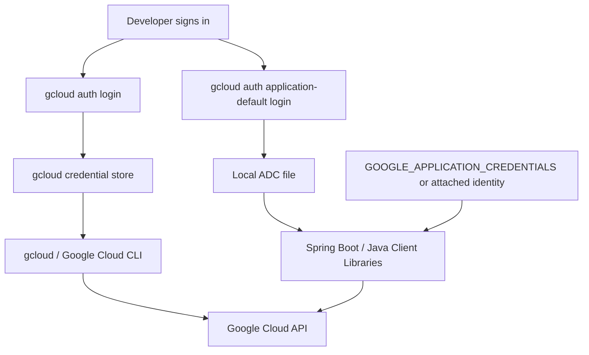

# Distinguishing gcloud Login from ADC Credentials

A developer can run `gcloud projects list` successfully while their Spring Boot application still fails with `UNAUTHENTICATED` or `PERMISSION_DENIED`. Conversely, an application may read a bucket through Google Cloud Client Libraries while `gcloud auth list` displays a completely different account. These two situations are not contradictory: **the Google Cloud CLI and Application Default Credentials (ADC) are two separate credential sets**.

`gcloud auth login` authenticates the `gcloud` command-line tool. `gcloud auth application-default login` creates credentials for applications and client libraries using ADC. Both can use the same Google account, or they can represent two different principals with different quota projects and permission scopes.

In the **SPRING_CLOUD_PROVIDER_INTEGRATION** module, we practice integrating Spring Boot with managed services from AWS, Azure, and Google Cloud. This lesson focuses on Google Cloud: distinguishing the two authentication mechanisms, understanding CLI configuration, inspecting the credentials an application actually uses, and avoiding confusion during development, testing, or operations.

## 1. Two Authentication Mechanisms, Two Purposes

| Aspect | Google Cloud CLI | Application Default Credentials |
| --- | --- | --- |
| Purpose | Allows `gcloud` and Google Cloud CLI tools to call APIs on behalf of the active principal | Supplies credentials to applications via Google authentication libraries |
| Common login command | `gcloud auth login` | `gcloud auth application-default login` |
| Storage location | Credential store inside the gcloud configuration directory | ADC file at the standard OS location or another ADC source |
| Primary inspection command | `gcloud auth list` | Inspect the process's ADC source; optionally fetch a test token with the dedicated ADC command |
| Scope of use | `gcloud`, `gsutil`, and related CLI tools | Google Cloud Client Libraries, Google API Client Libraries, and ADC-enabled applications |
| Account selection | Active account in the gcloud configuration | Principal stored in the ADC file or discovered from the active ADC source |
| Revoking local credentials | `gcloud auth revoke` | `gcloud auth application-default revoke` for the ADC file created by the login command |

**Key takeaway:** `gcloud auth login` does not automatically create a local ADC file. `gcloud auth application-default login` does not change gcloud's active account. Google Cloud documentation defines these two credential sets independently.

High-level diagram:



An application can use an ADC source other than the local ADC file. For example, `GOOGLE_APPLICATION_CREDENTIALS` may point to a Workload Identity Federation configuration; in that case, the Java process evaluates that source before the local ADC file.

## 2. What Does `gcloud auth login` Do?

The command:

```bash
gcloud auth login
```

opens a browser-based user authentication flow and saves credentials for use by the Google Cloud CLI. After signing in, the account is added to gcloud's credential store. One of those accounts is selected as the **active account** for the active CLI configuration.

You can sign in with multiple accounts:

```bash
gcloud auth login developer@example.com
gcloud auth login operator@example.com
```

View stored accounts and the active account:

```bash
gcloud auth list
```

Example output:

```text
Credentialed Accounts
ACTIVE  ACCOUNT
        developer@example.com
*       operator@example.com
```

The `*` marks the active account. Regular gcloud commands use this account unless overridden by a flag or another configuration.

Select the active account:

```bash
gcloud config set account developer@example.com
```

This command only updates the `core/account` property of the **current gcloud configuration**. It does not automatically change the account in the local ADC file.

### 2.1. `gcloud init` and gcloud Configurations

When setting up a development workstation for the first time, you typically run:

```bash
gcloud init
```

`gcloud init` helps sign in, pick a default project, and set up initial CLI configuration. A gcloud configuration has common properties:

| Property | Role |
| --- | --- |
| `core/account` | Account gcloud uses to authenticate |
| `core/project` | Default project for gcloud commands that do not specify another project |
| `compute/region` | Default region for certain Compute commands |
| `compute/zone` | Default zone for certain Compute commands |

View the active configuration:

```bash
gcloud config list
```

Change the CLI's default project:

```bash
gcloud config set project provider-integration-dev
```

You can create multiple named configurations to separate environments:

```bash
gcloud config configurations create dev
gcloud config configurations create prod

gcloud config configurations activate dev
gcloud config set account developer@example.com
gcloud config set project provider-integration-dev

gcloud config configurations activate prod
gcloud config set account operator@example.com
gcloud config set project provider-integration-prod
```

These configurations help operators quickly switch the CLI's default account/project. They are not separate ADC sets. Switching the active gcloud configuration **does not automatically switch local ADC** to the corresponding user or project.

When running bootstrap scripts, pass `--project` explicitly rather than relying entirely on the default project:

```bash
gcloud services list --enabled \
  --project=provider-integration-dev
```

This reduces the risk of enabling APIs, creating resources, or modifying IAM in the wrong environment.

## 3. What Does `gcloud auth application-default login` Do?

The command:

```bash
gcloud auth application-default login
```

runs an OAuth web flow to obtain user credentials and writes them to the standard **Application Default Credentials** location. Google Cloud Client Libraries and ADC-enabled libraries can locate this file automatically without passing a credentials path in code.

Default locations:

| Operating System | ADC File |
| --- | --- |
| Linux/macOS | `$HOME/.config/gcloud/application_default_credentials.json` |
| Windows | `%APPDATA%\\gcloud\\application_default_credentials.json` |

A local ADC file using user credentials typically contains a refresh token. Anyone with read access to the file can use it to obtain valid access tokens, so protect it as sensitive credential material:

- Never commit the ADC file to Git.
- Never include the file in Docker images or build artifacts.
- Never send the file over email/chat or store it in a publicly shared directory.
- Never share the file across multiple developers.
- Restrict read permissions on the development machine.
- Revoke ADC when no longer needed.

### 3.1. The ADC Command Does Not Change gcloud's Active Account

Suppose before running ADC login:

- `gcloud auth list` shows `operator@example.com` as the active account.
- The developer runs `gcloud auth application-default login` and selects `developer@example.com` in the browser.

Afterward:

- `gcloud auth list` still shows `operator@example.com` as the CLI's active account.
- Applications using ADC authenticate as `developer@example.com`.
- `gcloud config list` retains the CLI's previous account/project properties.

This is normal behavior. When debugging an application, never treat `gcloud auth list` output as sole proof of the identity the Java process is using.

### 3.2. ADC Login Can Overwrite the Existing ADC File

Each time you run `gcloud auth application-default login`, previous ADC credentials created by this command may be replaced. Therefore, if local ADC is currently configured to impersonate a service account or represent another user, check before running login again.

This command can also write a quota project into ADC based on the gcloud configuration. The quota project is used by client libraries for quota/billing on APIs that support this mechanism. It does not change the principal and does not change the project that owns a bucket, topic, or database.

## 4. Comparing with a Practical Example

Suppose a developer machine has the following setup:

| Component | Value |
| --- | --- |
| Active gcloud account | `operator@example.com` |
| gcloud default project | `provider-integration-prod` |
| Local ADC principal | `developer@example.com` |
| ADC quota project | `provider-integration-dev` |
| Spring Boot property | `spring.cloud.gcp.project-id=provider-integration-dev` |

In this case:

- `gcloud services list` may call the API using `operator@example.com` and the default production project, if no other project is passed.
- Spring Boot uses the ADC credentials of `developer@example.com`.
- Spring Boot uses the default project configured in the `spring.cloud.gcp.project-id` property.
- Local ADC's quota project may be the dev project, depending on the API.
- The actual resource can still belong to another project if the resource name specifies that project and IAM permits it.

Do not conclude the application is targeting production just because the CLI default project is production. Nor should you conclude a request is billed quota to the resource project simply because the resource's project ID is production.

### Four Questions to Answer Separately

1. **Who is the CLI using?** Check `gcloud auth list` and `gcloud config list`.
2. **Who is the application using?** Check the ADC source read by the Java process and the principal in request audit logs.
3. **Which project does the application use by default?** Check `spring.cloud.gcp.project-id` or the project explicitly supplied in code/config.
4. **Which quota project does the request use?** Check the ADC quota project, whether the API supports quota projects, and the `serviceusage.services.use` permission.

## 5. Distinguishing Token Inspection Commands

There are two access-token-printing commands that are frequently confused:

| Command | Token Represents | When to Use |
| --- | --- | --- |
| `gcloud auth print-access-token` | The active account or principal specified for the gcloud CLI command | Testing REST requests with CLI credentials |
| `gcloud auth application-default print-access-token` | Current ADC credentials | Testing REST requests with the credentials used by client libraries |

Example checking the CLI token:

```bash
gcloud auth print-access-token
```

Example checking the ADC token:

```bash
gcloud auth application-default print-access-token
```

These two commands can return tokens for two different principals. They only print a token for use in a follow-up step; **never copy tokens into logs, issues, terminal recordings, or share them with others**. An access token is a bearer credential and can be used by whoever holds it within its granted permissions until it expires or is invalidated by service mechanisms.

If you need to test a REST API with the exact credentials of your local application, you can use the ADC token:

```bash
gcloud auth application-default print-access-token
```

Then pass the token in the Authorization header of the test request. Never save tokens into files or long-lived scripts. If you only need to verify the application, it is better to run a test read/write operation from the Java process itself and check Cloud Audit Logs to confirm the actual principal.

### Never Use `gcloud auth list` to Infer the ADC Principal

`gcloud auth list` only lists accounts whose credentials are configured for the Google Cloud CLI and shows the active account. It does not read the local ADC file to report the application's principal.

Similarly, `gcloud auth print-access-token` fetches a token for the CLI account; it is not an ADC inspection command. Use the command prefixed with `application-default` when targeting ADC credentials.

## 6. `GOOGLE_APPLICATION_CREDENTIALS` Can Make ADC Pick Another Source

Even after running `gcloud auth application-default login`, the application can still use a different credential source if the `GOOGLE_APPLICATION_CREDENTIALS` environment variable is set.

ADC generally searches for credentials in this high-level order:

1. Credential configuration specified by `GOOGLE_APPLICATION_CREDENTIALS`.
2. Local ADC file in the standard location.
3. Attached service account/metadata server of the runtime environment.

The first source can be a Workload Identity Federation configuration, Workforce Identity Federation configuration, or a service account key JSON. A service account key is a high-risk long-lived credential; prefer federation or attached identities whenever possible.

Check the environment variable in PowerShell:

```powershell
$env:GOOGLE_APPLICATION_CREDENTIALS
```

In Linux/macOS:

```bash
printenv GOOGLE_APPLICATION_CREDENTIALS
```

If you want your local application to use the local ADC file created by `gcloud auth application-default login`, ensure this environment variable does not point to another credential file. If you intend to use WIF, explicitly configure the WIF file and test the external workload's principal.

### What Does Precedence Mean in Practice?

For example, a developer machine has local ADC for `developer@example.com`, but the environment variable points to a WIF configuration for a CI principal. The Java process evaluates the credential configuration from the environment variable first. The outcome can differ from what the developer sees in `gcloud auth list` and differ from the account just selected in the browser flow.

When running inside an IDE, container, or test runner, inspect the **environment variables of that exact process**. Opening a new PowerShell or terminal window does not guarantee the IDE picked up updated environment variables; the IDE must be restarted if it inherited an older environment.

## 7. Spring Boot Integration: Which Credentials Does the Application Actually Read?

Spring Framework on Google Cloud (historically commonly known as Spring Cloud GCP) provides the Core starter and `CredentialsProvider`. By default, this provider uses ADC to obtain credentials for Google Cloud Client Libraries.

Maven dependency example:

```xml
<dependency>
    <groupId>com.google.cloud</groupId>
    <artifactId>spring-cloud-gcp-starter</artifactId>
</dependency>
```

When adding the Pub/Sub starter:

```xml
<dependency>
    <groupId>com.google.cloud</groupId>
    <artifactId>spring-cloud-gcp-starter-pubsub</artifactId>
</dependency>
```

The Pub/Sub client is configured via Core's credentials provider. Without explicit credentials configuration, Java libraries can use environment-based ADC.

Project configuration example:

```yaml
spring:
  cloud:
    gcp:
      project-id: ${GOOGLE_CLOUD_PROJECT}
```

`spring.cloud.gcp.project-id` specifies the default project for the Spring integration; it does not determine which user/service account ADC selects. Both configurations must be verified separately.

### 7.1. Explicit Credentials Properties Can Change the Auth Source

Spring Core can support properties such as:

- `spring.cloud.gcp.credentials.location`: path to a credentials file.
- `spring.cloud.gcp.credentials.encoded-key`: Base64-encoded JSON key.
- `spring.cloud.gcp.credentials.scopes`: OAuth scopes.

If the application declares a credentials location or encoded key, check the actual behavior of your release line because the provider may use those explicit credentials instead of default ADC. Avoid accidentally configuring multiple identity sources at once.

**Base64 is not encryption.** Never store an encoded key in Git or logs. In production, prefer an attached service account, Workload Identity Federation, or short-lived identity mechanisms.

### 7.2. Do Not Rely on CLI Credentials as an Implicit Default

A Java application should not depend on whether a developer machine has run `gcloud auth login`. What client libraries need is ADC or an explicitly configured credential source.

If a developer machine has only run `gcloud auth login` without ADC, `gcloud` commands may work while local Spring Boot still reports no credentials found. The usual fix for local development is:

```bash
gcloud auth application-default login
```

Then rerun the application. In production, never run this command on servers; use a workload-attached identity or platform-native federation.

## 8. The ADC Quota Project Is Not gcloud's Default Project

When running `gcloud auth application-default login`, gcloud may record a quota project in ADC. The quota project is used by certain Google APIs to determine which project is charged quota/billing for requests.

View or update the quota project:

```bash
gcloud auth application-default set-quota-project provider-integration-dev
```

To use a project as a quota project, the ADC principal needs the `serviceusage.services.use` permission on that project, typically granted via the `roles/serviceusage.serviceUsageConsumer` role.

Distinguish:

| Value | Effect |
| --- | --- |
| gcloud `core/project` | Default project for CLI commands |
| Spring `spring.cloud.gcp.project-id` | Default project for the Spring integration when the property is used |
| ADC quota project | Quota/billing project for APIs that support it |
| Resource project | Project that owns the bucket, topic, database, or secret |

Some services may ignore the quota project and attribute billing/quota to the resource-owning project. Do not assume all APIs handle quota projects identically.

If you encounter a missing quota project or `serviceusage.services.use` error, check the quota project and corresponding permission. Never grant Owner/Editor just to make the request pass.

## 9. Revoking Credentials: Two Different Revoke Commands

Sign out of the gcloud CLI:

```bash
gcloud auth revoke
```

Or revoke a specific account:

```bash
gcloud auth revoke developer@example.com
```

This command affects Google Cloud CLI credentials. For user credentials, it can revoke server-side tokens and remove local credentials. For service accounts/external accounts, it may only delete local credentials or require revoking the external credential source; do not interpret it as deleting a service account key from IAM.

Revoke local ADC:

```bash
gcloud auth application-default revoke
```

This command revokes ADC created by `gcloud auth application-default login` and deletes the local ADC file. It does not affect other credential sources, such as:

- A credential file referenced by `GOOGLE_APPLICATION_CREDENTIALS`.
- An attached service account providing credentials via the metadata server.
- A Workload Identity Federation configuration stored elsewhere.
- Google Cloud CLI credentials created by `gcloud auth login`.

Therefore, to stop a local application from using ADC, you must revoke the exact ADC file or remove the credential source the process is reading. If a JSON key has been exposed, disable/delete the key in IAM per incident response procedures; deleting the local file alone does not invalidate the key on Google Cloud.

## 10. Scenario Table: Which Command Should You Run?

| Goal | Appropriate Command | Primary Effect |
| --- | --- | --- |
| Sign in to run gcloud CLI | `gcloud auth login` | Saves CLI credentials |
| Initialize default account/project for CLI | `gcloud init` | Sets up gcloud configuration |
| View active account in CLI | `gcloud auth list` | Lists CLI accounts only |
| Switch active CLI account | `gcloud config set account EMAIL` | Changes active CLI account |
| Switch default CLI project | `gcloud config set project PROJECT_ID` | Changes CLI project |
| Create credentials for local Spring Boot/Java Client Libraries | `gcloud auth application-default login` | Writes local ADC file |
| Inspect token for CLI account | `gcloud auth print-access-token` | Prints token for CLI credentials |
| Inspect token for ADC | `gcloud auth application-default print-access-token` | Prints token for ADC |
| Set quota project for ADC | `gcloud auth application-default set-quota-project PROJECT_ID` | Updates quota project in ADC |
| Sign out of CLI | `gcloud auth revoke` | Revokes/deletes CLI credentials |
| Revoke local ADC | `gcloud auth application-default revoke` | Revokes ADC file created by login command |
| Deliberately use CLI login credentials to update ADC | `gcloud auth login --update-adc` | Writes CLI credentials into ADC and overwrites previous ADC |

### Exception: `gcloud auth login --update-adc`

The Google Cloud CLI documentation includes the `--update-adc` flag for `gcloud auth login`. When this flag is used, the newly obtained credentials are written to the standard ADC location; previously created ADC may be overwritten.

This is **explicit behavior requested via a flag**, not the default behavior of `gcloud auth login`. Only use it when you genuinely want the exact credentials just signed in for the CLI to serve as ADC for client libraries. If you only need CLI login to run administrative commands, omit this flag.

## 11. Recommended Local Development Workflow

For a Spring Boot application calling Pub/Sub or Cloud Storage in a dev project:

1. Install Google Cloud CLI and run `gcloud init` to set up the CLI account/project.
2. Use `gcloud auth list` to confirm the active account for CLI tasks.
3. Run `gcloud auth application-default login` to create local ADC for the application.
4. Check whether `GOOGLE_APPLICATION_CREDENTIALS` points to another file.
5. Configure `spring.cloud.gcp.project-id` to the dev project.
6. Grant least-privilege IAM to the ADC principal on the test bucket/topic.
7. Run the application from your IDE or terminal.
8. Perform a real test operation and inspect audit logs if needed to confirm the principal.
9. When switching the ADC user, rerun the ADC login command and retest the application.
10. When finishing on a shared local environment or test machine, revoke ADC and CLI credentials appropriately.

Example command sequence:

```bash
# 1. Set up default account and project for CLI.
gcloud init

# 2. Check CLI identity.
gcloud auth list
gcloud config list

# 3. Create separate credentials for the application.
gcloud auth application-default login

# 4. Check project/quota project and environment configuration.
gcloud auth application-default print-access-token
gcloud config get-value project
```

The token-printing command is only for controlled verification; never write its output to files or share it. Inside the application, let Google Cloud Client Libraries use ADC and handle token refreshes automatically.

## 12. Troubleshooting: CLI Works but Spring Boot Fails

| Symptom | Possible Cause | How to Check/Fix |
| --- | --- | --- |
| `gcloud projects list` works, yet Spring Boot reports ADC not found | Ran CLI login without creating ADC | Run `gcloud auth application-default login` for local development |
| `gcloud auth list` shows user A, yet app calls as user B | Local ADC or environment credentials represent another user/principal | Check the ADC source and request audit logs |
| Changed active CLI account, yet Spring Boot identity did not change | CLI configuration and ADC are independent | Update ADC separately or configure the app's identity source |
| Running Spring Boot in IDE uses unexpected identity | IDE has `GOOGLE_APPLICATION_CREDENTIALS` or old ADC | Check IDE environment variables, local ADC, and restart the IDE if needed |
| Still getting `PERMISSION_DENIED` after `gcloud auth application-default login` | User ADC lacks IAM permission on resource | Grant least-privilege role to the right principal and resource |
| API reports missing quota project | ADC lacks quota project or principal lacks permission to use it | Use `set-quota-project` and grant Service Usage Consumer if needed |
| App still runs after `gcloud auth revoke` | Only revoked CLI credentials; ADC still exists | Revoke ADC separately if the app uses local ADC |
| App can still access resources after `gcloud auth application-default revoke` | App uses an env credential file or attached identity | Check `GOOGLE_APPLICATION_CREDENTIALS` and metadata/workload identity |
| REST request with CLI token succeeds, yet app fails | CLI token and ADC token differ in principal/scope/quota | Test with the ADC token and verify from the Java process |
| ADC login overwrote impersonated ADC | Logged back in with user credentials | Re-create impersonation ADC if the app should act as a service account |

Never fix permission errors by granting Owner to a user or service account. Identify the real principal, target API/resource, and missing permission before modifying IAM.

## 13. Hands-On Exercise: Proving the Two Credential Sets Are Independent

Create a dedicated test project and a bucket or Pub/Sub topic containing no real data. Use two test accounts with different permissions.

### Step 1 — Set Up CLI Identity

1. Run `gcloud auth login` with user A.
2. Select the test project for CLI with `gcloud config set project`.
3. Run `gcloud auth list` and note the active account.
4. Run a read-only command such as `gcloud projects describe` to confirm the CLI works.

### Step 2 — Set Up a Different ADC Identity

1. Run `gcloud auth application-default login`.
2. In the browser flow, sign in as user B.
3. Grant user B least-privilege access on the test bucket/topic.
4. Run the Spring Boot application and perform a test read/write operation.
5. Check Cloud Audit Logs to confirm the request principal is user B.

### Step 3 — Switch the CLI Account

1. Run `gcloud config set account USER_A`.
2. Confirm `gcloud auth list` shows user A active.
3. Rerun the Spring Boot application.
4. Check the principal in audit logs.

Expected result: switching the active CLI account does not automatically change the application's local ADC.

### Step 4 — Switch the ADC Account

1. Rerun `gcloud auth application-default login` as user A.
2. Rerun the application.
3. Check the principal in audit logs.
4. Compare the result with the previous step.

Expected result: the application changes identity when ADC changes, while gcloud's active account is managed independently.

### Step 5 — Compare Token Commands

- Use `gcloud auth print-access-token` to inspect the CLI token.
- Use `gcloud auth application-default print-access-token` to inspect the ADC token.
- Do not save or share either token.
- Do not infer the principal solely by comparing token strings; use audit logs or a controlled test operation.

### Step 6 — Revoke and Clean Up the Environment

1. Use `gcloud auth application-default revoke` to revoke the test local ADC.
2. Use `gcloud auth revoke` if you need to sign out the CLI account.
3. Delete lab resources and revoke granted IAM roles per administrative procedure.
4. Do not delete other users' service account keys or credentials outside your authorized administrative scope.

### Result Table to Record

| Experiment | CLI Active Account | ADC Principal | Spring Boot Request Identity |
| --- | --- | --- | --- |
| Initial | User A | User B | User B |
| Switch CLI account only | User C | User B | User B |
| Switch ADC to user A | User C | User A | User A |
| Revoke ADC file | User C | No local ADC file left | App needs another ADC source or errors |

If an environment variable or attached identity is present, results may differ because ADC may prioritize that source. The lab should verify and clear unintended sources before drawing conclusions.

## 14. Key Takeaways

- `gcloud auth login` authenticates the **Google Cloud CLI**; `gcloud auth application-default login` creates **ADC credentials for applications/client libraries**.
- `gcloud auth list` shows CLI accounts and the active account; it does not identify which principal Spring Boot is using.
- A gcloud configuration holds default account/project settings for the CLI. Switching configurations or active accounts does not automatically update local ADC.
- The ADC file sits at a standard OS location, holds sensitive credentials, and can be overwritten when rerunning ADC login.
- `GOOGLE_APPLICATION_CREDENTIALS` can cause the application to use a credential file other than local ADC; inspect the environment of the exact Java process.
- `gcloud auth print-access-token` and `gcloud auth application-default print-access-token` print tokens from two different credential sets.
- `gcloud auth revoke` and `gcloud auth application-default revoke` revoke two different credential sets; revoking the ADC file does not delete keys or attached identities.
- `gcloud auth login --update-adc` is an intentional exception that writes CLI credentials into ADC and can overwrite previous ADC.
- In local development, create dedicated ADC and grant least-privilege IAM. In production, use an attached service account or Workload Identity Federation instead of user ADC/key files.
- When debugging, determine **CLI principal**, **ADC principal**, **Project ID**, **quota project**, and **resource IAM** separately; never infer one from another.

## Official References

1. [Authenticate for the gcloud CLI](https://docs.cloud.google.com/sdk/docs/authenticate)
2. [gcloud auth login — sign in to Google Cloud CLI](https://docs.cloud.google.com/sdk/gcloud/reference/auth/login)
3. [gcloud auth application-default login — create ADC credentials](https://docs.cloud.google.com/sdk/gcloud/reference/auth/application-default/login)
4. [How Application Default Credentials works](https://docs.cloud.google.com/docs/authentication/application-default-credentials)
5. [Set up ADC for a local development environment](https://docs.cloud.google.com/docs/authentication/set-up-adc-local-dev-environment)
6. [gcloud auth list — list CLI accounts](https://docs.cloud.google.com/sdk/gcloud/reference/auth/list)
7. [gcloud auth application-default print-access-token](https://docs.cloud.google.com/sdk/gcloud/reference/auth/application-default/print-access-token)
8. [gcloud auth application-default revoke](https://docs.cloud.google.com/sdk/gcloud/reference/auth/application-default/revoke)
9. [gcloud auth revoke](https://docs.cloud.google.com/sdk/gcloud/reference/auth/revoke)
10. [Managing gcloud CLI configurations](https://docs.cloud.google.com/sdk/docs/configurations)
11. [gcloud auth application-default set-quota-project](https://docs.cloud.google.com/sdk/gcloud/reference/auth/application-default/set-quota-project)

The commands and behaviors in this lesson reflect Google Cloud CLI/ADC documentation checked on 24/11/2026. Some options may vary by Google Cloud CLI version; check the help/reference of your installed version before using them in automated scripts.
