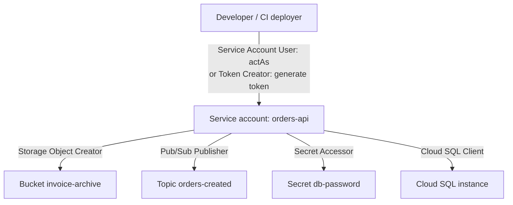
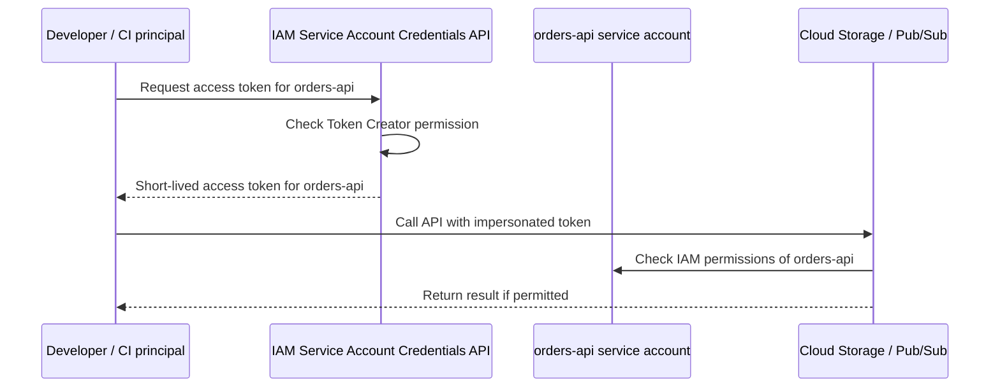

# Service Accounts, Impersonation, and Least-Privilege IAM Permissions

A Spring Boot application calling Cloud Storage, Pub/Sub, Secret Manager, or Cloud SQL needs an identity so Google Cloud knows which workload is making each request. In production environments, that identity is typically a **service account** attached to the application. IAM then grants the service account the specific permissions needed on each resource.

Two directions of permissions must be distinguished: the service account's permissions **on the resources the application uses**, and a user's or workload's permissions **to use that service account**. The first direction governs what data the application can read or write; the second governs who can attach or impersonate the application's identity. Confusing these two directions easily creates privilege-escalation paths.

In the **SPRING_CLOUD_PROVIDER_INTEGRATION** module, we practice integrating Spring Boot with managed services from AWS, Azure, and Google Cloud. This lesson focuses on Google Cloud: designing service accounts per workload, distinguishing Service Account User from Service Account Token Creator, using impersonation to issue short-lived credentials, and granting IAM roles at the smallest possible scope.

## 1. A Service Account Is a Workload's Identity

A service account is a type of IAM principal, typically representing an application, VM, job, service, or automated process. A service account has an email address of the form:

```text
orders-api@provider-integration-prod.iam.gserviceaccount.com
```

The email is the principal's identifier, not a password or secret. The application does not enter an email and password to sign in; the runtime is configured to supply credentials for that service account.

For example, an order-processing system can use separate identities:

| Workload | Service Account | Responsibility |
| --- | --- | --- |
| Order ingestion API | `orders-api@PROJECT_ID.iam.gserviceaccount.com` | Writes invoices and publishes events |
| Payment consumer | `payment-worker@PROJECT_ID.iam.gserviceaccount.com` | Reads subscriptions and retrieves connection secrets |
| Reconciliation job | `reconciliation-job@PROJECT_ID.iam.gserviceaccount.com` | Reads reporting data and writes results |
| Deployment pipeline | Dedicated deploy identity | Deploys revisions and attaches runtime identity |

Avoid sharing a single service account across all applications. When multiple workloads share one identity, permissions accumulate to satisfy every application's needs. A flaw in one workload then opens access to another workload's resources, and audit logs become harder to attribute to the specific application that performed an action.

### 1.1. A Service Account Is Both a Principal and a Resource

This is the most important concept when designing IAM:

| Role | Meaning | Example |
| --- | --- | --- |
| **Principal** | The service account is granted permissions on other resources | `orders-api` has permission to create objects in the invoice bucket |
| **Resource** | The service account has its own policy specifying who can use, attach, or impersonate it | A developer is allowed to impersonate `orders-api` to run tests |



Developers/deployers need permissions on the **service account resource** to attach or impersonate it. Meanwhile, `orders-api` needs permissions on the bucket/topic/secret/database to perform business operations.

Granting a developer permission to use a service account does not directly grant the developer roles to read/write the bucket. However, if the developer can impersonate the service account, they can perform whatever operations the service account is allowed to do. Therefore, permission to use a service account must be controlled as strictly as data access permissions.

## 2. Creating a Dedicated Service Account for the Application

Create service accounts per workload and per environment. Names should be clear, stable, and free of sensitive details.

```bash
PROJECT_ID="provider-integration-dev"

gcloud iam service-accounts create orders-api \
  --display-name="Orders API runtime" \
  --description="Identity for the Spring Boot orders API" \
  --project="$PROJECT_ID"
```

The service account email is generated in the project that owns the service account. Record this email in deployment/IaC configuration; there is no need to store a private key.

| Component | Example | Purpose |
| --- | --- | --- |
| Workload | `orders-api` | Identifies the application |
| Environment | `dev`, `staging`, `prod` | Separates permissions across environments |
| Service account ID | `orders-api-runtime` | Identifies the runtime identity |
| Display name | `Orders API runtime - production` | Description in the Console |
| Owner | `team-orders` | Responsible team |
| Purpose | `publish-orders-and-write-invoices` | Allowed business scope |

A project can contain many service accounts. A service account can also be created in a central project and attached to workloads in another project if the organization enables cross-project service account usage. However, start with a dedicated service account per workload inside the corresponding environment project unless centralized governance requires otherwise.

### Do Not Rely on Default Service Accounts by Default

Certain Google Cloud services create default service accounts when an API is enabled or when a resource is initialized. In some older organization setups, default service accounts were automatically granted the Editor role (`roles/editor`) on the project. Google recommends disabling automatic role grants for default service accounts and using administrator-created service accounts with least privilege.

Do not assume every default service account has the same permissions in every project. Inspect the actual IAM policy and Organization Policy before using one. Never add Editor/Owner to a runtime identity merely to bypass permission errors.

## 3. Distinguishing Service Account User and Token Creator

IAM defines separate roles for two different actions.

### 3.1. Service Account User — Permission to Attach a Service Account to a Resource

Role:

```text
roles/iam.serviceAccountUser
```

This role includes the `iam.serviceAccounts.actAs` permission. It allows a principal to attach a service account to resources that run workloads, such as a VM, a Cloud Run service/job, or other deployable resources.

Example: a developer deploys a Cloud Run service and selects the `orders-api` service account. The developer needs permission to create/update the Cloud Run service and the `actAs` permission on the attached service account. Service Account User is normally granted on **that specific service account**.

**Service Account User does not by itself allow creating access tokens to impersonate the service account.** It allows attaching the service account to a resource; once attached, the workload runs as that service account's identity and receives the permissions held by the service account.

### 3.2. Service Account Token Creator — Permission to Issue Short-Lived Credentials / Impersonate

Role:

```text
roles/iam.serviceAccountTokenCreator
```

This role allows a principal to create short-lived credentials representing a service account, including OAuth access tokens, OIDC ID tokens, and supported JWT/blob signatures. The key permission for access tokens is `iam.serviceAccounts.getAccessToken`.

Use this role when a developer needs to run an application locally under a runtime identity, when CI/CD needs to impersonate a deployment service account, when one workload needs short-lived access tokens for another service account, or when a workflow needs to sign a JWT/blob as a service account.

Token Creator carries broader reach than attaching a service account. When a principal impersonates a service account, that principal can access any resources the service account is allowed to access. Grant Token Creator only on the specific service account; avoid granting it at the project/folder level unless explicitly required.

### 3.3. Quick Comparison

| Criterion | Service Account User | Service Account Token Creator |
| --- | --- | --- |
| Role | `roles/iam.serviceAccountUser` | `roles/iam.serviceAccountTokenCreator` |
| Representative permission | `iam.serviceAccounts.actAs` | `iam.serviceAccounts.getAccessToken`, `signBlob`, `signJwt`, `getOpenIdToken` |
| Purpose | Attach a service account to a resource | Generate short-lived credentials / impersonate |
| Used with `gcloud run deploy --service-account` | Deployer needs appropriate permission to attach the SA | Not required solely to attach the SA |
| Used with `--impersonate-service-account` | Insufficient | Requires Token Creator or equivalent permission |
| Recommended scope | Policy on the attached service account | Policy on the target service account |

### 3.4. Workload Identity User for GKE Federation

Role:

```text
roles/iam.workloadIdentityUser
```

In the Workload Identity Federation for GKE model linking a Kubernetes Service Account (KSA) to a Google IAM service account (GSA), this role is granted on the GSA to the corresponding KSA principal. It allows workloads in Kubernetes to obtain credentials through the supported federation/impersonation mechanism.

Do not confuse the three roles:

- `roles/iam.serviceAccountUser`: a deployer can attach a service account to a resource.
- `roles/iam.serviceAccountTokenCreator`: a principal can generate short-lived credentials for a service account.
- `roles/iam.workloadIdentityUser`: a KSA is allowed to use a GSA via Workload Identity for GKE.

Grant only the role matching the runtime model. Do not grant all three roles to every principal out of habit.

## 4. How Does Service Account Impersonation Work?

Impersonation is the process where an authenticated principal asks Google Cloud to issue short-lived credentials for a target service account.



Two identities participate in this flow:

1. **Source principal:** the initially authenticated user, service account, or external identity.
2. **Target service account:** the identity the source principal requests to impersonate.

The source principal needs permission to create credentials for the target service account. The target service account needs business roles on the bucket/topic/secret/database. These two sets of permissions are granted in two different places.

### 4.1. Impersonation with the Google Cloud CLI

Grant Token Creator to the developer on the specific service account:

```bash
PROJECT_ID="provider-integration-dev"
SA="orders-api@provider-integration-dev.iam.gserviceaccount.com"

gcloud iam service-accounts add-iam-policy-binding "$SA" \
  --member="user:developer@example.com" \
  --role="roles/iam.serviceAccountTokenCreator" \
  --project="$PROJECT_ID"
```

You can then run a CLI command with impersonation:

```bash
gcloud storage buckets describe gs://invoice-archive-dev \
  --impersonate-service-account="$SA" \
  --project="$PROJECT_ID"
```

Or create local ADC using impersonation for supported client libraries:

```bash
gcloud auth application-default login \
  --impersonate-service-account="$SA"
```

Java client libraries that support ADC impersonation can use this local ADC. When running the Spring Boot application, clients use credentials representing the target service account; there is no need to download the service account's private key locally.

Do not grant Token Creator to a developer across an entire project if they only need to impersonate one service account. A project-scoped policy can allow impersonating multiple service accounts in the project, including higher-privileged accounts.

### 4.2. Impersonation Is Not Simply Granting Extra Roles to a Developer

For example, suppose a developer lacks permission to read a production bucket, while `orders-api` has permission to read it. If the developer is granted Token Creator on `orders-api`, they can generate short-lived credentials representing `orders-api` and perform whatever operations the service account is permitted to do.

This is a valuable mechanism for testing workload permissions, but it is also a security boundary. Before granting Token Creator, check which resources the target service account can access, whether the developer truly needs that identity, whether a lower-privileged test service account can be created instead, and whether impersonation is scoped to that specific service account.

### 4.3. Auditing and Tracing Impersonation

When requests are made using impersonated credentials, many Google Cloud audit logs record both the source principal and the target service account. Some services or operation types may log only the service account identity; therefore, check the specific audit log type and enable Data Access logs when investigating data access.

Do not treat the service account email in logs as sole proof of which upstream workload acted. Use delegation/audit log details supported by the service and keep service account boundaries isolated per workload to improve traceability.

## 5. Attaching Service Accounts to Cloud Run, VMs, and GKE

### 5.1. Cloud Run

A Cloud Run service/job can be configured with a runtime service account. Example:

```bash
gcloud run deploy orders-api \
  --image="REGION-docker.pkg.dev/PROJECT_ID/apps/orders-api:VERSION" \
  --service-account="orders-api@PROJECT_ID.iam.gserviceaccount.com" \
  --region="asia-southeast1" \
  --project="PROJECT_ID"
```

The deploying user or pipeline needs permission to create/update the Cloud Run resource and the `iam.serviceAccounts.actAs` permission on the attached service account, typically via Service Account User. Runtime code uses the attached identity to call Google Cloud APIs via ADC/metadata server.

Do not set `GOOGLE_APPLICATION_CREDENTIALS` pointing to a JSON key inside the container if you intend to use the attached service account. Avoid placing keys in environment variables or image layers.

### 5.2. Compute Engine

When creating a VM, select a dedicated service account for the workload and appropriate OAuth access scopes. Google recommends not relying on access scopes in place of IAM roles; modern workloads typically use the `cloud-platform` scope and restrict actual permissions through IAM.

A VM with an attached service account can obtain short-lived credentials from the metadata server. Anyone with shell access or code execution on the VM can use the VM's identity; therefore, restrict SSH/OS Login access, metadata access, and what code is allowed to run on machines carrying privileged service accounts.

### 5.3. Google Kubernetes Engine

With GKE, use Workload Identity Federation for GKE:

1. Create a dedicated Kubernetes Service Account for the deployment.
2. Configure the cluster to support Workload Identity.
3. Link the KSA to a Google IAM principal/GSA according to your chosen model.
4. Grant `roles/iam.workloadIdentityUser` on the GSA to the KSA if using the KSA-impersonates-GSA model.
5. Grant data permissions to the GSA on the required buckets/topics/secrets.
6. Configure the Deployment to use that KSA.
7. Test from inside a pod to verify the principal and permissions.

Do not share one highly privileged KSA across all namespaces. Never store a JSON key in a Kubernetes Secret solely to provide an identity to pods when Workload Identity satisfies the requirement.

## 6. Granting Least-Privilege IAM Roles per Service

The service account needs roles on business resources. Start from the specific operation, identify the required permissions, and then pick the lowest predefined role supported by the service.

### 6.1. Cloud Storage

| Operation | Suggested Role | Scope | Limitations |
| --- | --- | --- | --- |
| Only create new objects | `roles/storage.objectCreator` | Bucket or managed folder | Cannot read, list, delete, or overwrite existing objects |
| Read objects and metadata | `roles/storage.objectViewer` | Bucket or managed folder | Can list and read objects |
| Manage objects | `roles/storage.objectAdmin` | Bucket or managed folder | Can create, read, modify, and delete objects; does not equate to bucket administration |
| Administer bucket and config | `roles/storage.admin` | Bucket/project as needed | Broad permissions; use only for administration |

Example allowing only object creation in a bucket:

```bash
gcloud storage buckets add-iam-policy-binding gs://invoice-archive-dev \
  --member="serviceAccount:orders-api@provider-integration-dev.iam.gserviceaccount.com" \
  --role="roles/storage.objectCreator"
```

If the application needs to read objects, also grant Object Viewer on the bucket or choose a role matching the full set of operations. Object Creator does not allow overwriting existing objects; if the application uses fixed object names and overwrites them, evaluate the corresponding update permissions.

### 6.2. Pub/Sub

| Operation | Suggested Role | Scope |
| --- | --- | --- |
| Publish messages | `roles/pubsub.publisher` | Topic |
| Consume/acknowledge messages | `roles/pubsub.subscriber` | Subscription |
| View topic/subscription metadata | `roles/pubsub.viewer` | Resource/project as needed |
| Administer topics/subscriptions | `roles/pubsub.editor` or appropriate admin role | Grant only to administrative workflows |

Example granting publisher on the orders topic:

```bash
gcloud pubsub topics add-iam-policy-binding orders-created \
  --project=provider-integration-dev \
  --member="serviceAccount:orders-api@provider-integration-dev.iam.gserviceaccount.com" \
  --role="roles/pubsub.publisher"
```

If a consumer only needs to read one subscription, grant Subscriber on that subscription. Do not grant Pub/Sub Editor to a publisher just because the application needs to send messages.

### 6.3. Secret Manager

| Operation | Suggested Role | Scope |
| --- | --- | --- |
| Read secret payload | `roles/secretmanager.secretAccessor` | Specific secret |
| View metadata | `roles/secretmanager.viewer` | Secret/project as needed |
| Add new version | `roles/secretmanager.secretVersionAdder` | Specific secret |
| Administer secrets | `roles/secretmanager.admin` | Administrative workflows only |

Example granting read access to one secret:

```bash
gcloud secrets add-iam-policy-binding orders-db-password \
  --project=provider-integration-prod \
  --member="serviceAccount:orders-api@provider-integration-prod.iam.gserviceaccount.com" \
  --role="roles/secretmanager.secretAccessor"
```

The Secret Accessor role can be granted at the secret level. If granted at the project level, the service account can read the payload of many secrets across the project. Therefore, do not grant it project-wide if the application only needs one secret.

### 6.4. Cloud SQL

Cloud SQL involves two commonly confused permission layers:

| Need | Role | Meaning |
| --- | --- | --- |
| Connect via Cloud SQL connector/proxy | `roles/cloudsql.client` | Grants permissions needed to connect and read instance metadata |
| Sign in using IAM database authentication | `roles/cloudsql.instanceUser` | Grants IAM login permission to the database when the instance and DB user are configured for IAM authentication |
| Administer instance | `roles/cloudsql.admin` | Administers Cloud SQL; do not grant to runtimes that only need to connect |

`roles/cloudsql.client` is typically granted on the project containing the instance. If using IAM database authentication, also grant `roles/cloudsql.instanceUser` and create the corresponding IAM database user in MySQL/PostgreSQL. The Cloud SQL IAM connection role does not automatically create database users or SELECT/INSERT/UPDATE privileges inside the database.

Example granting connection permission on the project:

```bash
gcloud projects add-iam-policy-binding provider-integration-prod \
  --member="serviceAccount:orders-api@provider-integration-prod.iam.gserviceaccount.com" \
  --role="roles/cloudsql.client"
```

If IAM database authentication is enabled, also grant the Instance User role per Cloud SQL documentation and create a database user for the service account. Then grant SQL schema/table privileges separately according to least privilege.

## 7. Least-Privilege Table for a Spring Boot Application

Suppose `orders-api` needs to write new invoices to a bucket, publish events to a topic, read one secret containing connection info, and connect to Cloud SQL via a connector.

| Resource | Operation | Principal | Suggested Role | Scope |
| --- | --- | --- | --- | --- |
| Bucket `invoice-archive-prod` | Create new objects | `orders-api` | `roles/storage.objectCreator` | Bucket |
| Topic `orders-created` | Publish messages | `orders-api` | `roles/pubsub.publisher` | Topic |
| Secret `orders-db-password` | Read secret version | `orders-api` | `roles/secretmanager.secretAccessor` | Secret |
| Cloud SQL instance | Connect via connector/proxy | `orders-api` | `roles/cloudsql.client` | Project owning instance |
| Database user | Read/write business tables | Corresponding DB user | SQL grants | Database/schema/table |
| Service account `orders-api` | Developer runs local impersonation | Developer | `roles/iam.serviceAccountTokenCreator` | Service account itself |
| Service account `orders-api` | Pipeline attaches identity to Cloud Run | Deployer | `roles/iam.serviceAccountUser` | Service account itself |

Do not grant these roles to all developers or all workloads. Separate the deployer, runtime service account, and operator so each identity performs only its intended task.

Several things do NOT need to be granted in this model:

- The runtime service account does not need `roles/iam.serviceAccountAdmin`.
- The runtime service account does not need `roles/iam.serviceAccountTokenCreator` on itself in typical setups.
- Developers do not need production Pub/Sub Publisher or Storage Admin just to deploy the application.
- A deployment pipeline does not need to read business secrets if it only creates revisions.
- A service account reading secrets does not need Secret Manager Admin.
- A publisher does not need Pub/Sub Editor.
- An application that only creates new objects does not need Storage Admin.

## 8. Configuring Spring Boot to Use a Runtime Service Account

A Spring Boot application should not contain private keys or create service accounts in code. The identity is supplied by the runtime environment via ADC. Spring Framework on Google Cloud Core starter uses an ADC-based `CredentialsProvider` by default.

Configuration example:

```yaml
spring:
  application:
    name: orders-api
  cloud:
    gcp:
      project-id: ${GOOGLE_CLOUD_PROJECT}

app:
  storage:
    invoice-bucket: ${INVOICE_BUCKET}
  messaging:
    orders-topic: ${ORDERS_TOPIC}
  secrets:
    database-password-secret: orders-db-password
```

The keys under `app.*` are application-defined properties. `spring.cloud.gcp.project-id` determines the default project for the integration; the runtime service account is determined by the attached identity, Workload Identity, or corresponding ADC source.

Code example illustrating only template injection, without manual token management:

```java
package example.orders.messaging;

import com.google.cloud.spring.pubsub.core.PubSubTemplate;
import org.springframework.beans.factory.annotation.Value;
import org.springframework.stereotype.Service;

@Service
public class OrderEventPublisher {

    private final PubSubTemplate pubSubTemplate;
    private final String topic;

    public OrderEventPublisher(
            PubSubTemplate pubSubTemplate,
            @Value("${app.messaging.orders-topic}") String topic) {
        this.pubSubTemplate = pubSubTemplate;
        this.topic = topic;
    }

    public void publish(String payload) {
        pubSubTemplate.publish(topic, payload);
    }
}
```

`PubSubTemplate` uses the credentials configured by the starter. When deploying to Cloud Run/GKE/Compute Engine, attach the appropriate service account and grant the Publisher role on the topic. Do not call `GoogleCredentials.fromStream(...)` from a JSON file in production code when a runtime identity is available.

### Local Development Using Impersonation

Developers can test exact runtime permissions without downloading a key:

```bash
gcloud auth application-default login \
  --impersonate-service-account=orders-api@provider-integration-dev.iam.gserviceaccount.com
```

Then run Spring Boot against the test project/resources. The developer user needs Token Creator on the target service account; the target service account needs the appropriate data roles. Use a dev service account, and never impersonate a production service account unless an approved production-access workflow explicitly permits it.

## 9. Cross-Project: Service Account in One Project, Resource in Another

A service account can be granted permissions to access resources in another project. For example:

- Service account `orders-api` is created in application project A.
- The Pub/Sub topic resides in messaging project B.
- The invoice bucket resides in storage project C.

Distinguish the project hosting the service account, the project owning the resource, the API/quota consumer project if required by the service, and the IAM policy attached to the target resource.

Example granting publisher on a topic in project B:

```bash
gcloud pubsub topics add-iam-policy-binding orders-created \
  --project=messaging-prod \
  --member="serviceAccount:orders-api@app-prod.iam.gserviceaccount.com" \
  --role="roles/pubsub.publisher"
```

APIs and quota/service usage may need to be configured on the project issuing requests depending on service requirements. Check the API documentation when designing cross-project access; do not assume enabling the API in the service account's home project alone is enough.

Cross-project service account attachment can also be restricted by Organization Policies and organizational settings. Do not alter organization-level constraints just to make a deployment command pass; check governance and approval requirements first.

## 10. Service Account Keys: Why Should You Avoid Them?

A service account JSON key contains a long-lived private key. Anyone who obtains the key can authenticate as the service account without prior login or impersonation rights. If the service account has permissions to read sensitive data, a leaked key can lead to prolonged unauthorized access until the key is disabled or revoked.

Preference order:

1. Attached service account via metadata server for VMs/Cloud Run.
2. Workload Identity Federation for GKE, AWS, Azure, CI/CD, and workloads outside Google Cloud.
3. Service account impersonation so developers/pipelines use short-lived credentials.
4. User-managed service account keys only when no suitable identity alternative exists and an approved risk-management process is in place.

If a key must be used:

- Never commit it to Git, images, artifacts, or container layers.
- Never send it via email/chat or share it among multiple people.
- Restrict read permissions, lifetime, and usage scope.
- Monitor key usage and rotate it on schedule.
- Disable an old key before deleting it when you need to verify impact.
- Revoke immediately if compromise is suspected.
- Check Organization Policy `iam.disableServiceAccountKeyCreation` and key-upload constraints.

Never re-enable key creation at the organization level just to satisfy one application's need. If an exception is genuinely required, scope it to an approved project/workload with an expiration date.

## 11. Auditing and Managing Permissions Across the Lifecycle

IAM permissions evolve as applications add features, change resources, or retire services. Treat service account permissions as part of the application lifecycle.

### 11.1. Inspecting a Service Account's IAM Policy

```bash
gcloud iam service-accounts get-iam-policy \
  orders-api@provider-integration-prod.iam.gserviceaccount.com \
  --project=provider-integration-prod
```

This policy answers who can use/impersonate the service account. It is not the policy granted to the service account on buckets/topics/secrets.

### 11.2. Inspecting Resource Policies

```bash
gcloud storage buckets get-iam-policy gs://invoice-archive-prod
```

```bash
gcloud pubsub topics get-iam-policy orders-created \
  --project=provider-integration-prod
```

```bash
gcloud secrets get-iam-policy orders-db-password \
  --project=provider-integration-prod
```

When evaluating effective permissions, examine both the resource policy and permissions inherited from project/folder/organization. For Cloud Storage, if bucket/object ACLs are still in use, inspect ACLs alongside IAM; Uniform bucket-level access centralizes control through IAM.

### 11.3. Using Policy Troubleshooter and Audit Logs

When encountering `PERMISSION_DENIED`:

1. Identify the actual principal from the runtime identity or audit logs.
2. Identify the denied permission and target resource.
3. Check directly granted roles and inherited roles.
4. Use IAM Policy Troubleshooter to check whether a principal holds a specific permission.
5. Check Organization Policies, IAM Deny policies, VPC Service Controls, and IAM conditions if applicable.
6. Grant the right role or fix the resource scope, then retry the minimal operation.

Never test by granting Owner/Editor. That masks the root cause and leaves permissions far broader than business needs.

### 11.4. Periodic Permission Reviews

- Remove unused roles after an application drops a module.
- Split service accounts when a workload is decomposed into multiple services.
- Audit inactive service accounts and unused keys.
- Use IAM Recommender/Policy Intelligence to detect excess permissions.
- Audit which principals hold Token Creator/Service Account User on sensitive service accounts.
- Review inherited permissions from folders/projects.
- Review audit logs and break-glass/impersonation procedures.

## 12. Common Errors and How to Resolve Them

| Symptom | Common Cause | How to Resolve |
| --- | --- | --- |
| `iam.serviceAccounts.actAs` denied during deploy | Deployer lacks Service Account User on the attached service account | Grant `roles/iam.serviceAccountUser` on that service account and check deploy permissions |
| `iam.serviceAccounts.getAccessToken` denied | Principal lacks Token Creator on the target service account | Grant `roles/iam.serviceAccountTokenCreator` at the proper scope |
| Developer can attach SA but cannot impersonate | Has Service Account User but lacks Token Creator | Distinguish `actAs` from `getAccessToken`; grant the right role if genuinely needed |
| Can impersonate, yet reading bucket returns 403 | Target SA lacks permission on the bucket | Grant the Storage role to the target SA on the bucket |
| Pub/Sub publish returns 403 | SA lacks Publisher or role is on the wrong project/topic | Grant `roles/pubsub.publisher` on the target topic |
| Secret Manager returns permission denied | SA lacks Secret Accessor or role is on the wrong secret | Grant `roles/secretmanager.secretAccessor` on the specific secret |
| Cloud SQL connector cannot connect | Missing Cloud SQL Client, API/network, or wrong instance name | Check connector, instance, networking, and IAM |
| IAM database login fails | Has Cloud SQL Client but lacks Instance User or DB user | Grant `roles/cloudsql.instanceUser`, create the IAM DB user, and grant SQL privileges |
| GKE pod receives wrong identity | KSA not linked or missing Workload Identity User | Check cluster, KSA, principal identifier, and IAM binding |
| Cloud Run runs as default SA | Deployment did not specify a runtime service account | Attach a dedicated service account to the revision |
| A developer can impersonate multiple unrelated SAs | Token Creator granted at project/folder scope | Narrow bindings down to individual specific service accounts |
| JSON key exposed | Key stored in repo, artifact, or log | Disable/delete key, investigate audit logs, rotate credentials, and migrate to WIF/attached identity |

## 13. Hands-On Exercise: Granting Least-Privilege Permissions to Orders API

Create a dedicated lab project. Suppose the application needs to write objects, publish to Pub/Sub, and read one secret.

### Step 1 — Create the Runtime Service Account

```bash
PROJECT_ID="provider-integration-lab"

gcloud iam service-accounts create orders-api \
  --display-name="Orders API runtime" \
  --project="$PROJECT_ID"
```

Service account email:

```text
orders-api@provider-integration-lab.iam.gserviceaccount.com
```

### Step 2 — Create Test Resources

- Bucket `invoice-lab`.
- Pub/Sub topic `orders-lab`.
- Secret `orders-db-password`.

Create resources via IaC or approved administrative commands. Enable required APIs before creating resources.

### Step 3 — Grant Properly Scoped Roles

```bash
SA="orders-api@provider-integration-lab.iam.gserviceaccount.com"

gcloud storage buckets add-iam-policy-binding gs://invoice-lab \
  --member="serviceAccount:$SA" \
  --role="roles/storage.objectCreator"

gcloud pubsub topics add-iam-policy-binding orders-lab \
  --project=provider-integration-lab \
  --member="serviceAccount:$SA" \
  --role="roles/pubsub.publisher"

gcloud secrets add-iam-policy-binding orders-db-password \
  --project=provider-integration-lab \
  --member="serviceAccount:$SA" \
  --role="roles/secretmanager.secretAccessor"
```

Do not grant Storage Admin, Pub/Sub Editor, or Secret Manager Admin to the runtime just to perform these operations.

### Step 4 — Allow Developer Impersonation for Local Execution

```bash
gcloud iam service-accounts add-iam-policy-binding "$SA" \
  --project=provider-integration-lab \
  --member="user:developer@example.com" \
  --role="roles/iam.serviceAccountTokenCreator"
```

```bash
gcloud auth application-default login \
  --impersonate-service-account="$SA"
```

Run Spring Boot against the lab project and execute object writes, message publishing, and secret reads. Inspect audit logs and confirm requests use the `orders-api` identity.

### Step 5 — Verify Permission Boundaries

Try operations the application does not need: deleting the bucket, deleting the topic, changing the secret's IAM policy, creating a service account key, and administering a Cloud SQL instance.

These operations should be denied if no broader role is granted through inherited policies. If any succeed, look for broad roles at the project/folder/organization level or permissions granted via another principal.

### Step 6 — Deploy to Runtime

- Attach the service account to Cloud Run or configure KSA/Workload Identity for GKE.
- Remove local credentials files from the runtime image.
- Verify the runtime service account is correct.
- Re-test the business operations.
- Revoke the developer's impersonation permission after the lab if no longer needed.
- Save the role and resource-scope matrix to use as a deployment contract.

## 14. Key Takeaways

- A service account is a workload's identity; designing a dedicated identity per application/environment reduces cross-access and improves traceability.
- A service account is both a **principal** (granted permissions on buckets/topics/secrets/databases) and a **resource** (with its own policy governing who can use or impersonate it).
- `roles/iam.serviceAccountUser` contains `iam.serviceAccounts.actAs`, primarily allowing attaching a service account to a resource.
- `roles/iam.serviceAccountTokenCreator` allows creating short-lived credentials/impersonating; grant it only on the specific target service account needed.
- `roles/iam.workloadIdentityUser` is used in the KSA/GSA model of Workload Identity Federation for GKE; it does not replace the two roles above in every scenario.
- Impersonation uses a source principal to obtain short-lived tokens for a target service account; the target SA still needs business IAM roles on resources.
- Grant Storage Object Creator on the bucket, Pub/Sub Publisher on the topic, Pub/Sub Subscriber on the subscription, Secret Accessor on the secret; Cloud SQL Client and Instance User depend on connector/IAM DB authentication.
- Cloud SQL IAM roles do not replace users/grants inside MySQL/PostgreSQL.
- Avoid long-lived service account keys; prefer attached identities, Workload Identity Federation, and impersonation.
- Inspect both the service account's policy and resource policies. Never use Owner/Editor to fix permission errors.

## Official References

1. [Service accounts overview — service accounts as principals and resources](https://docs.cloud.google.com/iam/docs/service-account-overview)
2. [Best practices for using service accounts securely](https://docs.cloud.google.com/iam/docs/best-practices-service-accounts)
3. [Roles for service account authentication — Service Account User, Token Creator, and Workload Identity User](https://docs.cloud.google.com/iam/docs/service-account-permissions)
4. [Use service account impersonation](https://docs.cloud.google.com/docs/authentication/use-service-account-impersonation)
5. [Service account impersonation — IAM](https://docs.cloud.google.com/iam/docs/service-account-impersonation)
6. [Best practices for managing service account keys](https://docs.cloud.google.com/iam/docs/best-practices-for-managing-service-account-keys)
7. [Cloud Storage IAM access control](https://docs.cloud.google.com/storage/docs/access-control/iam)
8. [Pub/Sub access control with IAM](https://docs.cloud.google.com/pubsub/docs/access-control)
9. [Secret Manager access control](https://docs.cloud.google.com/secret-manager/docs/access-control)
10. [Cloud SQL roles and permissions](https://docs.cloud.google.com/iam/docs/roles-permissions/cloudsql)
11. [Cloud SQL IAM database authentication](https://docs.cloud.google.com/sql/docs/postgres/iam-authentication)

The roles and examples in this lesson are starting points for the lab. Before deploying, verify the exact permissions required by each operation, which roles are supported at each resource scope, and inherited policies in your organization.
