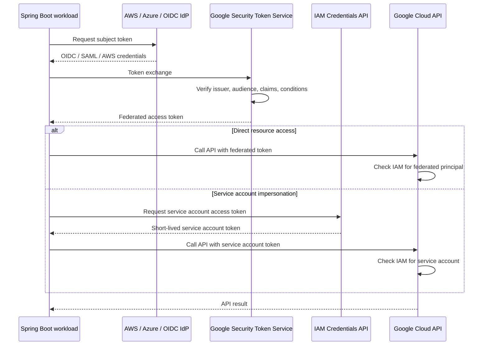

# Workload Identity Federation and Application Identity at Deployment Time

A Spring Boot application may run on Cloud Run, GKE, AWS, Azure, or a CI/CD system while still needing to access the same Cloud Storage bucket, Pub/Sub topic, or Secret Manager secret on Google Cloud. If every environment had to store a long-lived JSON service account key, deployment and key rotation would become an operational burden and increase the risk of credential exposure.

**Workload Identity Federation (WIF)** lets Google Cloud trust an identity issued by an external identity provider (IdP), verify that token, and issue short-lived credentials to the workload. The Java application continues using Application Default Credentials (ADC) and Google Cloud Client Libraries; authentication adapts to the environment while business code barely needs to know where the token originated.

In the **SPRING_CLOUD_PROVIDER_INTEGRATION** module, Spring Boot integrates with managed services from AWS, Azure, and Google Cloud. This lesson focuses on choosing application identity at deployment time: distinguishing WIF for external workloads from WIF for GKE, configuring pools/providers, mapping claims, restricting trusted subjects, choosing between direct resource access and service account impersonation, and connecting WIF to Spring Boot.

## 1. What Problem Does Workload Identity Federation Solve?

Workloads running outside Google Cloud still need to call Google Cloud APIs. Previously, the common pattern was to create a service account JSON key, store it in AWS/Azure/CI secret stores, and mount or inject it into the application. That created a long-lived credential that could be copied and used from anywhere until revoked.

WIF replaces static keys with a token-exchange chain:

1. The workload proves its identity to an IdP trusted by the organization, such as AWS IAM, Microsoft Entra ID, GitHub OIDC, or the Kubernetes API server.
2. The workload obtains a short-lived **subject token** from the IdP.
3. Google Security Token Service (STS) verifies the token against the configured pool/provider.
4. STS issues a **federated token** for the external principal.
5. The workload uses this token to access resources directly, or exchanges it for an access token of an allowed impersonated service account.
6. Google Cloud checks IAM permissions on the target resource.



WIF does not grant business permissions automatically. The pool/provider only verifies an external identity. Afterward, the principal must be granted appropriate roles on resources or be allowed to impersonate a service account with those roles.

## 2. Distinguishing Deployment Identity Models

Not every workload needs a custom workload identity pool. Choose the mechanism according to where the application runs:

| Environment | Common Mechanism | Identity Used by the Application |
| --- | --- | --- |
| Compute Engine VM | Attached service account | Service account attached to the VM via metadata server |
| Cloud Run service/job | Attached service account | Service account attached to the revision/job |
| GKE | Workload Identity Federation for GKE | Kubernetes ServiceAccount (KSA), directly or via an IAM service account |
| AWS EC2 | WIF with AWS provider | AWS role/instance profile linked to a Google principal |
| Azure VM | WIF with Azure provider | Managed identity or Entra application |
| Amazon EKS / Azure AKS | WIF with Kubernetes OIDC provider | Kubernetes ServiceAccount token |
| GitHub Actions / GitLab / Azure DevOps | WIF with OIDC provider | Identity of the workflow, repository, project, or service connection |
| On-premises | WIF with OIDC/SAML or X.509 | Identity issued by enterprise IdP |

Two concepts are often conflated:

- **Workload Identity Federation:** general mechanism for workloads outside Google Cloud such as AWS, Azure, EKS, AKS, CI/CD, and OIDC/SAML IdPs.
- **Workload Identity Federation for GKE:** a Google Cloud-managed mechanism specifically for workloads running inside GKE. GKE creates a per-project workload identity pool, registers the cluster, and provides a metadata server to pods.

GKE does not require configuring an external OIDC provider like EKS/AKS. On Cloud Run or Compute Engine, an attached service account is usually simpler than creating your own WIF pool. WIF fits when workloads live outside Google Cloud or when fine-grained KSA identities are needed in GKE.

## 3. Components of WIF

An external WIF setup consists of these components:

| Component | Role | Example |
| --- | --- | --- |
| **Workload identity pool** | Management namespace for external identities allowed to access Google Cloud | ci-production, aws-runtime |
| **Provider** | Describes how Google Cloud trusts a specific IdP | GitHub OIDC provider, AWS provider, Azure provider |
| **Issuer** | Identifier of the token-issuing system | https://token.actions.githubusercontent.com/ |
| **Audience** | Specifies who the token was issued for | Provider resource name or configured audience |
| **Attribute mapping** | Translates claims from the external token into Google principal attributes | google.subject=assertion.sub |
| **Attribute condition** | CEL expression restricting which identities are allowed through the provider | Accept only a specific production repository or AWS role |
| **Federated principal** | Principal representing the external identity in IAM | principal or principalSet |
| **Credential configuration** | Metadata file telling Auth Library how to obtain the subject token and exchange it | JSON generated by gcloud create-cred-config |

A pool can contain multiple providers. Separate pools by environment or trust boundary, such as development, staging, and production. Each provider describes an IdP; avoid overly broad conditions that let all repositories, tenants, or AWS accounts enter the same pool.

Pool/provider resource names have the form:

```text
projects/PROJECT_NUMBER/locations/global/workloadIdentityPools/POOL_ID
projects/PROJECT_NUMBER/locations/global/workloadIdentityPools/POOL_ID/providers/PROVIDER_ID
```

**Note:** the resource name uses the **Project number** of the project hosting the workload identity pool, not the Project ID. When constructing IAM principal identifiers or credential configurations, verify the exact project number.

## 4. Tokens, Claims, and Attribute Mapping

External IdPs issue tokens containing claims. Google Cloud needs to know which claim uniquely identifies the workload and which claims restrict permissions.

### 4.1. google.subject Is the Primary Identifier

Attribute mapping must map google.subject. This value must be stable, unique within the provider, and within Google's length limit. General OIDC example:

```text
google.subject=assertion.sub
```

assertion.sub is the sub claim in the external token. Different IdPs structure subjects differently. In GitHub Actions, the subject may include repository and ref; in Kubernetes, the subject typically looks like system:serviceaccount:NAMESPACE:KSA_NAME.

You can map additional attributes so IAM policies can select a set of workloads:

```text
google.subject=assertion.sub
attribute.repository_id=assertion.repository_id
attribute.repository_owner_id=assertion.repository_owner_id
attribute.environment=assertion.environment
```

In mapping expressions, assertion represents the incoming token's claims. Target attributes such as attribute.repository_id can be referenced in an IAM principalSet or policy condition.

### 4.2. Attribute Conditions Restrict Accepted Identities

An attribute condition is a CEL expression. If the expression evaluates to true, the credential is accepted; if false, the token is rejected.

Example restricting GitHub Actions by organization, repository, and branch:

```text
assertion.repository_owner_id == '12345678' &&
assertion.repository_id == '87654321' &&
assertion.ref == 'refs/heads/main'
```

The IDs above are illustrative only. In deployment, inspect actual claims from the IdP and verify values, data types, and token issuance rules.

For GitHub/GitLab/HCP Terraform, the same issuer URL may be shared across many organizations. Therefore, add a condition restricting the specific organization/group. For GitHub, prefer numeric repository_id and repository_owner_id rather than relying solely on repository/owner names, which could be reused after deletion.

Do not rely solely on IAM bindings while leaving the provider's admission condition empty. Provider conditions reject untrusted workload tokens early.

### 4.3. Audience and Issuer Must Match

- **Issuer** must match the issuer URL published by the IdP.
- **Audience** must match both the value expected by the provider and the value inside the actual token.
- **Subject/claims** must match the structure used by the mapping.
- **Attribute condition** must validate claims signed by the IdP.

If the audience mismatches, STS can reject the token even when the signature is valid. If the issuer points to the wrong tenant or endpoint, Google Cloud could verify an identity outside the intended environment.

## 5. Direct Resource Access vs. Service Account Impersonation

After STS issues a federated token, the workload has two ways to receive permissions on Google Cloud.

| Criterion | Direct Resource Access | Service Account Impersonation |
| --- | --- | --- |
| Principal granted IAM roles | Federated principal from the pool | Target service account |
| Intermediate resource | No service account needed | Requires a service account representing the workload |
| IAM binding | Grant role to principal or principalSet on the resource | Grant roles/iam.workloadIdentityUser on the service account; grant data roles to the service account |
| Advantages | Fewer layers, permissions bound directly to external identity | Easy to use with ecosystems already standardized on service accounts |
| Limitations | Not all resources/APIs support federated principals | Requires managing service accounts and impersonation permissions |
| Best fit | Resources supporting IAM principal federation needing direct access | APIs/clients requiring a service account identity or standardized SA permissions |

**Direct resource access** should be preferred when supported by the resource and API. If a service has limitations with federated identities or the application needs a service account token, use impersonation.

In the impersonation model, the external principal needs roles/iam.workloadIdentityUser on the target service account. The service account then holds business roles such as Storage Object Creator, Pub/Sub Publisher, or Secret Accessor on resources. Do not grant data roles to the pool if the application actually uses service account impersonation; nor should you grant broad roles to the service account just to avoid errors.

## 6. General WIF Setup Workflow for OIDC

This example uses GitHub Actions as the IdP. Similar steps apply to other OIDC providers, but issuer, audience, claims, and conditions must match each IdP's documentation.

### Step 1 — Prepare Project and APIs

Choose a project to manage pools/providers. Google recommends using a dedicated or identity-administration project for workload identity pools.

APIs commonly needed for WIF include IAM, Resource Manager, Security Token Service, and IAM Service Account Credentials. The IAM Credentials API is needed when using service account impersonation.

```bash
PROJECT_ID="identity-platform-prod"

gcloud services enable \
  iam.googleapis.com \
  cloudresourcemanager.googleapis.com \
  sts.googleapis.com \
  iamcredentials.googleapis.com \
  --project="$PROJECT_ID"
```

The operator needs permissions to enable APIs and administer workload identity pools/providers. Do not grant these bootstrap permissions to runtime workloads.

### Step 2 — Create a Workload Identity Pool

```bash
POOL_ID="github-production"

gcloud iam workload-identity-pools create "$POOL_ID" \
  --location="global" \
  --display-name="GitHub production workloads" \
  --description="Federated identities for approved production workflows" \
  --project="$PROJECT_ID"
```

The Pool ID is a stable identifier and should not be named after a single CI run. Separating pools by environment enables independent revocation and trust-policy reviews.

### Step 3 — Create an OIDC Provider

Example mapping GitHub claims:

```bash
PROVIDER_ID="github-orders-api"

gcloud iam workload-identity-pools providers create-oidc "$PROVIDER_ID" \
  --location="global" \
  --workload-identity-pool="$POOL_ID" \
  --display-name="GitHub Orders API" \
  --issuer-uri="https://token.actions.githubusercontent.com/" \
  --attribute-mapping="google.subject=assertion.sub,attribute.repository_id=assertion.repository_id,attribute.repository_owner_id=assertion.repository_owner_id" \
  --attribute-condition="assertion.repository_owner_id == '12345678' && assertion.repository_id == '87654321' && assertion.ref == 'refs/heads/main'" \
  --project="$PROJECT_ID"
```

Replace illustrative IDs with real values. If an IdP does not issue a ref claim, do not use that expression; pick an actual claim with equivalent meaning in your provider's token.

For custom OIDC providers, adjust the issuer URL, mapping, and condition according to the IdP's claims. For AWS providers, use the dedicated AWS provider type instead of creating a generic OIDC provider; Google Cloud verifies AWS identities via the supported AWS mechanism.

### Step 4 — Retrieve the Provider's Resource Name

```bash
gcloud iam workload-identity-pools providers describe "$PROVIDER_ID" \
  --location="global" \
  --workload-identity-pool="$POOL_ID" \
  --project="$PROJECT_ID" \
  --format="value(name)"
```

The returned value looks like:

```text
projects/123456789012/locations/global/workloadIdentityPools/github-production/providers/github-orders-api
```

This is the provider resource name used in IAM members, credential configurations, and CI workflows. Use the project number in this string.

### Step 5 — Choose Direct Access or Impersonation

If choosing direct access, grant an IAM role directly to the principalSet on a supported resource. Example granting object read access on a bucket:

```bash
PROJECT_NUMBER="123456789012"
POOL_ID="github-production"
REPOSITORY_ID="87654321"

gcloud storage buckets add-iam-policy-binding gs://orders-artifacts-prod \
  --member="principalSet://iam.googleapis.com/projects/$PROJECT_NUMBER/locations/global/workloadIdentityPools/$POOL_ID/attribute.repository_id/$REPOSITORY_ID" \
  --role="roles/storage.objectViewer"
```

If choosing service account impersonation, grant Workload Identity User to the external principal on the target service account:

```bash
SA="orders-api@provider-integration-prod.iam.gserviceaccount.com"

gcloud iam service-accounts add-iam-policy-binding "$SA" \
  --member="principalSet://iam.googleapis.com/projects/$PROJECT_NUMBER/locations/global/workloadIdentityPools/$POOL_ID/attribute.repository_id/$REPOSITORY_ID" \
  --role="roles/iam.workloadIdentityUser" \
  --project="provider-integration-prod"
```

Then grant business permissions to the service account on the buckets/topics/secrets it needs. Example:

```bash
gcloud storage buckets add-iam-policy-binding gs://orders-artifacts-prod \
  --member="serviceAccount:$SA" \
  --role="roles/storage.objectCreator"
```

Do not use roles/iam.serviceAccountTokenCreator instead of roles/iam.workloadIdentityUser in standard WIF bindings. The two roles have different purposes; follow Google Cloud's federation guidance.

### Step 6 — Generate the Credential Configuration File

The credential configuration file describes the provider and how Auth Library retrieves the external subject token. With service account impersonation:

```bash
gcloud iam workload-identity-pools create-cred-config \
  "projects/$PROJECT_NUMBER/locations/global/workloadIdentityPools/$POOL_ID/providers/$PROVIDER_ID" \
  --service-account="$SA" \
  --output-file="wif-credential-config.json"
```

For direct resource access, omit the --service-account flag. This configuration file does not contain a Google service account private key. However, the token source it references must still be protected and must point to the right IdP/token endpoint.

Do not hand-write credential JSON from scratch when create-cred-config can generate it. Never use a credential configuration from an untrusted source without verifying endpoints such as token URL, token info URL, and service account impersonation URL.

## 7. Connecting WIF with GitHub Actions

GitHub Actions can issue an OIDC ID token to a job. The workflow needs the id-token: write permission; there is no need to store a Google service account key in GitHub Secrets.

Example using the official action to authenticate directly with WIF:

```yaml
name: Build and deploy

on:
  push:
    branches:
      - main

jobs:
  deploy:
    runs-on: ubuntu-latest
    permissions:
      contents: read
      id-token: write

    steps:
      - uses: actions/checkout@v7

      - id: auth
        uses: google-github-actions/auth@v3
        with:
          project_id: provider-integration-prod
          workload_identity_provider: projects/123456789012/locations/global/workloadIdentityPools/github-production/providers/github-orders-api

      - name: Build
        run: ./gradlew clean build

      - name: Deploy
        run: gcloud run deploy orders-api --project=provider-integration-prod
```

If using service account impersonation, add service_account to the action inputs and grant roles/iam.workloadIdentityUser to the principalSet on the service account. Subsequent steps will then run under the service account identity.

Key notes:

- Keep id-token: write scoped only to the job that needs authentication.
- Restrict the provider condition by allowed organization, repository, and branch/environment.
- Use numeric repository ID and owner ID to avoid repository-name reuse risks.
- Grant only required deployment permissions to the deployer identity.
- Credentials files created by the action are temporary per-job files; add gha-creds-*.json to .gitignore and .dockerignore to prevent baking them into source or images.
- Use gcloud storage instead of gsutil in workflows using action-supplied credentials.

**Architectural note:** the GitHub Actions identity is the pipeline identity. It is used to build/deploy and interact with Google Cloud inside the job. Once running on Cloud Run or GKE, the Spring Boot application needs its own runtime identity; never reuse pipeline credentials as the application's long-term identity.

## 8. WIF for AWS and Azure VMs

### 8.1. AWS EC2

AWS workloads can use temporary credentials from an IAM role/instance profile. Google Cloud verifies the caller via the AWS mechanism and STS token exchange. No JSON service account key is needed.

Google Cloud supports two ways to link AWS: using AWS IAM credentials and calling GetCallerIdentity to verify the caller, or using AWS outbound identity federation when AWS issues an OIDC token. For EC2 instance profiles, the AWS provider is common; specify the AWS account ID and map claims from the GetCallerIdentity response.

Example creating an AWS provider in a pool:

```bash
AWS_ACCOUNT_ID="123456789012"
AWS_PROVIDER_ID="aws-ec2"

gcloud iam workload-identity-pools providers create-aws "$AWS_PROVIDER_ID" \
  --location="global" \
  --workload-identity-pool="aws-production" \
  --account-id="$AWS_ACCOUNT_ID" \
  --attribute-mapping="google.subject=assertion.arn,attribute.account=assertion.account,attribute.aws_role=assertion.arn.extract('assumed-role/{role_name}/')" \
  --attribute-condition="assertion.arn.startsWith('arn:aws:sts::123456789012:assumed-role/orders-api/')"
```

The illustrative condition restricts allowed roles; substitute your actual account ID and role name. If you need to distinguish individual EC2 instances, you can also map the instance ID per AWS provider guidance. Do not rely solely on the account ID if multiple roles in the account hold different permissions.

High-level steps:

1. Create an AWS provider in the workload identity pool.
2. Trust the exact AWS account and role to be used.
3. Attach the appropriate IAM role to the EC2 instance.
4. Grant direct resource access or service account impersonation permission.
5. Generate the credential configuration for AWS.
6. Set GOOGLE_APPLICATION_CREDENTIALS pointing to the configuration file.
7. Run Spring Boot using ADC.

Example generating an AWS config using service account impersonation:

```bash
gcloud iam workload-identity-pools create-cred-config \
  "projects/123456789012/locations/global/workloadIdentityPools/aws-production/providers/aws-ec2" \
  --service-account="orders-api@provider-integration-prod.iam.gserviceaccount.com" \
  --aws \
  --output-file="/etc/google-cloud/aws-wif.json" \
  --enable-imdsv2
```

The --enable-imdsv2 flag is required when EC2 uses IMDSv2. Verify your EC2 metadata service configuration and Google Auth Library documentation before deploying.

### 8.2. Azure VM

Azure workloads can use a managed identity or Entra application per federation setup. Google Cloud verifies the external identity and issues short-lived tokens.

With Azure, create a Microsoft Entra application, configure an Application ID URI, and grant permission for the managed identity or service principal to request tokens for that application. On Google Cloud, the provider is an OIDC provider; the issuer typically takes a tenant-specific STS URL form.

Example creating the provider:

```bash
TENANT_ID="00000000-1111-2222-3333-444444444444"
APPLICATION_ID_URI="api://orders-api"
AZURE_PROVIDER_ID="azure-vm"

gcloud iam workload-identity-pools providers create-oidc "$AZURE_PROVIDER_ID" \
  --location="global" \
  --workload-identity-pool="azure-production" \
  --issuer-uri="https://sts.windows.net/$TENANT_ID" \
  --allowed-audiences="$APPLICATION_ID_URI" \
  --attribute-mapping="google.subject=assertion.sub" \
  --attribute-condition="assertion.sub == 'MANAGED_IDENTITY_OBJECT_ID'"
```

For a managed identity, the sub claim in the access token holds the identity's Object ID. The illustrative condition limits access to one managed identity; substitute the actual Object ID. You can use app role assignments in Microsoft Entra ID to restrict who can request tokens for the application. Inspect actual token claims before finalizing mappings/conditions.

Example generating the credential configuration:

```bash
gcloud iam workload-identity-pools create-cred-config \
  "projects/123456789012/locations/global/workloadIdentityPools/azure-production/providers/azure-vm" \
  --service-account="orders-api@provider-integration-prod.iam.gserviceaccount.com" \
  --azure \
  --output-file="/etc/google-cloud/azure-wif.json"
```

The trust policy must restrict the allowed tenant, application, or managed identity. Do not reuse one shared Azure provider across every workload in the tenant if workloads require different permissions.

### 8.3. Configuring ADC on AWS/Azure

Set environment variables in the container or service definition:

```bash
export GOOGLE_APPLICATION_CREDENTIALS="/etc/google-cloud/wif-credential-config.json"
export GOOGLE_CLOUD_PROJECT="provider-integration-prod"
```

Java Auth Library reads the credential configuration, obtains an external subject token from AWS/Azure, exchanges it with Google STS, and refreshes credentials across their lifecycle as supported. The application continues using Google Cloud Client Libraries just as it would on Google Cloud.

Never copy an AWS access key or Azure client secret into the credential configuration. WIF should obtain temporary credentials/managed identities from the runtime via the provider's native mechanism.

## 9. WIF for EKS, AKS, and Self-Managed Kubernetes

EKS, AKS, and self-managed Kubernetes can issue Kubernetes ServiceAccount tokens through projected volumes. Google Cloud verifies the token against the cluster's OIDC issuer/JWKS.

| Platform | Prerequisite |
| --- | --- |
| Amazon EKS | Obtain the cluster's OIDC issuer URL; configure the provider in the pool |
| Azure AKS | Enable OIDC issuer so Google Cloud can read cluster metadata/JWKS |
| Self-managed Kubernetes | Kubernetes 1.20+ with projected ServiceAccount token volume support |
| GKE | Use Google Cloud-managed WIF for GKE; do not create an external provider via this flow |

Steps for EKS/AKS/self-managed Kubernetes:

1. Obtain the OIDC issuer URL and determine the audience.
2. Create a workload identity pool.
3. Create an OIDC provider with the issuer URL, google.subject mapping, and a condition restricting namespace/service account.
4. Grant direct permissions to the federated principal or link the KSA to a service account.
5. Generate a credential configuration file with --credential-source-file pointing to the projected token.
6. Mount the projected token volume and credential configuration into the pod.
7. Set GOOGLE_APPLICATION_CREDENTIALS pointing to the credential configuration file.
8. Use Google Cloud Client Libraries via ADC.

Example mapping for a Kubernetes ServiceAccount token:

```text
google.subject=assertion.sub
attribute.namespace=assertion['kubernetes.io']['namespace']
attribute.service_account_name=assertion['kubernetes.io']['serviceaccount']['name']
```

The condition can restrict the namespace:

```text
assertion['kubernetes.io']['namespace'] == 'orders'
&& assertion['kubernetes.io']['serviceaccount']['name'] == 'orders-api'
```

Credential configuration can be generated as follows:

```bash
gcloud iam workload-identity-pools create-cred-config \
  "projects/123456789012/locations/global/workloadIdentityPools/kubernetes-prod/providers/eks-orders" \
  --service-account="orders-api@provider-integration-prod.iam.gserviceaccount.com" \
  --credential-source-file="/var/run/service-account/token" \
  --credential-source-type="text" \
  --output-file="credential-configuration.json"
```

For direct resource access, omit --service-account. The pod must mount both the projected token and the credential configuration. The credential configuration can live in a ConfigMap; the projected token must be provided via a volume with an audience matching the provider.

Never put an actual token into a ConfigMap or Git. Kubernetes automatically provisions short-lived tokens into the projected volume and refreshes them per volume configuration.

## 10. Workload Identity Federation for GKE

GKE has its own model. When WIF for GKE is enabled, Google Cloud creates a per-project workload identity pool named:

```text
PROJECT_ID.svc.id.goog
```

GKE registers the cluster with the pool and runs the GKE metadata server on node pools. When an application requests ADC, the metadata server reads the pod's Kubernetes ServiceAccount token, exchanges it via STS, and returns a federated access token.

### 10.1. Autopilot and Standard

- **Autopilot:** WIF for GKE is always enabled.
- **Standard:** the workload pool must be enabled at the cluster level and node pools configured to use the GKE metadata server.

Example enabling it on an existing Standard cluster:

```bash
gcloud container clusters update CLUSTER_NAME \
  --location=CONTROL_PLANE_LOCATION \
  --workload-pool=PROJECT_ID.svc.id.goog
```

A new node pool can be created with:

```bash
gcloud container node-pools create orders-pool \
  --cluster=CLUSTER_NAME \
  --location=CONTROL_PLANE_LOCATION \
  --workload-metadata=GKE_METADATA
```

Updating an existing node pool can affect running workloads as pods switch to using the GKE metadata server. Plan rollouts and test workloads before changing production node pools.

### 10.2. Direct Access from KSA

WIF for GKE supports granting IAM roles directly to a KSA principal. Example principal identifier:

```text
principal://iam.googleapis.com/projects/PROJECT_NUMBER/locations/global/workloadIdentityPools/PROJECT_ID.svc.id.goog/subject/ns/orders/sa/orders-api
```

Grant object read access on a bucket:

```bash
gcloud storage buckets add-iam-policy-binding gs://orders-artifacts-prod \
  --member="principal://iam.googleapis.com/projects/123456789012/locations/global/workloadIdentityPools/provider-integration-prod.svc.id.goog/subject/ns/orders/sa/orders-api" \
  --role="roles/storage.objectViewer"
```

The application inside the pod uses the orders-api KSA in the orders namespace. Google Auth Library obtains credentials from the metadata server; there is no need for GOOGLE_APPLICATION_CREDENTIALS pointing to a service account key.

Direct access is the option to try first before using GSA impersonation. Check the list of products/APIs supporting federated principals, as certain API methods have limitations.

### 10.3. Linking a KSA to an IAM Service Account

If the application requires an IAM service account identity, link the KSA to a GSA and grant Workload Identity User on the GSA.

Create the KSA:

```bash
kubectl create namespace orders
kubectl create serviceaccount orders-api --namespace orders
```

Grant impersonation permission to the KSA principal on the GSA:

```bash
gcloud iam service-accounts add-iam-policy-binding \
  orders-api@provider-integration-prod.iam.gserviceaccount.com \
  --member="principal://iam.googleapis.com/projects/123456789012/locations/global/workloadIdentityPools/provider-integration-prod.svc.id.goog/subject/ns/orders/sa/orders-api" \
  --role="roles/iam.workloadIdentityUser"
```

Then grant business roles to the GSA on buckets/topics/secrets. The pod uses the KSA declared in the Deployment:

```yaml
apiVersion: apps/v1
kind: Deployment
metadata:
  name: orders-api
  namespace: orders
spec:
  replicas: 2
  selector:
    matchLabels:
      app: orders-api
  template:
    metadata:
      labels:
        app: orders-api
    spec:
      serviceAccountName: orders-api
      containers:
        - name: orders-api
          image: REGION-docker.pkg.dev/PROJECT_ID/apps/orders-api:VERSION
```

Do not add legacy annotations when following the current principal-based WIF for GKE model; follow the exact guidance for your cluster version and chosen binding style. Never use the default KSA for applications with sensitive permissions.

## 11. Spring Boot and Google Auth Library Using WIF

WIF does not require rewriting Google Cloud application code. With Google Cloud Client Libraries, ADC is discovered automatically. Spring Framework on Google Cloud Core starter also uses an ADC-based CredentialsProvider by default.

When running outside Google Cloud, set GOOGLE_APPLICATION_CREDENTIALS to the credential configuration file generated by gcloud create-cred-config. When running on GKE with WIF for GKE or on Cloud Run/GCE with an attached identity, the SDK uses the runtime's respective credential source.

### 11.1. Java Cloud Client Libraries

Example creating a Cloud Storage client without passing a private key:

```java
import com.google.cloud.storage.Storage;
import com.google.cloud.storage.StorageOptions;

public class StorageClientFactory {

    public Storage create(String projectId) {
        return StorageOptions.newBuilder()
                .setProjectId(projectId)
                // Client Library automatically retrieves Application Default Credentials.
                .build()
                .getService();
    }
}
```

When running on AWS/Azure with WIF, ADC reads the external account credential configuration. When running on GKE, ADC obtains tokens from the GKE metadata server. The exact same code works across environments once identity and IAM permissions are properly configured.

### 11.2. Spring Boot Configuration

Configuration example:

```yaml
spring:
  application:
    name: orders-api
  cloud:
    gcp:
      project-id: ${GOOGLE_CLOUD_PROJECT}

app:
  storage:
    bucket: ${ORDERS_BUCKET}
  messaging:
    topic: ${ORDERS_TOPIC}
```

spring.cloud.gcp.project-id determines the default project for the Spring integration. It does not select the external identity and does not grant IAM roles. Identity comes from ADC/runtime; the resource project may differ from the default project if resource names and IAM permit it.

If using a WIF credential configuration outside Google Cloud:

```bash
export GOOGLE_APPLICATION_CREDENTIALS="/etc/google-cloud/wif-credential-config.json"
```

Do not set spring.cloud.gcp.credentials.location or encoded-key to a service account key when using ADC/WIF. Explicit credentials properties can cause Spring Core to use a different credential source than the intended WIF source; verify the actual behavior of your release line.

### 11.3. Google Auth Library Version Required for WIF

Google Cloud Java Client Libraries support WIF when the com.google.auth:google-auth-library-oauth2-http dependency is version **0.24.0 or newer**, according to the Java support documentation.

Check the actual dependency:

```bash
mvn dependency:list \
  -DincludeArtifactIds=google-auth-library-oauth2-http
```

Or:

```bash
./gradlew dependencyInsight \
  --dependency google-auth-library-oauth2-http \
  --configuration runtimeClasspath
```

With Spring Framework on Google Cloud, choose a BOM compatible with Spring Boot first. Do not arbitrarily force the auth library version, as doing so can conflict with Google Cloud Client Libraries and Spring starters. If the resolved version is below the supported minimum, re-check your BOM/release line and dependency graph.

### 11.4. Do Not Parse Tokens Manually in Business Code

The application does not need to read projected tokens, call STS manually, or refresh access tokens on its own if Google Auth Library supports the credential configuration/runtime. Let ADC and the client library manage token exchange and refresh.

Only implement manual token exchange when special protocol requirements exist and a team explicitly owns refresh, audience, token expiry, and error handling. Never store access tokens in static fields or databases.

## 12. Permission Configuration and Security Boundaries

WIF separates two types of permissions:

1. **Admission into the pool/provider:** issuer, audience, attribute mapping, and conditions determine which identities are accepted.
2. **Resource access:** IAM policies determine which resources a principal can read/write or which service accounts it can impersonate.

An overly broad provider condition can accept more tokens than intended. An overly broad IAM binding can give a valid principal more permissions than the business requires. Review both layers.

### Configuration Principles

- Separate pools by environment and trust boundary.
- Trust only official issuers and well-defined audiences.
- Map a unique, stable subject.
- Restrict organization/account/repository/branch/namespace/service account using attribute conditions.
- Prefer immutable numeric IDs over names that can be reused.
- Grant roles at the smallest resource scope supported by the service.
- Grant roles/iam.workloadIdentityUser only on the service accounts that must be impersonated.
- Separate service accounts by workload and environment.
- Inspect audit logs and actual identities after token exchange.
- Never store external subject tokens in container images, source control, or logs.

### Credential Configuration Is Not a Service Account Key

A credential configuration file describes how to retrieve external credentials, the pool/provider, token endpoint, and optional service account impersonation. It does not contain a long-lived Google service account private key.

However:

- Token source files or token caches may hold valid subject tokens.
- Endpoints/token sources can be altered if the configuration file is tampered with.
- Never use a third-party JSON file without verifying issuer, audience, and URLs.
- Generate the file with Google Cloud CLI or download it from the Console for the exact provider.
- Do not commit credential files or tokens to repositories even though a credential configuration is not a private key.

## 13. Diagnosing WIF and Common Errors

| Symptom | Common Cause | How to Check |
| --- | --- | --- |
| invalid_grant or token exchange failed | Invalid issuer, audience, signature, or token timestamp | Check IdP issuer, JWKS, audience, and clock skew |
| invalid_target | Provider resource name or audience mismatch | Check full provider resource name and audience |
| unauthorized_client | Attribute condition rejected the token or untrusted subject | Check actual claims, mapping, and CEL condition |
| Credentials not found in Java | Missing GOOGLE_APPLICATION_CREDENTIALS or file not mounted | Check the exact process's environment and file path |
| WIF succeeds yet API returns 403 | Federated principal/service account lacks IAM role | Identify principal and resource IAM policy |
| Impersonation denied | Missing roles/iam.workloadIdentityUser on target service account | Check the service account's own IAM policy |
| Direct access fails for an API | API/resource method does not yet support federated principals | Check the supported products list; consider SA impersonation |
| AWS EC2 cannot obtain subject token | Misconfigured instance profile/IMDS or IMDSv2 | Check the EC2 IAM role and --enable-imdsv2 |
| Azure VM cannot obtain token | Managed identity or Entra application trust not configured | Check tenant, application, issuer, and subject |
| EKS/AKS rejected | Wrong OIDC issuer, projected token audience, or JWKS | Check cluster issuer, audience, token projection, and provider |
| GKE pod uses node identity | Node pool not using GKE metadata server or pod lacks intended KSA | Check cluster workload pool, node pool, and serviceAccountName |
| GitHub workflows outside main still authenticate | Attribute condition only restricted organization or repo | Add repository ID, ref/branch, or environment conditions |
| Spring Boot uses a different identity | GOOGLE_APPLICATION_CREDENTIALS or credentials property overrides expected source | Check process env and spring.cloud.gcp.credentials.* |
| WIF stabilizes only after several minutes | Pool/provider/IAM policy propagation delay | Wait for propagation and re-verify policies before making broad changes |

Never fix WIF errors by removing attribute conditions or granting Owner to an external principal. Identify which layer is rejecting the call: provider validation, token exchange, impersonation, or resource IAM.

## 14. Hands-On Exercise: Deploying Orders API with WIF

Goal: GitHub Actions deploys a Spring Boot application to Cloud Run, while the Orders API runtime uses a separate service account to write invoices and publish events.

### Step 1 — Prepare Two Separate Identities

- orders-api-runtime: runtime service account for Cloud Run.
- github-deployer: service account or federated principal for the pipeline.

The runtime identity holds only business permissions. The deployer identity holds only deployment permissions and permission to attach the runtime service account to the required scope.

### Step 2 — Create a Pool/Provider for GitHub

- Create the github-production pool.
- Create an OIDC provider with the GitHub issuer.
- Map google.subject, repository_id, and repository_owner_id.
- Restrict the condition to the trusted organization, repository, and main branch.
- Retrieve the full provider resource name via gcloud providers describe.

### Step 3 — Grant Permissions to the Pipeline

If the pipeline impersonates github-deployer, grant roles/iam.workloadIdentityUser to the principalSet on that service account. Then grant Cloud Run deployment permissions and iam.serviceAccounts.actAs on orders-api-runtime as required for deployment.

Do not grant Storage Object Creator or Pub/Sub Publisher to the deployer if the pipeline does not need to manipulate data.

### Step 4 — Grant Runtime Permissions

Grant orders-api-runtime:

- roles/storage.objectCreator on the invoice bucket.
- roles/pubsub.publisher on the orders topic.
- Secret Manager or Cloud SQL permissions only if the application actually uses them.

Do not grant project administration permissions to the runtime service account.

### Step 5 — Configure the Workflow

- Grant the job id-token: write permission.
- Use google-github-actions/auth@v3.
- Declare workload_identity_provider.
- Declare service_account if using impersonation.
- Build the image and deploy to Cloud Run using the deployer identity.
- Attach orders-api-runtime to the Cloud Run revision.

### Step 6 — Configure Spring Boot Runtime

The application uses:

```yaml
spring:
  cloud:
    gcp:
      project-id: provider-integration-prod

app:
  storage:
    bucket: orders-invoices-prod
  messaging:
    topic: orders-created
```

Do not bake the GitHub runner's credential file into the image. Cloud Run uses the attached service account orders-api-runtime via ADC/metadata server.

### Step 7 — Verify

- Check that the Cloud Run revision has the right service account attached.
- Write a test object to the bucket.
- Publish a test message to the topic.
- Inspect Cloud Audit Logs to confirm the runtime principal.
- Attempt a deploy from an unapproved branch and verify the provider condition rejects it.
- Test the runtime principal against another resource without permissions and verify it is denied.

### Results to Record

| Item | Expected Result |
| --- | --- |
| GitHub identity | Only workflows from the trusted repository/branch are accepted |
| Pipeline identity | Only holds deployment and runtime-identity-attach permissions |
| Cloud Run runtime identity | orders-api-runtime |
| ADC in Spring Boot | Automatically detects the attached service account |
| Resource IAM | Only permitted to write to the designated bucket and publish to the designated topic |
| Secrets/tokens | No service account private keys in repository or image |
| Audit | Request-executing principal can be clearly identified |

## 15. Key Takeaways

- WIF lets workloads outside Google Cloud use external identities to obtain short-lived credentials, reducing the need for service account keys.
- A workload identity pool manages external identities; a provider describes the issuer/IdP; mappings and conditions govern which principals are accepted.
- google.subject must be mapped; attribute conditions should restrict the specific organization, account, repository, branch, namespace, or service account.
- Project numbers are used in pool/provider resource names and IAM principal identifiers.
- Direct resource access grants IAM roles to the federated principal; service account impersonation grants roles/iam.workloadIdentityUser on the service account and data permissions to the service account.
- AWS EC2, Azure VMs, EKS, AKS, and CI/CD can use WIF; GKE has Google Cloud-managed WIF for GKE.
- On GKE, Autopilot enables WIF automatically; Standard requires cluster and node pool configuration. Prefer direct KSA access where APIs support it.
- Google Cloud Java Client Libraries use ADC; WIF is supported when google-auth-library-oauth2-http is version 0.24.0 or newer per Java docs.
- Spring Framework on Google Cloud Core starter uses an ADC-based CredentialsProvider; GOOGLE_APPLICATION_CREDENTIALS points to the credential configuration when an external workload needs a config file.
- A credential configuration contains no private key, yet must still come from a trusted source; external subject tokens must be protected.
- Pipeline identity and Spring Boot runtime identity are two separate identities. Grant permissions per responsibility, inspect audit logs, and never relax trust conditions just to make a pipeline pass.

## Official References

1. [Workload Identity Federation — concepts, pools/providers, attribute mapping, and direct access](https://docs.cloud.google.com/iam/docs/workload-identity-federation)
2. [Configure Workload Identity Federation with AWS or Azure VMs](https://docs.cloud.google.com/iam/docs/workload-identity-federation-with-other-clouds)
3. [Configure Workload Identity Federation with other identity providers](https://docs.cloud.google.com/iam/docs/workload-identity-federation-with-other-providers)
4. [Configure Workload Identity Federation with deployment pipelines](https://docs.cloud.google.com/iam/docs/workload-identity-federation-with-deployment-pipelines)
5. [Configure Workload Identity Federation with Kubernetes — EKS, AKS, and self-managed Kubernetes](https://docs.cloud.google.com/iam/docs/workload-identity-federation-with-kubernetes)
6. [About Workload Identity Federation for GKE](https://docs.cloud.google.com/kubernetes-engine/docs/concepts/workload-identity)
7. [Authenticate to Google Cloud APIs from GKE workloads](https://docs.cloud.google.com/kubernetes-engine/docs/how-to/workload-identity)
8. [Get started with Google Auth Library for Java — WIF and ADC](https://docs.cloud.google.com/java/getting-started/getting-started-with-google-auth-library)
9. [Authenticate to Google Cloud from GitHub Actions](https://github.com/google-github-actions/auth)
10. [Google Cloud IAM — Best practices for workload identity](https://docs.cloud.google.com/iam/docs/best-practices-for-using-workload-identity-federation)

The commands and examples in this lesson use illustrative values. When deploying, verify actual IdP claims, Google Auth Library version, API support matrix, and organization policies before granting permissions to production workloads.
