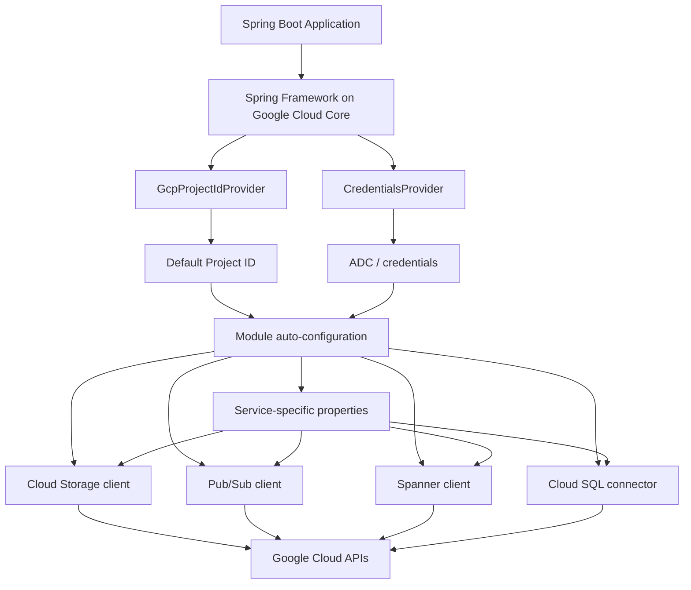

# Customizing Clients, Credentials Providers, and Project IDs per Service

A Spring Boot application may call multiple Google Cloud services at the same time: Cloud Storage for storing files, Pub/Sub for exchanging events, Spanner for storing data, and Cloud SQL for running a relational database. These services may reside in different projects, yet the application still needs to select the right identity, default project, credentials, and client configuration for each API.

Spring Framework on Google Cloud provides two core components to standardize this:

- **GcpProjectIdProvider** supplies the default Google Cloud Project ID for modules.
- **CredentialsProvider** supplies credentials for Google Cloud Client Libraries to authenticate and call APIs.

Starters auto-configure these two components and create clients for the corresponding services. When behavior needs to be changed, you can use Core-level properties, module-specific properties, customizers supported by the module, or construct a separate client using the Google Cloud Java Client Library.

In the **SPRING_CLOUD_PROVIDER_INTEGRATION** module, we practice integrating Spring Boot with managed services from AWS, Azure, and Google Cloud. This lesson focuses on organizing Google Cloud clients inside a Spring application: distinguishing the default project from the resource project and quota project, adjusting the credentials provider, setting per-service configuration for Pub/Sub/Storage/Spanner/Cloud SQL, and creating custom clients when auto-configuration does not meet requirements.

## 1. Client Configuration Model in Spring Framework on Google Cloud

Each Spring Framework on Google Cloud module typically uses two core pieces of information:

1. **Project ID**: the default project the module uses when an API needs project context or when a resource name does not specify a project.
2. **Credentials**: the identity used to authenticate requests; typically ADC supplied by the runtime environment.

Clients can also have service-specific options:

- Endpoint/host and universe domain.
- Retry, timeout, transport channels, thread count, or connection/session pools.
- Module-specific Project ID.
- Emulator endpoint during development and testing.
- Separate credentials if the module must access a different trust boundary.



**Not every module uses the exact same project ID or client configuration.** Core provides shared defaults; modules can override parts of that information. Therefore, when debugging a request, identify which specific module created the client and which properties applied to that client.

## 2. `GcpProjectIdProvider` and Selecting the Default Project ID

### 2.1. What Is `GcpProjectIdProvider`?

`GcpProjectIdProvider` is a functional interface with the method:

```java
public interface GcpProjectIdProvider {
    String getProjectId();
}
```

The Spring Framework on Google Cloud Core starter automatically creates a `GcpProjectIdProvider` bean. If you declare the property:

```yaml
spring:
  cloud:
    gcp:
      project-id: provider-integration-dev
```

the default provider returns the value of `spring.cloud.gcp.project-id`. This is the clearest way to specify the application's default project.

If the property is not declared, the Spring Framework on Google Cloud documentation describes the default Project ID lookup order as follows:

1. The `GOOGLE_CLOUD_PROJECT` environment variable.
2. The Google App Engine Project ID.
3. The Project ID in the JSON credentials file pointed to by `GOOGLE_APPLICATION_CREDENTIALS`.
4. The default project in the Google Cloud SDK.
5. The Project ID retrieved from the Google Compute Engine Metadata Server.

This order is the library's default project discovery mechanism. Never use it to infer the principal, IAM roles, or resource-owning project.

### 2.2. Setting the Project via Property or Environment

In deployment environments, you can set the project via an environment variable:

```bash
export GOOGLE_CLOUD_PROJECT="provider-integration-prod"
```

Or declare it in Spring configuration:

```yaml
spring:
  cloud:
    gcp:
      project-id: ${GOOGLE_CLOUD_PROJECT:provider-integration-dev}
```

Spring Boot supports profile-specific property sources. Example:

```yaml
# application-dev.yml
spring:
  cloud:
    gcp:
      project-id: provider-integration-dev
```

```yaml
# application-prod.yml
spring:
  cloud:
    gcp:
      project-id: provider-integration-prod
```

When a profile is activated, the application receives the corresponding default project. Avoid using the production project as a fallback for local environments; if the environment variable is missing, a local application should point to a dev project or fail startup via validation.

### 2.3. When Is a Custom `GcpProjectIdProvider` Needed?

Normally `spring.cloud.gcp.project-id` is enough. A custom provider fits when the default project is determined by application-specific configuration, such as a tenant, deployment cell, or fixed routing rule.

Example:

```java
import com.google.cloud.spring.core.GcpProjectIdProvider;
import org.springframework.beans.factory.annotation.Value;
import org.springframework.context.annotation.Bean;
import org.springframework.context.annotation.Configuration;

@Configuration
public class GoogleCloudProjectConfiguration {

    @Bean
    GcpProjectIdProvider applicationProjectIdProvider(
            @Value("${app.gcp.default-project}") String projectId) {
        return () -> projectId;
    }
}
```

Core auto-configuration provides a default bean when no bean of the same type exists. When you register a custom bean, the application's provider replaces the default provider and may affect multiple modules that rely on the default project.

Never build a provider by parsing a service account email or inferring the project from the principal. A service account in project A can still be granted permissions on resources in project B. Choose the Project ID according to your resource topology and deployment configuration.

## 3. `CredentialsProvider` and ADC Across Google Cloud Clients

### 3.1. What Does `CredentialsProvider` Do?

`CredentialsProvider` is an interface from Google API Client Libraries with a method supplying credentials to clients:

```java
public interface CredentialsProvider {
    Credentials getCredentials() throws IOException;
}
```

In Spring Framework on Google Cloud, the Core starter auto-configures a bean of type `com.google.api.gax.core.CredentialsProvider`. By default, this provider uses **Application Default Credentials (ADC)**.

ADC can obtain credentials from:

- A local ADC file created by `gcloud auth application-default login`.
- A service account attached to a VM, Cloud Run, or Google Cloud runtime environment.
- A Workload Identity Federation credential configuration pointed to by `GOOGLE_APPLICATION_CREDENTIALS`.
- Another credential source supported by the Google Auth Library.

As a result, business code does not need to read key files, call OAuth token endpoints, or manually refresh access tokens.

### 3.2. Core Credentials Properties

The Core module supports the following properties:

| Property | Purpose | Notes |
| --- | --- | --- |
| `spring.cloud.gcp.credentials.location` | Spring Resource pointing to credentials JSON | Documentation primarily describes it for service account key files |
| `spring.cloud.gcp.credentials.encoded-key` | Base64-encoded JSON credentials | Base64 is not encryption |
| `spring.cloud.gcp.credentials.scopes` | Comma-separated list of OAuth scopes | Supports the `DEFAULT_SCOPES` placeholder |

Example syntax referencing a resource file:

```yaml
spring:
  cloud:
    gcp:
      credentials:
        location: file:/run/secrets/gcp-service-account.json
```

This property is used when an explicit credentials file must be loaded. If the workload already uses ADC with an attached service account or WIF, let Core use ADC. Avoid declaring an explicit key file that causes the application to pick a different identity than the designed runtime identity.

The default credentials provider evaluates configuration sources in order: the credentials file at the `location` property, the JSON key declared via `encoded-key`, and then the default credentials of Google Cloud Client Libraries. When an explicit source is provided, the provider uses it instead of subsequent sources. Therefore, a single leftover credentials property can stop the application from using ADC as intended.

`encoded-key` is only a Base64 representation of the JSON. Anyone possessing this value can decode the private key. Never commit that value to a repository, log it, or put it inside a Docker image.

### 3.3. Scopes and IAM Are Two Separate Layers

The `spring.cloud.gcp.credentials.scopes` property lets you customize the OAuth scopes of credentials provided by Core. Example:

```yaml
spring:
  cloud:
    gcp:
      credentials:
        scopes: DEFAULT_SCOPES,https://www.googleapis.com/auth/cloud-vision
```

`DEFAULT_SCOPES` represents the starter's default scopes; you can append scopes for services you need. Core documentation also lists default scopes per integration module.

OAuth scopes define the API scope requested for the access token. IAM roles/permissions define which resources the principal can operate on. A broad scope does not grant permission to read a bucket or publish to a topic. When encountering `PERMISSION_DENIED`, inspect IAM policies and resource scopes before changing scopes.

### 3.4. When Is a Custom `CredentialsProvider` Needed?

If ADC meets your needs, there is no reason to create a custom provider. Only replace the provider when the application has a special credentials workflow, such as integrating a credential broker layer or a controlled internal token-issuing mechanism.

Core auto-configuration creates the default provider conditionally on a missing bean. You can register a bean of the same type to replace it:

```java
import com.google.api.gax.core.CredentialsProvider;
import com.google.auth.oauth2.GoogleCredentials;
import org.springframework.context.annotation.Bean;
import org.springframework.context.annotation.Configuration;

@Configuration
public class GoogleCredentialsConfiguration {

    @Bean
    CredentialsProvider applicationCredentialsProvider() {
        return GoogleCredentials::getApplicationDefault;
    }
}
```

This is a minimal example showing how a bean can supply ADC. If you only need standard ADC, keep auto-configuration so Spring Framework on Google Cloud manages scopes and default configuration.

When replacing the provider yourself, the application team is responsible for ensuring:

- Credentials support refresh when the access token expires.
- Scopes and quota project match the APIs being called.
- Credentials are not cached as a static access token.
- Other modules should genuinely share this provider rather than needing separate providers.
- Replacing the provider does not unintentionally disable Core credentials configuration.

Never return a fixed `AccessToken` and hold it forever in a bean. Tokens expire; use a credentials type capable of refreshing tokens through Google Auth Library mechanisms.

## 4. Distinguishing Project ID, Resource Project, and Quota Project

An application can involve three different projects in a single request:

| Value | Meaning | Example |
| --- | --- | --- |
| **Spring default Project ID** | Project Core supplies to modules if not overridden | `provider-integration-prod` |
| **Resource project** | Project owning the specific bucket, topic, database, secret, or resource name | `orders-data-prod` |
| **Quota project** | Project used for quota/billing on APIs supporting the quota project mechanism | `platform-billing-prod` |

Credentials determine the principal. The default Project ID determines the module's context. A resource name can explicitly identify the resource-owning project. Quota project is separate request/credentials metadata. Never substitute one value for the others.

For example, a service account in project `application-prod` has permission to publish to a topic in project `messaging-prod`. Spring can use `application-prod` as its default project, while passing the topic in full resource-name form:

```java
String topicName =
        "projects/messaging-prod/topics/orders-created";

pubSubTemplate.publish(topicName, "order-created");
```

The full resource name specifies the project owning the topic. The principal in ADC remains the identity selected from the runtime environment.

If an API requires a quota project, configure the quota project separately per API instructions and ensure the principal holds permission to use that quota project. The quota project does not alter the IAM policy of the topic, bucket, or database.

## 5. Service-Specific Configuration in Google Cloud

Spring Framework on Google Cloud modules support service-specific properties. These properties can override Core configuration when a service needs a different project or different credentials.

### 5.1. Common Properties Table

| Service | Dedicated Project ID | Dedicated Credentials | Notable Client Configuration |
| --- | --- | --- | --- |
| Core | `spring.cloud.gcp.project-id` | `spring.cloud.gcp.credentials.*` | Scopes, enabling/disabling Core |
| Pub/Sub | `spring.cloud.gcp.pubsub.project-id` | `spring.cloud.gcp.pubsub.credentials.*` | Emulator host, publisher/subscriber endpoints, batching, ordering |
| Cloud Storage | No dedicated `project-id` property in the current Storage config table | `spring.cloud.gcp.storage.credentials.*` | Host, universe domain, auto-create files |
| Spanner | `spring.cloud.gcp.spanner.project-id` | `spring.cloud.gcp.spanner.credentials.*` | Instance, database, session pool, emulator, SpannerOptionsCustomizer |
| Cloud SQL | Project embedded in `spring.cloud.gcp.sql.instance-connection-name` | `spring.cloud.gcp.sql.credentials.*` | IAM DB auth, targetPrincipal, delegates, refresh strategy |
| Datastore | `spring.cloud.gcp.datastore.project-id` | `spring.cloud.gcp.datastore.credentials.*` | Database ID, namespace, host/emulator |
| Firestore | `spring.cloud.gcp.firestore.project-id` | `spring.cloud.gcp.firestore.credentials.*` | Database ID, host-port/emulator |
| BigQuery | `spring.cloud.gcp.bigquery.project-id` | `spring.cloud.gcp.bigquery.credentials.*` | Dataset, endpoint, batch size |
| Cloud Monitoring | `spring.cloud.gcp.metrics.project-id` | `spring.cloud.gcp.metrics.credentials.*` | Enable/disable Micrometer metrics |
| Cloud Trace | `spring.cloud.gcp.trace.project-id` | `spring.cloud.gcp.trace.credentials.*` | Sampling, endpoint, and trace configuration |
| Cloud KMS | `spring.cloud.gcp.kms.project-id` | `spring.cloud.gcp.kms.credentials.location` | Endpoint and universe domain |
| Secret Manager | `spring.cloud.gcp.secretmanager.project-id` | `spring.cloud.gcp.secretmanager.credentials.*` | Secret Config Data, template, refresh |

Property names and customization capabilities depend on the module/version. Check the reference documentation for your exact release line before using a property in production.

**Special note on Cloud Storage:** the Storage module has configuration for credentials, host, and universe domain; the current reference does not list a `spring.cloud.gcp.storage.project-id` property. If you need project context for operations such as creating/listing buckets, configure the `StorageOptions` client with an explicit project ID or use APIs accepting full resource names.

### 5.2. Pub/Sub: API Project, Resource Name, and Emulator

Pub/Sub supports:

- `spring.cloud.gcp.pubsub.project-id` to set the default project for the Pub/Sub module.
- `spring.cloud.gcp.pubsub.credentials.location` and `encoded-key` to use separate credentials.
- `spring.cloud.gcp.pubsub.emulator-host` to connect to the Pub/Sub Emulator during local development.
- Publisher/subscriber endpoints, retry, and batching to tune client behavior.

Example configuring a separate project:

```yaml
spring:
  cloud:
    gcp:
      pubsub:
        project-id: messaging-prod
```

If a topic belongs to another project, pass the full resource name `projects/[PROJECT_ID]/topics/[TOPIC_ID]` when publishing. This is useful when one application sends events to multiple projects.

Example local profile with emulator:

```yaml
# application-local.yml
spring:
  cloud:
    gcp:
      pubsub:
        project-id: provider-integration-local
        emulator-host: localhost:8085
```

Never set emulator host in production configuration. Emulators are strictly for development and testing; IAM, quotas, and endpoints of the real service behave differently.

When using message ordering across multiple publishers, Pub/Sub documentation recommends sending messages to the same regional endpoint so messages pass through the same region. For example, a publisher endpoint takes the form `us-east1-pubsub.googleapis.com:443`; configure this only when your architecture requires regional ordering.

### 5.3. Cloud Storage: Client and Host

The Storage starter auto-configures a `Storage` bean using Core's credentials provider. Applications can inject that bean:

```java
import com.google.cloud.storage.BlobInfo;
import com.google.cloud.storage.Storage;
import org.springframework.stereotype.Service;

@Service
public class InvoiceStorageService {

    private final Storage storage;

    public InvoiceStorageService(Storage storage) {
        this.storage = storage;
    }

    public void upload(String bucket, String objectName, byte[] data) {
        storage.create(
                BlobInfo.newBuilder(bucket, objectName).build(),
                data);
    }
}
```

Notable Storage properties:

```yaml
spring:
  cloud:
    gcp:
      storage:
        enabled: true
        auto-create-files: false
        host: storage.googleapis.com/
        universe-domain: googleapis.com
```

`auto-create-files` determines whether the module automatically creates buckets/objects when writing to a non-existent location. In production, avoid letting business applications accidentally create buckets due to a misconfigured name. Provision resources via IaC or administrative workflows prior to deployment.

`host` and `universe-domain` configure the corresponding endpoints. Only change `host` for compatibility requirements, emulated environments, or another Google Cloud universe; never set an arbitrary endpoint, as doing so could send credentials and data to an untrusted host.

### 5.4. Spanner: Project, Instance, Database, and Options

Spanner requires three separate pieces of information:

- Project ID where the API/resource is managed.
- Instance ID.
- Database ID.

Example:

```yaml
spring:
  cloud:
    gcp:
      spanner:
        project-id: orders-data-prod
        instance-id: orders-instance
        database: orders
        max-sessions: 300
```

Session pool, RPC channel count, and prefetch properties affect connection resources. Do not increase the session pool arbitrarily; account for replica count, concurrency, transaction duration, and the instance's session quota.

Spanner supports `SpannerOptionsCustomizer` to customize `SpannerOptions.Builder` when standard properties are not enough:

```java
import com.google.cloud.spring.autoconfigure.spanner.SpannerOptionsCustomizer;
import org.springframework.context.annotation.Bean;
import org.springframework.context.annotation.Configuration;

@Configuration
public class SpannerClientConfiguration {

    @Bean
    SpannerOptionsCustomizer spannerOptionsCustomizer() {
        return builder -> builder.setNumChannels(8);
    }
}
```

A customizer should only alter options the application actually needs. Where a property already exists, prefer the property so configuration stays clearer and easier to inspect.

The Spanner Emulator can be enabled with `spring.cloud.gcp.spanner.emulator.enabled` and `emulator-host`. The emulator stores data in memory by default, serving development/testing rather than replacing a production database.

### 5.5. Cloud SQL: Project Embedded in Instance Connection Name

The Cloud SQL JDBC starter expects the connection name in the format:

```text
PROJECT_ID:REGION:INSTANCE_NAME
```

Example:

```yaml
spring:
  cloud:
    gcp:
      sql:
        instance-connection-name: provider-integration-prod:asia-southeast1:orders-db
        database-name: orders
        ip-types: PRIVATE,PUBLIC
```

The Cloud SQL starter creates the DataSource/connection configuration from this property. The project in the instance connection name is the project hosting the Cloud SQL instance; it does not have to match `spring.cloud.gcp.project-id`.

The SQL module can use separate credentials via `spring.cloud.gcp.sql.credentials.location` or `encoded-key`. In addition, `spring.cloud.gcp.sql.targetPrincipal` lets you specify a service account to impersonate while connecting to Cloud SQL and calling the Admin API. Use it only if impersonation permissions are configured and there is a clear requirement.

If using IAM database authentication for PostgreSQL, configure `spring.cloud.gcp.sql.enableIamAuth` and the corresponding database user. Google Cloud IAM permissions do not automatically grant SELECT/INSERT privileges inside PostgreSQL; database/schema/table privileges must still be granted as required.

## 6. Creating a Dedicated Client When an Application Uses Multiple Projects

There are cases where one Spring Boot service must access two buckets in two projects or two Pub/Sub API projects. If a module only provides one default bean, you can create a separate client using the Google Cloud Java Client Library and give the bean a clear name.

Example creating a separate Storage client for an archive store:

```java
import com.google.api.gax.core.CredentialsProvider;
import com.google.cloud.storage.Storage;
import com.google.cloud.storage.StorageOptions;
import java.io.IOException;
import org.springframework.beans.factory.annotation.Qualifier;
import org.springframework.beans.factory.annotation.Value;
import org.springframework.context.annotation.Bean;
import org.springframework.context.annotation.Configuration;

@Configuration
public class MultiProjectStorageConfiguration {

    @Bean
    @Qualifier("archiveStorage")
    Storage archiveStorage(
            CredentialsProvider credentialsProvider,
            @Value("${app.gcp.archive-project-id}") String projectId)
            throws IOException {

        return StorageOptions.newBuilder()
                .setProjectId(projectId)
                .setCredentials(credentialsProvider.getCredentials())
                .build()
                .getService();
    }
}
```

Inject the dedicated client using a qualifier:

```java
@Service
public class ArchiveService {

    private final Storage archiveStorage;

    public ArchiveService(
            @Qualifier("archiveStorage") Storage archiveStorage) {
        this.archiveStorage = archiveStorage;
    }
}
```

In this example, the credentials provider still uses the active ADC identity, while the Storage client has its own project context. The service account must be granted permissions on the bucket in the archive project.

Never create a new client per request. Google Cloud Client Libraries are designed to create a client once, reuse it across the application's lifecycle, and close it on application shutdown if the API requires closing.

### When Should You Create a Separate Client?

- One service must access resources across multiple projects.
- Each client needs a different endpoint or retry policy.
- One test slice needs an emulator while another profile uses the real service.
- One service needs a different identity due to permission boundaries or operational ownership.
- You need control over transport/client options that the starter does not expose as properties.

If you only need to change the default project for a module, prefer the module's property. Do not build a custom client just to change an already-exposed property.

## 7. Separating Configuration by Environment and by Service

A multi-service configuration can be organized as follows:

```yaml
# application.yml
spring:
  application:
    name: orders-api
  cloud:
    gcp:
      project-id: ${GOOGLE_CLOUD_PROJECT}
      pubsub:
        project-id: ${PUBSUB_PROJECT_ID}
      spanner:
        project-id: ${SPANNER_PROJECT_ID}
        instance-id: ${SPANNER_INSTANCE}
        database: ${SPANNER_DATABASE}
      sql:
        instance-connection-name: ${CLOUD_SQL_INSTANCE}
        database-name: orders

app:
  gcp:
    archive-project-id: ${ARCHIVE_PROJECT_ID}
```

Local profile:

```yaml
# application-local.yml
spring:
  cloud:
    gcp:
      pubsub:
        emulator-host: localhost:8085
      spanner:
        emulator:
          enabled: true
        emulator-host: localhost:9010
```

Production profiles must never declare emulators. Production identity should come from an attached service account or Workload Identity Federation. Never store private keys in `application.yml`.

Use environment variables to deploy the same artifact to dev/staging/prod. If multiple modules have separate project IDs, name environment variables per service—for example `PUBSUB_PROJECT_ID`, `SPANNER_PROJECT_ID`, and `ARCHIVE_PROJECT_ID`—rather than using one shared variable and implicitly assuming all resources live in the same project.

## 8. Managing Scopes, Credentials, and Security Boundaries

When a module has its own credentials, module properties can override Core credentials. This is helpful when one application must call two services using two different identities, but it can also create configuration that is hard to govern.

Example:

```yaml
spring:
  cloud:
    gcp:
      project-id: provider-integration-prod
      pubsub:
        project-id: messaging-prod
      storage:
        credentials:
          location: file:/run/secrets/storage-service-account.json
```

In this configuration, Pub/Sub uses a separate project; Storage is instructed via property to use separate credentials. This is a syntactic example illustrating an override, not a recommended production pattern when WIF/attached identities are available.

Before using a credentials override, answer:

1. Does this service genuinely need a different identity?
2. Does the new principal have least-privilege permissions on the target resource?
3. Do the credentials support safe token refresh rather than being a static token?
4. Can ADC with an attached identity or federation be used instead of a JSON key?
5. Will audit logs clearly distinguish principals when investigating incidents?

If a module needs to use WIF, prefer configuring ADC through a source supported by Google Auth Library, such as `GOOGLE_APPLICATION_CREDENTIALS` pointing to an external account credential configuration. Avoid setting `credentials.location` to a service account key merely to change projects; project ID and credentials are two independent configurations.

## 9. Customizing Bean Lifecycle and Credential Rotation

Spring Framework on Google Cloud starters create beans with singleton scope. This is appropriate for most clients because client creation is relatively expensive and clients are reusable.

If an application needs to refresh beans when credentials or configuration change, Spring Framework on Google Cloud documentation notes two approaches:

- Annotate custom beans with `@RefreshScope` if the application defined those beans itself.
- Add auto-configured beans to `spring.cloud.refresh.extra-refreshable` if they support refresh.

Example making certain Pub/Sub beans refreshable:

```yaml
spring:
  cloud:
    refresh:
      extra-refreshable:
        - com.google.cloud.spring.pubsub.support.SubscriberFactory
        - com.google.cloud.spring.pubsub.core.subscriber.PubSubSubscriberTemplate
```

Not every bean can be refreshed safely. `SmartLifecycle` components such as Spring Integration adapters may need to stop and restart when underlying dependencies refresh. Do not treat refresh scope as a replacement for platform credential rotation workflows.

With ADC and attached service accounts, Google Auth Library refreshes access tokens automatically; normally you do not need to restart the application just because an access token expires. If a private key or external identity configuration changes, follow the appropriate deployment/rotation procedure and test active clients.

## 10. Testing Clients and Per-Service Configuration

### 10.1. Separating Local and Production Profiles

Use a local profile to enable emulators or mock endpoints. Use a production profile to connect to real endpoints and obtain credentials from the runtime identity. Never enable emulators via a shared environment variable that could accidentally remain set in production deployments.

### 10.2. Testing Project ID

You can test the provider injected by Spring:

```java
import com.google.cloud.spring.core.GcpProjectIdProvider;
import org.springframework.stereotype.Component;

@Component
public class GcpConfigurationProbe {

    private final GcpProjectIdProvider projectIdProvider;

    public GcpConfigurationProbe(GcpProjectIdProvider projectIdProvider) {
        this.projectIdProvider = projectIdProvider;
    }

    public String defaultProjectId() {
        return projectIdProvider.getProjectId();
    }
}
```

In tests, set properties explicitly and assert the provider returns the expected project. For modules with dedicated project properties, verify that specific configuration and the final resource name used by the client.

Never log credentials or access tokens in tests. Log only the Project ID, non-sensitive endpoints, and module names when diagnostics are needed.

### 10.3. Testing Credentials and Permissions

A configuration test can verify that Spring creates the client bean, but it does not prove that the principal holds IAM permissions on real resources. Separate your tests:

- **Configuration test:** properties bind correctly, client beans are created, and project ID/endpoints are right.
- **Integration test with emulator:** verifies application logic and serialization without calling production services.
- **Integration test with sandbox project:** verifies IAM, credentials, and real APIs using a least-privilege test identity.
- **Production smoke test:** performs only safe, observable operations that do not mutate business data.

Never use a production project for tests that create/delete resources or produce side effects. Never use a user ADC with Owner to stand in for a runtime service account in integration tests; test using impersonation or the corresponding test identity.

## 11. Troubleshooting: Client Uses the Wrong Project or Credentials

| Symptom | Common Cause | How to Check |
| --- | --- | --- |
| Pub/Sub calls wrong project | Core project ID or Pub/Sub project override is wrong | Check `spring.cloud.gcp.pubsub.project-id` and full topic name |
| Storage creates bucket in wrong project | Storage client did not receive expected project context | Check `StorageOptions.setProjectId` or injected client bean |
| Spanner reports instance not found | Wrong Project ID, instance ID, or database ID | Verify all three Spanner properties and resource path |
| Cloud SQL connects to wrong instance | Instance connection name has wrong project/region/instance | Check `spring.cloud.gcp.sql.instance-connection-name` |
| Client uses unexpected principal | Module credentials override or ADC env var set differently | Check `GOOGLE_APPLICATION_CREDENTIALS`, Core credentials properties, and module properties |
| One module succeeds, another gets 403 | Modules use different credentials or resource projects | Inspect the actual principal and IAM policy on each resource |
| Works locally but fails on Cloud Run | Local ADC user has permissions, runtime service account lacks roles | Check the service account attached to the revision and IAM roles |
| Pub/Sub connects to localhost in production | Emulator profile or env var accidentally enabled | Check `spring.cloud.gcp.pubsub.emulator-host` |
| Spanner uses emulator unintentionally | Emulator profile activated in deployment | Check `spring.cloud.gcp.spanner.emulator.enabled` and host |
| Expired credentials cause repeated errors | Custom provider returns static token or lacks refresh support | Use refreshable credentials and avoid caching access tokens |
| Project ID is null | No matching property/env/runtime metadata found | Set `spring.cloud.gcp.project-id` or `GOOGLE_CLOUD_PROJECT` |
| Quota error despite right resource | Quota project unset or missing permission | Check quota project and `serviceusage.services.use` |
| Custom client bean fails to inject | Multiple beans of same type or missing qualifier | Use `@Qualifier` and distinct bean names |
| Module credentials property has no effect | Module uses a custom CredentialsProvider/Settings bean | Inspect custom beans and auto-configuration conditions |

When receiving `PERMISSION_DENIED`, inspect in order: credentials source → principal → project/resource name → IAM permissions → quota/API enablement. Never grant Owner/Editor or swap all credentials blindly just to make a request succeed.

## 12. Hands-On Exercise: Configuring Orders API to Access Three Projects

Goal: one Spring Boot service with a single runtime identity, using Pub/Sub, Storage, and Spanner across three different projects.

### Step 1 — Define the Project Topology

| Component | Project |
| --- | --- |
| Application and runtime identity | `provider-integration-prod` |
| Pub/Sub topic | `messaging-prod` |
| Invoice bucket | `archive-prod` |
| Spanner instance/database | `orders-data-prod` |

Create the runtime service account in the application project and grant exact roles on the corresponding topic, bucket, and database.

### Step 2 — Configure Project and Modules

```yaml
spring:
  cloud:
    gcp:
      project-id: provider-integration-prod
      pubsub:
        project-id: messaging-prod
      spanner:
        project-id: orders-data-prod
        instance-id: orders-instance
        database: orders
```

If the Storage client needs a dedicated project context for bucket management operations, create a separate bean with `StorageOptions.setProjectId("archive-prod")`; object operations still use the designated bucket name.

### Step 3 — Use One ADC Identity

- Local: create ADC via user or test-runtime service account impersonation.
- Cloud Run: attach the runtime service account.
- Do not declare JSON keys in `application.yml`.
- Verify `GOOGLE_APPLICATION_CREDENTIALS` does not override the intended credential source.

### Step 4 — Test Each Client

- Publish a message to `projects/messaging-prod/topics/orders-created`.
- Write a test object to the invoice bucket in the archive project.
- Execute a read query against the Spanner database in the orders-data project.
- Record the project ID, resource name, and principal for each operation.

### Step 5 — Verify Permission Boundaries

Try an out-of-scope operation, such as deleting a bucket or creating a topic. The request must be denied if the runtime identity lacks that permission. If the operation succeeds, check for inherited permissions from project/folder/organization and any credentials overrides.

### Step 6 — Compare Local and Production

Run the exact same image with the local profile and on Cloud Run. Expected results:

- Business code needs no credential changes.
- Default project and per-service projects keep their exact configuration.
- Local and production use the principal appropriate to each environment.
- Client endpoints/emulators are enabled only in the appropriate profile.
- Audit logs reflect the exact runtime service account when calling real services.

## 13. Key Takeaways

- Spring Framework on Google Cloud Core provides **GcpProjectIdProvider** and **com.google.api.gax.core.CredentialsProvider**.
- **spring.cloud.gcp.project-id** sets the default Project ID; if omitted, the provider uses the library's project discovery rules.
- Credentials identify the principal; Project ID sets the default context; resource project and quota project can differ.
- Core defaults to ADC. In production, prefer an attached service account or Workload Identity Federation.
- **spring.cloud.gcp.credentials.location** and **encoded-key** are explicit credential options; avoid long-lived service account keys when ADC satisfies requirements.
- Pub/Sub, Spanner, Datastore, Firestore, Metrics, BigQuery, KMS, and several other modules have dedicated project ID properties; Storage uses client project context and does not have a dedicated `project-id` property in the current Storage reference.
- Pub/Sub supports full resource names to access topics in another project; Cloud SQL specifies project/region/instance via the instance connection name.
- Use module properties before building custom clients. When a second client is needed, create a dedicated bean, apply a qualifier, and reuse the client.
- **SpannerOptionsCustomizer** is the extension point for tuning **SpannerOptions.Builder**; other modules provide their own customizers per module documentation.
- When replacing `CredentialsProvider`, preserve refresh capability, scopes, and quota project; never cache static access tokens.
- Separate local/emulator profiles from production; inspect project, principal, resource name, and IAM policies when troubleshooting.

## Official References

1. [Spring Framework on Google Cloud — Reference Documentation](https://googlecloudplatform.github.io/spring-cloud-gcp/reference/html/)
2. [Spring Framework on Google Cloud Core — Project ID and CredentialsProvider](https://googlecloudplatform.github.io/spring-cloud-gcp/6.4.0/reference/html/core.html)
3. [Spring Framework on Google Cloud 7.5.2 — compatibility matrix and BOM](https://googlecloudplatform.github.io/spring-cloud-gcp/reference/html/)
4. [Cloud Storage — configuration and Storage bean](https://googlecloudplatform.github.io/spring-cloud-gcp/reference/html/#cloud-storage)
5. [Cloud Pub/Sub — project, credentials, emulator, and client configuration](https://googlecloudplatform.github.io/spring-cloud-gcp/reference/html/#cloud-pubsub)
6. [Cloud SQL — configuration properties and connection name](https://googlecloudplatform.github.io/spring-cloud-gcp/reference/html/#cloud-sql)
7. [Spring Data Cloud Spanner — configuration and SpannerOptionsCustomizer](https://googlecloudplatform.github.io/spring-cloud-gcp/reference/html/#spring-data-cloud-spanner)
8. [GcpContextAutoConfiguration — default providers and ConditionalOnMissingBean](https://googleapis.dev/java/spring-cloud-gcp/latest/com/google/cloud/spring/autoconfigure/core/GcpContextAutoConfiguration.html)
9. [SpannerOptionsCustomizer — API reference](https://googleapis.dev/java/spring-cloud-gcp/latest/com/google/cloud/spring/autoconfigure/spanner/SpannerOptionsCustomizer.html)
10. [StorageOptions.Builder — setProjectId, setCredentials, and client options](https://docs.cloud.google.com/java/docs/reference/google-cloud-storage/latest/com.google.cloud.storage.StorageOptions.Builder)
11. [Authenticate with Google Cloud Client Libraries — ADC](https://docs.cloud.google.com/docs/authentication/client-libraries)

Properties and APIs in this lesson are cross-checked against Spring Framework on Google Cloud reference 7.5.2 at the time of writing. Before upgrading, check the compatibility matrix across Spring Framework on Google Cloud, Spring Boot, Spring Cloud, and Java; do not copy properties from older release lines without verification.
