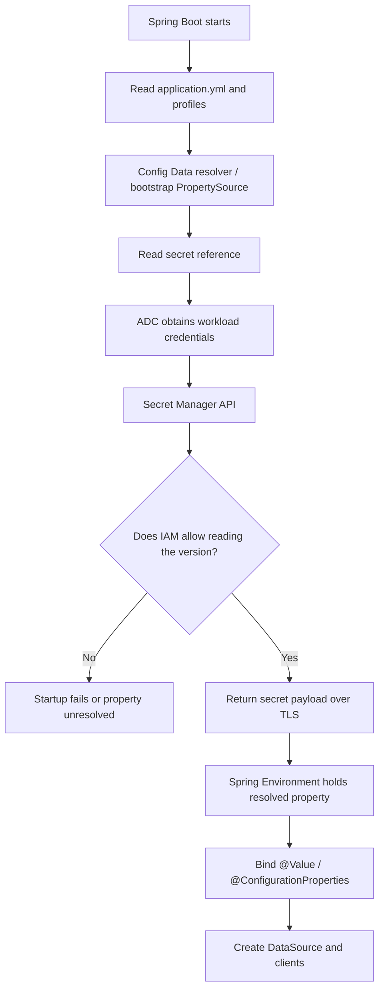

# Loading Secret Manager into Spring Configuration by Library Version

A Spring Boot application often needs database passwords, partner API keys, or credentials to connect to managed services. Placing real values in `application.yml`, committing `.env` files, passing them via Docker `ARG`, or printing the full configuration to logs can copy secrets into Git, build caches, image layers, CI artifacts, and observability systems. Removing the configuration line from source code afterward does not revoke an exposed credential.

This lesson belongs to the **Google Cloud Configuration** chapter of the **SPRING_CLOUD_PROVIDER_INTEGRATION** module. When integrating Spring Boot with managed services on AWS, Azure, and Google Cloud via the corresponding Spring Cloud libraries, this lesson focuses on how to **load Google Cloud Secret Manager secrets into Spring configuration**, choose the right starter/BOM for Spring Boot, authenticate with Application Default Credentials (ADC), restrict read permissions, and handle secret updates.

A key point to note is that **the syntax and mechanism for loading Secret Manager change across versions of Spring Framework on Google Cloud**. Older branches use a bootstrap property source; newer branches use the Spring Boot Config Data API; starting from version 6.0, a new reference syntax is introduced. Choosing the wrong syntax or BOM can cause the application to fail to resolve placeholders or fail at startup before creating beans.

## 1. Learning Objectives

After this lesson, you will be able to:

- Explain the role of Google Cloud Secret Manager in Spring Boot configuration.
- Choose the right Spring Framework on Google Cloud branch for your Spring Boot/Spring Cloud version.
- Distinguish between **bootstrap property source**, **Spring Boot Config Data resource**, and **SecretManagerTemplate**.
- Configure the BOM dependency and the spring-cloud-gcp-starter-secretmanager starter.
- Write the correct sm:// or sm@ syntax for your library version, including global secrets, regional secrets, and specific versions.
- Use ADC/workload identity to read secrets without packaging a service account private key into the application.
- Bind secrets into @Value or @ConfigurationProperties, understanding load timing and how refresh works.
- Diagnose errors involving wrong version, wrong project, missing IAM permissions, nonexistent secrets/versions, and inactive bootstrap.

## 2. How Is Secret Manager Loaded into Spring?

Google Cloud Secret Manager stores secret values as a **secret** and **secret versions**. Each secret can have multiple versions; applications typically read a specific version or the latest alias. Secret Manager does not automatically turn every secret in a project into a Spring property. The application must declare **references to the secrets it needs**, and the runtime identity must have permission to access those secret values.

There are three components to distinguish:

| Component | Responsibility | When to Use |
| --- | --- | --- |
| **Secret Manager Config Data resource / PropertySource** | Resolves secret references into properties in Spring's Environment | Configuring datasources, API keys, signing keys, or properties needed immediately at application startup |
| **SecretManagerTemplate** | Provides an API to read, create, update, or manipulate secrets programmatically | Business flows that need to read secrets by name/version at runtime, or secret administration tools |
| **Google Secret Manager Java client** | Native Google Cloud API, independent of Spring abstractions | Custom integrations or when not using the starter |

Typical configuration loading flow:



In the branch using the Config Data API, the resolver participates in Spring Boot's external configuration loading process. In older branches, the property source is loaded during Spring Cloud's bootstrap phase. Despite the different mechanisms, both require valid credentials and IAM permissions on the target secret.

**This is startup-time configuration loading.** Changing a secret in Google Cloud Secret Manager does not mean every running bean automatically receives the new value. To support hot updates, you must explicitly design refresh/reload handling or roll out the application.

## 3. Choose the Library Version Before Writing Configuration

The library's current name is **Spring Framework on Google Cloud** (previously often called Spring Cloud GCP). Do not pick the latest starter version and attach it to just any Spring Boot version. Spring Framework, Spring Cloud, and Spring Boot components must fall within a combination supported by the project.

The compatibility table below is based on the official project documentation as of **24-11-2026**:

| Spring Framework on Google Cloud | Spring Cloud release train | Compatible Spring Boot | Status per project documentation |
| --- | --- | --- | --- |
| **8.x** — e.g., 8.3.1 | 2025.1.x (Oakwood) | 4.0.x, 4.1.x | Supported |
| **7.x** — e.g., 7.5.2 | 2025.0.x (Northfields) | 3.5.x | Supported |
| **6.x** — e.g., 6.5.12 | 2024.0.x (Moorgate) | 3.4.x | Critical patches only |
| **5.x** — e.g., 5.13.12 | 2023.0.x (Leyton) | 3.2.x, 3.3.x* | Out of support |
| **4.x** — e.g., 4.11.3 | 2022.0.x (Kilburn) | 3.0.x, 3.1.x | Out of support |
| **3.x** — e.g., 3.9.19 | 2021.0.x (Jubilee) | 2.6.x, 2.7.x | Critical patches only |

*The 5.x branch has a compatibility exception for the Trace module on certain Boot 3.2.x versions. The table above is for selecting the overall library line; when using other modules, check each module's specific compatibility.*

You can choose as follows:

- Projects on **Spring Boot 4.0/4.1**: choose Spring Framework on Google Cloud 8.x and Spring Cloud 2025.1.x.
- Projects on **Spring Boot 3.5**: choose the 7.x line.
- Projects on **Spring Boot 3.4**: the 6.x line is compatible but currently receives only critical patches; plan an upgrade.
- Legacy projects on Boot 3.2/3.3, 3.0/3.1, or 2.6/2.7: clearly identify the support status before keeping them as-is. Do not upgrade only the Secret Manager starter beyond the BOM in use.

**Rule:** choose the Spring Boot and Spring Cloud release train first; then choose the compatible Spring Framework on Google Cloud line. Do not force a newer BOM version into a project just to use the new secret syntax.

## 4. Add the Dependency and Manage the BOM

The starter used for Secret Manager integration is:

```text
com.google.cloud:spring-cloud-gcp-starter-secretmanager
```

You should import the **Spring Framework on Google Cloud BOM** so modules in the same line have consistent versions. The following example is for a **Spring Boot 4.0/4.1** project using the 8.x line, with BOM 8.3.1:

### Maven

```xml
<dependencyManagement>
    <dependencies>
        <dependency>
            <groupId>com.google.cloud</groupId>
            <artifactId>spring-cloud-gcp-dependencies</artifactId>
            <version>8.3.1</version>
            <type>pom</type>
            <scope>import</scope>
        </dependency>
    </dependencies>
</dependencyManagement>

<dependencies>
    <dependency>
        <groupId>com.google.cloud</groupId>
        <artifactId>spring-cloud-gcp-starter-secretmanager</artifactId>
    </dependency>
</dependencies>
```

### Gradle

```kotlin
dependencies {
    implementation(platform("com.google.cloud:spring-cloud-gcp-dependencies:8.3.1"))
    implementation("com.google.cloud:spring-cloud-gcp-starter-secretmanager")
}
```

Examples using specific versions in this lesson should be interpreted according to their corresponding BOM:

| Spring Boot | Illustrated BOM line | Starter version |
| --- | --- | --- |
| 4.0/4.1 | spring-cloud-gcp-dependencies:8.3.1 | Managed by BOM |
| 3.5 | spring-cloud-gcp-dependencies:7.5.2 | Managed by BOM |
| 3.4 | spring-cloud-gcp-dependencies:6.5.12 | Managed by BOM |

Do not declare a separate version for spring-cloud-gcp-starter-secretmanager when the BOM is already imported. If other Spring Cloud dependencies also have a BOM, check the project's BOM combination guidelines and dependency management order to avoid version conflicts.

## 5. Syntax by Version: bootstrap, sm://, and sm@

This is the most important part of the lesson. The same secret can be referenced differently depending on the Spring Framework on Google Cloud line.

| Library line | Loading mechanism | Secret syntax | Commonly used config file |
| --- | --- | --- | --- |
| **2.x–3.x** | Spring Cloud Bootstrap PropertySource | sm://... | bootstrap.yml/bootstrap.properties for bootstrap settings; references can reside in application config |
| **4.x–5.x** | Spring Boot Config Data API | sm://... | application.yml/application.properties with spring.config.import |
| **6.x–8.x** | Spring Boot Config Data API | **sm@...** is recommended | application.yml/application.properties with spring.config.import |

### 5.1. The 3.x branch: bootstrap property source

In Spring Framework on Google Cloud 3.x, Secret Manager integrates as a **bootstrap property source**. Activation settings and the default project are placed in bootstrap.yml or bootstrap.properties, for example:

```yaml
spring:
  cloud:
    gcp:
      secretmanager:
        enabled: true
        project-id: invoice-prod
```

In application.yml, reference the secret using the sm:// syntax:

```yaml
spring:
  datasource:
    password: "${sm://projects/invoice-prod/secrets/invoice-db-password/versions/latest}"
```

The bootstrap phase must be enabled according to the project's Spring Cloud configuration. If the application does not run a bootstrap context, the Secret Manager property source will not be loaded even if the starter is on the classpath. For applications using a separated bootstrap mechanism, verify the use of spring-cloud-starter-bootstrap according to your Spring Cloud version.

Do not take a 3.x bootstrap.yml configuration and copy it verbatim to 6.x/8.x. The old bootstrap mechanism has been replaced by the Config Data API in newer lines.

### 5.2. The 4.x and 5.x branches: Config Data API with sm://

Starting from the 4.x line, Secret Manager is used as a Spring Boot **Config Data resource**. Declare the import in application.yml:

```yaml
spring:
  config:
    import: "sm://"
  cloud:
    gcp:
      secretmanager:
        project-id: invoice-prod

  datasource:
    url: jdbc:postgresql://10.20.0.15:5432/invoice
    username: invoice_app
    password: "${sm://projects/invoice-prod/secrets/invoice-db-password/versions/latest}"
```

The two parts have different meanings:

- spring.config.import: "sm://" registers Secret Manager as a Config Data source.
- A placeholder written in the pattern below specifies the concrete secret to resolve into a property value: sm://projects/PROJECT_ID/secrets/SECRET_ID/versions/VERSION.

This syntax is used in the 4.x and 5.x lines per the corresponding documentation. Do not add spring.cloud.gcp.secretmanager.legacy or old bootstrap settings to a 4.x project just because an outdated guide asks for it; the 4.x migration guide instructs moving to the Config Data API and removing the corresponding legacy settings.

### 5.3. From the 6.x branch: use the sm@ syntax

Starting in **6.0.0**, the library introduced the new **sm@secret_id** syntax. This is the recommended syntax in current branches. The older sm://secret_id syntax may still be accepted for compatibility, but the library emits a warning encouraging migration to sm@.

Example with Spring Boot 4.x and Spring Framework on Google Cloud 8.x:

```yaml
spring:
  config:
    import: "sm@"
  cloud:
    gcp:
      secretmanager:
        project-id: invoice-prod

  datasource:
    url: jdbc:postgresql://10.20.0.15:5432/invoice
    username: invoice_app
    password: "${sm@projects/invoice-prod/secrets/invoice-db-password/versions/latest}"

partner:
  api-key: "${sm@projects/invoice-prod/secrets/partner-api-key}"
```

You can use the short syntax when a default project is already configured:

```yaml
spring:
  config:
    import: "sm@"
  cloud:
    gcp:
      secretmanager:
        project-id: invoice-prod

partner:
  api-key: "${sm@partner-api-key}"
```

The short syntax is convenient but depends on the default project. In multi-project or multi-environment systems, the fully-qualified path form makes it clear which project owns the secret and reduces the risk of resolving against the wrong project.

## 6. Referencing Global, Regional, and Versioned Secrets

Secret Manager supports **global secrets** and **regional secrets**. The sm@ syntax in 6.x and later has several forms:

### 6.1. Global secret

| Notation | Meaning |
| --- | --- |
| sm@projects/PROJECT_ID/secrets/SECRET_ID/versions/VERSION_ID | Explicitly specifies project, secret, and version |
| sm@projects/PROJECT_ID/secrets/SECRET_ID | Explicitly specifies project and secret; uses version latest |
| sm@PROJECT_ID/SECRET_ID/VERSION_ID | Short form with project and version |
| sm@SECRET_ID/VERSION | Uses default project and a specific version |
| sm@SECRET_ID | Uses default project and version latest |

Example:

```yaml
spring:
  config:
    import: "sm@"
  cloud:
    gcp:
      secretmanager:
        project-id: invoice-prod

invoice:
  database:
    password: "${sm@projects/invoice-prod/secrets/invoice-db-password/versions/7}"
  partner:
    api-key: "${sm@projects/invoice-prod/secrets/partner-api-key}"
```

### 6.2. Regional secret

If a secret is created in a specific region, the resource path includes locations/LOCATION_ID:

| Notation | Meaning |
| --- | --- |
| sm@projects/PROJECT_ID/locations/LOCATION_ID/secrets/SECRET_ID/versions/VERSION_ID | Explicitly specifies project, location, secret, and version |
| sm@projects/PROJECT_ID/locations/LOCATION_ID/secrets/SECRET_ID | Explicitly specifies project and location, and uses latest |
| sm@PROJECT_ID/LOCATION_ID/SECRET_ID/VERSION_ID | Short form with project, location, and version |
| sm@locations/LOCATION_ID/SECRET_ID/VERSION | Uses default project and a specific version |
| sm@locations/LOCATION_ID/SECRET_ID | Uses default project and latest |

Example:

```yaml
spring:
  config:
    import: "sm@"

partner:
  api-key: "${sm@projects/invoice-prod/locations/asia-southeast1/secrets/partner-api-key/versions/latest}"
```

Only use a path with locations/... when the secret is actually a regional secret. Do not add a region to the path of a global secret.

### 6.3. Choosing latest or a pinned version?

| Option | Advantage | Considerations |
| --- | --- | --- |
| latest | The application picks up the newest version on the next configuration load | Requires a refresh/redeploy plan after rotation; startups at different times may receive different versions |
| Specific version number | Reproducible configuration and easier rollout/rollback control | Must update the reference to switch versions; pinning an old version too long can retain a revoked credential |

Example using a specific version:

```yaml
spring:
  config:
    import: "sm@"

partner:
  api-key: "${sm@projects/invoice-prod/secrets/partner-api-key/versions/12}"
```

Once version 12 has been tested, the next application release can roll out with version 13. If latest is chosen, the application resolves the alias when loading configuration; **the latest alias is not an automatic polling mechanism while the JVM is running**.

## 7. Default Project and Secret Manager Configuration

There are several common properties:

| Property | Role |
| --- | --- |
| spring.cloud.gcp.secretmanager.enabled | Enables/disables Secret Manager integration in branches that support this property; enabled by default |
| spring.cloud.gcp.secretmanager.project-id | Default project that Secret Manager integration uses to resolve secrets when the reference does not specify a project |
| spring.cloud.gcp.secretmanager.credentials.location | Location of credential resource if overriding ADC is needed |
| spring.cloud.gcp.secretmanager.credentials.encoded-key | Base64-encoded JSON credential key; may be used in some legacy environments but should not be the default choice |
| spring.cloud.gcp.secretmanager.allow-default-secret | Controls behavior when a secret does not exist; false by default |

You can configure the default project ID:

```yaml
spring:
  cloud:
    gcp:
      project-id: invoice-prod
      secretmanager:
        project-id: invoice-prod
```

The two properties have different scopes: spring.cloud.gcp.project-id is the default project for the Google Cloud Core module; spring.cloud.gcp.secretmanager.project-id is the default project for Secret Manager integration. In multi-project setups, specify the project explicitly in the secret's resource path to avoid mistakes.

If no default project is set, the library may infer it from Google Cloud Core configuration or Application Default Credentials depending on the version and credential source. For applications that need to read secrets in a project different from the one running the workload, use the full resource path to clearly state which project owns the secret.

## 8. Authenticating with ADC and Workload Identity

Spring Framework on Google Cloud Secret Manager uses **Application Default Credentials (ADC)** by default. ADC discovers credentials based on the execution environment. This allows the same Spring Boot application to run locally and in the cloud without bundling a private key into the image.

### 8.1. Local development

Developers can set up ADC for Google Cloud Java libraries with:

```bash
gcloud auth application-default login
```

This command creates ADC credentials for client libraries. It is different from gcloud auth login, which primarily authenticates the CLI. The developer account must be granted permission to read secrets in the test project; do not use production secrets to test local configuration unless there is a genuine need and approval.

### 8.2. Cloud Run, Compute Engine, and GKE

On Google Cloud runtimes:

- **Cloud Run:** attach a dedicated service account to the service revision.
- **Compute Engine:** attach a service account to the VM and configure appropriate OAuth scopes.
- **GKE:** use Workload Identity Federation for GKE so Pods receive the configured workload identity.
- **CI/CD outside Google Cloud:** use Workload Identity Federation to exchange OIDC tokens instead of service account key JSON files.

Grant the role roles/secretmanager.secretAccessor to the service account or federated principal on **specific secrets** whenever possible. The core permission to read a payload is secretmanager.versions.access. Example granting permission on a single secret:

```bash
gcloud secrets add-iam-policy-binding invoice-db-password \
  --project=invoice-prod \
  --member="serviceAccount:invoice-api@invoice-prod.iam.gserviceaccount.com" \
  --role="roles/secretmanager.secretAccessor"
```

Ensure the Secret Manager API is enabled in the project containing the secret:

```bash
gcloud services enable secretmanager.googleapis.com \
  --project=invoice-prod
```

**Do not** issue service account key JSON files for Cloud Run/GCE/GKE just to make Secret Manager work. Avoid configuring spring.cloud.gcp.secretmanager.credentials.location or encoded-key to point to static private keys; prefer ADC/workload identity and manage access via IAM.

## 9. Loading Secrets into Properties and Binding to Spring Beans

Once the Config Data resource is declared, you can use a secret reference just like a regular Spring property.

### 9.1. Binding to datasource

```yaml
spring:
  config:
    import: "sm@"
  cloud:
    gcp:
      secretmanager:
        project-id: invoice-prod
  datasource:
    url: jdbc:postgresql://10.20.0.15:5432/invoice
    username: invoice_app
    password: "${sm@projects/invoice-prod/secrets/invoice-db-password/versions/latest}"
```

Spring Boot resolves the placeholder before creating beans that require datasource properties. The secret value never appears in committed configuration files; the file only contains a **resource reference**.

### 9.2. Binding to @ConfigurationProperties

Example partner API configuration:

```yaml
spring:
  config:
    import: "sm@"

partner:
  base-url: https://api.partner.example
  api-key: "${sm@projects/invoice-prod/secrets/partner-api-key/versions/latest}"
```

Java class receiving the resolved properties:

```java
@ConfigurationProperties(prefix = "partner")
public class PartnerProperties {

    private String baseUrl;
    private String apiKey;

    public String getBaseUrl() {
        return baseUrl;
    }

    public void setBaseUrl(String baseUrl) {
        this.baseUrl = baseUrl;
    }

    public String getApiKey() {
        return apiKey;
    }

    public void setApiKey(String apiKey) {
        this.apiKey = apiKey;
    }
}
```

Register the configuration properties with @ConfigurationPropertiesScan on the application class or @EnableConfigurationProperties(PartnerProperties.class) in configuration. When using secrets, avoid implementing toString() on objects holding API keys or logging the entire configuration bean.

### 9.3. Using @Value

If there is only one simple property, you can inject it directly:

```java
@Component
public class PartnerClientFactory {

    private final String apiKey;

    public PartnerClientFactory(
            @Value("${partner.api-key}") String apiKey) {
        this.apiKey = apiKey;
    }

    // Use apiKey to configure the client.
    // Do not write apiKey to logs or exceptions.
}
```

You can reference a secret directly in the annotation using the syntax of your library branch, such as @Value("${sm@my-secret}") on 6.x and above. However, placing the reference in application.yml and binding via a domain property like partner.api-key is usually easier to manage across profiles, testing, and environment changes.

## 10. Dev, Staging, and Production Profiles

The same image can run across multiple environments while secrets differ by environment. Use profile-specific configuration to point to the corresponding secret:

```yaml
# application.yml
spring:
  config:
    import: "sm@"
```

```yaml
# application-dev.yml
partner:
  api-key: "${sm@projects/invoice-dev/secrets/partner-api-key/versions/latest}"
```

```yaml
# application-staging.yml
partner:
  api-key: "${sm@projects/invoice-staging/secrets/partner-api-key/versions/latest}"
```

```yaml
# application-prod.yml
partner:
  api-key: "${sm@projects/invoice-prod/secrets/partner-api-key/versions/latest}"
```

Select the profile at startup via an environment variable or deployment configuration, such as SPRING_PROFILES_ACTIVE=prod. Never commit secret values into profile files; commit only references. Each environment's identity should only be allowed to read its corresponding secrets, so if a staging workload is compromised, access to production does not automatically follow.

Check Spring Boot's **property precedence**. Environment variables, command-line arguments, or other external configs can override a property with the same name depending on source order. If an old PARTNER_API_KEY variable still exists in the deployment, the application may use that value instead of the property from Secret Manager. Control the actual configuration sources rather than looking only at YAML files.

## 11. How Do Config Data API and SecretManagerTemplate Differ?

Both APIs are often used with the same starter, but they serve two different purposes:

| Need | How to Use |
| --- | --- |
| Load DB password immediately when Spring Boot starts | Config Data reference sm@... or sm://... depending on version |
| Bind API key to @ConfigurationProperties | Config Data reference + Spring property binding |
| Read a secret by name/version during a runtime operation | SecretManagerTemplate or Secret Manager Java client |
| Create secrets/versions from an admin tool | SecretManagerTemplate/admin API with a principal that has write permissions |
| Rotate secrets | Create a new version, then refresh/roll out consumers according to plan |

Spring Framework on Google Cloud provides SecretManagerTemplate to simplify reading, creating, and updating secrets. After adding the starter, the application can inject the template and use operations defined in SecretManagerOperations. Choose the right API for the data type and operation needed; do not use the template to replace Config Data resources when the goal is simply to load a property at startup.

Do not use an administrative service with permissions to create/delete secrets as the default credential for every application request. Runtime services typically only need version access permissions; administration/rotation tools have their own principal and permissions.

## 12. Refreshing When a Secret Changes

When Secret Manager creates a new version, a running application **does not automatically re-read every property** just because the reference uses the latest alias. Config Data resources are resolved during configuration loading; beans may already hold the old value.

There are three common strategies:

| Strategy | How It Works | Suitable When |
| --- | --- | --- |
| **Restart/rollout** | Redeploy or restart instances so Spring loads new configuration and secrets | Simple applications, scheduled rotation, safe rollout capability available |
| **Spring Cloud refresh** | Use Actuator refresh and @RefreshScope for supported configuration properties | Need controlled configuration changes without restarting the entire process |
| **Runtime read via Template/client** | Business components fetch the new version using application-managed cache/TTL | Need dynamic secret reads or custom refresh logic |

### 12.1. Refreshing with Actuator

Spring Framework on Google Cloud documentation describes how to enable Actuator refresh:

```xml
<dependency>
    <groupId>org.springframework.boot</groupId>
    <artifactId>spring-boot-starter-actuator</artifactId>
</dependency>
```

```yaml
management:
  endpoints:
    web:
      exposure:
        include: refresh
```

After Secret Manager is updated, send a refresh request to the application:

```bash
curl -X POST http://localhost:8080/actuator/refresh
```

Per the integration documentation, only @ConfigurationProperties annotated with @RefreshScope are updated by this mechanism. Example:

```java
@Component
@RefreshScope
@ConfigurationProperties(prefix = "partner")
public class PartnerProperties {

    private String apiKey;

    public String getApiKey() {
        return apiKey;
    }

    public void setApiKey(String apiKey) {
        this.apiKey = apiKey;
    }
}
```

The refresh endpoint can alter running configuration. **Do not expose this endpoint publicly**; restrict it with authentication, authorization, and an administrative network. If a bean/client is not in refresh scope, or a connection pool holds onto the old credential, calling refresh alone may not update existing connections. Test consumers after rotation and plan rollouts/connection replacement if needed.

### 12.2. Choosing explicit versions for rotation

With the latest alias, each time the application reloads configuration it resolves the newest version. With a specific version number, the reference must be updated to the new version. Both approaches require a process:

1. Create a new secret version.
2. Verify access permissions and content using an appropriate workload/test principal.
3. Update consumers via refresh or rollout.
4. Verify that new requests actually use the new credential.
5. Revoke or disable the old credential once all consumers have switched over.

Do not disable the old version immediately upon creating the new version if some instances are still using the old credential and need transition time. Conversely, during a secret exposure incident, prioritize revocation per incident response rather than keeping the old credential just to maintain availability.

## 13. Nonexistent Secrets and Default Behavior

By default, when an application references a secret that does not exist, the Secret Manager integration throws an error. The following property changes that behavior:

```yaml
spring:
  cloud:
    gcp:
      secretmanager:
        allow-default-secret: true
```

When enabled, accessing a nonexistent secret may return null instead of throwing an exception. You can combine this with placeholder fallbacks for **optional configuration**, but you must understand placeholder resolution rules and test against your library version.

Do not use fallback behavior to mask errors on required secrets such as database passwords, signing keys, or production API keys. If a required secret is missing, the application should fail fast or refuse traffic. If an optional secret is absent, the fallback should be a non-sensitive value and must not cause the application to switch to a broader account/privilege.

## 14. Required IAM Permissions

An application can only read a secret when the workload principal is granted permissions on the resource. The key permission to access a secret version's payload is:

```text
secretmanager.versions.access
```

The commonly used predefined role is:

```text
roles/secretmanager.secretAccessor
```

Grant the role at the **specific secret** level if the application only reads a few secrets. Do not grant roles/secretmanager.admin to a runtime just to read a password. Distinguish between:

- **Runtime principal:** only needs permission to access the secrets/versions the application uses.
- **CI/deployer principal:** may need permission to deploy workloads; does not by default need to read runtime secrets.
- **Secret administrator/rotation principal:** manages metadata/versions/rotation per its duties; do not share administrative permissions across every service.

If the project hosting Secret Manager differs from the project running Cloud Run/GKE, the IAM binding must be attached for the principal on the target resource project; the resource path should explicitly state the project ID. Alongside IAM, check that the Secret Manager API is enabled, check VPC Service Controls/firewalls if your organization uses them, and check KMS permissions when CMEK encryption is configured.

## 15. Troubleshooting Common Errors

| Symptom | Possible Cause | What to Check |
| --- | --- | --- |
| Placeholder sm@... is not resolved | Using a library version below 6.x or the starter is not loaded | Check the BOM, dependency tree, and version-appropriate syntax |
| sm://... emits warnings after an upgrade | From 6.0 onward, the sm@ syntax is recommended | Migrate references and imports to sm@ per the docs |
| Application cannot find sm:// in 3.x | Bootstrap property source is not activated or config is in the wrong file | Check the bootstrap phase, bootstrap starter, and bootstrap.yml |
| Config Data resource not loaded in 4.x/5.x/6.x+ | Missing spring.config.import or wrong scheme imported | Use sm:// in 4.x/5.x; sm@ in 6.x+ |
| 403 PermissionDenied | Workload principal lacks secretmanager.versions.access or role is bound to the wrong secret | Verify the ADC principal and IAM binding on the exact secret |
| 404 Not Found | Wrong project ID, secret ID, location, or version | Check the resource path and confirm the secret version exists and is enabled |
| Works locally, fails on Cloud Run | Developer ADC has permission, but the runtime service account does not | Verify the service account attached to Cloud Run and its IAM bindings |
| Secret fetched from the wrong project | Default project was inferred from ADC or another config | Set spring.cloud.gcp.secretmanager.project-id or use a fully-qualified path |
| New secret created, but app still uses old value | Config Data was loaded at startup; bean has not refreshed | Roll out/restart or refresh the appropriate @RefreshScope properties |
| Application starts with null secret | allow-default-secret is enabled or placeholder fallback masks the error | Check fallback configuration; fail fast for required secrets |

### 15.1. Ordered diagnostic checklist

1. Confirm the **Spring Boot version**, Spring Cloud train, and Spring Framework on Google Cloud BOM.
2. Confirm the spring-cloud-gcp-starter-secretmanager starter is on the runtime classpath.
3. Confirm the right scheme: 3.x bootstrap sm://, 4.x–5.x Config Data sm://, 6.x+ sm@.
4. Confirm spring.config.import is present in Config Data branches.
5. Confirm project ID, secret ID, location, and version.
6. Verify the ADC/workload identity selected in the exact environment.
7. Check IAM permissions on the secret and Secret Manager audit logs.
8. Check the final property bound to the bean without printing the secret value.

Do not fix a 403 error by adding a service account key JSON into the image. If the identity is right but lacks permissions, fix IAM on the target secret; if the identity is wrong, fix the runtime identity/ADC first.

## 16. Safe Integration Testing

Create a dedicated project or secret for integration tests, for example:

```text
Project: invoice-integration-test
Secret: invoice-db-password-test
Version: 1
```

Grant roles/secretmanager.secretAccessor to the test workload on this secret. Tests should verify:

| Test Case | Expected Result |
| --- | --- |
| Secret and version exist, principal has permission | Spring property is bound properly |
| Principal lacks permission | Application cannot read payload; error is reported in a controlled manner |
| Wrong secret ID | Startup/test fails or handles according to designed fallback |
| Specific version does not exist/is disabled | Does not accidentally bind a different version |
| Change version then refresh/roll out | Bean is updated according to the chosen strategy |
| Secret belongs to another project | Readable only if resource path and IAM binding are correct |

Example test verifying property binding without printing the secret:

```java
@SpringBootTest
class PartnerPropertiesIntegrationTest {

    @Autowired
    private PartnerProperties partnerProperties;

    @Test
    void loadsPartnerApiKeyFromSecretManager() {
        assertNotNull(partnerProperties.getApiKey());
        assertFalse(partnerProperties.getApiKey().isBlank());
    }
}
```

This test must run in an environment that already has ADC/workload identity and the test secret. Do not put real secret values into assertion messages, reports, or logs. For unit tests without cloud access, mock the property source/bean; however, mocks do not prove that IAM, the Config Data resolver, or ADC work in a real environment.

## 17. Hands-On Exercise: Loading Database Password from Secret Manager

**Context:** invoice-service uses Spring Boot, runs on Cloud Run, and connects to Cloud SQL PostgreSQL. The database password is stored in Secret Manager. Requirements: the same image runs in staging and production; each environment reads its own secret; no service account key JSON or password appears in the repository/image.

### Step 1 — Prepare Secret Manager

Create a secret in the staging project, e.g., invoice-db-password, and add a test version. Enable the Secret Manager API. Do not use a production password in this exercise.

### Step 2 — Attach runtime identity

Attach a dedicated service account to the Cloud Run service, e.g., invoice-api-staging@invoice-staging.iam.gserviceaccount.com. Grant roles/secretmanager.secretAccessor on the invoice-db-password secret in the staging project. Do not use a default service account with broad permissions if not needed.

### Step 3 — Choose the right BOM for Spring Boot

If the project uses Spring Boot 3.5, choose the Spring Framework on Google Cloud 7.x line; if using Boot 4.0/4.1, choose the 8.x line. Import the corresponding BOM and add the Secret Manager starter. Do not mix 7.x and 8.x versions in the same dependency graph.

### Step 4 — Configure Spring Boot

For 6.x and above:

```yaml
spring:
  config:
    import: "sm@"
  cloud:
    gcp:
      secretmanager:
        project-id: invoice-staging
  datasource:
    url: jdbc:postgresql://10.20.0.15:5432/invoice
    username: invoice_app
    password: "${sm@projects/invoice-staging/secrets/invoice-db-password/versions/latest}"
```

If the project is on the 5.x line, use spring.config.import: "sm://" and sm://... placeholders. If the project is on the 3.x line, follow that branch's bootstrap property source approach.

### Step 5 — Run locally and on Cloud Run

- Local: log into ADC with a developer account that has permission to read the test secret.
- Cloud Run: deploy the service with the staging service account; do not place credential files inside the container.
- Verify the actual principal and the project containing the secret before testing the database connection.

### Step 6 — Test rotation

Create a new version of the test secret. Roll out/restart the service or perform a protected refresh if beans support @RefreshScope. Verify new connections use the new password; check the connection pool and old credential status before disabling the old version/credential.

### Step 7 — Security verification

- Source code and image contain no passwords.
- CI logs do not print secret values or tokens.
- The staging workload cannot read production secrets.
- The runtime service has no permissions to create/delete secrets if unnecessary.
- Secret references in YAML are only resource paths, not secret values.

## 18. Self-Check Questions

1. Why can the same sm://... secret reference work in Spring Framework on Google Cloud 5.x yet emit a warning in 6.x and later?
2. What is the difference between the 3.x bootstrap property source and the Config Data resource in 4.x and later?
3. In modern configuration, what does spring.config.import: "sm@" do, and what does a placeholder written as ${sm@...} do?
4. When should you use a fully-qualified resource path instead of the short reference sm@my-secret?
5. Why can adding spring.cloud.gcp.secretmanager.project-id help prevent reading from the wrong project?
6. Why should Cloud Run use a runtime-attached service account instead of a service account key JSON file?
7. How does roles/secretmanager.secretAccessor differ from secret administration permissions?
8. If Secret Manager already has a new version but a Spring bean still holds the old value, how should you refresh or roll it out?
9. Why should allow-default-secret not be enabled for a required database password?
10. If reading a secret works locally but Cloud Run returns 403, which principal and IAM binding should you check?

## 19. Key Takeaways

**Loading Secret Manager into Spring is a feature tightly tied to the Spring Framework on Google Cloud version.** The 3.x branch uses a bootstrap property source and the sm:// syntax; the 4.x–5.x branches use the Spring Boot Config Data API with sm://; starting from 6.0, the sm@ syntax is introduced and recommended. Choose a BOM compatible with Spring Boot first, add the right starter, declare version-appropriate imports/references, and verify the default project.

In production, let ADC/workload identity provide credentials to the runtime, grant read permissions on the exact secrets needed, do not package service account keys, never log secret values, and plan refresh/rollouts when versions change. **A successfully resolved property only proves the application can read the secret; IAM, rotation, and per-environment testing are what ensure the integration is properly controlled.**

## Official References

- [Spring Framework on Google Cloud 8.3.1 — Getting Started and compatibility matrix](https://googlecloudplatform.github.io/spring-cloud-gcp/8.3.1/reference/html/index.html)
- [Spring Framework on Google Cloud 8.3.1 — Secret Manager](https://googlecloudplatform.github.io/spring-cloud-gcp/8.3.1/reference/html/index.html#secret-manager)
- [Spring Framework on Google Cloud 5.13.2 — Secret Manager with sm:// syntax](https://googlecloudplatform.github.io/spring-cloud-gcp/5.13.2/reference/html/index.html)
- [Spring Framework on Google Cloud 4.11.3 — Migration guide and Config Data API](https://googlecloudplatform.github.io/spring-cloud-gcp/4.11.3/reference/html/index.html)
- [Spring Framework on Google Cloud 3.9.17 — Bootstrap PropertySource](https://googlecloudplatform.github.io/spring-cloud-gcp/3.9.17/reference/html/index.html)
- [Google Cloud Secret Manager documentation](https://cloud.google.com/secret-manager/docs)
