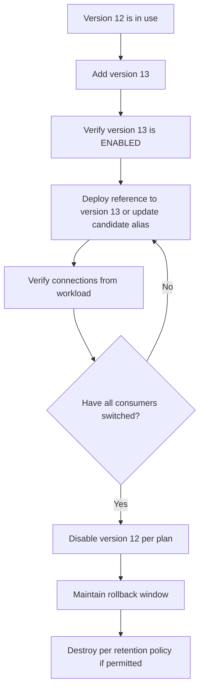

# Referencing Secret Names, Projects, and Secret Versions

When a Spring Boot application retrieves a database password from Google Cloud Secret Manager, the configuration needs to identify three exact pieces: **which project the secret lives in, what the secret's name is, and which version to read**. Writing only the secret name is sometimes enough in a simple project, but it easily leads to reading from the wrong environment when the workload runs in another project, uses a regional secret, or needs to roll out credentials version by version.

In Google Cloud Secret Manager, the secret name, the full resource name, and the secret value are three distinct concepts. The **secret name** identifies a managed object; a **secret version** identifies a single stored payload; the **resource name** combines the project, location (if applicable), secret, and version so the API knows which object to access. Spring Framework on Google Cloud provides a shorthand reference syntax to bring this resource into the Spring Environment.

This lesson belongs to the **Google Cloud Configuration** chapter of the **SPRING_CLOUD_PROVIDER_INTEGRATION** module. Within the scope of integrating Spring Boot with managed services on AWS, Azure, and Google Cloud via the corresponding Spring Cloud libraries, we focus on how to name and reference Secret Manager explicitly, in a way that is controllable across dev/staging/production and reproducible at deployment time.

## 1. Learning Objectives

After this lesson, you will be able to:

- Distinguish between **project ID**, project number, secret ID, secret resource name, secret version ID, and secret payload.
- Name secrets following Google Cloud rules and service operational conventions.
- Write full resource names for global secrets and regional secrets.
- Choose the right project when an application runs in one project but reads secrets from another.
- Use the `sm@` syntax of Spring Framework on Google Cloud to reference secrets by short name or full resource path.
- Distinguish between numeric version IDs, the `latest` alias, and user-created aliases.
- Choose appropriate versions for local, staging, and production; understand the impact of adding, disabling, or destroying versions.
- Diagnose errors caused by wrong names, wrong projects, wrong locations, unavailable versions, or missing IAM permissions.

## 2. Distinguishing Project, Secret, Version, and Payload

A Secret Manager resource has a hierarchical structure:

```text
Project
└── Secret
    ├── Secret metadata
    ├── Version 1
    │   └── Payload
    ├── Version 2
    │   └── Payload
    └── Version 3
        └── Payload
```

| Concept | Meaning | Example |
| --- | --- | --- |
| **Project ID** | Identifier of the project owning the secret | `invoice-prod` |
| **Project number** | Numeric identifier assigned by Google Cloud to the project | `415104041262` |
| **Secret ID** | Unique name of the secret within the project | `invoice-db-password` |
| **Secret resource name** | Full secret resource name, without specifying a version | `projects/invoice-prod/secrets/invoice-db-password` |
| **Version ID** | Identifier of a single stored payload of the secret | `12` |
| **Secret version resource name** | Full version resource name | `projects/invoice-prod/secrets/invoice-db-password/versions/12` |
| **Payload** | The actual secret data inside the version | Password, API key, or private key |

The project name displayed in the Google Cloud Console (project name) can contain spaces and can be renamed. The **Project ID** is the identifier commonly used in resource paths; it must be unique and cannot change after the project is created. The project number is a different numeric identifier. Examples in this lesson use project IDs so resource names remain readable; do not put the display name into the path.

A secret resource holds metadata such as replication policy, labels, annotations, and version aliases. **The secret value resides in the secret version**, not in the secret ID. A secret can exist before having its first version; at that point there is no payload to read.

### 2.1. Why separate secret ID and version ID?

Suppose a database password is rotated three times:

| Time | Secret ID | Version ID | Meaning |
| --- | --- | --- | --- |
| Initial | `invoice-db-password` | `1` | Initial password |
| First rotation | `invoice-db-password` | `2` | New password |
| Second rotation | `invoice-db-password` | `3` | Newer password |

The secret name stays the same; each time a new payload is added, a new version is created. Therefore, configuration pointing only to the secret ID cannot specify which version is needed. The payload access API must specify a version ID or a version alias.

**Do not put passwords into secret or version names.** Resource names can appear in logs, audit events, metrics, policies, and administrative tools. Only include necessary classification metadata such as service, environment, and purpose.

## 3. Naming Rules for Projects and Secrets

### 3.1. Project ID

Google Cloud Project IDs follow these main rules:

- Length from **6 to 30 characters**.
- Only lowercase ASCII letters `a-z`, digits `0-9`, and hyphens `-`.
- Must start with a letter.
- Cannot end with a hyphen.
- Must be globally unique on Google Cloud, and an ID that was previously used cannot be reused, even if the project was deleted.
- Certain strings are restricted, such as `google` and `ssl`.

Examples:

| Project ID | Evaluation |
| --- | --- |
| `invoice-dev` | Formally valid |
| `invoice-staging` | Formally valid |
| `invoice-prod` | Formally valid |
| `Invoice-Prod` | Invalid because it contains uppercase letters |
| `invoice_prod` | Invalid because it contains an underscore |
| `-invoice-prod` | Invalid because it starts with a hyphen |
| `invoice-prod-` | Invalid because it ends with a hyphen |

A project name can contain descriptive details, but the project ID appears in resource names and can be observed by many systems. Do not include personal emails, customer names, contract codes, or sensitive data in a project ID.

### 3.2. Secret ID

A secret ID must be unique within a project and follows these rules:

- Up to **255 characters**.
- Allows uppercase letters, lowercase letters, digits, hyphens `-`, and underscores `_`.
- Do not use `/` to simulate folders; Secret Manager does not organize secrets into a directory tree based on slashes in the secret ID.
- Keep names short, meaningful, and consistent across environments.

Examples:

```text
invoice-db-password
invoice-partner-api-key
invoice-jwt-signing-key
invoice-webhook-signature
billing-sftp-private-key
```

A secret ID is not a file path. A name like `prod/invoice/db-password` with slashes is not a naming pattern suited to Secret Manager rules. Use `invoice-db-password` as the ID and express the project/environment in the resource path or in governance conventions.

### 3.3. Naming conventions by service and environment

A simple convention:

```text
<service>-<purpose>
```

For example, if each environment has its own project:

| Environment | Project | Secret ID |
| --- | --- | --- |
| Dev | `invoice-dev` | `invoice-db-password` |
| Staging | `invoice-staging` | `invoice-db-password` |
| Production | `invoice-prod` | `invoice-db-password` |

Because projects already separate environments, the same secret ID can be used across projects. This keeps profile-based configuration consistent and avoids redundant names like `prod-prod-invoice-db-password`.

If multiple applications share a single project, include the service name in the secret ID:

```text
invoice-api-db-password
invoice-worker-db-password
reporting-service-readonly-db-password
```

Do not bundle multiple credentials from different services into a single secret just to reduce the number of secrets. Separating secrets enables least-privilege IAM grants, independent rotation, and clear auditing.

## 4. Full Resource Name of a Global Secret

For a **global secret**, the secret resource name has the form:

```text
projects/PROJECT_ID/secrets/SECRET_ID
```

A specific version has the form:

```text
projects/PROJECT_ID/secrets/SECRET_ID/versions/VERSION_ID
```

Example:

```text
projects/invoice-prod/secrets/invoice-db-password
projects/invoice-prod/secrets/invoice-db-password/versions/12
```

Where:

- `invoice-prod` is the project owning the secret.
- `invoice-db-password` is the secret ID.
- `12` is the version ID.
- `versions/12` indicates payload version 12, not the Spring Boot application version or the database version.

The resource name is a logical identifier used in the API. It is not a full HTTP URL; the global Secret Manager API endpoint accepts the resource name in the request.

### 4.1. Resource name and Spring `sm@` syntax

Starting from Spring Framework on Google Cloud **6.0**, the `sm@` syntax was introduced and is recommended. With the Config Data API, declare the import once:

```yaml
spring:
  config:
    import: "sm@"
```

Then reference the version by its resource path in a placeholder:

```yaml
spring:
  config:
    import: "sm@"

  cloud:
    gcp:
      secretmanager:
        project-id: invoice-prod

invoice:
  database:
    password: "${sm@projects/invoice-prod/secrets/invoice-db-password/versions/12}"
```

`spring.config.import` registers Secret Manager as a Config Data source; the placeholder specifies the secret/version to resolve. The configuration stores only a **resource reference**, not the secret payload.

If you are using an older library line, the syntax may be `sm://` according to that branch's documentation. Do not mix the `sm@` syntax with an older starter that does not support it. This lesson uses the current `sm@` syntax for Spring examples.

## 5. Choosing a Project: Explicit or Default Project?

There are two ways to specify the project in a Spring reference.

### 5.1. Specifying the project directly in the resource path

Full form:

```yaml
spring:
  config:
    import: "sm@"

invoice:
  database:
    password: "${sm@projects/invoice-prod/secrets/invoice-db-password/versions/12}"
```

Advantages:

- Readers know the exact project where the secret lives.
- Easy to audit configuration when an application accesses multiple projects.
- Reduces reliance on default project settings and ADC.
- Fits deployments requiring clear audit/review.

This is the preferred choice for production, cross-project setups, and multi-project systems.

### 5.2. Using the default project

You can set a default project for Secret Manager:

```yaml
spring:
  config:
    import: "sm@"
  cloud:
    gcp:
      secretmanager:
        project-id: invoice-prod

invoice:
  database:
    password: "${sm@invoice-db-password/12}"
```

When no project is specified in the reference, Spring Framework on Google Cloud infers the project from `spring.cloud.gcp.secretmanager.project-id`; if this property is not set, the library documentation notes that the project may be inferred from Google Cloud Core configuration or Application Default Credentials.

A default project makes configuration more concise when all secrets belong to the same project. However, when an application reads secrets from multiple projects, the shorthand form can obscure the target resource from maintainers. Use full paths for critical secrets or secrets outside the default project.

### 5.3. Workload project differs from secret project

A common scenario:

```text
Project running Cloud Run:
  invoice-runtime

Project hosting Secret Manager:
  invoice-prod

Service account attached to Cloud Run:
  invoice-api@invoice-runtime.iam.gserviceaccount.com

Secret to read:
  projects/invoice-prod/secrets/invoice-db-password/versions/12
```

The project in the resource path is **the project owning the secret**, not necessarily the project containing the VM, Cloud Run service, or GKE cluster. ADC identifies the principal calling the API; the IAM policy on the secret determines whether that principal can read the payload.

Example granting secret read permission to a service account from the runtime project:

```bash
gcloud secrets add-iam-policy-binding invoice-db-password \
  --project=invoice-prod \
  --member="serviceAccount:invoice-api@invoice-runtime.iam.gserviceaccount.com" \
  --role="roles/secretmanager.secretAccessor"
```

The command above binds the role on the secret inside project `invoice-prod`. A service account belonging to `invoice-runtime` can still read it unless another organization policy blocks it. There is no need to move the secret to the runtime project just because the application runs there.

## 6. Global Secrets and Regional Secrets

Google Cloud Secret Manager has **global secrets** and **regional secrets**. These are two different resource types; a regional secret includes a location in its resource name and uses the corresponding regional endpoint.

### 6.1. Global secret

Secret resource:

```text
projects/PROJECT_ID/secrets/SECRET_ID
```

Secret version:

```text
projects/PROJECT_ID/secrets/SECRET_ID/versions/VERSION_ID
```

Spring reference example:

```yaml
spring:
  config:
    import: "sm@"

partner:
  api-key: "${sm@projects/invoice-prod/secrets/partner-api-key/versions/12}"
```

### 6.2. Regional secret

A regional secret's resource includes a location:

```text
projects/PROJECT_ID/locations/LOCATION_ID/secrets/SECRET_ID
```

Secret version:

```text
projects/PROJECT_ID/locations/LOCATION_ID/secrets/SECRET_ID/versions/VERSION_ID
```

Example using location `us-central1`:

```yaml
spring:
  config:
    import: "sm@"

partner:
  api-key: "${sm@projects/invoice-prod/locations/us-central1/secrets/partner-api-key/versions/12}"
```

Do not add `locations/...` to a global secret's resource path. Do not omit the location from a regional secret's path. The location ID must match where the secret was created; it is not a project name or service name. Regional APIs use a location-specific endpoint, such as `secretmanager.us-central1.rep.googleapis.com`; when using the Java client or REST, configure the corresponding endpoint.

### 6.3. Shorthand `sm@` forms for regional secrets

When a default project is configured, you can write:

| Reference form | Meaning |
| --- | --- |
| `sm@projects/PROJECT_ID/locations/LOCATION_ID/secrets/SECRET_ID/versions/VERSION_ID` | Full project, location, secret, and version |
| `sm@projects/PROJECT_ID/locations/LOCATION_ID/secrets/SECRET_ID` | Full project, location, secret; uses `latest` |
| `sm@PROJECT_ID/LOCATION_ID/SECRET_ID/VERSION_ID` | Short form specifying project and version |
| `sm@locations/LOCATION_ID/SECRET_ID/VERSION` | Uses default project, specific version |
| `sm@locations/LOCATION_ID/SECRET_ID` | Uses default project and `latest` |

For global secrets:

| Reference form | Meaning |
| --- | --- |
| `sm@projects/PROJECT_ID/secrets/SECRET_ID/versions/VERSION_ID` | Full project, secret, and version |
| `sm@projects/PROJECT_ID/secrets/SECRET_ID` | Full project and secret; uses `latest` |
| `sm@PROJECT_ID/SECRET_ID/VERSION_ID` | Short form specifying project and version |
| `sm@SECRET_ID/VERSION` | Uses default project, specific version |
| `sm@SECRET_ID` | Uses default project and `latest` |

Shorthand forms make configuration concise but require consistency on the default project. For applications that have both global and regional secrets, use the full form to avoid confusing locations.

## 7. Version ID: Sequential Number of the Payload

Each time a payload is added to a secret, Secret Manager creates a new **secret version**. Version IDs start at `1` and increment sequentially for each version created for that secret.

Example:

```text
projects/invoice-prod/secrets/invoice-db-password/versions/1
projects/invoice-prod/secrets/invoice-db-password/versions/2
projects/invoice-prod/secrets/invoice-db-password/versions/3
```

A version ID is the version's identifier, not a timestamp, deploy count, or application version. When creating a new version, you do not edit an older version's payload in place; instead, you add a new version and move consumers to the version they should use.

You can list versions without printing payloads:

```bash
gcloud secrets versions list invoice-db-password \
  --project=invoice-prod
```

View metadata for version 12:

```bash
gcloud secrets versions describe 12 \
  --secret=invoice-db-password \
  --project=invoice-prod
```

Useful metadata includes the resource name, creation time, state, and replication status. There is no need to call payload access just to check whether a version exists.

## 8. `latest`, Custom Aliases, and Numeric Versions

Secret Manager lets you specify a version by number or alias. The three common options behave differently.

### 8.1. The `latest` alias

`latest` is a special alias pointing to the most recently created version of a secret. Example:

```text
projects/invoice-prod/secrets/invoice-db-password/versions/latest
```

Spring reference:

```yaml
invoice:
  database:
    password: "${sm@projects/invoice-prod/secrets/invoice-db-password/versions/latest}"
```

When a new version is added, `latest` points to that newest version. This is convenient for experimentation or workloads that accept picking up the newest value on the next configuration load. However, it makes configuration non-reproducible: two instances starting at different times can receive different versions.

Google Cloud's quickstart documentation recommends **not using `latest` for production applications**, and instead specifying an explicit version ID. That choice makes every deployment explicit about which credential is in use.

### 8.2. Custom version aliases

You can assign custom aliases to a version, for example:

```text
stable -> version 12
candidate -> version 13
rollback -> version 11
```

A custom alias is a mutable mapping from an alias name to a version ID. Key rules:

- Aliases can be up to **63 characters** long.
- Must start with a letter.
- Allows uppercase letters, lowercase letters, digits, hyphens, and underscores.
- Cannot use `latest` or `NEW` (case-insensitive).
- A secret can have at most **50 version aliases**.

You can update an alias with gcloud:

```bash
gcloud secrets update invoice-db-password \
  --project=invoice-prod \
  --update-version-aliases=stable=12
```

Then reference the alias just like a version:

```yaml
spring:
  config:
    import: "sm@"

invoice:
  database:
    password: "${sm@projects/invoice-prod/secrets/invoice-db-password/versions/stable}"
```

Aliases fit controlled rollout workflows—for instance, `candidate` pointing to a new version for testing before switching `stable` once verified. Because an alias target can change, audit alias changes and verify which version an alias points to before deploying.

Per the Google Cloud API, alias access is supported for **GetSecretVersion** and **AccessSecretVersion** operations. Do not assume aliases work identically to version IDs across all administrative operations or other APIs.

### 8.3. Specific numeric versions

Referencing a numeric version:

```yaml
spring:
  config:
    import: "sm@"

invoice:
  database:
    password: "${sm@projects/invoice-prod/secrets/invoice-db-password/versions/12}"
```

Advantages:

- Configuration is reproducible across instances of the same release.
- Deployment reviews know the exact version being used.
- You can roll back by reverting configuration to the previous version as long as it remains enabled.
- The target cannot unexpectedly change just because a new version is added to the secret.

The trade-off is having to update the reference to switch versions. This is an intentional action, well suited to production release and rotation workflows.

### 8.4. Comparing version selection approaches

| Selection method | Target referenced | Changes automatically when a new version is added? | Recommendation |
| --- | --- | --- | --- |
| `latest` | Newest version | Yes | Dev/test or cases where dynamic resolution is accepted |
| Custom alias `stable` | Version assigned to the alias | When the alias is updated | Controlled rollouts; audit the mapping |
| Numeric version `12` | Exactly version 12 | No | Production needing reproducibility |

Regardless of which approach you choose, Spring Config Data still resolves the reference during configuration loading. Having `latest` or an alias change targets **does not mean a running JVM automatically polls and updates beans**. You need refresh/rollout or a dedicated runtime read mechanism.

## 9. Secret Version States

A version can be in one of the following states:

| State | Meaning | Is payload accessible? |
| --- | --- | --- |
| `ENABLED` | Active version | Yes |
| `DISABLED` | Payload is still stored, but the version cannot be accessed | No |
| `DESTROYED` | Payload has been destroyed | No; irreversible state |

A disabled version can be re-enabled if policies and permissions allow. A destroyed version is a terminal state; the payload is no longer stored for recovery through Secret Manager.

This directly affects resource references:

- A valid resource path still fails to read the payload if the version is `DISABLED`.
- The version ID may still appear in metadata listings even after the payload is destroyed.
- Do not assume `latest` will automatically skip a disabled newest version to fall back to a previously enabled one.
- To roll back, verify that the target version still exists and is enabled.

Example checking state:

```bash
gcloud secrets versions describe 12 \
  --secret=invoice-db-password \
  --project=invoice-prod \
  --format="yaml(name,state,createTime,destroyTime)"
```

Do not use `DESTROYED` as a way to test rotation. Disable the old version after consumers have migrated, and destroy it only per an approved retention policy or data handling procedure.

## 10. Loading a Version into a Spring Property

### 10.1. Configuring datasource with a pinned version

Production example using version 12:

```yaml
spring:
  config:
    import: "sm@"
  cloud:
    gcp:
      secretmanager:
        project-id: invoice-prod
  datasource:
    url: jdbc:postgresql://10.20.0.15:5432/invoice
    username: invoice_app
    password: "${sm@projects/invoice-prod/secrets/invoice-db-password/versions/12}"
```

The secret reference is resolved into a property value before Spring Boot creates the datasource. The configuration file contains only the resource name, not the password.

### 10.2. Binding to configuration properties

```yaml
spring:
  config:
    import: "sm@"

partner:
  base-url: https://api.partner.example
  api-key: "${sm@projects/invoice-prod/secrets/partner-api-key/versions/7}"
```

```java
@ConfigurationProperties(prefix = "partner")
public class PartnerProperties {

    private String baseUrl;
    private String apiKey;

    public String getBaseUrl() {
        return baseUrl;
    }

    public void setBaseUrl(String baseUrl) {
        this.baseUrl = baseUrl;
    }

    public String getApiKey() {
        return apiKey;
    }

    public void setApiKey(String apiKey) {
        this.apiKey = apiKey;
    }
}
```

Register properties with `@ConfigurationPropertiesScan` or `@EnableConfigurationProperties`. Do not log objects containing API keys; avoid generating a `toString()` that exposes all sensitive fields.

### 10.3. Environment-specific profiles

You can keep the same secret ID while using separate projects and versions:

```yaml
# application-dev.yml
spring:
  config:
    import: "sm@"
partner:
  api-key: "${sm@projects/invoice-dev/secrets/partner-api-key/versions/3}"
```

```yaml
# application-staging.yml
spring:
  config:
    import: "sm@"
partner:
  api-key: "${sm@projects/invoice-staging/secrets/partner-api-key/versions/6}"
```

```yaml
# application-prod.yml
spring:
  config:
    import: "sm@"
partner:
  api-key: "${sm@projects/invoice-prod/secrets/partner-api-key/versions/12}"
```

When selecting the `prod` profile, the application reads the secret from the production project at version 12. Ensure the production runtime identity has permission to read the corresponding secret; profiles only swap resource references, they do not grant IAM permissions.

Do not let an environment variable containing a secret value unintentionally override a property from Secret Manager. Spring Boot has a property source precedence order; an external configuration source can override a loaded property. When verifying the application, check both the active profile and the effective property sources.

## 11. Reading a Secret Version with the Java Client

When you need programmatic access to Secret Manager instead of Config Data, you can use the Google Cloud Java client. The example below demonstrates a global secret with a passed-in version ID:

```java
public final class SecretVersionReader {

    private final SecretManagerServiceClient client;

    public SecretVersionReader(SecretManagerServiceClient client) {
        this.client = client;
    }

    public String read(
            String projectId,
            String secretId,
            String versionId) {

        String resourceName = String.format(
                "projects/%s/secrets/%s/versions/%s",
                projectId,
                secretId,
                versionId);

        AccessSecretVersionResponse response =
                client.accessSecretVersion(
                        AccessSecretVersionRequest.newBuilder()
                                .setName(resourceName)
                                .build());

        return response.getPayload().getData().toStringUtf8();
    }
}
```

The `versionId` argument can be a version number or an API-supported alias such as `12`, `latest`, or `stable`. In production, take numeric versions from reviewed release configuration. Validate project/secret/version inputs before constructing the resource name; do not accept raw resource paths from user requests unless the application genuinely requires it.

Never log `response`, the payload, or the returned string. The client's lifecycle must be managed and closed when the application stops. For regional secrets, both the resource name and the API endpoint must switch to regional forms; do not use the global client endpoint for a regional resource when the SDK requires a location-specific endpoint.

## 12. Inspecting Names and Versions with gcloud

Metadata commands let you inspect resources without printing payloads.

### 12.1. View secret metadata

```bash
gcloud secrets describe invoice-db-password \
  --project=invoice-prod
```

### 12.2. List versions

```bash
gcloud secrets versions list invoice-db-password \
  --project=invoice-prod
```

### 12.3. View metadata of a single version

```bash
gcloud secrets versions describe 12 \
  --secret=invoice-db-password \
  --project=invoice-prod
```

### 12.4. Access payload

```bash
gcloud secrets versions access 12 \
  --secret=invoice-db-password \
  --project=invoice-prod
```

The last command prints **the secret value to stdout**. Use it only in a controlled terminal when you genuinely need to verify a payload; never place it in CI jobs with archived logs, never paste output into tickets/chat, and never enable shell tracing. In automation, check status/metadata whenever possible instead of printing secrets.

For regional secrets, add `--location=LOCATION_ID` to the corresponding commands and use the matching regional endpoint/resource. Do not merely change the resource path string while omitting the location when calling the API.

## 13. Which Resource Are IAM Permissions Attached To?

The core permission to read a version's payload is:

```text
secretmanager.versions.access
```

Commonly used predefined role:

```text
roles/secretmanager.secretAccessor
```

Grant the role on a specific secret if the application only needs to read one secret. In a cross-project setup:

- The resource path specifies the project containing the secret.
- The principal is the workload's service account or federated identity.
- The IAM binding is applied on the secret in the target project.
- The project running the application does not automatically have permissions in the project containing the secret.

A common mistake is checking the right service account in Cloud Run but granting the role on the runtime project instead of the project owning the secret. Inspect the IAM policy on the secret resource itself, then match it against the runtime identity's principal.

Do not grant `roles/secretmanager.admin` to a service that only reads passwords. Permissions to manage version aliases, add versions, or destroy versions should be separated for administrative/rotation principals.

## 14. Controlled Rotation Workflow Using Versions

Suppose an application is using version 12 and needs to switch to a new password:



Operational steps:

1. Create the new password on the target system, such as the database, then add its payload as version 13.
2. Verify that version 13 is in state `ENABLED` and has the right secret/project/location.
3. Update the Spring configuration to version 13 or switch a managed alias.
4. Roll out instance by instance; verify new connections and check audit logs to confirm the right principal is used.
5. Wait for connection pools and older consumers to stop using the version 12 credential.
6. Disable version 12 once no consumers need it.
7. Destroy version 12 per the retention policy once the rollback window has passed and retention requirements are met.

Do not disable the old version immediately after creating the new version while older instances are still running. With databases, previously authenticated connections may keep working while new connections require the new password; verify the connection pool and the ability to open new connections. During a credential exposure incident, prioritize incident response and faster revocation over the normal rotation schedule.

## 15. Troubleshooting Reference Errors

| Symptom | Common Cause | What to Check |
| --- | --- | --- |
| `NOT_FOUND` | Wrong project ID, secret ID, or version | Run `gcloud secrets describe` and `versions list` on the exact project |
| `PERMISSION_DENIED` | Workload principal lacks `secretmanager.versions.access` | Verify ADC principal and IAM binding on the secret in the target project |
| Version unreadable despite valid resource path | Version is `DISABLED` or `DESTROYED` | Check state metadata; choose an `ENABLED` version |
| Read secret from wrong environment | Default project behaved unexpectedly | Use a full resource path and verify profiles |
| `sm@...` does not resolve | Starter does not yet support the syntax or Config Data import is missing | Check the BOM, runtime dependencies, and `spring.config.import` |
| Regional secret not found | Missing location or wrong endpoint used | Verify the resource path includes `locations/...` and the regional location |
| `latest` returns an unexpected credential | A new version was added to the secret | Pin a numeric version for production or govern aliases |
| Alias does not work | Alias not assigned, misspelled, or operation not supported by the API | Check `versionAliases` metadata and API alias limitations |
| Works locally but fails on cloud workload | Developer ADC has permission; runtime identity does not | Check the service account attached to Cloud Run/GKE/VM |
| Secret rotated but instance still uses old value | Spring loads properties at startup or bean did not refresh | Roll out/restart or refresh the right scope; inspect connection pools |

### 15.1. Reference verification checklist

When encountering an error, verify in order:

1. The Spring resolver syntax matches the library version in use.
2. `spring.config.import` registers Secret Manager Config Data.
3. The project in the resource path is the project owning the secret.
4. The secret ID has the exact spelling and casing.
5. If it is a regional secret, the location ID is accurate and present in the path.
6. The version ID or alias exists and the version is `ENABLED`.
7. ADC returns the right principal for the current environment.
8. The principal has `roles/secretmanager.secretAccessor` or appropriate custom permissions on the secret.
9. Profiles and property sources are not overridden by an external configuration.
10. If a new secret version was created, the application has refreshed/rolled out to load the new reference.

Do not fix `PERMISSION_DENIED` by granting project-wide permissions to every service or bundling a service account key into the image. Fix the exact principal and resource scope.

## 16. Testing References by Project and Version

Create an isolated test project or test secret:

```text
Project: invoice-integration-test
Secret ID: invoice-db-password
Versions:
  1: initial test password
  2: post-rotation test password
Alias:
  stable -> 1
```

Test these scenarios:

| Case | Setup | Expected Result |
| --- | --- | --- |
| A | Full path to version 1, authorized principal | Reads version 1 accurately |
| B | Short reference and valid default project | Reads the right secret in the default project |
| C | Full path to another project, IAM binding present | Reads secret from the target project |
| D | Full path to another project, no IAM binding | Rejected |
| E | Nonexistent version ID | Receives not found error |
| F | Disabled version | Cannot access payload |
| G | Alias `stable` pointing to version 1 | Reads version 1 |
| H | Switch `stable` to version 2 | Next read via alias receives version 2 |
| I | Add version 3 while app pins version 2 | App keeps using version 2 until config changes |
| J | Regional path missing location | Reference fails to resolve properly |

In integration tests, never compare real secrets in assertion messages or logs. You may compare against a test canary value stored in the test project; ensure the canary is never reused in production.

### 16.1. Testing Spring configuration

Example verifying that a property was loaded:

```java
@SpringBootTest
class InvoiceSecretReferenceTest {

    @Autowired
    private InvoiceProperties invoiceProperties;

    @Test
    void loadsPinnedSecretVersion() {
        assertNotNull(invoiceProperties.getDatabasePassword());
        assertFalse(invoiceProperties.getDatabasePassword().isBlank());
    }
}
```

This test requires ADC/workload identity and an actual test secret. It verifies property binding, but does not replace negative IAM testing with an unauthorized principal. For unit tests without cloud access, you can mock the property source; at least one integration test is needed to confirm the resolver, project, and version actually work.

## 17. Hands-On Exercise: Switching a Secret from Version 1 to Version 2

**Context:** `invoice-service` runs on Cloud Run in project `invoice-runtime`, while the database password lives in Secret Manager in project `invoice-prod`. The application needs a controlled migration from version 1 to version 2.

### Step 1 — Identify the resources

Record:

```text
Project hosting secret: invoice-prod
Project running workload: invoice-runtime
Secret ID: invoice-db-password
Current version: 1
Target version: 2
```

Do not use the project display name in place of the project ID. Verify the secret ID and resource path using metadata commands.

### Step 2 — Check IAM

Confirm the service account attached to Cloud Run has `roles/secretmanager.secretAccessor` on secret `invoice-db-password` in project `invoice-prod`. Do not grant the role on every secret in the project if the service only needs one secret.

### Step 3 — Add a new version

Add a new test password as version 2. Verify that version 2 exists and is `ENABLED`. Do not pass the payload in shell commands recorded in CI logs.

### Step 4 — Update the Spring reference

In production configuration, use the full resource path and a pinned version:

```yaml
spring:
  config:
    import: "sm@"
  datasource:
    password: "${sm@projects/invoice-prod/secrets/invoice-db-password/versions/2}"
```

### Step 5 — Deploy and verify

Roll out the application. Verify readiness, establish new database connections, and monitor for authentication errors. Cross-check audit logs to confirm the workload principal accesses the right secret version.

### Step 6 — Complete the rotation

Once all instances are using version 2, disable version 1 per procedure. Maintain an appropriate rollback window before destroying the old version. If a rollback is needed, re-enable version 1 (if not destroyed) and redeploy the configuration referencing version 1.

### Step 7 — Verify profiles and resources

Run the application again under the staging and production profiles, confirming each profile points to the right project. Verify staging has no IAM binding to read production secrets.

## 18. Self-Check Questions

1. What is the difference between project name, project ID, and project number? Which component typically appears in a Secret Manager resource path?
2. Why should a secret ID not contain slashes to simulate directories?
3. In the resource name `projects/invoice-prod/secrets/invoice-db-password/versions/12`, which parts identify the project, secret, and version?
4. If Cloud Run in project `invoice-runtime` reads a secret from `invoice-prod`, which project must appear in the resource path and where must the IAM binding be placed?
5. How do global secrets and regional secrets differ in their resource paths?
6. Why can `latest` cause two instances started at different times to receive different credentials?
7. When is a custom alias `stable` useful? Who has permission to change an alias and why must it be audited?
8. How does a `DISABLED` version differ from a `DESTROYED` version?
9. Why is a specific numeric version generally more suitable than `latest` for production deployments?
10. If a Spring property still uses the old version after an alias is updated, what needs to be done?
11. If `sm@invoice-db-password` reads from the wrong project, which property or resource path should be checked?
12. Why should you not print a payload to stdout just to confirm a version exists?

## 19. Key Takeaways

A Secret Manager reference must specify the exact **project, secret, location (if regional), and version**. Full resource paths make reviews and audits clear; `sm@` shorthand works when the default project is well-controlled. The secret ID names the object while the version ID identifies the payload; never put sensitive data into resource names.

`latest` is convenient but dynamic; custom aliases support phased rollouts but their targets can change; numeric versions make production deployments reproducible and rollbacks clear. When reading secrets cross-project, the resource path identifies the project containing the secret and the workload principal must be granted permission on that secret itself. **Proper naming, intentional version selection, and verifying state/IAM before deployment** ensure Spring Boot reads the right credentials in every environment without placing secrets in source code or container images.

## Official References

- [Spring Framework on Google Cloud — Secret Manager Config Data resource and sm@ syntax](https://googlecloudplatform.github.io/spring-cloud-gcp/reference/html/)
- [Google Cloud Secret Manager — Access a secret version](https://docs.cloud.google.com/secret-manager/docs/access-secret-version)
- [Google Cloud Secret Manager — SecretVersion resource and version states](https://docs.cloud.google.com/secret-manager/docs/reference/rest/v1/projects.secrets.versions)
- [Google Cloud Secret Manager — Assign an alias to a secret version](https://docs.cloud.google.com/secret-manager/docs/assign-alias-to-secret-version)
- [Google Cloud Secret Manager — Create a secret and naming rules](https://docs.cloud.google.com/secret-manager/docs/creating-and-accessing-secrets)
- [Google Cloud Resource Manager — Project ID requirements](https://docs.cloud.google.com/resource-manager/docs/creating-managing-projects)
- [Google Cloud Secret Manager — Access a regional secret version](https://docs.cloud.google.com/secret-manager/regional-secrets/access-secret-version-rs)
