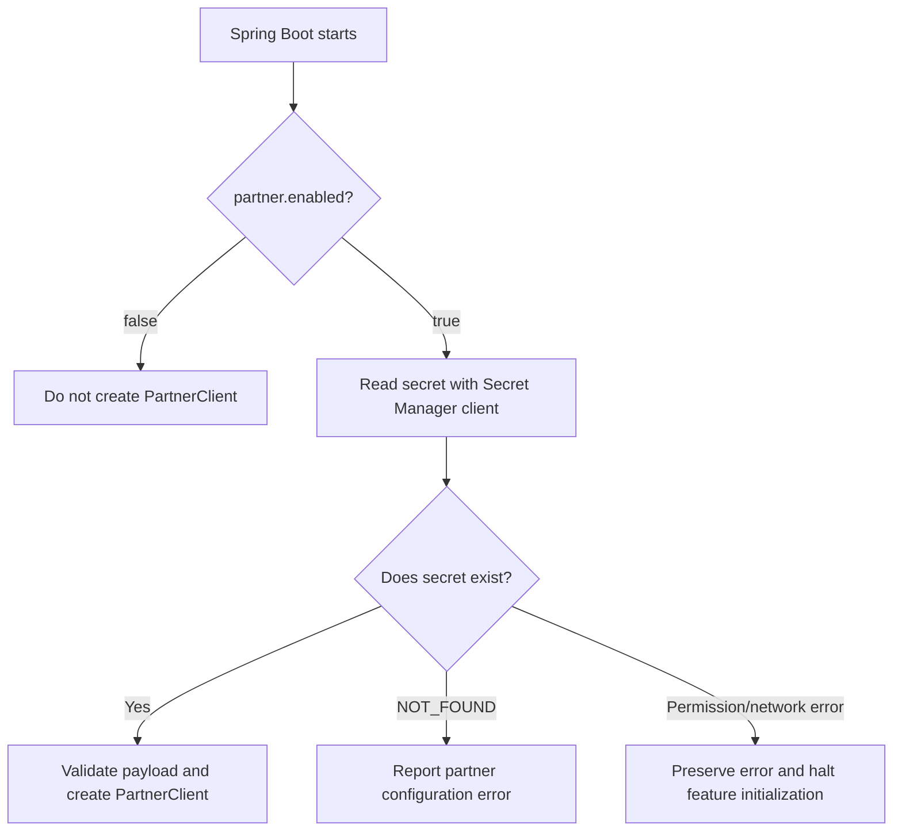

# Choosing Required or Optional Secrets in Config Data

A Spring Boot application typically needs several kinds of configuration from Google Cloud Secret Manager. Database passwords and token signing keys are usually **required**: without them, the application cannot operate safely. A partner API key used only for a secondary feature may be **optional**: if that feature is disabled, the application can still serve other flows.

To handle both cases properly, you must distinguish three layers: **Config Data import** registers Secret Manager as a configuration source; the **secret reference** specifies which value to resolve; and **application rules** decide whether a missing value halts startup or disables a feature. Using the wrong layer can cause the application to silently ignore a missing required configuration, or bring down the entire service over an unconfigured secondary integration.

This lesson belongs to the **Google Cloud Configuration** chapter of the **SPRING_CLOUD_PROVIDER_INTEGRATION** module. In this module, we practice integrating Spring Boot with managed services on AWS, Azure, and Google Cloud via the corresponding Spring Cloud libraries. This lesson focuses on Google Cloud Secret Manager and the Spring Boot Config Data API: choosing required vs. optional secrets, configuring default values, controlling errors when a secret does not exist, and testing startup behavior.

## 1. Learning Objectives

After this lesson, you will be able to:

- Distinguish between **Config Data location**, **secret reference**, **secret payload**, and **default value**.
- Explain the difference between `spring.config.import`, the `optional:` prefix, and `spring.cloud.gcp.secretmanager.allow-default-secret`.
- Decide which secrets must be present at startup and which secrets may be absent.
- Configure Spring Framework on Google Cloud to handle nonexistent secrets.
- Use placeholder indirection to retrieve optional secrets and apply fallbacks properly.
- Design feature flags and conditional beans so a secondary integration does not halt the entire application.
- Preserve fail-fast behavior for required secrets, even when the application also has optional secrets.
- Distinguish between `NOT_FOUND`, `PERMISSION_DENIED`, network errors, disabled versions, and empty values.
- Write tests for scenarios with a secret present, secret missing, missing permissions, and feature disabled.

## 2. Classifying Secrets by Requirement Level

Do not decide a secret is optional merely because the application can start without it. Base the decision on the capability the secret protects and the behavior the product must guarantee.

| Secret Type | Examples | When Missing | Appropriate Policy |
| --- | --- | --- | --- |
| **Required for service operation** | DB password, primary storage access credentials, token signing key | Cannot serve core flows or risks exposing data | Fail fast; do not accept traffic |
| **Required when a feature is enabled** | Partner API key, webhook signing secret, email sending credentials | That feature cannot operate safely | Only instantiate the client when the feature is enabled; if enabled and missing secret, fail fast |
| **Environment-optional** | Sandbox API key, test system credentials | Integration can be disabled in dev/test | Fall back to a feature-disabled state |
| **Truly optional** | Secret for an auxiliary feature not activated in the current environment | Does not affect core flows | Allow absence, record status, and skip creating the client |
| **Should never have a fallback** | Production private key, OAuth client secret, encryption key | Can cause weak authentication or loss of data protection | Do not use dummy default values; require a valid secret |

A practical rule of thumb:

- If missing the secret prevents the service from authenticating safely with a core component, that secret is **required**.
- If the secret is only needed when a feature is enabled, that secret is **conditionally required**.
- If the feature is disabled and the application can behave properly without creating the client, the secret can be **optional**.
- If a fallback causes the application to use a default account, broader permissions, or a shared key, that fallback is unsafe.

For example, `invoice-service` needs a DB password to read/write invoices, so the DB password is required. An SMS notification provider's API key is only needed when `notification.sms.enabled=true`; if SMS is disabled locally, the service can still run without the key.

## 3. Three Distinct Mechanisms in Spring Config Data

When integrating Secret Manager, three mechanisms are easily confused:

| Mechanism | Configuration | Scope of Impact |
| --- | --- | --- |
| Register Config Data resource | `spring.config.import: "sm@"` | Allows Spring Boot to use Secret Manager as an external configuration source |
| Optional Config Data location | `optional:` preceding a location in `spring.config.import` | Allows Spring Boot to continue when the imported location itself does not exist under Config Data rules |
| Allow nonexistent secrets | `spring.cloud.gcp.secretmanager.allow-default-secret=true` | When Secret Manager is queried for a nonexistent secret, the integration may return `null` instead of throwing an exception |

`spring.config.import` does not automatically load every secret in the project. It registers the Config Data resolver; each secret is referenced individually in a property or annotation.

### 3.1. Config Data import

For Spring Framework on Google Cloud lines supporting the new syntax, for example:

```yaml
spring:
  config:
    import: "sm@"
```

Then, a property can reference a secret:

```yaml
spring:
  datasource:
    password: "${sm@projects/invoice-prod/secrets/invoice-db-password/versions/12}"
```

`sm@` is the scheme for the Secret Manager Config Data resource. The `sm@` syntax was introduced in Spring Framework on Google Cloud 6.0 and is recommended in newer lines. For older library branches, check the corresponding version's documentation; some branches use the `sm://` syntax.

### 3.2. The optional: prefix applies to locations

Spring Boot allows placing the `optional:` prefix before a Config Data location. For example, with an auxiliary config file:

```yaml
spring:
  config:
    import:
      - "sm@"
      - "optional:file:./partner-overrides.yml"
```

In this example:

- `sm@` registers the Secret Manager resource.
- `optional:file:./partner-overrides.yml` allows the auxiliary config file to be absent without halting Spring Boot solely because that file is missing.

`optional:` is a Spring Boot rule for the **imported location**. It is not an attribute that marks individual secrets in placeholders as optional. Do not infer that putting `optional:` before `sm@` turns every secret referenced in YAML into an optional secret.

Nor does this prefix grant IAM permissions, fix wrong project/secret IDs, or turn authentication or network errors into a valid default value. If you need to ignore a Config Data location that genuinely may not exist, use `optional:` on that specific location; if you need to handle a specific secret that may be absent, design it at the secret reference layer or in the secret-accessing code.

### 3.3. allow-default-secret

Spring Framework on Google Cloud provides the property:

```yaml
spring:
  cloud:
    gcp:
      secretmanager:
        allow-default-secret: true
```

The default is `false`. When `allow-default-secret=true`, accessing a nonexistent secret can return `null` instead of throwing an exception. This is a mechanism of the Secret Manager integration, not a default Spring Boot feature.

Note carefully:

- This property applies to the entire Secret Manager integration in the application context, not as a per-secret flag.
- When enabled, a missing required secret might not throw an exception immediately at lookup time; the application must validate and fail fast where the value is used.
- It only changes documented behavior for **nonexistent secrets**. Do not treat it as a mechanism to ignore `PERMISSION_DENIED`, network errors, TLS errors, or all API errors.
- Do not enable this property merely to mask production configuration errors.

If an application has both a required DB password and an optional API key, carefully weigh this global scope. You can keep `allow-default-secret=false` and read the optional secret in a dedicated component that handles only `NOT_FOUND` errors.

## 4. Required Secrets: Fail Fast When a Value Cannot Be Retrieved

For required secrets, keep the default behavior `allow-default-secret=false`. When the secret does not exist, Spring Framework on Google Cloud raises an error instead of returning `null`.

Datasource configuration example:

```yaml
spring:
  config:
    import: "sm@"
  cloud:
    gcp:
      secretmanager:
        project-id: invoice-prod
        allow-default-secret: false
  datasource:
    url: jdbc:postgresql://10.20.0.15:5432/invoice
    username: invoice_app
    password: "${sm@projects/invoice-prod/secrets/invoice-db-password/versions/12}"
```

In production:

1. Secret `invoice-db-password` must exist in project `invoice-prod`.
2. Version `12` must exist and be in an accessible state.
3. The workload identity must have permission to read the version.
4. The application must only be marked ready after datasource configuration is valid and core connections pass health checks.

Never use default passwords like `password`, `changeme`, an empty string, or shared credentials just to let the service start. If the database password is missing, halting startup is the right behavior.

### 4.1. Checking for empty values after resolution

An existing secret with an empty payload is still different from a nonexistent secret. `allow-default-secret=false` does not replace content validation. For required credentials, verify the value is non-blank before creating clients or connections.

Example with `@ConfigurationProperties`:

```java
@ConfigurationProperties(prefix = "invoice.database")
public class InvoiceDatabaseProperties {

    private String username;
    private String password;

    public String getUsername() {
        return username;
    }

    public void setUsername(String username) {
        this.username = username;
    }

    public String getPassword() {
        return password;
    }

    public void setPassword(String password) {
        this.password = password;
    }

    public void validate() {
        if (password == null || password.isBlank()) {
            throw new IllegalStateException(
                    "invoice.database.password is required");
        }
    }
}
```

Invoke validation during datasource configuration or use Bean Validation with `@Validated` and `@NotBlank` if the properties structure suits it. Error messages should mention only the property name, never the secret value in the exception.

### 4.2. Missing secret errors and permission errors are not the same

| Situation | Meaning | How to Handle |
| --- | --- | --- |
| Secret does not exist | The requested resource is absent | For required secrets: fail fast; for optional secrets: controlled fallback |
| Secret/version disabled or destroyed | The resource has metadata, but the payload is inaccessible in that state | Choose a valid version or recover per governance procedure |
| `PERMISSION_DENIED` | The principal is not allowed to read | Fix IAM for the exact secret and workload identity |
| Network/timeout/TLS error | Cannot complete the request to the API | Bounded retry, check network/certificates; do not assume the secret does not exist |
| Empty or malformed payload | The secret may exist, but cannot be used | Validate schema/length/format per business rules |

An optional fallback should only apply to cases confirmed as **secret absent**. Never catch every exception and return an empty string, because doing so can cause IAM errors or outages to be misinterpreted as an operator intentionally disabling the feature.

## 5. Optional Secrets: Tying to a Toggleable Feature

Suppose `invoice-service` integrates with a notification partner. Locally and in some test environments, this feature is disabled. In that case:

- `partner.enabled=false`: the application does not create the partner client and does not need the API key.
- `partner.enabled=true`: the API key must exist and be valid.
- If the feature is enabled while the secret is missing, the application must report a configuration error rather than silently sending unauthenticated requests.

An illustrative configuration:

```yaml
spring:
  config:
    import: "sm@"
  cloud:
    gcp:
      secretmanager:
        allow-default-secret: true

partner:
  enabled: false
  api-key-secret-ref: "sm@projects/invoice-staging/secrets/partner-api-key/versions/7"
  api-key: "${${partner.api-key-secret-ref}:}"
```

Here, `partner.api-key-secret-ref` is a **reference string**, not the secret value. Nested placeholders work in two steps:

1. The inner placeholder retrieves the string `sm@projects/.../partner-api-key/versions/7`.
2. The outer placeholder uses that string as the key to resolve the secret; if Secret Manager lacks the secret and the integration is configured to allow returning `null`, the empty default part is used.

Expected result: if the secret has a value, `partner.api-key` receives the payload; if the secret does not exist, the property receives an empty string so the application can decide whether the feature is allowed to run.

**Do not write nested placeholders with a direct secret value as the inner expression.** The inner expression must resolve to an `sm@...` name/reference; if it resolves to a secret payload, Spring may interpret that payload as the next property name instead of preserving the secret value.

Placeholder syntax and `null` behavior must be tested against your project's exact Spring Boot/Spring Framework on Google Cloud versions. This is a sensitive spot in placeholder resolution, so do not copy examples across library branches without running an integration test.

### 5.1. Enable the client only when the feature is enabled

Properties configuration example:

```java
@ConfigurationProperties(prefix = "partner")
public class PartnerProperties {

    private boolean enabled;
    private String apiKey;

    public boolean isEnabled() {
        return enabled;
    }

    public void setEnabled(boolean enabled) {
        this.enabled = enabled;
    }

    public String getApiKey() {
        return apiKey;
    }

    public void setApiKey(String apiKey) {
        this.apiKey = apiKey;
    }
}
```

Create the client only when the feature flag is enabled:

```java
@Configuration
@EnableConfigurationProperties(PartnerProperties.class)
public class PartnerConfiguration {

    @Bean
    @ConditionalOnProperty(
            prefix = "partner",
            name = "enabled",
            havingValue = "true")
    PartnerClient partnerClient(PartnerProperties properties) {

        if (properties.getApiKey() == null
                || properties.getApiKey().isBlank()) {
            throw new IllegalStateException(
                    "partner.api-key is required when partner.enabled=true");
        }

        return new PartnerClient(properties.getApiKey());
    }
}
```

`PartnerClient` here represents an application client. In real code, replace it with your HTTP client or partner SDK. Do not log `apiKey` or include it in `toString()`.

`@ConditionalOnProperty` prevents the partner client bean from being created when `partner.enabled=false`. Property binding still runs; therefore, optional secrets must be handled safely during resolution or only accessed in code when the feature is enabled.

## 6. A Safer Approach When Only One Secret Is Optional

Because `allow-default-secret` is an integration-level property, an application may want to keep fail-fast mode for most secrets while allowing only one secondary secret to be absent. In this case, consider **not enabling `allow-default-secret` globally**. Instead, store the secret's resource name as a plain configuration string and read it inside a bean created only when the feature is enabled.

Flow:



Example service reading an optional secret:

```java
@Service
public class OptionalPartnerSecretReader {

    private final SecretManagerServiceClient client;

    public OptionalPartnerSecretReader(
            SecretManagerServiceClient client) {
        this.client = client;
    }

    public Optional<String> readIfPresent(String versionResourceName) {
        try {
            AccessSecretVersionResponse response =
                    client.accessSecretVersion(
                            AccessSecretVersionRequest.newBuilder()
                                    .setName(versionResourceName)
                                    .build());

            String value =
                    response.getPayload().getData().toStringUtf8();

            if (value.isBlank()) {
                return Optional.empty();
            }

            return Optional.of(value);
        } catch (NotFoundException ex) {
            return Optional.empty();
        }
    }
}
```

This snippet illustrates handling `NOT_FOUND` specifically. In a real application:

- `versionResourceName` must come from controlled configuration, never arbitrarily from external requests.
- `PERMISSION_DENIED`, timeouts, TLS errors, and other API errors must be preserved for operations to handle.
- If the feature is enabled yet returns `Optional.empty()`, the client configuration layer must raise a clear error.
- Manage `SecretManagerServiceClient` as a Spring bean and close the client when the application context stops.
- For regional secrets, use the matching regional resource name and endpoint.

This approach draws a clean boundary: a missing secret is a handleable case; Secret Manager access failures remain system errors. It also avoids altering the behavior of other required secrets in the same application context.

## 7. Do Not Use Default Values to Mask Security Errors

Default values work well for non-sensitive settings such as timeouts, retry counts, or disabling an integration. For secrets, fallbacks must be weighed carefully.

| Fallback | Evaluation |
| --- | --- |
| `partner.enabled=false` when an environment does not use the partner | Reasonable if the product allows disabling the feature |
| Empty string for an optional API key when feature is disabled | Acceptable if the bean is not created and the value is validated when the feature is enabled |
| `password=changeme` when DB secret is missing | Unsafe |
| Using the staging API key if the production secret is missing | Unsafe; can send production data to a test system |
| Using a default service account with broad permissions when credentials are missing | Unsafe; expands access scope |
| Using a hardcoded signing key in source code when Secret Manager fails | Unsafe; undermines revocation and rotation |

Some principles:

1. **Never fall back to credentials from another environment.** Each environment must use properly scoped secrets and identities.
2. **Never use dummy values to mark an application ready.** Health checks must reflect actual serving capability.
3. **Never catch all exceptions and return an empty value.** Only handle error types permitted by business logic, typically `NOT_FOUND`.
4. **Never log secrets to debug errors.** Log the resource name, project, principal, error code, and request ID if permitted.
5. **Never turn an optional secret into optional permissions.** The workload identity should still only be granted read access to the secrets it actually needs.

## 8. Dev, Staging, and Production Profiles

A secret can be optional in dev yet required in production. Express the policy explicitly per profile:

```yaml
# application.yml
spring:
  config:
    import: "sm@"

partner:
  enabled: false
```

```yaml
# application-dev.yml
partner:
  enabled: false
```

```yaml
# application-staging.yml
partner:
  enabled: true
  api-key-secret-ref: "sm@projects/invoice-staging/secrets/partner-api-key/versions/7"
```

```yaml
# application-prod.yml
partner:
  enabled: true
  api-key-secret-ref: "sm@projects/invoice-prod/secrets/partner-api-key/versions/12"
```

With the staging/production profiles, if the API key is missing while `partner.enabled=true`, the client factory must fail fast. If dev disables the partner integration, the application does not need to access that secret.

Do not rely solely on the profile name to decide whether a secret is required. The feature flag and bean validation must stay aligned. If the production profile accidentally overrides `partner.enabled=false`, the application could start while unexpectedly skipping the integration; verify deployment configuration and readiness against product requirements.

## 9. Property Precedence and Fallbacks

Spring Boot has a property source precedence order. Values from environment variables, system properties, command-line arguments, or test configuration sources can override properties from Config Data.

For example:

- YAML has `partner.enabled=true`.
- Deployment sets `PARTNER_ENABLED=false`.
- The runtime value can become `false` due to property source precedence.

This is useful in dev environments, but can unexpectedly disable an integration in production. Inspect the effective configuration sources with secured administrative tooling, and never expose secret values on `env`/`configprops` endpoints.

A property fallback in a placeholder is only used when the placeholder cannot be resolved under the corresponding mechanism. It does not replace business validation. If an API key has a value yet is malformed or revoked, the placeholder still resolves successfully; the application must verify it with a test request or an appropriate health check.

## 10. Retries and Behavior When Secret Manager Is Unavailable

Failing to retrieve a secret because Secret Manager is temporarily unreachable is different from a secret not existing.

| Situation | Application Requires Secret | Application Has Optional Secret |
| --- | --- | --- |
| Secret exists, valid permissions | Continue startup | Create client if feature is enabled |
| Secret does not exist | Fail fast | Disabled feature may continue; enabled feature must report an error |
| IAM denied | Fail fast and alert on permission config | Do not assume feature disabled; report access error |
| Timeout/outage | Bounded retry then fail per startup policy | May delay initialization or report degraded status; do not pretend the secret does not exist |
| Empty secret payload | Fail validation | If feature enabled, fail validation; if disabled, do not create client |

For workloads requiring a secret, bounded retries with backoff can be used for transient errors. Do not retry indefinitely and hang rollouts without bound. For optional secrets, if the system permits degraded operation briefly, define explicit timeouts, feature status, and alerts; do not treat every API error as `Optional.empty()`.

If the application caches secrets, define a TTL and behavior when refresh fails. When an old credential is revoked due to an incident, do not keep serving from a stale cache just to preserve availability.

## 11. Testing Required and Optional Behavior

Tests should run with the expected properties, profiles, and identities. Mocking Secret Manager is useful for unit tests, but does not prove real IAM works.

### 11.1. Test matrix

| Case | Feature | Secret | Permission | Expected Result |
| --- | --- | --- | --- | --- |
| A | Core service | DB secret exists | Allowed | Application starts and datasource is valid |
| B | Core service | DB secret does not exist | Allowed for other secrets | Application fails fast |
| C | Partner disabled | Partner secret does not exist | No partner permission needed | Application starts; PartnerClient is not created |
| D | Partner enabled | Partner secret exists | Allowed | PartnerClient is created |
| E | Partner enabled | Partner secret does not exist | Allowed | Partner startup/configuration fails clearly |
| F | Partner enabled | Secret exists | Denied | Reports IAM error; does not fall back to feature disabled |
| G | Partner enabled | Secret Manager timeout | Payload undetermined | Reports access error; retries per policy |
| H | Partner enabled | Empty payload | Allowed | Validation fails |
| I | Partner disabled | Secret Manager unreachable | Partner secret not needed | Core service still works if no secondary lookup runs |
| J | Production profile | Partner flag overridden wrongly | Irrelevant | Configuration test detects core feature was disabled |

### 11.2. Testing that a bean is created only when the feature is enabled

Example with Spring Boot test:

```java
@SpringBootTest(properties = {
        "partner.enabled=false",
        "partner.api-key="
})
class PartnerDisabledConfigurationTest {

    @Autowired
    private ApplicationContext context;

    @Test
    void doesNotCreatePartnerClientWhenDisabled() {
        assertFalse(context.containsBean("partnerClient"));
    }
}
```

This test verifies that the conditional bean is not created. If the secret is referenced directly in Config Data, an appropriate fallback must still be configured so property loading does not fail before the context completes.

### 11.3. Testing that a value is required

```java
@SpringBootTest(properties = {
        "partner.enabled=true",
        "partner.api-key="
})
class PartnerRequiredSecretTest {

    @Test
    void missingPartnerApiKeyFailsWhenFeatureIsEnabled() {
        assertThrows(
                Exception.class,
                () -> SpringApplication.run(PartnerTestApplication.class));
    }
}
```

This is a conceptual example of fail-fast behavior. In a real test suite, use `ApplicationContextRunner` or an isolated context to assert the specific exception and avoid booting the full application repeatedly. Never write real secrets into assertions or test reports.

## 12. Troubleshooting Common Errors

| Symptom | Possible Cause | Resolution |
| --- | --- | --- |
| Application stops when a secondary API key is missing | Secret is referenced as required or fallback is unconfigured | Identify the feature flag; use an appropriate optional secret flow |
| `optional:` was added, yet secret placeholder still errors | `optional:` applies to the Config Data location, not the secret reference | Use `allow-default-secret` or read the optional secret in code |
| Secret missing, yet application gets `null` for DB password | `allow-default-secret=true` applies to required secrets too | Disable the global flag or validate/fail fast for the DB password |
| Empty API key, yet client is still created | Property not validated when feature is enabled | Check `hasText` before creating the client |
| IAM denied, yet code treats it as an optional secret | Exception catch is too broad | Handle only `NotFoundException`; preserve permission errors |
| Secret Manager timed out, yet service reports feature disabled | Catching all errors and returning `Optional.empty()` | Separate `NOT_FOUND` from network and authentication errors |
| Secret exists, yet fallback is still used | Incorrect placeholder indirection or overridden by another property source | Check the value of the property holding the secret reference and property precedence |
| Works locally, fails in production | Local ADC has permission; production workload identity lacks permission | Check the service account/Workload Identity and IAM bindings |
| Version disabled, yet application does not use fallback as expected | Version is not in an accessible state | Select a valid version; do not treat disabled as nonexistent secret |
| Config import not loaded | Missing starter or wrong scheme for library version | Check BOM, dependencies, and branch-appropriate `sm@`/`sm://` syntax |

### 12.1. Pre-deployment checklist

1. List all secrets referenced by the application.
2. Mark each secret as required, conditionally required, or optional.
3. For required secrets, keep `allow-default-secret=false` and validate non-empty payloads.
4. For optional secrets, define the feature flag and behavior when absent.
5. If enabling `allow-default-secret=true`, review every Secret Manager reference in the application context because the flag has integration-wide scope.
6. If only one secret is optional, consider reading it in code and catching only `NOT_FOUND`.
7. Verify IAM of the workload identity on each secret.
8. Verify `PERMISSION_DENIED`, timeouts, and TLS errors are not turned into a "secret absent" state.
9. Verify the production profile does not accidentally disable required features.
10. Run tests using test secrets and a test principal; never use production credentials in unit tests.

## 13. Hands-On Exercise: Toggling a Partner Integration with an Optional Secret

**Context:** `invoice-service` needs database credentials to process invoices. An SMS sending service is a secondary integration, running only in staging and production. Locally, SMS is disabled and no API key is needed.

### Step 1 — Create core configuration and feature flag

```yaml
spring:
  config:
    import: "sm@"
  cloud:
    gcp:
      secretmanager:
        project-id: invoice-staging
        allow-default-secret: false

invoice:
  database:
    password: "${sm@projects/invoice-staging/secrets/invoice-db-password/versions/12}"

notification:
  sms:
    enabled: false
```

The DB password remains required. SMS configuration is disabled by default.

### Step 2 — Configure environments with SMS

In the staging profile:

```yaml
notification:
  sms:
    enabled: true
    api-key-secret-ref: "sm@projects/invoice-staging/secrets/sms-provider-api-key/versions/4"
```

In the production profile, replace the project and version with production resources. Never copy the API key value into YAML.

### Step 3 — Read the secret only when the feature is enabled

Create the SMS client bean with `@ConditionalOnProperty(prefix="notification.sms", name="enabled", havingValue="true")`. Inside the bean factory, read the configured resource, validate that the payload is non-blank, and build the client. If the secret does not exist or the principal lacks permission, report a configuration error so the rollout does not mark the service ready.

### Step 4 — Verify locally

Run the dev profile with `notification.sms.enabled=false`. Verify:

- The application still connects to the database.
- The SMS client is not created.
- Secret Manager is not called to fetch the SMS API key when code only reads it upon bean creation.
- Local developers do not need read permission on the SMS secret.

### Step 5 — Verify in staging

Enable SMS and grant read permission on the exact secret to the staging workload identity. Verify the client is created and sends a test request to the partner's sandbox. If the secret is missing, startup or feature initialization must fail with a message that contains no payload.

### Step 6 — Test permission errors

Revoke read permission on the SMS secret from the test principal. Verify the application reports `PERMISSION_DENIED`; do not treat this error as an absent optional secret and do not silently disable SMS.

### Step 7 — Test rotation

Create a new version, update the reference or refresh per the designed strategy. Verify the new client uses the new key, then revoke the old key. Do not print the API key to logs for verification.

## 14. Self-Check Questions

1. What does `spring.config.import: "sm@"` register in Spring Boot?
2. Why does `optional:` on a Config Data location not mean every secret placeholder is optional?
3. What is the default value of `spring.cloud.gcp.secretmanager.allow-default-secret`?
4. When `allow-default-secret=true` is enabled, how does the integration handle a nonexistent secret?
5. Why can the `allow-default-secret` flag introduce risk if the application also has a required DB password?
6. At what step should an API key that is only needed when `partner.enabled=true` be validated?
7. Why should you not catch all exceptions and return `Optional.empty()`?
8. Distinguish between `NOT_FOUND`, `PERMISSION_DENIED`, and timeouts when accessing Secret Manager.
9. Why does an empty secret payload still require validation even though the secret resource exists?
10. When should you read an optional secret with the Java client inside a conditional bean instead of a Config Data placeholder?
11. If a secret has a value yet the fallback is still used, how should you check placeholder indirection and property precedence?
12. Why should production not use a default string like `changeme` when the DB secret is missing?

## 15. Key Takeaways

Decide whether a secret is required or optional based on the capability it protects. Database passwords, signing keys, and core-flow credentials must fail fast when missing. A secret serving only a secondary feature can be absent while that feature is disabled; when the feature is enabled, the secret must still be valid.

In Spring Boot, `spring.config.import` registers the Config Data resource, `optional:` applies to the imported location, and `spring.cloud.gcp.secretmanager.allow-default-secret` controls how the integration handles nonexistent secrets. These three mechanisms do not replace one another. Because `allow-default-secret` applies integration-wide, evaluate its impact on every secret in the application; if only one secret is optional, reading it separately and handling only `NOT_FOUND` is usually easier to control.

**A fallback must represent a valid product state**, such as disabling a secondary integration. Do not use fallbacks to hide IAM errors, network errors, or missing core credentials. Test secret-present, secret-absent, feature-enabled/disabled, and unauthorized-principal cases before deploying.

## Official References

- [Spring Framework on Google Cloud — Secret Manager Config Data Resource and Allow default secret](https://googlecloudplatform.github.io/spring-cloud-gcp/reference/html/index.html#secret-manager)
- [Spring Boot — Externalized Configuration: Importing Additional Data and Optional Locations](https://docs.spring.io/spring-boot/reference/features/external-config.html)
- [Spring Boot 3.5 — Externalized Configuration](https://docs.spring.io/spring-boot/3.5/reference/features/external-config.html)
- [Spring Framework on Google Cloud — Secret Manager documentation source](https://github.com/GoogleCloudPlatform/spring-cloud-gcp/blob/main/docs/src/main/asciidoc/secretmanager.adoc)
- [Spring Framework on Google Cloud — Issue 3440: Secret Manager key with default value](https://github.com/GoogleCloudPlatform/spring-cloud-gcp/issues/3440)
