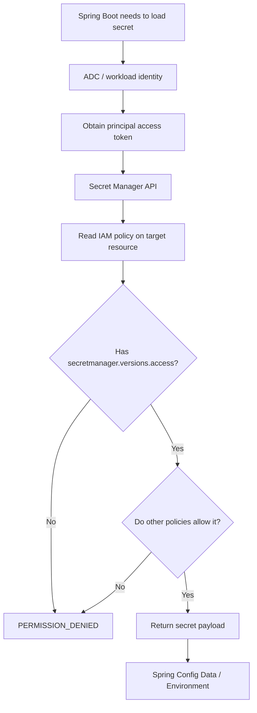
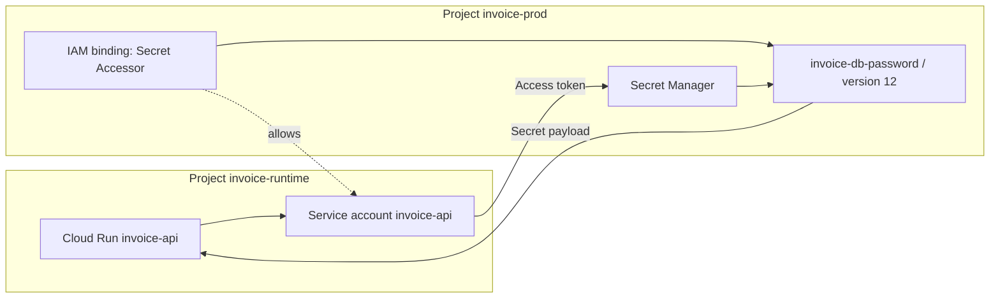

# Secret Read Permissions and Cross-Project Access

A Spring Boot application may run in project `invoice-runtime` while needing to read a database password stored in Secret Manager in project `invoice-prod`. Knowing the right resource name is not enough to read the secret. Google Cloud must authenticate **the identity calling the API**, then evaluate the IAM policy on **the secret targeted by the request**.

For Secret Manager, the core payload-reading permission is `secretmanager.versions.access`. The commonly used predefined role is `roles/secretmanager.secretAccessor`. This role can be granted directly on a specific secret. That is the right approach when a service only needs a few credentials. Granting the role at the project, folder, or organization level widens access to many more secrets.

This lesson belongs to the **Google Cloud Configuration** chapter of the **SPRING_CLOUD_PROVIDER_INTEGRATION** module. The module practices integrating Spring Boot with managed services on AWS, Azure, and Google Cloud through the corresponding Spring Cloud libraries. This lesson focuses on IAM for Google Cloud Secret Manager, separating the runtime identity from the project holding the secret, configuring cross-project access, and troubleshooting permission errors in deployment environments.

## 1. Learning Objectives

After this lesson, you will be able to:

- Explain the difference between authentication and authorization when Spring Boot calls Secret Manager.
- Identify the actual principal an application uses from ADC or workload identity.
- Understand the `secretmanager.versions.access` permission and the `roles/secretmanager.secretAccessor` role.
- Distinguish payload read permissions from metadata viewing, version creation, and secret administration permissions.
- Grant permissions at the secret level rather than the project level when an application needs only one secret.
- Configure permissions when the workload and Secret Manager live in two different projects.
- Choose the appropriate authentication mechanism for Cloud Run, Compute Engine, GKE, local environments, and workloads outside Google Cloud.
- Understand the role of OAuth scopes, IAM Conditions, VPC Service Controls, and audit logs.
- Diagnose `PERMISSION_DENIED`, insufficient authentication scopes, wrong principals, and cross-project errors.

## 2. Authentication and Authorization Are Two Separate Steps

When an application calls Secret Manager, Google Cloud evaluates two questions:

- **Authentication:** Who is sending the request? For example, a service account attached to Cloud Run, a linked Kubernetes service account, a federated principal, or a local developer user.
- **Authorization:** Does that principal have permission to perform the operation on the requested secret? For example, whether it has `secretmanager.versions.access` on the target secret.

Typical access flow:



Having a valid access token only proves the application is authenticated. That token does not automatically grant permission to read a secret. Conversely, a correct IAM binding will not help a request succeed if the application cannot obtain credentials or is using the wrong principal.

Example:

- A Cloud Run service is attached to the service account `invoice-api@invoice-runtime.iam.gserviceaccount.com`.
- The application references `projects/invoice-prod/secrets/invoice-db-password/versions/12`.
- The IAM policy of secret `invoice-db-password` in project `invoice-prod` must allow that service account to access the payload.
- If Cloud Run is running as a different service account, a binding for `invoice-api@...` has no effect on actual requests.

## 3. Permissions and Roles Needed to Read Secrets

The core permission is:

```text
secretmanager.versions.access
```

Common predefined role:

```text
roles/secretmanager.secretAccessor
```

`roles/secretmanager.secretAccessor` allows accessing a secret's payload. This role includes the `secretmanager.versions.access` permission and the project read permissions required for that operation. Google Cloud allows granting this role down to the **secret resource** level.

### 3.1. Distinguishing common roles

| Role | Primary Capability | Reads Payload? |
| --- | --- | --- |
| `roles/secretmanager.secretAccessor` | Accesses the secret payload | Yes |
| `roles/secretmanager.viewer` | Views metadata, secret, and version metadata | No |
| `roles/secretmanager.editor` | Creates/updates/manages certain resources and versions | No |
| `roles/secretmanager.secretVersionAdder` | Adds versions to an existing secret | No |
| `roles/secretmanager.secretVersionManager` | Manages versions: add, enable, disable, destroy, and view metadata | No |
| `roles/secretmanager.admin` | Administers all Secret Manager operations within the granted scope | Yes, but broader than a read-only runtime needs |

A common misconception: project `roles/editor` and `roles/secretmanager.editor` are not payload-reading roles. According to Google Cloud's current permission tables, these roles do not include `secretmanager.versions.access`. Likewise, `roles/secretmanager.viewer` only views metadata and cannot read secret contents.

Runtime applications typically only need `roles/secretmanager.secretAccessor`. Do not grant `roles/secretmanager.admin` just so Spring Boot can read a database password. Adding versions, modifying IAM policies, or destroying versions should belong to a dedicated administration/rotation principal.

### 3.2. Permission scope across the resource hierarchy

The same role yields different access scopes depending on where the binding is attached:

| Where `roles/secretmanager.secretAccessor` is granted | Scope of secrets the principal can read |
| --- | --- |
| A single secret | Only that secret |
| Project | All secrets in the project |
| Folder | All secrets across projects in the folder |
| Organization | All secrets across projects in the organization |

If `invoice-api` only needs `invoice-db-password`, grant the role on that secret. Do not grant permission at the project level just because the command is shorter to write. A project-level binding can allow a service to read additional secrets created later without changing the application.

## 4. Granting Permissions at the Secret Level

Suppose you have:

```text
Project hosting secret: invoice-prod
Secret ID: invoice-db-password
Runtime service account:
  invoice-api@invoice-runtime.iam.gserviceaccount.com
Role:
  roles/secretmanager.secretAccessor
```

gcloud command to grant permission:

```bash
gcloud secrets add-iam-policy-binding invoice-db-password \
  --project=invoice-prod \
  --member="serviceAccount:invoice-api@invoice-runtime.iam.gserviceaccount.com" \
  --role="roles/secretmanager.secretAccessor"
```

In this command:

- `invoice-db-password` is the secret ID.
- `--project=invoice-prod` specifies the project **owning the secret**.
- `--member` is the principal receiving permission; the service account can belong to a different project.
- `--role` grants payload read permission.

The account running the administrative command needs permission to modify the IAM policy on the secret, such as `secretmanager.secrets.setIamPolicy`. The runtime service account does not need permission to modify IAM policies in order to read a secret.

### 4.1. Viewing the current IAM policy

```bash
gcloud secrets get-iam-policy invoice-db-password \
  --project=invoice-prod \
  --format=yaml
```

Verify that the member and role appear accurately. Note that an IAM policy may contain multiple bindings managed by other teams and services; do not overwrite the entire policy just to add a single service account.

### 4.2. Revoking permissions when a service no longer needs a secret

```bash
gcloud secrets remove-iam-policy-binding invoice-db-password \
  --project=invoice-prod \
  --member="serviceAccount:invoice-api@invoice-runtime.iam.gserviceaccount.com" \
  --role="roles/secretmanager.secretAccessor"
```

After revocation, new requests from that principal will no longer be allowed to read the payload. Revoking permissions does not delete the secret or its versions. If the service still holds the secret in memory, revoking IAM does not automatically purge the previously loaded copy; you need a restart/refresh workflow or credential revocation on the target system if exposure is a risk.

For regional secrets, specify the location using the gcloud syntax supported for regional resources and check the IAM policy on the exact regional secret. Do not accidentally bind permissions to a global secret of the same name.

## 5. Accessing a Secret in a Different Project from the Application

This is the central scenario of this lesson:

```text
Project invoice-runtime
  Cloud Run service: invoice-api
  Service account:
    invoice-api@invoice-runtime.iam.gserviceaccount.com

Project invoice-prod
  Secret Manager:
    invoice-db-password
    Version: 12
```

Spring Boot references the resource in the project containing the secret:

```yaml
spring:
  config:
    import: "sm@"
  cloud:
    gcp:
      secretmanager:
        project-id: invoice-prod

invoice:
  database:
    password: "${sm@projects/invoice-prod/secrets/invoice-db-password/versions/12}"
```

There are two separate projects with two distinct roles:

- `invoice-runtime` hosts the workload and the service account used as the API-calling identity.
- `invoice-prod` hosts the secret and the IAM policy determining who can read the payload.

**The resource path must specify the project containing the secret.** The IAM binding must be attached to the secret inside project `invoice-prod`, with the member being the workload's service account from `invoice-runtime`.

### 5.1. Cross-project diagram



There is no need to copy secrets into the runtime project just because the application runs there. Keeping secrets in a project dedicated to sensitive data separates secret lifecycles, administrative permissions, and application deployment permissions.

### 5.2. Attaching an IAM binding for a cross-project service account

Run the command targeting the project that owns the secret:

```bash
gcloud secrets add-iam-policy-binding invoice-db-password \
  --project=invoice-prod \
  --member="serviceAccount:invoice-api@invoice-runtime.iam.gserviceaccount.com" \
  --role="roles/secretmanager.secretAccessor"
```

Use the exact service account email. Do not confuse it with:

- The developer user account running `gcloud`.
- The default service account of the runtime project.
- The service account used by the deployment pipeline.
- The service account of another service in the same project.

A service account can be managed in the runtime project while being granted permissions on resources in another project. The IAM member identifies the service account; the project in `--project` specifies where the secret and policy reside.

## 6. Workload Authentication on Google Cloud

Spring Framework on Google Cloud uses Application Default Credentials (ADC) to obtain environment-specific credentials. For workloads running on Google Cloud, use the identity attached to the compute resource.

### 6.1. Cloud Run

Attach a dedicated service account to each service or group of workloads sharing the same permission needs. Example updating a service:

```bash
gcloud run services update invoice-api \
  --project=invoice-runtime \
  --region=asia-southeast1 \
  --service-account=invoice-api@invoice-runtime.iam.gserviceaccount.com
```

When the application calls Secret Manager, ADC uses the service account attached to the Cloud Run revision. Grant `roles/secretmanager.secretAccessor` to that exact service account on the secret in `invoice-prod`.

Do not grant permissions to the user who deployed Cloud Run assuming the application will run as that user. The deployment identity and runtime identity are two distinct principals.

### 6.2. Compute Engine

Attach an appropriate service account to the VM and ensure the VM has the OAuth scope `https://www.googleapis.com/auth/cloud-platform`. Google Cloud requires this scope when using Secret Manager from Compute Engine.

OAuth scopes and IAM serve different roles:

- OAuth scopes restrict the set of APIs the VM's access token can call.
- IAM policies determine whether the principal has permission to read a specific secret.

Having the `cloud-platform` scope does not automatically grant `secretmanager.versions.access`. Conversely, a valid IAM binding is still insufficient if the VM was created with an overly narrow OAuth scope.

### 6.3. Google Kubernetes Engine

With GKE, use Workload Identity Federation for GKE to provide identities to Kubernetes workloads. There are two common patterns:

- **Direct resource access:** grant the Secret Accessor role directly to the federated Kubernetes service account principal on the secret.
- **Service account impersonation:** link the Kubernetes service account to a Google Cloud service account; then grant secret read permission to the Google Cloud service account.

The impersonation pattern is useful when you need a single Google Cloud service account as a unified identity across multiple Google Cloud APIs. Restrict the binding to the exact Kubernetes namespace/service account; do not allow every workload in the cluster to impersonate a service account with read access to many secrets.

For GKE nodes or Compute Engine VMs, also check the `cloud-platform` OAuth scope. This is a common cause of `insufficient authentication scopes` errors even when the IAM policy looks right.

## 7. Access from Local Development

Locally, developers can use ADC with user credentials:

```bash
gcloud auth application-default login
```

This works well for dev when the user is granted permission to read test secrets. Do not grant every developer permission to read production secrets just to run the application locally.

If you need to test the exact runtime permissions, you can use service account impersonation to generate short-lived ADC for the service account:

```bash
gcloud auth application-default login \
  --impersonate-service-account=invoice-api@invoice-runtime.iam.gserviceaccount.com
```

The developer principal needs the `iam.serviceAccounts.getAccessToken` permission, typically via `roles/iam.serviceAccountTokenCreator` on the impersonated service account. Google Java client libraries support ADC with service account impersonation.

Benefits:

- No need to download a service account private key onto the machine.
- Tests using the exact intended runtime permissions.
- Short-lived tokens are minted instead of using static credentials.
- Impersonation permission can be revoked independently without altering the secret's IAM policy.

When using impersonation, distinguish two permission layers: the developer is allowed to impersonate the service account; the service account is allowed to read the secret. The developer does not necessarily have direct permission to read production secrets.

## 8. Workloads Running Outside Google Cloud: AWS, Azure, and CI/CD

This module practices Spring Boot with different managed providers. If an application runs on AWS, Azure, GitHub Actions, or GitLab CI yet needs to read Google Cloud Secret Manager, use **Workload Identity Federation (WIF)**.

WIF lets Google Cloud trust external identity providers via OIDC, SAML, or supported federation mechanisms. The workload exchanges its external credentials for short-lived Google Cloud tokens. This avoids maintaining long-lived service account JSON keys.

There are two ways to grant permissions:

### 8.1. Direct resource access

Grant `roles/secretmanager.secretAccessor` directly to the federated principal on the target secret. The principal can be scoped by subject, repository, environment, or attribute mappings from the identity provider.

This eliminates the service account impersonation step when the API and use case support direct access. You must constrain the member using a principal identifier and attribute conditions; avoid granting access to all members of a workload identity pool.

### 8.2. Service account impersonation

A federated identity is permitted to impersonate a Google Cloud service account. In that flow:

1. WIF authenticates the AWS/Azure/CI workload with Google Cloud.
2. The federated principal receives `roles/iam.workloadIdentityUser` on the chosen service account.
3. The service account receives `roles/secretmanager.secretAccessor` on the secret in the secret-hosting project.
4. The workload uses short-lived credentials of the service account to call Secret Manager.

These are two separate bindings: the WIF principal is permitted to impersonate the service account; the service account is permitted to read the secret. Do not grant `roles/secretmanager.secretAccessor` to a different principal and expect the service account to inherit it automatically.

Google Cloud recommends scoping external identities with attributes/conditions and creating a dedicated service account per application. Across dev, staging, and production environments, consider separating workload identity pools or providers by environment so a staging CI identity cannot impersonate a production service account.

## 9. IAM Conditions and Access Restrictions

Beyond roles, IAM Conditions let you restrict permissions by resource attributes or time. Secret Manager supports conditions based on resource name/type/service and time.

Some use cases:

- Granting time-bound read access to a support team handling an incident.
- Restricting a principal to access only secrets with a specific prefix.
- Scoping access to a specific secret version when policy and resource attributes permit.
- Granting temporary access during a migration that automatically expires at a timestamp.

Example time-based condition expression:

```text
request.time < timestamp("2026-12-01T00:00:00Z")
```

When adding a condition, verify which resource attributes Secret Manager evaluates on that exact API operation. Do not assume the condition is evaluated against the exact same resource name across all secret and version operations. Test the policy with an actual principal before rolling out broadly.

IAM allow policies can also be constrained by IAM Deny policies or higher-level organization policies. A valid allow binding does not guarantee a request will succeed if a deny policy applies.

## 10. APIs, OAuth Scopes, and Non-IAM Constraints

To read a secret successfully, multiple layers must be verified:

| Layer | What to Confirm | Common Error |
| --- | --- | --- |
| Secret Manager API | The API is enabled in the relevant project | `SERVICE_DISABLED` or API-not-enabled error |
| Authentication | ADC returns the right principal | `UNAUTHENTICATED`, credentials not found |
| IAM | Principal has `secretmanager.versions.access` on the secret | `PERMISSION_DENIED` |
| OAuth scope | VM/GKE node has the `cloud-platform` scope | `insufficient authentication scopes` |
| VPC Service Controls | Request is permitted across the service perimeter | Policy denied despite IAM being granted |
| IAM Deny/Condition | No deny policy blocks it and conditions are satisfied | `PERMISSION_DENIED` |
| Version state | Secret version exists and is accessible | `NOT_FOUND` or version unavailable error |
| CMEK (if used) | Secret Manager service agent has permission to use the Cloud KMS key | Encryption/decryption operation error |

Enable the Secret Manager API if the project does not have it enabled yet:

```bash
gcloud services enable secretmanager.googleapis.com \
  --project=invoice-prod
```

For secrets encrypted with a customer-managed encryption key (CMEK), distinguish the workload's secret read permission from the Secret Manager service agent's Cloud KMS key usage permission. The workload typically needs Secret Accessor on the secret; the Secret Manager service agent needs appropriate permissions on the CryptoKey to perform encryption/decryption. Do not grant broad KMS permissions to the workload just because the secret uses CMEK.

## 11. Monitoring Access with Cloud Audit Logs

Secret Manager generates audit logs for administrative and data-access activity. The `AccessSecretVersion` method requires the `secretmanager.versions.access` permission and emits a **Data Access audit log**.

Data Access audit logs must be enabled in the project/organization audit logging configuration if not already on. You can then filter in Logs Explorer:

```text
protoPayload.serviceName="secretmanager.googleapis.com"
```

To inspect payload read operations:

```text
protoPayload.serviceName="secretmanager.googleapis.com"
protoPayload.methodName="google.cloud.secretmanager.v1.SecretManagerService.AccessSecretVersion"
```

Use logs to verify:

- Which principal accessed the secret.
- Which secret resource was requested.
- Timestamp and method executed.
- Whether the request was denied, when logs are generated for that event.

Audit logs support investigation and auditing; they do not replace IAM policies. Never log secret payloads inside the application to supplement audit logs.

## 12. Diagnosing `PERMISSION_DENIED` and Cross-Project Errors

When Spring Boot reports it cannot read a secret, inspect in order:

### 12.1. Verify the actual principal

Confirm which service account the application is running as:

- Cloud Run: the service account attached to the revision.
- Compute Engine: the service account attached to the VM.
- GKE: the federated Kubernetes service account or impersonated Google Cloud service account.
- Local: ADC user or impersonated service account.
- AWS/Azure/GitHub/GitLab: external principal or service account impersonated via WIF.

Do not infer the runtime principal from the account that ran the deployment command.

### 12.2. Verify the project hosting the secret

The resource name must contain the project owning the secret:

```text
projects/invoice-prod/secrets/invoice-db-password/versions/12
```

If the application uses a default project, check `spring.cloud.gcp.secretmanager.project-id`. For cross-project setups, explicitly include the project in the resource path to avoid reading from the wrong project.

### 12.3. Verify the IAM binding on the exact secret

```bash
gcloud secrets get-iam-policy invoice-db-password \
  --project=invoice-prod \
  --format=yaml
```

Look for the exact service account or federated principal and the `roles/secretmanager.secretAccessor` role. If the binding only exists in `invoice-runtime`, it does not automatically apply to a secret living in `invoice-prod`.

### 12.4. Distinguish errors by symptom

| Error | What to Check |
| --- | --- |
| `UNAUTHENTICATED` | ADC, token, service account attachment, WIF credential configuration |
| `PERMISSION_DENIED` | Principal, IAM binding, IAM Deny, IAM Condition, VPC Service Controls |
| `insufficient authentication scopes` | `cloud-platform` OAuth scope on Compute Engine/GKE |
| `SERVICE_DISABLED` | Secret Manager API in the appropriate project |
| `NOT_FOUND` | Project ID, secret ID, location, version, and resource path |
| CMEK error | Secret Manager service agent and permissions on the Cloud KMS key |
| Works locally, fails on Cloud Run | User ADC has permission, but the runtime service account has not been granted permission |
| Secret Accessor granted yet still blocked | Check deny policies, service perimeter, and scopes |

A `PERMISSION_DENIED` error should never be resolved by granting `roles/owner` or `roles/secretmanager.admin` to the runtime. Identify which policy layer is denying access and fix the minimal binding required.

## 13. Hands-On Exercise: Cloud Run Reading a Secret in Another Project

**Context:** `invoice-api` runs on Cloud Run in project `invoice-runtime`. The database password resides in Secret Manager in project `invoice-prod`. Requirements: Cloud Run uses a dedicated service account, can read only the single required secret, and contains no service account JSON key.

### Step 1 — Identify the two projects and principal

```text
Runtime project: invoice-runtime
Secret project: invoice-prod
Cloud Run service: invoice-api
Runtime service account:
  invoice-api@invoice-runtime.iam.gserviceaccount.com
Secret:
  invoice-db-password
Secret version:
  12
```

Confirm the project IDs, secret ID, and version using metadata commands. Do not use the project display name in place of the project ID.

### Step 2 — Enable the Secret Manager API

```bash
gcloud services enable secretmanager.googleapis.com \
  --project=invoice-prod
```

### Step 3 — Attach the service account to Cloud Run

```bash
gcloud run services update invoice-api \
  --project=invoice-runtime \
  --region=asia-southeast1 \
  --service-account=invoice-api@invoice-runtime.iam.gserviceaccount.com
```

If the service does not exist yet, attach the service account during deployment. Verify the new revision actually uses this identity.

### Step 4 — Grant Secret Accessor on the target secret

```bash
gcloud secrets add-iam-policy-binding invoice-db-password \
  --project=invoice-prod \
  --member="serviceAccount:invoice-api@invoice-runtime.iam.gserviceaccount.com" \
  --role="roles/secretmanager.secretAccessor"
```

The binding is attached on the secret inside `invoice-prod`. The service account from `invoice-runtime` receives permission to read only that secret.

### Step 5 — Configure Spring Boot

```yaml
spring:
  config:
    import: "sm@"
  cloud:
    gcp:
      secretmanager:
        project-id: invoice-prod
  datasource:
    url: jdbc:postgresql://10.20.0.15:5432/invoice
    username: invoice_app
    password: "${sm@projects/invoice-prod/secrets/invoice-db-password/versions/12}"
```

The application uses Cloud Run's ADC. Never set `GOOGLE_APPLICATION_CREDENTIALS` pointing to a service account key in the image or production environment variables.

### Step 6 — Verify access

- Verify the Cloud Run revision uses the right service account.
- Verify the secret's IAM policy includes the right member.
- Call the health check endpoint that depends on the datasource and confirm connectivity.
- Check Data Access audit logs (if enabled) to confirm the principal accessed the right resource.
- Never print the password to logs or return it in API responses.

### Step 7 — Test denied permissions

Use another test service account without granted permissions to call Secret Manager. The expected result is `PERMISSION_DENIED`. Then grant the role on the specific secret and re-run. Verify that the test service account cannot read other secrets in the project.

## 14. Testing IAM and Cross-Project Access

Your test environment should cover these test cases:

| Case | Principal | IAM Binding | Expected Result |
| --- | --- | --- | --- |
| A | Runtime service account | Accessor on the exact secret | Payload read succeeds |
| B | Runtime service account | No binding | Rejected |
| C | Different service account | Accessor on secret A | Reads A successfully; cannot read B |
| D | Runtime service account | Accessor in runtime project, secret in another project | Rejected unless bound in the resource project |
| E | Runtime service account | Accessor on secret project | Reads all secrets in the project; broad scope requires review |
| F | GKE/Compute workload | Valid IAM, missing OAuth scope | `insufficient authentication scopes` error |
| G | Federated principal | Valid direct access binding | Reads if API supports it and other policies allow |
| H | WIF principal | Allowed to impersonate service account; service account has Accessor | Reads via service account |
| I | Principal has Accessor but blocked by VPC-SC | Rejected by policy perimeter |
| J | Viewer or Editor | Lacks `secretmanager.versions.access` | Cannot read payload |

A real integration test must run under the corresponding identity. Mocking `SecretManagerServiceClient` only verifies application handling logic; it does not prove that IAM policies, OAuth scopes, or service perimeters in Google Cloud are configured correctly.

## 15. Permission Design Principles for Production

A sound design separates identities by responsibility:

| Principal | Recommended Permissions |
| --- | --- |
| Runtime service account | Secret Accessor on each secret it needs to read |
| Deploy pipeline | Permission to deploy workloads; no default permission to read payloads |
| Secret administrator | Manages metadata, IAM policies, and secret lifecycle |
| Rotation job | Permission to add versions or manage versions as needed |
| Local developer | ADC for dev/test secrets; controlled impersonation if runtime testing is needed |
| Security auditor | Permission to view policies and audit logs, without payloads |

Key principles:

1. Use a dedicated service account for each application or workload with distinct permission requirements.
2. Grant `roles/secretmanager.secretAccessor` at the secret level whenever possible.
3. Separate the project hosting secrets from the project running workloads if architecture requires an administrative boundary.
4. Use workload identity/ADC instead of static service account keys.
5. Separate payload read permissions from permissions to create, disable, or destroy versions and edit IAM policies.
6. Use IAM Conditions or temporary elevation mechanisms when time/scope limits are needed.
7. Enable appropriate audit logs and review access permissions periodically.
8. Test both allowed and denied cases; verify workloads cannot read out-of-scope secrets.

## 16. Self-Check Questions

1. What is the difference between authentication and authorization when Spring Boot calls Secret Manager?
2. Which permission allows reading the payload of a secret version?
3. Why is `roles/secretmanager.viewer` insufficient to read a secret?
4. How does granting `roles/secretmanager.secretAccessor` at the secret level differ from granting it at the project level?
5. When Cloud Run runs in `invoice-runtime` and the secret resides in `invoice-prod`, which project appears in the resource path?
6. In which project must the IAM binding be attached, and which principal should the member be?
7. Why does the service account used to deploy Cloud Run differ from the service account the revision uses at runtime?
8. Does the `cloud-platform` OAuth scope on Compute Engine/GKE replace IAM roles?
9. How does WIF direct resource access differ from service account impersonation?
10. If Secret Accessor has already been granted yet requests are still blocked, which policies should be checked?
11. Into which audit log type is `AccessSecretVersion` recorded?
12. Why should `roles/secretmanager.admin` not be granted to a runtime service that only reads a database password?

## 17. Key Takeaways

Reading a secret requires the combination of the **right principal**, **right permission**, and **right resource**. The core permission is `secretmanager.versions.access`; the standard role is `roles/secretmanager.secretAccessor`. Granting the role at the secret level ensures a service reads only the exact credentials it needs. Granting at the project, folder, or organization level expands access to many more secrets.

For cross-project access, the resource path must point to the project holding the secret, and the IAM binding must allow the runtime principal to read the secret in that project. Cloud Run, Compute Engine, GKE, local development, and workloads outside Google Cloud may use different identity mechanisms, yet the authorization principle on the secret remains the same. **Verifying the actual principal, attaching permissions on the exact resource, and testing both allowed and denied access** is how to deploy Spring Boot with Secret Manager in a controlled manner.

## Official References

- [Google Cloud Secret Manager — Access control with IAM](https://docs.cloud.google.com/secret-manager/docs/access-control)
- [Google Cloud Secret Manager — Manage access to secrets](https://docs.cloud.google.com/secret-manager/docs/manage-access-to-secrets)
- [Google Cloud Secret Manager — Access the Secret Manager API](https://docs.cloud.google.com/secret-manager/docs/accessing-the-api)
- [Google Cloud Secret Manager — Audit logging](https://docs.cloud.google.com/secret-manager/docs/audit-logging)
- [Google Cloud IAM — Workload Identity Federation](https://docs.cloud.google.com/iam/docs/workload-identity-federation)
- [Google Cloud IAM — Service account impersonation](https://docs.cloud.google.com/iam/docs/service-account-impersonation)
- [Google Cloud VPC Service Controls — Troubleshooting](https://docs.cloud.google.com/vpc-service-controls/docs/troubleshooting)
- [Google Cloud Secret Manager — Customer-managed encryption keys](https://docs.cloud.google.com/secret-manager/docs/cmek)
