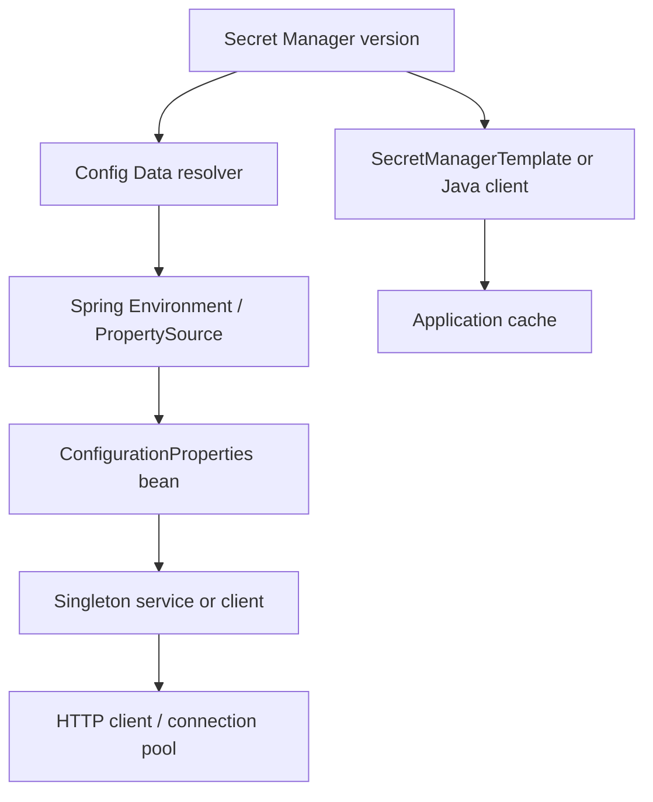
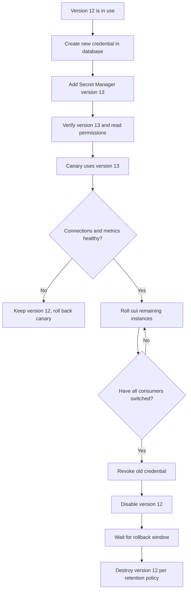

# Secret Versions, Caching, and Updating Applications After Rotation

Creating a new secret version in Google Cloud Secret Manager **does not automatically change the value held in a running Spring Boot application's memory**. Secret Manager stores the new version; the application must read that version, reload configuration, or redeploy to use it. If the application still holds the old value in the Spring Environment, a singleton bean, an HTTP client, or a connection pool, adding a new version alone is not enough to complete rotation.

This lesson connects three parts of the secret lifecycle: **versions in Secret Manager**, **caching inside the application**, and **workload update workflows**. The goal is to transition credentials safely in phases, verify the new version works, keep rollback capability for as long as needed, and revoke the old version only after all consumers have migrated.

This lesson belongs to the **Google Cloud Configuration** chapter of the **SPRING_CLOUD_PROVIDER_INTEGRATION** module. The module practices integrating Spring Boot with managed services on AWS, Azure, and Google Cloud via the corresponding Spring Cloud libraries. Within Google Cloud, this lesson focuses on Secret Manager, Spring Framework on Google Cloud, the Spring Boot Config Data API, @RefreshScope, Actuator, and Pub/Sub notifications.

## 1. Learning Objectives

After this lesson, you will be able to:

- Explain the relationship between a secret, a secret version, and an immutable payload.
- Distinguish latest from a specific version ID in production deployments.
- Identify the layers holding secrets in an application: Config Data, Spring Environment, beans, SDK clients, caches, and connection pools.
- Understand why updating a secret on Google Cloud does not automatically update a running JVM.
- Choose between restart/rollout, Actuator refresh, and dynamic client reads.
- Use @ConfigurationProperties together with @RefreshScope to reload supported properties.
- Design a cache with TTL, staleness bounds, and error handling when Secret Manager is unreachable.
- Build a rotation workflow with overlap, phased rollout, verification, and rollback.
- Use Pub/Sub event notifications and rotation schedules to trigger workflows.
- Verify the application is genuinely using the new version before disabling or destroying the old version.

## 2. A Secret Version Is a Payload Snapshot

Secret Manager stores a secret as a managed resource and multiple **secret versions**. Each time a new payload is added, the service creates a new version with an incrementing ID. An existing version's payload is not modified in place; rotation creates a new version instead of overwriting the old one.

Example:

```text
projects/invoice-prod/secrets/invoice-db-password/versions/12
projects/invoice-prod/secrets/invoice-db-password/versions/13
```

- Version 12 holds the credential currently used by the application.
- Version 13 holds the new post-rotation credential.
- Both versions can coexist during the transition window.
- The application only reads the version requested by its resource reference or runtime logic.

You can add a version with gcloud:

```bash
gcloud secrets versions add invoice-db-password \
  --project=invoice-prod \
  --data-file=./invoice-db-password.next
```

The input file must have restricted read permissions, must not live in source control, and must not be captured in pipeline artifacts/logs. The command returns the resource name of the newly created version; store the version ID in deployment metadata or controlled outputs, never the payload.

List versions:

```bash
gcloud secrets versions list invoice-db-password \
  --project=invoice-prod
```

View metadata for a version:

```bash
gcloud secrets versions describe 13 \
  --secret=invoice-db-password \
  --project=invoice-prod
```

These operations tell you whether the version was created and its state. There is no need to fetch the payload just to verify a version ID.

## 3. Choosing a Pinned Version or latest?

Secret Manager provides the latest alias pointing to the newest version. Spring Framework on Google Cloud supports referencing this alias, for example:

```yaml
spring:
  config:
    import: "sm@"

invoice:
  database:
    password: "${sm@projects/invoice-prod/secrets/invoice-db-password/versions/latest}"
```

When version 13 is added, the latest alias points to the newest version. However, two instances starting at different times can read two different payloads. A faulty version can immediately be picked up by many new instances as they restart or scale out.

Google Cloud recommends referencing a version number instead of latest in production and deploying new versions through your existing release process. This lets you test versions, roll out gradually, and roll back by reverting configuration to the previous version. latest may suit local/test setups or cases where pointing automatically to the newest version is explicitly accepted.

### 3.1. Pinning the version ID in configuration

Example of a production application using version 12:

```yaml
spring:
  config:
    import: "sm@"
  cloud:
    gcp:
      secretmanager:
        project-id: invoice-prod

invoice:
  database:
    password: "${sm@projects/invoice-prod/secrets/invoice-db-password/versions/12}"
```

After version 13 is created, the resource reference above still points to version 12. To move the application to version 13, update the deployment configuration:

```yaml
invoice:
  database:
    password: "${sm@projects/invoice-prod/secrets/invoice-db-password/versions/13}"
```

When using a pinned version, adding a new version does not alter the current configuration. This is a valuable property for reproducible deployments.

### 3.2. Comparing binding strategies

| Strategy | When Is the Payload Fetched? | Updates When a New Version Is Added? | Characteristics |
| --- | --- | --- | --- |
| Pin numeric version | When the app loads config or calls the API for that version | No | Easy to review, reproduce, roll out, and roll back |
| latest at startup | Each time an instance loads configuration | Only on the next load | Simple, but instances may run different versions |
| Poll latest continuously | On an application-defined polling interval | After a successful poll | Can update quickly, but easily spreads a faulty version to all instances |
| Read version via API on demand | Per call or per application-managed cache | When version selection logic changes | Flexible, but must manage latency, quota, and caching |

For production, pinning versions and using the release process usually produces the cleanest path. If continuous updates are required, you must have phased rollouts, health checks, rate limiting, and the ability to revert to the previously working version.

## 4. Where Are Secrets Held Inside a Spring Application?

A value fetched from Secret Manager can live in multiple places after being read:



These layers have different lifecycles:

| Location | How the Value Is Held | What Causes the Value to Change? |
| --- | --- | --- |
| Config Data / PropertySource | Loaded into Spring Environment during config processing | Reloading config or an integration-supported refresh |
| @Value in a singleton | Value is injected into the bean at creation | Recreating the bean/context; does not change just because a new secret exists |
| @ConfigurationProperties | Bean holds the bound properties | Supported refresh mechanism when the bean is in refresh scope |
| HTTP client/SDK client | May copy API key/token into internal configuration | Recreating the client or updating credentials via the client's API |
| JDBC connection pool | Already-open connections may continue using the old auth session | Creating new connections, replacing the pool, or rolling out appropriately |
| Application-written cache | In-memory value keyed with TTL | TTL expiration, invalidation event, or proactive refresh |

Therefore, **refreshing a property does not mean every object that received the secret automatically updates**. A service may have copied the API key into a singleton client; a datasource may hold connections authenticated with the old password. Your rotation design must identify which places need to be recreated or refreshed.

## 5. Spring Config Data Does Not Automatically Watch Changes

Declaring spring.config.import: "sm@" lets Spring Boot load secret references through the Config Data API. During startup, the library resolves references and places values into the Spring Environment. Beans then receive values from the Environment.

Example:

```yaml
spring:
  config:
    import: "sm@"

partner:
  api-key: "${sm@projects/invoice-prod/secrets/partner-api-key/versions/12}"
```

```java
@ConfigurationProperties(prefix = "partner")
public class PartnerProperties {

    private String apiKey;

    public String getApiKey() {
        return apiKey;
    }

    public void setApiKey(String apiKey) {
        this.apiKey = apiKey;
    }
}
```

Creating version 13 in Secret Manager does not edit the YAML file and does not push the new payload directly into PartnerProperties. While the application is running, the old value remains in the Environment or bean until the application reloads configuration through a supported mechanism.

Do not confuse Secret Manager event notifications with Spring refresh. Pub/Sub can notify that a secret/version changed; the application or automation still has to receive that notification and actively trigger a refresh, update configuration, or roll out the workload.

## 6. Updating Configuration Without Restarting via Actuator Refresh

Spring Framework on Google Cloud guides using Spring Boot Actuator to refresh secrets without restarting the application. Basic steps:

1. Add the Actuator dependency.
2. Expose the refresh endpoint.
3. Annotate the @ConfigurationProperties to be updated with @RefreshScope.
4. Update the secret in Secret Manager.
5. Send a POST request to the refresh endpoint.
6. Verify the bean and consumers are using the new value.

### 6.1. Add dependency and expose endpoint

Maven:

```xml
<dependency>
    <groupId>org.springframework.boot</groupId>
    <artifactId>spring-boot-starter-actuator</artifactId>
</dependency>
```

Configuration:

```yaml
management:
  endpoints:
    web:
      exposure:
        include: refresh
```

The refresh endpoint can alter running configuration. Expose it only on an administrative network, require appropriate authentication/authorization, and restrict allowed principals. Never expose this endpoint to the public internet.

### 6.2. Annotate ConfigurationProperties with RefreshScope

Example:

```java
@Component
@RefreshScope
@ConfigurationProperties(prefix = "partner")
public class PartnerProperties {

    private String apiKey;

    public String getApiKey() {
        return apiKey;
    }

    public void setApiKey(String apiKey) {
        this.apiKey = apiKey;
    }
}
```

Per the Spring Framework on Google Cloud Secret Manager integration documentation, only @ConfigurationProperties annotated with @RefreshScope support updating secrets without restarting the application.

### 6.3. Call refresh after updating the secret

Once Secret Manager has a new version, call:

```bash
curl -X POST https://invoice-api.internal/actuator/refresh
```

The URL in the example is an internal management endpoint; actual requests must go through your system's authentication and management network. Do not record bearer tokens or secrets in shell history.

With a reference using latest, the refresh can re-resolve the alias to pick up the new version. With a reference pinning version 12, refresh continues reading version 12 until configuration is changed to version 13. Refresh does not automatically rewrite pinned version numbers in YAML.

### 6.4. Refreshing properties and recreating consumers

Suppose PartnerProperties receives the new API key, yet PartnerClient was created once and holds a copy of the old API key. That client may continue sending requests with the old credential.

You can place the client in refresh scope so it is recreated after a refresh:

```java
@Configuration
public class PartnerClientConfiguration {

    @Bean
    @RefreshScope
    PartnerClient partnerClient(PartnerProperties properties) {
        return new PartnerClient(properties.getApiKey());
    }
}
```

PartnerClient represents the application's concrete client. In a real deployment, ensure the old client is closed properly per its lifecycle and the new client is not used before initializing cleanly. For datasources/connection pools, plan pool replacement or an appropriate rollout; do not assume refreshing a properties bean automatically re-authenticates every open connection.

## 7. When Should You Restart or Roll Out the Application?

Actuator refresh works well when beans and libraries support refreshable configuration. There are cases where restart/rollout is clearer and easier to control:

- Credentials are read in the constructor of a singleton outside refresh scope.
- An SDK does not support swapping credentials after client creation.
- A connection pool must be recreated to use a new password.
- The application needs to pin a specific version per release.
- You need to roll out instance groups gradually, observe errors, and roll back.
- You do not want to expose a refresh endpoint on production workloads.

Rollout process:

1. Add the new version to Secret Manager.
2. Update manifests/parameters/deployment config to the new version ID.
3. Deploy a small group of instances or a canary revision.
4. Monitor readiness, authentication failures, latency, and error rates.
5. Gradually increase traffic percentage if metrics look healthy.
6. Complete the rollout before revoking the old credential.

Cloud Run can deploy a new revision with the same image and updated reference/version configuration. Kubernetes can update deployment annotations/configs to trigger a new rollout. Regardless of platform, know which instances are running which version so you avoid revoking the old credential too early.

## 8. Caching and Bounding Secret Staleness

Secret Manager is a remote service. Calling its API on every business request adds latency, introduces a network dependency, and increases access counts. Conversely, caching a secret for too long keeps the application using a rotated or revoked credential.

Choose storage matching your requirements:

| Approach | Benefits | Risks to Manage |
| --- | --- | --- |
| Load once at startup | Few requests to Secret Manager, predictable behavior | Old value persists until next restart/refresh |
| Cache with TTL | Fewer requests, bounded staleness | Delay before picking up a new version |
| Event-driven refresh | Updates close to when the version changes | Needs subscriber, ensuring events are not dropped and handling duplicates |
| Periodic polling | Less dependent on event delivery | Increases requests; multiple instances may poll simultaneously |
| Read API per request | Always checks the resource on demand | High latency, quota usage, cost, and service dependency |

### 8.1. Cache design rules

If the application must read secrets dynamically, the cache needs explicit policies:

- **Finite TTL:** defines the maximum duration the application may use a cached value.
- **Jitter:** staggers refresh timing across instances to avoid thundering herds hitting the API together.
- **Single-flight:** when concurrent requests see an expired cache, only one thread performs the refresh; others wait for the result.
- **Bounded stale-on-error:** use the old value only if business rules permit, with a maximum duration and alerting.
- **Intentional invalidation:** a new version event can trigger an early refresh ahead of TTL.
- **Never log payloads:** log the version resource, refresh timestamp, status, and error code; never log the secret value.
- **Permission scoping:** the runtime principal only has permission to read required secrets.

There is no single TTL suitable for every secret type. An API key might tolerate a brief transition window; credentials used for data encryption or high-privilege auth may need shorter cache durations and stricter revocation procedures. Choose the TTL alongside the target system's tolerance for old credentials.

### 8.2. Cache by version rather than only by secret ID

A cache can store the secret resource, version ID, payload, and load timestamp together. This makes it observable which version an instance is using without exposing the payload.

Internal metadata example:

```text
secret: projects/invoice-prod/secrets/partner-api-key
version: 13
loadedAt: 2026-11-24T10:30:00Z
expiresAt: 2026-11-24T10:35:00Z
```

Never use the payload as a cache key or metric label. Do not write secret values into a distributed cache just to share across instances; if a shared cache is mandatory, enforce strict access controls, encryption, and appropriate TTLs.

### 8.3. When refresh fails

If a refresh attempt fails, the application must make an explicit decision:

- Is the old secret still valid and safe to use for a brief window?
- Was the old credential revoked due to an incident, or is only the new version unreadable?
- Can the feature enter a degraded state or must it halt?
- After how long should it be marked unhealthy and trigger an alert?

Never keep stale cache entries indefinitely. During a credential exposure incident, retaining an old secret in cache can preserve unauthorized access. During routine rotation, an overlap window may be necessary so rollouts do not disrupt traffic; that is a policy of the target system and application, not a reason to keep unbounded caches.

## 9. SecretManagerTemplate and Java Client in Runtime Flows

Spring Framework on Google Cloud provides SecretManagerTemplate to read, create, and update secrets programmatically. Unlike Config Data, using the template/client lets the application decide when to call Secret Manager and whether to maintain its own cache.

You can inject the template after adding the starter:

```java
@Service
public class PartnerSecretService {

    private final SecretManagerTemplate secretManagerTemplate;

    public PartnerSecretService(
            SecretManagerTemplate secretManagerTemplate) {
        this.secretManagerTemplate = secretManagerTemplate;
    }

    // Choose the secret-reading operation from SecretManagerOperations
    // matching your resource name and application data type.
}
```

Specific operations are defined in SecretManagerOperations. Choose the API matching your library version. Do not assume the template automatically polls for new versions or updates beans that previously received values.

If using the Google Cloud Java client directly, you can access a specific version:

```java
public String readSecretVersion(
        SecretManagerServiceClient client,
        String projectId,
        String secretId,
        String versionId) {

    SecretVersionName name =
            SecretVersionName.of(projectId, secretId, versionId);

    AccessSecretVersionResponse response =
            client.accessSecretVersion(name);

    return response.getPayload().getData().toStringUtf8();
}
```

The client should be managed as a shared bean and closed when the application context stops. The snippet above illustrates reading a payload; do not call it repeatedly on every request without a business reason. If reading dynamically, add a cache TTL, concurrency limits, and a way to refresh/close consumers.

## 10. Pub/Sub Notifications and Rotation Schedules

Secret Manager supports configuring a Pub/Sub topic to send notifications when secrets or versions change. Important event types include:

| Event | Meaning |
| --- | --- |
| SECRET_VERSION_ADD | A new version was added successfully |
| SECRET_VERSION_ENABLE | A version was enabled |
| SECRET_VERSION_DISABLE | A version was disabled |
| SECRET_VERSION_DESTROY | A version was destroyed |
| SECRET_ROTATE | The configured rotation schedule time has arrived |

Event notifications can trigger workflows, such as:

- Updating deployment parameters to the new version ID.
- Requesting the release system to roll out a revision.
- Invalidating caches or sending refresh signals to applications.
- Alerting operations teams when a version is disabled/destroyed.

### 10.1. Rotation schedules only send signals

Secret Manager can configure rotation_period and next_rotation_time. When the time arrives, the service publishes a SECRET_ROTATE message to the Pub/Sub topic attached to the secret. **Secret Manager does not change database passwords on its own, generate new payloads, or deploy applications.** You must have a subscriber or workflow that receives the message and executes the rotation steps.

Typical steps:

1. Subscriber receives SECRET_ROTATE.
2. Rotation worker creates a new credential on the target system.
3. Worker adds the new payload as a secret version.
4. System detects SECRET_VERSION_ADD or pipeline receives the output version ID.
5. Release workflow updates configuration and rolls out the application.
6. After verifying all consumers have migrated, the workflow revokes the old credential and cleans up old versions per policy.

A rotation notification does not guarantee the business workflow finished. Track per-step state, use controlled retries, and alert when a rotation fails to complete.

### 10.2. Designing reentrant subscribers

Cloud Run or workers receiving Pub/Sub messages can experience retries, timeouts, or mid-run termination. The rotation workflow must be idempotent/reentrant:

- Identify the active rotation by secret and timestamp/operation ID.
- Persist completed step state to avoid creating unintended duplicate credentials.
- Use etags when updating metadata if multiple actors can modify the same secret.
- Limit concurrency so two rotations do not run simultaneously for the same credential.
- Record version IDs and workflow status, never payloads.
- Support resume or rollback actions when a step fails.

Google Cloud retries notification delivery several times, but cannot guarantee delivery if topic configuration, permissions, or quotas are wrong. Subscribers still need retries, dead-lettering/alerting, and missed-rotation detection.

## 11. Rotation Workflow with Overlap and Rollback

Suppose invoice-service uses database credential version 12 and needs to migrate to version 13.



### 11.1. Keeping two credentials valid during transition

If the target system supports two active keys/users simultaneously, create the new credential before revoking the old one. This allows old instances to keep operating while new instances roll out.

For databases allowing only one password at a time, consider alternating users, dual database principals, or a planned transition with an accepted downtime window. Never assume rolling deployments are automatically safe if the old credential is invalidated the moment the new password is set.

### 11.2. Verification before revocation

Consider rotation complete only after verifying:

- All instances/revisions are running the new version reference.
- New clients establish connections successfully.
- No consumers are still using the old credential.
- Error rates and authentication failures are at normal levels.
- Old caches have expired by TTL or been invalidated.
- The rollback window has ended or an explicit decision was made about retaining the old version.

Only then disable the old version. Disabling is reversible; destroying makes payload recovery impossible. Google Cloud recommends disabling and waiting for verification before destroying a version.

## 12. Observability and Diagnostics After Rotation

Never log secret payloads to confirm the application updated. Log non-sensitive operational metadata instead:

| Observed Field | Purpose |
| --- | --- |
| Secret resource name | Identifies which secret the instance references |
| Loaded version ID | Shows which version the instance is using |
| Load/refresh timestamp | Confirms whether refresh occurred |
| Instance/revision ID | Finds instances that have not transitioned |
| Refresh result | Succeeded, failed, or retrying |
| Error code | Distinguishes IAM, NOT_FOUND, timeouts, and other errors |
| Remaining cache age/TTL | Shows how stale cached data is |

You can create metrics such as secret_refresh_success_total, secret_refresh_failure_total, secret_cache_age_seconds, or secret_version_loaded, but never place payloads, API keys, or passwords in labels.

### 12.1. Common errors

| Symptom | Possible Cause | Resolution |
| --- | --- | --- |
| Version added, yet app still uses old value | Config Data and beans were loaded earlier | Refresh the right beans or roll out/restart |
| Called /actuator/refresh, yet client still uses old key | Client holds a credential copy and is not in refresh scope | Recreate the client or design it to read properties dynamically |
| Pinned version 12, yet expected version 13 after refresh | Reference still points to version 12 | Update the resource reference to 13, then refresh/roll out |
| Used latest and some instances fail after scale out | New instances read an invalid new version | Pin a verified version; roll back deployment |
| Simultaneous refresh across many instances causes traffic spike | Missing jitter or rollout control | Stagger refreshes, add jitter, and cap concurrency |
| Secret Manager times out, cache serves old value forever | Unbounded stale-on-error | Set max staleness, alerting, and explicit fail policy |
| Old version disabled while old instances still run | Revoked before rollout finished | Re-enable if appropriate, migrate consumers, then disable |
| Rotation schedule arrived, yet credential did not change | Only Pub/Sub notification arrived; no subscriber finished workflow | Check topic, subscription, IAM, retries, and rotation state |
| Pub/Sub message processed multiple times | Subscriber is not idempotent | Use operation ID/state and concurrency controls |
| New version loaded, yet database still rejects it | Database credential mismatch or pool holds stale connections | Check target system, open new connections, and cycle pool |

## 13. Hands-On Exercise: Rotating an API Key for a Partner Client

**Context:** invoice-service runs on Cloud Run. The partner API key lives in Secret Manager in project invoice-prod. The current revision uses version 12; version 13 will be issued. Requirements: transition gradually to the new key, maintain rollback capability, and never log payloads.

### Step 1 — Check the current version

```bash
gcloud secrets versions describe 12 \
  --secret=partner-api-key \
  --project=invoice-prod
```

Confirm version 12 is enabled and the application uses this exact resource reference.

### Step 2 — Create the new key on the partner system

Use the partner's admin portal/API to issue a new key. If the partner supports multiple active keys simultaneously, keep the old key active during the rollout. Do not deactivate the old key immediately upon creating the new key.

### Step 3 — Add the new version to Secret Manager

```bash
gcloud secrets versions add partner-api-key \
  --project=invoice-prod \
  --data-file=./partner-api-key.next
```

Protect the temporary file and delete it per policy once done. Never print the file contents to the terminal or pipeline logs.

### Step 4 — Verify the new version

List versions and inspect metadata for the newly created version. Confirm the version is enabled and the runtime service account has permission to read the secret.

### Step 5 — Update release configuration

Change the reference from version 12 to version 13:

```yaml
partner:
  api-key: "${sm@projects/invoice-prod/secrets/partner-api-key/versions/13}"
```

Create a new revision or use a controlled refresh workflow if beans support @RefreshScope.

### Step 6 — Canary and rollout

Deploy a small set of instances/revisions. Send test requests to the partner, watching HTTP 401/403, timeouts, and error rates. If errors occur, revert configuration to version 12 and roll back the canary while the old key is still valid.

### Step 7 — Complete rotation

Once every instance uses version 13, wait for cache TTLs and old connection/client lifecycles to finish. Revoke the old key in the partner system, then disable version 12. Keep an appropriate rollback window before destroying the old version.

### Step 8 — Verify via metadata

Confirm the deployment pins version 13, version 12 was handled per plan, and no old instances remain. Do not read payloads to verify rollout status.

## 14. Self-Check Questions

1. Why does adding a new secret version not automatically change the value inside a Spring singleton bean?
2. How does latest differ from a pinned version ID when multiple instances start at different times?
3. Which layers inside an application can continue holding an old credential after Config Data refreshes?
4. What role does @RefreshScope play when combined with @ConfigurationProperties?
5. Why might calling /actuator/refresh fail to update an already-created HTTP client or connection pool?
6. When should you roll out a new revision instead of performing an in-process refresh?
7. What do cache TTL, jitter, and single-flight help control?
8. Why should stale-on-error not be used indefinitely?
9. How do SECRET_ROTATE and SECRET_VERSION_ADD differ?
10. Why does a rotation schedule require a Pub/Sub subscriber or separate workflow?
11. Why should the old credential remain valid during rollout if the target system supports it?
12. When is it safe to disable and destroy an old version?
13. How can you verify which version is in use without logging payloads?
14. If a new version causes errors during canary, what condition must hold for rollback?

## 15. Key Takeaways

Secret Manager stores separate versions; the application decides which version is read and where that value is held. Config Data typically loads secrets during startup; beans, clients, connection pools, and caches can continue holding old values. Actuator refresh with @RefreshScope supports updating properly annotated @ConfigurationProperties, but consumers holding credential copies still need recreation or rollout.

Google Cloud recommends pinning numeric versions in production and using release workflows to roll out new versions gradually. Caches need TTLs and staleness bounds; Pub/Sub notifications only trigger workflows and do not rotate credentials or update JVMs on their own. **Revoke the old version only after all consumers have migrated and been verified with the new version.**

## Official References

- [Spring Framework on Google Cloud — Secret Manager: Refresh secrets without restarting the application](https://googlecloudplatform.github.io/spring-cloud-gcp/reference/html/index.html#secret-manager)
- [Google Cloud Secret Manager — Rotation recommendations](https://docs.cloud.google.com/secret-manager/docs/rotation-recommendations)
- [Google Cloud Secret Manager — Create rotation schedules](https://docs.cloud.google.com/secret-manager/docs/secret-rotation)
- [Google Cloud Secret Manager — Event notifications](https://docs.cloud.google.com/secret-manager/docs/event-notifications)
- [Google Cloud Secret Manager — Best practices](https://docs.cloud.google.com/secret-manager/docs/best-practices)
- [Google Cloud Secret Manager — Access a secret version](https://docs.cloud.google.com/secret-manager/docs/access-secret-version)
- [Google Cloud Secret Manager — Add a secret version](https://docs.cloud.google.com/secret-manager/docs/add-secret-version)
