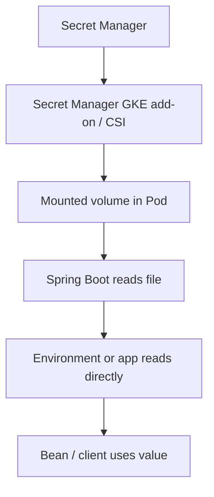

# Distinguishing Secret Manager, Environment Variables, and Configuration Files

Spring Boot can receive configuration from many sources: YAML files, properties files, environment variables, command-line arguments, and external configuration management services. All of these sources can place values into the Spring Environment, yet they do not share the same purpose or level of protection. An HTTP port, profile name, or feature flag usually belongs in environment variables or configuration files. Database passwords, API keys, and private keys must be managed as secret data.

With Google Cloud, **Secret Manager is where secrets are stored and managed**; environment variables and configuration files are ways to deliver values to the application process. When using managed integrations from Cloud Run or GKE, secrets can be provided via environment variables or file mounts. When using Spring Framework on Google Cloud, the application can also read secrets directly via Secret Manager Config Data or the client library.

The key point is not merely choosing where to store a value. You need to understand **who is allowed to read it, where the value gets injected, when the application reloads it, and which source can override another**. This lesson belongs to the **Google Cloud Configuration** chapter of the **SPRING_CLOUD_PROVIDER_INTEGRATION** module, where we practice integrating Spring Boot with managed services on AWS, Azure, and Google Cloud via the corresponding Spring Cloud libraries.

## 1. Learning Objectives

After this lesson, you will be able to:

- Distinguish ordinary configuration from secret data.
- Explain the roles of Secret Manager, environment variables, and configuration files.
- Choose the right source for URLs, ports, profiles, feature flags, database passwords, and API keys.
- Configure Spring Boot to read secrets via Spring Framework on Google Cloud Config Data.
- Use environment variables for deployment settings without storing secret payloads in manual environment variables.
- Use Cloud Run secret environment variables or secret volumes and understand the differences in load timing.
- Use the GKE Secret Manager add-on to mount secrets into Pods.
- Load mounted files as Spring properties using Config Data configtree.
- Understand PropertySource precedence order and the risk of overriding a secret reference.
- Assess risks when secrets appear in source code, images, logs, process environments, filesystems, or Kubernetes Secrets.

## 2. Distinguishing Configuration and Secrets

**Configuration** describes how an application behaves in an environment. A **secret** is sensitive data that unauthorized parties must not know, typically used to authenticate, sign, encrypt, or access resources.

| Value | Example | Classification | Typically Appropriate Source |
| --- | --- | --- | --- |
| HTTP port | 8080 | Configuration | Environment variable or application.yml |
| Spring profile | prod | Configuration | Environment variable/deployment setting |
| Database host | 10.20.0.15 | Infrastructure config | Configuration file or environment variable |
| Partner API base URL | https://api.partner.example | Configuration | Configuration file or environment variable |
| Feature flag | partner.enabled=true | Configuration | Configuration file or environment variable |
| Database password | PostgreSQL connection password | Secret | Google Cloud Secret Manager |
| Partner API key | Partner access key | Secret | Google Cloud Secret Manager |
| JWT signing private key | Token signing key | Secret | Google Cloud Secret Manager |
| OAuth client secret | OAuth client's secret | Secret | Google Cloud Secret Manager |
| Service account private key | Service account JSON key | Highly sensitive credential | Avoid issuing static keys; use ADC/workload identity |

A value does not become a secret merely because the property name contains the word password or token; conversely, sensitive data remains a secret even if placed in a file named application-dev.yml. Classify based on the impact if the value is exposed.

For example, SPRING_PROFILES_ACTIVE=prod can be visible in deployment configuration without exposing access. SPRING_DATASOURCE_PASSWORD containing a real password can expose database access if read from the process environment or logs.

## 3. Three Distinct Data Sources

### 3.1. Secret Manager: centralized secret storage

Google Cloud Secret Manager stores secrets and their versions. Each version has its own payload; IAM controls which principals can read; audit logs track access; versioning and rotation support replacing credentials procedurally.

Secret Manager is well suited for:

- Database passwords and API keys.
- Private keys, signing keys, and certificate material.
- Credentials shared by multiple workloads that require separate access permissions.
- Secrets requiring auditing, rotation, and version management.
- Secrets requiring per-service or per-environment authorization.

Applications can read Secret Manager using the Java client library, Spring Framework on Google Cloud Config Data, or platform integrations such as Cloud Run secret environment variables/volumes and the GKE Secret Manager add-on.

Google Cloud recommends using the API/client library directly when appropriate and avoiding manually passing secrets via filesystems or environment variables. Serverless/managed integrations are platform-supported exceptions, yet you still must understand how data enters the process.

### 3.2. Environment variables: runtime process configuration

Environment variables are name/value pairs supplied by the runtime to a process. Spring Boot can read them through the Spring Environment and relaxed binding.

Example:

```bash
SPRING_PROFILES_ACTIVE=prod
SERVER_PORT=8080
PARTNER_ENABLED=true
GOOGLE_CLOUD_PROJECT=invoice-prod
```

Environment variables fit values that vary by deployment:

- Profile and port.
- Service name, project ID, and region.
- Feature flags and log levels.
- Non-sensitive auxiliary service URLs.
- Concurrency limits, timeouts, and operational parameters.

Do not place real passwords or API keys into environment variables as a default storage habit. Environments can be read by diagnostic tools, child processes, startup scripts, or dependencies that dump the entire environment. Misconfigured debugging can also leak values.

Distinguish two approaches:

- **Manually placing a secret payload into an environment variable:** the application receives the secret directly through the environment; Google Cloud advises against this.
- **Cloud Run referencing Secret Manager to populate an environment variable:** the platform fetches the secret via IAM and places the payload into the instance's environment; this is a supported managed integration, though the payload still resides in the process environment and is resolved when the instance starts.

### 3.3. Configuration files: describing structure and non-sensitive values

application.yml or application.properties files are suited for:

- Non-sensitive default values.
- Datasource, logging, HTTP client, and feature structure.
- Values per dev/staging/prod profile.
- Secret resource references, rather than secret payloads.

Example:

```yaml
spring:
  application:
    name: invoice-service
  datasource:
    url: jdbc:postgresql://10.20.0.15:5432/invoice
    username: invoice_app

partner:
  base-url: https://api.partner.example
  enabled: false
```

Configuration files can live in source code, JARs, container images, or external mounts. If a real password is written into YAML and committed, that value can persist in Git history, build artifacts, image layers, and repository clones even after the line is deleted later.

Configuration files should contain **references** to secrets, not payloads:

```yaml
spring:
  config:
    import: "sm@"
  datasource:
    password: "${sm@projects/invoice-prod/secrets/invoice-db-password/versions/12}"
```

## 4. Comparing Operational Requirements

| Criterion | Secret Manager | Environment Variables | Configuration Files |
| --- | --- | --- | --- |
| Primary purpose | Secret management | Process/deployment configuration | Declaring application configuration |
| Centralized secret storage | Yes | No; values are injected into the process | No; unless mounted from a secret store |
| Read authorization | Per-secret/project IAM | Depends on platform config permissions and process access | Depends on file, volume, and storage platform permissions |
| Secret access auditing | Audit logs from Secret Manager | No dedicated secret audit without another source | Depends on filesystem/config store |
| Versioning and rotation | Secret versions, rotation workflows | No independent secret versioning | No independent secret versioning |
| Use for non-secret config | Not the default choice | Very suitable | Very suitable |
| Impact on restart | App reads version by reference or integration mechanism | Runtime injects value on process creation | Spring Boot loads file during startup |
| Primary risks | Overly broad IAM, credentials cached or logged after reading | Exposed via environment inspection, debug, process dumps, or platform config | Exposed via source control, images, backups, file permissions, and logs |

No single source fits every property. Let Secret Manager manage sensitive payloads, use environment variables to select profiles or deployment parameters, and use YAML to describe application structure alongside resource references.

## 5. Spring Boot Configuration: Files Hold References, Secret Manager Holds Payloads

Spring Framework on Google Cloud provides the Secret Manager starter. For library lines using the sm@ syntax (6.x onward), declare the Config Data import and placeholders:

```yaml
spring:
  config:
    import: "sm@"
  cloud:
    gcp:
      secretmanager:
        project-id: invoice-prod
  datasource:
    url: jdbc:postgresql://10.20.0.15:5432/invoice
    username: invoice_app
    password: "${sm@projects/invoice-prod/secrets/invoice-db-password/versions/12}"

partner:
  base-url: https://api.partner.example
  api-key: "${sm@projects/invoice-prod/secrets/partner-api-key/versions/7}"
  enabled: false
```

In this example:

- YAML contains URLs, username, feature flags, and secret references.
- Secret Manager holds the database password and partner API key.
- ADC/workload identity determines the principal calling Secret Manager.
- IAM decides which secrets that principal can read.
- Spring Boot resolves placeholders before binding properties into consuming beans.

For older library lines, syntax may differ; check the exact version of Spring Framework on Google Cloud. Some branches use sm:// instead of sm@. Do not upgrade only the starter to use the new syntax if your Spring Boot dependency graph is incompatible.

### 5.1. Adding the starter

Maven dependency (version managed by the Spring Framework on Google Cloud BOM):

```xml
<dependency>
    <groupId>com.google.cloud</groupId>
    <artifactId>spring-cloud-gcp-starter-secretmanager</artifactId>
</dependency>
```

Import the BOM matching your project's Spring Boot and Spring Framework on Google Cloud lines. Do not declare a separate version for the starter if the BOM manages it.

### 5.2. Binding properties like normal configuration

```java
@ConfigurationProperties(prefix = "partner")
public class PartnerProperties {

    private String baseUrl;
    private String apiKey;
    private boolean enabled;

    public String getBaseUrl() {
        return baseUrl;
    }

    public void setBaseUrl(String baseUrl) {
        this.baseUrl = baseUrl;
    }

    public String getApiKey() {
        return apiKey;
    }

    public void setApiKey(String apiKey) {
        this.apiKey = apiKey;
    }

    public boolean isEnabled() {
        return enabled;
    }

    public void setEnabled(boolean enabled) {
        this.enabled = enabled;
    }
}
```

Register properties with @ConfigurationPropertiesScan or @EnableConfigurationProperties. Do not log objects containing apiKey; never include secrets in toString(), exceptions, or metric labels.

## 6. Using Environment Variables in Their Proper Role

Spring Boot supports relaxed binding from environment variables. Property names are converted by replacing dots with underscores, removing dashes, and uppercasing.

Examples:

| Spring property | Environment variable |
| --- | --- |
| server.port | SERVER_PORT |
| spring.profiles.active | SPRING_PROFILES_ACTIVE |
| spring.datasource.url | SPRING_DATASOURCE_URL |
| partner.enabled | PARTNER_ENABLED |
| logging.level.root | LOGGING_LEVEL_ROOT |

You can provide defaults in YAML and let deployments override them:

```yaml
server:
  port: "${SERVER_PORT:8080}"

spring:
  profiles:
    active: "${SPRING_PROFILES_ACTIVE:dev}"

partner:
  enabled: "${PARTNER_ENABLED:false}"
```

Environment variables take higher precedence than Config Data in Spring Boot. Therefore, if SPRING_DATASOURCE_PASSWORD is declared with another value, it can override the property of the same name loaded from application.yml or a Secret Manager reference. This is a common reason an application appears to use Secret Manager while actually using a different source.

Do not put secret payloads into variables like:

```bash
SPRING_DATASOURCE_PASSWORD=actual-database-password
PARTNER_API_KEY=actual-partner-key
```

Instead, use Secret Manager Config Data or your platform's Secret Manager integration. If an environment variable shares a name with a sensitive property, inspect the effective source using secured methods; never print secret values in logs or diagnostic endpoints.

## 7. Spring Boot PropertySource Precedence

Spring Boot merges configuration sources into the Environment. Higher-precedence sources can override lower-precedence ones.

In current Spring Boot documentation, the typical precedence order for web/service applications includes:

1. Application default properties.
2. @PropertySource.
3. Config Data, including application YAML/properties and Config Data imports.
4. RandomValuePropertySource.
5. OS environment variables.
6. Java system properties.
7. JNDI and servlet context/config, if applicable.
8. SPRING_APPLICATION_JSON.
9. Command-line arguments.
10. Properties declared directly in tests.

Exact positions can vary by Spring Boot version and environment; consult the documentation for your project's version. The practical rule to remember is that **OS environment variables, system properties, and command-line arguments can override Config Data**.

Example:

```yaml
# application.yml
spring:
  datasource:
    password: "${sm@projects/invoice-prod/secrets/invoice-db-password/versions/12}"
```

If the deployment simultaneously sets:

```bash
SPRING_DATASOURCE_PASSWORD=temporary-password
```

Spring Boot may bind temporary-password instead of the value from the Secret Manager reference. Therefore:

- Do not create environment variables matching secret-bearing properties without an explicit reason.
- Do not pass passwords via command-line arguments.
- Check SPRING_APPLICATION_JSON in manifests and pipelines.
- When diagnosing, inspect property sources and source names; avoid displaying payloads.
- Lock down Actuator env and configprops endpoints with authentication/authorization if used for investigation.

## 8. Cloud Run: Secret Environment Variables and Secret Volumes

Cloud Run supports two ways to integrate Secret Manager directly with containers. These are platform-managed options, distinct from writing secret values manually into the service environment.

### 8.1. Secret as an environment variable

Example:

```bash
gcloud run services update invoice-api \
  --project=invoice-prod \
  --region=asia-southeast1 \
  --update-secrets=SPRING_DATASOURCE_PASSWORD=invoice-db-password:12
```

Cloud Run fetches the secret value before starting the instance. If the secret cannot be retrieved, the instance fails to start. Because environment variables are resolved at startup time, Google recommends pinning a specific version rather than latest.

Advantages:

- Easy to integrate with existing Spring Boot configuration.
- Can bind directly to spring.datasource.password.
- Requires no file-reading code.

Considerations:

- The secret payload exists in the process environment.
- Values are resolved at instance startup; a new version does not automatically alter the environment of running instances.
- A new revision/instance is needed to load a new version per deployment configuration.
- Never expose the process environment or log all environment variables.

### 8.2. Secret as a volume mount

Example:

```bash
gcloud run services update invoice-api \
  --project=invoice-prod \
  --region=asia-southeast1 \
  --update-secrets=/var/run/secrets/spring/datasource/password=invoice-db-password:latest
```

Cloud Run exposes the secret as a file. When the application reads the mounted file, Cloud Run fetches the latest value from Secret Manager. This better supports rotation when the application actually re-reads the file after a version change.

Spring Boot can read the file directly in code, or use configtree: to map files into properties. Remember: **Cloud Run updating a file's contents does not mean the Spring Environment automatically rebinds properties**. If the file is imported via Config Data at startup, Spring retains the loaded property until an appropriate refresh/restart occurs.

### 8.3. Which approach to choose on Cloud Run?

| Need | Choice |
| --- | --- |
| App uses @ConfigurationProperties and release-based rollouts | Secret env var with pinned version or Spring Config Data |
| App needs to re-read files when a secret changes | Secret volume mount with controlled file-reading code |
| Need per-deployment version tracking | Pin version and deploy a new revision |
| Need latest on each read | Volume mount; app must re-read the file and manage caching |
| Want to keep secrets out of the process environment | Volume mount or call the Secret Manager API directly |

Do not choose volumes thinking they automatically update every bean. Verify whether consumers actually re-read the file or still keep credentials in a singleton client or connection pool.

## 9. GKE: Secret Manager Add-on and Spring configtree

With GKE, the Secret Manager add-on uses the Secrets Store CSI Driver to mount secrets from Secret Manager into a Pod volume. The Pod uses Workload Identity Federation for GKE to authenticate to the API; a SecretProviderClass defines which secrets are mounted.

Diagram:



Example volume section in a Pod:

```yaml
spec:
  containers:
    - name: invoice-api
      image: example/invoice-api:1.0
      volumeMounts:
        - name: secrets-volume
          mountPath: /var/run/secrets
          readOnly: true
  volumes:
    - name: secrets-volume
      csi:
        driver: secrets-store-gke.csi.k8s.io
        readOnly: true
        volumeAttributes:
          secretProviderClass: invoice-secrets
```

Actual manifests require a SecretProviderClass describing the secret resources and appropriate identity setup. The workload must have permission to read the exact secrets in Secret Manager.

### 9.1. Automatic rotation on GKE

The Secret Manager add-on can automatically update mounted files when a new version is created:

- Requires GKE version 1.32.2-gke.1059000 or later for automatic rotation.
- Default interval is 120 seconds.
- Minimum supported interval is 60 seconds.
- Files in the Pod volume update without restarting the Pod.

This updates files inside the volume. The application must re-read the file or have a reload mechanism. If configtree loaded the file as a Spring property at startup, the property does not change automatically just because the CSI volume updated. If beans or clients retain the old value, refresh/recreate consumers or roll out.

### 9.2. Using Spring Boot configtree

Suppose the mounted volume has the structure:

```text
/var/run/secrets/
  spring/
    datasource/
      password
  partner/
    api-key
```

Spring Boot maps directory and file names into properties:

- File spring/datasource/password becomes spring.datasource.password.
- File partner/api-key becomes partner.api-key.

Import configuration:

```yaml
spring:
  config:
    import: "configtree:/var/run/secrets/"
```

Do not use the optional: prefix for required secrets; if the volume or file does not exist, the application should fail fast. For optional secrets, you can use optional:configtree: or a dedicated feature flag structure, while still verifying behavior when the feature is enabled.

### 9.3. Kubernetes Secrets and data copies

Some integrations can sync payloads into Kubernetes Secrets. In that case, data is stored in an additional system outside Secret Manager. Evaluate:

- RBAC: who has permission to read Kubernetes Secrets and Pod specs?
- Is Kubernetes/etcd encryption at rest configured?
- Do audit logs record secret access?
- Is the namespace and node scope broader than the IAM policy in Secret Manager?
- Do location/replication policies satisfy data requirements?

Base64 encoding in Kubernetes manifests is not encryption. The managed GKE Secret Manager add-on does not support the Sync as Kubernetes Secret feature of the open-source CSI driver; if syncing is required, choose a dedicated sync mechanism and evaluate the security boundaries of the copy.

## 10. External Configuration Files and Profile-Based Configuration

Spring Boot can load application YAML/properties from inside the JAR or from external locations. External files can change configuration without rebuilding the image.

Example directory layout:

```text
/app/
  invoice-service.jar
  config/
    application.yml
    application-prod.yml
```

Run the application with external config:

```bash
java -jar invoice-service.jar \
  --spring.config.additional-location=optional:file:./config/
```

External files can override properties from inside the JAR. Use them for URLs, feature flags, timeouts, logging, and secret resource references. Never store real payloads in external files assuming being outside the repository is safe enough; files still require proper permissions, auditing, backups, and rotation.

Profiles help separate non-sensitive values and resource references:

```yaml
# application.yml
spring:
  application:
    name: invoice-service
  config:
    import: "sm@"

partner:
  enabled: false
```

```yaml
# application-staging.yml
spring:
  cloud:
    gcp:
      secretmanager:
        project-id: invoice-staging
  datasource:
    password: "${sm@projects/invoice-staging/secrets/invoice-db-password/versions/6}"
```

```yaml
# application-prod.yml
spring:
  cloud:
    gcp:
      secretmanager:
        project-id: invoice-prod
  datasource:
    password: "${sm@projects/invoice-prod/secrets/invoice-db-password/versions/12}"
```

Deployment configuration selects the profile:

```bash
SPRING_PROFILES_ACTIVE=prod
```

Separating projects and secrets by environment keeps IAM policies clear. Never use staging secrets as a fallback when a production secret is missing.

## 11. Risks When Secrets Appear in Other Sources

### 11.1. Source code and Git

If payloads are written in application.yml, .env, Dockerfiles, or manifests, they can persist in commit history, forks, pull requests, build logs, and artifacts. Deleting the file in a new commit does not remove old copies. If credentials were exposed, revoke/rotate the secret on the target system.

### 11.2. Container images and build pipelines

Never pass secrets via Docker ARG or ENV when building images. Values can be stored in image metadata/layers, build caches, or CI logs. The same image should be reusable across environments; runtime supplies configuration and secret references.

### 11.3. Environment and diagnostic endpoints

Do not enable debug endpoints or dependencies that can print the entire environment. Protect Actuator env, configprops, heap dumps, thread dumps, and management endpoints. When investigating, you only need the property name, source, project, secret resource, and error code; you do not need payloads.

### 11.4. Filesystem and volumes

File mounts avoid putting payloads into the environment, yet any process with read permissions on the file can still retrieve the secret. Restrict mounts to the exact container, use read-only volumes, enforce file permissions, and never mount secrets into directories serving static content. Prevent path traversal and never let the application return file contents via APIs.

### 11.5. Kubernetes Secrets

If a secret is copied from Secret Manager into a Kubernetes Secret, access scope can become broader or harder to audit. Evaluate RBAC, encryption at rest, and which Pods are permitted to mount it. Keep Secret Manager as the primary system of record and minimize the number of places holding copies.

## 12. Process for Choosing a Source for Each Property

Use the following process when designing configuration:

1. **Classify the value.** Is this non-sensitive configuration or a secret?
2. **Choose where to store it.** Ordinary configuration in YAML/environment; secret payloads in Secret Manager.
3. **Choose delivery mechanism.** Spring Config Data/API, Cloud Run secret integration, or GKE CSI volume.
4. **Choose versioning.** Production should pin numeric versions if using environment variables or release workflows; use latest only when dynamic behavior is accepted and re-reading is understood.
5. **Choose identity.** ADC/workload identity and least-privilege IAM on the secret.
6. **Verify precedence.** Ensure environment variables or command-line args do not unexpectedly override sensitive properties.
7. **Design refresh.** Define restart, Actuator refresh, dynamic file reading, or cache TTL.
8. **Test for leaks.** Check source code, images, CI logs, process environment, file mounts, and diagnostic endpoints.

### 12.1. Quick decision matrix

| Scenario | Recommended Source | Rationale |
| --- | --- | --- |
| Port, profile, log level | Environment variable | Changes per deployment, non-sensitive |
| Service URLs and timeouts | YAML/profile or environment | Easy to review and override |
| Database password in Spring Boot | Secret Manager Config Data/API | IAM, auditing, versioning |
| Cloud Run service needing password at startup | Secret Manager env integration with pinned version or Config Data/API | Managed secret access and fail fast |
| Cloud Run service needing to read secret file on version change | Secret Manager volume | Volume fetches latest when read |
| GKE workload needing secret files and auto-rotation | Secret Manager add-on CSI volume | Centralized management and mounted file updates |
| Spring needing to bind mounted files as properties | configtree: | Maps file trees into the Spring Environment |
| Default config inside the JAR | application.yml without payloads | Can be versioned alongside source code |
| Per-environment config outside the JAR | External application config | No need to build separate images |
| Credential used across multiple workloads | Secret Manager with per-workload IAM | Centralized permission control and auditing |

## 13. Hands-On Exercise: Configuring invoice-service on Cloud Run

**Context:** invoice-service runs on Cloud Run. The application uses PostgreSQL and a partner API. Requirements: one image shared across staging and production; YAML contains only structure and references; the database password and API key are stored in Secret Manager.

### Step 1 — Create secrets in the environment project

Create two secrets:

```text
Project: invoice-prod
Secrets:
  invoice-db-password
  partner-api-key
```

Add verified versions to each secret. Do not commit payloads or temporary payload files to the repository.

### Step 2 — Grant permissions to the runtime identity

Attach a dedicated service account to the Cloud Run service. Grant roles/secretmanager.secretAccessor on just those two secrets. Do not grant project-wide read access if the service only needs two secrets.

### Step 3 — Choose one secret-loading approach

You can choose one of the following:

- Spring Framework on Google Cloud Config Data: the application reads directly via ADC and sm@ placeholders.
- Cloud Run secret environment variable: Cloud Run resolves secrets at instance startup; pin specific versions.
- Cloud Run secret volume: Cloud Run mounts files and fetches latest when read by the application; code must re-read the file to pick up new versions.

Do not declare the same property from multiple sources unless you clearly understand precedence and fallback intent.

### Step 4 — Configure application.yml

Example using Spring Config Data:

```yaml
spring:
  config:
    import: "sm@"
  application:
    name: invoice-service
  datasource:
    url: jdbc:postgresql://10.20.0.15:5432/invoice
    username: invoice_app
    password: "${sm@projects/invoice-prod/secrets/invoice-db-password/versions/12}"

partner:
  base-url: https://api.partner.example
  api-key: "${sm@projects/invoice-prod/secrets/partner-api-key/versions/7}"
  enabled: true
```

YAML contains no secret payloads. When deploying staging, change the project and version references for the staging environment.

### Step 5 — Configure non-secrets via environment

Example:

```bash
SPRING_PROFILES_ACTIVE=prod
SERVER_PORT=8080
```

Do not set SPRING_DATASOURCE_PASSWORD or PARTNER_API_KEY to real payloads if the application obtains those properties from Secret Manager.

### Step 6 — Deploy and verify

Deploy the image to Cloud Run with the runtime service account. Verify:

- The instance starts up and the datasource connects successfully.
- The service account has permission to read the exact secrets.
- Secret Manager audit logs record the expected principal.
- No password/API key appears in source, images, manual environment configs, or CI logs.
- Actuator endpoints and logs do not expose secret values.

### Step 7 — Test version changes

Create a new version for partner-api-key. If using Config Data pinned versions, update the reference and roll out a new revision. If using Cloud Run volumes, re-read the file after the version changes. If a client cached the API key, recreate the client or refresh per design.

## 14. Self-Check Questions

1. Why is SPRING_PROFILES_ACTIVE appropriate for an environment variable while a database password should not be stored there manually?
2. How does Secret Manager differ from application.yml in its role?
3. Why is a secret reference in YAML safer than a real payload in YAML?
4. How can Spring Boot PropertySource precedence cause an environment variable to override a secret reference?
5. When does Cloud Run resolve a secret environment variable?
6. Why does Cloud Run recommend pinning a version when using secret environment variables?
7. How does a Cloud Run secret volume differ from a secret environment variable in read timing?
8. Does the GKE Secret Manager add-on updating a mounted file mean @ConfigurationProperties is automatically rebound?
9. How does configtree: map directories and file names into Spring properties?
10. Why does syncing Secret Manager payloads into Kubernetes Secrets introduce another boundary to protect?
11. Which locations can retain secrets outside Secret Manager: Git, images, environments, filesystems, or logs?
12. When a secret version changes, which consumers/caches must be identified for refresh or recreation?

## 15. Key Takeaways

Secret Manager, environment variables, and configuration files play distinct roles. Secret Manager manages sensitive payloads, IAM, auditing, and versioning. Environment variables fit per-deployment settings such as profiles, ports, and feature flags. YAML/properties files describe application structure, defaults, and resource references; they should never contain real passwords or API keys.

On Cloud Run, secret environment variables are resolved at instance startup and should pin versions; secret volumes fetch latest when the application reads the file. On GKE, the Secret Manager add-on can automatically update mounted files, yet Spring Boot does not automatically rebind properties just because a file changed. Always check property precedence, read permissions, and consumer lifecycles. **Store payloads in Secret Manager, use YAML/environment for non-sensitive configuration, and choose the delivery mechanism matching how the application actually reads secrets.**

## Official References

- [Google Cloud Secret Manager — Best practices](https://docs.cloud.google.com/secret-manager/docs/best-practices)
- [Google Cloud Secret Manager — Access the Secret Manager API](https://docs.cloud.google.com/secret-manager/docs/accessing-the-api)
- [Google Cloud Run — Configure secrets for services](https://docs.cloud.google.com/run/docs/configuring/services/secrets)
- [Google Cloud Run — Configure environment variables for services](https://docs.cloud.google.com/run/docs/configuring/services/environment-variables)
- [Google Kubernetes Engine — Use Secret Manager add-on](https://docs.cloud.google.com/secret-manager/docs/secret-manager-managed-csi-component)
- [Spring Boot — Externalized Configuration](https://docs.spring.io/spring-boot/reference/features/external-config.html)
- [Spring Framework on Google Cloud — Secret Manager](https://googlecloudplatform.github.io/spring-cloud-gcp/reference/html/index.html#secret-manager)
