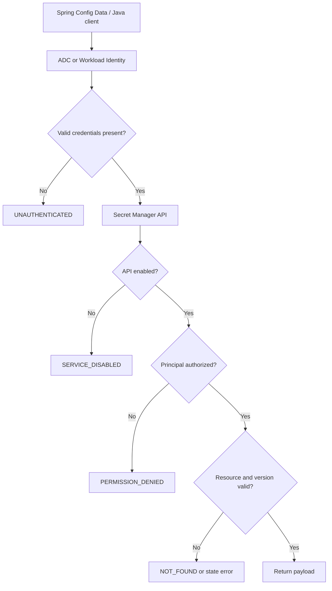

# Handling Missing Permissions, Disabled APIs, and Nonexistent Secrets

When Spring Boot fails to read a secret from Google Cloud Secret Manager, the initial error message often does not tell the whole story. The request may have failed because the application is using the wrong identity, IAM does not permit reading the payload, the Secret Manager API is not enabled in the project, the resource name points to the wrong secret/version, or the version has been disabled. Each case requires a different fix.

Diagnose across three layers: **whether the service is ready to accept requests, which principal sent the request, and whether that principal has permission on the requested resource/version**. Once these three layers are right, check the secret state and Spring configuration. Clear classification avoids granting overly broad permissions just to fix a disabled API error, or enabling fallbacks that mask an IAM failure.

This lesson belongs to the **Google Cloud Configuration** chapter of the **SPRING_CLOUD_PROVIDER_INTEGRATION** module. The module practices integrating Spring Boot with managed services on AWS, Azure, and Google Cloud via the corresponding Spring Cloud libraries. This lesson focuses on Google Cloud Secret Manager, Service Usage, IAM, Application Default Credentials (ADC), secret version states, and error handling in Spring Boot.

## 1. Learning Objectives

After this lesson, you will be able to:

- Distinguish between disabled API errors, missing IAM permissions, missing authentication, and nonexistent resources.
- Identify which project needs the Secret Manager API enabled and verify service status with gcloud.
- Identify the actual principal Spring Boot uses via ADC or workload identity.
- Grant the right payload-read permission at the secret level.
- Distinguish `roles/secretmanager.secretAccessor` from metadata-viewing permissions.
- Verify the resource name, project, location, secret ID, and version ID.
- Distinguish `ENABLED`, `DISABLED`, and `DESTROYED` versions.
- Handle `NOT_FOUND` separately from `PERMISSION_DENIED`, API errors, and network errors.
- Design fail-fast behavior for required secrets and controlled fallbacks for optional secrets.
- Use Policy Troubleshooter, Cloud Audit Logs, and integration tests to pinpoint root causes.

## 2. Classify Errors Before Fixing

A Secret Manager error can occur at several layers. Do not merely look at an HTTP status code and immediately add permissions or change the resource path.

| Symptom | Cause Group | What to Check First |
| --- | --- | --- |
| `SERVICE_DISABLED` or message that the API has not been used in the project | Secret Manager API is not enabled in the consumer project named in the error | Project ID/project number in the message and API status |
| `PERMISSION_DENIED` | Principal lacks permission, IAM Condition unsatisfied, or Deny/PAB policy or VPC Service Controls blocked it | Actual principal, target resource, and policies |
| `UNAUTHENTICATED` | ADC found no credentials, token expired, or workload identity misconfigured | Credential source and runtime identity |
| `NOT_FOUND` | Wrong project, secret ID, location, or version; resource genuinely does not exist | Full resource name and metadata |
| Version inaccessible even though secret exists | Version is `DISABLED` or `DESTROYED` | Version state |
| `INVALID_ARGUMENT` | Malformed resource name or request parameter | Global/regional resource path syntax |
| `FAILED_PRECONDITION` | Resource state or operational condition disallows the operation | Version state and detailed API error info |
| `RESOURCE_EXHAUSTED`, `UNAVAILABLE`, `DEADLINE_EXCEEDED` | Quota, temporary service unavailability, or timeout | Quotas, network, and retry policy |

These codes are signals to narrow down the layer; they do not replace the `reason` and details in a Google API error. For example, `403` can be an IAM denial or an unenabled API; read `status`, `reason`, the mentioned project, and request context. Never classify solely by HTTP status code.

## 3. Understanding Spring Boot's Request Flow

With Spring Framework on Google Cloud Config Data, configuration can reference a secret like this:

```yaml
spring:
  config:
    import: "sm@"
  cloud:
    gcp:
      secretmanager:
        project-id: invoice-prod

invoice:
  database:
    password: "${sm@projects/invoice-prod/secrets/invoice-db-password/versions/12}"
```

When the application starts, Spring resolves the reference through the Secret Manager integration. The request is sent using credentials discovered by ADC. Google Cloud authenticates the token, checks the service/API, evaluates IAM and related policies on the resource, and then returns the payload.



Four details must align:

1. **Principal:** the service account, user ADC, or federated identity sending the request.
2. **API consumer project:** the project Google APIs evaluate for Service Usage/quota, typically named in the error message.
3. **Secret-owning project:** the project appearing in the secret's resource name.
4. **Resource/version:** secret ID, location if regional, and version ID/alias.

In a cross-project model, the project running the workload can differ from the project containing the secret. Never replace the secret-owning project with the runtime project in the resource path.

## 4. Secret Manager API Not Enabled

Google Cloud requires enabling an API in a project before using the service. For Secret Manager, the API service name is:

```text
secretmanager.googleapis.com
```

### 4.1. Identify the right project

Suppose the secret resides in project `invoice-prod` while the application runs in `invoice-runtime`. Identify the project named in the `SERVICE_DISABLED` error or the request's consumer project. Do not blindly enable the API in whichever project happens to be open in the Console if that is not the project involved in the request.

View the current gcloud project:

```bash
gcloud config get-value project
```

This command shows the gcloud CLI default project. It does not prove which project the application's ADC or request is using. In cross-project configurations, check both the resource path and the project mentioned in the error.

### 4.2. Check whether the API is enabled

```bash
gcloud services list \
  --enabled \
  --project=invoice-prod \
  --filter="name:secretmanager.googleapis.com"
```

If there is no output, verify the project ID and Service Usage permissions before enabling the API.

### 4.3. Enable the Secret Manager API

```bash
gcloud services enable secretmanager.googleapis.com \
  --project=invoice-prod
```

This operation requires the `serviceusage.services.enable` permission on the project. The predefined role typically granted to API administrators is:

```text
roles/serviceusage.serviceUsageAdmin
```

A runtime service account that only reads secrets does not need permission to enable APIs. Keep project configuration permissions separate from payload read permissions. If the deployer lacks permission to enable services, ask a project administrator to perform it per governance procedures.

### 4.4. Verify after enabling

After the command finishes, run again:

```bash
gcloud services list \
  --enabled \
  --project=invoice-prod \
  --filter="name:secretmanager.googleapis.com"
```

If you still receive `SERVICE_DISABLED`, re-read the error for the exact consumer project, check the Service Usage API, and verify the enable operation completed. Enabling an API in `invoice-runtime` does not automatically enable it in other projects.

API enablement and IAM are two independent concerns. Enabling the API does not grant `secretmanager.versions.access`; granting Secret Accessor does not enable the API either.

## 5. Missing IAM Permissions: Identify the Exact Principal

The permission to read a secret version's payload is:

```text
secretmanager.versions.access
```

Common predefined role:

```text
roles/secretmanager.secretAccessor
```

Grant this role on the exact secret:

```bash
gcloud secrets add-iam-policy-binding invoice-db-password \
  --project=invoice-prod \
  --member="serviceAccount:invoice-api@invoice-runtime.iam.gserviceaccount.com" \
  --role="roles/secretmanager.secretAccessor"
```

In this command, project `invoice-prod` owns the secret. The service account can belong to a different runtime project. Because the binding is attached to the target secret, the service can read only that secret.

### 5.1. Do not confuse metadata-viewing permissions with payload read permissions

| Role | Purpose | Can Read Payload? |
| --- | --- | --- |
| `roles/secretmanager.secretAccessor` | Reads secret version contents | Yes |
| `roles/secretmanager.viewer` | Views secret and version metadata | No |
| `roles/secretmanager.secretVersionAdder` | Adds versions to a secret | No |
| `roles/secretmanager.secretVersionManager` | Manages version states/versions | No |
| `roles/secretmanager.admin` | Administers Secret Manager | Yes, but overly broad for a read-only workload |

If `gcloud secrets describe` succeeds yet the application cannot read the payload, that does not prove Accessor permission was granted. Metadata viewing permission and `AccessSecretVersion` permission are distinct.

Never grant `roles/owner`, `roles/editor`, or `roles/secretmanager.admin` as a quick runtime fix. Grant Secret Accessor at the secret level if the workload needs only one credential.

### 5.2. Inspect the secret's policy

```bash
gcloud secrets get-iam-policy invoice-db-password \
  --project=invoice-prod \
  --format=yaml
```

Match the exact member and role. Common mistakes include:

- Granting permissions to the deploy service account instead of the runtime service account.
- Granting permissions to the default service account while Cloud Run/GKE uses a dedicated identity.
- Granting permissions in `invoice-runtime` while the secret lives in `invoice-prod`.
- Wrong service account email or wrong member prefix type.
- An IAM Condition exists that the request does not satisfy.
- An IAM Deny, Principal Access Boundary, or VPC Service Controls blocks the request.

### 5.3. Verify the application's principal

On Cloud Run, check the service account attached to the revision. On Compute Engine, check the service account attached to the VM. On GKE, check Workload Identity Federation for GKE or the impersonated service account. In local development, distinguish gcloud CLI user credentials from the ADC used by the Java client.

The following commands only inspect the CLI identity:

```bash
gcloud auth list
gcloud config get-value project
```

`gcloud auth list` does not necessarily indicate the principal of an application running on Cloud Run/GKE. Locally, ADC may use different user credentials than the CLI account. In cloud runtimes, ADC typically obtains the identity attached to the workload. Inspect the workload configuration and safe application identity logs; never print access tokens.

### 5.4. Use Policy Troubleshooter

Once you know:

- The principal calling the API.
- The full secret resource.
- That the permission to check is `secretmanager.versions.access`.

Use IAM Policy Troubleshooter in the Google Cloud Console to check whether allow policies, deny policies, and Principal Access Boundaries affect the request. The tool shows which policy allows or blocks the principal on that specific resource/permission.

If IAM policies look right yet requests are still denied, check VPC Service Controls, IAM Conditions, and OAuth scopes. Workloads on Compute Engine or GKE need the `cloud-platform` OAuth scope; this scope does not replace IAM roles.

## 6. Nonexistent Secret or Version

`NOT_FOUND` errors typically involve the resource name or version. Check each component instead of changing IAM right away.

Global secret versions have the form:

```text
projects/PROJECT_ID/secrets/SECRET_ID/versions/VERSION_ID
```

Regional secret versions have the form:

```text
projects/PROJECT_ID/locations/LOCATION_ID/secrets/SECRET_ID/versions/VERSION_ID
```

Verify:

1. The project ID is the project owning the secret.
2. The secret ID has the exact spelling and casing.
3. If it is a regional secret, the location is present and accurate.
4. The version ID or alias exists.
5. Spring configuration is not accidentally using the wrong default project.
6. The application is running with the right active profile.

### 6.1. Check secret metadata

```bash
gcloud secrets describe invoice-db-password \
  --project=invoice-prod
```

This command inspects the secret resource and metadata without printing the payload.

### 6.2. Check the version list

```bash
gcloud secrets versions list invoice-db-password \
  --project=invoice-prod
```

### 6.3. Check metadata for a specific version

```bash
gcloud secrets versions describe 12 \
  --secret=invoice-db-password \
  --project=invoice-prod
```

If the metadata command fails with `PERMISSION_DENIED`, the principal running the command may lack metadata-viewing permissions. That is different from concluding the secret does not exist. Use an appropriate administrative principal to verify the resource while checking runtime permissions separately.

## 7. Disabled or Destroyed Secret Version

A secret can exist while the referenced version is no longer accessible.

| State | Payload | Readable? | Recoverable? |
| --- | --- | --- | --- |
| `ENABLED` | Stored | Yes | No recovery needed |
| `DISABLED` | Still stored | No | Can be re-enabled |
| `DESTROYED` | Destroyed | No | Cannot be transitioned back to enabled |

A `DISABLED` version is not a nonexistent secret. With proper administrative permissions and approval to restore it, it can be re-enabled:

```bash
gcloud secrets versions enable 12 \
  --secret=invoice-db-password \
  --project=invoice-prod
```

This operation requires version management permissions, not the runtime's payload read permissions. Never grant `roles/secretmanager.secretVersionManager` to an application just so it can enable versions on its own.

A `DESTROYED` version has lost its payload and cannot be recovered by enabling it. You must add a new version from a valid credential source and update references. If the secret has delayed destruction configured, check whether it is pending destruction and its deadline before concluding the payload was permanently erased.

## 8. Distinguishing API Errors from IAM Errors

`PERMISSION_DENIED` does not always mean Secret Accessor is missing. Google APIs can return permission errors for an unenabled API or another policy blocking the request. Inspect the reason and details in the error.

| Situation | Signal to Look For | Resolution |
| --- | --- | --- |
| API not enabled | `SERVICE_DISABLED`, service name, and consumer project | Enable `secretmanager.googleapis.com` in the right project |
| Missing IAM permission | Denied principal and permission | Grant Secret Accessor on the secret |
| IAM Deny/PAB/Condition | Policy Troubleshooter shows a blocking policy | Fix the policy/condition at the proper scope |
| VPC Service Controls | Violation/perimeter details in the error or audit logs | Check ingress/egress policies and the service perimeter |
| Missing OAuth scope | `insufficient authentication scopes` | Configure the `cloud-platform` scope for the VM/node |
| Invalid ADC | `UNAUTHENTICATED`, missing credential source, or token error | Fix workload identity/ADC |
| Wrong resource | `NOT_FOUND` or `INVALID_ARGUMENT` | Check project, location, secret, and version |
| Disabled version | State/precondition error on access | Check state and enable per procedure |
| Quota or outage | `RESOURCE_EXHAUSTED`, `UNAVAILABLE`, `DEADLINE_EXCEEDED` | Backoff with jitter; check quotas and service status |

Do not continuously retry `PERMISSION_DENIED`, `SERVICE_DISABLED`, or `NOT_FOUND`. These are usually configuration errors requiring a fix. Retrying only makes sense for confirmed transient causes, quotas, or service availability issues.

## 9. Error Handling in Spring Boot

### 9.1. When using Config Data

Example:

```yaml
spring:
  config:
    import: "sm@"

invoice:
  database:
    password: "${sm@projects/invoice-prod/secrets/invoice-db-password/versions/12}"
```

Secrets are resolved while loading configuration. If a required secret cannot be read, Spring may halt startup before the ApplicationContext completes. Spring exceptions can wrap Google API errors; when diagnosing, inspect the root cause and Google API status code rather than looking only at the outermost exception.

Do not add `optional:` or enable `allow-default-secret` to hide `PERMISSION_DENIED` or `SERVICE_DISABLED`. An optional Config Data location is not a mechanism to ignore all secret access errors. `allow-default-secret` relates to nonexistent secrets per library behavior; it does not grant permissions, enable APIs, or fix network errors.

### 9.2. Required secrets: fail fast

For database passwords, signing keys, or core-flow credentials, keep failing when the value cannot be retrieved. Validate non-blank payloads before building clients:

```java
String password = properties.getPassword();

if (password == null || password.isBlank()) {
    throw new IllegalStateException(
            "invoice.database.password is required");
}
```

Error messages should state only the property/resource name and categorized cause; never put payloads into exceptions, logs, or responses.

### 9.3. Optional secrets: handle only NOT_FOUND

If a secondary feature can be disabled when its secret does not exist, convert only `NOT_FOUND` into an absent state. Permission, API-disabled, authentication, and network errors must continue propagating.

Example with the Google Cloud Java client:

```java
import com.google.api.gax.rpc.NotFoundException;
import com.google.cloud.secretmanager.v1.AccessSecretVersionResponse;
import com.google.cloud.secretmanager.v1.SecretManagerServiceClient;
import com.google.cloud.secretmanager.v1.SecretVersionName;

import java.util.Optional;

public class OptionalSecretReader {

    private final SecretManagerServiceClient client;

    public OptionalSecretReader(SecretManagerServiceClient client) {
        this.client = client;
    }

    public Optional<String> readIfPresent(
            String projectId,
            String secretId,
            String versionId) {

        SecretVersionName name =
                SecretVersionName.of(projectId, secretId, versionId);

        try {
            AccessSecretVersionResponse response =
                    client.accessSecretVersion(name);

            String value =
                    response.getPayload().getData().toStringUtf8();

            if (value.isBlank()) {
                return Optional.empty();
            }

            return Optional.of(value);
        } catch (NotFoundException ex) {
            return Optional.empty();
        }
    }
}
```

This example only illustrates handling global secrets. For regional secrets, use the matching regional resource name/client endpoint. In production, manage the client as a shared bean and close it when the application context stops.

Never catch generic `Exception` or `ApiException` and return `Optional.empty()`. Doing so can turn `PERMISSION_DENIED`, `SERVICE_DISABLED`, or an outage into a "feature not configured" state. If the feature is enabled yet yields `Optional.empty()`, the client-building layer must report a clear configuration error.

### 9.4. Safe logging

You can log diagnostic metadata:

- Secret resource name or a normalized identifier.
- Project ID.
- Operation (`AccessSecretVersion`).
- Error code/status.
- Identified runtime principal (without logging tokens).
- Correlation/request ID, if available.

Never log secret payloads, access tokens, private keys, passwords, or entire response objects. Avoid logging the full environment, exceptions carrying sensitive config, or resolved property values.

## 10. Retries: Which Errors Should Be Retried?

| Error | Retry? | Action |
| --- | --- | --- |
| `PERMISSION_DENIED` due to IAM | Do not retry continuously | Fix IAM/policy and retry after changes take effect |
| `SERVICE_DISABLED` | No | Enable the API in the right project |
| `NOT_FOUND` | No | Fix resource path or create the right resource |
| Version `DISABLED`/`DESTROYED` | No | Choose a valid version or create a new version |
| `UNAUTHENTICATED` | Do not retry blindly | Fix ADC/token/workload identity |
| `INVALID_ARGUMENT` | No | Fix the request/resource name |
| `RESOURCE_EXHAUSTED` | Yes, per quota/backoff | Exponential backoff with jitter; respect quotas |
| `UNAVAILABLE` or transient 5xx errors | Bounded | Retry with backoff; cap total duration |
| `DEADLINE_EXCEEDED` | Conditionally | Check timeout, network, and idempotency before retrying |

Use exponential backoff with jitter to avoid many instances retrying simultaneously. Do not retry indefinitely during startup; set a reasonable total timeout and fail fast so rollouts surface errors. Reading a version is generally safer to retry than mutating resources, yet still must cap attempt counts and total time.

## 11. Using Cloud Audit Logs to Find Principals and Operations

Secret Manager provides audit logs for administrative and data-access activity. `AccessSecretVersion` is a Data Access method. Data Access logging must be enabled in the project/organization audit settings.

In Logs Explorer, start with:

```text
protoPayload.serviceName="secretmanager.googleapis.com"
```

Filter specifically for payload read operations:

```text
protoPayload.serviceName="secretmanager.googleapis.com"
protoPayload.methodName="google.cloud.secretmanager.v1.SecretManagerService.AccessSecretVersion"
```

Cross-check the principal, resource, timestamp, and outcome. Audit logs can confirm which service account the application is actually using, rather than the principal the deployer assumed it was using. Not every error produces the same log level; combine audit logs with error details and Policy Troubleshooter.

## 12. Ordered Diagnostic Workflow

When a Spring Boot instance fails to read a secret, proceed step by step:

1. **Read the root cause:** identify the error code and reason, not just the outermost exception.
2. **Identify the resource:** record project, secret ID, location, and version from the reference.
3. **Check the API:** confirm `secretmanager.googleapis.com` is enabled in the project used by the request.
4. **Verify the principal:** check the Cloud Run revision, VM, GKE workload identity, or local ADC.
5. **Check IAM:** confirm the principal has `secretmanager.versions.access` on the target secret.
6. **Check advanced policies:** IAM Conditions, Deny, PAB, VPC Service Controls, and OAuth scopes.
7. **Check metadata:** confirm the secret/version exists and the version is `ENABLED`.
8. **Check Spring config:** default project, profiles, `sm@`/`sm://` per library version, and property overrides.
9. **Check application state:** required secrets must fail fast; optional secrets only fall back on `NOT_FOUND`.
10. **Retest:** use the exact runtime principal and never print payloads to logs.

This order distinguishes errors across project, identity, policy, and resource layers. Never start by granting project-wide permissions or switching the secret to `latest`, as both can mask the real cause.

## 13. Hands-On Exercise: Resolving Three Errors in invoice-service

**Context:** `invoice-service` runs on Cloud Run in project `invoice-runtime`. The database password resides in Secret Manager in project `invoice-prod`:

```text
projects/invoice-prod/secrets/invoice-db-password/versions/12
```

Runtime service account:

```text
invoice-api@invoice-runtime.iam.gserviceaccount.com
```

### Step 1 — Check the API

```bash
gcloud services list \
  --enabled \
  --project=invoice-prod \
  --filter="name:secretmanager.googleapis.com"
```

If the API is not enabled and you have Service Usage permissions:

```bash
gcloud services enable secretmanager.googleapis.com \
  --project=invoice-prod
```

If you lack `serviceusage.services.enable`, ask a project administrator to enable the API. Never grant Secret Accessor as a substitute for service-enablement permissions.

### Step 2 — Check the secret and version

```bash
gcloud secrets describe invoice-db-password \
  --project=invoice-prod
```

```bash
gcloud secrets versions describe 12 \
  --secret=invoice-db-password \
  --project=invoice-prod
```

Confirm the resource is accurate and the version is enabled. If the version is disabled, re-enable it only after an administrator confirms it is the version that should be used.

### Step 3 — Check the IAM binding

```bash
gcloud secrets get-iam-policy invoice-db-password \
  --project=invoice-prod \
  --format=yaml
```

If the member is missing, grant the role on the exact secret:

```bash
gcloud secrets add-iam-policy-binding invoice-db-password \
  --project=invoice-prod \
  --member="serviceAccount:invoice-api@invoice-runtime.iam.gserviceaccount.com" \
  --role="roles/secretmanager.secretAccessor"
```

Do not attach the binding to the deploy account if the Cloud Run revision runs under a different service account.

### Step 4 — Check Cloud Run identity

Inspect the service/revision configuration and confirm the runtime service account is indeed `invoice-api@invoice-runtime.iam.gserviceaccount.com`. If the identity is wrong, update the service account per deployment workflow and roll out a new revision.

### Step 5 — Check the Spring resource reference

```yaml
spring:
  config:
    import: "sm@"

invoice:
  database:
    password: "${sm@projects/invoice-prod/secrets/invoice-db-password/versions/12}"
```

The project in the resource path is `invoice-prod`, where the secret lives. Do not change it to `invoice-runtime` just because Cloud Run runs in that project.

### Step 6 — Negative permission testing

Use a test service account without Accessor granted and confirm the request is rejected. Then test with the properly authorized runtime service account. Never use Owner/Admin roles to make tests pass.

### Step 7 — Verify logs and readiness

Confirm Data Access audit logs show the expected principal and resource. Verify the datasource connects cleanly before marking the service ready. Never return passwords in endpoints or logs.

## 14. Test Matrix

| Case | API | IAM | Resource/Version | Expected Result |
| --- | --- | --- | --- | --- |
| A | Enabled | Valid Accessor | Exists, enabled | Reads payload successfully |
| B | Disabled | Any | Exists | API/service disabled error |
| C | Enabled | Missing Accessor | Exists | `PERMISSION_DENIED` |
| D | Enabled | Viewer | Exists | Views metadata if permissions suffice; cannot read payload |
| E | Enabled | Valid Accessor | Wrong secret ID/project | `NOT_FOUND` |
| F | Enabled | Valid Accessor | Wrong version | `NOT_FOUND` or corresponding resource error |
| G | Enabled | Valid Accessor | Disabled version | Unreadable; can be re-enabled with admin permissions |
| H | Enabled | Valid Accessor | Destroyed version | Cannot read or recover payload |
| I | Enabled | Wrong principal/no ADC | Exists | `UNAUTHENTICATED` or credential error |
| J | Enabled | Valid IAM, blocked by VPC-SC/Deny | Exists | Request is still rejected by policy |
| K | Enabled | Valid Accessor | Optional secret absent | Falls back only if business rules permit |
| L | Enabled | IAM denied for optional secret | Exists | Reports permission error; does not fall back to empty |

Unit tests can mock the client to verify how the application classifies exceptions. Integration tests must run under real test identities to verify API enablement, IAM, resource paths, and workload identity. Never use production secrets in tests.

## 15. Self-Check Questions

1. Why should `SERVICE_DISABLED` not be handled by granting `roles/secretmanager.secretAccessor`?
2. Which permission is needed to enable an API in a project?
3. Why does `gcloud auth list` not prove the principal of a Cloud Run runtime?
4. When a secret resides in `invoice-prod` while the workload runs in `invoice-runtime`, which project appears in the resource path?
5. What is the difference between `roles/secretmanager.viewer` and `roles/secretmanager.secretAccessor`?
6. When can `PERMISSION_DENIED` be caused by IAM Deny, PAB, or VPC Service Controls instead of a missing allow binding?
7. How does a `DISABLED` version differ from a nonexistent secret?
8. Can a `DESTROYED` version be recovered by running an enable operation?
9. Why should you not catch every `ApiException` and return `Optional.empty()`?
10. How should a required secret behave when the API is disabled or IAM is denied?
11. When should `UNAVAILABLE` and `RESOURCE_EXHAUSTED` be retried?
12. Which audit log records `AccessSecretVersion` operations?
13. Why should `roles/owner` not be granted to a runtime just to fix secret read errors?
14. How can you test that a service account cannot read out-of-scope secrets?

## 16. Key Takeaways

Three main error groups must be handled separately. **Disabled API** is a Service Usage issue in the relevant project and requires the `serviceusage.services.enable` permission. **Missing permissions** is a principal and secret-level IAM/policy issue; payload read permission is `secretmanager.versions.access`, commonly granted via `roles/secretmanager.secretAccessor`. **Nonexistent or unreadable secret** requires checking project, secret ID, location, version, and version state.

In Spring Boot, Secret Manager errors can surface while Config Data is loading, before the application finishes starting. Required secrets must fail fast. Optional secrets should only turn `NOT_FOUND` into an absent state when business rules permit; never turn IAM, API-disabled, authentication, or network errors into empty values. **Identifying the exact error reason, principal, project, and version before modifying policies** resolves incidents accurately while keeping access at least privilege.

## Official References

- [Google Cloud Secret Manager — Enable the Secret Manager API](https://docs.cloud.google.com/secret-manager/docs/configuring-secret-manager)
- [Google Cloud Service Usage — Troubleshoot issues](https://docs.cloud.google.com/service-usage/docs/troubleshooting)
- [Google Cloud Service Usage — Enable and disable services](https://docs.cloud.google.com/service-usage/docs/enable-disable)
- [Google Cloud Secret Manager — Access control with IAM](https://docs.cloud.google.com/secret-manager/docs/access-control)
- [Google Cloud Secret Manager — Access a secret version](https://docs.cloud.google.com/secret-manager/docs/access-secret-version)
- [Google Cloud Secret Manager — Disable a secret version](https://docs.cloud.google.com/secret-manager/docs/disable-secret-version)
- [Google Cloud Secret Manager — Destroy a secret version](https://docs.cloud.google.com/secret-manager/docs/destroy-secret-version)
- [Google Cloud IAM — Troubleshoot IAM-related policies](https://docs.cloud.google.com/iam/docs/troubleshoot-policies)
- [Google Cloud Secret Manager — Audit logging](https://docs.cloud.google.com/secret-manager/docs/audit-logging)
- [Spring Framework on Google Cloud — Secret Manager](https://googlecloudplatform.github.io/spring-cloud-gcp/reference/html/index.html#secret-manager)
