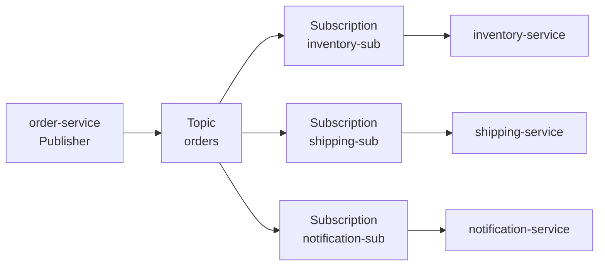
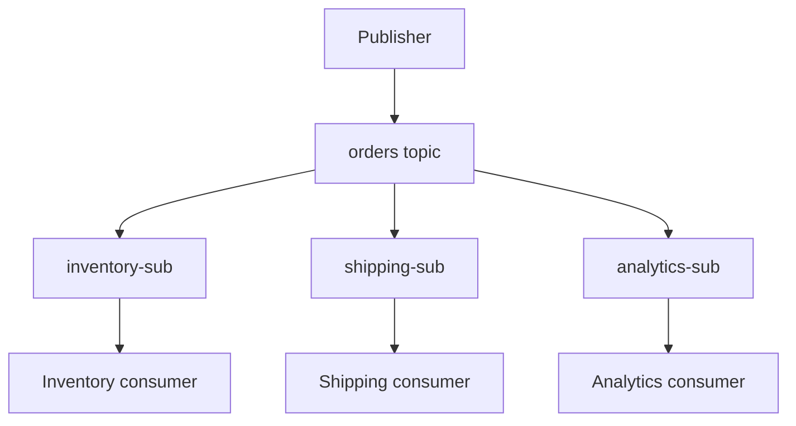
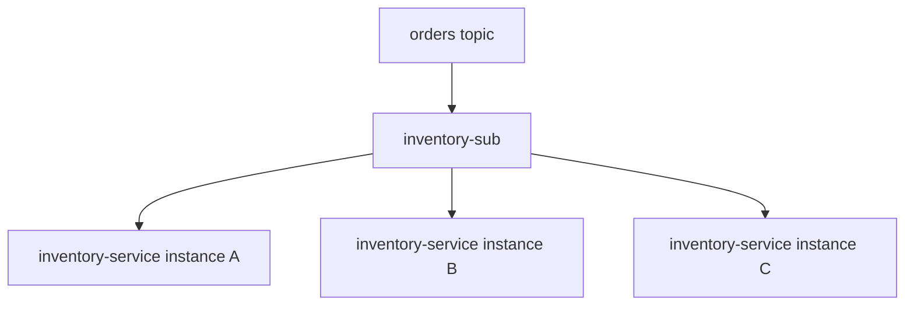
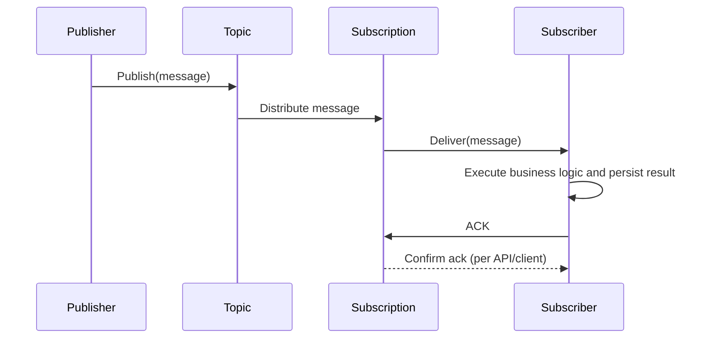
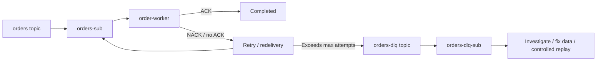
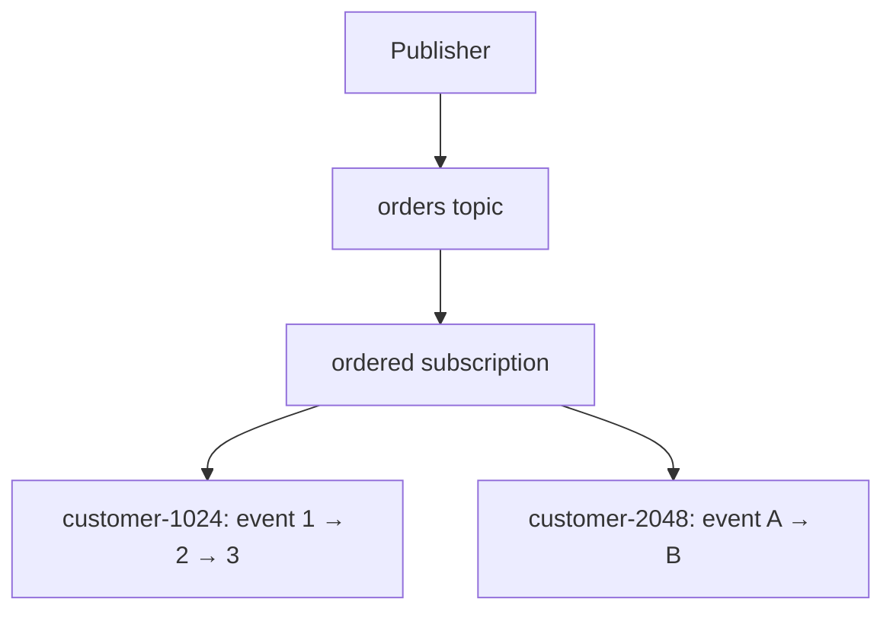

# Topic, subscription, publisher, and subscriber in Pub/Sub

## Lesson Objectives

The **SPRING_CLOUD_PROVIDER_INTEGRATION** module guides you through integrating Spring Boot with managed services from **AWS, Azure, and Google Cloud** using the corresponding Spring Cloud libraries. Alongside identity and permission configuration, storage, messaging, data, and secret protection, learners need to know how to implement asynchronous processing using each cloud provider's managed messaging service.

In the **Google Cloud Pub/Sub** chapter, this lesson introduces four core components:

- **Topic**: where publishers send messages.
- **Subscription**: a registration to receive messages from a topic, maintaining its own delivery state.
- **Publisher**: an application that creates and sends messages.
- **Subscriber**: an application that receives, processes, and acknowledges messages from a subscription.

After this lesson, you will be able to:

1. Describe the publish/subscribe flow and the relationship between a topic and one or more subscriptions.
2. Distinguish between fan-out, load balancing, pull subscriptions, and push subscriptions.
3. Create topics/subscriptions using the Google Cloud CLI and grant least-privilege IAM permissions.
4. Integrate Spring Boot using **Spring Framework on Google Cloud Pub/Sub Starter**, `PubSubTemplate`, and `PubSubAdmin`.
5. Handle acknowledgment, redelivery, duplicates, ordering, retries, and dead-letter topics.
6. Run local tests with the Pub/Sub emulator and design integration tests on a Google Cloud sandbox.

> **Scope:** Examples use Maven and the Spring Boot starter `com.google.cloud:spring-cloud-gcp-starter-pubsub`, following the current Spring Framework on Google Cloud documentation. Choose a BOM compatible with your project's Spring Boot version; do not pin an isolated version manually or mix old and new library lines.

## 1. What problem does Pub/Sub solve?

Suppose an e-commerce system has `order-service`, `inventory-service`, `shipping-service`, and `notification-service`. When a customer places an order, `order-service` needs to emit an `OrderCreated` event. Other services can process it independently:

- `inventory-service` deducts inventory stock.
- `shipping-service` creates a delivery request.
- `notification-service` sends a confirmation email.

If `order-service` makes sequential HTTP calls to all three services, it depends on the network state, response time, and availability of each service. A slow downstream service can prolong the order placement request, and an unavailable downstream service can cause the entire synchronous flow to fail.

Pub/Sub **decouples publishers from subscribers**. The publisher sends events to a topic; subscribers receive them through their own subscriptions and process them independently. The publisher does not need to know which services are listening, how many consumers exist, or how each consumer is implemented.



Each subscription has its own delivery and acknowledgment state. When `inventory-service` acknowledges a message, it does not acknowledge it on behalf of `shipping-service` or `notification-service`. This is the foundation of the **fan-out** model.

Pub/Sub is well-suited for event-driven architecture, background processing, multi-system integration, and absorbing traffic spikes. It does not automatically guarantee cross-database transactions, replace idempotency design, or turn every message into exactly-once processing at the business layer.

## 2. Four core components

### 2.1. Topic

A **Topic** is a named resource representing a stream of messages. Publishers send messages to a topic, not directly to a subscription or a specific subscriber.

Examples:

```text
projects/acme-commerce/topics/orders
projects/acme-commerce/topics/payments
projects/acme-commerce/topics/inventory-events
```

A message typically consists of:

| Component | Meaning | Example |
| --- | --- | --- |
| `data` | Payload in bytes | JSON representing `OrderCreated` |
| `attributes` | String key/value metadata | `eventType=OrderCreated`, `schemaVersion=1` |
| `orderingKey` | Key used for per-group ordering | `customer-1024` |
| `messageId` | ID assigned by Pub/Sub after a successful publish | Used to observe/correlate messages |
| `publishTime` | Timestamp when Pub/Sub recorded the message | Service-provided timestamp |

`data` can be JSON, protobuf, or an application-defined format. Pub/Sub does not interpret payload semantics unless you use a corresponding schema/consumer. `attributes` are suitable for routing or observability metadata; do not put passwords, tokens, or sensitive data in attributes.

### 2.2. Subscription

A **Subscription** is a resource representing a logical consumer group interested in messages from a topic. A subscription tracks delivered messages, unacknowledged messages, retries, and retention.

Examples:

```text
projects/acme-commerce/subscriptions/inventory-sub
projects/acme-commerce/subscriptions/shipping-sub
projects/acme-commerce/subscriptions/notification-sub
```

A topic can have multiple subscriptions; a subscription belongs to a single topic. A subscriber must read from a **subscription**, not directly from a topic.

An important rule: a subscription normally only receives messages published **after the subscription was created**. If you need to replay messages published before the subscription was created, you must design topic message retention and appropriate replay/seek operations; do not assume a topic is an infinite historical store.

### 2.3. Publisher

A publisher is an application or component that creates messages and sends them to a topic. It typically performs:

1. Build the payload according to the event contract.
2. Add necessary attributes.
3. Select the target topic.
4. Call the publish API and await the asynchronous result.
5. Handle publish errors and record the message ID on success.

A publisher does not need to know which subscriber processed the message. A successful publish means Pub/Sub has accepted the message; it **does not mean** every consumer has completed its business logic.

### 2.4. Subscriber

A subscriber is an application that receives messages from a subscription. It needs to:

1. Receive the message.
2. Validate the schema and input data.
3. Execute business logic, usually writing results to a database or calling another service.
4. **Ack** when processing succeeds.
5. **Nack** or let the acknowledgment deadline expire when processing fails, so Pub/Sub can redeliver according to the retry policy.

A subscriber must tolerate receiving the same message multiple times. This is critical even if the publisher only sends it once.

## 3. Topics, subscriptions, and distribution models

### 3.1. Fan-out: one topic, multiple subscriptions

When multiple systems need to receive the same event and process it for different purposes, create one subscription per consumer:



Each subscription receives an independent delivery copy of new messages. `inventory-sub` acknowledging a message does not remove it from `shipping-sub`. As a result, consumers can have different processing speeds, retry policies, and retention settings.

### 3.2. Load balancing: multiple subscribers on one subscription

If you need to scale processing capacity, run multiple subscriber instances reading from **the same subscription**:



Instances share the workload of processing messages from the subscription. An outstanding message is normally not sent concurrently to other subscribers on the same subscription; if it is not acknowledged on time, it can be redelivered. Each instance does not receive a full copy of the entire stream.

### 3.3. Fan-out combined with load balancing

An architecture can combine both patterns:

- Multiple subscriptions so different business domains receive independent copies.
- Multiple subscriber instances per subscription to distribute load.

| Goal | Design approach |
| --- | --- |
| Both Inventory and Shipping need every OrderCreated | Two separate subscriptions |
| Increase the number of inventory workers | Multiple subscribers sharing `inventory-sub` |
| Analytics needs independent replay | Dedicated subscription with appropriate retention/replay |
| One failing consumer should not slow down others | Separate subscriptions with separate retry/DLQ |

Do not create a separate subscription per instance if your goal is load distribution; doing so turns load balancing into fan-out, causing every instance to receive the same messages.

## 4. Pull subscriptions and push subscriptions

Pub/Sub supports the following main message delivery modes:

| Type | How it works | When appropriate |
| --- | --- | --- |
| **Pull** | Subscriber actively retrieves messages from Pub/Sub | Background workers, autoscaling, flow and ack control |
| **Push** | Pub/Sub sends HTTP requests to an application endpoint | Web services with an HTTPS endpoint that want service-initiated delivery |
| **Export subscription** | Pub/Sub writes messages directly to a supported resource such as BigQuery or Cloud Storage | Data pipelines, storage/analytics without operating a subscriber |

In Spring Framework on Google Cloud, `PubSubTemplate.subscribe()` listens to a subscription using the asynchronous pull model. When using a push subscription, Pub/Sub calls the configured endpoint; the endpoint must meet production authentication and HTTPS requirements. Push does not use the same callback mechanism as `PubSubTemplate.subscribe()`.

With push delivery, the endpoint acknowledges a message by returning one of the HTTP status codes `102`, `200`, `201`, `202`, or `204`. Other status codes are treated as a negative acknowledgment and may cause Pub/Sub to redeliver the message. When push authentication is enabled, Pub/Sub sends a JWT in the `Authorization` header; the endpoint must verify the signature, audience, and configured service account identity, rather than merely checking that the request arrived over HTTPS.

By default, a push request sends a JSON envelope; the `message.data` field is a Base64-encoded payload:

```json
{
  "message": {
    "data": "eyJldmVudElkIjoiZXZ0LTEwMDEifQ==",
    "messageId": "2070443601311540",
    "attributes": {
      "eventType": "OrderCreated"
    }
  },
  "subscription": "projects/acme-commerce-dev/subscriptions/notification-sub"
}
```

The endpoint must Base64-decode the data, validate the payload, and return an acknowledgment status only after completing the designed business logic. A push subscriber cannot call `ModifyAckDeadline` per message like a pull subscriber; processing time must fit within the subscription's ack deadline. If the push endpoint returns an error or times out, Pub/Sub retries and may also apply push backoff in addition to the subscription's retry policy.

For authenticated push, the Pub/Sub service agent needs `roles/iam.serviceAccountTokenCreator` on the selected service account to sign the JWT; the principal creating/updating the subscription also needs `iam.serviceAccounts.actAs` on that service account. Verify the JWT by signature, issuer, audience, expiration, and expected service account email.

### When to choose pull

- Workers can scale based on backlog.
- The application explicitly controls processing and acknowledgment.
- Flow control can be configured to limit the number of in-flight messages.
- Easy to integrate into background services.

### When to choose push

- The application already exposes an HTTP endpoint ready to accept POST requests.
- You want Pub/Sub to proactively invoke the consumer.
- You can secure the endpoint, authenticate requests, and handle HTTP responses with proper semantics.

Do not choose push merely because "Spring Boot has a REST controller"; you must account for push authentication, timeouts, success/failure responses, and endpoint scaling.

## 5. Message lifecycle: publish, receive, ack, and redelivery

### 5.1. Basic processing flow



After the publisher sends a message, Pub/Sub distributes it to the subscriptions attached to the topic. The subscriber receives the message via its subscription and must acknowledge it after successful processing. If the subscriber does not ack within the allowed time, the message may be redelivered.

### 5.2. Acknowledgment deadline

The **acknowledgment deadline (ack deadline)** is the duration a subscriber is allowed to process a message before Pub/Sub considers it unacknowledged and eligible for redelivery.

Common subscription values:

| Property | Value |
| --- | --- |
| Default ack deadline | 10 seconds |
| Minimum ack deadline | 10 seconds |
| Maximum directly configurable ack deadline | 600 seconds |

Client libraries can automatically extend the deadline using modify-ack-deadline requests while processing is ongoing. Therefore, the actual duration a message stays outstanding also depends on the subscriber/client configuration, not just the subscription's initial value.

If processing takes 30 seconds and the client does not extend the deadline, Pub/Sub may redeliver the message while the first worker is still working on it. Two workers could execute the same business logic, so you need idempotent design and appropriate processing timeouts.

### 5.3. Ack only after completing business logic

Safe rule:

```text
Receive message
    ↓
Validate payload
    ↓
Execute business logic and commit data
    ↓
ACK
```

If you ack **before** committing to the database, the process may crash after the ack but before persisting data. Pub/Sub already treats the message as completed and will not redeliver it under normal flow; business work risks being lost.

If the database commit succeeds but the ack fails or its response is lost, Pub/Sub may redeliver the message. Therefore, the application needs an **idempotent consumer**: processing the same event multiple times still produces a single correct business outcome.

One approach is storing `eventId`/business key alongside the result in the same transaction with a unique constraint:

```sql
CREATE TABLE processed_events (
    event_id VARCHAR(100) PRIMARY KEY,
    processed_at TIMESTAMP NOT NULL
);
```

Within the processing transaction, the application checks/inserts `event_id`. If the event has already been processed, skip duplicate side effects and ack. Log only approved `messageId` or `eventId` values; do not log the full payload if it contains personal or sensitive data.

### 5.4. At-least-once and duplicates

By default, Pub/Sub provides **at-least-once delivery** and no global ordering guarantee. This means a message may be delivered multiple times, for example:

- The subscriber fails to ack before the deadline expires.
- The subscriber sends a nack.
- An ack is sent, but the response is lost or a network error occurs.
- A worker finishes processing, but the process dies before the acknowledgment is recorded.
- In rare situations, a message may still be redelivered even after an acknowledgment request succeeded, due to internal or client/server issues.

A valid redelivery may preserve the same `messageId`. Pub/Sub may also redeliver a message in rare cases even if a prior acknowledgment request returned success. An application-level publisher retry of a publish request can create multiple distinct messages with different IDs if the initial send succeeded but the response was lost. Thus, idempotency should rely on a **business-generated event ID** when identifying a logical event across multiple publishes.

### 5.5. Limited exactly-once delivery

Pub/Sub offers **exactly-once delivery** for **pull subscriptions** within a single region. When enabled, the subscriber can receive acknowledgment confirmation; messages are not redelivered after an ack is successfully recorded per service semantics.

However:

- Exactly-once delivery does not turn external database/API side effects into an exactly-once transaction.
- Publisher retries can still produce multiple independent published messages without a business-layer event ID/idempotency check.
- Exactly-once has regional and subscription-type limitations; push subscriptions do not support this feature.
- Spring Framework on Google Cloud provides asynchronous `ack()` via `CompletableFuture<Void>` in current documentation; some older versions use `ListenableFuture<Void>`. If enabling exactly-once, verify how your library version forwards acknowledgment results and handles ack errors. When business requirements need direct control over ack responses/ack IDs or features not yet exposed by the abstraction, evaluate using the lower-level Google Cloud Java Pub/Sub client.

Therefore, idempotent subscriber design remains necessary even when exactly-once delivery is enabled.

## 6. Retry, dead-letter topics, and message retention

### 6.1. Retry policy

If a subscriber nacks or the ack deadline expires, Pub/Sub can redeliver the message. Subscriptions support two commonly used retry styles:

| Policy | Behavior |
| --- | --- |
| Immediate retry | Redelivers almost immediately after nack or deadline expiration |
| Exponential backoff | Gradually increases wait time between redeliveries within configured bounds |

Exponential backoff is useful for transient errors, such as database maintenance or downstream API rate limiting. It is not a business-scheduled delay mechanism; if you need to run tasks at a future scheduled time, evaluate Cloud Tasks.

Example of creating a subscription with exponential backoff via CLI:

```bash
gcloud pubsub subscriptions create orders-sub \
  --topic=orders \
  --min-retry-delay=10s \
  --max-retry-delay=300s
```

These values are examples. Retry intervals should be based on dependency recovery times, API limits, and latency requirements.

### 6.2. Dead-letter topic (DLQ)

If a message repeatedly fails processing, a subscription can forward it to a **dead-letter topic** after a configured number of delivery attempts. A DLQ isolates failing messages from the main flow for investigation or manual remediation.



Key points:

- DLQ is configured on the **subscription**, not on the source topic.
- Configurable delivery attempts range from **5 to 100**; forwarding is best-effort, so do not treat this count as an exact guarantee.
- The default maximum delivery attempts value is **5**. Pub/Sub must grant its service agent permission to publish to the dead-letter topic and consume/ack from the source subscription as configured. Missing IAM permissions for the service agent can prevent DLQ forwarding from working as expected.
- A message forwarded to a DLQ is wrapped in a new message with metadata identifying the source subscription; design replay procedures to avoid creating infinite loops.

Example of creating a subscription with a DLQ:

```bash
gcloud pubsub subscriptions create orders-sub \
  --topic=orders \
  --dead-letter-topic=orders-dlq \
  --max-delivery-attempts=8
```

This command assumes the `orders-dlq` topic already exists and the required permissions for the Pub/Sub service agent have been granted.

The service agent has the form `service-PROJECT_NUMBER@gcp-sa-pubsub.iam.gserviceaccount.com`. For example, within the project owning the source subscription, grant publish permission on the DLQ topic and subscriber permission on the source subscription:

```bash
PUBSUB_SERVICE_ACCOUNT="service-PROJECT_NUMBER@gcp-sa-pubsub.iam.gserviceaccount.com"

gcloud pubsub topics add-iam-policy-binding orders-dlq \
  --member="serviceAccount:${PUBSUB_SERVICE_ACCOUNT}" \
  --role="roles/pubsub.publisher"

gcloud pubsub subscriptions add-iam-policy-binding orders-sub \
  --member="serviceAccount:${PUBSUB_SERVICE_ACCOUNT}" \
  --role="roles/pubsub.subscriber"
```

Replace `PROJECT_NUMBER` with your actual project number. If the DLQ topic and source subscription are in different projects, grant the role on the respective owning project/resource. Grant these roles only to the Pub/Sub service agent; do not grant `roles/pubsub.serviceAgent` to an application service account.

### 6.3. Message retention and subscription expiration

A subscription retains unacknowledged messages for a configured retention duration:

| Property | Default value | Range |
| --- | --- | --- |
| Message retention duration | 7 days | 10 minutes to 31 days |
| Subscription expiration | 31 days of inactivity | Can be configured never to expire |
| Initial ack deadline | 10 seconds | 10 to 600 seconds |

Retention determines how long unprocessed messages remain eligible for redelivery. Inactive subscriptions may expire under the default policy. If you need to retain acknowledged messages for replay, you must enable the appropriate retain acknowledged messages option and account for additional storage costs.

Do not treat Pub/Sub as a long-term store replacing a database or data lake. If you need historical storage, design topic retention, subscription retention, or export pipelines according to recovery and cost requirements.

## 7. Message ordering and ordering keys

By default, Pub/Sub **does not guarantee message delivery in publish order**. If business logic requires ordering per customer, order, or account, you can enable ordering on the subscription and have the publisher attach an `orderingKey`.

Example:

```text
orderingKey = "customer-1024"

OrderCreated(customer-1024)
OrderPaid(customer-1024)
OrderShipped(customer-1024)
```

With Spring converters, you can pass the ordering key via headers:

```java
import com.google.cloud.spring.pubsub.support.GcpPubSubHeaders;
import java.util.Map;

pubSubTemplate.publish(
        "orders",
        jsonPayload,
        Map.of(
                "eventType", "OrderCreated",
                GcpPubSubHeaders.ORDERING_KEY, "customer-1024"
        )
);
```

For the same ordering key, within the same region and with proper ordering configuration, subscribers receive messages in the order the service received them. Different keys have no relative ordering guarantee:



Conditions to remember:

1. Enable message ordering on the subscription.
2. Have the publisher set the ordering key on messages.
3. With multiple publishers, send to the same regional endpoint to preserve the regional stream as designed.
4. Ack messages in order within the same ordering key; acking a later message may wait on an earlier one.
5. Redelivery of a message can trigger redelivery of subsequent messages with the same key.

Create a subscription with ordering enabled via CLI:

```bash
gcloud pubsub subscriptions create orders-ordered-sub \
  --topic=orders \
  --enable-message-ordering
```

The subscription must be created/configured with ordering; simply enabling `spring.cloud.gcp.pubsub.publisher.enable-message-ordering` on the publisher is not sufficient.

Ordering can reduce throughput if a single key receives many messages or if the head message gets stuck. Choose a key with appropriate cardinality and avoid using a single key for the entire system unless global ordering is truly required.

In Spring Framework on Google Cloud, you can enable:

```yaml
spring:
  cloud:
    gcp:
      pubsub:
        publisher:
          enable-message-ordering: true
          endpoint: "us-central1-pubsub.googleapis.com:443"
```

When using Spring converters/headers, the ordering key is passed through the `GcpPubSubHeaders.ORDERING_KEY` header. Verify the exact header name and API for your library version.

## 8. Creating topics and subscriptions

### 8.1. Preparing the project

Before creating resources:

1. Select the Google Cloud project for your dev/test environment.
2. Enable the **Cloud Pub/Sub API** in the project.
3. Determine the Region or multi-region matching latency, ordering, and application hosting requirements.
4. Create topics and subscriptions using a clear naming convention.
5. Grant IAM roles to publisher and subscriber service accounts.

Naming example:

```text
Project: acme-commerce-dev
Topic: orders
Subscription: inventory-sub
Dead-letter topic: orders-dlq
```

Full resource names take the form:

```text
projects/acme-commerce-dev/topics/orders
projects/acme-commerce-dev/subscriptions/inventory-sub
```

### 8.2. Creating with the Google Cloud CLI

After logging in and selecting the project:

```bash
gcloud config set project acme-commerce-dev
gcloud services enable pubsub.googleapis.com

gcloud pubsub topics create orders
gcloud pubsub subscriptions create inventory-sub --topic=orders
```

Publish a test message:

```bash
gcloud pubsub topics publish orders \
  --message='{"eventId":"evt-1001","orderId":"ord-1001","status":"CREATED"}'
```

Pull one message with auto-ack for a quick check:

```bash
gcloud pubsub subscriptions pull inventory-sub --auto-ack
```

`--auto-ack` is suitable for simple smoke tests; when building a real subscriber, ack **after** business logic completes. Manual pull commands can consume messages from an active subscription, so avoid running them against production subscriptions serving real consumers.

### 8.3. Managing resources with `PubSubAdmin`

Spring Framework on Google Cloud provides `PubSubAdmin` to create, list, and delete topics and subscriptions. Example:

```java
import com.google.cloud.spring.pubsub.core.PubSubAdmin;
import org.springframework.stereotype.Component;

@Component
public class PubSubResourceProvisioner {
    private final PubSubAdmin pubSubAdmin;

    public PubSubResourceProvisioner(PubSubAdmin pubSubAdmin) {
        this.pubSubAdmin = pubSubAdmin;
    }

    public void createDevelopmentResources() {
        pubSubAdmin.createTopic("orders");
        pubSubAdmin.createSubscription("inventory-sub", "orders");
    }
}
```

This snippet illustrates the resource management API; if run multiple times, you must handle already-exists conditions and race errors when multiple instances start concurrently. In production environments, provision topics/subscriptions via **Terraform, gcloud/IaC, or a dedicated administration pipeline** rather than granting `Pub/Sub Editor` permissions to every application instance.

### 8.4. Configuring subscriptions for business requirements

You can configure retries, dead-letter topics, and ordering when creating a subscription. Example:

```bash
gcloud pubsub subscriptions create inventory-sub \
  --topic=orders \
  --ack-deadline=30 \
  --min-retry-delay=10s \
  --max-retry-delay=300s \
  --dead-letter-topic=orders-dlq \
  --max-delivery-attempts=8
```

These options are illustrative. The `orders-dlq` topic must exist beforehand, and the Pub/Sub service agent must be granted permissions to forward messages. The ack deadline should match processing duration; client libraries can automatically extend the deadline while the subscriber is active.

## 9. Spring Boot integration with Spring Framework on Google Cloud

### 9.1. Adding the starter and BOM

Spring Framework on Google Cloud provides a starter that auto-configures the required Pub/Sub components. With Maven:

```xml
<dependencyManagement>
    <dependencies>
        <dependency>
            <groupId>com.google.cloud</groupId>
            <artifactId>spring-cloud-gcp-dependencies</artifactId>
            <version>${spring-cloud-gcp.version}</version>
            <type>pom</type>
            <scope>import</scope>
        </dependency>
    </dependencies>
</dependencyManagement>

<dependencies>
    <dependency>
        <groupId>com.google.cloud</groupId>
        <artifactId>spring-cloud-gcp-starter-pubsub</artifactId>
    </dependency>
</dependencies>
```

`${spring-cloud-gcp.version}` is a project-declared property set to a BOM version compatible with your Spring Boot and Spring Cloud versions. Do not copy a version from an outdated example and mix modules from different versions. You can select the **GCP Messaging** entry in Spring Initializr to generate the initial dependency set.

The starter provides the following main beans:

| Bean/API | Role |
| --- | --- |
| `PubSubTemplate` | Publish, subscribe, pull, ack/nack messages |
| `PubSubAdmin` | Create, list, delete topics and subscriptions |
| `PubSubPublisherTemplate` / publisher factory | Underlying components creating publisher clients |
| `PubSubSubscriberTemplate` / subscriber factory | Underlying components creating subscriber clients |
| `GcpProjectIdProvider` | Supplies the project ID |
| `CredentialsProvider` | Supplies credentials via Application Default Credentials or configuration |

In business applications, typically use `PubSubTemplate` for publish/subscribe and let IaC manage resources. There is no need to manually instantiate the Java Pub/Sub client in every service when the starter already provides appropriate beans.

### 9.2. Project and credentials configuration

In `application.yml`:

```yaml
spring:
  cloud:
    gcp:
      pubsub:
        project-id: acme-commerce-dev
```

If the Pub/Sub project differs from the shared project ID used by Spring Framework on Google Cloud Core, configure `spring.cloud.gcp.pubsub.project-id` separately.

**Do not embed service account JSON keys into repositories or container images.** Prefer Application Default Credentials (ADC) with the environment's workload identity:

| Environment | Recommended authentication |
| --- | --- |
| Local developer | `gcloud auth application-default login` with a dev-authorized user |
| Google Compute Engine | Service account attached to the VM |
| Google Kubernetes Engine | Workload Identity Federation for GKE |
| Cloud Run | Service account attached to the service |
| CI/CD outside Google Cloud | Workload Identity Federation instead of long-lived keys |

When running locally with the emulator, production credentials are not needed. When running in the cloud, grant IAM roles to the **workload's service account** and verify the correct project/resource. Avoid putting a JSON key file into `spring.cloud.gcp.credentials.location` just as a quick workaround for authentication errors.

### 9.3. Publishing messages with `PubSubTemplate`

Example publisher sending a JSON payload as a `String`:

```java
import com.google.cloud.spring.pubsub.core.PubSubTemplate;
import java.util.Map;
import java.util.concurrent.CompletableFuture;
import org.springframework.stereotype.Service;

@Service
public class OrderEventPublisher {
    private final PubSubTemplate pubSubTemplate;

    public OrderEventPublisher(PubSubTemplate pubSubTemplate) {
        this.pubSubTemplate = pubSubTemplate;
    }

    public CompletableFuture<String> publishOrderCreated(String jsonPayload) {
        return pubSubTemplate.publish(
                "orders",
                jsonPayload,
                Map.of(
                        "eventType", "OrderCreated",
                        "schemaVersion", "1"
                )
        });
    }
}
```

`PubSubTemplate.publish()` executes asynchronously and returns a result containing the message ID on success. Callers should observe completion/failure, log errors, and coordinate retry/outbox logic as designed; do not treat invoking the method without observing the result as a guaranteed publish.

This example uses `String` because the default converter supports `String`, `byte[]`, `ByteString`, and `ByteBuffer`. To send POJOs directly, configure an appropriate `PubSubMessageConverter` (such as a Jackson JSON converter) and test serialization/deserialization between publisher and subscriber. Both sides must agree on the schema/version.

### 9.4. Receiving and acknowledging messages in a subscriber

Example subscriber receiving a byte payload, converting it to a UTF-8 string, and acking after processing:

```java
import com.google.cloud.spring.pubsub.core.PubSubTemplate;
import com.google.cloud.spring.pubsub.support.BasicAcknowledgeablePubsubMessage;
import com.google.cloud.pubsub.v1.Subscriber;
import jakarta.annotation.PreDestroy;
import org.springframework.context.event.EventListener;
import org.springframework.boot.context.event.ApplicationReadyEvent;
import org.springframework.stereotype.Component;

@Component
public class InventorySubscriber {
    private final PubSubTemplate pubSubTemplate;
    private final InventoryService inventoryService;
    private Subscriber subscriber;

    public InventorySubscriber(
            PubSubTemplate pubSubTemplate,
            InventoryService inventoryService) {
        this.pubSubTemplate = pubSubTemplate;
        this.inventoryService = inventoryService;
    }

    @EventListener(ApplicationReadyEvent.class)
    public void start() {
        subscriber = pubSubTemplate.subscribe(
                "inventory-sub",
                this::handleMessage
        );
    }

    private void handleMessage(BasicAcknowledgeablePubsubMessage message) {
        try {
            String payload = message.getPubsubMessage()
                    .getData()
                    .toStringUtf8();

            inventoryService.processIdempotently(payload);

            message.ack().whenComplete((unused, error) -> {
                if (error != null) {
                    // Record ack error; do not log payload.
                }
            });
        } catch (Exception processingError) {
            message.nack().whenComplete((unused, ackError) -> {
                if (ackError != null) {
                    // Record nack error; Pub/Sub may redeliver if unacknowledged.
                }
            });
        }
    }

    @PreDestroy
    public void stop() {
        if (subscriber != null) {
            subscriber.stopAsync();
        }
    }
}
```

Imports and APIs in the example reflect the current library line; verify the packages and return types of the exact BOM your project uses. Some older versions use `ListenableFuture` instead of `CompletableFuture` on acknowledgment APIs, so completion handlers may differ.

Key practices to follow:

- Call `ack()` only after `inventoryService` commits successfully.
- If a processing error is retryable, call `nack()` so Pub/Sub can redeliver according to the retry policy.
- `processIdempotently()` must protect against duplicates; do not rely solely on `messageId` to guarantee a single side effect.
- Do not log payloads containing sensitive data.
- Gracefully stop the subscriber when the Spring context closes so the application stops pulling messages during shutdown.

### 9.5. Subscriber configuration and flow control

Spring Framework on Google Cloud allows configuring subscribers globally or per subscription. Example:

```yaml
spring:
  cloud:
    gcp:
      pubsub:
        subscriber:
          parallel-pull-count: 2
          max-ack-extension-period: 600
          executor-threads: 8
          flow-control:
            max-outstanding-element-count: 100
            max-outstanding-request-bytes: 10485760
            limit-exceeded-behavior: Block
```

These are illustrative values. Flow control limits outstanding messages/bytes to prevent the subscriber from pulling more messages than its processing capacity or memory allows. Measure throughput, latency, and memory usage before choosing production values.

You can also configure per subscription:

```yaml
spring:
  cloud:
    gcp:
      pubsub:
        subscription:
          inventory-sub:
            parallel-pull-count: 4
            max-ack-extension-period: 900
            flow-control:
              max-outstanding-element-count: 200
              max-outstanding-request-bytes: 20971520
```

When a custom `SubscriberFactory` or configuration bean is defined, it may override autoconfiguration. If per-subscription settings are needed, verify the precedence order across custom beans, per-subscription settings, and global configuration.

### 9.6. Other Spring integration options

Spring Framework on Google Cloud also provides alternatives beyond `PubSubTemplate`:

| Integration option | When appropriate |
| --- | --- |
| Pub/Sub Starter + `PubSubTemplate` | Direct publish/subscribe calls from Spring services with explicit ack/nack control |
| Spring Integration channel adapters | Flows already built with Spring Integration `MessageChannel`, transformers, filters, and routers |
| Spring Cloud Stream Binder for Pub/Sub | Applications using Spring Cloud Stream's function/binding model and swapping binders per environment |
| Direct Google Cloud Java Pub/Sub client | Low-level APIs or features not yet exposed by Spring abstractions, such as verifying exactly-once acknowledgments |

Do not mix multiple abstractions on the same subscription without a clear reason. Choose one consumption model to avoid two listeners accidentally pulling and acknowledging the same messages.

## 10. IAM and workload identity

### 10.1. Publisher and subscriber permissions

Google Cloud Pub/Sub uses IAM to control access at the project or individual resource level. Grant permissions at the **resource level** whenever the architecture allows:

| Role | Predefined role | Appropriate grant scope |
| --- | --- | --- |
| Publisher only sending messages | `roles/pubsub.publisher` | Target topic to publish to |
| Subscriber only consuming messages | `roles/pubsub.subscriber` | Target subscription to consume from |
| Operator viewing metadata | `roles/pubsub.viewer` | Project or resource requiring observation |
| Topic/subscription administration | `roles/pubsub.editor` | Provisioning/operations team, not every runtime workload |

Publishers require `pubsub.topics.publish`. Subscribers require consume permissions on the subscription, primarily `pubsub.subscriptions.consume`. If a subscriber needs to create subscriptions or attach a subscription to a topic in another project, additional administrative permissions are required; do not grant `Pub/Sub Editor` to consumers by default.

For example: service account `order-publisher` receives `roles/pubsub.publisher` on topic `orders`; service account `inventory-worker` receives `roles/pubsub.subscriber` on subscription `inventory-sub`. `inventory-worker` does not need publish permission on `orders` if it only consumes messages.

### 10.2. IAM with gcloud

Grant publish permission on a topic:

```bash
gcloud pubsub topics add-iam-policy-binding orders \
  --member="serviceAccount:order-publisher@acme-commerce-dev.iam.gserviceaccount.com" \
  --role="roles/pubsub.publisher"
```

Grant consume permission on a subscription:

```bash
gcloud pubsub subscriptions add-iam-policy-binding inventory-sub \
  --member="serviceAccount:inventory-worker@acme-commerce-dev.iam.gserviceaccount.com" \
  --role="roles/pubsub.subscriber"
```

These service accounts are examples. Substitute your actual workload identities; do not use personal user accounts as principals for production services.

### 10.3. Workload Identity and ADC

Spring Boot applications should use **Application Default Credentials (ADC)** to obtain credentials from the environment:

- Local: `gcloud auth application-default login` with a developer account.
- GKE: Workload Identity Federation for GKE, mapping a Kubernetes ServiceAccount to a Google service account or appropriate principal.
- Cloud Run: service account attached to the service.
- Compute Engine: service account attached to the VM.
- CI/CD outside Google Cloud: Workload Identity Federation instead of long-lived JSON keys.

Never commit service account private keys or place them in `application.yml`. When encountering `PERMISSION_DENIED`, inspect the actual service account used by the process, the project ID, resource scope, and IAM bindings; do not grant project-wide `roles/pubsub.editor` just to test.

### 10.4. Cross-project

A publisher in project A can publish to a topic in project B if A's service account is granted `roles/pubsub.publisher` on topic B. A subscriber in project A can consume from a subscription in project B if granted `roles/pubsub.subscriber` on subscription B.

Creating a subscription in project A attached to a topic in project B is a separate case: it requires permission to create subscriptions in A and permission to attach a subscription to the topic in B. Always distinguish the **topic-owning project** from the **subscription-owning project** in full resource names.

## 11. Local testing with the Pub/Sub emulator

### 11.1. Why use the emulator?

The Pub/Sub emulator lets you develop and test message flows locally without publishing data to a live project. The emulator supports core flows such as creating topics/subscriptions via client libraries, publishing, pull/push, ordering, retries, and dead-letter handling within its supported feature scope.

Start the emulator:

```bash
gcloud beta emulators pubsub start --project=local-pubsub
```

By default, the emulator listens on `[::1]:8085`. You can specify a host/port:

```bash
gcloud beta emulators pubsub start \
  --project=local-pubsub \
  --host-port=127.0.0.1:8085
```

In `application-local.yml`:

```yaml
spring:
  cloud:
    gcp:
      pubsub:
        project-id: local-pubsub
        emulator-host: 127.0.0.1:8085
```

Spring Framework on Google Cloud provides the `spring.cloud.gcp.pubsub.emulator-host` property to point clients to the emulator. Do not use production credential files when running against the local emulator.

### 11.2. Creating resources and testing messages

Once the client is configured to target the emulator, use `PubSubAdmin` or the Google Cloud Java client in tests to create topics and subscriptions:

```java
pubSubAdmin.createTopic("orders");
pubSubAdmin.createSubscription("inventory-sub", "orders");
```

Then:

1. Start Spring Boot with the `local` profile.
2. Invoke the publisher to send a mock JSON event.
3. Have the subscriber receive the message and record the result in an in-memory repository or test database.
4. Verify the event was processed.
5. Verify ack/nack and redelivery behavior per test case.

The emulator stores topics, subscriptions, and messages only for the lifetime of the emulator session. Stopping the emulator ends the session; do not treat it as persistent test storage.

### 11.3. Emulator limitations

The emulator does not replace real Google Cloud. Important limitations include:

- Does not support IAM operations; cannot prove that a service account has the right roles.
- Does not fully simulate Cloud IAM, Workload Identity, resource-level permissions, or audit logs.
- Certain features such as retention/expiration, schemas, or SMTs may differ from the managed service or be incompletely supported.
- Configurable message retention and subscription expiration are not fully supported; the emulator keeps messages indefinitely during a session. Therefore, do not use the emulator to verify expiration behavior or retention costs.
- `gcloud pubsub` commands do not interact directly with the emulator; use client libraries or the Spring starter configured with the emulator endpoint.

Accordingly, split tests into layers:

| Test type | Environment | What it verifies |
| --- | --- | --- |
| Unit test | JVM, mock/fake | Payload processing logic, idempotency, business rules |
| Messaging integration test | Pub/Sub emulator | Publisher/subscriber flow, serialization, basic ack/nack |
| Cloud integration test | Google Cloud sandbox | Real IAM, Workload Identity, quotas, DLQ permissions, monitoring, and service behavior |

### 11.4. Using Testcontainers

Testcontainers provides the `PubSubEmulatorContainer` module to run the emulator in Java integration tests. You can start the container before the Spring context initializes, retrieve its dynamic host/port, and pass it to `spring.cloud.gcp.pubsub.emulator-host` or the client configuration.

When tests use dynamic ports, do not hardcode `8085` if the container may map to another port. Use the endpoint provided by Testcontainers and shut down the container after tests. Check the API of your selected Testcontainers version, as module configuration details can change.

## 12. Testing publishers and subscribers

### 12.1. Publisher tests

Recommended test cases:

| Test case | What to verify |
| --- | --- |
| Publish valid JSON | Message reaches the right topic and returns a message ID |
| Publish with attributes | Subscriber reads `eventType`, `schemaVersion` |
| Non-existent topic | Publish error is observed and handled |
| Permission denied | Runtime service account lacking publisher role cannot publish |
| Downstream API transient failure after publish | Outbox/retry does not produce duplicate logical events |
| Ordering key | Messages with the same key are sent to the appropriate regional endpoint |

For publishers in transactional systems, consider the **transactional outbox** pattern: write business state and the outbox event in the same database transaction; a separate worker publishes the event and marks it sent. If the database commit succeeds but publishing fails, the outbox allows retrying. Events should carry a stable `eventId` for subscriber deduplication.

### 12.2. Subscriber tests

Test cases:

| Test case | What to verify |
| --- | --- |
| Valid message | Business handler completes, then acks |
| Invalid schema payload | Nacks or routes to DLQ per policy without crashing the consumer |
| Transient database error | Does not ack early; message can be retried |
| Duplicate message | Idempotency prevents repeated side effects |
| Processing exceeds ack deadline | Client extends the deadline properly or handles potential redelivery |
| Subscriber shutdown | Stops receiving new messages and handles outstanding ones cleanly per lifecycle |
| Revoked IAM permissions | Permission errors are logged without unbounded tight-loop retries |

### 12.3. Testing IAM in a Google Cloud sandbox

Since the emulator does not support IAM operations, use a sandbox project to verify:

1. Can `order-publisher` publish to topic `orders`?
2. Is `order-publisher` denied when publishing to an out-of-scope topic like `payroll`?
3. Can `inventory-worker` consume from `inventory-sub`?
4. Is `inventory-worker` denied when consuming `hr-service`'s subscription?
5. Is the runtime service account denied when creating or deleting topics or subscriptions?
6. Does the service account work properly via Workload Identity in the deployment environment?

Test both allow and deny cases. A service account granted project-wide permissions may pass positive tests while violating least privilege.

## 13. Monitoring, health checks, and troubleshooting

### 13.1. Operational metrics to monitor

A healthy subscriber is not judged solely by whether its process is alive. Monitor:

- **Undelivered messages/backlog**: number of unprocessed messages in the subscription.
- **Oldest unacked message age**: age of the oldest unacknowledged message.
- **Acknowledgment deadline expiration**: frequency of messages exceeding their deadline and risking redelivery.
- **Delivery attempts/DLQ**: number of messages retried or forwarded to a dead-letter topic.
- **Publish latency/error**: publish duration and error rate on publishers.
- **Subscriber throughput/processing latency**: message intake and processing speed.
- **Permission/quota errors**: `PERMISSION_DENIED`, `RESOURCE_EXHAUSTED`, and connection failures.

If backlog grows continuously, distinguish whether the publisher is sending faster than consumer capacity, the subscriber is repeatedly failing, or a subset of messages is stuck. Scaling out instances only helps when the bottleneck is parallel processing capacity; it will not fix poison messages, schema errors, or a downed downstream dependency.

### 13.2. Spring Boot Actuator health indicator

When `spring-boot-starter-actuator` is present, Spring Framework on Google Cloud can auto-configure a `pubsub` health indicator to verify Pub/Sub connectivity. If configured with a specific subscription, the indicator may pull messages from that subscription; by default, pulled messages are **not acked** unless `spring.cloud.gcp.pubsub.health.acknowledge-messages=true` is set.

Therefore:

- Do not point the health check at a live business subscription carrying real messages.
- Do not enable auto-acknowledge on a business subscription just to make the health check pass.
- If no subscription is specified, the indicator may intentionally probe a non-existent subscription name and treat `NOT_FOUND` or `PERMISSION_DENIED` as proof that the endpoint responded; this verifies API connectivity rather than proving the role has permissions on a specific subscription.

Additionally, there is a `pubsub-subscriber` health indicator using Cloud Monitoring to inspect backlog and processing activity; this requires the Monitoring dependency and lag/backlog threshold configuration. Pay attention to indicator behavior when a subscription has a DLQ enabled, as backlog counts may drop due to DLQ forwarding without meaning consumers succeeded.

### 13.3. Common errors

| Symptom | Possible cause | Resolution |
| --- | --- | --- |
| `PERMISSION_DENIED` on publish | Service account lacks `roles/pubsub.publisher` on the topic | Check ADC principal, IAM binding, and topic project |
| `PERMISSION_DENIED` on subscribe/pull | Lacks `roles/pubsub.subscriber` on the subscription | Check consume permissions and subscription resource |
| `NOT_FOUND` | Wrong project ID, or topic/subscription not created yet | Check full names `projects/.../topics/...` and `subscriptions/...` |
| Publish succeeds but subscriber receives nothing | Reading from the wrong subscription or subscription created after publish | Verify topic/subscription mapping, retention, and consumer |
| Subscriber receives the same message repeatedly | Missing ack, ack deadline expired, or ack response failed | Inspect ack flow, processing duration, and idempotency |
| Messages move to DLQ too early or not at all | Misconfigured dead-letter policy or service agent IAM | Verify delivery attempts and service agent permissions |
| High subscriber memory usage | Unbounded outstanding messages/bytes | Configure flow control, parallel pull, and worker pool |
| Incorrect ordering | Subscription lacks ordering, publisher omits key, or cross-region publish | Check ordering key, publisher config, and regional endpoint |
| JSON deserialization failure | Schema mismatch between publisher/subscriber or unconfigured converter | Check payload version and `PubSubMessageConverter` |
| Local emulator receives no requests | Spring starter still pointing to production endpoint or wrong host/port | Verify `emulator-host` and local profile |
| Emulator tests pass but real cloud fails | Emulator does not simulate IAM or all service behaviors | Run integration tests in a Google Cloud sandbox |

### 13.4. Distinguishing RPC retry from message redelivery

Spring Framework on Google Cloud documents retry settings for gRPC/RPC calls. These retries handle transient failures when invoking the Pub/Sub API, such as `UNAVAILABLE`. They are **not the same** as subscription message redelivery triggered when a subscriber nacks or lets the ack deadline expire.

| Mechanism | What it handles | Example |
| --- | --- | --- |
| RPC retry | Transient gRPC API call failure | Client retries pull/publish request per retry settings |
| Message redelivery | Unacknowledged message | Pub/Sub redelivers the message to a subscriber |
| Business retry | Downstream business operation failure | Application retries database/API or emits a separate retry event |

Do not use RPC retries as a substitute for idempotency or business retries. If a handler already executed side effects and the ack failed, the message can still be redelivered.

## 14. Message design and event contracts

### 14.1. Creating versioned events

Example `OrderCreated` payload:

```json
{
  "eventId": "evt-1001",
  "eventType": "OrderCreated",
  "schemaVersion": 1,
  "occurredAt": "2026-11-24T08:30:00Z",
  "orderId": "ord-1001",
  "customerId": "customer-1024"
}
```

An event should include:

- A stable `eventId` for deduplication.
- `eventType` for routing/observability.
- `schemaVersion` to manage schema evolution.
- `occurredAt` to record when the business event happened.
- Necessary business identifiers for consumers.

Do not place passwords, access tokens, sensitive payment data, or entire database entities into messages if consumers do not need them. Messages may be kept for the retention period and delivered to multiple subscriptions, so minimize exposed data.

### 14.2. Schemas and compatibility

Pub/Sub supports schemas to enforce message formats (such as Avro or Protocol Buffers). Schemas help publishers and consumers adhere to a data contract, though they do not replace business validation. When changing an event:

1. Determine whether the change is backward-compatible.
2. Specify the schema version or event version explicitly.
3. Deploy consumers capable of reading both old and new versions during the transition window.
4. Publish the new version only once critical consumers are ready.
5. Monitor deserialization errors and route invalid messages to a DLQ for investigation.

For JSON without Pub/Sub Schemas, the application must manage versioning and validation itself.

### 14.3. Publisher reliability and transactional outbox

If `order-service` commits an order in the database and then publishes `OrderCreated`, there is a failure window:

```text
Database commit succeeds
        ↓
Process crashes before publishing
        ↓
No event is sent
```

The reverse can also happen: publishing succeeds, but the process fails to record the result and retries, creating a duplicate event. The **transactional outbox** pattern solves this by writing the business row and outbox row within the same transaction; a publisher worker reads the outbox, publishes the message, and marks its status upon receiving the result. Consumers still need idempotency.

### 14.4. Batching and flow control

Publisher batching groups multiple messages before sending to reduce overhead and improve throughput. Typical thresholds include:

- Message count in the batch.
- Total bytes in the batch.
- Wait time since the first message was added.

Batching can increase latency for the first message in a batch; benchmark actual traffic before tuning. Subscriber flow control caps outstanding messages/bytes to prevent exhausting memory. These two mechanisms address opposite sides:

| Mechanism | Side | Purpose |
| --- | --- | --- |
| Publisher batching | Publisher | Optimize request count/throughput |
| Subscriber flow control | Subscriber | Limit in-flight message volume |
| Parallel pull | Subscriber | Increase concurrent message-pulling streams |
| Ack extension | Subscriber | Keep messages outstanding during long processing |

## 15. Comprehensive hands-on exercise

An e-commerce system has `order-service`, `inventory-service`, and `notification-service`. When an order is created, `order-service` emits `OrderCreated`. Inventory needs to deduct stock; notification sends an email. Both process independently.

### Requirements

1. Create the `orders` topic.
2. Create two subscriptions, `inventory-sub` and `notification-sub`, so each service receives a copy of every message.
3. Create a publisher service account with only `roles/pubsub.publisher` on topic `orders`.
4. Create two subscriber service accounts, each with only `roles/pubsub.subscriber` on its respective subscription.
5. Add the Spring Cloud GCP Pub/Sub starter and configure the project ID and ADC.
6. Write a publisher using `PubSubTemplate.publish()` to send `OrderCreated` JSON with `eventType` and `schemaVersion` attributes.
7. Write two subscribers using `PubSubTemplate.subscribe()` that ack only after business logic commits.
8. Design idempotency keyed by `eventId` to handle redeliveries/duplicates.
9. Configure retries and a DLQ for `inventory-sub`; identify who needs permission to publish to the DLQ and consume from the source subscription.
10. Run integration tests with the emulator, then run positive/negative IAM tests on a Google Cloud sandbox.

### Test matrix

| Scenario | Expected outcome |
| --- | --- |
| Publisher sends valid `OrderCreated` | Both `inventory-sub` and `notification-sub` receive the message |
| Inventory acks | Notification still receives an independent copy |
| Two inventory instances read `inventory-sub` | Messages are load-balanced rather than duplicated to every instance |
| Inventory fails processing and nacks | Message is redelivered per retry policy |
| Inventory succeeds but ack is lost | Duplicate may occur; idempotency prevents deducting stock twice |
| Inventory service account reads notification subscription | Denied |
| Publisher sends to an unauthorized topic | Denied |
| Invalid schema payload | Not acked as success; handled via retry/DLQ as designed |
| Emulator running locally | Basic publish/subscribe flow works |
| IAM binding revoked on cloud sandbox | API call denied and error observed |

### Completion criteria

- Can explain fan-out and load balancing using topics/subscriptions.
- Has Spring Boot publisher/subscriber code using `PubSubTemplate`.
- Acknowledgment happens after business logic completes.
- Includes idempotency and duplicate/redelivery tests.
- Service account IAM is scoped to specific topics/subscriptions.
- Includes retry/DLQ setup and a poison message handling scenario.
- Distinguishes emulator testing from real IAM testing on Google Cloud.

## 16. Mapping to AWS and Azure

Within the **SPRING_CLOUD_PROVIDER_INTEGRATION** module, evaluate equivalent messaging needs across cloud providers:

| Need | Google Cloud | AWS | Azure |
| --- | --- | --- | --- |
| Topic/event channel | Pub/Sub topic | SNS topic or EventBridge bus depending on event type | Event Grid topic or Service Bus topic |
| Subscription/consumer | Pub/Sub subscription | SQS queue subscribed to SNS or SQS queue consumer | Event Grid subscription or Service Bus subscription |
| Publisher | Pub/Sub Publisher API / `PubSubTemplate` | SNS SDK / Spring Cloud AWS | Azure SDK / Spring Cloud Azure |
| Subscriber | Pull/push subscriber | SQS listener/consumer | Service Bus receiver/listener |
| IAM | Google Cloud IAM roles | AWS IAM policies/roles | Azure RBAC/Managed Identity |
| Retry/DLQ | Subscription retry + dead-letter topic | SQS redrive policy/DLQ and SNS delivery retry | Service Bus delivery count/dead-letter queue or Event Grid retry |

The services share similar concepts but are **not strictly equivalent**. A Pub/Sub topic with multiple fan-out subscriptions resembles SNS fanning out to multiple SQS queues; a single Pub/Sub subscription shared by multiple subscribers for load distribution resembles multiple consumers sharing a queue. Event Grid focuses on event distribution; Service Bus topics/subscriptions offer different broker/queue capabilities.

When migrating across clouds, keep application-level event contracts and idempotency rules intact where possible, but redesign acknowledgment, ordering, retention, IAM, and dead-letter semantics to match the target service.

## Summary

Google Cloud Pub/Sub decouples publishers from subscribers via **topics** and **subscriptions**. A topic can have multiple subscriptions for fan-out; multiple subscribers on a single subscription share load. Publishers send messages, while subscribers process and ack them; unacknowledged messages can be redelivered. Because default delivery is at-least-once, consumers require idempotency, retries, and DLQs.

In Spring Boot, **Spring Framework on Google Cloud Pub/Sub Starter** auto-configures `PubSubTemplate` and `PubSubAdmin`. Use `PubSubTemplate` for publish/subscribe, grant `roles/pubsub.publisher` and `roles/pubsub.subscriber` to the exact resources, test locally with the emulator, and verify real IAM in a sandbox. For production design, pay close attention to ack deadlines, flow control, ordering keys, dead-letter permissions, monitoring, and schema contracts.

## References

- [Google Cloud Pub/Sub — Overview of the Pub/Sub service](https://docs.cloud.google.com/pubsub/docs/pubsub-basics) — topics, subscriptions, publishers, subscribers, and message lifecycle.
- [Google Cloud Pub/Sub — Subscription overview](https://docs.cloud.google.com/pubsub/docs/subscription-overview) — pull/push, acknowledgment, and delivery semantics.
- [Google Cloud Pub/Sub — Push subscriptions](https://docs.cloud.google.com/pubsub/docs/push) — HTTP acknowledgment statuses, push backoff, and authenticated delivery.
- [Google Cloud Pub/Sub — Subscription properties](https://docs.cloud.google.com/pubsub/docs/subscription-properties) — retention, ack deadline, ordering, retries, and dead-letter topics.
- [Google Cloud Pub/Sub — Message ordering](https://docs.cloud.google.com/pubsub/docs/ordering) — ordering keys, regional publishing, and subscription configuration.
- [Google Cloud Pub/Sub — Subscription retry policy](https://docs.cloud.google.com/pubsub/docs/subscription-retry-policy) — immediate retry and exponential backoff.
- [Google Cloud Pub/Sub — Dead-letter topics](https://docs.cloud.google.com/pubsub/docs/dead-letter-topics) — forwarding unprocessable messages and service agent permissions.
- [Google Cloud Pub/Sub — Exactly-once delivery](https://docs.cloud.google.com/pubsub/docs/exactly-once-delivery) — exactly-once limits, pull subscriptions, and acknowledgments.
- [Google Cloud Pub/Sub — IAM access control](https://docs.cloud.google.com/pubsub/docs/access-control) — Pub/Sub Publisher/Subscriber roles and cross-project access.
- [Google Cloud IAM — Pub/Sub roles and permissions](https://docs.cloud.google.com/iam/docs/roles-permissions/pubsub) — specific permissions within predefined roles.
- [Spring Framework on Google Cloud — Pub/Sub](https://github.com/GoogleCloudPlatform/spring-cloud-gcp/blob/main/docs/src/main/asciidoc/pubsub.adoc) — starter, configuration, `PubSubTemplate`, `PubSubAdmin`, converters, and health indicators.
- [Google Cloud Pub/Sub — Emulator](https://docs.cloud.google.com/pubsub/docs/emulator) — running locally, endpoint configuration, and emulator limitations.
- [Testcontainers — Pub/Sub Emulator](https://java.testcontainers.org/modules/gcloud/) — integrating the emulator into Java tests.
