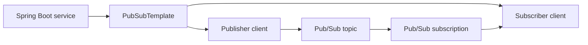

# Sending and receiving messages with PubSubTemplate

## Lesson Objectives

The **SPRING_CLOUD_PROVIDER_INTEGRATION** module practices integrating Spring Boot with managed services from **AWS, Azure, and Google Cloud** using the corresponding Spring Cloud libraries. On the Google Cloud messaging side, Pub/Sub enables services to exchange events asynchronously without direct lifecycle coupling.

This lesson focuses on the **`PubSubTemplate`** API from Spring Framework on Google Cloud. After understanding topics and subscriptions, you will learn how to use the template to:

1. Publish a string, JSON payload, or `PubsubMessage` to a topic.
2. Send attributes, ordering keys, and metadata conforming to the message contract.
3. Receive messages with `subscribe()` or `subscribeAndConvert()`.
4. Acknowledge messages with `ack()`/`nack()` after business processing.
5. Pull messages in batches, convert payloads, and ack in batches.
6. Handle publish errors, conversion errors, duplicates, and acknowledgment failures.
7. Test publishers/subscribers with the Pub/Sub emulator and a Google Cloud sandbox.

> **Example scope:** Maven/YAML snippets illustrate Spring Framework on Google Cloud **7.5.2**, compatible with Spring Boot **3.5.x** per the current compatibility matrix. If your project uses Spring Boot 3.4.x, pick the 6.x line; if using Spring Boot 4.x, pick the 8.x line and check Jackson/API changes. Always import the BOM to manage versions consistently.

## 1. Where does `PubSubTemplate` fit in an application?

`PubSubTemplate` is the primary abstraction for Spring applications to publish to topics and consume from subscriptions. The Pub/Sub starter auto-configures the underlying components, including publisher/subscriber factories, message converters, project ID, and credentials.



Applications do not need to instantiate `Publisher` and `Subscriber` on every call. Typically, inject a `PubSubTemplate` bean into the service that sends or receives messages. The template exposes application-level APIs; the actual network operations are handled by the Google Cloud Java client.

### API groups

| Group | Representative API | Purpose |
| --- | --- | --- |
| Publish | `publish(topic, payload)` | Send a payload |
| Publish with metadata | `publish(topic, payload, headers)` | Send payload and attributes/headers |
| Publish raw message | `publish(topic, PubsubMessage)` | Control data, attributes, ordering key |
| Streaming pull | `subscribe(subscription, handler)` | Receive messages asynchronously |
| Streaming pull with converter | `subscribeAndConvert(...)` | Receive payloads converted into a Java type |
| Synchronous pull | `pull(...)`, `pullAndConvert(...)` | Fetch a batch of messages and decide acks explicitly |
| Auto-ack pull | `pullAndAck(...)`, `pullNext(...)` | Fetch messages and automatically ack |
| Acknowledgment | `ack(...)`, `nack(...)` | Acknowledge or reject messages |

One key distinction to remember: `subscribe()` is a continuous asynchronous receive stream; `pull()` is a call to retrieve a single batch of messages. `pullAndAck()` and `pullNext()` automatically ack, so they are only appropriate when the application can confirm receipt immediately upon receiving.

## 2. Preparing the Spring Boot project

### 2.1. Maven dependencies

Use the Spring Framework on Google Cloud BOM so all modules share matching versions:

```xml
<dependencyManagement>
    <dependencies>
        <dependency>
            <groupId>com.google.cloud</groupId>
            <artifactId>spring-cloud-gcp-dependencies</artifactId>
            <version>7.5.2</version>
            <type>pom</type>
            <scope>import</scope>
        </dependency>
    </dependencies>
</dependencyManagement>

<dependencies>
    <dependency>
        <groupId>com.google.cloud</groupId>
        <artifactId>spring-cloud-gcp-starter-pubsub</artifactId>
    </dependency>
    <dependency>
        <groupId>org.springframework.boot</groupId>
        <artifactId>spring-boot-starter-validation</artifactId>
    </dependency>
</dependencies>
```

`spring-cloud-gcp-starter-pubsub` brings in the dependencies needed for Pub/Sub integration. `spring-boot-starter-validation` is used in payload validation examples. If your application already includes the validation starter via another module, there is no need to declare it twice.

### 2.2. Project ID configuration

In `application.yml`:

```yaml
spring:
  cloud:
    gcp:
      project-id: acme-commerce-dev
```

This is the default project owning topics/subscriptions. `PubSubTemplate` also accepts fully qualified resource names like `projects/{project}/topics/{topic}` or `projects/{project}/subscriptions/{subscription}` when accessing resources in another project.

### 2.3. Credentials with ADC

By default, Spring Framework on Google Cloud uses **Application Default Credentials (ADC)** via `CredentialsProvider`. Recommended approaches:

| Environment | How identity is obtained |
| --- | --- |
| Developer machine | `gcloud auth application-default login` with dev permissions |
| GKE | Workload Identity Federation for GKE |
| Cloud Run | Service account attached to the service |
| Compute Engine | Service account attached to the VM |
| CI/CD outside Google Cloud | Workload Identity Federation |

Never commit service account private keys or bake JSON keys into container images. When receiving `PERMISSION_DENIED`, verify the principal, project, and IAM binding; do not broaden project-wide roles just to make the application run.

### 2.4. Connecting to the emulator for local development

When running the Pub/Sub emulator, configure a dedicated local profile:

```yaml
# application-local.yml
spring:
  cloud:
    gcp:
      project-id: local-pubsub
      pubsub:
        emulator-host: 127.0.0.1:8085
```

`spring.cloud.gcp.pubsub.emulator-host` directs the starter's clients to the emulator instead of the production Pub/Sub endpoint. Do not enable this setting in real cloud profiles. The emulator lets you test basic message flows, though it does not fully simulate IAM or Workload Identity.

## 3. Message contracts and payload conversion

### 3.1. Messages with data and attributes

A Pub/Sub message holds a byte payload along with metadata properties:

| Component | Used for | Example |
| --- | --- | --- |
| `data` | Business content | `OrderCreated` JSON |
| `attributes` | String metadata | `eventType=OrderCreated` |
| `orderingKey` | Per-group ordering | `customer-1024` |
| `messageId` | ID assigned by Pub/Sub after publish | Used for correlation/logging |

Do not put passwords, access tokens, payment data, or sensitive payloads in attributes. Messages may be stored during retention and delivered to multiple subscriptions; send only the data consumers genuinely need.

### 3.2. Default converter

Without another converter configured, `SimplePubSubMessageConverter` directly supports:

- `String`
- `byte[]`
- `ByteString`
- `ByteBuffer`

Thus, the simplest approach is serializing a JSON payload to `String` before publishing, then parsing it in the subscriber. To pass Java POJOs directly, configure a Jackson-backed `PubSubMessageConverter`.

### 3.3. Defining a versioned payload

Example event:

```java
import java.time.Instant;

public record OrderCreated(
        String eventId,
        String orderId,
        String customerId,
        Instant occurredAt,
        int schemaVersion
) {}
```

`eventId` should be generated by the business system and remain stable across publish retries. It enables subscriber deduplication when a logical event arrives multiple times. `schemaVersion` tells consumers how to interpret payloads as contracts evolve.

### 3.4. Configuring the Jackson converter

With Spring Boot 3.x and Jackson 2, you can register the converter:

```java
import com.fasterxml.jackson.databind.ObjectMapper;
import com.google.cloud.spring.pubsub.support.converter.JacksonPubSubMessageConverter;
import com.google.cloud.spring.pubsub.support.converter.PubSubMessageConverter;
import org.springframework.context.annotation.Bean;
import org.springframework.context.annotation.Configuration;

@Configuration
public class PubSubMessageConfiguration {
    @Bean
    PubSubMessageConverter pubSubMessageConverter(ObjectMapper objectMapper) {
        return new JacksonPubSubMessageConverter(objectMapper);
    }
}
```

Spring Boot provides a configured `ObjectMapper` via auto-configuration when Jackson is on the classpath. The starter automatically wires this converter into `PubSubTemplate`. If your project uses Spring Boot 4/Jackson 3, import `ObjectMapper` from that version's Jackson namespace; do not mix Jackson 2 and Jackson 3 in the same codebase.

A converter only handles serialization/deserialization. It does not replace schema checks, business validation, or version compatibility rules. Publisher and subscriber applications must agree on the JSON format and schema evolution rules.

## 4. Publishing messages with `PubSubTemplate`

### 4.1. Sending a simple string

```java
import com.google.cloud.spring.pubsub.core.PubSubTemplate;
import java.util.concurrent.CompletableFuture;
import org.springframework.stereotype.Service;

@Service
public class NotificationPublisher {
    private final PubSubTemplate pubSubTemplate;

    public NotificationPublisher(PubSubTemplate pubSubTemplate) {
        this.pubSubTemplate = pubSubTemplate;
    }

    public CompletableFuture<String> publish(String message) {
        return pubSubTemplate.publish("notifications", message);
    }
}
```

The short topic name `notifications` resolves within the configured project. You can pass the full resource name if the topic belongs to another project:

```java
pubSubTemplate.publish(
        "projects/acme-commerce-prod/topics/notifications",
        message
);
```

### 4.2. Publishing is asynchronous

`publish()` returns `CompletableFuture<String>`. On success, the value is the Pub/Sub-assigned message ID. On failure, the future completes exceptionally.

Example recording the outcome:

```java
public void publishOrder(OrderCreated event) {
    pubSubTemplate.publish("orders", event)
            .whenComplete((messageId, error) -> {
                if (error != null) {
                    // Log sanitized error; route event to retry/outbox flow.
                    return;
                }
                // Optionally record messageId for correlation.
            });
}
```

Do not call `.get()` or `.join()` on the future in every HTTP request without good reason. Blocking web threads reduces throughput and can cause cascading timeouts. If business logic must confirm the publish succeeded before returning a response, manage timeouts and errors explicitly; for critical transactional flows, consider a transactional outbox.

### 4.3. Sending payloads with attributes

When passing a `Map<String, String>` as headers, the converter maps entries to Pub/Sub message metadata:

```java
import java.util.Map;
import java.util.concurrent.CompletableFuture;

public CompletableFuture<String> publishOrder(OrderCreated event) {
    Map<String, String> attributes = Map.of(
            "eventType", "OrderCreated",
            "schemaVersion", "1",
            "source", "order-service"
    );

    return pubSubTemplate.publish("orders", event, attributes);
}
```

This snippet requires `JacksonPubSubMessageConverter` to be configured. With the default converter, publish `String`/`byte[]` or a pre-built `PubsubMessage`.

### 4.4. Using `GcpPubSubHeaders.ORDERING_KEY`

If the subscription has message ordering enabled, pass the ordering key via its dedicated header:

```java
import com.google.cloud.spring.pubsub.support.GcpPubSubHeaders;
import java.util.Map;

public CompletableFuture<String> publishOrder(OrderCreated event) {
    Map<String, String> headers = Map.of(
            "eventType", "OrderCreated",
            GcpPubSubHeaders.ORDERING_KEY, event.customerId()
    );

    return pubSubTemplate.publish("orders", event, headers);
}
```

In addition to the header, ordering must be enabled in publisher configuration and the subscription must be created with ordering enabled. With multiple publishers, use a consistent regional endpoint to maintain regional ordering. Ordering keys do not replace idempotency.

### 4.5. Publishing `PubsubMessage` when direct control is needed

If you want to construct data, attributes, and ordering key yourself, build the native message:

```java
import com.google.protobuf.ByteString;
import com.google.pubsub.v1.PubsubMessage;

PubsubMessage message = PubsubMessage.newBuilder()
        .setData(ByteString.copyFromUtf8(jsonPayload))
        .putAttributes("eventType", "OrderCreated")
        .putAttributes("schemaVersion", "1")
        .setOrderingKey("customer-1024")
        .build();

CompletableFuture<String> result =
        pubSubTemplate.publish("orders", message);
```

The overload accepting `PubsubMessage` bypasses the Spring converter's payload conversion step. This is useful when integrating with another publisher sharing a protobuf contract or when exact metadata control is required.

## 5. Receiving messages with `subscribe()`

### 5.1. Streaming pull and callbacks

`subscribe(subscription, handler)` creates an asynchronous subscriber. The Pub/Sub client continuously pulls messages from the subscription and invokes the handler when messages arrive. The subscription name can be a short name in the default project or a full resource name:

```text
projects/acme-commerce-dev/subscriptions/inventory-sub
```

Example reading raw payloads:

```java
import com.google.cloud.spring.pubsub.core.PubSubTemplate;
import com.google.cloud.spring.pubsub.support.BasicAcknowledgeablePubsubMessage;
import com.google.cloud.pubsub.v1.Subscriber;
import org.springframework.stereotype.Component;

@Component
public class InventorySubscriber {
    private final PubSubTemplate pubSubTemplate;
    private final InventoryService inventoryService;
    private Subscriber subscriber;

    public InventorySubscriber(
            PubSubTemplate pubSubTemplate,
            InventoryService inventoryService) {
        this.pubSubTemplate = pubSubTemplate;
        this.inventoryService = inventoryService;
    }

    @EventListener(ApplicationReadyEvent.class)
    public void start() {
        subscriber = pubSubTemplate.subscribe(
                "inventory-sub",
                this::handleMessage
        );
    }

    private void handleMessage(BasicAcknowledgeablePubsubMessage message) {
        String payload = message.getPubsubMessage()
                .getData()
                .toStringUtf8();

        try {
            inventoryService.processJsonIdempotently(payload);
            message.ack().whenComplete((unused, error) -> {
                if (error != null) {
                    // Record ack error and correlation ID; do not log payload.
                }
            });
        } catch (Exception processingError) {
            message.nack().whenComplete((unused, error) -> {
                if (error != null) {
                    // Record nack error; message may redeliver while unacknowledged.
                }
            });
        }
    }

    @PreDestroy
    public void stop() {
        if (subscriber != null) {
            subscriber.stopAsync();
        }
    }
}
```

The example above illustrates the lifecycle: start receiving messages once the Spring application is ready and signal the subscriber to stop when the context closes. In complete code, add imports for `ApplicationReadyEvent`, `EventListener`, and `PreDestroy`, and configure shutdown grace periods suitable for your deployment platform.

### 5.2. `ack()` and `nack()` are asynchronous

`BasicAcknowledgeablePubsubMessage` provides:

| Method | Meaning | Return type |
| --- | --- | --- |
| `ack()` | Acknowledge that the message was processed | `CompletableFuture<Void>` |
| `nack()` | Reject the message, allowing retry/redelivery | `CompletableFuture<Void>` |
| `getPubsubMessage()` | Access the underlying message | `PubsubMessage` |
| `getProjectSubscriptionName()` | Get the source project/subscription | `ProjectSubscriptionName` |

Do not ignore the future when you need visibility into ack/nack errors. Calling `ack()` does not mean Pub/Sub has already confirmed the request at the exact moment the method returns. If the ack fails to complete, the message may be redelivered.

**Safe processing order:**

```text
Receive message
    ↓
Validate payload
    ↓
Execute business logic + commit data
    ↓
Send ACK
```

Do not ack before writing to the database or executing side effects that must be preserved. If processing succeeds but the ack fails, the message may appear again; the consumer must be idempotent on `eventId`.

### 5.3. Reading attributes and metadata

When you need to read metadata, inspect the underlying `PubsubMessage`:

```java
private void handleMessage(BasicAcknowledgeablePubsubMessage message) {
    var pubsubMessage = message.getPubsubMessage();
    String eventType = pubsubMessage.getAttributesOrDefault(
            "eventType", "UNKNOWN");
    String payload = pubsubMessage.getData().toStringUtf8();

    // Route by eventType, then validate payload.
}
```

Use attributes only for non-sensitive metadata such as event type, schema version, source, or correlation ID. Do not write full payloads to logs for debugging.

### 5.4. Handling failed messages

Not every error should be handled the same way:

| Error category | Recommended action |
| --- | --- |
| Transient database/downstream API error | `nack()` to retry per subscription policy |
| Schema-invalid payload recoverable after consumer fix | Nack/DLQ per policy, investigate, then replay |
| Permanently invalid payload | Persist to a controlled quarantine/DLQ stream, then ack once durably stored |
| Already-processed event | Skip duplicate side effects; ack |
| Network error on ack | Log error; accept possible redelivery and rely on idempotency |

If every bad message is `nack()`ed indefinitely, a poison message can tie up subscription resources. Configure a dead-letter policy on the subscription and monitor the DLQ. If the application itself publishes bad messages to a quarantine topic, ack the original message only after storing/quarantining succeeds.

## 6. Receiving typed payloads with `subscribeAndConvert()`

### 6.1. Using a converter to receive POJOs

Once `JacksonPubSubMessageConverter` is configured, you can receive `OrderCreated` directly:

```java
import com.google.cloud.spring.pubsub.core.PubSubTemplate;
import com.google.cloud.spring.pubsub.support.converter.ConvertedBasicAcknowledgeablePubsubMessage;
import com.google.cloud.pubsub.v1.Subscriber;

public void start() {
    subscriber = pubSubTemplate.subscribeAndConvert(
            "inventory-sub",
            this::handleOrderCreated,
            OrderCreated.class
    );
}

private void handleOrderCreated(
        ConvertedBasicAcknowledgeablePubsubMessage<OrderCreated> message) {
    try {
        OrderCreated event = message.getPayload();
        inventoryService.reserve(event);
        message.ack().whenComplete((unused, error) -> {
            if (error != null) {
                // Log sanitized ack error.
            }
        });
    } catch (Exception error) {
        message.nack().whenComplete((unused, nackError) -> {
            if (nackError != null) {
                // Log sanitized nack error.
            }
        });
    }
}
```

`ConvertedBasicAcknowledgeablePubsubMessage<T>` provides `getPayload()` while inheriting `ack()`/`nack()`. Thus, converting the payload does not forfeit acknowledgment control.

### 6.2. When to use `subscribe()` vs. `subscribeAndConvert()`?

| Criterion | `subscribe()` | `subscribeAndConvert()` |
| --- | --- | --- |
| Payload handler receives | `BasicAcknowledgeablePubsubMessage` | `ConvertedBasicAcknowledgeablePubsubMessage<T>` |
| Reading raw bytes/attributes | Directly via `getPubsubMessage()` | Still accessible via the underlying message |
| JSON-to-POJO conversion | Application parses or converts manually | Uses the converter configured on the template |
| Parse error control | Easy to handle in callback when parsing manually | Requires understanding conversion-step exceptions |
| Best suited for | Multi-format payloads or inspecting raw messages | Stable payload contracts with a configured converter |

If payloads may be malformed and you need to record raw bytes before deciding to nack/quarantine, `subscribe()` gives explicit decoding control inside the handler. When publisher and subscriber share an agreed schema and JSON converter, `subscribeAndConvert()` keeps business code cleaner.

### 6.3. Do not mistake conversion for validation

Jackson deserializing JSON into a POJO does not prove the business data is valid. For example, `orderId` might be an empty string or `schemaVersion` might be unsupported. After calling `getPayload()`, you still need to:

- Validate required fields.
- Validate `schemaVersion`.
- Validate size/format constraints.
- Check permissions and business state.
- Handle stale/duplicate events.

For events with a newer version not yet supported by the consumer, do not silently ack. Route them to a DLQ or quarantine according to your schema compatibility process.

## 7. Pulling messages in batches

### 7.1. `pull()` returns unacknowledged messages

If an application wants to proactively fetch a batch of messages and process them together, use:

```java
import com.google.cloud.spring.pubsub.support.AcknowledgeablePubsubMessage;
import java.util.List;

int maxMessages = 20;
boolean returnImmediately = false;

List<AcknowledgeablePubsubMessage> messages =
        pubSubTemplate.pull("inventory-sub", maxMessages, returnImmediately);
```

Returned messages are **not automatically acked**. After processing succeeds, the application can ack individually or in batches:

```java
List<AcknowledgeablePubsubMessage> succeeded = new ArrayList<>();
List<AcknowledgeablePubsubMessage> failed = new ArrayList<>();

for (AcknowledgeablePubsubMessage message : messages) {
    try {
        String payload = message.getPubsubMessage()
                .getData()
                .toStringUtf8();
        inventoryService.processIdempotently(payload);
        succeeded.add(message);
    } catch (Exception error) {
        failed.add(message);
    }
}

if (!succeeded.isEmpty()) {
    pubSubTemplate.ack(succeeded);
}
if (!failed.isEmpty()) {
    pubSubTemplate.nack(failed);
}
```

Batch `ack()`/`nack()` operations return `CompletableFuture<Void>`; production code should observe completion and errors on those futures. All messages passed to a batch operation must belong to the same project ID. If handling multiple projects, group messages before calling batch ack/nack.

### 7.2. Pulling and converting payloads

When a converter is configured:

```java
List<ConvertedAcknowledgeablePubsubMessage<OrderCreated>> messages =
        pubSubTemplate.pullAndConvert(
                "inventory-sub",
                20,
                false,
                OrderCreated.class
        );

for (var message : messages) {
    try {
        inventoryService.reserve(message.getPayload());
        message.ack();
    } catch (Exception error) {
        message.nack();
    }
}
```

`pullAndConvert()` only converts the payload; it **does not auto-ack**. This is a good choice when batch processing is needed while keeping control over which messages get acknowledged.

### 7.3. Be cautious with auto-ack APIs

The following methods automatically ack received messages:

| Method | Behavior |
| --- | --- |
| `pullAndAck(...)` | Pulls a batch and acks every returned message |
| `pullAndAckAsync(...)` | Asynchronous variant of pull-and-ack |
| `pullNext(...)` | Pulls a single message and auto-acks |
| `pullNextAsync(...)` | Asynchronous variant of pull-next |

Do not use these APIs if you still need to parse, validate, write to a database, or call other services before confirming. Once a message is acked and business processing subsequently fails, Pub/Sub has no reason to redeliver it in normal operation.

### 7.4. `returnImmediately` and choosing streaming

With `pull()`, passing `returnImmediately=true` makes the server respond immediately even when no messages are ready yet. Spring Framework on Google Cloud documentation discourages this setting because it can return empty responses even while messages are waiting on the backend. Normally use `false`.

| Need | Appropriate API |
| --- | --- |
| Continuously running background consumer | `subscribe()` / `subscribeAndConvert()` |
| Periodic job processing up to N messages | `pull()` / `pullAndConvert()` |
| Pull and immediately ack with no further processing | `pullAndAck()` / `pullNext()` |
| Asynchronous pull inside a custom workflow | `pullAsync()` / `pullAndConvertAsync()` |

Do not build a tight loop calling pull with `returnImmediately=true` to mimic streaming. Use `subscribe()` or a polling mechanism with backoff and load limits.

## 8. Acknowledgment deadline and long-running processing

### 8.1. With a streaming subscriber

`subscribe()` uses the underlying Pub/Sub `Subscriber` client. The client manages acknowledgment deadline extensions while the callback runs; you can configure the maximum extension duration:

```yaml
spring:
  cloud:
    gcp:
      pubsub:
        subscriber:
          max-ack-extension-period: 600
          parallel-pull-count: 2
```

`600` is an example value in seconds, not a universal production default. If processing takes longer than the client is allowed to extend, the message may be redelivered while the original worker is still running. Align business timeouts, ack extensions, and flow control together.

### 8.2. With synchronous pull

`pull()` returns `AcknowledgeablePubsubMessage`, which additionally exposes:

- `getAckId()` to access the acknowledgment ID.
- `modifyAckDeadline(seconds)` to adjust the deadline.
- `ack()`/`nack()` inherited from `BasicAcknowledgeablePubsubMessage`.

Example extending the deadline when a batch needs extra time:

```java
for (AcknowledgeablePubsubMessage message : messages) {
    message.modifyAckDeadline(120);
}
```

In production code, observe the future returned by `modifyAckDeadline()` and do not extend indefinitely. Setting a deadline of `0` behaves similarly to a nack. If processing duration is unpredictable, consider splitting work or using a dedicated workflow rather than holding messages outstanding for too long.

### 8.3. Idempotency is mandatory

Pub/Sub provides at-least-once delivery by default. A message may be redelivered if an ack fails to complete, the deadline expires, or a failure occurs. In transactional systems, store `eventId` in a processed-events table with a unique constraint:

```sql
CREATE TABLE processed_events (
    event_id VARCHAR(100) PRIMARY KEY,
    processed_at TIMESTAMP NOT NULL
);
```

Inside the business transaction, check/insert `eventId` before applying side effects. If the event has already been processed, skip repeating the action and ack the message. Exactly-once delivery (when supported and enabled on a subscription) does not make external database transactions or HTTP calls exactly-once.

## 9. Testing `PubSubTemplate`

### 12.1. Publisher unit tests

Publisher unit tests should verify:

- Messages are sent to the right topic.
- Payloads/attributes match the contract.
- Errors from `CompletableFuture` are propagated to the caller or handled properly.
- Events keep a stable `eventId` when retried from an outbox.

You can mock `PubSubTemplate` in service unit tests and return `CompletableFuture.completedFuture("test-message-id")`. This verifies application logic, though it does not prove real serialization or IAM permissions.

### 12.2. Subscriber unit tests

Separate the business handler from the Pub/Sub callback:

```java
public class InventoryService {
    public void processIdempotently(OrderCreated event) {
        // Validate event, deduplicate eventId, update inventory.
    }
}
```

Test each case separately:

1. A valid event updates inventory once.
2. Processing the same `eventId` twice applies the side effect only once.
3. A payload missing `orderId` is rejected by validation.
4. A database exception propagates so the subscriber can nack.

Separating the handler enables testing business logic without starting Pub/Sub.

### 12.3. Integration testing with the emulator

Start the emulator:

```bash
gcloud beta emulators pubsub start \
  --project=local-pubsub \
  --host-port=127.0.0.1:8085
```

Run Spring Boot with the local profile:

```yaml
spring:
  cloud:
    gcp:
      project-id: local-pubsub
      pubsub:
        emulator-host: 127.0.0.1:8085
```

In your test:

1. Use `PubSubAdmin` to create topic `orders` and subscription `inventory-sub`.
2. Start the subscriber or call pull.
3. Publish an `OrderCreated` event via `PubSubTemplate`.
4. Wait for the consumer to process (using Awaitility or polling with a timeout).
5. Assert data was persisted and acknowledgment completed.
6. Publish a duplicate event with the same `eventId` and assert no duplicate side effects occur.

Avoid long fixed `Thread.sleep()` calls in tests when you can wait on conditions with timeouts. Tests should clean up topics/subscriptions or use unique resource names to prevent cross-test interference.

### 9.4. Testing against real cloud

The emulator does not verify IAM, Workload Identity, quotas, DLQ service agents, or all real Pub/Sub behaviors. In a Google Cloud sandbox, verify:

| Test case | Expected result |
| --- | --- |
| Publisher with `roles/pubsub.publisher` on the topic | Publish succeeds |
| Publisher without permissions on another topic | `PERMISSION_DENIED` |
| Subscriber with `roles/pubsub.subscriber` on the subscription | Pull/subscribe succeeds |
| Subscriber without permissions on another subscription | Denied |
| Failing payload and nack | Redelivery per retry policy |
| Exceeding delivery attempts | Message moves to DLQ if service agent IAM is configured |
| Slow-processing subscriber | Ack deadline extension/flow control works properly |
| Ordering key used | Ordering within the same key is preserved as configured |

### 9.5. Avoid pull auto-ack in business tests

`pullAndAck()` is convenient for smoke tests because messages are acked immediately. However, if your goal is to verify handlers, validation, or database transactions, use `pull()`/`pullAndConvert()` so acks happen only after assertions and processing succeed. With auto-ack, a failing test assertion can still remove the message from the subscription.

## 10. Complete example: publisher and subscriber for OrderCreated

### 13.1. Payload

```java
import java.time.Instant;

public record OrderCreated(
        String eventId,
        String orderId,
        String customerId,
        Instant occurredAt,
        int schemaVersion
) {}
```

### 13.2. Publisher

```java
import com.google.cloud.spring.pubsub.core.PubSubTemplate;
import java.util.Map;
import java.util.concurrent.CompletableFuture;
import org.springframework.stereotype.Service;

@Service
public class OrderPublisher {
    private final PubSubTemplate pubSubTemplate;

    public OrderPublisher(PubSubTemplate pubSubTemplate) {
        this.pubSubTemplate = pubSubTemplate;
    }

    public CompletableFuture<String> publish(OrderCreated event) {
        Map<String, String> headers = Map.of(
                "eventType", "OrderCreated",
                "schemaVersion", Integer.toString(event.schemaVersion())
        );

        return pubSubTemplate.publish("orders", event, headers);
    }
}
```

### 13.3. Subscriber

```java
import com.google.cloud.spring.pubsub.core.PubSubTemplate;
import com.google.cloud.spring.pubsub.support.converter.ConvertedBasicAcknowledgeablePubsubMessage;
import com.google.cloud.pubsub.v1.Subscriber;
import jakarta.annotation.PreDestroy;
import org.springframework.boot.context.event.ApplicationReadyEvent;
import org.springframework.context.event.EventListener;
import org.springframework.stereotype.Component;

@Component
public class InventoryListener {
    private final PubSubTemplate pubSubTemplate;
    private final InventoryService inventoryService;
    private Subscriber subscriber;

    public InventoryListener(
            PubSubTemplate pubSubTemplate,
            InventoryService inventoryService) {
        this.pubSubTemplate = pubSubTemplate;
        this.inventoryService = inventoryService;
    }

    @EventListener(ApplicationReadyEvent.class)
    public void start() {
        subscriber = pubSubTemplate.subscribeAndConvert(
                "inventory-sub",
                this::handle,
                OrderCreated.class
        );
    }

    private void handle(
            ConvertedBasicAcknowledgeablePubsubMessage<OrderCreated> message) {
        try {
            inventoryService.processIdempotently(message.getPayload());
            message.ack().whenComplete((unused, error) -> {
                if (error != null) {
                    // Record ack error with sanitized eventId.
                }
            });
        } catch (Exception error) {
            message.nack().whenComplete((unused, nackError) -> {
                if (nackError != null) {
                    // Record nack error; do not log full payload.
                }
            });
        }
    }

    @PreDestroy
    public void stop() {
        if (subscriber != null) {
            subscriber.stopAsync();
        }
    }
}
```

### 13.4. Configuration

```yaml
spring:
  cloud:
    gcp:
      project-id: acme-commerce-dev
      pubsub:
        subscriber:
          parallel-pull-count: 2
          max-ack-extension-period: 600
          flow-control:
            max-outstanding-element-count: 100
            max-outstanding-request-bytes: 10485760
```

This example assumes topic `orders` and subscription `inventory-sub` were already created via IaC or admin tooling. The publisher service account needs `roles/pubsub.publisher` on the topic; the subscriber service account needs `roles/pubsub.subscriber` on the subscription. Do not grant resource creation/deletion permissions to runtime services unless required.

## 11. Hands-on exercise

An e-commerce system needs to send a `PaymentAuthorized` event from `payment-service` to `order-service`. The topic is `payments`, and the subscription is `orders-payment-sub`.

### Requirements

1. Add the Spring Framework on Google Cloud Pub/Sub starter and a Spring Boot–compatible BOM.
2. Configure the project ID and ADC for local, GKE, or Cloud Run.
3. Create a `PaymentAuthorized` record with `eventId`, `paymentId`, `orderId`, `amount`, `currency`, `occurredAt`, and `schemaVersion`.
4. Configure a Jackson converter so `PubSubTemplate` serializes/deserializes POJOs.
5. Write `PaymentPublisher` using `publish(topic, payload, headers)`, returning `CompletableFuture<String>`.
6. Write a subscriber using `subscribeAndConvert()` that acks after `order-service` successfully updates order status.
7. On transient database errors, nack the message; on duplicate `eventId`, skip repeated updates and ack.
8. Write unit tests for the publisher and business handler.
9. Run integration tests against the Pub/Sub emulator.
10. Run cloud sandbox tests with least-privilege service accounts, checking both allow and deny cases.

### Test matrix

| Scenario | Expected result |
| --- | --- |
| Publish valid payload | Returns message ID and subscription reads the event |
| Converter not configured for POJO | Test catches serialization/deserialization error |
| Subscriber succeeds | Ack is sent after commit |
| Subscriber hits database timeout | Nack and message can redeliver |
| Same `eventId` redelivered | No repeated side effects |
| Ack future fails | Error logged; redelivery tolerated |
| Subscriber lacks IAM role | Receives `PERMISSION_DENIED` |
| Publisher lacks topic permission | Publish fails |
| Pulling with `pullAndAck()` | Message is acked immediately; not suitable for testing business logic |
| Emulator running locally | Serialization and basic flow tests pass |

### Completion criteria

- Can distinguish `publish`, `subscribe`, `subscribeAndConvert`, `pull`, and `pullAndAck`.
- Publish observes asynchronous results.
- POJO payloads serialize/deserialize consistently.
- Subscriber acks after business logic completes.
- Includes idempotency and duplicate handling.
- Includes unit tests, emulator integration tests, and IAM sandbox tests.

## 12. Publisher/subscriber configuration and load control

### 12.1. Subscriber concurrency

Spring Framework on Google Cloud lets you configure pull worker counts and thread pools:

```yaml
spring:
  cloud:
    gcp:
      pubsub:
        subscriber:
          parallel-pull-count: 2
          executor-threads: 8
          max-ack-extension-period: 600
          flow-control:
            max-outstanding-element-count: 100
            max-outstanding-request-bytes: 10485760
            limit-exceeded-behavior: Block
```

These values are examples, not production baselines. `parallel-pull-count` increases pull streams; `executor-threads` controls subscriber worker threads; flow control caps outstanding messages/bytes so the subscriber does not pull beyond its processing capacity or memory.

You can set per-subscription overrides:

```yaml
spring:
  cloud:
    gcp:
      pubsub:
        subscription:
          inventory-sub:
            parallel-pull-count: 4
            executor-threads: 8
            flow-control:
              max-outstanding-element-count: 200
              max-outstanding-request-bytes: 20971520
              limit-exceeded-behavior: Block
```

When both global and per-subscription properties are configured, per-subscription settings take precedence unless overridden by a custom factory/bean. Measure throughput, latency, CPU, and heap before increasing concurrency. More threads will not automatically speed up the system if the database or a downstream API is the bottleneck.

### 12.2. Publisher batching

Publishers can group multiple messages into a batch to reduce overhead:

```yaml
spring:
  cloud:
    gcp:
      pubsub:
        publisher:
          batching:
            enabled: true
            element-count-threshold: 100
            request-byte-threshold: 1048576
            delay-threshold-seconds: 0.01
```

Batching trades latency for throughput: a publisher may wait for more messages or until the delay threshold before sending a batch. For latency-sensitive events, measure end-to-end latency before enabling. Do not treat a batch publish as an atomic multi-message transaction; each message still needs an event ID and proper error handling.

### 12.3. RPC retry vs. message retry

The `spring.cloud.gcp.pubsub.[publisher,subscriber].retry.*` properties configure retries for **gRPC/RPC requests** on transient Pub/Sub API errors. They do not govern subscription message redelivery after a nack or ack deadline expiration.

| Mechanism | Scope |
| --- | --- |
| RPC retry | Retries publish/pull requests when gRPC calls hit retryable errors |
| Message redelivery | Pub/Sub redelivers unacknowledged messages |
| Business retry | Application retries database/API calls or emits a retry event |

Do not increase RPC retries to handle a poison message. For recurring business errors, use the subscription's retry policy, dead-letter topics, or a quarantine workflow.

## 13. Error handling and reliability

### 13.1. Publish errors

`publish()` can fail due to:

- Missing `roles/pubsub.publisher` on the topic.
- Wrong project ID or topic name.
- Network/gRPC unavailability, deadlines, or quotas.
- Payload exceeding size limits or invalid metadata.
- Publisher shutting down while messages are queued.

Callers must observe `CompletableFuture<String>` and apply an appropriate retry strategy. If the initial request reached Pub/Sub but the response was lost, an application-level retry may produce a second message. Hence, events should have a stable `eventId` and subscribers must be idempotent.

In transactional systems, consider the **transactional outbox**:

```text
Database transaction:
  update order
  write outbox event
        ↓
Publisher worker reads outbox
        ↓
publish() to Pub/Sub
        ↓
mark outbox as sent
```

If the process crashes after publishing but before marking the outbox row, the worker may resend. Consumers must still deduplicate using `eventId`.

### 13.2. Subscriber errors

| Error | Recommended action |
| --- | --- |
| Database temporarily unavailable | Nack so the subscription retries |
| Downstream API rate limit | Nack/backoff; avoid immediate concurrent retry storms |
| Unparseable JSON | Nack to move to DLQ or store in quarantine |
| Missing required field | Do not ack before storing the error in quarantine |
| Event already processed | Ack after confirming idempotency |
| Ack future fails | Log error and tolerate redelivery; handler must be safe to re-run |
| Subscriber shutdown | Stop pulling new messages and let outstanding ones complete/expire per lifecycle |

### 13.3. Do not swallow exceptions in callbacks

An anti-pattern:

```java
private void handle(BasicAcknowledgeablePubsubMessage message) {
    try {
        service.process(message);
    } catch (Exception ignored) {
        // No log, no nack, no ack.
    }
}
```

This handler gives operators no clear signal. The message eventually hits its ack deadline and redelivers, while the original error is lost. Instead, log a sanitized error code/correlation ID, call `nack()` when retryable, and observe the acknowledgment future.

### 13.4. Graceful subscriber shutdown

`subscribe()` returns a Google Cloud `Subscriber`, allowing the listener to stop on application shutdown:

```java
@PreDestroy
public void stop() {
    if (subscriber != null) {
        subscriber.stopAsync();
    }
}
```

In high-traffic applications, size the shutdown grace period to fit message processing times, readiness probes, and container termination limits. Do not terminate the process abruptly while business transactions are in flight. If subscribers are created for multiple subscriptions, track and stop each instance accordingly.

## Summary

`PubSubTemplate` unifies publish, subscribe, pull, and acknowledgment operations into a Spring Boot–friendly abstraction. Publishers call `publish()` to send payloads, receiving a `CompletableFuture<String>` holding the message ID on success. Subscribers can receive raw messages via `subscribe()` or converted POJOs via `subscribeAndConvert()`. For pull, `pull()`/`pullAndConvert()` leave ack control with the application, whereas `pullAndAck()`/`pullNext()` auto-ack and should only be used when no post-receive processing is needed.

Production designs must observe publish and ack errors, enforce idempotency, keep converters consistent, cap flow control, shut down subscribers gracefully, and test both permission and business failures. `PubSubTemplate` simplifies the API; it does not automatically solve transactions, duplicates, or schema compatibility at the application layer.

## References

- [Spring Framework on Google Cloud 7.5.2 — Pub/Sub](https://googlecloudplatform.github.io/spring-cloud-gcp/reference/html/pubsub.html) — configuration, `PubSubTemplate`, publish, subscribe, pull, ack/nack, and converters.
- [Spring Framework on Google Cloud — Getting Started and Compatibility](https://googlecloudplatform.github.io/spring-cloud-gcp/reference/html/getting-started.html) — BOM, starters, and Spring Boot/Spring Cloud compatibility matrix.
- [PubSubTemplate API](https://googleapis.dev/java/spring-cloud-gcp/latest/com/google/cloud/spring/pubsub/core/PubSubTemplate.html) — publish, subscribe, pull, ack, and nack API signatures.
- [BasicAcknowledgeablePubsubMessage API](https://googleapis.dev/java/spring-cloud-gcp/latest/com/google/cloud/spring/pubsub/support/BasicAcknowledgeablePubsubMessage.html) — asynchronous acknowledgment.
- [ConvertedBasicAcknowledgeablePubsubMessage API](https://googleapis.dev/java/spring-cloud-gcp/latest/com/google/cloud/spring/pubsub/support/converter/ConvertedBasicAcknowledgeablePubsubMessage.html) — converted payload and acknowledgment.
- [JacksonPubSubMessageConverter API](https://googleapis.dev/java/spring-cloud-gcp/latest/com/google/cloud/spring/pubsub/support/converter/JacksonPubSubMessageConverter.html) — POJO conversion with Jackson.
- [Google Cloud Pub/Sub — Publisher](https://docs.cloud.google.com/pubsub/docs/publisher) — publishing messages, ordering keys, and publisher clients.
- [Google Cloud Pub/Sub — Subscriber](https://docs.cloud.google.com/pubsub/docs/subscriber) — pulling, acknowledgment deadlines, and subscriber clients.
- [Google Cloud Pub/Sub — Emulator](https://docs.cloud.google.com/pubsub/docs/emulator) — local testing and emulator limitations.
