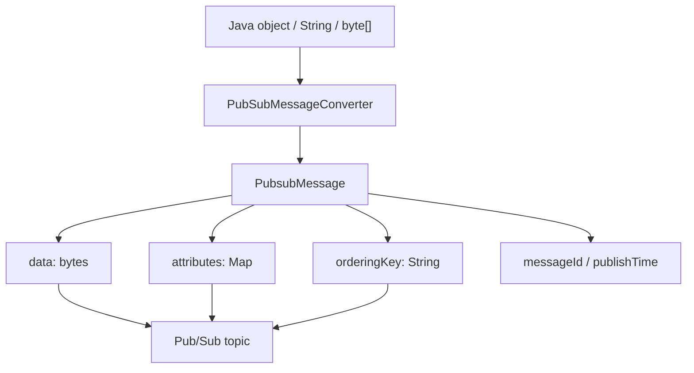

# Payload conversion, attributes, and ordering keys

## Lesson Objectives

The **SPRING_CLOUD_PROVIDER_INTEGRATION** module practices integrating Spring Boot with managed services from **AWS, Azure, and Google Cloud** using the corresponding Spring Cloud libraries. For messaging, applications must agree on how to encode data, pass metadata, and maintain processing order when multiple messages belong to the same business workflow.

In the **Google Cloud Pub/Sub** chapter, this lesson explores how `PubSubTemplate` converts Java data into `PubsubMessage`, how to use attributes, and how to set ordering keys. After this lesson, you will be able to:

1. Explain the wire-format structure of a Pub/Sub message.
2. Choose between `SimplePubSubMessageConverter` and `JacksonPubSubMessageConverter` based on payload type.
3. Configure a `PubSubMessageConverter` bean and build a custom converter when needed.
4. Send/receive attributes via `PubSubTemplate` and read metadata in a subscriber.
5. Distinguish Spring headers, Pub/Sub attributes, and special fields like the ordering key.
6. Use `GcpPubSubHeaders.ORDERING_KEY` and configure publisher/subscription settings to guarantee per-key ordering.
7. Design schema versioning, validation, idempotency, and tests for converters/ordering.

> **Example version:** Jackson configuration sections illustrate Spring Boot 3.x with Jackson 2. If your project uses Spring Boot 4.x/Jackson 3, use a compatible BOM and import `ObjectMapper` from the Jackson 3 namespace supported by that version. Do not mix Jackson 2 and Jackson 3 dependencies in the same application.

## 1. What does a Pub/Sub message contain?

Pub/Sub does not transmit a Java object directly. Before sending, the application must turn the payload into bytes. The service stores and delivers messages in a structure containing data, attributes, and dedicated metadata fields:



| Field | Type | Role |
| --- | --- | --- |
| `data` | Bytes (`ByteString`) | Business payload, such as JSON or protobuf |
| `attributes` | String-to-string map | Metadata such as `eventType`, `schemaVersion`, `source` |
| `orderingKey` | String | Groups messages that require ordering |
| `messageId` | Service-assigned string | Identifies the message after successful publish |
| `publishTime` | Service-assigned timestamp | Time when the service recorded the message |

`data`, `attributes`, and `orderingKey` are provided by the publisher. `messageId` and `publishTime` are assigned by Pub/Sub upon receipt. Do not populate `messageId` inside the payload as a substitute for a business ID; if you need to identify an event across multiple publishes, generate a separate `eventId` and keep it stable at the application layer.

A conceptual message example:

```json
{
  "data": "eyJldmVudElkIjoiZXZ0LTEwMDEiLCJvcmRlcklkIjoib3JkLTEwMDEifQ==",
  "attributes": {
    "eventType": "OrderCreated",
    "schemaVersion": "1",
    "source": "order-service"
  },
  "orderingKey": "customer-1024"
}
```

In the JSON/REST API, `data` is Base64-represented because the underlying content is bytes. When using the Java client and `PubSubTemplate`, the application works with `ByteString`/converted objects; you do not need to manually Base64-encode the payload before calling `publish()`.

## 2. How does `PubSubMessageConverter` convert data?

`PubSubMessageConverter` is the conversion contract between Java objects and `PubsubMessage`. The interface has two primary operations:

```java
public interface PubSubMessageConverter {
    PubsubMessage toPubSubMessage(
            Object payload,
            Map<String, String> headers
    );

    <T> T fromPubSubMessage(
            PubsubMessage message,
            Class<T> payloadType
    );
}
```

`PubSubTemplate` uses the converter when publishing generic payloads with headers; `subscribeAndConvert()` and `pullAndConvert()` use it to turn received bytes into the Java type requested by the application.

Principles:

- The converter determines how the payload is serialized into bytes.
- The converter receives headers as `Map<String, String>` to populate message metadata.
- The converter is responsible for reading bytes and instantiating the target Java type on the receiving side.
- The converter does not automatically enforce schema compatibility or business validation.
- The converter must be used consistently between publisher and subscriber, or adhere to a clearly published wire format.

### 2.1. Default converter: `SimplePubSubMessageConverter`

If no other converter is declared, the starter uses `SimplePubSubMessageConverter`. It directly supports:

| Java type | How it maps |
| --- | --- |
| `String` | Encodes/decodes using the converter's charset |
| `byte[]` | Uses bytes directly |
| `ByteString` | Uses protobuf bytes directly |
| `ByteBuffer` | Reads bytes from the buffer |

Example publishing a JSON string:

```java
String json = """
        {
          "eventId": "evt-1001",
          "orderId": "ord-1001",
          "schemaVersion": 1
        }
        """;

pubSubTemplate.publish("orders", json);
```

On the subscriber side:

```java
pubSubTemplate.subscribe(
        "orders-sub",
        message -> {
            String json = message.getPubsubMessage()
                    .getData()
                    .toStringUtf8();
            // Parse and validate JSON before executing business logic.
            message.ack();
        }
);
```

The default converter's strength is simplicity: it imposes no object structure and works well when the application manages serialization itself. Its limitation is that it cannot automatically convert arbitrary POJOs to JSON. Passing a record/POJO without a suitable converter will fail conversion.

### 2.2. When to choose the default converter?

Choose `SimplePubSubMessageConverter` when:

- The payload is already a `String`, `byte[]`, or protobuf `ByteString`.
- Multiple languages exchange a shared wire format.
- The application wants explicit control over JSON/protobuf schemas.
- You want to inspect raw bytes before deserializing.

Protobuf example:

```java
ByteString payload = ByteString.copyFrom(orderCreatedProto.toByteArray());
pubSubTemplate.publish("orders", payload);
```

The subscriber can parse using the generated protobuf class:

```java
OrderCreatedProto event =
        OrderCreatedProto.parseFrom(
                message.getPubsubMessage().getData()
        );
```

When using protobuf, publishers and subscribers must share the `.proto` schema or compatible generated code artifacts. Do not use standard Java serialization for inter-service events, as it couples tightly to class implementations and is unsuitable as a stable wire contract.

## 3. Using Jackson to convert POJOs to JSON

### 3.1. `JacksonPubSubMessageConverter`

When you want to pass Java records/POJOs directly, configure `JacksonPubSubMessageConverter`. The converter uses an `ObjectMapper` to:

1. Serialize objects into JSON bytes when publishing.
2. Deserialize JSON bytes into the requested type when subscribing/pulling.

Registering the bean:

```java
import com.fasterxml.jackson.databind.ObjectMapper;
import com.google.cloud.spring.pubsub.support.converter.JacksonPubSubMessageConverter;
import com.google.cloud.spring.pubsub.support.converter.PubSubMessageConverter;
import org.springframework.context.annotation.Bean;
import org.springframework.context.annotation.Configuration;

@Configuration
public class PubSubConversionConfiguration {

    @Bean
    PubSubMessageConverter pubSubMessageConverter(ObjectMapper objectMapper) {
        return new JacksonPubSubMessageConverter(objectMapper);
    }
}
```

Spring Boot auto-configures an `ObjectMapper` when the appropriate Jackson starter is present. Sharing a mapper with REST APIs keeps naming strategies, date/time modules, and other Jackson modules consistent. If you need a separate wire format, create a dedicated `ObjectMapper` with explicit configuration and test it independently.

When a `PubSubMessageConverter` bean is registered, the starter automatically wires it into `PubSubTemplate`. An alternative is calling `setMessageConverter()` on the template, though bean configuration is usually easier for dependency management and testing.

### 3.2. Defining stable event DTOs

Example `OrderCreated` event:

```java
import java.time.Instant;

public record OrderCreated(
        String eventId,
        String orderId,
        String customerId,
        Instant occurredAt,
        int schemaVersion
) {}
```

Publishing the POJO:

```java
OrderCreated event = new OrderCreated(
        "evt-1001",
        "ord-1001",
        "customer-1024",
        Instant.now(),
        1
);

pubSubTemplate.publish("orders", event);
```

Receiving the POJO:

```java
pubSubTemplate.subscribeAndConvert(
        "orders-sub",
        message -> {
            OrderCreated event = message.getPayload();
            orderService.processIdempotently(event);
            message.ack();
        },
        OrderCreated.class
);
```

`subscribeAndConvert()` supplies the converted Java payload. If the subscriber also needs raw attributes or original metadata, it can still access `getPubsubMessage()` from the acknowledgeable message.

### 3.3. Be careful with dates, times, and data types

Two applications can share identical class fields yet serialize differently if their Jackson configurations differ. Align on:

- Timestamp format, timezone, and precision.
- Naming strategy: camelCase vs. snake_case.
- Enum conventions: enum names vs. business codes.
- Decimals: precision and scale for currency values.
- Nullable fields, omitted fields, and default values.
- How unknown fields are handled when a consumer receives a newer schema.

For example, `Instant` should be represented in ISO-8601 UTC or epoch format per a published contract. Do not let each service choose its own format independently.

### 3.4. Conversion does not replace validation

Syntactically valid JSON can still be invalid for business rules:

```json
{
  "eventId": "",
  "orderId": null,
  "customerId": "customer-1024",
  "occurredAt": "not-a-time",
  "schemaVersion": 99
}
```

Jackson can reject some type mismatches during deserialization, but it cannot automatically know that `eventId` must be non-blank or whether `schemaVersion=99` is supported. After conversion, the subscriber must still validate:

```java
public void validate(OrderCreated event) {
    if (event.eventId() == null || event.eventId().isBlank()) {
        throw new IllegalArgumentException("eventId is required");
    }
    if (event.orderId() == null || event.orderId().isBlank()) {
        throw new IllegalArgumentException("orderId is required");
    }
    if (event.schemaVersion() != 1) {
        throw new IllegalArgumentException("Unsupported schema version");
    }
}
```

In real applications, use Jakarta Bean Validation or a dedicated validator. Do not include the entire payload in exceptions or logs when validation fails, as the message may contain personal or sensitive data.

## 4. Attributes and headers with `PubSubTemplate`

### 4.1. Attributes are string metadata

Pub/Sub attributes are a map of string keys and string values. They suit small, well-structured metadata:

| Attribute | Example | Purpose |
| --- | --- | --- |
| `eventType` | `OrderCreated` | Identify the event type |
| `schemaVersion` | `1` | Select deserialization/validation rules |
| `source` | `order-service` | Identify the emitting service |
| `correlationId` | `req-8f31` | Correlate logs/traces |
| `tenantId` | `tenant-42` | Partition processing where permitted |

Do not store nested objects, raw integers, or booleans directly in attributes; convert them to strings by convention. For example, `schemaVersion` is sent as `"1"`, not a JSON number. The business payload belongs in `data`.

Attributes are not meant for large payloads. Keep metadata concise with stable names, and avoid stuffing an entire JSON payload into an attribute.

### 4.2. Publishing with a headers map

`PubSubTemplate.publish(topic, payload, headers)` takes a string-to-string map. With the default or Jackson converter, standard headers map to `PubsubMessage.attributes`:

```java
Map<String, String> headers = Map.of(
        "eventType", "OrderCreated",
        "schemaVersion", "1",
        "source", "order-service",
        "correlationId", "req-8f31"
);

pubSubTemplate.publish("orders", event, headers);
```

Here the parameter is named `headers` per the Spring API, while on Pub/Sub they are stored in the `attributes` field. Do not confuse this map with HTTP headers or with all internal Spring headers.

### 4.3. Reading attributes in a subscriber

When using a raw subscriber:

```java
pubSubTemplate.subscribe("orders-sub", message -> {
    var pubsubMessage = message.getPubsubMessage();

    Map<String, String> attributes =
            pubsubMessage.getAttributesMap();

    String eventType = attributes.get("eventType");
    String schemaVersion = attributes.get("schemaVersion");
    String correlationId = attributes.get("correlationId");

    // Select handler by eventType, check version, and process.
    message.ack();
});
```

With `subscribeAndConvert()`, you can still obtain the underlying message from the acknowledgeable wrapper:

```java
pubSubTemplate.subscribeAndConvert(
        "orders-sub",
        message -> {
            OrderCreated event = message.getPayload();
            Map<String, String> attributes =
                    message.getPubsubMessage().getAttributesMap();

            // Cross-check event against metadata before processing.
            message.ack();
        },
        OrderCreated.class
);
```

Do not blindly trust metadata. For instance, if `eventType=OrderCreated` but the payload deserializes into a different shape or carries an unsupported schema version, reject/quarantine it according to consumer rules.

### 4.4. Separating metadata from payload

An easy-to-operate convention:

```text
data:
  eventId, orderId, customerId, occurredAt, business fields

attributes:
  eventType, schemaVersion, source, correlationId

orderingKey:
  customerId
```

Do not duplicate every business field into attributes just for filtering. Attributes can assist routing/observability, but the payload remains the canonical source of truth for business processing.

### 4.5. Naming and security rules

- Use stable attribute names shared consistently between producers and consumers.
- Standardize casing and spelling, such as camelCase.
- Use string values only; convert types according to a published contract.
- Avoid changing the meaning of an existing key; if needed, add a new key or version.
- Never place tokens, passwords, API keys, session IDs, or sensitive data in attributes.
- Do not log the entire attributes map if it could contain tenant IDs or sensitive data.
- Check message/metadata sizes against current Pub/Sub limits before publishing.

## 5. Ordering key is a dedicated Pub/Sub field

### 5.1. Ordering keys vs. attributes

`orderingKey` is a dedicated field on `PubsubMessage`, not an ordinary business attribute. When using a converter, Spring provides a special header:

```java
GcpPubSubHeaders.ORDERING_KEY
```

The converter maps this header to `PubsubMessage.orderingKey`. It should not appear inside `attributes` as a normal key/value pair.

Example:

```java
Map<String, String> headers = new HashMap<>();
headers.put("eventType", "OrderCreated");
headers.put("schemaVersion", "1");
headers.put(GcpPubSubHeaders.ORDERING_KEY, "customer-1024");

pubSubTemplate.publish("orders", event, headers);
```

`customer-1024` is the ordering key. Messages sharing the same key can be delivered in order within the same region if both publisher and subscription are properly configured for ordering.

### 5.2. Choosing keys by business workflow

An ordering key should represent the group of messages requiring strict order:

| Business domain | Suggested ordering key |
| --- | --- |
| Order status | `orderId` |
| Customer session | `customerId` |
| Single account updates | `accountId` |
| Change data capture for a record | Record primary key |

Do not use a single key across the entire topic unless global ordering is truly required. Messages with the same key are serialized, which can reduce throughput; distinct keys can be processed in parallel.

An ordering key is not a partition ID. A topic can have vast numbers of keys; each key defines an independent ordered stream.

### 5.3. Conditions for ordering to work

For a subscriber to receive messages in order:

1. The publisher must supply an `orderingKey` on each related message.
2. Message ordering must be enabled on the publisher.
3. The subscription must be created with message ordering enabled.
4. Publishes for the same ordering key must go through the same region.
5. The subscriber must preserve processing order; if offloading work to an async thread/queue, the application must preserve ordering there too.

Example publisher configuration in `application.yml`:

```yaml
spring:
  cloud:
    gcp:
      pubsub:
        publisher:
          enable-message-ordering: true
          endpoint: "asia-southeast1-pubsub.googleapis.com:443"
```

Select the regional endpoint based on where the publisher is deployed and the regions allowed for message storage. The example above illustrates one endpoint; cross-check the regional endpoint list and the topic's message storage policy.

Create a subscription with ordering enabled via CLI:

```bash
gcloud pubsub subscriptions create orders-ordered-sub \
  --topic=orders \
  --enable-message-ordering
```

Ordering must be enabled at subscription creation time; it cannot be toggled on or off afterward. If requirements change, create a new subscription with the right configuration and migrate consumers cleanly.

### 5.4. Ordering applies only per key and per region

Suppose a publisher sends:

```text
key=order-1001: OrderCreated
key=order-1001: OrderPaid
key=order-1001: OrderShipped

key=order-2002: OrderCreated
key=order-2002: OrderCancelled
```

Pub/Sub preserves ordering within each key group. There is no ordering guarantee between `order-1001` and `order-2002`.

If multiple publishers send with the same key, Pub/Sub preserves the order in which the service receives the messages within the same region. If business logic requires a deterministic sequence across concurrent publishers emitting for the same key, the application must coordinate before publishing—for example, using ownership/locking or a single producer per key.

Ordering keys have a maximum length of **1 KB**. Publish throughput per ordering key is capped by default at **1 MB/sec**; total topic throughput also depends on regional publish quotas. Use short, stable IDs containing no secrets. If a single key becomes a bottleneck, review cardinality and workflow partitioning before requesting quota increases.

### 5.5. Redelivery affects ordering

Pub/Sub retains at-least-once delivery semantics. If one message in an ordered stream is redelivered, subsequent messages with the same key may also be redelivered to preserve order. Therefore:

- Consumers must be idempotent on `eventId`.
- Do not assume each message callback executes strictly once.
- Do not offload side effects asynchronously to another executor without preserving order.
- Account for the latency impact when a head-of-stream message fails or remains unacked.

Ordering guarantees delivery sequence within its configured scope; it does not replace transactions or idempotency.

### 5.6. Publish failures with ordering keys

When a publish with an ordering key fails unrecoverably, the publisher client may pause subsequent publishes for that same key to prevent out-of-order messages. The Google Cloud Java Pub/Sub client provides `resumePublish(orderingKey)` to reopen the stream once the application handles the failure.

`PubSubTemplate` abstracts away the publisher client. If business logic requires direct control over per-key resumption, inspect the APIs exposed by your Spring Framework on Google Cloud version; a custom publisher integration or lower-level Java client usage may be necessary. Do not retry indefinitely or silently drop a failed message and continue sending subsequent messages for the same key.

## 6. Building a custom `PubSubMessageConverter`

### 6.1. When is a custom converter needed?

Built-in converters usually suffice for strings, bytes, and JSON. Write a custom converter when you need to:

- Use protobuf or a specialized wire format.
- Standardize timestamps, decimals, enums, or naming conventions.
- Inject or strip metadata per internal conventions.
- Map a domain object type to a stable message schema.
- Separate special metadata from attributes, such as the ordering key.

Do not write a custom converter just to rename a field if Jackson annotations or `ObjectMapper` settings already solve it. A converter is part of the communication contract, so test and version it like production business code.

### 6.2. Example JSON converter handling ordering keys

The example below serializes payloads with Jackson and maps normal headers to attributes. The `GcpPubSubHeaders.ORDERING_KEY` header is extracted and assigned to the dedicated `orderingKey` field:

```java
import com.fasterxml.jackson.core.JsonProcessingException;
import com.fasterxml.jackson.databind.ObjectMapper;
import com.google.cloud.spring.pubsub.support.GcpPubSubHeaders;
import com.google.cloud.spring.pubsub.support.converter.PubSubMessageConverter;
import com.google.protobuf.ByteString;
import com.google.pubsub.v1.PubsubMessage;
import java.io.IOException;
import java.util.HashMap;
import java.util.Map;

public class EventJsonMessageConverter implements PubSubMessageConverter {
    private final ObjectMapper objectMapper;

    public EventJsonMessageConverter(ObjectMapper objectMapper) {
        this.objectMapper = objectMapper;
    }

    @Override
    public PubsubMessage toPubSubMessage(
            Object payload,
            Map<String, String> headers) {
        try {
            byte[] json = objectMapper.writeValueAsBytes(payload);

            Map<String, String> attributes = new HashMap<>(
                    headers == null ? Map.of() : headers
            );
            String orderingKey =
                    attributes.remove(GcpPubSubHeaders.ORDERING_KEY);

            PubsubMessage.Builder builder = PubsubMessage.newBuilder()
                    .setData(ByteString.copyFrom(json))
                    .putAllAttributes(attributes);

            if (orderingKey != null && !orderingKey.isBlank()) {
                builder.setOrderingKey(orderingKey);
            }

            return builder.build();
        } catch (JsonProcessingException error) {
            throw new IllegalArgumentException(
                    "Cannot serialize Pub/Sub event payload", error);
        }
    }

    @Override
    public <T> T fromPubSubMessage(
            PubsubMessage message,
            Class<T> payloadType) {
        try {
            return objectMapper.readValue(
                    message.getData().toByteArray(),
                    payloadType
            );
        } catch (IOException error) {
            throw new IllegalArgumentException(
                    "Cannot deserialize Pub/Sub event payload", error);
        }
    }
}
```

Registering the converter:

```java
@Bean
PubSubMessageConverter pubSubMessageConverter(ObjectMapper objectMapper) {
    return new EventJsonMessageConverter(objectMapper);
}
```

This is a minimal example. For a production converter, add:

- Checks verifying `payload` belongs to allowed serializable types.
- Checks ensuring `headers` do not contain duplicate or invalid reserved keys.
- Explicit charset and schema version policies.
- Payload/attribute size checks against Pub/Sub limits.
- Exception messages free of raw payloads or secrets.
- Unit tests for empty payloads, malformed JSON, unsupported types, and ordering keys.

### 6.3. Converters should not guess schemas

Avoid practices such as:

- Serializing arbitrary objects without restricting allowed types.
- Storing Java class names in attributes and deserializing via unchecked reflection.
- Changing JSON formats across releases without versioning.
- Silently mapping unknown enum values to a business state that triggers side effects.
- Ignoring unreadable fields and acking the message as successful.

A good converter preserves a stable wire format, reports errors clearly, and lets the business handler decide how to deal with the event.

## 7. Header mapping and Spring Integration

### 7.1. Distinguishing Spring headers from Pub/Sub attributes

There are two conceptual layers:

| Concept | API | Usage |
| --- | --- | --- |
| `PubSubTemplate` headers map | `publish(topic, payload, Map<String,String>)` | Converter maps metadata to attributes and handles special headers |
| Spring `MessageHeaders` | Spring Messaging | Internal application message metadata |
| Pub/Sub attributes | `PubsubMessage.getAttributesMap()` | Metadata transmitted over the Pub/Sub service |
| Header mapper | Spring Integration `PubSubHeaderMapper` | Filters/maps headers between Spring `Message` and Pub/Sub messages |

When calling `PubSubTemplate` directly, pass a `Map<String, String>`; there is no need to construct `MessageHeaders` or `PubSubHeaderMapper`. Header mappers belong to Spring Integration channel adapters.

### 7.2. Filtering headers in Spring Integration

If an application uses `PubSubMessageHandler`/`PubSubInboundChannelAdapter`, `PubSubHeaderMapper` lets you choose which headers pass through. Example:

```java
PubSubHeaderMapper headerMapper = new PubSubHeaderMapper();
headerMapper.setOutboundHeaderPatterns(
        "!authorization",
        "!password",
        "!internal_*",
        "*"
);
```

Patterns are evaluated in order; earlier patterns take precedence. The example excludes sensitive headers before the `*` wildcard allows remaining ones.

`GcpPubSubHeaders.ORDERING_KEY` is a special header: the mapper translates it to `PubsubMessage.orderingKey` and omits it from ordinary attributes. Maintain these same semantics when publishing through a converter.

### 7.3. Do not forward all HTTP headers to Pub/Sub

Do not blindly copy all HTTP request headers into a Pub/Sub message. Headers like `Authorization`, `Cookie`, `Set-Cookie`, access tokens, trace baggage, or internal metadata can leak sensitive data or push the message past size limits.

Instead, build a metadata allowlist:

```java
Map<String, String> attributes = Map.of(
        "eventType", "OrderCreated",
        "schemaVersion", "1",
        "correlationId", correlationId,
        "source", "order-service"
);
```

Transmit only the information consumers and observability tooling genuinely require.

## 8. Schema versioning and compatibility

### 8.1. Version in payload and attributes

You can place `schemaVersion` in the payload, attributes, or both:

```json
{
  "eventId": "evt-1001",
  "eventType": "OrderCreated",
  "schemaVersion": 2,
  "orderId": "ord-1001",
  "customerId": "customer-1024"
}
```

Attributes:

```text
eventType=OrderCreated
schemaVersion=2
```

Putting the version in attributes lets consumers/routers select a handler before deserializing the full payload. Putting it in the payload keeps the contract self-describing when stored or replayed. If kept in both places, enforce that they match; never let metadata and payload advertise different versions.

### 8.2. Schema evolution rules

| Change | Impact | Rollout strategy |
| --- | --- | --- |
| Add optional field | Usually backward-compatible if consumers handle unknown/missing fields | Old consumers ignore the new field; new consumers supply defaults |
| Add required field | Can break old consumers or new producers | Deploy supporting consumers first, then publish required field |
| Rename field | Old consumers may fail to read | Use aliases or a dual-write phase before retiring the old field |
| Change field type | Prone to deserialization errors | Introduce a new field or bump the version |
| Change enum semantics | Can cause wrong business logic even if deserialization succeeds | Add a new enum value and handle unknowns explicitly |
| Remove field | Can break old consumers | Deprecate first, monitor usage, then remove in a new version |

Pub/Sub supports service-level schemas such as Avro and Protocol Buffers. If using Pub/Sub Schemas, configure topic/schema compatibility appropriately; the Jackson converter remains solely an application-level JSON serializer and does not register or validate schemas in Pub/Sub.

### 8.3. Routing by event type

A subscriber may receive multiple event types from the same subscription. You can inspect `eventType` in attributes first and pick the matching converter/handler:

```java
String eventType = message.getPubsubMessage()
        .getAttributesOrDefault("eventType", "");

switch (eventType) {
    case "OrderCreated" -> handleOrderCreated(message);
    case "OrderCancelled" -> handleOrderCancelled(message);
    default -> quarantineUnknownEvent(message);
}
```

If different event types have distinct schemas, do not deserialize all of them into a single DTO merely because they share a topic. Select types per the published contract, validate versions, and route unknown types to quarantine/DLQ.

## 9. Testing payloads, attributes, and ordering keys

### 9.1. Unit testing converters

Converters can be tested standalone without connecting to Google Cloud:

```java
import static org.assertj.core.api.Assertions.assertThat;

import com.fasterxml.jackson.databind.ObjectMapper;
import com.google.cloud.spring.pubsub.support.GcpPubSubHeaders;
import com.google.cloud.spring.pubsub.support.converter.PubSubMessageConverter;
import com.google.pubsub.v1.PubsubMessage;
import java.time.Instant;
import java.util.Map;
import org.junit.jupiter.api.Test;

class PubSubMessageConverterTest {
    private final ObjectMapper objectMapper = new ObjectMapper()
            .findAndRegisterModules();
    private final PubSubMessageConverter converter =
            new JacksonPubSubMessageConverter(objectMapper);

    @Test
    void convertsPayloadAndAttributes() {
        OrderCreated event = new OrderCreated(
                "evt-1001",
                "ord-1001",
                "customer-1024",
                Instant.parse("2026-11-24T08:30:00Z"),
                1
        );

        PubsubMessage message = converter.toPubSubMessage(
                event,
                Map.of(
                        "eventType", "OrderCreated",
                        "schemaVersion", "1"
                )
        );

        assertThat(message.getAttributesMap())
                .containsEntry("eventType", "OrderCreated")
                .containsEntry("schemaVersion", "1");

        OrderCreated restored = converter.fromPubSubMessage(
                message,
                OrderCreated.class
        );
        assertThat(restored).isEqualTo(event);
    }

    @Test
    void mapsOrderingHeaderToDedicatedField() {
        PubsubMessage message = converter.toPubSubMessage(
                "payload",
                Map.of(
                        "eventType", "OrderCreated",
                        GcpPubSubHeaders.ORDERING_KEY, "customer-1024"
                )
        );

        assertThat(message.getOrderingKey()).isEqualTo("customer-1024");
        assertThat(message.getAttributesMap())
                .containsEntry("eventType", "OrderCreated")
                .doesNotContainKey(GcpPubSubHeaders.ORDERING_KEY);
    }
}
```

The second test uses the library's built-in Jackson converter to verify the special header moves into the dedicated field. If your project uses a custom converter, run the same assertions to ensure it does not accidentally store the ordering key as an attribute.

### 9.2. Testing schema compatibility

Maintain JSON test fixtures representing:

- Current version.
- Older still-supported versions.
- Newer version with optional fields.
- Unknown enum values.
- Missing required fields.
- Non-JSON or truncated payloads.

Verify both stages: whether the converter deserializes it, and whether the validator/handler accepts it under business rules. Successful parsing does not mean an event is safe to execute.

### 9.3. Integration testing with the Pub/Sub emulator

The emulator is useful for verifying:

1. `PubSubTemplate.publish()` converts objects to bytes properly.
2. Attributes are transmitted and read back intact.
3. `subscribeAndConvert()` reconstructs the expected DTO.
4. Subscribers can read `orderingKey` from `getPubsubMessage()`.
5. Two-way conversion yields an identical object after round-trip.

Start the emulator and configure the local profile:

```bash
gcloud beta emulators pubsub start \
  --project=local-pubsub \
  --host-port=127.0.0.1:8085
```

```yaml
spring:
  cloud:
    gcp:
      project-id: local-pubsub
      pubsub:
        emulator-host: 127.0.0.1:8085
```

Do not use the emulator to declare IAM or production ordering behavior verified. For regional ordering guarantees, test in a Google Cloud sandbox using a regional publisher endpoint and an ordering-enabled subscription.

### 9.4. Testing ordering in a sandbox

Create a dedicated topic and subscription for the test:

```bash
gcloud pubsub topics create orders-ordering-test

gcloud pubsub subscriptions create orders-ordering-test-sub \
  --topic=orders-ordering-test \
  --enable-message-ordering
```

Publish three messages with the same key and one with a different key:

```java
String key = "order-1001";

for (int sequence = 1; sequence <= 3; sequence++) {
    Map<String, String> headers = Map.of(
            "eventType", "OrderStatusChanged",
            "sequence", Integer.toString(sequence),
            GcpPubSubHeaders.ORDERING_KEY, key
    );

    pubSubTemplate.publish(
            "orders-ordering-test",
            "status-" + sequence,
            headers
    ).join();
}
```

Have the consumer record sequences per key. Expected outcomes:

- For `order-1001`, the subscriber receives sequences `1`, `2`, `3` in the publish order received by Pub/Sub.
- Messages with another key have no ordering relationship with `order-1001`.
- When redelivery occurs, the consumer still processes idempotently.

In multi-publisher tests, messages for the same ordering key must be published to the same region. If publishers run across multiple regions, configure the same regional endpoint. If deterministic ordering across concurrent publishers is needed, add application-level coordination.

### 9.5. Comprehensive test matrix

| Scenario | What to verify |
| --- | --- |
| Publish `String` with default converter | Received bytes match content |
| Publish POJO without Jackson converter | Test catches conversion error |
| Jackson converter serializes record | JSON matches wire contract |
| Publish attributes | Subscriber reads exact key/value pairs |
| Publish `ORDERING_KEY` | `orderingKey` field is set and absent from regular attributes |
| Missing required field | Validation rejects payload |
| Unknown schema version | Handler routes to quarantine/DLQ per policy |
| Ordering enabled on publisher but disabled on subscription | Do not assume ordered delivery is guaranteed |
| Multiple publishers send same key to different regions | No cross-region ordering guarantee |
| Publish with ordering key fails | Verify publisher pauses key and recovery/resume flow |
| Attribute contains token | Security test detects and blocks before publish |

## 10. Common errors and troubleshooting

| Symptom | Possible cause | Resolution |
| --- | --- | --- |
| `No converter available` or conversion error | Sending a POJO while still using the simple converter | Register `JacksonPubSubMessageConverter` or a custom converter |
| JSON parsing failure | Publisher and subscriber use different formats/`ObjectMapper` settings | Standardize mapper, charset, date/time, and schema version |
| Deserialization succeeds but processing is wrong | Missing validation or mismatched `eventType` | Validate payload and metadata independently |
| Attributes missing | Converter ignores headers or mapper filters them out | Check map passed to `publish()` and converter implementation |
| Ordering key appears in attributes | Custom converter fails to extract special header | Remove `GcpPubSubHeaders.ORDERING_KEY` and set `PubsubMessage.orderingKey` |
| Message has no ordering | Ordering disabled on publisher or empty key | Check publisher properties and key value |
| Subscriber does not preserve order | Subscription lacks ordering enabled | Create a new subscription with ordering enabled |
| Out-of-order across multiple publishers | Publishers send same key to different regions | Use a single regional endpoint and coordinate if needed |
| Publishes stall after a key error | Publisher client paused the ordering key | Handle error and resume key using supported client API |
| Metadata leak | Copying all HTTP/Spring headers | Use an allowlist and strip credentials and sensitive data |

### Checklist before publishing an event

- Payload has an explicit schema and version.
- Attributes contain only required metadata and every value is a string.
- `eventId` is stable for deduplication.
- Ordering key is used only when business logic requires per-group order.
- Both publisher and subscription enable ordering when ordered delivery is required.
- Publishers using the same key route through the same region.
- Consumer enforces validation, idempotency, and unknown-version handling.
- Sensitive payloads and metadata are never logged.

## 11. Comparison with AWS and Azure

The shared principle across clouds is separating business payloads from transport metadata and choosing partition/ordering keys according to service capabilities. However, APIs and semantics differ:

| Concept | Google Cloud Pub/Sub | AWS | Azure |
| --- | --- | --- | --- |
| Payload | `PubsubMessage.data` bytes | SNS/SQS message body bytes/string | Service Bus message body or Event Grid data |
| Metadata | `attributes: Map<String,String>` | SNS message attributes, SQS message/system attributes | Application properties, system properties, or event metadata |
| Ordering key / partition | `orderingKey` on message | SQS FIFO `MessageGroupId` | Service Bus `SessionId` or partition key depending on service |
| Deduplication | Consumer idempotency; scoped exactly-once | SQS FIFO deduplication window and consumer idempotency | Duplicate detection and consumer idempotency |
| Serialization | `PubSubMessageConverter`, JSON/protobuf | SDK serializer or Spring Cloud AWS converter | Azure SDK serializer or Spring Cloud Azure |
| Permissions | Google Cloud IAM | IAM roles/policies | Azure RBAC/Managed Identity |

Do not blindly map a Pub/Sub ordering key to an arbitrary field and assume identical semantics on another cloud. For example:

- Pub/Sub ordering keys preserve order per key within a region when publisher and subscription are configured appropriately.
- SQS FIFO uses `MessageGroupId` to preserve order within a message group.
- Azure Service Bus sessions use `SessionId` to group messages and process per session.

When designing multi-cloud abstractions, define the contract at the application layer—such as `partitionKey`, `eventType`, and `schemaVersion`—and have each provider's adapter map to its native field and test that provider's specific semantics.

## 12. Hands-on exercise

An e-commerce system needs to emit order-status events:

```text
Topic: orders
Subscription: order-projection-sub

Events:
  OrderCreated
  OrderPaid
  OrderCancelled

Metadata:
  eventType
  schemaVersion
  source
  correlationId

Ordering:
  orderId
```

### Requirements

1. Create an `OrderCreated` record with `eventId`, `orderId`, `customerId`, `occurredAt`, and `schemaVersion`.
2. Register `JacksonPubSubMessageConverter` using Spring Boot's `ObjectMapper`.
3. Write a publisher sending the POJO with `eventType`, `schemaVersion`, `source`, and `correlationId` attributes.
4. Pass `GcpPubSubHeaders.ORDERING_KEY` set to `orderId`.
5. Enable `spring.cloud.gcp.pubsub.publisher.enable-message-ordering`.
6. Configure the publisher to use a regional endpoint matching your deployment environment.
7. Create a new subscription with message ordering enabled.
8. Write a subscriber using `subscribeAndConvert()`, reading raw attributes to determine event type and validate schema version.
9. Write unit tests for converter round-trip, attributes, and ordering keys.
10. Run emulator integration tests for JSON/attributes, then run ordering tests in a Google Cloud sandbox.
11. Test missing fields, unsupported schema versions, publish failures, and duplicate events.
12. Document how the consumer guarantees idempotency and preserves order if callbacks dispatch asynchronous work.

### Evaluation matrix

| Criterion | Pass condition |
| --- | --- |
| Payload conversion | POJO serializes/deserializes matching wire format |
| Attributes | Consumer receives required metadata without credentials |
| Ordering key | Special header maps to the `orderingKey` field |
| Ordering setup | Both publisher and subscription have ordering enabled |
| Regional routing | Publishers for the same key target the same region |
| Schema | Versioning, validation, and unknown-version handling implemented |
| Reliability | Duplicates do not cause repeated side effects |
| Testing | Unit, emulator, and sandbox tests present |

## Summary

`PubSubTemplate` does not transmit raw Java objects as-is. `PubSubMessageConverter` serializes payloads into bytes and maps metadata onto `PubsubMessage`. `SimplePubSubMessageConverter` fits `String`, `byte[]`, `ByteString`, and `ByteBuffer`; `JacksonPubSubMessageConverter` fits applications serializing/deserializing POJOs as JSON. For specialized needs, implement `PubSubMessageConverter` and register it as a bean.

Attributes are string-to-string maps meant for metadata, while business payloads belong in `data`. `GcpPubSubHeaders.ORDERING_KEY` is a special header mapped to `PubsubMessage.orderingKey`, not a standard attribute. To receive messages in order, enable ordering on both the publisher and subscription, route messages with the same key through the same region, and maintain idempotency and ordering at the consumer layer.

A sound event contract includes explicit payload versioning, an attributes allowlist, business-grouped ordering keys, and tests covering both serialization and redelivery. These practices keep Spring Boot Pub/Sub integrations reliable and lay a clean foundation for mapping onto AWS and Azure messaging services.

## References

- [Spring Framework on Google Cloud — Pub/Sub](https://googlecloudplatform.github.io/spring-cloud-gcp/reference/html/pubsub.html) — `PubSubTemplate`, converters, JSON support, attributes, and ordering keys.
- [Spring Framework on Google Cloud — Pub/Sub API configuration](https://googlecloudplatform.github.io/spring-cloud-gcp/reference/html/pubsub.html) — publisher ordering properties and regional endpoints.
- [PubSubMessageConverter API](https://googleapis.dev/java/spring-cloud-gcp/latest/com/google/cloud/spring/pubsub/support/converter/PubSubMessageConverter.html) — `toPubSubMessage` and `fromPubSubMessage` contract.
- [SimplePubSubMessageConverter API](https://googleapis.dev/java/spring-cloud-gcp/latest/com/google/cloud/spring/pubsub/support/converter/SimplePubSubMessageConverter.html) — default supported payload types.
- [JacksonPubSubMessageConverter API](https://googleapis.dev/java/spring-cloud-gcp/latest/com/google/cloud/spring/pubsub/support/converter/JacksonPubSubMessageConverter.html) — POJO conversion with Jackson.
- [Google Cloud Pub/Sub — Publish messages](https://docs.cloud.google.com/pubsub/docs/publisher) — attributes, ordering keys, regional endpoints, and publish failure handling.
- [Google Cloud Pub/Sub — Order messages](https://docs.cloud.google.com/pubsub/docs/ordering) — ordering keys, key limits, subscription ordering, and redelivery.
- [Google Cloud Pub/Sub — Retry requests with ordering keys](https://docs.cloud.google.com/pubsub/docs/retry-requests) — resuming publisher streams after ordering-key failures.
- [Google Cloud Pub/Sub — Emulator](https://docs.cloud.google.com/pubsub/docs/emulator) — local testing and emulator limitations.
