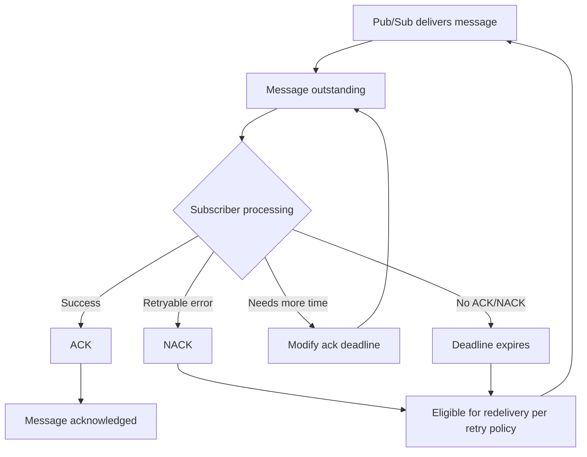
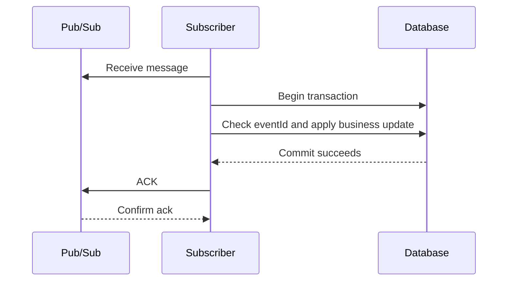

# Ack, nack, ack deadline, and extending processing time

## Lesson Objectives

The **SPRING_CLOUD_PROVIDER_INTEGRATION** module practices integrating Spring Boot with managed services from **AWS, Azure, and Google Cloud** using the corresponding Spring Cloud libraries. For messaging, receiving a message is only part of the workflow; the subscriber must also decide when a message is considered complete, when it needs redelivery, and how much time is needed to process it safely.

In Google Cloud Pub/Sub, three key operations are:

- **Ack (acknowledge):** confirms the subscriber has processed the message; Pub/Sub removes the message from the subscription's outstanding state.
- **Nack (negative acknowledge):** signals that the subscriber could not process the message; the message becomes eligible for redelivery according to the retry policy.
- **Modify ack deadline:** updates the acknowledgment deadline of an outstanding message, typically to extend it when longer processing is needed.

After this lesson, you will be able to:

1. Describe a message's lifecycle from delivery through ack, nack, or deadline expiration.
2. Distinguish a subscription's ack deadline from client library lease management.
3. Use `PubSubTemplate` to ack/nack messages individually or in batches.
4. Manually extend deadlines when using synchronous pull.
5. Configure automatic extension for Spring Boot streaming subscribers.
6. Choose appropriate retry/backoff policies, dead-letter topics, and flow control.
7. Design idempotency, graceful shutdown, monitoring, and delivery-failure tests.

> **Version:** Examples use the current `PubSubTemplate` API from Spring Framework on Google Cloud. Spring properties follow the current reference; choose a BOM compatible with your project's Spring Boot version. Do not mix Spring Integration channel adapter properties with `PubSubTemplate` properties if the application does not use that adapter.

## 1. Acknowledgment lifecycle of a message

When Pub/Sub delivers a message to a pull subscriber, the message enters the **outstanding** state. The subscriber must process it and send an acknowledgment before the deadline expires, or extend the deadline if more time is required.



A subscriber can encounter three outcomes:

| Outcome | Meaning | Next behavior |
| --- | --- | --- |
| Ack succeeds | Processing complete | Message is no longer outstanding on the subscription |
| Nack | Processing failed | Message returns to the retry flow; redelivery timing depends on the retry policy |
| No ack and deadline expires | Subscriber did not confirm within allowed time | Pub/Sub may redeliver the message |

**Ack is not a database transaction commit.** The application must commit business work first, then ack. If you ack before committing, the process may crash after the ack, losing the chance for redelivery even though the data was never persisted.

Conversely, if the database commits but the ack fails or its response is lost, the message may be redelivered. That is why subscribers require idempotency.

## 2. Subscription ack deadline

### 2.1. Initial deadline

The ack deadline is the initial duration Pub/Sub waits for a subscriber to acknowledge a message after delivery. This value is configured on the subscription:

| Property | Value |
| --- | --- |
| Default | 10 seconds |
| Minimum | 10 seconds |
| Configurable maximum | 600 seconds (10 minutes) |

Example updating a subscription:

```bash
gcloud pubsub subscriptions update orders-sub \
  --ack-deadline=60
```

This command sets the initial deadline to 60 seconds for deliveries on the subscription. It does not alter the current deadline of messages already delivered; to adjust an outstanding message's deadline, the subscriber must call `ModifyAckDeadline` or rely on client library lease management.

### 2.2. Deadlines are best-effort

This duration should not be treated as a strict, exact timer. Pub/Sub attempts not to redeliver an outstanding message before the deadline expires, though redeliveries can occur due to faults or operational conditions. If stricter semantics are needed, evaluate exactly-once delivery on pull subscriptions and inspect acknowledgment responses where supported by the client.

A short ack deadline can trigger redelivery while the original worker is still processing, causing duplicates and extra load. An overly long deadline delays redelivery when a worker dies or loses connectivity. With streaming pull, the client library automatically extends the deadline, so the subscription deadline does not need to match the longest possible processing duration.

### 2.3. Relevance to push subscriptions

For push subscriptions, the ack deadline also serves as the timeout for HTTP requests sent to the endpoint. The endpoint must return an HTTP status code recognized by Pub/Sub as an acknowledgment after finishing work. Push subscribers do not call `modifyAckDeadline` per message the way pull subscribers do; design processing durations and endpoint timeouts to fit within the subscription deadline.

## 3. Ack and nack with `PubSubTemplate`

### 3.1. Acking after business logic completes

`PubSubTemplate.subscribe()` delivers messages asynchronously as `BasicAcknowledgeablePubsubMessage`. Messages expose `ack()` and `nack()` methods:

```java
import com.google.cloud.spring.pubsub.core.PubSubTemplate;
import com.google.cloud.spring.pubsub.support.BasicAcknowledgeablePubsubMessage;
import com.google.cloud.pubsub.v1.Subscriber;
import java.util.concurrent.CompletableFuture;

public class OrderSubscriber {
    private final PubSubTemplate pubSubTemplate;
    private final OrderService orderService;
    private Subscriber subscriber;

    public OrderSubscriber(
            PubSubTemplate pubSubTemplate,
            OrderService orderService) {
        this.pubSubTemplate = pubSubTemplate;
        this.orderService = orderService;
    }

    public void start() {
        subscriber = pubSubTemplate.subscribe(
                "orders-sub",
                this::handle
        );
    }

    private void handle(BasicAcknowledgeablePubsubMessage message) {
        String payload = message.getPubsubMessage()
                .getData()
                .toStringUtf8();

        try {
            orderService.processAndCommit(payload);
            CompletableFuture<Void> ackResult = message.ack();
            ackResult.whenComplete((unused, error) -> {
                if (error != null) {
                    // Record sanitized ack error and correlation ID.
                }
            });
        } catch (Exception processingError) {
            CompletableFuture<Void> nackResult = message.nack();
            nackResult.whenComplete((unused, error) -> {
                if (error != null) {
                    // Record nack error; message may redeliver if unacknowledged.
                }
            });
        }
    }
}
```

`ack()`/`nack()` are asynchronous and return `CompletableFuture<Void>`. Observe the future when you need to know whether the acknowledgment request completed. Never log payloads or secrets inside error callbacks.

In production code, classify errors before calling nack: transient database errors can be retried, whereas permanently invalid schema payloads should go to quarantine/DLQ to prevent infinite loops.

### 3.2. Nack and redelivery

A nack tells Pub/Sub that the subscriber chooses not to acknowledge the message. At the protocol level, nack sets the ack deadline to 0, making the message eligible for redelivery. However, the actual redelivery timing also depends on the subscription's retry policy:

- `Retry immediately`: Pub/Sub attempts redelivery as soon as possible.
- `Exponential backoff`: Pub/Sub applies progressively longer wait intervals between redeliveries.

Therefore, do not treat nack as a fixed-delay retry timer. If a subscriber repeatedly nacks a message, configure backoff and a dead-letter policy.

### 3.3. Batch ack/nack

When pulling multiple messages, `PubSubTemplate` supports batch acknowledgments:

```java
List<AcknowledgeablePubsubMessage> succeeded = new ArrayList<>();
List<AcknowledgeablePubsubMessage> failed = new ArrayList<>();

for (AcknowledgeablePubsubMessage message : messages) {
    try {
        processAndCommit(message);
        succeeded.add(message);
    } catch (TransientProcessingException error) {
        failed.add(message);
    }
}

CompletableFuture<Void> ackFuture =
        succeeded.isEmpty()
                ? CompletableFuture.completedFuture(null)
                : pubSubTemplate.ack(succeeded);

CompletableFuture<Void> nackFuture =
        failed.isEmpty()
                ? CompletableFuture.completedFuture(null)
                : pubSubTemplate.nack(failed);
```

`ack(Collection)` and `nack(Collection)` are more efficient when confirming multiple messages. All messages in a single batch call must belong to the **same project**. These methods return futures; applications must observe outcomes rather than assuming the entire batch was confirmed merely because the method was invoked.

## 4. Manually extending deadlines with `modifyAckDeadline`

### 4.1. When is manual extension needed?

With synchronous/unary pull, the application receives `AcknowledgeablePubsubMessage` and manages the outstanding window itself. If processing exceeds the initial deadline, call:

```java
message.modifyAckDeadline(120);
```

The argument is the number of seconds from when the request is sent. Valid values for a single modification range from **0 to 600 seconds**:

- `0`: makes the message immediately eligible for redelivery.
- `1` to `600`: sets the new deadline starting from when the request is processed.

`modifyAckDeadline()` does not update the subscription's default ack deadline configuration. It affects only the specified message/ack ID.

### 4.2. Pull and extend example

```java
import com.google.cloud.spring.pubsub.core.PubSubTemplate;
import com.google.cloud.spring.pubsub.support.AcknowledgeablePubsubMessage;
import java.util.List;
import java.util.concurrent.CompletableFuture;

public void processBatch(PubSubTemplate pubSubTemplate) {
    List<AcknowledgeablePubsubMessage> messages =
            pubSubTemplate.pull("orders-sub", 10, false);

    for (AcknowledgeablePubsubMessage message : messages) {
        // Extend deadline by 120 seconds for the message being processed.
        CompletableFuture<Void> extension =
                message.modifyAckDeadline(120);

        extension.whenComplete((unused, error) -> {
            if (error != null) {
                // Log extension error; do not assume the message is still leased.
            }
        });

        try {
            processAndCommit(message);
            message.ack();
        } catch (Exception error) {
            message.nack();
        }
    }
}
```

This snippet illustrates the API. For long-running tasks, do not extend once and run indefinitely. Observe the future, enforce a business timeout, and schedule subsequent extensions before the current deadline expires. If the worker dies, extensions stop and the message becomes eligible for redelivery.

### 4.3. Multiple extensions

If processing may span several minutes, the manual lease pattern is:

```text
Pull message
    ↓
Extend deadline
    ↓
Process a chunk of work
    ↓
If not finished: extend again
    ↓
If succeeded: ACK
If retryable error: NACK
```

Do not send `modifyAckDeadline(600)` indefinitely in an unbounded loop. The goal is to hold the message for a reasonable processing period while still allowing the system to detect a dead worker within a bounded time.

### 4.4. Ack IDs can expire

Each message delivery carries an acknowledgment ID tied to that specific delivery attempt. When a deadline expires and the message is redelivered, the new subscriber receives a new ack ID. The old ack ID may become invalid; do not retain an ack ID to acknowledge a message after it has already been redelivered.

On subscriptions with exactly-once delivery enabled, an ack/modify-deadline request using an expired ack ID may return an error. In that case, process the new delivery using its new ack ID; do not blindly retry an expired ack ID.

## 5. Automatic extension in streaming subscribers

### 5.1. Java client lease management

When using a high-level streaming subscriber like `PubSubTemplate.subscribe()`, the Google Cloud Java client manages leases automatically for unacked messages. The client periodically sends `ModifyAckDeadline` requests to extend messages while callbacks are still running.

By default, the high-level client can extend leases up to roughly **one hour**. Spring Framework on Google Cloud lets the underlying client choose the default; you can configure a different cap with:

```yaml
spring:
  cloud:
    gcp:
      pubsub:
        subscriber:
          max-ack-extension-period: 900
```

`max-ack-extension-period` is specified in seconds. For instance, `900` allows the client to automatically extend the lease for up to 15 minutes from receipt. This is the total maximum extension window, not the duration of each individual `ModifyAckDeadline` request.

### 5.2. Per-extension duration bounds

Spring Framework on Google Cloud also provides these properties:

| Property | Meaning | Unit |
| --- | --- | --- |
| `spring.cloud.gcp.pubsub.subscriber.max-ack-extension-period` | Maximum total time the client extends a message's deadline | Seconds |
| `spring.cloud.gcp.pubsub.subscriber.min-duration-per-ack-extension` | Lower bound of a single extension | Seconds |
| `spring.cloud.gcp.pubsub.subscriber.max-duration-per-ack-extension` | Upper bound of a single extension | Seconds |

Example:

```yaml
spring:
  cloud:
    gcp:
      pubsub:
        subscriber:
          max-ack-extension-period: 900
          min-duration-per-ack-extension: 10
          max-duration-per-ack-extension: 60
```

These values illustrate configuration syntax. Choose extension bounds based on actual processing time distributions and how quickly dead workers must be detected. Extending for too long per request slows redelivery after a process crash; extending too briefly increases the number of modify-deadline requests.

### 5.3. Per-subscription configuration

If one application handles message types with different processing times, configure settings per subscription:

```yaml
spring:
  cloud:
    gcp:
      pubsub:
        subscriber:
          max-ack-extension-period: 300
        subscription:
          invoice-sub:
            max-ack-extension-period: 1800
            min-duration-per-ack-extension: 10
            max-duration-per-ack-extension: 60
          notification-sub:
            max-ack-extension-period: 120
```

In this example, `invoice-sub` can process tasks longer than `notification-sub`. With auto-configuration active, per-subscription settings take precedence over global ones. A custom `SubscriberFactory` or manually configured bean may override auto-configuration, so verify active settings if properties do not take effect.

### 5.4. Streaming pull vs. synchronous pull

| Receive method | Deadline management |
| --- | --- |
| `PubSubTemplate.subscribe()` | High-level subscriber client automatically extends leases for unacked messages |
| `subscribeAndConvert()` | Same as `subscribe()`, plus payload conversion |
| `PubSubTemplate.pull()` | Unary/synchronous pull; application explicitly acks/nacks and may call `modifyAckDeadline()` |
| `pullAndConvert()` | Converts payload while keeping ack control; application manages deadlines |
| `pullAndAck()` / `pullNext()` | Auto-acks upon receipt; unsuitable if business logic runs after pull |

With streaming subscribers, you normally do not call `modifyAckDeadline()` per message; client lease management handles it. When using synchronous pull for long tasks, you must extend deadlines and manage ack IDs yourself.

## 6. Choosing deadlines and extension limits

### 6.1. Do not rely solely on average duration

Message processing durations are typically skewed: most messages finish quickly, while a small fraction take much longer due to database locks, downstream APIs, or large payloads. Choosing a deadline solely from average time causes slow messages to expire and redeliver.

Measure:

- Median, p95, and p99 processing times.
- Time from callback start to database commit.
- Downstream call durations and dependency timeouts.
- Ack request completion time.
- Deadline expiration and redelivery rates.

Set `max-ack-extension-period` higher than the legitimate maximum processing time plus a buffer, yet still bounded so the system detects unresponsive workers. If a task can take hours, split it into a dedicated job/workflow rather than holding a Pub/Sub message outstanding the entire time.

### 6.2. Trade-offs between short and long deadlines

| Setting | Advantage | Risk |
| --- | --- | --- |
| Short deadline | Failed messages redeliver faster | Prone to duplicates during slow processing or subscriber overload |
| Long deadline | Fewer redeliveries from slow processing | Dead workers delay redelivery longer |
| Automatic extension | Adapts to varying processing durations | Needs total lease cap and extension monitoring |
| Manual extension | Per-message control | Must manage timers, request errors, and ack IDs yourself |

### 6.3. Do not hold messages when work can be decoupled

If a handler must wait for human approval, large file transfers, or multi-hour jobs, consider:

1. Persist durable job state.
2. Ack the initiating event once the job record is saved.
3. Use a worker/job queue or workflow orchestrator to continue.
4. Emit a completion event when the job finishes.

Pub/Sub suits notifications and short-to-medium task distribution; long leases are not a substitute for a job orchestration system.

## 7. Retry policies and dead-letter topics

### 7.1. Nacks and expired deadlines enter the retry policy

When a subscriber nacks or fails to ack before the deadline expires, Pub/Sub may redeliver the message. Subscriptions support:

| Retry policy | Behavior |
| --- | --- |
| Immediate retry | Attempts redelivery as soon as feasible |
| Exponential backoff | Gradually increases delay between redeliveries |

Example configuring exponential backoff:

```bash
gcloud pubsub subscriptions update orders-sub \
  --min-retry-delay=10s \
  --max-retry-delay=300s
```

Nacking makes a message eligible for retry; it does not guarantee immediate redelivery. Retry policies, push backoff (for push subscriptions), and service conditions all affect redelivery timing.

### 7.2. When should you nack?

| Scenario | How to handle |
| --- | --- |
| Database temporarily unavailable | Nack to trigger retry/backoff |
| Downstream API returns 429/503 | Nack or apply bounded retries to avoid retry storms |
| Permanently malformed payload | Quarantine/DLQ; do not nack forever |
| Already-processed event | Ack after confirming idempotency |
| Missing dependency or misconfiguration | Controlled nack plus alerting; prioritize fixing the system issue |
| Business-expired message | Route to expired/cancel business handling, then ack |

Do not use nack as a scheduled business delay mechanism. If a message must be delivered at a specific future time, evaluate Cloud Tasks or an appropriate scheduler/workflow.

### 7.3. Dead-letter topics

If a message repeatedly fails processing, configure a dead-letter topic on the subscription to forward the message after a set number of delivery attempts. Delivery attempts can be configured between 5 and 100, with a default of 5. DLQ forwarding is best-effort, so do not treat the delivery attempt count as an exact counter.

Example:

```bash
gcloud pubsub subscriptions update orders-sub \
  --dead-letter-topic=orders-dlq \
  --max-delivery-attempts=8
```

The DLQ topic must exist, and the Pub/Sub service agent must have the required permissions to publish to the DLQ and ack messages from the source subscription. Without service agent permissions, messages may fail to forward as expected.

### 7.4. Poison messages and quarantine

A poison message is one that consistently causes subscriber failures, such as unparseable JSON, an unsupported version, or invalid business data. Simply nacking it causes repeated loops that waste resources.

A safe handling procedure:

1. Classify whether the error is retryable.
2. For permanent errors, durably save the message and required metadata to quarantine/DLQ.
3. Ack the source message only after quarantine persistence succeeds.
4. Record event ID, message ID, subscription, error code, and timestamp.
5. Never write plaintext secrets or sensitive payloads into logs/tickets.
6. Replay after fixing the root cause using a controlled, idempotent process.

## 8. Idempotency and transactions on ack

### 8.1. Commit first, ack second

A safe flow for database-backed subscribers:



If the database commit fails, the subscriber nacks or lets the deadline expire per its retry strategy. If the database commit succeeds but the ack fails, the message may be redelivered; the subscriber must recognize the already-processed event.

### 8.2. Deduplicating by event ID

Pub/Sub's `messageId` identifies a specific published message. When a publisher retries the same logical event as a new publish request, Pub/Sub may assign a different message ID. Therefore, use a business-generated `eventId` kept stable across retries:

```sql
CREATE TABLE processed_events (
    event_id VARCHAR(100) PRIMARY KEY,
    processed_at TIMESTAMP NOT NULL
);
```

Within the same transaction:

1. Insert `eventId` into `processed_events`.
2. If the insert succeeds, perform business side effects.
3. Commit.
4. Ack the message.
5. If a unique constraint violation indicates the event already exists, skip duplicate side effects and ack.

Ensure inserting the event ID and applying business updates occur in the same transaction. Splitting them across two transactions risks marking an event processed without completing side effects.

### 8.3. Exactly-once does not replace transactions

Pub/Sub supports exactly-once delivery for pull subscriptions within a region when enabled and paired with clients supporting the semantics. This confirms acknowledgments and reduces redeliveries within the service scope, but it does not turn external databases or APIs into exactly-once transactions.

Publisher retries can still generate separate messages for the same logical event. Subscribers must still be idempotent on event ID.

## 9. Flow control and subscriber capacity

### 9.1. Why does subscriber overload cause deadline expiration?

If a client pulls more messages than it can process, messages sit in internal queues waiting for workers. While waiting, ack deadlines may expire or lease extensions may hit their limits; Pub/Sub redelivers the messages, creating extra copies while earlier attempts are still running.

This can trigger a feedback loop:

```text
Pull too aggressively
    ↓
Worker backlog grows
    ↓
Ack deadlines / lease extensions fail
    ↓
Message redelivery
    ↓
Backlog and duplicates grow further
```

### 9.2. Limiting outstanding messages and bytes

Spring Framework on Google Cloud lets you configure flow control:

```yaml
spring:
  cloud:
    gcp:
      pubsub:
        subscriber:
          parallel-pull-count: 2
          flow-control:
            max-outstanding-element-count: 100
            max-outstanding-request-bytes: 10485760
            limit-exceeded-behavior: Block
```

Cap outstanding message count and total bytes so the subscriber does not ingest beyond capacity. Appropriate values depend on:

- p95/p99 processing time.
- Message size.
- Worker and thread counts.
- Container heap/memory.
- Database/downstream API throughput.

Lowering the outstanding message cap often reduces deadline expirations when subscribers are overloaded. Raising `max-ack-extension-period` without throttling intake can mask overload and keep messages held too long.

### 9.3. Choosing concurrency

`parallel-pull-count` scales streaming pull streams; executor threads control processing concurrency. Increase concurrency when:

- Sufficient CPU/memory headroom exists.
- Databases/downstream APIs can absorb higher load.
- Handlers can run in parallel without breaking ordering.

If messages sharing an ordering key must run sequentially, do not hand callbacks off to another executor without preserving order. Tune flow control and concurrency using backlog, latency, and deadline expiration metrics rather than guesswork.

## 10. Spring Integration acknowledgment modes

If an application uses `PubSubInboundChannelAdapter` instead of direct `PubSubTemplate` callbacks, Spring Integration provides three acknowledgment modes:

| Ack mode | Success flow | Error flow |
| --- | --- | --- |
| `AUTO` (default) | Adapter acks | Adapter nacks when the exception propagates back to the adapter |
| `AUTO_ACK` | Adapter acks | Neither acks nor nacks; message can expire and redeliver |
| `MANUAL` | No automatic ack/nack | No automatic ack/nack; application must handle manually |

Example enabling manual mode:

```java
@Bean
PubSubInboundChannelAdapter pubSubInboundChannelAdapter(
        MessageChannel inputChannel,
        PubSubTemplate pubSubTemplate) {
    PubSubInboundChannelAdapter adapter =
            new PubSubInboundChannelAdapter(pubSubTemplate, "orders-sub");
    adapter.setOutputChannel(inputChannel);
    adapter.setAckMode(AckMode.MANUAL);
    return adapter;
}
```

In the flow, the adapter attaches `BasicAcknowledgeablePubsubMessage` to the `GcpPubSubHeaders.ORIGINAL_MESSAGE` header. Retrieve the original message to ack/nack:

```java
@ServiceActivator(inputChannel = "ordersInput")
public void handle(Message<?> springMessage) {
    BasicAcknowledgeablePubsubMessage original =
            springMessage.getHeaders().get(
                    GcpPubSubHeaders.ORIGINAL_MESSAGE,
                    BasicAcknowledgeablePubsubMessage.class
            );

    try {
        orderService.processAndCommit(springMessage.getPayload());
        original.ack();
    } catch (Exception error) {
        original.nack();
    }
}
```

Watch out for error channels: if an error handler catches an exception and returns normally, the adapter may treat the flow as successful and ack under `AUTO`/`AUTO_ACK`. To trigger default error handling, the exception must propagate back to the adapter. Under `MANUAL`, the handler owns the ack/nack decision.

Do not confuse Spring Integration's `AckMode.AUTO` with automatic acking in `PubSubTemplate.subscribe()`; the two abstractions have distinct lifecycles and error-handling rules.

## 11. Monitoring ack deadlines and troubleshooting

### 11.1. Key metrics

Cloud Monitoring provides metrics to detect subscribers failing to ack on time:

| Metric | Meaning | Signal to watch |
| --- | --- | --- |
| `subscription/expired_ack_deadlines_count` | Count of messages expiring ack deadlines while outstanding (pull/streaming pull) | Steady rise signals slow processing, overload, or failed lease extensions |
| `subscription/num_unacked_messages_by_region` | Unacknowledged messages per region | Sustained backlog growth |
| `subscription/oldest_unacked_message_age_by_region` | Age of oldest unacknowledged message per region | Stuck messages or subscriber falling behind |
| `subscription/delivery_latency_health_score` | Delivery latency health score | Unhealthy scores can point to high nacks, expired deadlines, or ack latency |
| `subscription/dead_letter_message_count` | Messages forwarded to DLQ | Poison messages or prolonged dependency failures |

For push subscriptions, monitor `subscription/push_request_count` filtered by response code; pull deadline expiration metrics are not the primary measure for push delivery.

### 11.2. Interpreting symptoms

| Observation | Possible cause | Action |
| --- | --- | --- |
| `expired_ack_deadlines_count` rising | Slow handler, worker crashes, or insufficient lease extension | Inspect processing time, `max-ack-extension-period`, network, and process errors |
| Both backlog and oldest age rising | Subscriber cannot keep pace with publish rate | Scale capacity if dependencies tolerate it; reduce outstanding count and find bottlenecks |
| Low backlog but rising oldest age | A few stuck or poison messages | Locate failing messages, inspect retry/DLQ |
| Spike in nacks | Downstream dependency outage or validation failures | Check error classes, retry/backoff, and DLQ |
| Duplicates rising alongside deadline expirations | Subscriber overloaded or processing exceeds lease | Lower outstanding cap, tune lease and concurrency |
| DLQ growing | Messages failing after max delivery attempts | Inspect payloads, code version, service agent IAM, and replay procedures |

### 11.3. Useful logs without exposing payloads

Record:

- Business `eventId` and Pub/Sub `messageId` where permitted.
- Subscription, attempt/flow stage, and correlation ID.
- Timestamps for receipt, processing start, commit, and ack dispatch.
- Processing duration and ack future completion duration.
- Exception type, status code, and available delivery attempt count.

Never log raw payloads or tokens. Use structured logging to filter by subscription and error class.

## 12. Testing ack, nack, and extensions

### 12.1. Unit testing the business handler

Separate business processing from the Pub/Sub callback:

```java
public class OrderService {
    public void processAndCommit(String payload) {
        // Validate, deduplicate eventId, update order in one transaction.
    }
}
```

Test:

1. Valid payloads commit once.
2. Reprocessing the same `eventId` produces no duplicate side effects.
3. Database timeouts propagate so the subscriber can nack.
4. Schema-invalid payloads are quarantined or routed to DLQ per policy.
5. Failed commits do not mark the event as processed.

### 12.2. Testing ack/nack callbacks

Mock `BasicAcknowledgeablePubsubMessage` to verify:

- The handler calls `ack()` when business logic succeeds.
- The handler calls `nack()` on retryable errors.
- Both ack and nack are never called for the same delivery.
- Failed acknowledgment futures are logged/handled.

Mock tests verify application orchestration logic; they do not prove Pub/Sub actually received the ack.

### 12.3. Integration testing with the emulator

The Pub/Sub emulator supports testing basic publish/subscribe, ack, and nack flows. Start the emulator:

```bash
gcloud beta emulators pubsub start \
  --project=local-pubsub \
  --host-port=127.0.0.1:8085
```

Configure the profile:

```yaml
spring:
  cloud:
    gcp:
      project-id: local-pubsub
      pubsub:
        emulator-host: 127.0.0.1:8085
```

In your tests:

1. Create a test topic and subscription.
2. Publish messages via `PubSubTemplate`.
3. Receive messages using `subscribe()` or `pull()`.
4. Verify ack happens after the business handler commits.
5. Nack a message and observe redelivery.
6. Use `pull()` to invoke `modifyAckDeadline()` and verify the message remains outstanding during the test window.

The emulator does not replace testing lease management, retry timing, exactly-once delivery, IAM, or quotas on the real service. Never declare production behavior verified based solely on emulator results.

### 12.4. Integration testing in a Google Cloud sandbox

In a dedicated sandbox project, verify:

| Scenario | What to verify |
| --- | --- |
| Ack succeeds | Message is no longer outstanding |
| Nack | Message is retried per retry policy |
| No ack | Message is redelivered after deadline/lease expires |
| Long-running streaming handler | Client auto-extends per `max-ack-extension-period` |
| Worker killed | Lease extensions stop; message can redeliver |
| Unary pull and modify deadline | Deadline extends per request |
| Expired ack ID | Ack/modify request may fail; new delivery carries a new ack ID |
| Outstanding messages exceed cap | Flow control blocks or applies configured behavior |
| DLQ configured | Service agent has permissions and failed messages forward |

Never test by killing workers or revoking IAM on production subscriptions. Provision sandbox resources and synthetic test data to exercise failure modes.

## 13. Hands-on exercise

An `invoice-worker` service processes messages from subscription `invoice-sub`. Normal processing takes 2–5 seconds; some large invoices require 3–4 minutes. The database may return transient errors, and some messages arrive with deprecated schema versions.

### Requirements

1. Create `InvoiceCreated` containing `eventId`, `invoiceId`, and `schemaVersion`.
2. Use `PubSubTemplate.subscribeAndConvert()` to receive the DTO.
3. Commit invoice updates inside a transaction before acking.
4. Nack on transient database errors; configure exponential backoff.
5. Quarantine/DLQ messages with unsupported schema versions.
6. Set `max-ack-extension-period` high enough for 4-minute processing plus buffer; justify your chosen limit.
7. Configure flow control so the subscriber does not pull more messages than database capacity allows.
8. Write a unary pull case using `modifyAckDeadline()` to extend deadlines manually.
9. Write an idempotency test ensuring the same `eventId` does not update an invoice twice.
10. Monitor `expired_ack_deadlines_count`, backlog, and oldest unacked age.

### Evaluation matrix

| Scenario | Expected result |
| --- | --- |
| Completes normally in 5 seconds | Commits first, ack succeeds |
| Long 4-minute processing | Streaming client extends lease within configured cap |
| Worker crashes mid-processing | Message can redeliver; no business work lost |
| Transient database error | Nacks and retries with backoff |
| Unsupported schema version | Quarantined/DLQ without infinite retries |
| Ack future fails | Error logged; consumer remains safe on redelivery |
| Subscriber overloaded | Flow control limits outstanding messages |
| Duplicate with same eventId | Side effect occurs only once |

### Completion criteria

- Can distinguish ack, nack, deadline, and lease extension.
- Uses the right APIs for streaming subscribers and synchronous pull.
- Acks only after business logic commits.
- Implements idempotency and a retry policy.
- Configures lease caps, flow control, and DLQ.
- Includes unit, emulator, and cloud sandbox tests.
- Configures metrics/alerts for deadline expirations and backlog.

## 14. Mapping to AWS and Azure

All cloud providers offer message acknowledgment and redelivery mechanisms, though APIs and semantics differ:

| Concept | Google Cloud Pub/Sub | AWS | Azure |
| --- | --- | --- | --- |
| Confirm message | `ack()` | SQS `DeleteMessage` after processing | Service Bus `CompleteMessage` |
| Reject / redeliver | `nack()` or deadline expiration | Omit SQS delete; visibility timeout expires | `AbandonMessage` or lock expires |
| Extend time | `ModifyAckDeadline` | SQS `ChangeMessageVisibility` | Service Bus `RenewMessageLock` |
| Processing window | Ack deadline + client lease management | Visibility timeout | Message lock duration and auto-renew |
| Forward failed messages | Dead-letter topic | SQS DLQ/redrive policy | Service Bus dead-letter queue |
| Permissions | Google Cloud IAM | IAM roles/policies | Azure RBAC/Managed Identity |

One commonality is that unacknowledged messages can reappear, making consumer idempotency mandatory. However, do not mechanically map `nack()` to a single API on another provider: SQS, Service Bus, and Pub/Sub each have distinct retry, visibility/lock, and dead-letter rules.

## Summary

Ack confirms a message has been processed; nack returns a message to the retry flow; the ack deadline defines how long Pub/Sub initially waits for acknowledgment. With streaming pull, the high-level Java client automatically extends leases, and Spring lets you cap it with `spring.cloud.gcp.pubsub.subscriber.max-ack-extension-period`. With synchronous pull, the application can call `modifyAckDeadline()` on messages and must manage extension timing itself.

Sound design requires committing business work before acking, remaining idempotent on redelivery, classifying errors to decide between nack and DLQ, capping outstanding messages, and monitoring deadline expirations. Long deadlines cannot cure an overloaded subscriber; coordinate leases, flow control, retry/backoff, and downstream capacity together. When moving to AWS or Azure, preserve safe processing principles while re-verifying each service's visibility-timeout or message-lock semantics.

## References

- [Spring Framework on Google Cloud — Pub/Sub Operations & Template](https://googlecloudplatform.github.io/spring-cloud-gcp/reference/html/index.html) — `PubSubTemplate`, ack/nack, pull, and acknowledgment APIs.
- [Spring Framework on Google Cloud — Publisher/Subscriber Configuration](https://googlecloudplatform.github.io/spring-cloud-gcp/reference/html/index.html) — `max-ack-extension-period`, min/max extension duration, and flow control.
- [Google Cloud Pub/Sub — Subscription properties](https://docs.cloud.google.com/pubsub/docs/subscription-properties) — ack deadline, retry policies, and dead-letter policies.
- [Google Cloud Pub/Sub — Extend ack time with lease management](https://docs.cloud.google.com/pubsub/docs/lease-management) — automatic deadline extension in high-level clients and manual management.
- [Google Cloud Pub/Sub — ModifyAckDeadline API](https://docs.cloud.google.com/pubsub/docs/reference/rest/v1/projects.subscriptions/modifyAckDeadline) — modifying deadlines per ack ID.
- [Google Cloud Pub/Sub — Exactly-once delivery](https://docs.cloud.google.com/pubsub/docs/exactly-once-delivery) — exactly-once limits and acknowledgment IDs.
- [Google Cloud Pub/Sub — Monitor Pub/Sub](https://docs.cloud.google.com/pubsub/docs/monitoring) — deadline expiration, backlog, latency health, and DLQ metrics.
- [Google Cloud Pub/Sub — Troubleshoot pull subscriptions](https://docs.cloud.google.com/pubsub/docs/pull-troubleshooting) — causes of deadline expirations, duplicates, and flow control.
