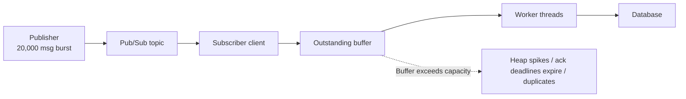
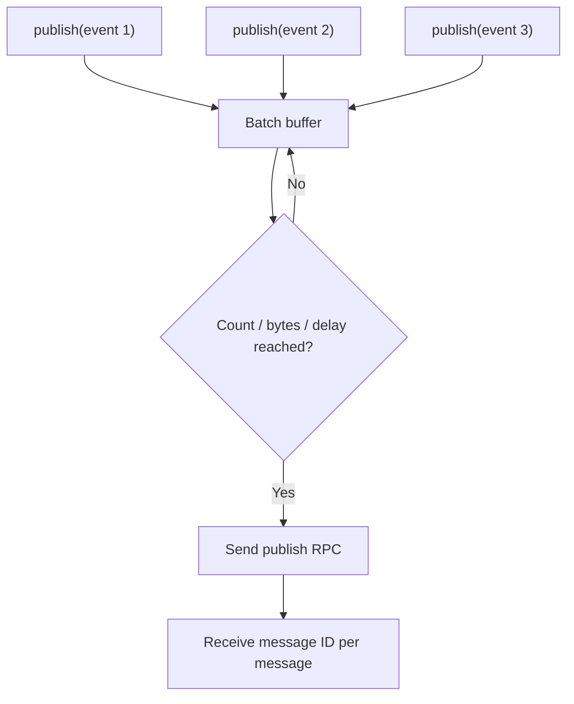

# Receive flow control, batching, and concurrency

## Lesson Objectives

The **SPRING_CLOUD_PROVIDER_INTEGRATION** module practices integrating Spring Boot with managed services from **AWS, Azure, and Google Cloud** using the corresponding Spring Cloud libraries. For messaging, applications must receive and emit messages according to the real capacity of CPU, memory, network, and downstream systems. If Pub/Sub delivers faster than processing capacity, the subscriber can accumulate backlog, miss ack deadlines, and process duplicates; if a publisher generates requests faster than the network can transmit, memory grows and publishes may time out.

This lesson focuses on three cooperating mechanisms:

- **Flow control:** caps the number of outstanding messages and total bytes to regulate receive or publish rates.
- **Batching:** groups multiple published messages into a single batch to reduce RPC overhead.
- **Concurrency:** tunes streaming pull streams and processing threads to increase consumption capacity.

After this lesson, you will be able to:

1. Distinguish subscriber-side and publisher-side flow control.
2. Configure `max-outstanding-element-count` and `max-outstanding-request-bytes` limits.
3. Choose `Block`, `Ignore`, or `ThrowException` based on operational goals.
4. Enable publisher batching and tune message count, byte, and delay thresholds.
5. Distinguish `parallel-pull-count`, `executor-threads`, application instance count, and concurrent in-flight messages.
6. Balance throughput, latency, heap, ack deadlines, and downstream database/API capacity.
7. Design load tests, monitor backlog, and troubleshoot overload conditions.

> **Scope:** Examples use Spring Framework on Google Cloud Pub/Sub Starter and `PubSubTemplate`. Exact properties may vary by BOM; consult the documentation for your project's selected Spring Cloud GCP / Spring Framework on Google Cloud version. Numeric values in examples are starting points for load testing, not production defaults.

## 1. Why is flow regulation needed?

Suppose `order-service` publishes 20,000 messages in a short burst, while `inventory-worker` can only process 2,000 messages per minute. If the subscriber pulls messages without limits, many messages accumulate in memory waiting for workers while the database nears its connection limit.



Flow control bounds the client buffer. When a threshold is reached, the subscriber pauses pulling additional messages until in-flight ones are acked/nacked. On the publisher side, flow control caps messages waiting to be sent/confirmed, preventing unbounded in-memory request buildup.

Batching solves a different problem: publishers can combine multiple messages into one request to cut RPC count and boost throughput. Batching does not replace flow control; if a publisher produces messages faster than it can send them, you still need bounds on outstanding messages/bytes.

Concurrency determines how many streams receive and process messages. Raising concurrency can boost throughput when CPU or worker threads are the bottleneck, yet it can overwhelm downstream databases or APIs. All three mechanisms must be tuned together.

## 2. Subscriber-side flow control

### 2.1. What is an outstanding message?

A message is **outstanding** once the subscriber has received it and before Pub/Sub receives an ack or nack. During this window, the client holds the message and the state needed to process and acknowledge it.

Two primary limits apply:

| Property | Meaning |
| --- | --- |
| `max-outstanding-element-count` | Maximum number of outstanding messages in the subscriber client |
| `max-outstanding-request-bytes` | Maximum total bytes of outstanding messages |

When either threshold is hit, the subscriber client stops pulling more messages until outstanding volume drops. This is client-side backpressure; it does not immediately slow the producer's publish rate, but it prevents the subscriber from ingesting more work than it can handle.

Example: set limits to 100 messages and 10 MiB. If the subscriber receives 100 messages totaling only 2 MiB, the client still pauses. Conversely, if 10 large messages consume 10 MiB, the client also pauses before reaching 100 messages.

### 2.2. Count and byte limits

Limiting only message count is insufficient when message sizes vary widely. 100 small messages might take a few hundred KB, whereas 100 large messages can consume tens of MB.

Memory estimate:

\[
\text{Outstanding bytes} \approx
\text{message count} \times \text{average message size}
\]

This estimates raw payloads only; actual heap usage also includes Java objects, protobufs, callbacks, buffers, metadata, and deserialization copies.

For example, if messages average 64 KiB and the limit is 200 messages:

\[
200 \times 64\text{ KiB} = 12.5\text{ MiB}
\]

If messages can be much larger, the byte limit may trigger before the count limit. Configure both thresholds.

In many Java client versions, both limits default to unbounded if left unconfigured. Therefore, workloads facing traffic bursts or variable payload sizes should set explicit bounds rather than relying on defaults.

### 2.3. Behavior when limits are exceeded

The Java client supports three behaviors:

| Value | Behavior | When appropriate |
| --- | --- | --- |
| `Block` | Waits until capacity frees up before continuing | Background workers, batch processing |
| `ThrowException` | Raises an error when capacity is exceeded | Applications managing their own admission/rejection |
| `Ignore` | Bypasses flow control limits | Primarily debugging; unsuitable for production due to memory growth and RPC failures |

For typical streaming subscribers, `Block` is the easiest to reason about: the client pauses intake until outstanding messages are acked/nacked. `Ignore` disables protection; during traffic spikes, heap growth can trigger process OOM kills.

### 2.4. Configuring subscriber flow control

Example in `application.yml`:

```yaml
spring:
  cloud:
    gcp:
      pubsub:
        subscriber:
          flow-control:
            max-outstanding-element-count: 100
            max-outstanding-request-bytes: 10485760
            limit-exceeded-behavior: Block
```

In this example:

- At most 100 outstanding messages.
- At most roughly 10 MiB of outstanding message bytes.
- When either limit is reached, the subscriber pauses receiving messages.

Base limits on container heap, message size, and processing time. Never copy these values straight into production without load testing.

### 2.5. Flow control is not a Pub/Sub quota

Flow control here is a **client-side** mechanism inside the subscriber library. It does not alter service quotas, restrict how many messages publishers send to a topic, or eliminate server-side backlog. If publish rate persistently exceeds consume rate, subscription backlog still grows; flow control merely stops the subscriber from overloading its own memory.

For temporary rate mismatches, flow control absorbs bursts. For sustained mismatches, scale consumer capacity, optimize processing, or throttle producers.

## 3. Configuring flow control in Spring Boot

### 3.1. Global configuration

Spring Framework on Google Cloud maps these properties to the Java client's `FlowControlSettings`:

```yaml
spring:
  cloud:
    gcp:
      pubsub:
        subscriber:
          parallel-pull-count: 2
          executor-threads: 8
          flow-control:
            max-outstanding-element-count: 100
            max-outstanding-request-bytes: 10485760
            limit-exceeded-behavior: Block
```

| Property | Effect |
| --- | --- |
| `subscriber.parallel-pull-count` | Number of streaming pull workers |
| `subscriber.executor-threads` | Number of executor threads used by factory-created subscribers |
| `subscriber.flow-control.max-outstanding-element-count` | Maximum outstanding messages |
| `subscriber.flow-control.max-outstanding-request-bytes` | Maximum outstanding bytes |
| `subscriber.flow-control.limit-exceeded-behavior` | Behavior when limits are reached |

`parallel-pull-count` and `executor-threads` are related but distinct: one tunes streaming pull streams, while the other tunes executor threads. Actual throughput also depends on flow control, callback duration, and downstream systems.

### 3.2. Per-subscription configuration

If the same application consumes message types with different sizes and processing times, configure per subscription:

```yaml
spring:
  cloud:
    gcp:
      pubsub:
        subscriber:
          parallel-pull-count: 1
          executor-threads: 4
          flow-control:
            max-outstanding-element-count: 50
            max-outstanding-request-bytes: 5242880
        subscription:
          invoice-sub:
            parallel-pull-count: 3
            executor-threads: 8
            flow-control:
              max-outstanding-element-count: 150
              max-outstanding-request-bytes: 20971520
              limit-exceeded-behavior: Block
          notification-sub:
            parallel-pull-count: 1
            executor-threads: 2
            flow-control:
              max-outstanding-element-count: 30
              max-outstanding-request-bytes: 2097152
```

`invoice-sub` may require higher throughput, whereas `notification-sub` may call a slow email API and need a lower outstanding cap. Under auto-configuration, per-subscription settings override global ones. A custom `SubscriberFactory` or manually defined bean can override auto-configuration and prevent properties from taking effect as expected.

### 3.3. Per-subscription configuration may allocate extra thread pools

Spring Framework on Google Cloud documentation notes that setting `executor-threads` per subscription can create thread pools for both global/default and per-subscription configurations. When managing many subscriptions, calculate total threads and memory rather than looking at each subscription in isolation.

Do not spin up numerous subscription-specific executors just to chase throughput. If subscriptions share similar processing profiles, use global settings; split configurations only when workloads genuinely differ.

## 4. Publisher batching

### 4.1. How does batching work?

Publisher batching packs multiple messages into a single publish request instead of sending one RPC per message. A batch flushes whenever any configured threshold is met:

- Batch message count reaches `element-count-threshold`.
- Total request size reaches `request-byte-threshold`.
- Elapsed wait time since the first message was added reaches `delay-threshold-seconds`.



Batching reduces request count and can increase throughput when publishers emit many small messages. In return, the first message in a batch may wait until the batch becomes ready to send, which can raise latency. Batching does not merge multiple events into a single business message and does not make a batch an atomic transaction.

### 4.2. Configuring batching

Example in `application.yml`:

```yaml
spring:
  cloud:
    gcp:
      pubsub:
        publisher:
          batching:
            enabled: true
            element-count-threshold: 100
            request-byte-threshold: 1048576
            delay-threshold-seconds: 0.01
```

In this example, the publisher sends a batch when it reaches 100 messages, roughly 1 MiB, or 10 ms after the first queued message. Effective limits are also bounded by Pub/Sub request/message size limits; never configure batches larger than service limits.

Batching is disabled by default in Spring configuration. Setting thresholds without enabling `publisher.batching.enabled` should not be assumed to turn on batching; verify the property behavior for your exact library version.

### 4.3. Choosing thresholds by goal

| Goal | Adjustment | Trade-off |
| --- | --- | --- |
| High throughput, small messages | Raise count and byte thresholds | Larger batches; higher latency for early batch items |
| Low latency | Lower delay threshold | Smaller batches; more RPCs |
| Large payloads | Watch byte threshold, lower count threshold | Prevents oversized requests and memory spikes |
| Irregular traffic | Use a bounded delay threshold | Low-traffic periods do not stall waiting for count |
| Traffic bursts | Pair batching with publisher flow control | Cuts RPC overhead while bounding buffer memory |

Do not optimize solely for throughput. Measure p50/p95/p99 latency from calling `publish()` until future completion, along with batch sizes and publish error rates.

### 4.4. Batching does not replace per-message outcome handling

`PubSubTemplate.publish()` still returns a `CompletableFuture<String>` per message. Once a batch is sent, each message receives its own publish result/message ID. Applications must observe each future and handle errors; never assume all messages in a batch succeeded just because one future completed.

Do not call `.join()` sequentially on each message if your goal is to benefit from batching. Doing so turns asynchronous publishing synchronous and can prevent the buffer from accumulating enough messages to batch. Instead, track bounded futures, observe outcomes, and use an outbox/retry flow when business reliability requires it.

## 5. Publisher flow control

### 5.1. Why does the publisher also need flow control?

If an application calls `publish()` faster than the publisher client can transmit data, pending messages and outstanding requests pile up in memory. Under overload, heap grows or calls fail with errors like `DEADLINE_EXCEEDED`.

Publisher flow control bounds:

- The number of messages waiting to be sent/acknowledged.
- Total bytes of outstanding messages.

This is a publisher-client limit, distinct from subscriber flow control. It does not limit messages retained on the topic or replace project publish quotas.

### 5.2. Configuring publisher flow control

Publisher flow control properties live under `publisher.batching.flow-control`:

```yaml
spring:
  cloud:
    gcp:
      pubsub:
        publisher:
          batching:
            enabled: true
            element-count-threshold: 100
            request-byte-threshold: 1048576
            delay-threshold-seconds: 0.01
            flow-control:
              max-outstanding-element-count: 500
              max-outstanding-request-bytes: 52428800
              limit-exceeded-behavior: Block
```

In this example, the publisher holds at most 500 messages and roughly 50 MiB of outstanding message bytes before applying flow control. Count and byte limits are independent; whichever triggers first throttles publishing.

### 5.3. Choosing behavior when the publisher buffer fills

| Behavior | Outcome | Notes |
| --- | --- | --- |
| `Block` | Calling thread waits until capacity frees up | Suits background workers; avoid on event loops or latency-sensitive request threads without controlling blocking |
| `ThrowException` | Calls exceeding limits fail immediately with an exception | Suits fail-fast admission control or writing to an outbox for retry |
| `Ignore` | Enforces no limit | Debugging only; risks unbounded buffer and heap growth |

When using `Block`, know which thread invokes `publish()`. If it is a servlet request thread, that thread may stall when the publisher is saturated. Offload publishing to a dedicated worker/outbox with a bounded internal queue and return an appropriate status to callers.

### 5.4. Combining batching and publisher flow control

Batching groups messages for efficient transmission; publisher flow control caps pending messages/bytes. They complement one another:

```text
Application calls publish()
        ↓
Publisher flow control checks capacity
        ↓
Batch buffer collects messages
        ↓
Count / bytes / delay threshold reached
        ↓
Publish RPC
        ↓
Each message future completes with ID or error
```

If batch thresholds are too high while publisher flow control is too low, the publisher may block before a batch can flush. Conversely, if flow control is too permissive, large bursts can still consume excessive heap. Tune both sets of thresholds together and load test with realistic message sizes.

## 6. Concurrency and subscriber capacity

### 6.1. Four levels to distinguish

When scaling processing capacity, four concepts are often conflated:

| Component | Controls | Impact |
| --- | --- | --- |
| Application instances | Number of pods/containers/VMs running subscribers | Scales total processes and resources |
| `parallel-pull-count` | Number of streaming pull workers per subscriber | Increases receive streams from Pub/Sub |
| `executor-threads` | Number of executor threads used by the subscriber | Determines how many callbacks run concurrently within executor capacity |
| Flow control | Max outstanding messages/bytes | Caps work ingested and held in client memory |

You cannot infer real concurrency from a single property. For instance, raising `parallel-pull-count` while leaving flow control at 10 messages still caps outstanding work at 10. Raising executor threads when a database connection pool only has 5 connections merely queues callbacks waiting for connections instead of boosting throughput.

### 6.2. Configuring pull workers and executors

Example:

```yaml
spring:
  cloud:
    gcp:
      pubsub:
        subscriber:
          parallel-pull-count: 2
          executor-threads: 8
          flow-control:
            max-outstanding-element-count: 100
            max-outstanding-request-bytes: 10485760
```

`parallel-pull-count` typically defaults to 1, and `executor-threads` typically defaults to 4 in factory configuration. Check defaults for your exact BOM as library versions can change. Never set either to huge numbers without measuring CPU, heap, connection pools, and downstream latency.

### 6.3. Scaling out multiple instances on one subscription

Multiple subscriber instances can share a subscription to distribute load. As you add instances:

- Pub/Sub distributes messages across active clients.
- Each client maintains its own flow control and buffer.
- Fleet-wide outstanding messages scale with instance count.
- Downstream databases/APIs also receive higher aggregate load.

For example, if each instance allows 100 outstanding messages and you run 10 instances, roughly 1,000 messages may be held across clients depending on timing and distribution. Calculate capacity across the entire fleet, not just one pod.

Scaling out only helps if downstream dependencies have spare headroom. If the database caps out at 500 transactions/sec, scaling from 10 to 50 workers can increase connection contention and retries without increasing throughput.

### 6.4. Estimating initial concurrency

A simple estimate using Little's Law:

\[
\text{Required concurrency} \approx
\text{Arrival rate (messages/sec)} \times
\text{Average processing time (sec)}
\]

For example, if a subscriber must process 40 messages/sec and each takes an average of 0.25 seconds:

\[
40 \times 0.25 = 10
\]

Roughly 10 concurrent tasks is the baseline to sustain that rate in steady state. Add headroom for p95/p99 variance, bursts, retries, and dependency waits. This formula does not directly model overhead, lock contention, or database limits.

### 6.5. Message caching and uneven distribution

Streaming pull can cache messages on the client. In workloads with many small messages that each take a long time to process, one subscriber may pull and hold more messages than others, leading to uneven load distribution despite multiple instances.

Spring Framework on Google Cloud documentation notes this case and suggests **synchronous pull** / `PubSubMessageSource` when more uniform distribution across consumers is needed. This is not faster in every scenario: streaming pull generally suits continuous, high-throughput workloads, whereas synchronous pull helps with batch or small, slow-to-process messages.

### 6.6. Using `PubSubMessageSource` when polling is needed

If the application uses Spring Integration, you can define a pollable source:

```java
@Bean
PubSubMessageSource invoiceMessageSource(PubSubTemplate pubSubTemplate) {
    PubSubMessageSource source =
            new PubSubMessageSource(pubSubTemplate, "invoice-sub");
    source.setAckMode(AckMode.MANUAL);
    source.setPayloadType(String.class);
    source.setBlockOnPull(true);
    source.setMaxFetchSize(50);
    return source;
}
```

Then attach the source to a poller with an appropriate interval. `setMaxFetchSize()` controls how many messages are fetched per poll; `setBlockOnPull(true)` lets pulls wait for messages instead of returning empty immediately. With `AckMode.MANUAL`, the flow must ack/nack the original message after processing.

Avoid overly short synchronous pull polling intervals when unnecessary, as they generate empty requests. Pick poll intervals, batch sizes, and blocking behavior based on target latency and load.

## 7. End-to-end backpressure from API to database

### 7.1. Flow control alone does not protect downstream

Outstanding limits only govern how many messages the client accepts. If each callback spawns unbounded async tasks and acks early, downstream work can exceed flow control. For example, if a callback submits payloads to an unbounded executor, acks immediately, and keeps pulling: Pub/Sub considers messages finished while the internal queue grows unchecked.

Design rules:

- Ack only after essential work completes or is written to a durable queue.
- If handing off to an internal executor, bound the queue and preserve clear handoff semantics.
- Align outstanding caps with worker pools and connection pools.
- When downstream is overloaded, pause pulling or nack/backoff per policy rather than queuing endlessly.

### 7.2. Example message memory budget

Suppose a pod has:

| Component | Assumed limit |
| --- | ---: |
| Heap allocated for messages/callbacks | 256 MiB |
| Reserve for framework and business objects | 128 MiB |
| Remaining capacity for outstanding payloads | 128 MiB |
| Average message size | 64 KiB |

Rough message-count estimate:

\[
128\text{ MiB} / 64\text{ KiB} = 2048\text{ messages}
\]

Do not set flow control to the full 2,048 messages because payloads incur object overhead, byte copies, JSON DTOs, and size variance. Start substantially lower, monitor heap/GC, and raise gradually during load tests. Set byte limits well below the theoretical heap budget too.

### 7.3. Coordinating with the database connection pool

If each callback requires a database connection, processing concurrency should not greatly exceed available connections plus bounded wait capacity. For instance, if the pool has 20 connections while the subscriber allows 500 concurrent callbacks, most callbacks simply wait for connections, holding messages outstanding and raising deadline expiration risk.

Measure:

- Active/idle/pending database connections.
- Connection acquisition wait time.
- Transaction duration and lock waits.
- Subscriber processing latency.
- Ack deadline expirations and redeliveries.

If the connection pool is the bottleneck, adding pull workers will not raise throughput. Optimize queries/transactions or scale database capacity before raising subscriber concurrency.

## 8. Tuning workflow with load tests

### 8.1. Define targets before tweaking settings

Do not start by cranking up `parallel-pull-count` or batching. First establish:

- Normal steady publish rate and peak burst rate (messages/sec).
- Average, p95, and maximum message sizes.
- p50/p95/p99 processing latency.
- Target subscriber throughput.
- Maximum acceptable backlog and time to drain it.
- Limits for heap, CPU, database connections, and downstream APIs.
- End-to-end SLO from publish to business completion.

Example targets:

| Metric | Hypothetical target |
| --- | ---: |
| Publish steady rate | 500 msg/s |
| Burst | 1,500 msg/s for 2 minutes |
| Message size p95 | 32 KiB |
| Subscriber throughput | At least 600 msg/s |
| Processing latency p95 | Under 2 seconds |
| Ack deadline expiration | Near 0 under normal load |
| Heap | Under 70% of container limit |

These are synthetic lab numbers; derive real workloads from production telemetry or product requirements.

### 8.2. Test matrix

Change one configuration group per test run so you can isolate what caused any difference:

| Run | Subscriber flow control | Pull workers / executor | Publisher batching | Purpose |
| --- | --- | --- | --- | --- |
| A | Low limits | 1 / 4 | Disabled | Baseline, locate bottleneck |
| B | Moderate count/bytes increase | Unchanged | Disabled | Measure subscriber buffer impact |
| C | Keep flow control | Increase pull workers | Disabled | Measure pull stream impact |
| D | Keep flow control | Increase executor threads | Disabled | Measure callback concurrency impact |
| E | Keep subscriber config | Unchanged | Enable small batches | Measure publisher throughput/latency |
| F | Keep subscriber config | Unchanged | Larger batches | Find throughput saturation and latency inflection |

Then test scaling out instance counts. Never change every setting at once, or diagnosing results becomes guesswork.

### 8.3. Required load scenarios

1. **Steady load:** publish steadily long enough to observe stable throughput.
2. **Burst load:** publish faster than consumption for a window, then return to baseline.
3. **Large payloads:** increase message sizes to validate byte limits and heap behavior.
4. **Slow consumer:** intentionally slow handlers to verify flow control and deadlines.
5. **Downstream degradation:** slow down or inject transient errors into sandbox databases/APIs.
6. **Scale out/in:** add and remove instances to verify load balancing and draining.
7. **Recovery:** restore dependencies after a burst and measure backlog drain time.

Never inject faults against production dependencies or real customer data during load tests. Use isolated sandbox projects, subscriptions, databases, and APIs.

### 8.4. Acceptance criteria

A configuration passes when:

- Target throughput is met without unbounded backlog growth.
- p95/p99 processing latency stays within SLO.
- Heap/GC/CPU retain healthy headroom.
- Database pools show no sustained connection wait queues.
- `expired_ack_deadlines_count` does not climb continuously.
- Duplicates/redeliveries are handled idempotently.
- Publishers do not accumulate unbounded futures/message buffers.
- Post-burst backlog drains within the target window.

## 9. Metrics and operational observability

### 9.1. Subscription-side metrics

Monitor Cloud Monitoring and application metrics:

| Metric | Meaning | How to use |
| --- | --- | --- |
| `subscription/num_unacked_messages_by_region` | Unacknowledged messages per region | Track current backlog |
| `subscription/oldest_unacked_message_age_by_region` | Age of oldest unacknowledged message | Detect lagging consumers or stuck messages |
| `subscription/expired_ack_deadlines_count` | Ack deadline expirations for pull subscribers | Spot slow processing, overload, or failed lease extensions |
| `subscription/delivery_latency_health_score` | Delivery latency health score | Monitor conditions affecting delivery latency |
| `subscription/dead_letter_message_count` | Messages forwarded to DLQ | Detect poison messages or sustained failures |

Metric names and labels can vary by subscription type and service version; consult the Cloud Monitoring metric catalog when building dashboards.

### 9.2. Publisher and application metrics

Beyond Pub/Sub metrics, instrument applications to track:

- `publish()` calls per second.
- Pending publish futures.
- Publish success/failure counts and latency to future completion.
- Messages/bytes per batch where observable.
- Publisher flow control blocks or thrown exceptions.
- Active subscriber callbacks and processing durations.
- Estimated outstanding messages from client settings and app telemetry.
- Internal queue depth, heap, GC pauses, CPU, and database pool saturation.

Never attach raw payloads or secrets as metric labels. Use controlled dimensions like topic/subscription, event type, and error class; avoid high-cardinality labels like `eventId` or `customerId`.

### 9.3. Dashboards and alerts

Dashboards should cover at least four groups:

1. **Ingress:** publish rate, publish latency, publish errors.
2. **Backlog:** unacked messages, oldest unacked age, backlog drain rate.
3. **Processing:** handler throughput, p95/p99 processing time, nacks, deadline expirations, DLQ.
4. **Resources:** CPU, heap, GC, active threads, database pools, downstream latency.

Base alerts on trends and sustained windows rather than single brief spikes—for example, backlog and oldest age climbing together for several minutes, concurrent deadline expirations, or elevated publisher error rates. Tune thresholds to SLOs and on-call response capacity.

## 10. Troubleshooting bottlenecks

### 10.1. Backlog rising, subscriber CPU low

Likely constrained by concurrency/flow control or waiting on I/O dependencies:

1. Check executor threads and pull worker counts.
2. Check database connection wait times and downstream latency.
3. If workers are idle and dependencies have headroom, increase concurrency step by step.
4. If flow control is too restrictive, moderately raise count/bytes limits.
5. Re-measure p95/p99 latency and deadline expirations.

### 10.2. Backlog rising, CPU/heap high

Likely subscriber overload:

1. Lower outstanding message limits if heap/GC is under pressure.
2. Lower concurrency if CPU contention or downstream saturation occurs.
3. Optimize deserialization, business handlers, and database transactions.
4. Scale out if individual instances are near optimal utilization.
5. Check whether message sizes and payloads are unexpectedly large.

### 10.3. High publish latency while subscribers have spare capacity

Inspect the publisher:

1. Verify network, region/endpoint, and publish errors.
2. Enable batching if traffic justifies it and the latency budget allows.
3. Tune count/bytes/delay thresholds incrementally.
4. Configure publisher flow control to bound buffering.
5. Monitor pending futures and completion times.

### 10.4. Deadline expirations rise after increasing concurrency

Raising concurrency lets handlers accept more messages, which can trigger CPU or database contention. Check:

- Did outstanding messages exceed worker capacity?
- Did database pool wait queues or transaction durations grow?
- Is `max-ack-extension-period` sufficient for valid p99 durations?
- Are callbacks handing work to internal executors and acking too early?
- Are poison messages or hot ordering keys stalling queues?

Never solve every deadline expiration merely by lengthening leases. When overload is the cause, reduce outstanding work or add real processing capacity.

## 11. Common configuration mistakes

| Symptom | Possible cause | Resolution |
| --- | --- | --- |
| Heap spikes during traffic bursts | Unbounded flow control or `Ignore` | Set count/byte limits with `Block` or `ThrowException` |
| Subscriber stops pulling messages | Flow control blocking on unacked/unnacked outstanding messages | Inspect callbacks, ack/nack futures, and downstream latency |
| Raising `parallel-pull-count` yields no throughput gain | Executor, DB, or downstream is the bottleneck | Measure each tier and scale the constrained resource |
| Many threads waiting for DB connections | Executor larger than DB pool | Align concurrency with connection pool size |
| Publisher buffer grows | Publish rate exceeds send rate without flow control | Configure publisher flow control, batching, and bounded producer queues |
| Publish latency rises after enabling batching | Delay/count thresholds too high or sparse traffic | Lower delay threshold and balance latency vs. throughput |
| Publishes block for long periods | Publisher flow control uses `Block` on request threads | Move publishing to a worker/outbox with bounded queues |
| Uneven subscriber load distribution | Streaming pull message caching with small, slow messages | Evaluate synchronous pull / `PubSubMessageSource` and re-measure |
| `DEADLINE_EXCEEDED` during publish bursts | Too many outstanding publish requests or network saturation | Use publisher flow control, batching, and producer rate limits |
| Backlog stays flat after scaling out | Downstream or hot key bottleneck | Optimize downstream, inspect ordering keys and transactions |

## 12. Hands-on exercise

An invoicing system consumes `InvoiceCreated` from topic `invoices`. Messages average 48 KiB with p95 processing at 800 ms; the test database handles roughly 40 transactions/sec. During peak hours, publishers emit 100 messages/sec for 3 minutes, versus 25 messages/sec normally.

### Requirements

1. Configure subscriber flow control by both count and bytes; explain why both limits are required.
2. Choose initial `parallel-pull-count` and `executor-threads`, estimating concurrency from arrival rate and processing time.
3. Ensure subscriber concurrency does not push the database past 40 transactions/sec.
4. Enable publisher batching and pick count/bytes/delay thresholds matching your latency budget.
5. Configure publisher flow control to cap pending outbound messages/bytes.
6. Run steady load at 25 msg/s and bursts at 100 msg/s in a sandbox.
7. Measure backlog, oldest unacked age, deadline expirations, heap, CPU, and database pool metrics.
8. Experiment with raising pull workers, executor threads, and instance counts one at a time.
9. Test larger payloads to verify byte-based flow control.
10. Compare streaming pull with `PubSubMessageSource` when many small messages require slow processing.

### Evaluation matrix

| Scenario | Expected outcome |
| --- | --- |
| Steady 25 msg/s traffic | Subscriber keeps up smoothly without sustained backlog growth |
| 100 msg/s burst | Buffers stay bounded and heap does not grow unbounded |
| 48 KiB p95 messages | Byte limit triggers cleanly before heap exhaustion |
| Database reaches capacity | Subscriber does not create an unbounded internal queue |
| Publisher burst | Batching reduces RPC overhead; flow control caps pending publishes |
| Scale out | Throughput increases while downstream has headroom |
| Slow dependency | Backlog grows under control without cascading deadline expirations |
| Post-burst | Backlog drains within the target window |

### Completion criteria

- Distinguishes publisher vs. subscriber flow control.
- Explains the three batching thresholds and the latency/throughput trade-off.
- Distinguishes `parallel-pull-count`, `executor-threads`, and instance count.
- Configures global/per-subscription settings and publisher flow control.
- Provides load-test measurements and bottleneck analysis.
- Prevents unbounded internal queues or outstanding message growth.

## 13. Comparison with AWS and Azure

All cloud providers offer buffer limits or consumer throttling, though naming and configuration points vary:

| Goal | Google Cloud Pub/Sub | AWS | Azure |
| --- | --- | --- | --- |
| Subscriber flow control | `maxOutstandingElementCount`, `maxOutstandingRequestBytes` in Java client | SQS consumer concurrency, batch size, visibility timeout, and poller limits | Service Bus processor `MaxConcurrentCalls`, `PrefetchCount` |
| Publisher batching | Pub/Sub Java publisher batching settings | SDK batching for SNS/SQS/EventBridge per service/client | Service Bus sender batching |
| Publisher buffer limits | Publisher flow control by outstanding count/bytes | Client-side buffering, request/concurrency limits | Sender/processor client options and bounded queues |
| Consumer scaling | Multiple subscriber instances on one subscription | Multiple SQS pollers/consumers on one queue | Multiple Service Bus processors/receivers |
| Backpressure | Client flow control + pausing streaming pull | Tuning pollers, batch sizes, visibility timeouts, and worker pools | Prefetch/concurrency, lock duration, and worker pools |

Do not mechanically translate `parallel-pull-count` into another provider's property. When migrating across clouds, preserve operational goals (bounded memory, throughput, latency, downstream capacity) and redesign according to the target SDK and service semantics.

## Summary

Flow control protects clients from ingesting or queuing more messages than they can hold and process. On subscribers, outstanding count/byte caps regulate received messages awaiting ack/nack. On publishers, flow control bounds messages/bytes awaiting transmission. Batching packs multiple messages into single requests to improve RPC efficiency, trading potentially higher latency while waiting for count, byte, or delay thresholds.

`parallel-pull-count`, `executor-threads`, instance counts, and flow control tune distinct layers; raising one setting will not improve throughput if downstream databases or APIs are saturated. Guide tuning with load tests, measuring backlog, oldest unacked age, deadline expirations, publish latency, heap, CPU, and connection pools. For sustained high traffic, scale or optimize real processing capacity instead of merely enlarging buffers.

## References

- [Spring Framework on Google Cloud — Pub/Sub configuration](https://googlecloudplatform.github.io/spring-cloud-gcp/reference/html/pubsub.html) — subscriber parallel pull, executor threads, publisher batching, and flow-control properties.
- [Spring Framework on Google Cloud — Pollable Message Source](https://googlecloudplatform.github.io/spring-cloud-gcp/reference/html/index.html) — synchronous pull, `PubSubMessageSource`, block-on-pull, and fetch size.
- [Google Cloud Pub/Sub — Handle transient spikes with flow control](https://docs.cloud.google.com/pubsub/docs/flow-control) — subscriber flow control, outstanding messages/bytes, and scaling.
- [Google Cloud Pub/Sub — Publish messages with flow control](https://docs.cloud.google.com/pubsub/docs/flow-control-messages) — publisher flow control and batching.
- [Google Cloud Java — FlowControlSettings](https://docs.cloud.google.com/java/docs/reference/gax/latest/com.google.api.gax.batching.FlowControlSettings) — count, bytes, and limit-exceeded behaviors.
- [Google Cloud Pub/Sub — Monitor Pub/Sub](https://docs.cloud.google.com/pubsub/docs/monitoring) — backlog, oldest unacked age, and deadline expiration metrics.
- [Google Cloud Pub/Sub — Subscriber client library](https://docs.cloud.google.com/pubsub/docs/subscriber) — streaming pull, concurrency, and acknowledgment.
