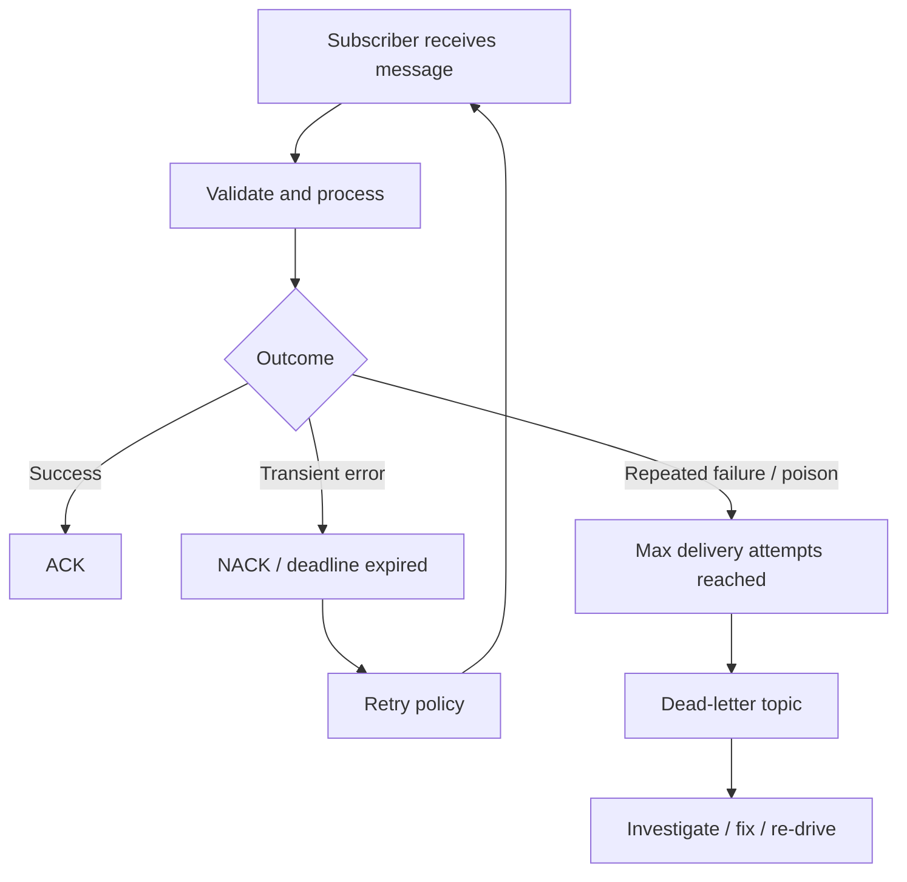
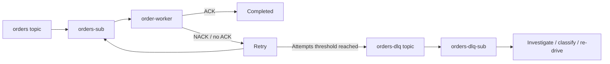

# Retry policy, dead-letter topics, and message replay

## Lesson Objectives

The **SPRING_CLOUD_PROVIDER_INTEGRATION** module practices integrating Spring Boot with managed services from **AWS, Azure, and Google Cloud** using the corresponding Spring Cloud libraries. In event-driven systems, messages can fail due to transient dependencies, malformed payloads, unsupported schemas on the consumer side, or code bugs. Applications need a retry strategy, a place to hold unprocessable messages, and a safe way to replay them once the issue is resolved.

In Google Cloud Pub/Sub, three related mechanisms serve distinct purposes:

- **Retry policy:** determines how long Pub/Sub waits before redelivering an unacknowledged message.
- **Dead-letter topic (DLQ):** destination where Pub/Sub forwards messages that failed repeatedly, for separate investigation and handling.
- **Replay (seek):** alters a subscription's acknowledgment state to replay acknowledged messages or skip part of a backlog.

After this lesson, you will be able to:

1. Distinguish between immediate retry and exponential backoff.
2. Configure subscription retry policies via the Google Cloud CLI.
3. Create a dead-letter topic, attach it to a subscription, and grant IAM permissions to the Pub/Sub service agent.
4. Inspect delivery attempts and metadata on messages forwarded to a DLQ.
5. Design a quarantine, investigation, and message re-drive workflow.
6. Create snapshots and use seek to replay messages by snapshot or timestamp.
7. Distinguish replay via seek from republishing messages from a DLQ.
8. Integrate retry/DLQ handling into Spring Boot, monitor operations, and test failure scenarios.

## 1. Classifying message-processing errors

Before configuring retries, separate transient errors from failures that redelivery cannot fix on its own:

| Error category | Examples | Handling approach |
| --- | --- | --- |
| Transient | Database timeout, HTTP 503, rate limit | Nack and retry with backoff |
| Dependency unavailable | Downstream service deploying or unreachable | Bounded retries, alert on dependency |
| Invalid data | Malformed JSON, missing required field | Quarantine/DLQ; do not retry forever |
| Schema incompatibility | Consumer does not yet support a new `schemaVersion` | DLQ or retain to process after updating consumer |
| Permanent business error | Order already cancelled, invalid state transition | Handle per business rule, then ack or quarantine |
| Code bug | Null pointer, bug triggered by a specific event | DLQ for investigation and hotfix release |

Retries suit errors likely to clear after a short delay. If a message is malformed or crashes the code identically every time, immediate redelivery wastes resources in a tight loop. A DLQ isolates those messages so the main consumer continues processing healthy traffic.



## 2. Subscription retry policies

### 2.1. Retry is default behavior

Pub/Sub automatically attempts to redeliver messages when subscribers fail to acknowledge them. A retry policy belongs to the **subscription**; you do not toggle redelivery on or off, though you can choose how long to wait before the next delivery attempt.

Two primary modes:

| Type | Behavior | Default |
| --- | --- | --- |
| Immediate redelivery | Attempts redelivery as soon as possible after nack or ack deadline expiration | Yes |
| Exponential backoff | Gradually increases wait time between failed deliveries of the same message | No |

Immediate redelivery works for ultra-brief glitches, but if a database or downstream API has a sustained outage, subscribers receive failed messages continuously. Many failing messages at once can trigger a retry storm and hinder dependency recovery.

### 2.2. Exponential backoff

Exponential backoff inserts progressively longer waits between failed deliveries:

```text
Initial delivery fails
        ↓
Wait min retry delay
        ↓
Fails again
        ↓
Increase wait interval
        ↓
Keep increasing up to max retry delay
```

Configuration bounds:

| Property | Value |
| --- | --- |
| Default minimum retry delay | 10 seconds |
| Default maximum retry delay | 600 seconds |
| Valid configurable range | 0 to 600 seconds |

Exponential backoff applies per message, not as a subscription-wide pause. Other messages continue being delivered while one message waits for retry, unless ordered delivery ties messages sharing an ordering key together.

Backoff triggers when:

- The subscriber sends a negative acknowledgment (nack).
- The message's ack deadline expires.

Delays are best-effort; actual redelivery timing may differ from configured values. Never use retry policies to schedule business delivery for a specific future time. For scheduled delivery, evaluate Cloud Tasks.

### 2.3. Configuring when creating a subscription

Create a topic and a subscription with exponential backoff:

```bash
gcloud pubsub topics create orders

gcloud pubsub subscriptions create orders-sub \
  --topic=orders \
  --min-retry-delay=10s \
  --max-retry-delay=300s
```

This example sets a 10-second minimum and a 5-minute maximum delay. The account running these commands needs permission to manage topics/subscriptions in the project.

### 2.4. Updating retry policy on an existing subscription

You can update the policy without recreating the subscription:

```bash
gcloud pubsub subscriptions update orders-sub \
  --min-retry-delay=15s \
  --max-retry-delay=300s
```

To revert to immediate redelivery, clear the retry delay settings using the corresponding clear flags in `gcloud pubsub subscriptions update` for your CLI version. Before modifying production, inspect `gcloud pubsub subscriptions describe orders-sub` to confirm the active policy.

### 2.5. Retry policy and push backoff

For push subscriptions, Pub/Sub also applies **push backoff** when the endpoint returns an error or times out. Push backoff is independent of the subscription retry policy. When both are configured, total wait time is influenced by both; when push backoff exceeds retry backoff, redelivery may wait for push backoff.

When investigating slow push delivery, check the endpoint's HTTP responses/timeouts, push backoff, and the retry policy together. Do not simply tweak exponential backoff without verifying whether the endpoint is continuously returning errors.

### 2.6. Retries do not solve every failure

- Bulk-nacking messages can cause Pub/Sub to throttle subscription delivery, and some messages may not receive the full configured backoff.
- Exponential backoff is best-effort, not an exact timer.
- Retries do not guarantee once-only processing.
- Publisher RPC retry is a separate mechanism: it retries publish calls on transient network/client errors. A publish that succeeded before its response was lost can create a duplicate message with a different message ID.

Consumers still require idempotency keyed by a business event ID.

## 3. What is a dead-letter topic?

### 3.1. DLQs isolate failing messages from the main flow

A dead-letter topic receives messages that a subscriber fails to process after multiple deliveries. You configure a DLQ on the **subscription**, not the source topic, because each subscription has its own error-handling policy.



When Pub/Sub forwards a message to a DLQ:

- The message is published to the dead-letter topic as a new message.
- Pub/Sub adds attributes identifying the source subscription and delivery count.
- The source message is removed from the original subscription once forwarded.
- A dedicated subscription on the DLQ topic lets a consumer inspect or handle failed messages.

A DLQ topic should have a subscription attached. Messages published to a topic with no subscription may not be retained for processing.

### 3.2. Delivery attempts

The `maxDeliveryAttempts` property has the following bounds:

| Property | Value |
| --- | --- |
| Default | 5 |
| Minimum | 5 |
| Maximum | 100 |

Delivery attempts are approximated as: **1 + total NACKs + total ack deadline expirations**. Pub/Sub tracks attempts only when a DLQ is properly configured with valid IAM permissions. DLQ forwarding remains best-effort:

- A message may forward earlier than the configured count.
- A message may undergo a few extra attempts before forwarding.
- Delivery attempt tracking can reset, especially when a pull subscription has no active subscribers.

Therefore, do not rely on `maxDeliveryAttempts` as an exact counter or business condition. It is an operational threshold to isolate failing messages.

### 3.3. Choosing delivery attempt counts

| Workload type | Starting reference | Rationale |
| --- | ---: | --- |
| Events calling fast-recovering dependent APIs | 5–8 | Caps retries before isolation |
| Jobs depending on databases with brief maintenance | 8–12 | Allows more retry attempts |
| Payloads prone to schema errors on producer bugs | 5 | Quickly routes poison messages to DLQ |
| Tasks needing operational intervention | 5–10 | Avoids prolonged loops and improves visibility |

These are starting points for design, not universal defaults. Factor in retry backoff, dependency recovery times, retention, and processing SLOs.

## 4. Creating and configuring a dead-letter topic

### 4.1. Creating the DLQ topic and subscription

Create the DLQ topic and subscription before attaching the policy to the source subscription:

```bash
gcloud pubsub topics create orders-dlq

gcloud pubsub subscriptions create orders-dlq-sub \
  --topic=orders-dlq
```

`orders-dlq-sub` is where the operational consumer reads forwarded messages. Without a subscription on the DLQ topic, messages published there may not be retained for investigation/re-drive.

### 4.2. Attaching the DLQ to the source subscription

Create a new subscription with retry and dead-letter policies:

```bash
gcloud pubsub subscriptions create orders-sub \
  --topic=orders \
  --min-retry-delay=10s \
  --max-retry-delay=300s \
  --dead-letter-topic=orders-dlq \
  --max-delivery-attempts=8
```

If the subscription already exists:

```bash
gcloud pubsub subscriptions update orders-sub \
  --min-retry-delay=10s \
  --max-retry-delay=300s \
  --dead-letter-topic=orders-dlq \
  --max-delivery-attempts=8
```

The DLQ topic must differ from the topic the source subscription consumes. If the DLQ topic resides in another project, specify its owning project with `--dead-letter-topic-project`.

### 4.3. Granting permissions to the Pub/Sub service agent

This step is mandatory. Pub/Sub requires two permissions to forward messages:

1. `roles/pubsub.publisher` on the DLQ topic to publish forwarded messages.
2. `roles/pubsub.subscriber` on the source subscription to ack messages after forwarding.

The Pub/Sub service agent for the project owning the subscription has the form:

```text
service-PROJECT_NUMBER@gcp-sa-pubsub.iam.gserviceaccount.com
```

Retrieve the project number:

```bash
gcloud projects describe acme-commerce-dev \
  --format="value(projectNumber)"
```

After substituting `PROJECT_NUMBER` with the returned value:

```bash
PUBSUB_SERVICE_ACCOUNT="service-PROJECT_NUMBER@gcp-sa-pubsub.iam.gserviceaccount.com"

gcloud pubsub topics add-iam-policy-binding orders-dlq \
  --member="serviceAccount:${PUBSUB_SERVICE_ACCOUNT}" \
  --role="roles/pubsub.publisher"

gcloud pubsub subscriptions add-iam-policy-binding orders-sub \
  --member="serviceAccount:${PUBSUB_SERVICE_ACCOUNT}" \
  --role="roles/pubsub.subscriber"
```

If the DLQ topic is in another project, grant `roles/pubsub.publisher` on the topic in the DLQ project; the subscriber role is still granted on the source subscription. In cross-project setups, verify the service agent belongs to the project owning the source subscription.

Do not grant these roles to `order-worker`'s runtime service account; they belong to the Pub/Sub service agent. Runtime consumers only need consume permission on their own subscription.

### 4.4. Example creating a subscription with `PubSubAdmin`

A Spring application can provision subscriptions with `PubSubAdmin`:

```java
import com.google.cloud.spring.pubsub.core.PubSubAdmin;
import com.google.pubsub.v1.DeadLetterPolicy;
import com.google.pubsub.v1.Subscription;
import org.springframework.stereotype.Component;

@Component
public class PubSubProvisioner {
    private final PubSubAdmin pubSubAdmin;

    public PubSubProvisioner(PubSubAdmin pubSubAdmin) {
        this.pubSubAdmin = pubSubAdmin;
    }

    public void createOrdersSubscription() {
        String deadLetterTopic =
                "projects/acme-commerce-dev/topics/orders-dlq";

        Subscription subscription = Subscription.newBuilder()
                .setName("projects/acme-commerce-dev/subscriptions/orders-sub")
                .setTopic("projects/acme-commerce-dev/topics/orders")
                .setDeadLetterPolicy(
                        DeadLetterPolicy.newBuilder()
                                .setDeadLetterTopic(deadLetterTopic)
                                .setMaxDeliveryAttempts(8)
                                .build()
                )
                .build();

        pubSubAdmin.createSubscription(subscription);
    }
}
```

This example targets resources in the configured project. In production, prefer Terraform or infrastructure pipelines to control IAM and resource changes. If provisioning in application code, handle `ALREADY_EXISTS`, fully qualified resource names, and appropriate administrative permissions; do not grant `Pub/Sub Editor` to every runtime service just to create subscriptions.

### 4.5. Verifying the configuration

After setting policies and permissions:

```bash
gcloud pubsub subscriptions describe orders-sub
gcloud pubsub topics get-iam-policy orders-dlq
gcloud pubsub subscriptions get-iam-policy orders-sub
```

Verify:

- `deadLetterPolicy.deadLetterTopic` points to the right DLQ topic.
- `maxDeliveryAttempts` is between 5 and 100.
- The Pub/Sub service agent has the publisher role on the DLQ topic.
- The Pub/Sub service agent has the subscriber role on the source subscription.
- The DLQ topic has a subscription for an operational consumer to read messages.

## 5. Tracking delivery attempts and forwarded messages

### 5.1. Delivery attempts on the subscriber

When a subscription has a dead-letter policy, Pub/Sub surfaces delivery count info:

- Pull API includes `delivery_attempt`.
- Push delivery includes `deliveryAttempt`.
- In Java and C# client libraries, the delivery attempt count is exposed in message attribute `googclient_deliveryattempt`.

Example reading from `PubSubTemplate`:

```java
pubSubTemplate.subscribe("orders-sub", message -> {
    String attempt = message.getPubsubMessage()
            .getAttributesOrDefault("googclient_deliveryattempt", "unknown");

    String eventId = message.getPubsubMessage()
            .getAttributesOrDefault("eventId", "unknown");

    log.info("Received order event; deliveryAttempt={}, eventId={}",
            attempt, eventId);

    // Execute business logic, then ack/nack.
});
```

Delivery attempt may be absent if no DLQ is configured or if a client does not populate the field. Treat it as observability data, not an exact counter, because tracking can reset and forwarding is best-effort.

### 5.2. Attributes added when forwarding to a DLQ

Pub/Sub attaches the following attributes to forwarded messages:

| Attribute | Meaning |
| --- | --- |
| `CloudPubSubDeadLetterSourceDeliveryCount` | Number of deliveries to the source subscription |
| `CloudPubSubDeadLetterSourceSubscription` | Source subscription name |
| `CloudPubSubDeadLetterSourceSubscriptionProject` | Project containing the source subscription |
| `CloudPubSubDeadLetterSourceTopicPublishTime` | Original message publish timestamp |
| `CloudPubSubDeadLetterSourceDeliveryErrorMessage` | Delivery failure reason; present only on export subscriptions |

A forwarded message is a new message, so never use the DLQ's `messageId` as a substitute for a business `eventId`. Keep the event ID in the payload/attributes for source correlation, deduplication, and re-drive.

### 5.3. Reading messages from the DLQ subscription

A DLQ consumer should serve dedicated investigation and operations. Example:

```java
pubSubTemplate.subscribe("orders-dlq-sub", message -> {
    var pubsubMessage = message.getPubsubMessage();
    var attributes = pubsubMessage.getAttributesMap();

    String sourceSubscription =
            attributes.get("CloudPubSubDeadLetterSourceSubscription");
    String deliveryCount =
            attributes.get("CloudPubSubDeadLetterSourceDeliveryCount");
    String eventId =
            attributes.getOrDefault("eventId", "unknown");

    log.warn(
            "Dead-letter event received; sourceSubscription={}, attempts={}, eventId={}",
            sourceSubscription, deliveryCount, eventId
    );

    // Persist investigation record durably before ACKing the DLQ message.
    deadLetterRegistry.record(pubsubMessage, attributes);
    message.ack();
});
```

`deadLetterRegistry.record()` is an application component you implement to persist metadata/payloads in compliance with security policies. Ack the DLQ message only after durable persistence or handoff to another workflow. Acking the DLQ message before recording the failure risks losing operational audit trails if registry persistence fails.

### 5.4. Monitoring DLQs

Cloud Monitoring provides the metric:

```text
subscription/dead_letter_message_count
```

This metric counts messages forwarded by Pub/Sub from the source subscription. Monitor it alongside:

- Source subscription backlog and oldest unacked age.
- Nack counts and ack deadline expirations.
- Message count on `orders-dlq-sub`.
- Processing rate and message age in the DLQ.
- Service agent permission errors.

When DLQ counts spike, inspect consumer versions, producer schemas, dependencies, and IAM. Never just raise `maxDeliveryAttempts` to hide failures.

## 6. Re-driving messages from a DLQ

### 6.1. DLQs do not auto-fix or auto-replay messages

A DLQ isolates unprocessable messages. Pub/Sub does not inspect failure causes, repair payloads, or return messages to the source topic after forwarding. Operators must diagnose the root cause, decide remediation, and choose whether to replay.

A controlled re-drive workflow:

1. `orders-dlq-sub` consumer reads messages and source metadata.
2. Persist an investigation record with event ID, source subscription, delivery count, publish time, and error classification.
3. Identify root cause: consumer bug, schema incompatibility, bad data, or dependency outage.
4. Fix the consumer/configuration or normalize the payload through an approved process.
5. Select a targeted subset of messages to re-drive rather than blindly replaying the entire DLQ.
6. Republish the business payload to the source topic or a dedicated retry topic.
7. Preserve the business `eventId` so consumers remain idempotent.
8. Ack the DLQ message only after the investigation record and re-drive outcome are durably saved.

### 6.2. Distinguishing message ID from event ID

When Pub/Sub forwards a message, the DLQ entry is a new message and may receive a new message ID. Re-driving by republishing the payload assigns yet another new message ID. Therefore:

- `messageId` identifies a specific publish attempt.
- Application-generated `eventId` identifies the same logical event.
- `CloudPubSubDeadLetterSourceSubscription` identifies which subscription failed.
- `CloudPubSubDeadLetterSourceDeliveryCount` helps investigate delivery attempts.

Do not generate a fresh `eventId` when re-driving the same logical event. If a payload is intentionally modified, store a link between the original event and the normalized event for auditing.

### 6.3. Do not blindly re-drive every message

A safe re-drive process needs:

- **Allowlist:** select only event types/schema versions whose fixes are deployed.
- **Rate limit:** publish at a pace consumers and downstream systems can absorb.
- **Small batches:** start with a small batch, observe, then scale up.
- **Idempotency:** identical event IDs never repeat side effects.
- **Audit:** record initiator/automation, timestamp, count, and outcome.
- **Stop condition:** halt if DLQ counts rise again, error rates spike, or backlog crosses thresholds.

If a message failed due to unrecoverable data, retain it in DLQ/quarantine for manual resolution or mark it unrecoverable per data policy. Never create an infinite loop republishing broken messages back to the source topic.

### 6.4. Example re-drive service design

Reading from a DLQ and republishing requires a decoder aware of the forwarded message format. Separate this logic from the Pub/Sub callback:

```java
public record DeadLetterRecord(
        String eventId,
        String sourceSubscription,
        String sourceProject,
        String deliveryCount,
        byte[] originalPayload,
        Map<String, String> originalAttributes
) {}

public interface DeadLetterDecoder {
    DeadLetterRecord decode(PubsubMessage message);
}
```

Re-drive service:

```java
import com.google.cloud.spring.pubsub.core.PubSubTemplate;
import com.google.cloud.spring.pubsub.support.BasicAcknowledgeablePubsubMessage;
import com.google.pubsub.v1.PubsubMessage;
import java.util.HashMap;
import java.util.Map;
import org.springframework.stereotype.Service;

@Service
public class OrderDeadLetterRedriver {
    private final PubSubTemplate pubSubTemplate;
    private final DeadLetterDecoder decoder;
    private final DeadLetterRegistry registry;

    public OrderDeadLetterRedriver(
            PubSubTemplate pubSubTemplate,
            DeadLetterDecoder decoder,
            DeadLetterRegistry registry) {
        this.pubSubTemplate = pubSubTemplate;
        this.decoder = decoder;
        this.registry = registry;
    }

    public void redrive(BasicAcknowledgeablePubsubMessage dlqMessage) {
        DeadLetterRecord record = decoder.decode(dlqMessage.getPubsubMessage());

        registry.markRedriveStarted(
                record.eventId(),
                record.sourceSubscription(),
                record.deliveryCount()
        );

        Map<String, String> attributes =
                new HashMap<>(record.originalAttributes());
        attributes.put("redriven", "true");
        attributes.put("redriveSource", record.sourceSubscription());

        pubSubTemplate.publish(
                "orders",
                record.originalPayload(),
                attributes
        ).whenComplete((messageId, publishError) -> {
            if (publishError != null) {
                registry.markRedriveFailed(record.eventId(), publishError);
                return;
            }

            registry.markRedrivePublished(record.eventId(), messageId);
            dlqMessage.ack().whenComplete((unused, ackError) -> {
                if (ackError != null) {
                    registry.markDlqAckFailed(record.eventId(), ackError);
                }
            });
        });
    }
}
```

`DeadLetterDecoder` and `DeadLetterRegistry` are application components implemented to match your wire format, audit policy, and schema. The example assumes the decoder strips forwarding metadata from the original payload/attributes; never copy `CloudPubSubDeadLetter...` system attributes back as business metadata. In production, ack the DLQ message only after publish succeeds and the re-drive state is persisted; if publish succeeds but DLQ ack fails, a duplicate re-drive may occur, so the source consumer must remain idempotent.

## 7. Replaying subscriptions with snapshots and seek

### 7.1. Replay vs. re-drive

Pub/Sub offers **seek** to modify message acknowledgment states within a subscription:

- Replay acknowledged messages by marking them unacknowledged.
- Skip backlog by marking unacknowledged messages as acknowledged.
- Restore acknowledgment state to a previously created snapshot.

Seek does not publish new messages or alter payloads. It modifies delivery state for messages Pub/Sub still retains for the subscription. Re-driving from a DLQ means the application itself republishes messages; the two workflows serve different goals.

| Need | Appropriate mechanism |
| --- | --- |
| New consumer reprocesses mistakenly acked messages | Snapshot/seek or timestamp seek |
| Replay the same known dataset for testing | Snapshot/seek |
| Skip obsolete backlog no longer needed | Seek to a future timestamp |
| Reprocess only specific messages that landed in DLQ | DLQ consumer and selective re-drive |
| Repair payload before resending event | Re-drive/publish a new event via application workflow |

### 7.2. What is a snapshot?

A snapshot is a durable record of a subscription's acknowledgment state at creation time. Snapshots let you restore message state if a newly deployed consumer mistakenly acks or corrupts processing.

Characteristics:

- Snapshots preserve the ack state of subscription messages at creation time.
- Snapshots retain unacked backlog messages present at snapshot time plus new messages published afterward.
- Snapshots have a maximum lifetime of 7 days.
- Effective lifetime depends on the age of the oldest unacked message in the source backlog: roughly 7 days minus that message's age.
- A snapshot cannot be created if it would expire in less than 1 hour.

Snapshots are not indefinite payload archives. Create snapshots close to risky consumer deployments/changes and check remaining lifetime.

### 7.3. Creating a snapshot before deployment

Example:

```bash
gcloud pubsub snapshots create orders-before-deploy \
  --subscription=orders-sub
```

List snapshots:

```bash
gcloud pubsub snapshots list
```

When a snapshot is no longer needed:

```bash
gcloud pubsub snapshots delete orders-before-deploy
```

Safe rollout workflow:

1. Create a snapshot before rolling out the new consumer.
2. Deploy the new consumer and monitor errors/acks.
3. If the consumer mistakenly acks or corrupts processing, stop/roll back the consumer.
4. Seek the subscription back to the snapshot.
5. Start the fixed consumer and monitor backlog/duplicates.
6. Delete the snapshot once the protection window ends and processing is verified stable.

### 7.4. Seeking to a snapshot

```bash
gcloud pubsub subscriptions seek orders-sub \
  --snapshot=orders-before-deploy
```

A snapshot can also be used to seek a different subscription as long as the target subscription attaches to the **same topic**. This helps when spinning up a new subscription to rerun a known dataset. Snapshots cannot be applied to subscriptions on different topics.

After seeking, messages do not necessarily appear instantaneously. Seek is eventually consistent with respect to delivery; changes can take roughly a minute to fully propagate. The system guarantees messages needing redelivery will eventually be delivered at least once, so consumers still need idempotency.

### 7.5. Seeking by timestamp

You can seek a subscription to a specific point in time:

```bash
gcloud pubsub subscriptions seek orders-sub \
  --time="PAST_TIMESTAMP"
```

Replace `PAST_TIMESTAMP` with a UTC timestamp in the past within the active retention window.

When seeking into the past, messages published after the timestamp are marked unacked for redelivery; messages before the timestamp are marked acked. To replay acknowledged messages by timestamp, you must enable retention for acknowledged messages on the subscription or message retention on the topic.

Enable retaining acknowledged messages:

```bash
gcloud pubsub subscriptions update orders-sub \
  --retain-acked-messages
```

When enabled, acknowledged messages are kept for the subscription's retention duration (defaulting to 7 days if unchanged). Enable this only when replay is required and storage costs are accounted for.

### 7.6. Limitations of timestamp replay

Timestamp seek uses the server-recorded `publishTime`, not the `occurredAt` field inside the payload. Consequently:

- Clock skew across servers can affect time boundaries.
- When a publish request reaches Pub/Sub differs from when the event occurred in the source system.
- Timestamp seek is not an exact filter by business event time.

If replay by business time is required, consider creating a dedicated subscription and filtering by `occurredAt` in the consumer, or storing events in a queryable data store indexed by event time.

### 7.7. Seeking to the future to purge backlog

Seeking to a future timestamp marks all messages prior to that time as acked, effectively skipping the existing backlog:

```bash
gcloud pubsub subscriptions seek orders-sub \
  --time="FUTURE_TIMESTAMP"
```

Replace `FUTURE_TIMESTAMP` with a UTC timestamp ahead of the current execution time.

This operation destructively clears redelivery eligibility for messages in the subscription. Perform it only after confirming the backlog is no longer needed, obtaining operational approval, and taking a snapshot if recovery might be needed. Never use this command merely to clear backlog because a consumer is slow.

### 7.8. Seek and retry/DLQ interaction

When seeking a subscription that has a dead-letter policy:

- Message delivery attempts reset to 0.
- Message retry delays reset after the seek.
- Consumers may receive messages again and must handle them as fresh deliveries.

Seek does not delete messages already forwarded to a DLQ. Messages already in a DLQ live in the DLQ topic/subscription and require a separate re-drive process if they need reprocessing.

## 8. Integrating retries and DLQs in Spring Boot

### 8.1. Consumer decides ack/nack

Spring Framework on Google Cloud provides `PubSubTemplate` to receive messages. Retry and dead-letter policies are configured on the subscription in Google Cloud, while the Spring callback decides whether to ack or nack:

```java
import com.google.cloud.spring.pubsub.core.PubSubTemplate;
import com.google.cloud.spring.pubsub.support.BasicAcknowledgeablePubsubMessage;
import com.google.cloud.pubsub.v1.Subscriber;
import org.springframework.stereotype.Component;

@Component
public class OrderConsumer {
    private final PubSubTemplate pubSubTemplate;
    private final OrderService orderService;
    private Subscriber subscriber;

    public OrderConsumer(
            PubSubTemplate pubSubTemplate,
            OrderService orderService) {
        this.pubSubTemplate = pubSubTemplate;
        this.orderService = orderService;
    }

    public void start() {
        subscriber = pubSubTemplate.subscribe(
                "orders-sub",
                this::handle
        );
    }

    private void handle(BasicAcknowledgeablePubsubMessage message) {
        String payload = message.getPubsubMessage()
                .getData()
                .toStringUtf8();

        try {
            orderService.processIdempotently(payload);
            message.ack().whenComplete((unused, error) -> {
                if (error != null) {
                    // Record ack failure; message may be redelivered.
                }
            });
        } catch (TransientDependencyException error) {
            message.nack();
        } catch (InvalidEventException error) {
            // NACK so DLQ isolates it per policy.
            // If using a custom quarantine, ACK only after durable persistence.
            message.nack();
        }
    }
}
```

This example illustrates error classification. If the subscription has a DLQ, nacking or failing to ack sends the message into the retry flow and eventually toward forwarding. For permanent failures, you can persist to a custom quarantine store first and ack the source message, or nack and let Pub/Sub's DLQ policy forward it. Never ack a bad message before durably storing enough data to investigate it.

### 8.2. Do not build retry loops inside the callback

Avoid looping calls to `orderService.process()` inside the callback before acking/nacking. Doing so:

- Keeps the message outstanding for the entire internal retry loop.
- Ties up worker threads and connections.
- Risks exceeding ack extension/processing timeouts.
- Bypasses the subscription's backoff and DLQ policies.

To let Pub/Sub retry a message, finish the callback with a nack on retryable errors. If business retries need custom schedules or multi-step orchestration, persist state to a workflow/job store and use Cloud Tasks or Cloud Workflows.

### 8.3. Managing subscription resources

In Spring, `PubSubAdmin` can create topics/subscriptions and `PubSubTemplate` handles publish/consume. However, `PubSubTemplate` does not replace operational snapshot/seek tools. Use the Google Cloud CLI, Console, or Pub/Sub API/`SubscriptionAdminClient` for replay operations.

In production, best practices are:

- Provision retry/DLQ/IAM settings with Terraform or infrastructure pipelines.
- Grant runtime service accounts consume permission on their exact subscriptions.
- Grant DLQ publisher/subscriber roles to the Pub/Sub service agent.
- Version retry/DLQ configurations alongside infrastructure code for review.
- Include snapshots in runbooks before risky consumer deployments.

### 8.4. Keep the DLQ subscription separate from the main consumer

Never point the main business consumer at the DLQ topic unless it has dedicated error-handling logic. Create a separate consumer to:

- Record metadata in a dead-letter registry.
- Classify errors by event type, source subscription, and delivery count.
- Send alerts to operations tooling per internal policy.
- Feed messages into a re-drive flow once fixes are deployed.

Limit concurrency and access permissions on DLQ consumers. Messages in a DLQ may carry the same sensitive data as original messages; apply matching retention, IAM, and logging policies.

## 9. Monitoring and troubleshooting

### 9.1. Metrics to monitor

| Metric/field | Meaning | Usage |
| --- | --- | --- |
| `subscription/dead_letter_message_count` | Messages forwarded from the source subscription | Detect unusual DLQ spikes |
| `subscription/num_unacked_messages_by_region` | Unacknowledged backlog | Check if consumers keep up with publishes |
| `subscription/oldest_unacked_message_age_by_region` | Age of oldest unacknowledged message | Spot stuck messages |
| `subscription/expired_ack_deadlines_count` | Pull subscriber ack deadline expirations | Spot slow processing or overloaded workers |
| `googclient_deliveryattempt` | Java client delivery attempt count when DLQ policy is enabled | Investigate repeated deliveries |
| `CloudPubSubDeadLetterSourceSubscription` | Source subscription | Identify the failing stream |

Combine Pub/Sub metrics with application logs, processing latency, database/API error rates, and deployed consumer versions. Rising DLQs can stem from schema incompatibilities, consumer bugs, missing IAM, or prolonged dependency outages.

### 9.2. Common errors

| Symptom | Possible cause | Resolution |
| --- | --- | --- |
| Repeatedly nacked messages never reach DLQ | Misconfigured dead-letter policy or missing service agent IAM | Check subscription policy and service agent publisher/subscriber roles |
| `maxDeliveryAttempts` behaves unexpectedly | Attempt counts are best-effort and can reset when subscribers are inactive | Do not treat threshold as exact; inspect delivery attempts and IAM |
| DLQ topic has messages but cannot be read | No subscription on DLQ topic or consumer lacks permissions | Create `orders-dlq-sub` and grant `roles/pubsub.subscriber` |
| Forwarded messages lack expected metadata | Reading wrong attributes or using a different client API | Inspect `CloudPubSubDeadLetter...` and `googclient_deliveryattempt` |
| Retries hammer failing downstream too fast | Immediate retry or too-short backoff | Configure appropriate exponential backoff |
| Slow push delivery despite low retry delay | Push backoff exceeds retry policy | Inspect HTTP responses and push backoff |
| Timestamp seek fails to replay acked messages | Acknowledged message retention disabled or messages expired | Enable `retain-acked-messages`/topic retention before replay is needed |
| Seek has no immediate effect | Seek eventual consistency | Wait for propagation and inspect deliveries afterward |
| Snapshot creation fails | Snapshot would expire in under an hour due to old backlog | Clear/age out backlog or use another recovery plan |
| Replay produces duplicate side effects | Consumer is not idempotent | Deduplicate by event ID inside transactions |

### 9.3. Checklist when DLQ forwarding does not work

Verify in order:

1. Run `gcloud pubsub subscriptions describe orders-sub` to confirm `deadLetterPolicy`.
2. Verify the DLQ topic exists and has a subscription.
3. Determine the project number of the project owning the source subscription.
4. Check the service agent `service-PROJECT_NUMBER@gcp-sa-pubsub.iam.gserviceaccount.com`.
5. Verify the publisher role on the DLQ topic.
6. Verify the subscriber role on the source subscription.
7. Check `subscription/dead_letter_message_count`.
8. Confirm messages include delivery attempt metadata when received by the consumer.

If the DLQ topic lives in another project, inspect IAM on the project owning that topic. Do not check only the application's service account role, because the Pub/Sub service agent is the principal performing forwarding.

## 10. Testing retries, DLQs, and replay

### 10.1. Unit testing error classification

Decouple the business handler from the Pub/Sub callback to test:

- Valid events are processed and committed.
- Database timeouts classify as retryable errors.
- Schema-invalid payloads classify as permanent/quarantine errors.
- Duplicate event IDs produce no repeated side effects.
- Failed DLQ registry persistence prevents acking the source message before durable storage succeeds.

### 10.2. Integration testing in a Google Cloud sandbox

The emulator does not fully simulate IAM, service agents, or forwarding behavior. Use a sandbox project to verify:

| Test case | Expected result |
| --- | --- |
| Consumer nacks message | Pub/Sub retries per retry policy |
| Exponential backoff | Wait intervals grow within configured bounds |
| Consumer omits ack | Message redelivers after deadline |
| Delivery attempts reached | Message forwards to DLQ on a best-effort basis |
| Service agent lacks publisher role | Forwarding fails or stalls; logs/metrics indicate permission errors |
| Service agent has both roles | Message forwards and is acked from the source subscription |
| DLQ subscription receives message | Source metadata and event ID are recorded |
| Seek to snapshot | Message state per snapshot is redelivered |
| Seek to timestamp | Retained messages after timestamp are marked unacked |
| Seek to future | Old backlog is skipped; test only on non-production subscriptions |

### 10.3. Testing re-drive

Re-drive tests should verify:

1. Decoder extracts the original payload and business attributes accurately.
2. DLQ system attributes are not accidentally leaked into business messages.
3. `eventId` is preserved.
4. Publish failures never ack the DLQ message.
5. Publish succeeding while DLQ ack fails does not cause duplicate side effects in the source consumer.
6. Re-drive enforces rate limits, auditing, and stop conditions.

### 10.4. Testing snapshots before rollout

On a sandbox subscription:

1. Create a snapshot before deploying a new consumer.
2. Publish test events and confirm they are acked.
3. Simulate the consumer mistakenly acking or writing bad results.
4. Seek back to the snapshot.
5. Verify messages are redelivered.
6. Run the fixed consumer and verify idempotency.

Never run seek/purge tests against a production subscription serving live business traffic.

## 11. Comprehensive hands-on exercise

An e-commerce system has topic `orders` and subscription `orders-sub`. `order-worker` calls a database and an inventory API. During peak hours, the inventory API can return HTTP 503 for several minutes. Additionally, some older events carry a schema version that is no longer supported.

### Requirements

1. Create topic `orders-dlq` and subscription `orders-dlq-sub`.
2. Attach exponential backoff to `orders-sub`, such as min 10 seconds and max 300 seconds.
3. Attach the dead-letter topic with `maxDeliveryAttempts=8`.
4. Grant `roles/pubsub.publisher` to the Pub/Sub service agent on the DLQ topic.
5. Grant `roles/pubsub.subscriber` to the Pub/Sub service agent on the source subscription.
6. Write a consumer classifying transient errors vs. schema errors.
7. Record `eventId`, source subscription, and delivery count in a dead-letter registry.
8. Write a DLQ consumer that acks only after registry persistence succeeds.
9. Write a re-drive service enforcing a schema version allowlist, rate limit, and audit log.
10. Create a snapshot before deploying a new consumer.
11. Practice seeking to a snapshot and a timestamp on a sandbox subscription.
12. Monitor DLQ count, backlog, oldest unacked age, and delivery attempts.

### Evaluation matrix

| Scenario | Expected outcome |
| --- | --- |
| Inventory API returns brief 503 | Nacks and retries with exponential backoff |
| Inventory API recovers | Consumer succeeds and acks |
| Unsupported legacy schema event | Isolated to DLQ/quarantine without infinite retries |
| DLQ service agent lacks role | Test catches missing forwarding permissions |
| DLQ service agent has proper roles | Message forwards on a best-effort basis |
| DLQ consumer fails registry write | Does not ack DLQ message |
| Re-driving an already-processed event | Idempotency prevents duplicate side effects |
| New consumer mistakenly acks | Seeking to snapshot recovers retained messages |
| Timestamp replay without retention | Test detects acked messages cannot be replayed |
| Unusual spike in DLQ count | Dashboard/alert identifies source subscription |

### Completion criteria

- Distinguishes retry, DLQ, replay, and re-drive.
- Configures immediate/exponential backoff on the right subscription.
- Grants exact IAM permissions to the Pub/Sub service agent.
- Implements a DLQ subscription and investigation consumer.
- Re-drive preserves event IDs with rate limits and auditing.
- Creates snapshots/seeks and understands retention/expiry.
- Includes unit tests, sandbox tests, and monitoring dashboards.

## 12. Comparison with AWS and Azure

| Need | Google Cloud Pub/Sub | AWS | Azure |
| --- | --- | --- | --- |
| Retry delivery | Subscription retry policy | SQS visibility timeout/redelivery and consumer retries | Service Bus abandon/lock expiry and delivery count |
| Backoff | Immediate or exponential backoff | Consumer delay/retry strategy and visibility timeout | Lock renewal, retry policy, and application scheduling |
| Dead-letter | Dead-letter topic on subscription | SQS dead-letter queue/redrive policy | Service Bus dead-letter queue |
| Replay | Snapshots and timestamp seek | DLQ redrive or replay from storage/event archive | Resubmit from DLQ or event archive depending on service |
| Attempt tracking | `delivery_attempt`/`googclient_deliveryattempt` | SQS `ApproximateReceiveCount` | Service Bus `DeliveryCount` |
| Permissions | Google Cloud IAM and Pub/Sub service agent | IAM roles/policies | Azure RBAC/Managed Identity |

The services share similar goals, yet their semantics differ. Pub/Sub seek alters a subscription's ack state; SQS/Service Bus re-drive typically resends messages out of a DLQ. When migrating clouds, redesign retention, attempt counts, lock/visibility timeouts, replay, and service permissions to fit the target platform.

## Summary

Retry policies handle transient errors via immediate redelivery or exponential backoff. Dead-letter topics isolate unprocessable messages after repeated deliveries; policies are configured on the subscription and require granting the publisher role on the DLQ topic plus the subscriber role on the source subscription to the Pub/Sub service agent. Delivery counts are best-effort, not exact counters.

Replay via snapshot/seek updates a subscription's acknowledgment state to redeliver acked messages or skip backlog. Snapshots capture ack state at a point in time for up to 7 days; timestamp seeks require message retention for acknowledged data. Re-driving from a DLQ is an application workflow that reads failed messages and republishes them under strict controls. Regardless of mechanism, consumers still require idempotency, stable event IDs, auditing, and monitoring.

## References

- [Google Cloud Pub/Sub — Subscription retry policy](https://docs.cloud.google.com/pubsub/docs/subscription-retry-policy) — immediate redelivery, exponential backoff, and push backoff.
- [Google Cloud Pub/Sub — Dead-letter topics](https://docs.cloud.google.com/pubsub/docs/dead-letter-topics) — delivery attempts, service agent IAM, forwarding metadata, and monitoring.
- [Google Cloud Pub/Sub — Replay and purge messages with seek](https://docs.cloud.google.com/pubsub/docs/replay-overview) — snapshots, seek, retention, and eventual consistency.
- [Google Cloud Pub/Sub — Replay a message by seeking to a snapshot or timestamp](https://docs.cloud.google.com/pubsub/docs/replay-message) — CLI workflows and replay examples.
- [Google Cloud Pub/Sub — Subscription properties](https://docs.cloud.google.com/pubsub/docs/subscription-properties) — retry, dead-letter, and retention settings.
- [Google Cloud Pub/Sub — Retry publish requests](https://docs.cloud.google.com/pubsub/docs/retry-requests) — distinguishing publish RPC retries from message redelivery.
- [Spring Framework on Google Cloud — Pub/Sub](https://googlecloudplatform.github.io/spring-cloud-gcp/reference/html/pubsub.html) — `PubSubTemplate`, `PubSubAdmin`, and dead-letter policy configuration.
- [Google Cloud Pub/Sub — Monitor Pub/Sub](https://docs.cloud.google.com/pubsub/docs/monitoring) — backlog, deadline expiration, and DLQ metrics.
