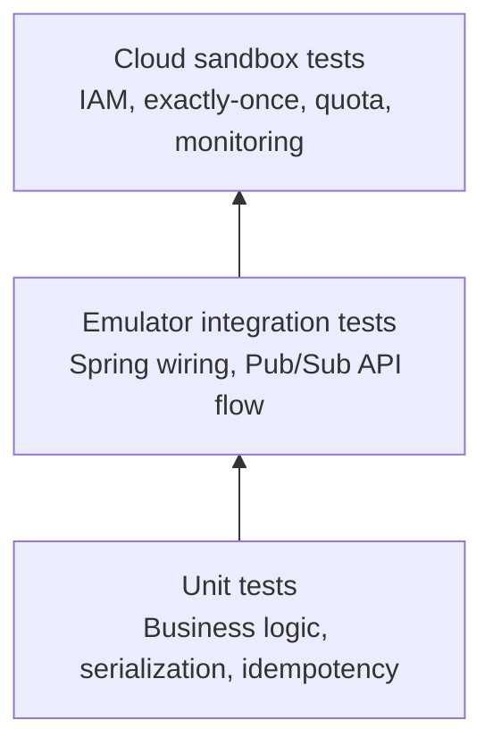

# The Pub/Sub emulator and differences from the managed service

## Lesson Objectives

The **SPRING_CLOUD_PROVIDER_INTEGRATION** module practices integrating Spring Boot with managed services from **AWS, Azure, and Google Cloud** using the corresponding Spring Cloud libraries. When developing with Google Cloud Pub/Sub, not every application run needs to connect to a live cloud project. The Pub/Sub emulator provides a local server to create topics/subscriptions, publish, and receive messages—supporting development, integration testing, and CI runs without provisioning production Pub/Sub resources.

The emulator is a simulation with a limited feature set. It helps verify application flows and client interactions, yet does not replace verifying IAM, quotas, latency, monitoring, exactly-once delivery, retention, or integrated service behavior against real Pub/Sub.

After this lesson, you will be able to:

1. Explain what the emulator is for and its limitations.
2. Install, start, configure host/port, and stop the Pub/Sub emulator.
3. Configure Spring Boot to connect to the emulator using `spring.cloud.gcp.pubsub.emulator-host`.
4. Understand why the Java client requires explicit emulator configuration even when `PUBSUB_EMULATOR_HOST` is set.
5. Create topics/subscriptions, publish, pull, and ACK messages using `PubSubAdmin`/`PubSubTemplate`.
6. Write integration tests and run the emulator in Testcontainers.
7. Distinguish supported features from missing RPCs or capabilities.
8. Design a test pyramid: unit tests, emulator integration tests, and cloud sandbox tests.
9. Prevent test or local profiles from accidentally connecting to a production project.
10. Evaluate differences between the emulator, real Pub/Sub, and emulators from other cloud providers.

## 1. What is the Pub/Sub emulator?

### 1.1. Role

The Pub/Sub emulator is a local server provided by the Google Cloud CLI. Applications use Cloud Client Libraries to call the emulator endpoint instead of Google Cloud's Pub/Sub endpoints.

The following operations can run locally:

- Creating topics and subscriptions.
- Publishing messages and pulling them.
- Delivering messages to a local push endpoint.
- ACKing/NACKing and observing redeliveries in emulator-supported flows.
- Testing features such as ordering, retry policies, dead-letter topics, replay, Avro schemas, and filtering.

The emulator works well for:

- Developing publish/consume features without a live cloud project.
- Integration testing serialization, converters, headers, routing, and business handlers.
- Testing basic ACK/NACK, retry, and duplicate flows.
- Repeatable CI runs with a synthetic project ID and isolated test data.
- Debugging requests/responses between Spring applications and the Pub/Sub client.

### 1.2. The emulator is not a miniature production environment

Upon startup, the emulator prints a banner like:

```text
This is the Pub/Sub fake.
Implementation may be incomplete or differ from the real system.
Server started, listening on 8085
```

This message reminds you that the emulator simulates APIs within a constrained scope. Never assume every RPC, IAM policy, quota, latency profile, ordering guarantee, or delivery semantic matches production.

### 1.3. What the emulator cannot replace

| Need | Use emulator? | Where final verification belongs |
| --- | --- | --- |
| Payload serialization/deserialization | Yes | Unit/integration tests |
| Basic topic/subscription creation | Yes | Emulator or sandbox |
| Publishing and pulling | Yes | Emulator or sandbox |
| Spring Integration adapters/binder | Can test basic flows | Sandbox for broker semantics |
| IAM, service accounts, and resource permissions | No | Real cloud project |
| Production authenticated push and OIDC JWTs | Do not rely on emulator | Sandbox |
| Exactly-once delivery and ACK responses | Do not use emulator as proof | Real pull subscription in one region |
| Quotas, throughput, latency, and autoscaling | No | Sandbox/load tests |
| Retention, expiration, and billing | Incompletely modeled | Real cloud project |
| BigQuery subscription delivery | No | Real Pub/Sub |

## 2. Installing and starting the emulator

### 2.1. Prerequisites

Development machines need:

- Google Cloud CLI (`gcloud`).
- Pub/Sub emulator component.
- JDK compatible with your Spring Boot application.
- Docker if running the emulator via Testcontainers.
- An application using Google Cloud Pub/Sub Client Library or Spring Framework on Google Cloud.

Install the component:

```bash
gcloud components install pubsub-emulator
gcloud components update
```

If Google Cloud CLI was installed via a package manager or an environment that disables `gcloud components`, install the Cloud CLI package containing the emulator component per your OS instructions.

### 2.2. Starting on localhost

Example running the emulator with synthetic project ID `local-pubsub`:

```bash
gcloud beta emulators pubsub start \
  --project=local-pubsub \
  --host-port=127.0.0.1:8085 \
  --data-dir=.local/pubsub-emulator
```

Explanation:

| Flag | Meaning |
| --- | --- |
| `--project` | Project ID identifying resources inside the emulator; need not be a real Google Cloud project |
| `--host-port` | Address and port the emulator listens on |
| `--data-dir` | Directory used by the emulator to read/write local data and configuration |

By default, the emulator typically listens on `[::1]:8085` (IPv6 localhost). If your application cannot connect because IPv6 is disabled, specify `127.0.0.1:8085` as shown above.

Do not bind `0.0.0.0` on shared machines or untrusted networks unless external containers or devices must reach it. If binding another interface is required, restrict network access via firewalls or container networks.

### 2.3. Getting the endpoint with `env-init`

After starting the emulator, inspect the required environment variables:

```bash
gcloud beta emulators pubsub env-init
```

The output usually includes `PUBSUB_EMULATOR_HOST` and optionally `PUBSUB_PROJECT_ID`. Ports may vary if the emulator chooses a dynamic port; read the values from your active run instead of hardcoding stale output.

On Linux/macOS, load them into the current shell:

```bash
$(gcloud beta emulators pubsub env-init)
```

On Windows Command Prompt:

```bat
gcloud beta emulators pubsub env-init > set_vars.cmd
set_vars.cmd
```

In PowerShell, if you pinned host/port as in the example:

```powershell
$env:PUBSUB_EMULATOR_HOST = "127.0.0.1:8085"
$env:PUBSUB_PROJECT_ID = "local-pubsub"
```

`PUBSUB_PROJECT_ID` is optional for many clients, though helpful to prevent inferring a project ID from real cloud config.

### 2.4. Stopping the emulator and clearing environment variables

Press `Ctrl+C` in the terminal running the emulator. Then clear the environment variables in your current shell so applications do not keep pointing at a stale endpoint:

Linux/macOS:

```bash
unset PUBSUB_EMULATOR_HOST
unset PUBSUB_PROJECT_ID
```

PowerShell:

```powershell
Remove-Item Env:PUBSUB_EMULATOR_HOST -ErrorAction SilentlyContinue
Remove-Item Env:PUBSUB_PROJECT_ID -ErrorAction SilentlyContinue
```

Never leave `PUBSUB_EMULATOR_HOST` set in production terminals or deployment environments. Once the app stops targeting the emulator, it may connect to real cloud endpoints using configured credentials and project settings.

### 2.5. Emulator data lifecycle

Topics, subscriptions, and messages created in the emulator belong to the local environment. Emulator documentation describes resources and messages as lasting for the emulator session lifecycle; the CLI also offers `--data-dir` to persist/read run data and configuration.

For automated tests, follow these practices:

- Use separate `data-dir` paths per workspace/test suite when isolation is needed.
- Prefix or suffix topic/subscription names with test identifiers or UUIDs.
- Delete subscriptions before topics at test teardown.
- Never rely on leftover data from previous runs.
- Never commit emulator data directories to Git.

## 3. Connecting Spring Boot to the emulator

### 3.1. Configuring Spring Framework on Google Cloud

The Spring Boot Pub/Sub starter supports `spring.cloud.gcp.pubsub.emulator-host`. When set, auto-configuration builds Pub/Sub clients pointing to the emulator.

Create `application-emulator.yml`:

```yaml
spring:
  cloud:
    gcp:
      project-id: local-pubsub
      pubsub:
        emulator-host: ${PUBSUB_EMULATOR_HOST:127.0.0.1:8085}
```

Activate the profile:

```bash
SPRING_PROFILES_ACTIVE=emulator ./mvnw spring-boot:run
```

In PowerShell:

```powershell
$env:SPRING_PROFILES_ACTIVE = "emulator"
./mvnw spring-boot:run
```

On Windows, you may run `mvnw.cmd spring-boot:run` depending on the project.

`spring.cloud.gcp.project-id` sets the Spring Cloud GCP project ID. To override the project specifically for Pub/Sub, use `spring.cloud.gcp.pubsub.project-id` per your library version.

### 3.2. Distinguishing environment variables from Spring properties

These two mechanisms serve different roles:

| Approach | Used by | Meaning |
| --- | --- | --- |
| `PUBSUB_EMULATOR_HOST` | Google Cloud client libraries across languages; Java needs explicit client config | Specifies the emulator endpoint |
| `spring.cloud.gcp.pubsub.emulator-host` | Spring Framework on Google Cloud auto-configuration | Sets emulator host/port for Spring-managed Pub/Sub clients |
| `spring.cloud.gcp.project-id` | Spring Framework on Google Cloud | Sets the default project ID |

With the Spring Boot starter, configuring `emulator-host` directly is clearest. Do not assume setting `PUBSUB_EMULATOR_HOST` alone automatically redirects every raw Java client.

### 3.3. Raw Java clients require explicit configuration

Unlike several other languages, the Java Pub/Sub client library requires explicitly configuring the client to use the emulator. Basic pattern:

```java
import com.google.api.gax.core.CredentialsProvider;
import com.google.api.gax.core.NoCredentialsProvider;
import com.google.api.gax.grpc.GrpcTransportChannel;
import com.google.api.gax.rpc.FixedTransportChannelProvider;
import com.google.api.gax.rpc.TransportChannelProvider;
import com.google.cloud.pubsub.v1.TopicAdminClient;
import com.google.cloud.pubsub.v1.TopicAdminSettings;
import com.google.pubsub.v1.TopicName;
import io.grpc.ManagedChannel;
import io.grpc.ManagedChannelBuilder;

String hostPort = System.getenv("PUBSUB_EMULATOR_HOST");
if (hostPort == null || hostPort.isBlank()) {
    throw new IllegalStateException("PUBSUB_EMULATOR_HOST is not set");
}

ManagedChannel channel = ManagedChannelBuilder
        .forTarget(hostPort)
        .usePlaintext()
        .build();

TransportChannelProvider channelProvider =
        FixedTransportChannelProvider.create(
                GrpcTransportChannel.create(channel));

CredentialsProvider credentialsProvider =
        NoCredentialsProvider.create();

TopicAdminSettings topicAdminSettings = TopicAdminSettings.newBuilder()
        .setTransportChannelProvider(channelProvider)
        .setCredentialsProvider(credentialsProvider)
        .build();

try (TopicAdminClient topicAdminClient =
             TopicAdminClient.create(topicAdminSettings)) {
    topicAdminClient.createTopic(
            TopicName.of("local-pubsub", "orders"));
} finally {
    channel.shutdown();
}
```

This shows configuring `TopicAdminClient`. When building `SubscriptionAdminClient`, `Publisher`, or `Subscriber`, apply the same `TransportChannelProvider` and `NoCredentialsProvider`. Shut down channels and clients cleanly per lifecycle to avoid leaking threads or connections after tests.

The emulator does not enforce production IAM authentication; `NoCredentialsProvider` suits emulator clients. Never use this setup in production.

### 3.4. Separating emulator profiles from cloud profiles

Example layout:

```text
src/main/resources/
  application.yml
  application-emulator.yml
  application-dev.yml
  application-prod.yml
```

Rules:

- `application-emulator.yml` holds `emulator-host` and a synthetic project ID.
- `application-dev.yml` and `application-prod.yml` never contain an emulator host.
- Never share a single environment variable between emulator hosts and cloud endpoints.
- CI must activate the emulator profile explicitly.
- Production pipelines must never set `SPRING_PROFILES_ACTIVE=emulator`.

You can add a startup guard in non-local environments that refuses to boot if `emulator-host` is configured. This prevents accidental misdeployment alongside pipeline configuration controls.

## 4. Creating resources and running message flows in Spring

### 4.1. `PubSubAdmin` creates topics and subscriptions

Google Cloud Console and `gcloud pubsub` commands do not interact with the emulator. Use Cloud Client Libraries or Spring's `PubSubAdmin` to manage resources:

```java
import com.google.cloud.spring.pubsub.core.PubSubAdmin;
import org.springframework.boot.ApplicationRunner;
import org.springframework.context.annotation.Bean;
import org.springframework.context.annotation.Configuration;

@Configuration
public class EmulatorResources {

    @Bean
    ApplicationRunner createPubSubResources(PubSubAdmin pubSubAdmin) {
        return args -> {
            pubSubAdmin.createTopic("orders");
            pubSubAdmin.createSubscription("orders-sub", "orders", 60);
        };
    }
}
```

This example assumes a freshly started emulator with a clean data directory. If resources already exist, `createTopic`/`createSubscription` can throw `AlreadyExistsException`; in repeated runs, use unique names or list/check resources before creating. Never catch and ignore all exceptions, which hides connectivity or configuration bugs.

### 4.2. Publishing messages with `PubSubTemplate`

```java
import com.google.cloud.spring.pubsub.core.PubSubTemplate;
import java.util.concurrent.TimeUnit;
import org.springframework.stereotype.Service;

@Service
public class EmulatorPublisher {
    private final PubSubTemplate pubSubTemplate;

    public EmulatorPublisher(PubSubTemplate pubSubTemplate) {
        this.pubSubTemplate = pubSubTemplate;
    }

    public String publish(String payload) throws Exception {
        return pubSubTemplate.publish("orders", payload)
                .get(10, TimeUnit.SECONDS);
    }
}
```

`publish()` executes asynchronously; `.get()` here suits tests or flows needing a bounded wait. Never block request threads indefinitely in production.

### 4.3. Pulling and ACKing messages

```java
import com.google.cloud.spring.pubsub.core.PubSubTemplate;
import com.google.cloud.spring.pubsub.support.AcknowledgeablePubsubMessage;
import java.util.List;
import java.util.concurrent.TimeUnit;
import org.springframework.stereotype.Service;

@Service
public class EmulatorConsumer {
    private final PubSubTemplate pubSubTemplate;

    public EmulatorConsumer(PubSubTemplate pubSubTemplate) {
        this.pubSubTemplate = pubSubTemplate;
    }

    public String receiveOne() throws Exception {
        List<AcknowledgeablePubsubMessage> messages =
                pubSubTemplate.pull("orders-sub", 1, false);

        if (messages.isEmpty()) {
            return null;
        }

        AcknowledgeablePubsubMessage message = messages.get(0);
        String payload = message.getPubsubMessage()
                .getData()
                .toStringUtf8();

        // ACK only after test processing completes.
        message.ack().get(10, TimeUnit.SECONDS);
        return payload;
    }
}
```

`pull()` does not auto-ACK messages. If a test fails prior to ACK, the message remains outstanding and can redeliver after its ack deadline. When testing duplicates or retries, this is the exact behavior to observe.

### 4.4. Inspecting resources via the API

`PubSubAdmin` can list topics and subscriptions:

```java
import com.google.pubsub.v1.Subscription;
import com.google.pubsub.v1.Topic;
import java.util.List;

List<String> topics = pubSubAdmin.listTopics().stream()
        .map(Topic::getName)
        .toList();

List<String> subscriptions = pubSubAdmin.listSubscriptions().stream()
        .map(Subscription::getName)
        .toList();
```

Resource names in responses are fully qualified with the project. In assertions, compare full names or normalize suffixes to match application conventions.

### 4.5. Cleaning up resources after tests

Delete subscriptions before topics:

```java
pubSubAdmin.deleteSubscription("orders-sub");
pubSubAdmin.deleteTopic("orders");
```

If tests run in parallel, give each test its own topic/subscription names. Never let one test delete resources another test is still using.

## 5. Integration testing with Spring Boot

### 5.1. Configuring the test profile

`src/test/resources/application-emulator.yml`:

```yaml
spring:
  cloud:
    gcp:
      project-id: local-pubsub-test
      pubsub:
        emulator-host: ${PUBSUB_EMULATOR_HOST:127.0.0.1:8085}
```

Pub/Sub starter dependencies and the BOM must match your project's Spring Boot version. Run tests under a dedicated project ID to avoid sharing resources with other local apps.

### 5.2. Example integration test

```java
import static org.assertj.core.api.Assertions.assertThat;

import com.google.cloud.spring.pubsub.core.PubSubAdmin;
import com.google.cloud.spring.pubsub.core.PubSubTemplate;
import com.google.cloud.spring.pubsub.support.AcknowledgeablePubsubMessage;
import java.util.List;
import java.util.UUID;
import java.util.concurrent.TimeUnit;
import org.junit.jupiter.api.AfterEach;
import org.junit.jupiter.api.BeforeEach;
import org.junit.jupiter.api.Test;
import org.springframework.beans.factory.annotation.Autowired;
import org.springframework.boot.test.context.SpringBootTest;
import org.springframework.test.context.ActiveProfiles;

@SpringBootTest
@ActiveProfiles("emulator")
class PubSubEmulatorIntegrationTest {

    @Autowired
    PubSubAdmin pubSubAdmin;

    @Autowired
    PubSubTemplate pubSubTemplate;

    private final String suffix = UUID.randomUUID().toString().substring(0, 8);
    private final String topic = "orders-" + suffix;
    private final String subscription = "orders-sub-" + suffix;

    @BeforeEach
    void createResources() {
        pubSubAdmin.createTopic(topic);
        pubSubAdmin.createSubscription(subscription, topic, 60);
    }

    @AfterEach
    void deleteResources() {
        pubSubAdmin.deleteSubscription(subscription);
        pubSubAdmin.deleteTopic(topic);
    }

    @Test
    void publishesAndReceivesMessage() throws Exception {
        String expected = "order-created-" + suffix;

        pubSubTemplate.publish(topic, expected)
                .get(10, TimeUnit.SECONDS);

        List<AcknowledgeablePubsubMessage> messages =
                pubSubTemplate.pull(subscription, 1, false);

        assertThat(messages).hasSize(1);

        AcknowledgeablePubsubMessage received = messages.get(0);
        assertThat(received.getPubsubMessage()
                .getData()
                .toStringUtf8()).isEqualTo(expected);

        received.ack().get(10, TimeUnit.SECONDS);
    }
}
```

This test verifies Spring auto-configuration, resource provisioning, publishing, pulling, payloads, and ACKs. It does not verify production IAM, quotas, exactly-once delivery, or real latency.

### 5.3. Testing asynchronous subscribers

If the app uses `PubSubTemplate.subscribe()` or `PubSubInboundChannelAdapter`, tests can use a `CountDownLatch`:

```java
import static org.assertj.core.api.Assertions.assertThat;

import com.google.cloud.spring.pubsub.core.PubSubTemplate;
import com.google.cloud.spring.pubsub.support.BasicAcknowledgeablePubsubMessage;
import com.google.cloud.pubsub.v1.Subscriber;
import java.util.concurrent.CountDownLatch;
import java.util.concurrent.TimeUnit;
import java.util.concurrent.atomic.AtomicReference;

CountDownLatch received = new CountDownLatch(1);
AtomicReference<Throwable> failure = new AtomicReference<>();

Subscriber subscriber = pubSubTemplate.subscribe(
        subscription,
        message -> {
            try {
                String payload = message.getPubsubMessage()
                        .getData()
                        .toStringUtf8();
                assertThat(payload).isEqualTo(expected);
                message.ack().get(10, TimeUnit.SECONDS);
                received.countDown();
            } catch (Exception | AssertionError error) {
                message.nack();
                failure.set(error);
                received.countDown();
            }
        });

pubSubTemplate.publish(topic, expected).get(10, TimeUnit.SECONDS);

try {
    assertThat(received.await(10, TimeUnit.SECONDS)).isTrue();
    assertThat(failure.get()).isNull();
} finally {
    subscriber.stopAsync().awaitTerminated();
}
```

In real tests, keep `subscriber` in a scope where `@AfterEach`/`@AfterAll` can clean it up. Never let callback assertion failures go unreported to the test thread; capture exceptions in an `AtomicReference` and assert after the latch releases.

### 5.4. Isolating parallel tests

To prevent tests from interfering with each other:

- Use topics and subscriptions with unique suffixes.
- Never use a real environment's project ID.
- Have each test create and tear down its own resources.
- Set explicit timeouts for publish, pull, and latches.
- Never depend on test execution order.
- If sharing one emulator across multiple suites, namespace resources by build/job prefix.

## 6. Running the emulator with Testcontainers

### 6.1. When to use Testcontainers?

Testcontainers provides the `gcloud` module containing `PubSubEmulatorContainer`. This lets tests spin up the emulator in Docker automatically and stop the container afterward, removing the need for developers to start the emulator manually.

The Testcontainers GCloud module is currently marked incubating; pin your Testcontainers version and check for API changes when upgrading.

Maven dependencies (version managed by Testcontainers BOM):

```xml
<dependencyManagement>
    <dependencies>
        <dependency>
            <groupId>org.testcontainers</groupId>
            <artifactId>testcontainers-bom</artifactId>
            <version>${testcontainers.version}</version>
            <type>pom</type>
            <scope>import</scope>
        </dependency>
    </dependencies>
</dependencyManagement>

<dependencies>
    <dependency>
        <groupId>org.testcontainers</groupId>
        <artifactId>gcloud</artifactId>
        <scope>test</scope>
    </dependency>
</dependencies>
```

### 6.2. Starting the container and passing its endpoint to Spring

```java
import org.junit.jupiter.api.AfterAll;
import org.junit.jupiter.api.Test;
import org.springframework.beans.factory.annotation.Autowired;
import org.springframework.boot.test.context.SpringBootTest;
import com.google.cloud.spring.pubsub.core.PubSubAdmin;
import org.testcontainers.containers.PubSubEmulatorContainer;
import org.testcontainers.utility.DockerImageName;
import org.springframework.test.context.DynamicPropertyRegistry;
import org.springframework.test.context.DynamicPropertySource;

@SpringBootTest
class PubSubContainerTest {

    @Autowired
    PubSubAdmin pubSubAdmin;

    static final PubSubEmulatorContainer emulator =
            new PubSubEmulatorContainer(
                    DockerImageName.parse(
                            "gcr.io/google.com/cloudsdktool/google-cloud-cli:583.0.0-emulators"));

    static {
        emulator.start();
    }

    @DynamicPropertySource
    static void pubsubProperties(DynamicPropertyRegistry registry) {
        registry.add(
                "spring.cloud.gcp.pubsub.emulator-host",
                emulator::getEmulatorEndpoint);
        registry.add(
                "spring.cloud.gcp.project-id",
                () -> "test-project");
    }

    @AfterAll
    static void stopEmulator() {
        emulator.stop();
    }

    @Test
    void createsTopicThroughSpringConfiguration() {
        pubSubAdmin.createTopic("container-test-topic");
    }
}
```

This is a minimal lifecycle snippet showing dynamic endpoint wiring. In real test suites, place the container in a shared base class or singleton to avoid restarting containers for every test class. Ensure the container stops even on test failures; use Testcontainers extensions/lifecycle annotations instead of static blocks if your project standardizes container management.

### 6.3. Benefits and trade-offs

| Runner | Pros | Trade-offs |
| --- | --- | --- |
| gcloud-installed emulator | Easy to debug, long-lived during local dev | Developers must install CLI and manage processes |
| Testcontainers | CI manages containers, dynamic host/port, isolated test env | Requires Docker and image pull / container startup time |
| Real Pub/Sub sandbox | Verifies IAM and genuine service semantics | Requires project, credentials, cleanup, quota, and cost management |

## 7. Features supported by the emulator

According to current Google Cloud Pub/Sub emulator documentation, the following feature groups are listed as supported:

| Feature | Testable in emulator | Suggested test scope |
| --- | --- | --- |
| Publishing messages | Yes | Payloads, attributes, message IDs, serialization errors |
| Pull subscriptions | Yes | Pull, ACK/NACK, and consumer flows |
| Push subscriptions | Yes | Local HTTP endpoints and JSON envelopes |
| Message ordering | Yes | Ordering keys and basic per-key streams |
| Replay | Yes | Snapshots/seek in supported flows |
| Dead-letter topics | Yes | Forwarding failed messages and basic DLQ consumers |
| Retry policies | Yes | Redelivery of unacked messages |
| Avro schemas | Yes | Schema validation/serialization within emulator scope |
| Subscription filtering | Yes | Basic filter expressions |

Being listed as supported does not mean semantics, timing, and performance match production. In particular, retry timing, ordering under concurrency, and DLQ forwarding still require sandbox testing if critical to your system.

## 8. Known limitations and differences from real Pub/Sub

### 8.1. IAM is not supported

The emulator does not execute IAM operations. Therefore:

- Cannot test `roles/pubsub.publisher`, `roles/pubsub.subscriber`, or resource-level permissions.
- Cannot test service accounts, Workload Identity, or service agents.
- Cannot use the emulator to verify authenticated push OIDC JWTs.
- Cannot prove production runtimes follow least privilege.

Locally, emulator clients normally use `NoCredentialsProvider` or Spring emulator auto-configuration. Test IAM in a real sandbox project using dedicated service accounts.

### 8.2. Retention and subscription expiration

The emulator does not support configurable message retention; messages are retained indefinitely within the emulator session. Subscription expiration is not simulated either; subscriptions never auto-expire.

Implications for testing:

- Do not use the emulator to verify message expiration under retention policies.
- Do not use the emulator to verify automatic subscription expiration.
- Do not extrapolate storage costs or production backlog retention behavior.
- Use sandbox tests to verify retention policies and subscription lifecycles.

### 8.3. Incomplete RPCs and features

| Limitation | Impact |
| --- | --- |
| `UpdateTopic` RPC unsupported | Cannot test topic updates via this API |
| `UpdateSnapshot` RPC unsupported | Cannot test snapshot updates |
| IAM operations unsupported | Cannot verify access control |
| BigQuery subscriptions can be created but do not deliver to BigQuery | Do not use emulator to test BigQuery export |
| Timestamp seek on ordered subscriptions unsupported | Replay-by-timestamp tests need a sandbox when ordering is enabled |
| Topics/subscriptions can be created with SMTs but messages are not transformed | Do not use emulator to verify Single Message Transforms |
| Protocol Buffer schemas have documented emulator limitations | Do not assume Avro and Protobuf share equal support |

Google's documentation lists Avro schema support while noting Protocol Buffer schemas under known limitations. When using Protobuf schemas, verify behavior on real Pub/Sub and your current emulator version.

### 8.4. Exactly-once delivery

Never use the emulator to conclude exactly-once delivery behaves like production. Exactly-once has pull/StreamingPull, regional affinity, and ACK response constraints; the emulator cannot validate server guarantees, quotas, or live response semantics.

When an application relies on exactly-once:

- Unit test database inbox/idempotency logic.
- Use the emulator to test publish/consume and basic ACK flows.
- Sandbox test against a real pull subscription with exactly-once enabled.
- Verify single-region subscriber placement and ACK responses with a compatible client library.

### 8.5. Push endpoints and HTTPS

The emulator lets you test local push endpoints over unencrypted HTTP, such as `http://127.0.0.1:8081/pubsub`. Production Pub/Sub accepts only HTTPS-secured push endpoints.

Thus, the emulator can verify:

- HTTP controllers receiving envelopes.
- Base64 payload decoding.
- HTTP status–based ACK/NACK handling.
- Basic retries when endpoints return errors.

But it cannot prove:

- TLS certificates and public production endpoints.
- OIDC token signing and validation.
- Invoker IAM roles or service account token creators.
- Network ingress, load balancers, or VPC Service Controls.

### 8.6. No Google Cloud Console or `gcloud pubsub`

The emulator does not support the Google Cloud Console or resource management CLI commands such as:

```bash
gcloud pubsub topics create orders
gcloud pubsub subscriptions create orders-sub --topic=orders
```

Those commands target the live cloud service. Against the emulator, use `PubSubAdmin`, the Java Pub/Sub client library, or test helpers calling client APIs.

`gcloud beta emulators pubsub start` and `env-init` are still used to launch and configure the emulator; they are distinct from `gcloud pubsub` cloud resource commands.

## 9. Comparison matrix: emulator vs. real service

| Aspect | Emulator | Real Pub/Sub |
| --- | --- | --- |
| Endpoint | Local host/port | Google Cloud regional/global endpoints |
| Project ID | Synthetic identifier string; no real project needed | Real Google Cloud project |
| Authentication | Does not simulate full IAM; emulator clients can use no credentials | OAuth2, service accounts, Workload Identity, and IAM |
| Topics/subscriptions | Created via client libraries | Console, `gcloud`, API, IaC, or client libraries |
| Publish/pull | Supports basic flows | Managed service with service quotas and SLAs |
| Push | Supports local HTTP | Public HTTPS endpoints, optionally authenticated push |
| Retry/DLQ | Basic support | Production retry/DLQ semantics and IAM |
| Retention | Not configurable; messages retained indefinitely in emulator | Governed by topic/subscription retention and service limits |
| Subscription expiration | Not simulated | Enforces lifecycle/expiration policies |
| Exactly-once | Do not use to verify guarantee | Supported for pull subscriptions within one region |
| Quotas and billing | Does not model production quotas/costs | Enforces quotas, usage tracking, and billing |
| Monitoring | Local logs | Cloud Monitoring, metrics, and alerts |
| Latency/throughput | Depends on local host hardware | Depends on region, load, network, and quotas |
| BigQuery export | Subscription can be created without delivering data | Real export integration |

## 10. Layered testing strategy

### 10.1. Unit tests

Unit tests require no emulator:

- Test serializers/deserializers.
- Validate schemas and event IDs.
- Test business handlers and idempotency.
- Test retry error classification.
- Test header/attribute mappings.
- Mock publisher interfaces to test publish-failure handling.

Unit tests are fast, parallelizable, and focused on business logic.

### 10.2. Emulator integration tests

Use the emulator to verify:

- Spring Boot auto-configuration pointing to the emulator.
- `PubSubAdmin` topic/subscription creation.
- `PubSubTemplate` publish/pull.
- Spring Integration inbound/outbound adapters.
- Stream binder basics with destinations and groups.
- Payload converters, headers, and attributes.
- Basic ACK/NACK and redelivery.
- Filtering, ordering, and retry/DLQ within emulator-supported flows.

Do not assert strict retry timings or production throughput. Use generous timeouts to prevent CI scheduler flakiness.

### 10.3. Cloud sandbox integration tests

Use a sandbox project for requirements tied to the real service:

- IAM policies and service accounts.
- Authenticated push OIDC JWTs.
- Exactly-once delivery and ACK responses.
- Retention and subscription expiration.
- BigQuery subscriptions.
- Protocol Buffer schemas if used by the application.
- SMTs.
- Quotas, metrics, alerts, and latency.
- Required cross-region behavior and ordering semantics.

Sandboxes should have isolated topics/subscriptions, dedicated service accounts, naming prefixes, and cleanup jobs. Never run integration tests against production projects.

### 10.4. Test pyramid



Unit tests are the most numerous; emulator tests verify real client integration; sandbox tests are fewer in number but cover semantics the emulator does not simulate.

## 11. Running the emulator in CI

### 11.1. Basic CI pipeline

A CI job typically performs:

1. Start the Pub/Sub emulator as a service or container.
2. Wait until `127.0.0.1:8085` is ready.
3. Set `SPRING_PROFILES_ACTIVE=emulator`.
4. Run unit tests and emulator integration tests.
5. Collect logs on test failure.
6. Stop the emulator/container and clean up temporary state.

Never run emulator tests alongside real cloud tests under the same profile or configuration.

### 11.2. Endpoint health check

The emulator exposes a gRPC endpoint. Probe the listening port before launching Spring tests. Avoid fixed `Start-Sleep` delays alone since CI runners vary in startup speed.

PowerShell example probing the TCP port:

```powershell
$deadline = (Get-Date).AddSeconds(30)
$ready = $false
while ((Get-Date) -lt $deadline) {
    $client = [System.Net.Sockets.TcpClient]::new()
    try {
        $client.Connect("127.0.0.1", 8085)
        $ready = $true
        break
    }
    catch {
        Start-Sleep -Milliseconds 250
    }
    finally {
        $client.Dispose()
    }
}

if (-not $ready) {
    throw "Pub/Sub emulator did not become ready within 30 seconds."
}
```

In Linux CI, use container healthchecks or an equivalent TCP wait script.

### 11.3. Preventing tests from hitting cloud projects accidentally

Enforce guards:

- Require `emulator-host` in the emulator profile.
- Use a fixed synthetic test project ID like `local-pubsub-test`, never a production project ID.
- Never mount production service account keys in emulator CI jobs.
- Never use production ADC in emulator jobs.
- Use separate profiles, credentials, and prefixed resource names for cloud sandbox tests.
- Fail fast if the emulator is unreachable; never silently fall back to real Pub/Sub.

## 12. Troubleshooting

| Symptom | Possible cause | Resolution |
| --- | --- | --- |
| Connection refused | Emulator not running or wrong port | Check startup logs and `PUBSUB_EMULATOR_HOST` |
| IPv6 localhost unreachable | IPv6 disabled on host or client targets different address | Start emulator with `--host-port=127.0.0.1:8085` |
| Spring still calls real Pub/Sub | Missing `spring.cloud.gcp.pubsub.emulator-host` or inactive profile | Check active profiles and effective configuration |
| Java client ignores `PUBSUB_EMULATOR_HOST` | Java client requires explicit channel/credentials config | Use Spring `emulator-host` or `TransportChannelProvider` |
| `UNAUTHENTICATED`/credential error | Client uses an auth provider incompatible with emulator | Use Spring emulator property or `NoCredentialsProvider` for raw clients |
| Topic/subscription already exists | Stale state left in emulator data directory | Use unique test names or list/check before creating |
| Pull returns empty list | Publish incomplete, wrong subscription, or `returnImmediately` enabled | Await publish future, verify names, set `returnImmediately=false` |
| Message redelivered unexpectedly | Missing ACK, incomplete ACK, or deadline expired | Check ack future/deadline and test cleanup |
| Order-dependent test failures | Shared topic/subscription or data directory | Isolate resources and clean up after every test |
| Push test skips HTTPS | Emulator allows local HTTP while production rejects it | Test production push endpoints in an HTTPS sandbox |
| IAM tests always pass / have no effect | Emulator does not enforce IAM | Move IAM tests to a cloud sandbox project |
| BigQuery subscription delivers no rows | Emulator creates the resource without exporting to BigQuery | Test against real Pub/Sub |
| Timestamp seek on ordered subscription fails | Unsupported by emulator | Test in a cloud sandbox |
| `gcloud pubsub` fails | Emulator does not support these commands | Use `PubSubAdmin` or client libraries |

### 12.1. Diagnostic checklist

1. Verify the emulator process is running.
2. Check the host/port printed in emulator logs.
3. Check `PUBSUB_EMULATOR_HOST` or `spring.cloud.gcp.pubsub.emulator-host`.
4. Check the active Spring profile.
5. Check the project ID and topic/subscription names.
6. If configuring Java clients manually, verify plaintext channel and no-credentials provider usage.
7. Confirm publish futures completed.
8. Verify subscription receipt and ACK/NACK calls.
9. Check data directory and test isolation.
10. For IAM/retention/exactly-once failures, move testing to a sandbox instead of debugging the emulator endlessly.

## 13. Comprehensive hands-on exercise

A Spring Boot application processes `OrderCreated` over Pub/Sub. The `order-worker` service receives messages from topic `orders`, validates payloads, writes orders to a database, and ACKs. On transient dependency errors, messages are NACKed for retry. On invalid payloads, the application stores them in quarantine.

### Part A — Running the local emulator

1. Install the Pub/Sub emulator.
2. Start the emulator with project ID `local-pubsub` and host `127.0.0.1:8085`.
3. Set `PUBSUB_EMULATOR_HOST`.
4. Create `application-emulator.yml` with `spring.cloud.gcp.pubsub.emulator-host`.
5. Activate the `emulator` profile.
6. Use `PubSubAdmin` to create topic `orders` and subscription `orders-sub`.
7. Publish an `OrderCreated` message.
8. Pull the message, verify the payload, and ACK it.
9. Stop the emulator and clear environment variables.

### Part B — Integration testing

1. Write a `@SpringBootTest` using the emulator profile.
2. Use topics/subscriptions with unique suffixes.
3. Verify publish/pull/ACK.
4. Verify unacked messages redeliver.
5. Verify duplicate event IDs do not create duplicate orders.
6. Delete subscriptions before topics.
7. Run tests with Testcontainers if CI provides Docker.

### Part C — Comparing against a sandbox

Run additional tests in a sandbox project:

1. Verify IAM for the runtime service account.
2. Verify authenticated push OIDC if using push.
3. Verify exactly-once on a real pull subscription if required by the app.
4. Verify retention and DLQ policies.
5. Verify metrics/alerts in Cloud Monitoring.
6. Document observed differences compared to the emulator.

### Evaluation matrix

| Scenario | Emulator | Sandbox |
| --- | --- | --- |
| Create topic/subscription via client | Succeeds | Succeeds if IAM permits |
| Basic publish/pull/ACK | Testable | Testable |
| Serialization and Spring wiring | Testable | Testable |
| IAM allow/deny | Not verified | Mandatory |
| Exactly-once delivery | Do not use as proof | Mandatory if required |
| Retention/expiration | Not verified | Mandatory if required |
| BigQuery export | Not verified | Mandatory if used |
| Throughput/latency | Not representative of production | Load test in an appropriate sandbox |

### Completion criteria

- Starts/stops the emulator and configures host/port accurately.
- Connects Spring Boot to the emulator via a dedicated profile.
- Creates topics/subscriptions using `PubSubAdmin`.
- Publishes, pulls, and ACKs messages using `PubSubTemplate`.
- Writes integration tests with isolated resources.
- Summarizes supported emulator features and key limitations.
- Maintains a sandbox test plan covering IAM, exactly-once, retention, quotas, and monitoring.
- Has no silent fallback path to production projects when the emulator is down.

## 14. Comparison with AWS and Azure emulators and services

| Criterion | Google Cloud Pub/Sub emulator | AWS LocalStack/SQS-SNS | Azure Service Bus Emulator |
| --- | --- | --- | --- |
| Goal | Simulates Pub/Sub APIs for client libraries | Simulates multiple AWS services via local endpoints | Simulates a subset of Azure Service Bus |
| Connection | Pub/Sub emulator host/port; Java needs explicit client config | Endpoint URL / SDK endpoint override | Local connection string/endpoint per emulator |
| Resource creation | Cloud Client Libraries / Spring `PubSubAdmin` | LocalStack-compatible AWS SDK/CLI by service | SDK/AMQP and emulator-provided tooling |
| IAM/identity | Does not support IAM operations | Does not fully mirror real AWS IAM | Does not fully mirror real Entra ID/RBAC |
| Feature coverage | Publish, push/pull, ordering, retry, DLQ, replay, Avro, filtering; with noted limits | Varies by service and LocalStack version | Subset of Service Bus features |
| Production validation | Requires a Pub/Sub sandbox | Requires an AWS sandbox account | Requires an Azure sandbox namespace |

Emulators share similar goals yet differ in fidelity. When designing multi-cloud tests, keep business contracts and shared test suites consistent while using provider-specific adapters/fixtures to validate each cloud's unique behavior.

## Summary

The Pub/Sub emulator enables Spring Boot teams to develop and locally test topic/subscription creation, publishing, pull/push delivery, and message handling. With Spring Framework on Google Cloud, setting `spring.cloud.gcp.pubsub.emulator-host` is the simplest way for auto-configuration to target the emulator. Raw Java clients require explicit channel/endpoint and credentials provider setup; setting `PUBSUB_EMULATOR_HOST` alone does not redirect them.

The emulator supports many core flows including publish, push/pull, ordering, retries, DLQs, replay, Avro, and filtering. However, IAM is unsupported; retention and subscription expiration are not simulated; BigQuery subscriptions do not deliver data; and certain RPCs, Protobuf schemas, ordered timestamp seeks, and SMTs have limitations. Nor does the emulator represent production quotas, latency, throughput, monitoring, exactly-once guarantees, or authenticated push.

Use unit tests for business logic, emulator integration tests for Spring/client wiring, and a cloud sandbox project for IAM, exactly-once, retention, quotas, monitoring, and unsupported features. Isolate emulator profiles from cloud profiles, use synthetic project IDs, and fail fast if the emulator is offline so tests never leak messages into production projects.

## References

- [Google Cloud Pub/Sub — Testing apps locally with the emulator](https://docs.cloud.google.com/pubsub/docs/emulator) — installation, startup, environment variables, Java client config, supported features, and known limitations.
- [Google Cloud SDK — gcloud beta emulators pubsub start](https://docs.cloud.google.com/sdk/gcloud/reference/beta/emulators/pubsub/start) — `--data-dir`, `--host-port`, and start command reference.
- [Google Cloud SDK — gcloud beta emulators pubsub env-init](https://docs.cloud.google.com/sdk/gcloud/reference/beta/emulators/pubsub/env-init) — generating environment variables for the emulator endpoint.
- [Spring Framework on Google Cloud — Cloud Pub/Sub](https://googlecloudplatform.github.io/spring-cloud-gcp/reference/html/pubsub.html) — `emulator-host`, `PubSubAdmin`, `PubSubTemplate`, publish/pull, and ACK.
- [Spring Framework on Google Cloud — Spring Integration](https://googlecloudplatform.github.io/spring-cloud-gcp/reference/html/spring-integration.html) — inbound/outbound adapters and `PubSubMessageSource`.
- [Testcontainers — GCloud module](https://java.testcontainers.org/modules/gcloud/) — `PubSubEmulatorContainer` and running the emulator in integration tests.
- [Google Cloud Pub/Sub — Exactly-once delivery](https://docs.cloud.google.com/pubsub/docs/exactly-once-delivery) — exactly-once scope and live-service testing requirements.
- [Google Cloud Pub/Sub — Monitoring](https://docs.cloud.google.com/pubsub/docs/monitoring) — metrics and cloud-environment observability.
