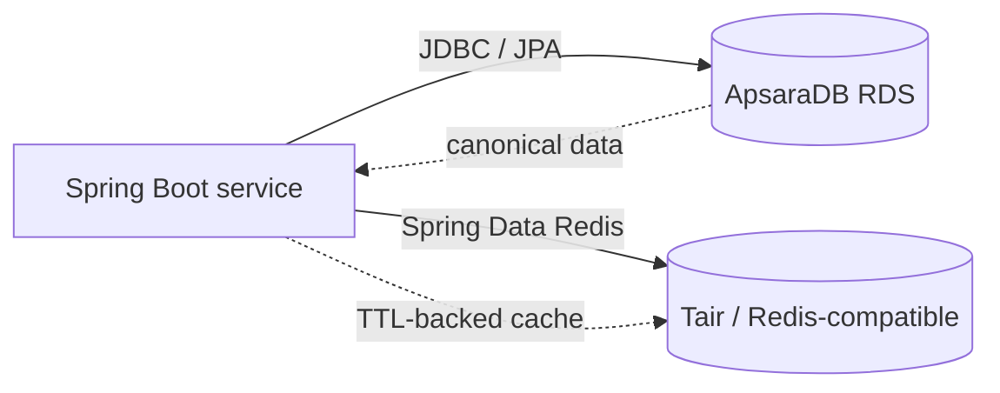

# Connecting to RDS or Redis via Their Corresponding Data Libraries

When deploying Spring Boot on Alibaba Cloud, an application typically needs both a durable store for relational data and a low-latency key-value store. Two common managed options are **ApsaraDB RDS** for relational data and **Tair (Redis OSS-compatible)** for caching or fast-access data.

The key is choosing the right data access library at the application layer. For RDS, Spring Boot uses a JDBC driver with `DataSource`, Spring JDBC, or Spring Data JPA. For Tair, Spring Data Redis uses a client such as Lettuce or Jedis. These are standard integrations in the Spring ecosystem; no separate Spring Cloud Alibaba starter is needed just to open a JDBC or Redis connection. Spring Cloud Alibaba can still be used for other system capabilities such as centralized configuration, discovery, or messaging.

After completing this lesson, you will be able to:

- Distinguish the roles of RDS and Redis-compatible Tair in an application.
- Prepare endpoints, VPCs, whitelists, and accounts so the application connects securely.
- Configure Spring Boot to connect to RDS via JDBC/JPA and to Tair via Spring Data Redis.
- Implement the data access layer with appropriate timeouts and connection pool limits.
- Test connectivity, diagnose network/authentication/TLS errors, and avoid insecure configurations.

## 1. Choosing the Right Service and Library

| Need | Alibaba Cloud Service | Common Spring Library | Data Role |
|---|---|---|---|
| Relational business data, constraints, transactions, and SQL queries | ApsaraDB RDS for MySQL or PostgreSQL | JDBC, Spring JDBC, Spring Data JPA, or MyBatis | Primary data source, durable storage |
| Cache, sessions, counters, rate limits, or TTL key-value data | Tair (Redis OSS-compatible) | Spring Data Redis with Lettuce or Jedis | Speeds up access; normally does not replace the primary database |

A typical architecture stores canonical data in RDS while Redis holds time-limited copies of frequently read data:



Do not pick Redis simply because reads are fast. RDS fits when you need transactions, foreign keys, unique constraints, relational queries, and database-style backup/restore. Redis fits data that is reconstructible, time-bounded, or requires fast key-value operations. If using Redis as a sole data store, you must separately evaluate persistence, replication, backups, eviction policies, and recovery; never assume a cache provides the same durability guarantees as RDS.

## 2. Preparing Connectivity on Alibaba Cloud

### 2.1. Preparing ApsaraDB RDS

Before configuring Spring, gather the following details from the RDS instance details page:

1. Engine and version, such as MySQL or PostgreSQL.
2. Internal (private) endpoint, port, and database name.
3. Dedicated database account for the application and its granted privileges.
4. VPC, region, and IP address of the host running the application.
5. TLS status and CA certificate if connection encryption is enabled.

Prefer placing the application and RDS in the same VPC and same region, then connecting via the private endpoint. Add the ECS private IP or appropriate security group to the RDS whitelist/security group. If the application resides in another VPC, establish cross-VPC network connectivity (such as VPC peering or an equivalent networking solution) before testing connections.

A public endpoint should only be enabled when access from outside the VPC is genuinely needed. When using a public endpoint, restrict the whitelist strictly to the application host's public IP/CIDR; never open `0.0.0.0/0`. Once external access is no longer needed, disable or release the public endpoint. Note: having a private endpoint does not automatically mean the public endpoint is disabled.

Create a database account with least-privilege permissions. For example, the runtime account only needs `SELECT`, `INSERT`, `UPDATE`, and `DELETE` on the business schema; migration tasks can use a separate account with elevated DDL privileges. Never use the instance administrator account in application configuration.

### 2.2. Preparing Tair (Redis OSS-Compatible)

In the Alibaba Cloud Console, retrieve the VPC endpoint, port (commonly `6379`, though you must verify the actual value), architecture type, and instance account details. For ECS/ACK, prefer connecting over the VPC and whitelisting the corresponding private IP or security group. Tair typically provides only an internal endpoint by default; to access over the internet, configure the whitelist first before requesting a public endpoint.

Tair supports multiple authentication modes:

- **Default account password:** compatible with traditional Redis login; no separate username is needed in client configuration.
- **Username and password:** preferred for production and when separating permissions/accounts per application. Custom accounts use a dedicated username and password.
- **Password-free access within a VPC:** works only inside the VPC and carries specific constraints. Do not treat this as the default choice for production; evaluate whitelists, reachable client scope, and auditing carefully.

If enabling TLS on Tair, check whether the instance type/architecture supports it, download the Alibaba Cloud-provided CA certificate, and configure the client to verify the certificate. Enabling TLS may affect endpoints and cause brief disruptions while the service applies the change; schedule it within a maintenance window and ensure the application can reconnect.

## 3. Connecting to RDS with Spring Boot

### 3.1. Adding Dependencies

The example below uses MySQL and Spring Data JPA. Let the project's Spring Boot dependency management/BOM govern compatible versions; do not pin JDBC driver versions manually without a specific reason.

```xml
<dependencies>
    <dependency>
        <groupId>org.springframework.boot</groupId>
        <artifactId>spring-boot-starter-data-jpa</artifactId>
    </dependency>

    <dependency>
        <groupId>com.mysql</groupId>
        <artifactId>mysql-connector-j</artifactId>
        <scope>runtime</scope>
    </dependency>
</dependencies>
```

If RDS uses PostgreSQL, replace MySQL Connector/J with the `org.postgresql:postgresql` driver. If you only need direct SQL, use `spring-boot-starter-jdbc` instead of `spring-boot-starter-data-jpa`; do not include both JPA and JDBC starters just to get a `DataSource`, because JPA already pulls in the required JDBC components.

### 3.2. Configuring DataSource via Environment Variables

Never commit real endpoints, usernames, or passwords to Git. Example `application.yml`:

```yaml
spring:
  datasource:
    url: ${RDS_JDBC_URL}
    username: ${RDS_USERNAME}
    password: ${RDS_PASSWORD}
    hikari:
      maximum-pool-size: ${RDS_POOL_MAX:10}
      minimum-idle: ${RDS_POOL_MIN:2}
      connection-timeout: 30000
      validation-timeout: 5000
  jpa:
    open-in-view: false
    hibernate:
      ddl-auto: validate
    properties:
      hibernate:
        jdbc:
          time_zone: UTC
```

Example URL value for MySQL (replace placeholders with the real endpoint and database):

```text
RDS_JDBC_URL=jdbc:mysql://<private-endpoint>:3306/<database>?serverTimezone=UTC
```

For PostgreSQL, the URL takes the form:

```text
jdbc:postgresql://<private-endpoint>:5432/<database>
```

If the instance requires TLS, configure SSL per engine/driver documentation using the instance's CA certificate. With MySQL Connector/J, you can use a server identity verification mode such as `sslMode=VERIFY_IDENTITY` once the trust chain is properly configured; never enable encryption while skipping certificate verification. With PostgreSQL JDBC, the typical equivalent is `sslmode=verify-full` with an appropriate CA. Exact parameters depend on the engine version, driver, and instance TLS policy.

Spring Boot auto-configures `DataSource` from `spring.datasource.*`; HikariCP is typically the default connection pool when present on the classpath. Size `maximum-pool-size` based on workload and RDS connection limits rather than copying sample values mechanically. Total potential connections are roughly `pool-size per instance × application replica count`, plus connections for migrations, background jobs, and operational tools. When many replicas run, even a small per-instance pool can place heavy total load on the database.

`ddl-auto: validate` requires the schema to exist already and has Hibernate verify mappings on startup; it does not auto-create tables. Use Flyway or Liquibase for controlled migrations. Avoid `ddl-auto: update` in production because automatic schema mutations may conflict with release and rollback processes.

### 3.3. Creating Repositories and Accessing Data

Minimal entity example for the `customer` table:

```java
import jakarta.persistence.Column;
import jakarta.persistence.Entity;
import jakarta.persistence.GeneratedValue;
import jakarta.persistence.GenerationType;
import jakarta.persistence.Id;
import jakarta.persistence.Table;

@Entity
@Table(name = "customer")
public class Customer {
    @Id
    @GeneratedValue(strategy = GenerationType.IDENTITY)
    private Long id;

    @Column(nullable = false, length = 120)
    private String name;

    protected Customer() {
    }

    public Customer(String name) {
        this.name = name;
    }

    public Long getId() {
        return id;
    }

    public String getName() {
        return name;
    }
}
```

A repository can be declared as an interface:

```java
import org.springframework.data.jpa.repository.JpaRepository;

public interface CustomerRepository extends JpaRepository<Customer, Long> {
}
```

Spring Data JPA generates the repository implementation at application startup. You can inject the repository into a service and define transaction boundaries at the service layer:

```java
import org.springframework.stereotype.Service;
import org.springframework.transaction.annotation.Transactional;

@Service
public class CustomerService {
    private final CustomerRepository customers;

    public CustomerService(CustomerRepository customers) {
        this.customers = customers;
    }

    @Transactional
    public Customer create(String name) {
        return customers.save(new Customer(name));
    }
}
```

In real projects, add validation, business error handling, pagination, and query-aligned indexes. Do not return persistence entities directly from APIs if that leaks data structures; map them to DTOs instead. Transactions should wrap a well-defined unit of business work—avoid holding transactions open while calling slow network services.

## 4. Connecting to Tair with Spring Data Redis

### 4.1. Adding the Dependency

```xml
<dependency>
    <groupId>org.springframework.boot</groupId>
    <artifactId>spring-boot-starter-data-redis</artifactId>
</dependency>
```

This starter uses Lettuce by default and provides Spring Data Redis abstractions. Let the Spring Boot BOM manage the compatible Lettuce version. Switch to Jedis only for concrete API, operational, or compatibility reasons; in that case, exclude Lettuce from the dependency and add Jedis per your Spring Boot version's guide. Do not include multiple clients simultaneously thinking both are needed.

### 4.2. Configuring Endpoint, Account, and TLS

Example `application.yml` for an account using username/password:

```yaml
spring:
  data:
    redis:
      host: ${REDIS_HOST}
      port: ${REDIS_PORT:6379}
      password: ${REDIS_PASSWORD}
      database: ${REDIS_DATABASE:0}
      timeout: 2s
      ssl:
        enabled: ${REDIS_SSL_ENABLED:false}
```

For the default account that authenticates with password only, omit the `username` property. For custom accounts, add `username: ${REDIS_USERNAME}` to the configuration and pass both username and password. Do not concatenate `username:password` into the password property when the client accepts two separate fields; the single-field `user:password` syntax is meant only for specific tools/connection styles.

Enable `spring.data.redis.ssl.enabled` only when TLS is enabled on the instance and the client trusts the corresponding CA certificate. If the instance requires custom trust material, configure an SSL bundle/trust store per Spring Boot and driver documentation. Never disable certificate verification to quickly bypass handshake errors.

For a Tair cluster running in proxy mode, applications typically connect through the proxy endpoint like a regular Redis endpoint. If using a cluster direct-connection endpoint, the client must support the Redis Cluster protocol and be configured in cluster mode; do not configure standalone mode just because the endpoint has a single hostname. Check the instance architecture and Alibaba Cloud-supported client guides before selecting a mode. Some direct-connection setups require a sufficiently recent Lettuce version.

### 4.3. Using StringRedisTemplate

Spring Boot auto-configures `RedisConnectionFactory` and `StringRedisTemplate` from the properties above. Example service caching a string with a TTL:

```java
import java.time.Duration;
import org.springframework.data.redis.core.StringRedisTemplate;
import org.springframework.stereotype.Service;

@Service
public class ProductCache {
    private final StringRedisTemplate redis;

    public ProductCache(StringRedisTemplate redis) {
        this.redis = redis;
    }

    public void put(String productId, String json) {
        redis.opsForValue().set(
            "product:" + productId,
            json,
            Duration.ofMinutes(10)
        );
    }

    public String get(String productId) {
        return redis.opsForValue().get("product:" + productId);
    }

    public void evict(String productId) {
        redis.delete("product:" + productId);
    }
}
```

`StringRedisTemplate` works well when the application explicitly serializes data to strings, such as JSON. For complex objects, pick a JSON serializer with a clear schema and type controls; avoid Java native serialization for data that could come from untrusted sources. Namespace keys with prefixes (`product:`, `session:`, etc.), and enforce TTLs and value size limits to avoid key collisions or unexpected memory growth.

### 4.4. Applying Cache-Aside Properly

A basic cache-aside read flow:

1. Construct a stable key, e.g., `product:42`.
2. Read Redis. If valid, non-expired data is present, return it.
3. On a cache miss, read the record from RDS.
4. Serialize the result and write it to Redis with an appropriate TTL.
5. When updating or deleting the source record, invalidate or update the cache according to a consistent policy.

RDS remains the canonical data source in this pattern. On writes, you normally update RDS first and evict the cache after the transaction commits (for example using `@TransactionalEventListener(phase = TransactionPhase.AFTER_COMMIT)`). Writing to the cache before the database transaction commits risks leaving rolled-back data in the cache. Cache-aside still has a window of stale data; TTL, invalidation, versioning, and miss handling must match business consistency requirements.

Do not use a cache to mask an unindexed RDS query or poor schema design. Optimize queries and measure first; only then add caching on repeated hot reads where it delivers clear value.

## 5. Secrets, Permissions, and Resilient Connectivity

- Store `RDS_PASSWORD` and `REDIS_PASSWORD` in your deployment environment's secret store (such as Alibaba Cloud Secrets Manager or the platform's secret management system), and inject them into the process/container at runtime. Never commit `.env` files, YAML files containing passwords, logs, or pipeline outputs with secrets.
- Create separate accounts per application or workload; grant only necessary database/keyspace privileges. Separate migration accounts from runtime accounts.
- Prefer private endpoints, VPCs, and tight whitelists. Never open `0.0.0.0/0` "just to make it work". Public endpoints must be justified, restricted to exact IPs, and revoked once no longer needed.
- Enable TLS when required by security policy or when traffic crosses untrusted networks; verify CA/hostname instead of disabling certificate validation.
- Size pools based on total replica count and service connection quotas. Set bounded timeouts for connection acquisition, queries, and Redis commands; never let web requests block indefinitely.
- Design selective retries. Transient timeouts can be retried with backoff and jitter if the operation is idempotent; never retry infinitely or blindly retry writes that the server may already have executed.
- Monitor Hikari active/pending connections, query durations, slow queries, Redis latency, timeouts, authentication failures, and Tair memory/evictions.

## 6. Integration Testing

### 6.1. Layered Verification

Inspect from the outside in to isolate issues:

1. **DNS and endpoint:** does the hostname resolve properly inside the application's runtime environment?
2. **Network:** do VPC routes, security groups, ports, and whitelists allow traffic from the workload?
3. **Authentication:** do the username/password match the right account type and instance?
4. **TLS:** does the client trust the CA, does the hostname match the certificate, and is the TLS version compatible?
5. **Application:** does Spring construct `DataSource`/`RedisConnectionFactory`, and do repositories and read/write commands execute?

For RDS, test connectivity using a MySQL/PostgreSQL client from the ECS/container itself or an environment sharing the same network path. Then run a simple SQL check like `SELECT 1` and a create/read/delete cycle on a test database. For Tair, use `redis-cli` or a test program to verify `PING`/`PONG`, then test `SET`/`GET`/`DEL` on a test key. A successful TCP port check only proves network reachability; it does not prove authentication or permissions are valid.

### 6.2. Automated Testing in CI

Do not make integration tests depend on production RDS/Tair. Use Testcontainers with MySQL/Redis or provision isolated test instances. Testcontainers provides isolated, reproducible environments on every run; configure Spring tests using `@DynamicPropertySource` or service connections compatible with your Spring Boot version.

Example testing the cache service when the test profile points to a dedicated test Redis:

```java
import static org.assertj.core.api.Assertions.assertThat;

import org.junit.jupiter.api.Test;
import org.springframework.beans.factory.annotation.Autowired;
import org.springframework.boot.test.context.SpringBootTest;

@SpringBootTest
class ProductCacheIntegrationTest {
    @Autowired
    private ProductCache cache;

    @Test
    void storesAndReadsValue() {
        cache.put("test-42", "{\"name\":\"keyboard\"}");

        assertThat(cache.get("test-42"))
            .isEqualTo("{\"name\":\"keyboard\"}");

        cache.evict("test-42");
        assertThat(cache.get("test-42")).isNull();
    }
}
```

For JPA repositories, write an integration test that creates an entity, reads it back through the repository, and cleans up. When using `@DataJpaTest`, note that the test slice may replace the datasource with an embedded database; if intentionally testing an external database, explicitly configure `@AutoConfigureTestDatabase(replace = NONE)` and point only to a test database. Never run write/delete tests against production data.

## 7. Diagnosing Common Errors

| Symptom | Possible Cause | Where to Check |
|---|---|---|
| RDS `Connection timed out` or socket open failure | Wrong endpoint/port, different VPC/region, or misconfigured route/whitelist/security group | Verify private endpoint, network path, and the workload's actual source IP |
| RDS reports access denied | Wrong password, wrong database account, or insufficient schema privileges | Check account, password secret, and grants; do not switch to admin to bypass errors |
| RDS `Too many connections` | Sum of pools across replicas exceeds limit or connections leak | Sum `maximum-pool-size`, check for leaks, and consider a database proxy where appropriate |
| RDS `Unknown host` | Wrong endpoint, internal DNS not resolving, or missing environment config | Check hostname, DNS resolver, and actual env vars (without printing secrets) |
| RDS/Tair `SSLHandshakeException` | TLS not enabled on service, missing/expired CA, hostname mismatch, or incompatible TLS version | Check TLS status, CA chain, endpoint hostname, and trust store |
| Redis `NOAUTH`, `WRONGPASS` | Wrong password or wrong default/custom account format | Check if username is needed; custom accounts use separate username and password |
| Redis timeout or `ERR client ip is not in whitelist` | Wrong IP type (private/public), outdated whitelist, or wrong network path | Match VPC/public endpoint with the actual source IP and check whitelist |
| Redis cluster returns redirect errors or keys hit wrong shards | Using direct endpoint while client is configured standalone, or client lacks cluster protocol support | Check proxy/direct mode and Redis Cluster configuration/client version |

During diagnosis, never include passwords, URLs containing credentials, or full environment variable dumps in logs or tickets. Record only permitted endpoints, error codes, timestamps, request/correlation IDs, and non-sensitive network details.

## 8. RDS and Redis: Responsibility Boundaries

| Criterion | ApsaraDB RDS | Tair (Redis-Compatible) |
|---|---|---|
| Data model | Tables, rows, relations, and SQL | Key-value and Redis data structures |
| Transactions | SQL engine transactions | Atomic Redis commands/transactions with different semantics; does not replace RDS transactions |
| Primary storage | Suitable for durable business data | Usually cache or fast-access data; requires persistence assessment if used as primary storage |
| Spring integration | JDBC, Spring JDBC, JPA, MyBatis | Spring Data Redis, Lettuce/Jedis |
| Operational focus | Connection pools, queries/indexes, migrations, backups, and replicas | TTL, eviction, key design, memory, connections, and cache invalidation |

There is no automatic distributed transaction between RDS and Redis simply because both are injected into the same Spring service. If a business operation writes to both, define the canonical source of truth, update order, partial-failure behavior, and recovery mechanism. For caches, the simple pattern is committing RDS first and invalidating the cache afterward; for stricter synchronization requirements, consider outbox/event-driven patterns and idempotent design.

## 9. Pre-Production Checklist

- [ ] Application uses the right engine driver and Spring starter; versions are managed by a compatible BOM.
- [ ] Endpoint/port come from the right instance and region; production prefers private endpoints.
- [ ] VPC, routes, whitelists, and security groups allow only required workloads.
- [ ] Runtime account has least-privilege permissions; migrations use separate credentials.
- [ ] Secrets are injected at runtime and absent from source control and logs.
- [ ] TLS and CA certificates are configured properly when encryption is enabled.
- [ ] Pool sizes, timeouts, and retries are calculated from replica counts and service limits.
- [ ] Schema changes are managed via migrations; Redis keys use namespaces and appropriate TTLs.
- [ ] Integration tests run against test data/services without touching production.
- [ ] Metrics, secret-scrubbed logs, alerts, and connection-failure runbooks are in place.

## 10. Conclusion

Connecting to managed databases on Alibaba Cloud does not require changing how you write Spring Boot's data access layer: RDS is accessed through JDBC/DataSource and standard SQL libraries, while Tair is accessed through Spring Data Redis with Lettuce or Jedis. Provider-specific concerns reside primarily in endpoints, VPCs, whitelists, accounts, TLS, connection limits, and instance operations. Keeping these concerns separated preserves Spring's abstractions while taking advantage of the security and manageability of managed services.

## References

- [Spring Boot — SQL Databases](https://docs.spring.io/spring-boot/reference/data/sql.html): `DataSource`, JDBC, JPA, and connection pool configuration.
- [Spring Boot — Working with NoSQL Technologies](https://docs.spring.io/spring-boot/reference/data/nosql.html): Redis auto-configuration, Lettuce/Jedis, `StringRedisTemplate`, and SSL.
- [Alibaba Cloud — ApsaraDB RDS connections and networks](https://help.aliyun.com/en/rds/apsaradb-rds-for-mysql/connections-and-networks/): private/public endpoints, whitelists, security groups, and TLS.
- [Alibaba Cloud — Tair connection prerequisites](https://help.aliyun.com/en/redis/user-guide/connection-preparation): VPCs and client whitelists.
- [Alibaba Cloud — Connect to a Tair instance by using client code](https://help.aliyun.com/en/redis/user-guide/use-a-client-to-connect-to-an-apsaradb-for-redis-instance): endpoints, accounts, and Java/Spring Data Redis clients.
- [Alibaba Cloud — Tair authentication methods](https://help.aliyun.com/en/redis/user-guide/logon-methods): password-only, username/password, and password-free access.
- [Alibaba Cloud — Enable TLS encryption for Tair](https://help.aliyun.com/en/redis/user-guide/enable-tls-encryption): TLS prerequisites and CA certificates.
