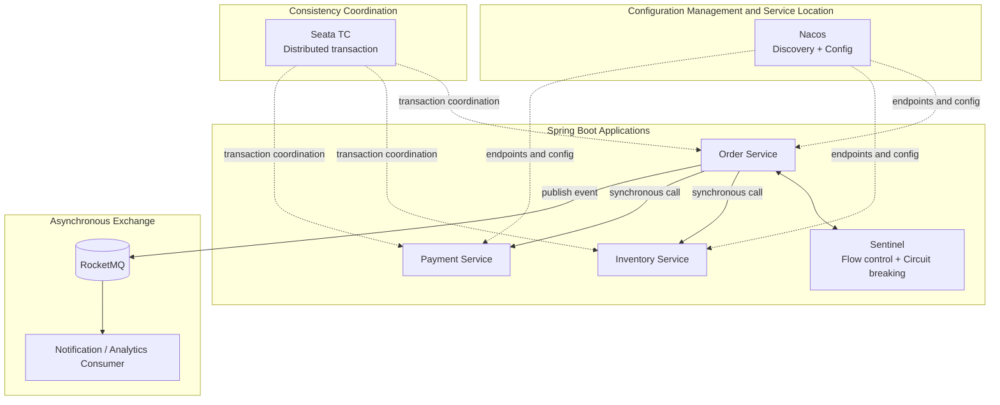

# Boundaries Across Nacos, Sentinel, Seata, and RocketMQ

In a Spring Boot system running on Alibaba Cloud, Nacos, Sentinel, Seata, and RocketMQ frequently appear together. They solve different problems: **Nacos manages configuration and service discovery; Sentinel protects applications against traffic spikes and failures; Seata coordinates distributed transactions; RocketMQ delivers asynchronous messages**. Understanding these boundaries clearly helps you choose the right tool, avoiding misusing a message queue as a transaction manager or expecting a service registry to protect the system under overload.

This lesson places these components in the context of Spring Cloud Alibaba and the corresponding Alibaba Cloud managed services. The goal is not to install all of them into every application, but to know which component addresses which requirement, where they can collaborate, and which responsibilities remain in business code.

After completing this lesson, you will be able to:

- Distinguish the roles of Nacos, Sentinel, Seata, and RocketMQ.
- Identify the boundary between Spring Cloud Alibaba integration libraries and managed services on Alibaba Cloud.
- Choose synchronous calls, distributed transactions, or asynchronous events based on consistency requirements.
- Configure and operate these components with dedicated endpoints, least-privilege permissions, timeouts, and appropriate recovery mechanisms.
- Avoid false assumptions about exactly-once delivery, cross-service transactions, secret storage, and fault tolerance.

## 1. Four Components, Four Responsibilities

| Component | Question It Answers | Primary Responsibility | Does Not Replace |
|---|---|---|---|
| Nacos | Where is the service? What is the current configuration? | Service discovery and centralized configuration | API Gateway, message broker, secret vault, transaction coordinator |
| Sentinel | When traffic surges or a dependency fails, how should the application protect itself? | Flow control, circuit breaking, hotspot/system protection | Retry queue, durable messaging, distributed transaction |
| Seata | How should a business workflow spanning multiple services/databases coordinate commit or rollback? | Coordinates distributed transactions according to the chosen mode | Message broker, general-purpose distributed lock, solution for every long-running workflow |
| RocketMQ | How do we send and process events without forcing two services to call each other synchronously? | Durable messaging, buffering, consumer groups, retries, and event-driven integration | Service registry, database transaction manager, cache, or canonical business datastore |

A concise mnemonic:

- Nacos helps **locate and configure** components.
- Sentinel helps **limit and isolate** the blast radius of failures.
- Seata helps **coordinate transactions** across multiple service branches.
- RocketMQ helps **deliver messages** between producers and consumers.



The diagram only illustrates possible relationships. An application does not necessarily need all four components; Nacos can be replaced by another discovery/config platform, Sentinel by another protection mechanism, and the business logic may choose an event-driven model instead of distributed transactions.

## 2. Distinguishing Integration Frameworks from Managed Services

Spring Cloud Alibaba provides adapters and abstractions so Spring Boot applications can communicate with components in the Alibaba ecosystem. These libraries run inside the application process or provide clients to call a remote service. Managed services, by contrast, are infrastructure operated by Alibaba Cloud, for example:

| Capability | In-Application Component/Library | Managed Service or Deployment on Alibaba Cloud |
|---|---|---|
| Discovery and config | Nacos client, Spring Cloud Alibaba Nacos Discovery/Config | MSE Nacos or self-hosted Nacos |
| Traffic protection | Sentinel core, Spring Cloud Alibaba Sentinel adapter | Sentinel Dashboard/AHAS or an organization-operated dashboard and rule service, depending on model |
| Distributed transaction | Seata client and Seata Server (TC) | Self-hosted Seata Server or a compatible service offered in specific products/regions; verify actual availability |
| Messaging | RocketMQ client or Spring Cloud Stream RocketMQ Binder | ApsaraMQ for RocketMQ or self-hosted RocketMQ |

Do not equate a library name with a cloud product name. Adding the Nacos starter does not automatically provision a Nacos cluster; adding the RocketMQ Binder does not automatically create topics, consumer groups, ACLs, or endpoints. The application still requires the corresponding endpoints, networking, identities, permissions, and service configuration.

Spring Cloud Alibaba, Spring Boot, and Spring Cloud follow release-train compatibility matrices. Before adding dependencies, pick a version set supported by official documentation and use the matching BOM to manage dependencies. Do not mix starters from multiple release trains or upgrade a transitive client independently without verifying compatibility. Properties and configuration bootstrapping mechanisms may change across Spring Boot/Spring Cloud generations; examples in this lesson are illustrative and must be cross-checked against your target release.

## 3. Nacos: Discovery and Centralized Configuration

### 3.1. What Is Nacos Responsible For?

Nacos provides two capabilities commonly used via Spring Cloud Alibaba:

**Service discovery:** instances register their service name, address, and metadata in the registry. Clients can look up instances of a service by service name; Spring Cloud LoadBalancer or the appropriate caller component selects an instance. The registry supplies location information, while making HTTP/gRPC calls, authenticating requests, load balancing, and enforcing access control remain the responsibilities of clients, gateways, and network infrastructure.

**Configuration management:** applications fetch configuration by namespace, group, and data ID. Centralized configuration decouples configuration from build artifacts, manages environments, and updates refresh-capable values. Not every property can change safely at runtime; settings like datasource pools, thread pools, or bean topology may still require a restart or rolling rollout.

Nacos is not an API Gateway. It does not enforce authentication/authorization for every business request, does not replace a service mesh, and does not create a messaging channel between two services. Nor should Nacos be treated as a dedicated secret vault: passwords, private keys, and tokens should be managed through a proper secrets solution with access controls, encryption, rotation, and auditing.

### 3.2. Configuring Discovery and Config

For a Spring Boot application using Spring Cloud Alibaba, Nacos endpoints are typically passed via environment variables:

```yaml
spring:
  application:
    name: order-service
  cloud:
    nacos:
      discovery:
        server-addr: ${NACOS_SERVER_ADDR}
        namespace: ${NACOS_NAMESPACE}
      config:
        server-addr: ${NACOS_SERVER_ADDR}
        namespace: ${NACOS_NAMESPACE}
        file-extension: yaml
```

This is an illustrative structure. In newer Spring Boot/Spring Cloud Alibaba versions, loading config may require `spring.config.import` or the corresponding bootstrap mechanism; follow the guide for the exact release you deploy. Endpoint, namespace, and authentication settings for discovery and config can be separated if the environment requires it.

Key concepts to standardize:

- **Namespace:** isolates environments or administrative domains, such as dev, staging, and production. Do not rely on namespace names alone as a security boundary; configure permissions and network controls as well.
- **Group:** groups configurations or services according to organizational conventions.
- **Data ID:** identifies a single configuration item, usually tied to the application name and file format.
- **Service name:** logical name registered by instances and queried by consumers for discovery.

Avoid having multiple applications accidentally overwrite the same Data ID. Establish clear naming conventions, review config changes, enforce permissions by namespace/group, and maintain a rollback procedure. If using MSE Nacos, retrieve private/public endpoints, namespaces, and credentials from the exact instance/region; prefer private endpoints inside a VPC.

### 3.3. What Nacos Does Not Guarantee

- Having an instance address in the registry does not guarantee the instance is healthy at the business level. Health checks, timeouts, and retries are still necessary.
- A successful config update does not guarantee every bean in the application reconfigures safely.
- If Nacos becomes temporarily unreachable, the application may continue using local configuration/cache depending on client settings and state; startup, refresh, and discovery behavior during outages must be tested.
- Namespaces do not replace IAM, ACLs, network policies, or a secret manager.

## 4. Sentinel: Protecting Applications Under Load Spikes or Dependency Failures

### 4.1. What Does Sentinel Control?

Sentinel provides runtime protection mechanisms, typically including:

- **Flow control:** limits the number or rate of requests entering a resource within a time window.
- **Circuit breaking/degradation:** temporarily blocks calls to a dependency when error rates, response times, or configured conditions cross thresholds; after a recovery window, allows trial calls via half-open probing.
- **Hotspot parameter flow control:** throttles based on hot parameter values, such as a `productId` receiving abnormal traffic.
- **System protection:** protects the application based on system load metrics and supported conditions.

Sentinel protects resources inside the application, such as an API endpoint, a method, or an instrumented dependency call. It does not persist messages for deferred execution, fix business errors on its own, or guarantee that a blocked request will be retried. If durable asynchronous retries are needed, use bounded retry mechanisms or a message broker.

### 4.2. Marking Resources and Handling Blocked Calls

Example method protected by Sentinel using an annotation:

```java
import com.alibaba.csp.sentinel.annotation.SentinelResource;
import com.alibaba.csp.sentinel.slots.block.BlockException;
import org.springframework.stereotype.Service;

@Service
public class InventoryQueryService {

    @SentinelResource(
        value = "inventory-query",
        blockHandler = "handleBlocked"
    )
    public int available(String sku) {
        return queryInventoryFromDatabase(sku);
    }

    public int handleBlocked(String sku, BlockException exception) {
        // Can return a throttled state or delegate to an appropriate fallback.
        throw new InventoryTemporarilyUnavailableException(sku, exception);
    }

    private int queryInventoryFromDatabase(String sku) {
        // Execute the actual query.
        return 0;
    }
}
```

This snippet illustrates attaching a resource and handler; ensure the `blockHandler` method signature matches the original method parameters with `BlockException` appended at the end. With Spring AOP, verify proxy invocation behavior; self-invocation within the same bean may bypass the interceptor. Never catch `BlockException` and return a plausible-looking dummy result if doing so corrupts business data.

Sentinel Dashboard helps observe and manage rules, but distinguish dashboard rule pushing from persistent rule storage. If rules reside only in application memory, a restart can lose them. Production needs a persistent rule data source (such as Nacos if supported by the release and integration) or an equivalent rule management store, while also securing access to the dashboard and rule modification permissions.

### 4.3. Designing Meaningful Rules

Do not apply an arbitrary QPS cap across the entire system. Measure baselines, identify dependency limits and latency budgets, then place rules on critical resources. For example:

- An inventory lookup API can apply hotspot throttling per SKU so one viral product does not exhaust the entire pool.
- Calls to a promotions service can use a circuit breaker because it is a non-essential dependency for every checkout flow.
- Login APIs require multi-layered rate limiting and anti-abuse controls; Sentinel is only one piece of that design.
- RocketMQ consumers may need concurrency caps to prevent overwhelming RDS when draining a backlog rapidly.

Flow control and circuit breaking have distinct goals: flow control proactively caps incoming traffic per rules; circuit breaking reacts to resource error rates/latency. Combining them requires care to avoid cascading rejections. Monitor passed/blocked counts, exception ratios, response times, and circuit states before tuning thresholds.

## 5. Seata: Coordinating Distributed Transactions

### 5.1. Why Is Seata Needed?

A standard JDBC transaction only manages changes within a single database connection/transaction boundary. When a business operation calls multiple services, each service may write to its own database. If the first service commits while a later service fails, the system can end up in a partially updated state.

Seata provides a distributed transaction model with three core roles:

- **TM (Transaction Manager):** starts, commits, or rolls back a global transaction along a business boundary.
- **RM (Resource Manager):** manages branch transactions on the resources/databases used by each service.
- **TC (Transaction Coordinator):** coordinates the state of global transactions and their branch transactions.

In Spring, Seata can integrate with service transaction boundaries, for example via `@GlobalTransactional` on an orchestrating method. Some setups use Nacos as the registry/config store for Seata Server (TC); this is an optional infrastructure integration. Nacos only helps locate/configure the TC, whereas commit/rollback decisions belong to Seata.

### 5.2. Transaction Modes and Trade-Offs

| Mode | Idea | When Suitable | Costs/Constraints |
|---|---|---|---|
| AT | Captures before/after images and uses undo logs for Seata-managed automatic rollback | Databases and SQL fall within supported scope; goal is reducing manual compensation code | Requires `undo_log`, SQL/schema compatibility checks, global locks, and conflict handling |
| TCC | Each participant implements Try, Confirm, Cancel | Business workflows requiring explicit reservation, confirmation, and cancellation steps | Must implement all three actions accurately, make them idempotent, and handle repeated Cancel/Confirm calls |
| Saga | Sequence of local transactions paired with compensation actions | Long-running multi-step workflows accepting eventual consistency | Compensation is real business logic, not a physical rollback; requires state tracking and handling failed compensations |
| XA | Uses XA/two-phase commit across supporting resource managers | Environments requiring XA semantics that can tolerate locking/coordination overhead | Increases complexity, resource lock duration, and driver/database dependence |

No mode is free. AT is not a silver bullet for every SQL statement; TCC demands careful business-level design; Saga does not erase completed steps but executes compensating actions; XA can hold locks longer and hurt throughput. Choose a mode after evaluating consistency needs, transaction duration, database engines, and recovery capabilities.

### 5.3. Global Transaction Boundary Example

Suppose `order-service` creates an order and `inventory-service` deducts stock across two databases. If business rules require both branches to succeed or roll back together within Seata's supported scope, the transaction boundary can be placed on the orchestrating service:

```java
import io.seata.spring.annotation.GlobalTransactional;
import org.springframework.stereotype.Service;

@Service
public class CheckoutService {
    private final OrderRepository orders;
    private final InventoryClient inventory;

    public CheckoutService(OrderRepository orders, InventoryClient inventory) {
        this.orders = orders;
        this.inventory = inventory;
    }

    @GlobalTransactional(name = "checkout-create-order", rollbackFor = Exception.class)
    public Order checkout(CheckoutCommand command) {
        Order order = orders.save(Order.pending(command));
        inventory.reserve(command.sku(), command.quantity(), order.getId());
        return order;
    }
}
```

This is a conceptual example, not a standalone runnable class: `InventoryClient` must invoke the participating service with compatible Seata propagation configured, database resources must be properly registered, and each participant must configure the appropriate mode. For AT mode, branch databases generally require an `undo_log` table matching the Seata schema/version. Simply adding the annotation does not make arbitrary HTTP calls join the transaction automatically; you must verify propagation, RPC context passing, datasource proxying, and integration versions.

### 5.4. Seata Limitations and Operations

- Keep global transactions short. Do not hold a transaction open while waiting for user input, calling slow third-party APIs, or executing workflows spanning minutes.
- The TC is a critical component. Configure clustering, registry, storage, networking, and transaction state monitoring; test behavior when the TC loses connectivity.
- AT requires checking database engine, SQL dialect, DDL, isolation levels, and write conflicts. `undo_log` must be created and maintained properly.
- TCC must ensure Try/Confirm/Cancel can all be retried safely; Cancel may arrive after a timeout even if Try succeeded.
- Saga requires durable workflow state, timeouts, and retryable compensation actions.
- Do not place irreversible side effects (such as sending emails or calling payment gateways without void/refund APIs) under an assumption of pure database rollback.

Seata is not a general-purpose distributed lock and does not replace RocketMQ. If the workflow only needs to emit an event after updating a database, a transactional outbox or RocketMQ transaction message may fit far better than a global transaction spanning multiple services.

## 6. RocketMQ: Messaging and Event-Driven Integration

### 6.1. What Does RocketMQ Handle?

RocketMQ decouples producers and consumers in time. Producers send messages to topics; brokers store and deliver messages to consumer groups. Consumers can process independently, scale instance counts, and drain backlogs when load returns to normal.

Key concepts to distinguish:

- **Topic:** message channel, usually representing an event category or business stream.
- **Tag/Key:** metadata for classifying or tracing messages as supported by the broker.
- **Producer:** application publishing messages.
- **Consumer group:** group of consumers sharing consumption of a subscription; each group maintains its own progress/offset in the broker model.
- **Retry and dead-letter queue (DLQ):** handles failed messages according to policy; after a retry threshold or condition, messages can route to a DLQ for investigation.
- **Ordering:** ordering is guaranteed only within the scope and ordering mode supported by the broker, typically tied to a sharding key/queue; never assume strict global ordering across an entire topic.

RocketMQ is not a database. Messages are retained according to retention periods and broker configuration, while canonical business state belongs in an appropriate database. Queues can build backlogs and consumers can receive redelivered messages, so consumption logic must be idempotent.

### 6.2. Integrating with Spring Cloud Stream

In the Spring Cloud Alibaba ecosystem, RocketMQ can be integrated via the Spring Cloud Stream RocketMQ Binder. Use a compatible BOM/release train and the binder dependency matching your project version. Example producer binding configuration:

```yaml
spring:
  cloud:
    stream:
      rocketmq:
        binder:
          name-server: ${ROCKETMQ_NAME_SERVER}
      bindings:
        orderCreated-out-0:
          destination: order-created
          content-type: application/json
```

Producers can publish events via `StreamBridge`:

```java
import org.springframework.cloud.stream.function.StreamBridge;
import org.springframework.stereotype.Component;

@Component
public class OrderEventPublisher {
    private final StreamBridge streamBridge;

    public OrderEventPublisher(StreamBridge streamBridge) {
        this.streamBridge = streamBridge;
    }

    public void publish(OrderCreated event) {
        boolean accepted = streamBridge.send("orderCreated-out-0", event);
        if (!accepted) {
            throw new IllegalStateException("Failed to send OrderCreated event");
        }
    }
}
```

Binder property names and consumer declaration styles can vary across Spring Cloud Stream Binder versions. When using ApsaraMQ for RocketMQ, also configure endpoints/name servers, ACL credentials, instance/topic/group settings, and network access per your edition's documentation. Never place access keys or secrets directly into committed configuration files.

A consumer function can be declared using Spring Cloud Stream's functional model:

```java
import java.util.function.Consumer;
import org.springframework.context.annotation.Bean;
import org.springframework.context.annotation.Configuration;

@Configuration
public class OrderEventConsumerConfiguration {
    @Bean
    Consumer<OrderCreated> orderCreated() {
        return event -> {
            // Idempotent handling: check eventId/orderId before applying.
            processOrderCreated(event);
        };
    }

    private void processOrderCreated(OrderCreated event) {
        // Record downstream side effects.
    }
}
```

Consumer bindings are typically configured with a destination and group for the corresponding function. Use stable consumer group names per application/environment; never generate random group names on every startup if you want to resume persisted consumption offsets.

### 6.3. Retries, Idempotency, and Ordering

Never assume messages are delivered exactly once. In distributed systems, a producer may time out after the broker has already accepted a message; a consumer may commit processing and lose connectivity before acknowledging; a broker may redeliver messages. Therefore:

- Give every event a unique `eventId`, `occurredAt`, `aggregateId`, and explicit version/schema.
- Have consumers track processed IDs or use unique constraints/idempotency keys so redelivered events do not cause duplicate effects.
- Apply retries only to transient failures; invalid data errors should route to a DLQ or manual remediation flow.
- Configure backoff and retry limits; avoid rapid infinite retries that amplify load on a failing dependency.
- If per-order ordering is required, use a key/sharding key based on `orderId` and configure producers/consumers in ordered message mode; still design for delayed or duplicate events.
- Monitor backlog, consumer lag, retry rate, DLQ count, message age, and processing duration.

### 6.4. Transaction Messages and Transactional Outbox

RocketMQ provides transaction messages in certain versions/editions: the producer sends a half message, executes a local transaction, then commits or rolls back the message; the broker can query the local transaction status if no result arrives. This mechanism coordinates message visibility with a local transaction under RocketMQ's protocol, but it does not turn multiple databases and services into a single global ACID transaction.

An alternative is the transactional outbox pattern: write the business change and an outbox record inside the same local database transaction; a publisher reads the outbox, publishes the event to RocketMQ, and marks it sent. This eliminates the gap where "the database committed but message publishing failed," provided the publisher retries and consumers are idempotent. CDC can also be used to read the outbox depending on architecture.

Choose between transaction messages and an outbox based on requirements, broker version, deployment model, and operational capabilities. Never assume using RocketMQ transaction messages guarantees a consumer runs only once; consumers must still be idempotent.

## 7. When Do Components Work Together?

### 7.1. Nacos Combined with Sentinel

Nacos can store configurations or act as a rule source for Sentinel when supported by the integration and configured properly. In this relationship, Nacos distributes/stores the configuration; Sentinel remains the runtime enforcing flow control and circuit breaking. Nacos does not execute Sentinel rules itself. Verify rule source persistence, refresh behavior, and access controls; avoid relying on the dashboard as the sole store if restarts can wipe rules.

### 7.2. Nacos Combined with Seata

Seata Server (TC) can register and fetch configuration through Nacos in certain deployments. Nacos helps clients locate the TC and manage configuration; the TC remains the coordinator responsible for global transaction state. If Nacos experiences a temporary outage, evaluate Seata's discovery/config behavior and in-flight transactions separately.

### 7.3. Sentinel Protecting RocketMQ Producers and Consumers

Sentinel can throttle message-processing resources or downstream calls inside consumers. This prevents a consumer from draining a backlog too aggressively and overloading RDS. However, when a consumer is blocked, understand how the binder/client handles exceptions, retries, reconsume behavior, and acks. Avoid turning a block into an immediate retry loop; configure concurrency, backoff, retry limits, and DLQs appropriately.

### 7.4. Seata and RocketMQ Solve Two Different Consistency Models

Seata fits when a business operation must coordinate commit/rollback synchronously across supported participants. RocketMQ fits when a service emits events and consumers process them independently under eventual consistency. Both tools can coexist in the same system, provided boundaries remain clear:

- If order creation and inventory reservation must update synchronously within a short global transaction, Seata may fit.
- If notifications, search indexing, analytics, or read-model synchronization should happen after the order commits, RocketMQ is usually the better fit.
- If you only need to emit an event after a local database commit, consider an outbox or transaction message before pulling RocketMQ into a Seata global transaction.

Do not wrap an entire consumer message-processing workflow inside a long-lived global transaction. If a consumer receives an event and calls multiple services, define small transaction boundaries, retries, and compensations for each step.

## 8. Architecture Selection Example for an Order Flow

Suppose an e-commerce platform has `order-service`, `inventory-service`, `payment-service`, and `notification-service`.

| Business Step | Viable Choice | Reason |
|---|---|---|
| Services register and look up each other's endpoints | Nacos Discovery | Locates instances by service name |
| Fetch endpoints, timeouts, and feature flags | Nacos Config or a suitable config platform | Separates configuration per environment |
| Throttle inventory lookup API for a hot SKU | Sentinel | Protects resources from sudden traffic spikes |
| Checkout needs synchronous order + inventory reservation | Seata, if mode/databases/workflow fit | Coordinates a short global transaction across supported branches |
| Send email/push after order commits | RocketMQ | Decouples notifications from the synchronous checkout path |
| Update reports or search index | Dedicated RocketMQ consumer | Enables asynchronous processing and independent scaling |

This flow does not mean every payment operation can be rolled back by Seata. External payment gateways maintain their own state and refund/void APIs; design a state machine, idempotency keys, and reconciliation. Similarly, notifications do not belong inside the checkout transaction: if the email provider fails, the order can still succeed while the notification retries later.

## 9. Security and Operations

These components often sit on critical system paths. Each requires its own endpoints, network path, credentials, and permissions.

| Component | Access Protection | Key Metrics to Monitor |
|---|---|---|
| Nacos | Private VPC endpoint, authentication/ACL, namespace/group permissions, TLS if supported; avoid storing arbitrary secrets in config | Registrations/heartbeats, healthy instance count, config query errors, config fetch latency, auth errors |
| Sentinel | Protect dashboard, restrict rule-edit permissions, persist rules, restrict network access to dashboard | Pass/block counts, exception ratio, response time, circuit state, rule load failures |
| Seata | Protect TC endpoint, restrict service accounts and network, secure registry/config, persist state/undo logs properly | Active global/branch transactions, commit/rollback rates, timeouts, lock conflicts, TC health |
| RocketMQ | Producer/consumer ACLs, TLS/network isolation if supported, topic/group permissions, credential rotation | Produce/consume TPS, consumer lag, retries, DLQ depth, message age, broker availability |

General guidelines:

- Never commit AccessKeys, SecretKeys, passwords, or tokens into Git, container image layers, or logs.
- Use RAM/secret managers or platform secret stores to inject credentials at runtime; scope permissions per workload and rotate regularly.
- Prefer private endpoints and network segmentation. Never expose wide public endpoints just for quick testing.
- Set bounded timeouts, retries, and circuit breakers; avoid nested retries across HTTP clients, Sentinel, Seata, and message consumers that amplify load.
- Test connectivity loss to Nacos, the Sentinel rule source, Seata TC, and the RocketMQ broker. Document expected behavior on cold start, during active requests, and while draining backlogs.
- Propagate correlation IDs/trace IDs across HTTP and message headers; log event IDs and transaction IDs without logging sensitive payloads.

## 10. Common Misconceptions

| Misconception | Accurate Boundary |
|---|---|
| "Having Nacos means we have an API Gateway." | Nacos provides registry/config; gateways still handle routing, edge authentication, edge rate limiting, and HTTP policies. |
| "Nacos config is where all secrets belong." | A config center does not natively provide the full secret lifecycle, rotation, and auditing of a secret manager. |
| "Sentinel retries blocked requests later." | Sentinel decides pass/block/degrade; retrying and queuing deferred work belong to clients/workflows/message brokers. |
| "Seata automatically rolls back every HTTP call." | Only properly integrated and configured participants/resources join the transaction; external side effects require separate compensation. |
| "RocketMQ guarantees consumers run exactly once." | Messages can be redelivered; consumers must be idempotent and manage retries/DLQs. |
| "RocketMQ transaction messages replace Seata in all cases." | Transaction messages coordinate a local transaction with message visibility; they do not coordinate multiple databases/services into a global ACID transaction. |
| "Using all four makes the system more reliable." | Every component adds operational dependencies. Adopt each only when a concrete requirement exists and monitoring/recovery capabilities are ready. |

## 11. Selection and Implementation Checklist

- [ ] Identify whether the need is discovery/config, traffic protection, distributed transactions, or asynchronous messaging.
- [ ] Verify Spring Boot, Spring Cloud, and Spring Cloud Alibaba belong to a compatible release train.
- [ ] Select the specific managed service/cluster, region, VPC endpoints, ACLs, and credentials.
- [ ] For Nacos, standardize namespace/group/Data ID/service name conventions and config change workflows.
- [ ] For Sentinel, define resources, baselines, rules, fallbacks, persistence, and dashboard security.
- [ ] For Seata, pick AT/TCC/Saga/XA based on databases and business logic; configure TC, datasources/resources, and rollback/compensation.
- [ ] For RocketMQ, design topics, groups, keys, ordering, retries, DLQs, retention, and idempotency.
- [ ] Ensure timeouts/retries/circuit breakers do not conflict across layers.
- [ ] Test disconnects, restarts, duplicate messages, consumer lag, transaction timeouts, and config/rule refreshes.
- [ ] Maintain dashboards, alerts, traces, and runbooks for every critical dependency.

## 12. Conclusion

Nacos, Sentinel, Seata, and RocketMQ complement each other because each addresses a distinct problem layer. Nacos locates services and distributes configuration; Sentinel protects resources under unstable traffic or dependencies; Seata coordinates distributed transactions within supported participants and modes; RocketMQ transports asynchronous events with retries and consumer groups. Spring Cloud Alibaba helps Spring Boot integrate these capabilities, while provisioning endpoints, networking, permissions, persistence, and operating managed services still requires deliberate design. Choosing components based on business needs and testing failure modes yields a system that is clearer and easier to operate than pulling in every starter at once.

## References

- [Spring Cloud Alibaba — Documentation](https://sca.aliyun.com/en/docs/): guides for integrating Nacos, Sentinel, Seata, and RocketMQ by release train.
- [Nacos — Official Documentation](https://nacos.io/en/docs/latest/what-is-nacos/): service discovery and configuration management.
- [Alibaba Cloud MSE — Nacos](https://www.alibabacloud.com/help/en/mse/product-overview/what-is-microservices-engine): managed microservices capabilities, including Nacos in supported editions.
- [Sentinel — Official Documentation](https://sentinelguard.io/en-us/docs/introduction.html): flow control, circuit breaking, and dashboard/rule management.
- [Seata — Official Documentation](https://seata.apache.org/docs/overview/what-is-seata/): TM/RM/TC architecture and transaction modes.
- [Apache RocketMQ — Documentation](https://rocketmq.apache.org/docs/): topics, consumers, retries, ordering, and transaction messages.
- [Alibaba Cloud ApsaraMQ for RocketMQ](https://www.alibabacloud.com/help/en/apsaramq-for-rocketmq/): managed RocketMQ instances, endpoints, ACLs, and client integration.
